IMPORTING REQUIRED LIBRARIES


```python
import pandas as pd
import numpy as np
import matplotlib.pyplot as plt
import seaborn as sns

from IPython.display import display

from sklearn.model_selection import train_test_split, GridSearchCV
from sklearn.preprocessing import StandardScaler
from sklearn.linear_model import LinearRegression
from sklearn.ensemble import RandomForestRegressor
from sklearn.svm import SVR
from sklearn.metrics import r2_score, mean_squared_error, mean_absolute_error

from xgboost import XGBRegressor

import statsmodels.api as sm
from statsmodels.stats.outliers_influence import variance_inflation_factor

import warnings
warnings.filterwarnings("ignore")
```

DATA LOADING


```python
# File path
file_path = r"D:\MSC THESIS AAVAS\AFTER MID DEFENSE\FINAL DATA\Final Data for Model.xlsx"

# Import dataset
df = pd.read_excel(file_path, sheet_name="Sheet1")

# Display first five rows
df.head()
```


<div>
<style scoped>
    .dataframe tbody tr th:only-of-type {
        vertical-align: middle;
    }

    .dataframe tbody tr th {
        vertical-align: top;
    }

    .dataframe thead th {
        text-align: right;
    }
</style>
<table border="1" class="dataframe">
  <thead>
    <tr style="text-align: right;">
      <th></th>
      <th>SN</th>
      <th>V85 Speed</th>
      <th>Gradient</th>
      <th>Radius of Curve</th>
      <th>Carriageway Width</th>
      <th>Left Shoulder Width</th>
      <th>Left Shoulder Type</th>
      <th>Right Shoulder Width</th>
      <th>Right Shoulder Type</th>
      <th>IRI</th>
    </tr>
  </thead>
  <tbody>
    <tr>
      <th>0</th>
      <td>1</td>
      <td>57.0</td>
      <td>1.27</td>
      <td>inf</td>
      <td>5.5</td>
      <td>0.9</td>
      <td>Gravel</td>
      <td>0.9</td>
      <td>Gravel</td>
      <td>3.70</td>
    </tr>
    <tr>
      <th>1</th>
      <td>2</td>
      <td>33.0</td>
      <td>2.92</td>
      <td>46.0</td>
      <td>5.5</td>
      <td>0.9</td>
      <td>Gravel</td>
      <td>0.9</td>
      <td>Gravel</td>
      <td>4.51</td>
    </tr>
    <tr>
      <th>2</th>
      <td>3</td>
      <td>43.0</td>
      <td>7.97</td>
      <td>inf</td>
      <td>5.5</td>
      <td>0.9</td>
      <td>Gravel</td>
      <td>0.9</td>
      <td>Gravel</td>
      <td>4.39</td>
    </tr>
    <tr>
      <th>3</th>
      <td>4</td>
      <td>48.0</td>
      <td>2.07</td>
      <td>inf</td>
      <td>5.5</td>
      <td>0.9</td>
      <td>Gravel</td>
      <td>0.9</td>
      <td>Gravel</td>
      <td>4.69</td>
    </tr>
    <tr>
      <th>4</th>
      <td>5</td>
      <td>36.0</td>
      <td>1.21</td>
      <td>16.0</td>
      <td>5.5</td>
      <td>0.9</td>
      <td>Gravel</td>
      <td>0.9</td>
      <td>Gravel</td>
      <td>5.57</td>
    </tr>
  </tbody>
</table>
</div>


<div>
<style scoped>
    .dataframe tbody tr th:only-of-type {
        vertical-align: middle;
    }

    .dataframe tbody tr th {
        vertical-align: top;
    }

    .dataframe thead th {
        text-align: right;
    }
</style>
<table border="1" class="dataframe">
  <thead>
    <tr style="text-align: right;">
      <th></th>
      <th>SN</th>
      <th>V85 Speed</th>
      <th>Gradient</th>
      <th>Radius of Curve</th>
      <th>Carriageway Width</th>
      <th>Left Shoulder Width</th>
      <th>Left Shoulder Type</th>
      <th>Right Shoulder Width</th>
      <th>Right Shoulder Type</th>
      <th>IRI</th>
    </tr>
  </thead>
  <tbody>
    <tr>
      <th>0</th>
      <td>1</td>
      <td>57.0</td>
      <td>1.27</td>
      <td>inf</td>
      <td>5.5</td>
      <td>0.9</td>
      <td>Gravel</td>
      <td>0.9</td>
      <td>Gravel</td>
      <td>3.70</td>
    </tr>
    <tr>
      <th>1</th>
      <td>2</td>
      <td>33.0</td>
      <td>2.92</td>
      <td>46.0</td>
      <td>5.5</td>
      <td>0.9</td>
      <td>Gravel</td>
      <td>0.9</td>
      <td>Gravel</td>
      <td>4.51</td>
    </tr>
    <tr>
      <th>2</th>
      <td>3</td>
      <td>43.0</td>
      <td>7.97</td>
      <td>inf</td>
      <td>5.5</td>
      <td>0.9</td>
      <td>Gravel</td>
      <td>0.9</td>
      <td>Gravel</td>
      <td>4.39</td>
    </tr>
    <tr>
      <th>3</th>
      <td>4</td>
      <td>48.0</td>
      <td>2.07</td>
      <td>inf</td>
      <td>5.5</td>
      <td>0.9</td>
      <td>Gravel</td>
      <td>0.9</td>
      <td>Gravel</td>
      <td>4.69</td>
    </tr>
    <tr>
      <th>4</th>
      <td>5</td>
      <td>36.0</td>
      <td>1.21</td>
      <td>16.0</td>
      <td>5.5</td>
      <td>0.9</td>
      <td>Gravel</td>
      <td>0.9</td>
      <td>Gravel</td>
      <td>5.57</td>
    </tr>
  </tbody>
</table>
</div>


INITIAL INSPECTION OF DATA


```python
df.shape
```


    (165, 10)


    (165, 10)


```python
df.info()
```

    <class 'pandas.DataFrame'>
    RangeIndex: 165 entries, 0 to 164
    Data columns (total 10 columns):
     #   Column                Non-Null Count  Dtype  
    ---  ------                --------------  -----  
     0   SN                    165 non-null    int64  
     1   V85 Speed             165 non-null    float64
     2   Gradient              165 non-null    float64
     3   Radius of Curve       165 non-null    float64
     4   Carriageway Width     165 non-null    float64
     5   Left Shoulder Width   165 non-null    float64
     6   Left Shoulder Type    165 non-null    str    
     7   Right Shoulder Width  165 non-null    float64
     8   Right Shoulder Type   165 non-null    str    
     9   IRI                   165 non-null    float64
    dtypes: float64(7), int64(1), str(2)
    memory usage: 13.0 KB
    <class 'pandas.DataFrame'>
    RangeIndex: 165 entries, 0 to 164
    Data columns (total 10 columns):
     #   Column                Non-Null Count  Dtype  
    ---  ------                --------------  -----  
     0   SN                    165 non-null    int64  
     1   V85 Speed             165 non-null    float64
     2   Gradient              165 non-null    float64
     3   Radius of Curve       165 non-null    float64
     4   Carriageway Width     165 non-null    float64
     5   Left Shoulder Width   165 non-null    float64
     6   Left Shoulder Type    165 non-null    str    
     7   Right Shoulder Width  165 non-null    float64
     8   Right Shoulder Type   165 non-null    str    
     9   IRI                   165 non-null    float64
    dtypes: float64(7), int64(1), str(2)
    memory usage: 13.0 KB
    


```python
df.describe()
```


<div>
<style scoped>
    .dataframe tbody tr th:only-of-type {
        vertical-align: middle;
    }

    .dataframe tbody tr th {
        vertical-align: top;
    }

    .dataframe thead th {
        text-align: right;
    }
</style>
<table border="1" class="dataframe">
  <thead>
    <tr style="text-align: right;">
      <th></th>
      <th>SN</th>
      <th>V85 Speed</th>
      <th>Gradient</th>
      <th>Radius of Curve</th>
      <th>Carriageway Width</th>
      <th>Left Shoulder Width</th>
      <th>Right Shoulder Width</th>
      <th>IRI</th>
    </tr>
  </thead>
  <tbody>
    <tr>
      <th>count</th>
      <td>165.000000</td>
      <td>165.000000</td>
      <td>165.000000</td>
      <td>165.0</td>
      <td>165.000000</td>
      <td>165.000000</td>
      <td>165.000000</td>
      <td>165.000000</td>
    </tr>
    <tr>
      <th>mean</th>
      <td>89.145455</td>
      <td>44.525758</td>
      <td>4.100955</td>
      <td>inf</td>
      <td>6.323788</td>
      <td>0.622606</td>
      <td>0.628545</td>
      <td>5.922667</td>
    </tr>
    <tr>
      <th>std</th>
      <td>50.827213</td>
      <td>9.485801</td>
      <td>2.498089</td>
      <td>NaN</td>
      <td>0.894131</td>
      <td>0.407672</td>
      <td>0.397181</td>
      <td>2.636332</td>
    </tr>
    <tr>
      <th>min</th>
      <td>1.000000</td>
      <td>25.000000</td>
      <td>0.070000</td>
      <td>15.0</td>
      <td>4.700000</td>
      <td>0.000000</td>
      <td>0.000000</td>
      <td>2.150000</td>
    </tr>
    <tr>
      <th>25%</th>
      <td>47.000000</td>
      <td>37.000000</td>
      <td>1.850000</td>
      <td>35.0</td>
      <td>5.500000</td>
      <td>0.300000</td>
      <td>0.380000</td>
      <td>3.700000</td>
    </tr>
    <tr>
      <th>50%</th>
      <td>89.000000</td>
      <td>44.000000</td>
      <td>4.090000</td>
      <td>75.0</td>
      <td>7.000000</td>
      <td>0.750000</td>
      <td>0.750000</td>
      <td>5.350000</td>
    </tr>
    <tr>
      <th>75%</th>
      <td>132.000000</td>
      <td>50.000000</td>
      <td>6.000000</td>
      <td>NaN</td>
      <td>7.000000</td>
      <td>1.000000</td>
      <td>1.000000</td>
      <td>8.340000</td>
    </tr>
    <tr>
      <th>max</th>
      <td>175.000000</td>
      <td>67.250000</td>
      <td>11.085000</td>
      <td>inf</td>
      <td>8.000000</td>
      <td>1.130000</td>
      <td>1.180000</td>
      <td>12.050000</td>
    </tr>
  </tbody>
</table>
</div>


<div>
<style scoped>
    .dataframe tbody tr th:only-of-type {
        vertical-align: middle;
    }

    .dataframe tbody tr th {
        vertical-align: top;
    }

    .dataframe thead th {
        text-align: right;
    }
</style>
<table border="1" class="dataframe">
  <thead>
    <tr style="text-align: right;">
      <th></th>
      <th>SN</th>
      <th>V85 Speed</th>
      <th>Gradient</th>
      <th>Radius of Curve</th>
      <th>Carriageway Width</th>
      <th>Left Shoulder Width</th>
      <th>Right Shoulder Width</th>
      <th>IRI</th>
    </tr>
  </thead>
  <tbody>
    <tr>
      <th>count</th>
      <td>165.000000</td>
      <td>165.000000</td>
      <td>165.000000</td>
      <td>165.0</td>
      <td>165.000000</td>
      <td>165.000000</td>
      <td>165.000000</td>
      <td>165.000000</td>
    </tr>
    <tr>
      <th>mean</th>
      <td>89.145455</td>
      <td>44.525758</td>
      <td>4.100955</td>
      <td>inf</td>
      <td>6.323788</td>
      <td>0.622606</td>
      <td>0.628545</td>
      <td>5.922667</td>
    </tr>
    <tr>
      <th>std</th>
      <td>50.827213</td>
      <td>9.485801</td>
      <td>2.498089</td>
      <td>NaN</td>
      <td>0.894131</td>
      <td>0.407672</td>
      <td>0.397181</td>
      <td>2.636332</td>
    </tr>
    <tr>
      <th>min</th>
      <td>1.000000</td>
      <td>25.000000</td>
      <td>0.070000</td>
      <td>15.0</td>
      <td>4.700000</td>
      <td>0.000000</td>
      <td>0.000000</td>
      <td>2.150000</td>
    </tr>
    <tr>
      <th>25%</th>
      <td>47.000000</td>
      <td>37.000000</td>
      <td>1.850000</td>
      <td>35.0</td>
      <td>5.500000</td>
      <td>0.300000</td>
      <td>0.380000</td>
      <td>3.700000</td>
    </tr>
    <tr>
      <th>50%</th>
      <td>89.000000</td>
      <td>44.000000</td>
      <td>4.090000</td>
      <td>75.0</td>
      <td>7.000000</td>
      <td>0.750000</td>
      <td>0.750000</td>
      <td>5.350000</td>
    </tr>
    <tr>
      <th>75%</th>
      <td>132.000000</td>
      <td>50.000000</td>
      <td>6.000000</td>
      <td>NaN</td>
      <td>7.000000</td>
      <td>1.000000</td>
      <td>1.000000</td>
      <td>8.340000</td>
    </tr>
    <tr>
      <th>max</th>
      <td>175.000000</td>
      <td>67.250000</td>
      <td>11.085000</td>
      <td>inf</td>
      <td>8.000000</td>
      <td>1.130000</td>
      <td>1.180000</td>
      <td>12.050000</td>
    </tr>
  </tbody>
</table>
</div>


DATA CLEANING AND PREPARATION

Missing Value Check


```python
df.isnull().sum()
```


    SN                      0
    V85 Speed               0
    Gradient                0
    Radius of Curve         0
    Carriageway Width       0
    Left Shoulder Width     0
    Left Shoulder Type      0
    Right Shoulder Width    0
    Right Shoulder Type     0
    IRI                     0
    dtype: int64


    SN                      0
    V85 Speed               0
    Gradient                0
    Radius of Curve         0
    Carriageway Width       0
    Left Shoulder Width     0
    Left Shoulder Type      0
    Right Shoulder Width    0
    Right Shoulder Type     0
    IRI                     0
    dtype: int64


Cleaning Categorical Variables


```python
df["Left Shoulder Type"] = df["Left Shoulder Type"].str.strip().str.lower().str.capitalize()
df["Right Shoulder Type"] = df["Right Shoulder Type"].str.strip().str.lower().str.capitalize()
```

Encoding


```python
df_encoded = pd.get_dummies(
    df,
    columns=["Left Shoulder Type", "Right Shoulder Type"],
    drop_first=True,
    dtype=int
)
```

Putting Radius of Curve of Tangent Section Infinity as 1500


```python
# Identify tangent sections
tangent_mask = (
    df_encoded["Radius of Curve"]
    .astype(str)
    .str.strip()
    .str.lower()
    .isin(["infinity", "inf", "∞"])
)

# Count tangent sections
print("Number of tangent sections:", tangent_mask.sum())

# Replace infinity with 1500
df_encoded.loc[tangent_mask, "Radius of Curve"] = 1500

# Convert radius column to numeric
df_encoded["Radius of Curve"] = pd.to_numeric(
    df_encoded["Radius of Curve"],
    errors="raise"
)

# Verify replacement
print("Infinity values remaining:",
      np.isinf(df_encoded["Radius of Curve"]).sum())

df_encoded.head()
```

    Number of tangent sections: 45
    Infinity values remaining: 0
    


<div>
<style scoped>
    .dataframe tbody tr th:only-of-type {
        vertical-align: middle;
    }

    .dataframe tbody tr th {
        vertical-align: top;
    }

    .dataframe thead th {
        text-align: right;
    }
</style>
<table border="1" class="dataframe">
  <thead>
    <tr style="text-align: right;">
      <th></th>
      <th>SN</th>
      <th>V85 Speed</th>
      <th>Gradient</th>
      <th>Radius of Curve</th>
      <th>Carriageway Width</th>
      <th>Left Shoulder Width</th>
      <th>Right Shoulder Width</th>
      <th>IRI</th>
      <th>Left Shoulder Type_Gravel</th>
      <th>Left Shoulder Type_Paved</th>
      <th>Right Shoulder Type_Gravel</th>
      <th>Right Shoulder Type_Paved</th>
    </tr>
  </thead>
  <tbody>
    <tr>
      <th>0</th>
      <td>1</td>
      <td>57.0</td>
      <td>1.27</td>
      <td>1500.0</td>
      <td>5.5</td>
      <td>0.9</td>
      <td>0.9</td>
      <td>3.70</td>
      <td>1</td>
      <td>0</td>
      <td>1</td>
      <td>0</td>
    </tr>
    <tr>
      <th>1</th>
      <td>2</td>
      <td>33.0</td>
      <td>2.92</td>
      <td>46.0</td>
      <td>5.5</td>
      <td>0.9</td>
      <td>0.9</td>
      <td>4.51</td>
      <td>1</td>
      <td>0</td>
      <td>1</td>
      <td>0</td>
    </tr>
    <tr>
      <th>2</th>
      <td>3</td>
      <td>43.0</td>
      <td>7.97</td>
      <td>1500.0</td>
      <td>5.5</td>
      <td>0.9</td>
      <td>0.9</td>
      <td>4.39</td>
      <td>1</td>
      <td>0</td>
      <td>1</td>
      <td>0</td>
    </tr>
    <tr>
      <th>3</th>
      <td>4</td>
      <td>48.0</td>
      <td>2.07</td>
      <td>1500.0</td>
      <td>5.5</td>
      <td>0.9</td>
      <td>0.9</td>
      <td>4.69</td>
      <td>1</td>
      <td>0</td>
      <td>1</td>
      <td>0</td>
    </tr>
    <tr>
      <th>4</th>
      <td>5</td>
      <td>36.0</td>
      <td>1.21</td>
      <td>16.0</td>
      <td>5.5</td>
      <td>0.9</td>
      <td>0.9</td>
      <td>5.57</td>
      <td>1</td>
      <td>0</td>
      <td>1</td>
      <td>0</td>
    </tr>
  </tbody>
</table>
</div>


    Number of tangent sections: 0
    Infinity values remaining: 0
    


<div>
<style scoped>
    .dataframe tbody tr th:only-of-type {
        vertical-align: middle;
    }

    .dataframe tbody tr th {
        vertical-align: top;
    }

    .dataframe thead th {
        text-align: right;
    }
</style>
<table border="1" class="dataframe">
  <thead>
    <tr style="text-align: right;">
      <th></th>
      <th>SN</th>
      <th>V85 Speed</th>
      <th>Gradient</th>
      <th>Radius of Curve</th>
      <th>Carriageway Width</th>
      <th>Left Shoulder Width</th>
      <th>Right Shoulder Width</th>
      <th>IRI</th>
      <th>Left Shoulder Type_Gravel</th>
      <th>Left Shoulder Type_Paved</th>
      <th>Right Shoulder Type_Gravel</th>
      <th>Right Shoulder Type_Paved</th>
    </tr>
  </thead>
  <tbody>
    <tr>
      <th>0</th>
      <td>1</td>
      <td>57.0</td>
      <td>1.27</td>
      <td>1500.0</td>
      <td>5.5</td>
      <td>0.9</td>
      <td>0.9</td>
      <td>3.70</td>
      <td>1</td>
      <td>0</td>
      <td>1</td>
      <td>0</td>
    </tr>
    <tr>
      <th>1</th>
      <td>2</td>
      <td>33.0</td>
      <td>2.92</td>
      <td>46.0</td>
      <td>5.5</td>
      <td>0.9</td>
      <td>0.9</td>
      <td>4.51</td>
      <td>1</td>
      <td>0</td>
      <td>1</td>
      <td>0</td>
    </tr>
    <tr>
      <th>2</th>
      <td>3</td>
      <td>43.0</td>
      <td>7.97</td>
      <td>1500.0</td>
      <td>5.5</td>
      <td>0.9</td>
      <td>0.9</td>
      <td>4.39</td>
      <td>1</td>
      <td>0</td>
      <td>1</td>
      <td>0</td>
    </tr>
    <tr>
      <th>3</th>
      <td>4</td>
      <td>48.0</td>
      <td>2.07</td>
      <td>1500.0</td>
      <td>5.5</td>
      <td>0.9</td>
      <td>0.9</td>
      <td>4.69</td>
      <td>1</td>
      <td>0</td>
      <td>1</td>
      <td>0</td>
    </tr>
    <tr>
      <th>4</th>
      <td>5</td>
      <td>36.0</td>
      <td>1.21</td>
      <td>16.0</td>
      <td>5.5</td>
      <td>0.9</td>
      <td>0.9</td>
      <td>5.57</td>
      <td>1</td>
      <td>0</td>
      <td>1</td>
      <td>0</td>
    </tr>
  </tbody>
</table>
</div>


Variance Inflation Factor(VIF for Multicollinearity Check)


```python
# Select independent variables for VIF

X_vif = df_encoded[
    [
        "Gradient",
        "Radius of Curve",
        "Carriageway Width",
        "Left Shoulder Width",
        "Right Shoulder Width",
        "IRI",
        "Left Shoulder Type_Gravel",
        "Left Shoulder Type_Paved",
        "Right Shoulder Type_Gravel",
        "Right Shoulder Type_Paved"
    ]
]

# Convert to float
X_vif = X_vif.astype(float)

# Add constant
X_vif_const = sm.add_constant(X_vif)

# Calculate VIF
vif_data = pd.DataFrame()

vif_data["Feature"] = X_vif_const.columns

vif_data["VIF"] = [
    variance_inflation_factor(X_vif_const.values, i)
    for i in range(X_vif_const.shape[1])
]

# Display results
display(vif_data.round(3))
```


<div>
<style scoped>
    .dataframe tbody tr th:only-of-type {
        vertical-align: middle;
    }

    .dataframe tbody tr th {
        vertical-align: top;
    }

    .dataframe thead th {
        text-align: right;
    }
</style>
<table border="1" class="dataframe">
  <thead>
    <tr style="text-align: right;">
      <th></th>
      <th>Feature</th>
      <th>VIF</th>
    </tr>
  </thead>
  <tbody>
    <tr>
      <th>0</th>
      <td>const</td>
      <td>104.455</td>
    </tr>
    <tr>
      <th>1</th>
      <td>Gradient</td>
      <td>1.129</td>
    </tr>
    <tr>
      <th>2</th>
      <td>Radius of Curve</td>
      <td>1.111</td>
    </tr>
    <tr>
      <th>3</th>
      <td>Carriageway Width</td>
      <td>1.259</td>
    </tr>
    <tr>
      <th>4</th>
      <td>Left Shoulder Width</td>
      <td>7.359</td>
    </tr>
    <tr>
      <th>5</th>
      <td>Right Shoulder Width</td>
      <td>5.800</td>
    </tr>
    <tr>
      <th>6</th>
      <td>IRI</td>
      <td>1.829</td>
    </tr>
    <tr>
      <th>7</th>
      <td>Left Shoulder Type_Gravel</td>
      <td>8.843</td>
    </tr>
    <tr>
      <th>8</th>
      <td>Left Shoulder Type_Paved</td>
      <td>8.470</td>
    </tr>
    <tr>
      <th>9</th>
      <td>Right Shoulder Type_Gravel</td>
      <td>6.547</td>
    </tr>
    <tr>
      <th>10</th>
      <td>Right Shoulder Type_Paved</td>
      <td>7.858</td>
    </tr>
  </tbody>
</table>
</div>


<div>
<style scoped>
    .dataframe tbody tr th:only-of-type {
        vertical-align: middle;
    }

    .dataframe tbody tr th {
        vertical-align: top;
    }

    .dataframe thead th {
        text-align: right;
    }
</style>
<table border="1" class="dataframe">
  <thead>
    <tr style="text-align: right;">
      <th></th>
      <th>Feature</th>
      <th>VIF</th>
    </tr>
  </thead>
  <tbody>
    <tr>
      <th>0</th>
      <td>const</td>
      <td>104.455</td>
    </tr>
    <tr>
      <th>1</th>
      <td>Gradient</td>
      <td>1.129</td>
    </tr>
    <tr>
      <th>2</th>
      <td>Radius of Curve</td>
      <td>1.111</td>
    </tr>
    <tr>
      <th>3</th>
      <td>Carriageway Width</td>
      <td>1.259</td>
    </tr>
    <tr>
      <th>4</th>
      <td>Left Shoulder Width</td>
      <td>7.359</td>
    </tr>
    <tr>
      <th>5</th>
      <td>Right Shoulder Width</td>
      <td>5.800</td>
    </tr>
    <tr>
      <th>6</th>
      <td>IRI</td>
      <td>1.829</td>
    </tr>
    <tr>
      <th>7</th>
      <td>Left Shoulder Type_Gravel</td>
      <td>8.843</td>
    </tr>
    <tr>
      <th>8</th>
      <td>Left Shoulder Type_Paved</td>
      <td>8.470</td>
    </tr>
    <tr>
      <th>9</th>
      <td>Right Shoulder Type_Gravel</td>
      <td>6.547</td>
    </tr>
    <tr>
      <th>10</th>
      <td>Right Shoulder Type_Paved</td>
      <td>7.858</td>
    </tr>
  </tbody>
</table>
</div>


Average Shoulder Width


```python
# Calculate Average Shoulder Width

df_encoded["Average Shoulder Width"] = (
    df_encoded["Left Shoulder Width"] +
    df_encoded["Right Shoulder Width"]
) / 2

# Display updated dataset
df_encoded.head()
```


<div>
<style scoped>
    .dataframe tbody tr th:only-of-type {
        vertical-align: middle;
    }

    .dataframe tbody tr th {
        vertical-align: top;
    }

    .dataframe thead th {
        text-align: right;
    }
</style>
<table border="1" class="dataframe">
  <thead>
    <tr style="text-align: right;">
      <th></th>
      <th>SN</th>
      <th>V85 Speed</th>
      <th>Gradient</th>
      <th>Radius of Curve</th>
      <th>Carriageway Width</th>
      <th>Left Shoulder Width</th>
      <th>Right Shoulder Width</th>
      <th>IRI</th>
      <th>Left Shoulder Type_Gravel</th>
      <th>Left Shoulder Type_Paved</th>
      <th>Right Shoulder Type_Gravel</th>
      <th>Right Shoulder Type_Paved</th>
      <th>Average Shoulder Width</th>
    </tr>
  </thead>
  <tbody>
    <tr>
      <th>0</th>
      <td>1</td>
      <td>57.0</td>
      <td>1.27</td>
      <td>1500.0</td>
      <td>5.5</td>
      <td>0.9</td>
      <td>0.9</td>
      <td>3.70</td>
      <td>1</td>
      <td>0</td>
      <td>1</td>
      <td>0</td>
      <td>0.9</td>
    </tr>
    <tr>
      <th>1</th>
      <td>2</td>
      <td>33.0</td>
      <td>2.92</td>
      <td>46.0</td>
      <td>5.5</td>
      <td>0.9</td>
      <td>0.9</td>
      <td>4.51</td>
      <td>1</td>
      <td>0</td>
      <td>1</td>
      <td>0</td>
      <td>0.9</td>
    </tr>
    <tr>
      <th>2</th>
      <td>3</td>
      <td>43.0</td>
      <td>7.97</td>
      <td>1500.0</td>
      <td>5.5</td>
      <td>0.9</td>
      <td>0.9</td>
      <td>4.39</td>
      <td>1</td>
      <td>0</td>
      <td>1</td>
      <td>0</td>
      <td>0.9</td>
    </tr>
    <tr>
      <th>3</th>
      <td>4</td>
      <td>48.0</td>
      <td>2.07</td>
      <td>1500.0</td>
      <td>5.5</td>
      <td>0.9</td>
      <td>0.9</td>
      <td>4.69</td>
      <td>1</td>
      <td>0</td>
      <td>1</td>
      <td>0</td>
      <td>0.9</td>
    </tr>
    <tr>
      <th>4</th>
      <td>5</td>
      <td>36.0</td>
      <td>1.21</td>
      <td>16.0</td>
      <td>5.5</td>
      <td>0.9</td>
      <td>0.9</td>
      <td>5.57</td>
      <td>1</td>
      <td>0</td>
      <td>1</td>
      <td>0</td>
      <td>0.9</td>
    </tr>
  </tbody>
</table>
</div>


<div>
<style scoped>
    .dataframe tbody tr th:only-of-type {
        vertical-align: middle;
    }

    .dataframe tbody tr th {
        vertical-align: top;
    }

    .dataframe thead th {
        text-align: right;
    }
</style>
<table border="1" class="dataframe">
  <thead>
    <tr style="text-align: right;">
      <th></th>
      <th>SN</th>
      <th>V85 Speed</th>
      <th>Gradient</th>
      <th>Radius of Curve</th>
      <th>Carriageway Width</th>
      <th>Left Shoulder Width</th>
      <th>Right Shoulder Width</th>
      <th>IRI</th>
      <th>Left Shoulder Type_Gravel</th>
      <th>Left Shoulder Type_Paved</th>
      <th>Right Shoulder Type_Gravel</th>
      <th>Right Shoulder Type_Paved</th>
      <th>Average Shoulder Width</th>
    </tr>
  </thead>
  <tbody>
    <tr>
      <th>0</th>
      <td>1</td>
      <td>57.0</td>
      <td>1.27</td>
      <td>1500.0</td>
      <td>5.5</td>
      <td>0.9</td>
      <td>0.9</td>
      <td>3.70</td>
      <td>1</td>
      <td>0</td>
      <td>1</td>
      <td>0</td>
      <td>0.9</td>
    </tr>
    <tr>
      <th>1</th>
      <td>2</td>
      <td>33.0</td>
      <td>2.92</td>
      <td>46.0</td>
      <td>5.5</td>
      <td>0.9</td>
      <td>0.9</td>
      <td>4.51</td>
      <td>1</td>
      <td>0</td>
      <td>1</td>
      <td>0</td>
      <td>0.9</td>
    </tr>
    <tr>
      <th>2</th>
      <td>3</td>
      <td>43.0</td>
      <td>7.97</td>
      <td>1500.0</td>
      <td>5.5</td>
      <td>0.9</td>
      <td>0.9</td>
      <td>4.39</td>
      <td>1</td>
      <td>0</td>
      <td>1</td>
      <td>0</td>
      <td>0.9</td>
    </tr>
    <tr>
      <th>3</th>
      <td>4</td>
      <td>48.0</td>
      <td>2.07</td>
      <td>1500.0</td>
      <td>5.5</td>
      <td>0.9</td>
      <td>0.9</td>
      <td>4.69</td>
      <td>1</td>
      <td>0</td>
      <td>1</td>
      <td>0</td>
      <td>0.9</td>
    </tr>
    <tr>
      <th>4</th>
      <td>5</td>
      <td>36.0</td>
      <td>1.21</td>
      <td>16.0</td>
      <td>5.5</td>
      <td>0.9</td>
      <td>0.9</td>
      <td>5.57</td>
      <td>1</td>
      <td>0</td>
      <td>1</td>
      <td>0</td>
      <td>0.9</td>
    </tr>
  </tbody>
</table>
</div>


Recalculating VIF


```python
# Select independent variables for VIF

X_vif = df_encoded[
    [
        "Gradient",
        "Radius of Curve",
        "Carriageway Width",
        "Average Shoulder Width",
        "IRI",
        "Left Shoulder Type_Gravel",
        "Left Shoulder Type_Paved",
        "Right Shoulder Type_Gravel",
        "Right Shoulder Type_Paved"
    ]
]

# Convert to float
X_vif = X_vif.astype(float)

# Add constant
X_vif_const = sm.add_constant(X_vif)

# Calculate VIF
vif_data = pd.DataFrame()

vif_data["Feature"] = X_vif_const.columns

vif_data["VIF"] = [
    variance_inflation_factor(X_vif_const.values, i)
    for i in range(X_vif_const.shape[1])
]

# Display VIF results
display(vif_data.round(3))
```


<div>
<style scoped>
    .dataframe tbody tr th:only-of-type {
        vertical-align: middle;
    }

    .dataframe tbody tr th {
        vertical-align: top;
    }

    .dataframe thead th {
        text-align: right;
    }
</style>
<table border="1" class="dataframe">
  <thead>
    <tr style="text-align: right;">
      <th></th>
      <th>Feature</th>
      <th>VIF</th>
    </tr>
  </thead>
  <tbody>
    <tr>
      <th>0</th>
      <td>const</td>
      <td>101.331</td>
    </tr>
    <tr>
      <th>1</th>
      <td>Gradient</td>
      <td>1.118</td>
    </tr>
    <tr>
      <th>2</th>
      <td>Radius of Curve</td>
      <td>1.111</td>
    </tr>
    <tr>
      <th>3</th>
      <td>Carriageway Width</td>
      <td>1.233</td>
    </tr>
    <tr>
      <th>4</th>
      <td>Average Shoulder Width</td>
      <td>5.387</td>
    </tr>
    <tr>
      <th>5</th>
      <td>IRI</td>
      <td>1.829</td>
    </tr>
    <tr>
      <th>6</th>
      <td>Left Shoulder Type_Gravel</td>
      <td>5.642</td>
    </tr>
    <tr>
      <th>7</th>
      <td>Left Shoulder Type_Paved</td>
      <td>5.620</td>
    </tr>
    <tr>
      <th>8</th>
      <td>Right Shoulder Type_Gravel</td>
      <td>5.337</td>
    </tr>
    <tr>
      <th>9</th>
      <td>Right Shoulder Type_Paved</td>
      <td>6.426</td>
    </tr>
  </tbody>
</table>
</div>


<div>
<style scoped>
    .dataframe tbody tr th:only-of-type {
        vertical-align: middle;
    }

    .dataframe tbody tr th {
        vertical-align: top;
    }

    .dataframe thead th {
        text-align: right;
    }
</style>
<table border="1" class="dataframe">
  <thead>
    <tr style="text-align: right;">
      <th></th>
      <th>Feature</th>
      <th>VIF</th>
    </tr>
  </thead>
  <tbody>
    <tr>
      <th>0</th>
      <td>const</td>
      <td>101.331</td>
    </tr>
    <tr>
      <th>1</th>
      <td>Gradient</td>
      <td>1.118</td>
    </tr>
    <tr>
      <th>2</th>
      <td>Radius of Curve</td>
      <td>1.111</td>
    </tr>
    <tr>
      <th>3</th>
      <td>Carriageway Width</td>
      <td>1.233</td>
    </tr>
    <tr>
      <th>4</th>
      <td>Average Shoulder Width</td>
      <td>5.387</td>
    </tr>
    <tr>
      <th>5</th>
      <td>IRI</td>
      <td>1.829</td>
    </tr>
    <tr>
      <th>6</th>
      <td>Left Shoulder Type_Gravel</td>
      <td>5.642</td>
    </tr>
    <tr>
      <th>7</th>
      <td>Left Shoulder Type_Paved</td>
      <td>5.620</td>
    </tr>
    <tr>
      <th>8</th>
      <td>Right Shoulder Type_Gravel</td>
      <td>5.337</td>
    </tr>
    <tr>
      <th>9</th>
      <td>Right Shoulder Type_Paved</td>
      <td>6.426</td>
    </tr>
  </tbody>
</table>
</div>


Recalculating VIF After Dropping Shoulder Type as Variable


```python
# Select independent variables without shoulder types

X_vif = df_encoded[
    [
        "Gradient",
        "Radius of Curve",
        "Carriageway Width",
        "Average Shoulder Width",
        "IRI"
    ]
]

# Convert to float
X_vif = X_vif.astype(float)

# Add constant
X_vif_const = sm.add_constant(X_vif)

# Calculate VIF
vif_data = pd.DataFrame()

vif_data["Feature"] = X_vif_const.columns

vif_data["VIF"] = [
    variance_inflation_factor(X_vif_const.values, i)
    for i in range(X_vif_const.shape[1])
]

# Display VIF results
display(vif_data.round(3))
```


<div>
<style scoped>
    .dataframe tbody tr th:only-of-type {
        vertical-align: middle;
    }

    .dataframe tbody tr th {
        vertical-align: top;
    }

    .dataframe thead th {
        text-align: right;
    }
</style>
<table border="1" class="dataframe">
  <thead>
    <tr style="text-align: right;">
      <th></th>
      <th>Feature</th>
      <th>VIF</th>
    </tr>
  </thead>
  <tbody>
    <tr>
      <th>0</th>
      <td>const</td>
      <td>69.806</td>
    </tr>
    <tr>
      <th>1</th>
      <td>Gradient</td>
      <td>1.073</td>
    </tr>
    <tr>
      <th>2</th>
      <td>Radius of Curve</td>
      <td>1.064</td>
    </tr>
    <tr>
      <th>3</th>
      <td>Carriageway Width</td>
      <td>1.146</td>
    </tr>
    <tr>
      <th>4</th>
      <td>Average Shoulder Width</td>
      <td>1.553</td>
    </tr>
    <tr>
      <th>5</th>
      <td>IRI</td>
      <td>1.758</td>
    </tr>
  </tbody>
</table>
</div>


<div>
<style scoped>
    .dataframe tbody tr th:only-of-type {
        vertical-align: middle;
    }

    .dataframe tbody tr th {
        vertical-align: top;
    }

    .dataframe thead th {
        text-align: right;
    }
</style>
<table border="1" class="dataframe">
  <thead>
    <tr style="text-align: right;">
      <th></th>
      <th>Feature</th>
      <th>VIF</th>
    </tr>
  </thead>
  <tbody>
    <tr>
      <th>0</th>
      <td>const</td>
      <td>69.806</td>
    </tr>
    <tr>
      <th>1</th>
      <td>Gradient</td>
      <td>1.073</td>
    </tr>
    <tr>
      <th>2</th>
      <td>Radius of Curve</td>
      <td>1.064</td>
    </tr>
    <tr>
      <th>3</th>
      <td>Carriageway Width</td>
      <td>1.146</td>
    </tr>
    <tr>
      <th>4</th>
      <td>Average Shoulder Width</td>
      <td>1.553</td>
    </tr>
    <tr>
      <th>5</th>
      <td>IRI</td>
      <td>1.758</td>
    </tr>
  </tbody>
</table>
</div>


Final Features Selection


```python
# Final independent variables
X = df_encoded[
    [
        "Gradient",
        "Radius of Curve",
        "Carriageway Width",
        "Average Shoulder Width",
        "IRI"
    ]
]

# Dependent variable
y = df_encoded["V85 Speed"]
```

EXPLORATORY DATA ANALYSIS

Distribution Plots


```python
# Select numerical variables
num_cols = [
    "V85 Speed",
    "Gradient",
    "Radius of Curve",
    "Carriageway Width",
    "Average Shoulder Width",
    "IRI"
]

sns.set_style("white")

for col in num_cols:
    plt.figure(figsize=(7, 4))

    sns.histplot(
        df_encoded[col],
        bins=20,
        stat="density",
        color="skyblue",
        edgecolor="black",
        alpha=0.6
    )

    sns.kdeplot(
        df_encoded[col],
        color="red",
        linewidth=2
    )

    plt.title(f"Distribution of {col}", fontsize=13)
    plt.xlabel(col)
    plt.ylabel("Density")

    plt.tight_layout()
    plt.show()
```


    
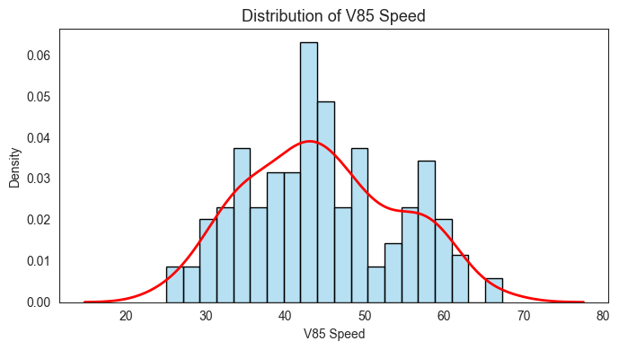
    


    
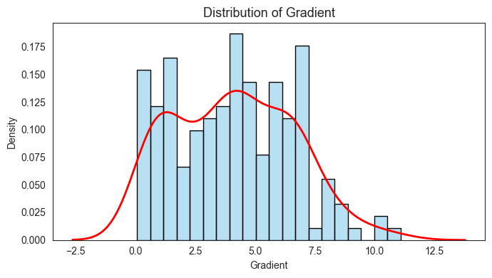
    


    

    


    

    


    
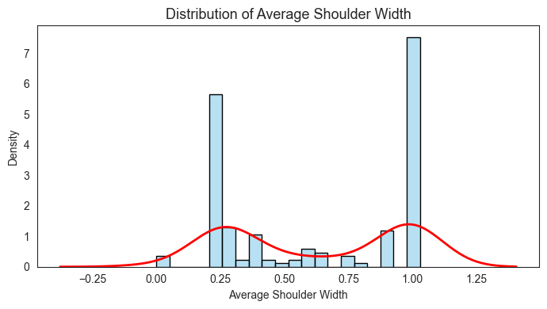
    


    
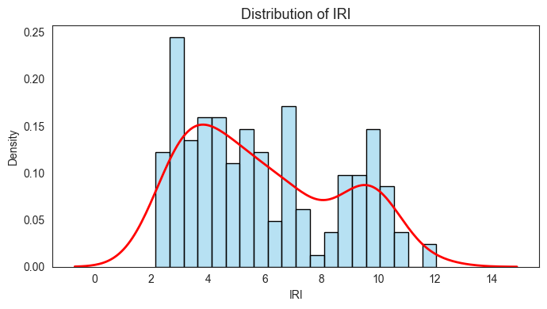
    


    

    


    

    


    
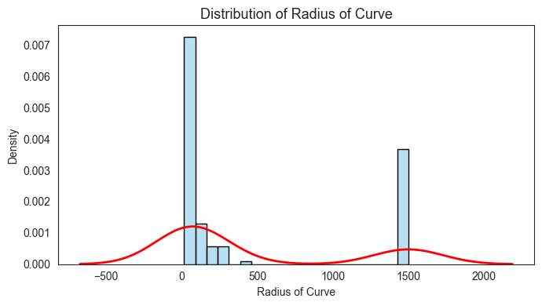
    


    
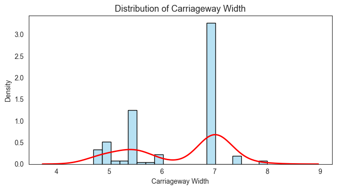
    


    

    


    

    


Box Plots


```python
# Select numerical variables
num_cols = [
    "V85 Speed",
    "Gradient",
    "Radius of Curve",
    "Carriageway Width",
    "Average Shoulder Width",
    "IRI"
]

# Set plot style
sns.set_style("whitegrid")

# Generate boxplots
for col in num_cols:
    plt.figure(figsize=(7, 4))

    sns.boxplot(
        x=df_encoded[col],
        color="lightblue",
        width=0.4
    )

    plt.title(f"Boxplot of {col}")
    plt.xlabel(col)

    plt.tight_layout()
    plt.show()
```


    

    


    

    


    
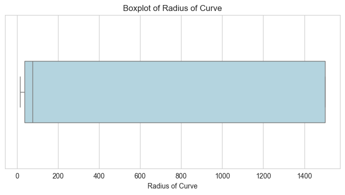
    


    

    


    
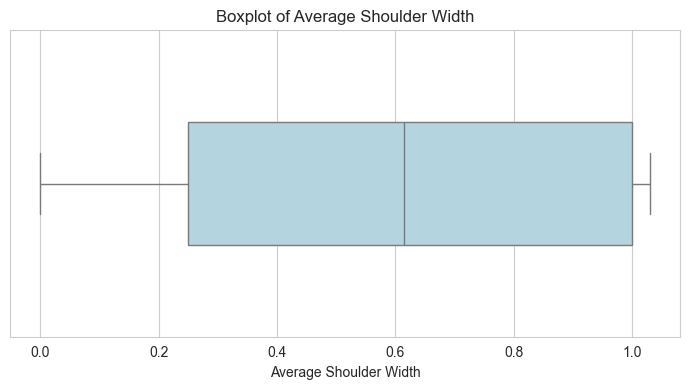
    


    
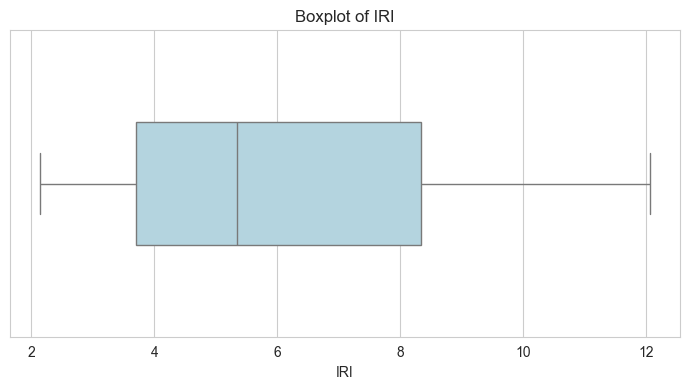
    


    
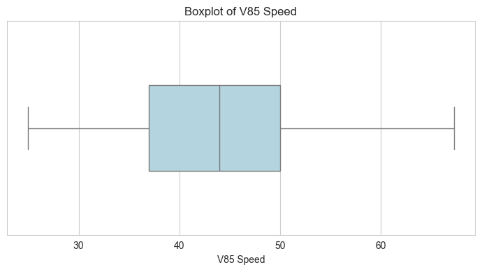
    


    
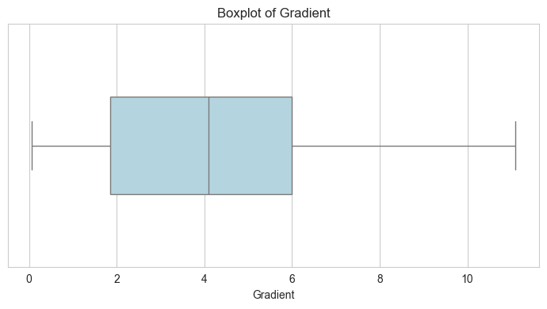
    


    

    


    
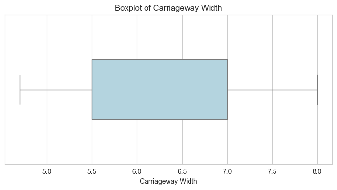
    


    

    


    

    


Skewness


```python
# Calculate skewness

skew_table = pd.DataFrame({
    "Variable": num_cols,
    "Skewness": df_encoded[num_cols].skew().values
})

# Display results
display(skew_table.round(3))
```


<div>
<style scoped>
    .dataframe tbody tr th:only-of-type {
        vertical-align: middle;
    }

    .dataframe tbody tr th {
        vertical-align: top;
    }

    .dataframe thead th {
        text-align: right;
    }
</style>
<table border="1" class="dataframe">
  <thead>
    <tr style="text-align: right;">
      <th></th>
      <th>Variable</th>
      <th>Skewness</th>
    </tr>
  </thead>
  <tbody>
    <tr>
      <th>0</th>
      <td>V85 Speed</td>
      <td>0.201</td>
    </tr>
    <tr>
      <th>1</th>
      <td>Gradient</td>
      <td>0.234</td>
    </tr>
    <tr>
      <th>2</th>
      <td>Radius of Curve</td>
      <td>0.997</td>
    </tr>
    <tr>
      <th>3</th>
      <td>Carriageway Width</td>
      <td>-0.448</td>
    </tr>
    <tr>
      <th>4</th>
      <td>Average Shoulder Width</td>
      <td>-0.051</td>
    </tr>
    <tr>
      <th>5</th>
      <td>IRI</td>
      <td>0.440</td>
    </tr>
  </tbody>
</table>
</div>


<div>
<style scoped>
    .dataframe tbody tr th:only-of-type {
        vertical-align: middle;
    }

    .dataframe tbody tr th {
        vertical-align: top;
    }

    .dataframe thead th {
        text-align: right;
    }
</style>
<table border="1" class="dataframe">
  <thead>
    <tr style="text-align: right;">
      <th></th>
      <th>Variable</th>
      <th>Skewness</th>
    </tr>
  </thead>
  <tbody>
    <tr>
      <th>0</th>
      <td>V85 Speed</td>
      <td>0.201</td>
    </tr>
    <tr>
      <th>1</th>
      <td>Gradient</td>
      <td>0.234</td>
    </tr>
    <tr>
      <th>2</th>
      <td>Radius of Curve</td>
      <td>0.997</td>
    </tr>
    <tr>
      <th>3</th>
      <td>Carriageway Width</td>
      <td>-0.448</td>
    </tr>
    <tr>
      <th>4</th>
      <td>Average Shoulder Width</td>
      <td>-0.051</td>
    </tr>
    <tr>
      <th>5</th>
      <td>IRI</td>
      <td>0.440</td>
    </tr>
  </tbody>
</table>
</div>


Correlation Matrix


```python
# Select final numerical variables
num_cols = [
    "V85 Speed",
    "Gradient",
    "Radius of Curve",
    "Carriageway Width",
    "Average Shoulder Width",
    "IRI"
]

# Calculate correlation matrix
corr_matrix = df_encoded[num_cols].corr(method="pearson")

# Display correlation matrix
display(corr_matrix.round(3))
```


<div>
<style scoped>
    .dataframe tbody tr th:only-of-type {
        vertical-align: middle;
    }

    .dataframe tbody tr th {
        vertical-align: top;
    }

    .dataframe thead th {
        text-align: right;
    }
</style>
<table border="1" class="dataframe">
  <thead>
    <tr style="text-align: right;">
      <th></th>
      <th>V85 Speed</th>
      <th>Gradient</th>
      <th>Radius of Curve</th>
      <th>Carriageway Width</th>
      <th>Average Shoulder Width</th>
      <th>IRI</th>
    </tr>
  </thead>
  <tbody>
    <tr>
      <th>V85 Speed</th>
      <td>1.000</td>
      <td>-0.166</td>
      <td>0.601</td>
      <td>0.139</td>
      <td>-0.185</td>
      <td>0.314</td>
    </tr>
    <tr>
      <th>Gradient</th>
      <td>-0.166</td>
      <td>1.000</td>
      <td>-0.180</td>
      <td>-0.153</td>
      <td>-0.025</td>
      <td>-0.133</td>
    </tr>
    <tr>
      <th>Radius of Curve</th>
      <td>0.601</td>
      <td>-0.180</td>
      <td>1.000</td>
      <td>0.026</td>
      <td>-0.087</td>
      <td>0.182</td>
    </tr>
    <tr>
      <th>Carriageway Width</th>
      <td>0.139</td>
      <td>-0.153</td>
      <td>0.026</td>
      <td>1.000</td>
      <td>-0.058</td>
      <td>0.307</td>
    </tr>
    <tr>
      <th>Average Shoulder Width</th>
      <td>-0.185</td>
      <td>-0.025</td>
      <td>-0.087</td>
      <td>-0.058</td>
      <td>1.000</td>
      <td>-0.577</td>
    </tr>
    <tr>
      <th>IRI</th>
      <td>0.314</td>
      <td>-0.133</td>
      <td>0.182</td>
      <td>0.307</td>
      <td>-0.577</td>
      <td>1.000</td>
    </tr>
  </tbody>
</table>
</div>


<div>
<style scoped>
    .dataframe tbody tr th:only-of-type {
        vertical-align: middle;
    }

    .dataframe tbody tr th {
        vertical-align: top;
    }

    .dataframe thead th {
        text-align: right;
    }
</style>
<table border="1" class="dataframe">
  <thead>
    <tr style="text-align: right;">
      <th></th>
      <th>V85 Speed</th>
      <th>Gradient</th>
      <th>Radius of Curve</th>
      <th>Carriageway Width</th>
      <th>Average Shoulder Width</th>
      <th>IRI</th>
    </tr>
  </thead>
  <tbody>
    <tr>
      <th>V85 Speed</th>
      <td>1.000</td>
      <td>-0.166</td>
      <td>0.601</td>
      <td>0.139</td>
      <td>-0.185</td>
      <td>0.314</td>
    </tr>
    <tr>
      <th>Gradient</th>
      <td>-0.166</td>
      <td>1.000</td>
      <td>-0.180</td>
      <td>-0.153</td>
      <td>-0.025</td>
      <td>-0.133</td>
    </tr>
    <tr>
      <th>Radius of Curve</th>
      <td>0.601</td>
      <td>-0.180</td>
      <td>1.000</td>
      <td>0.026</td>
      <td>-0.087</td>
      <td>0.182</td>
    </tr>
    <tr>
      <th>Carriageway Width</th>
      <td>0.139</td>
      <td>-0.153</td>
      <td>0.026</td>
      <td>1.000</td>
      <td>-0.058</td>
      <td>0.307</td>
    </tr>
    <tr>
      <th>Average Shoulder Width</th>
      <td>-0.185</td>
      <td>-0.025</td>
      <td>-0.087</td>
      <td>-0.058</td>
      <td>1.000</td>
      <td>-0.577</td>
    </tr>
    <tr>
      <th>IRI</th>
      <td>0.314</td>
      <td>-0.133</td>
      <td>0.182</td>
      <td>0.307</td>
      <td>-0.577</td>
      <td>1.000</td>
    </tr>
  </tbody>
</table>
</div>


```python
plt.figure(figsize=(8, 6))

sns.heatmap(
    corr_matrix,
    annot=True,
    cmap="RdYlGn",
    vmin=-1, vmax=1,
    center=0,
    fmt=".2f",
    linewidths=0.8,
    linecolor="black",
    cbar_kws={"shrink": 0.8}
)

plt.title(
    "Correlation Matrix of Variables",
    fontsize=14,
    fontweight="bold"
)

plt.xticks(rotation=45, ha="right")
plt.yticks(rotation=0)

plt.tight_layout()
plt.show()
```


    

    


    
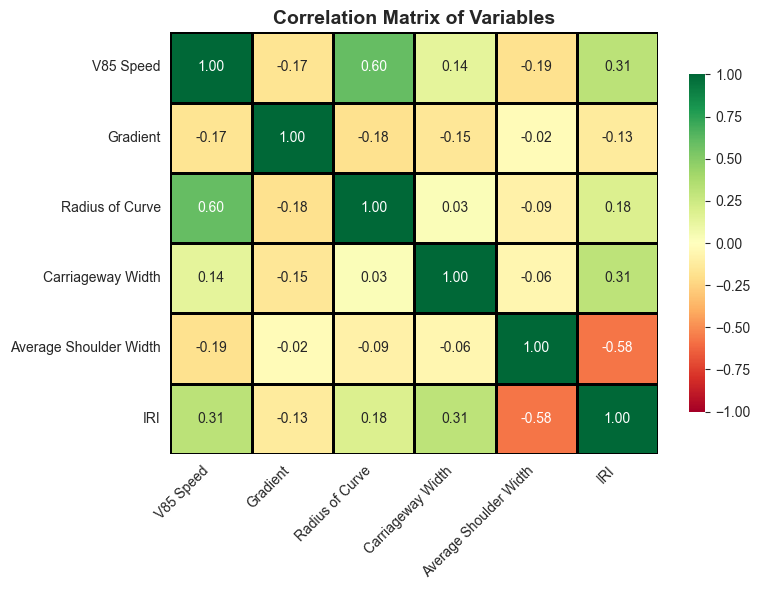
    


```python
# Correlation of independent variables with V85 Speed

speed_corr = corr_matrix["V85 Speed"].drop("V85 Speed")

# Sort correlations
speed_corr = speed_corr.sort_values(ascending=False)

# Display results
display(speed_corr.round(3))
```


    Radius of Curve           0.601
    IRI                       0.314
    Carriageway Width         0.139
    Gradient                 -0.166
    Average Shoulder Width   -0.185
    Name: V85 Speed, dtype: float64


    Radius of Curve           0.601
    IRI                       0.314
    Carriageway Width         0.139
    Gradient                 -0.166
    Average Shoulder Width   -0.185
    Name: V85 Speed, dtype: float64


Relationship Plots


```python
# Final selected independent variables

predictor_cols = [
    "Radius of Curve",
    "Gradient",
    "Carriageway Width",
    "Average Shoulder Width",
    "IRI"
]

# Set plot style
sns.set_style("white")

# Generate scatter plots with regression lines
for col in predictor_cols:
    plt.figure(figsize=(7, 4))

    sns.regplot(
        x=df_encoded[col],
        y=df_encoded["V85 Speed"],
        scatter_kws={
            "s": 40,
            "color": "steelblue",
            "alpha": 0.7
        },
        line_kws={
            "color": "darkred",
            "linewidth": 2
        },
        ci=None
    )

    plt.title(f"{col} vs V85 Speed")
    plt.xlabel(col)
    plt.ylabel("V85 Speed (km/h)")

    plt.tight_layout()
    plt.show()
```


    

    


    
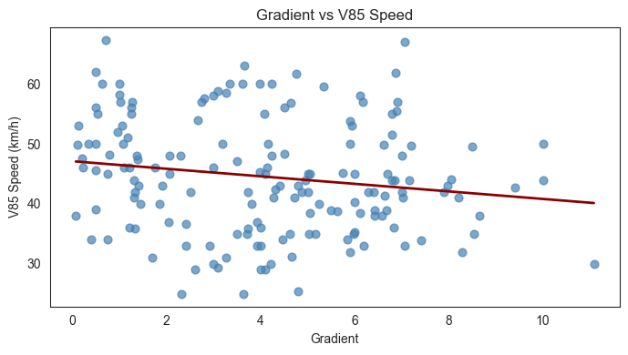
    


    
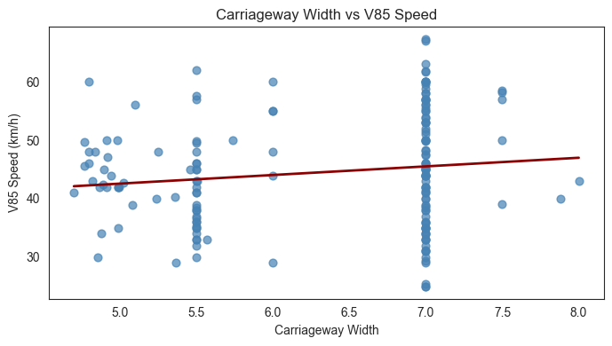
    


    

    


    

    


    
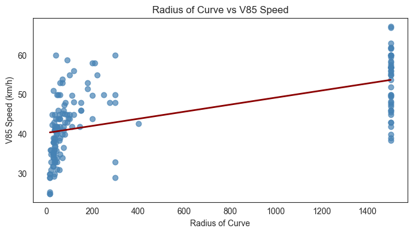
    


    

    


    

    


    
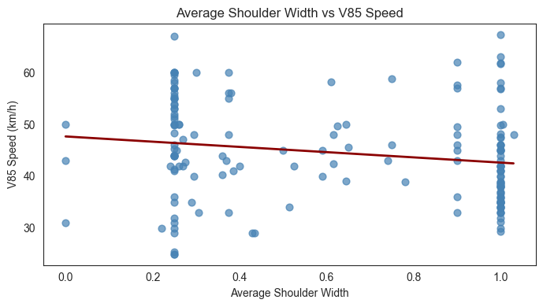
    


    
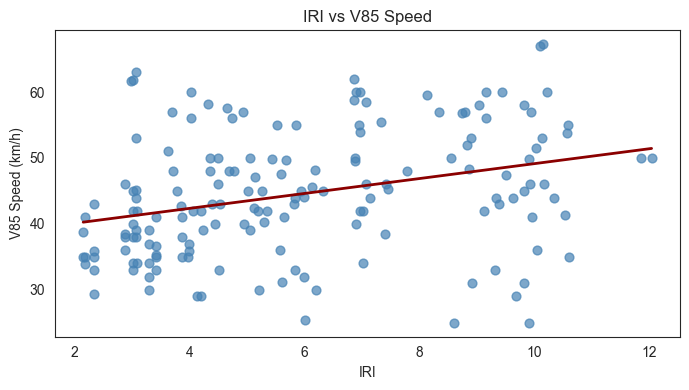
    


Additional Analysis: Radius of Curve vs V85 Speed (Curved Sections Only)


```python
# Select curved sections only (exclude tangent sections)

df_curves = df_encoded[
    df_encoded["Radius of Curve"] != 1500
].copy()

# Display number of curved sections
print("Number of curved sections:", len(df_curves))

# Scatter plot with regression line
sns.set_style("white")

plt.figure(figsize=(7, 4))

sns.regplot(
    x=df_curves["Radius of Curve"],
    y=df_curves["V85 Speed"],
    scatter_kws={
        "s": 40,
        "color": "steelblue",
        "alpha": 0.7
    },
    line_kws={
        "color": "darkred",
        "linewidth": 2
    },
    ci=None
)

plt.title("Radius of Curve vs V85 Speed (Curved Sections Only)")
plt.xlabel("Radius of Curve (m)")
plt.ylabel("V85 Speed (km/h)")

plt.tight_layout()
plt.show()
```

    Number of curved sections: 120
    


    
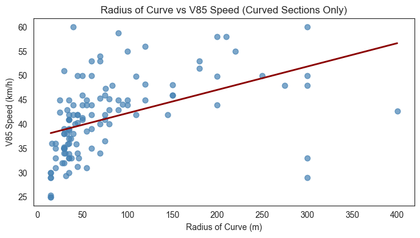
    


    Number of curved sections: 120
    


    

    


Calculate Pearson Correlation for Curved Sections Only


```python
# Calculate correlation for curved sections

curve_corr = df_curves[
    ["Radius of Curve", "V85 Speed"]
].corr(method="pearson")

display(curve_corr.round(3))
```


<div>
<style scoped>
    .dataframe tbody tr th:only-of-type {
        vertical-align: middle;
    }

    .dataframe tbody tr th {
        vertical-align: top;
    }

    .dataframe thead th {
        text-align: right;
    }
</style>
<table border="1" class="dataframe">
  <thead>
    <tr style="text-align: right;">
      <th></th>
      <th>Radius of Curve</th>
      <th>V85 Speed</th>
    </tr>
  </thead>
  <tbody>
    <tr>
      <th>Radius of Curve</th>
      <td>1.000</td>
      <td>0.462</td>
    </tr>
    <tr>
      <th>V85 Speed</th>
      <td>0.462</td>
      <td>1.000</td>
    </tr>
  </tbody>
</table>
</div>


<div>
<style scoped>
    .dataframe tbody tr th:only-of-type {
        vertical-align: middle;
    }

    .dataframe tbody tr th {
        vertical-align: top;
    }

    .dataframe thead th {
        text-align: right;
    }
</style>
<table border="1" class="dataframe">
  <thead>
    <tr style="text-align: right;">
      <th></th>
      <th>Radius of Curve</th>
      <th>V85 Speed</th>
    </tr>
  </thead>
  <tbody>
    <tr>
      <th>Radius of Curve</th>
      <td>1.000</td>
      <td>0.462</td>
    </tr>
    <tr>
      <th>V85 Speed</th>
      <td>0.462</td>
      <td>1.000</td>
    </tr>
  </tbody>
</table>
</div>


Compare Correlation: All Sections vs Curved Sections


```python
# Correlation including tangent sections
corr_all = df_encoded[
    ["Radius of Curve", "V85 Speed"]
].corr().iloc[0, 1]

# Correlation excluding tangent sections
corr_curves = df_curves[
    ["Radius of Curve", "V85 Speed"]
].corr().iloc[0, 1]

# Comparison table
correlation_comparison = pd.DataFrame({
    "Road Section": [
        "All Sections",
        "Curved Sections Only"
    ],
    "Pearson Correlation": [
        corr_all,
        corr_curves
    ]
})

display(correlation_comparison.round(3))
```


<div>
<style scoped>
    .dataframe tbody tr th:only-of-type {
        vertical-align: middle;
    }

    .dataframe tbody tr th {
        vertical-align: top;
    }

    .dataframe thead th {
        text-align: right;
    }
</style>
<table border="1" class="dataframe">
  <thead>
    <tr style="text-align: right;">
      <th></th>
      <th>Road Section</th>
      <th>Pearson Correlation</th>
    </tr>
  </thead>
  <tbody>
    <tr>
      <th>0</th>
      <td>All Sections</td>
      <td>0.601</td>
    </tr>
    <tr>
      <th>1</th>
      <td>Curved Sections Only</td>
      <td>0.462</td>
    </tr>
  </tbody>
</table>
</div>


<div>
<style scoped>
    .dataframe tbody tr th:only-of-type {
        vertical-align: middle;
    }

    .dataframe tbody tr th {
        vertical-align: top;
    }

    .dataframe thead th {
        text-align: right;
    }
</style>
<table border="1" class="dataframe">
  <thead>
    <tr style="text-align: right;">
      <th></th>
      <th>Road Section</th>
      <th>Pearson Correlation</th>
    </tr>
  </thead>
  <tbody>
    <tr>
      <th>0</th>
      <td>All Sections</td>
      <td>0.601</td>
    </tr>
    <tr>
      <th>1</th>
      <td>Curved Sections Only</td>
      <td>0.462</td>
    </tr>
  </tbody>
</table>
</div>


MODEL DEVELOPMENT

Train Test Split


```python
# Train-Test Split

from sklearn.model_selection import train_test_split

X_train, X_test, y_train, y_test = train_test_split(
    X, y,
    test_size=0.20,
    random_state=42
)

print("X_train shape:", X_train.shape)
print("X_test shape :", X_test.shape)
print("y_train shape:", y_train.shape)
print("y_test shape :", y_test.shape)
```

    X_train shape: (132, 5)
    X_test shape : (33, 5)
    y_train shape: (132,)
    y_test shape : (33,)
    X_train shape: (132, 5)
    X_test shape : (33, 5)
    y_train shape: (132,)
    y_test shape : (33,)
    

Feature Scaling (Standardization)


```python
# Feature Scaling

from sklearn.preprocessing import StandardScaler

# Initialize scaler
scaler = StandardScaler()

# Fit scaler on training data and transform
X_train_scaled = scaler.fit_transform(X_train)

# Transform testing data using the same scaler
X_test_scaled = scaler.transform(X_test)

# Check scaled data
print("X_train_scaled shape:", X_train_scaled.shape)
print("X_test_scaled shape :", X_test_scaled.shape)
```

    X_train_scaled shape: (132, 5)
    X_test_scaled shape : (33, 5)
    X_train_scaled shape: (132, 5)
    X_test_scaled shape : (33, 5)
    

MODELING

MLR Model

Training of MLR Model


```python
# Multiple Linear Regression (MLR)

from sklearn.linear_model import LinearRegression

# Initialize MLR model
mlr = LinearRegression()

# Train MLR using unscaled training data
mlr.fit(X_train, y_train)
```


<style>#sk-container-id-1 {
  /* Definition of color scheme common for light and dark mode */
  --sklearn-color-text: #000;
  --sklearn-color-text-muted: #666;
  --sklearn-color-line: gray;
  /* Definition of color scheme for unfitted estimators */
  --sklearn-color-unfitted-level-0: #fff5e6;
  --sklearn-color-unfitted-level-1: #f6e4d2;
  --sklearn-color-unfitted-level-2: #ffe0b3;
  --sklearn-color-unfitted-level-3: chocolate;
  /* Definition of color scheme for fitted estimators */
  --sklearn-color-fitted-level-0: #f0f8ff;
  --sklearn-color-fitted-level-1: #d4ebff;
  --sklearn-color-fitted-level-2: #b3dbfd;
  --sklearn-color-fitted-level-3: cornflowerblue;
}

#sk-container-id-1.light {
  /* Specific color for light theme */
  --sklearn-color-text-on-default-background: black;
  --sklearn-color-background: white;
  --sklearn-color-border-box: black;
  --sklearn-color-icon: #696969;
}

#sk-container-id-1.dark {
  --sklearn-color-text-on-default-background: white;
  --sklearn-color-background: #111;
  --sklearn-color-border-box: white;
  --sklearn-color-icon: #878787;
}

#sk-container-id-1 {
  color: var(--sklearn-color-text);
}

#sk-container-id-1 pre {
  padding: 0;
}

#sk-container-id-1 input.sk-hidden--visually {
  border: 0;
  clip: rect(1px 1px 1px 1px);
  clip: rect(1px, 1px, 1px, 1px);
  height: 1px;
  margin: -1px;
  overflow: hidden;
  padding: 0;
  position: absolute;
  width: 1px;
}

#sk-container-id-1 div.sk-dashed-wrapped {
  border: 1px dashed var(--sklearn-color-line);
  margin: 0 0.4em 0.5em 0.4em;
  box-sizing: border-box;
  padding-bottom: 0.4em;
  background-color: var(--sklearn-color-background);
}

#sk-container-id-1 div.sk-container {
  /* jupyter's `normalize.less` sets `[hidden] { display: none; }`
     but bootstrap.min.css set `[hidden] { display: none !important; }`
     so we also need the `!important` here to be able to override the
     default hidden behavior on the sphinx rendered scikit-learn.org.
     See: https://github.com/scikit-learn/scikit-learn/issues/21755 */
  display: inline-block !important;
  position: relative;
}

#sk-container-id-1 div.sk-text-repr-fallback {
  display: none;
}

div.sk-parallel-item,
div.sk-serial,
div.sk-item {
  /* draw centered vertical line to link estimators */
  background-image: linear-gradient(var(--sklearn-color-text-on-default-background), var(--sklearn-color-text-on-default-background));
  background-size: 2px 100%;
  background-repeat: no-repeat;
  background-position: center center;
}

/* Parallel-specific style estimator block */

#sk-container-id-1 div.sk-parallel-item::after {
  content: "";
  width: 100%;
  border-bottom: 2px solid var(--sklearn-color-text-on-default-background);
  flex-grow: 1;
}

#sk-container-id-1 div.sk-parallel {
  display: flex;
  align-items: stretch;
  justify-content: center;
  background-color: var(--sklearn-color-background);
  position: relative;
}

#sk-container-id-1 div.sk-parallel-item {
  display: flex;
  flex-direction: column;
}

#sk-container-id-1 div.sk-parallel-item:first-child::after {
  align-self: flex-end;
  width: 50%;
}

#sk-container-id-1 div.sk-parallel-item:last-child::after {
  align-self: flex-start;
  width: 50%;
}

#sk-container-id-1 div.sk-parallel-item:only-child::after {
  width: 0;
}

/* Serial-specific style estimator block */

#sk-container-id-1 div.sk-serial {
  display: flex;
  flex-direction: column;
  align-items: center;
  background-color: var(--sklearn-color-background);
  padding-right: 1em;
  padding-left: 1em;
}


/* Toggleable style: style used for estimator/Pipeline/ColumnTransformer box that is
clickable and can be expanded/collapsed.
- Pipeline and ColumnTransformer use this feature and define the default style
- Estimators will overwrite some part of the style using the `sk-estimator` class
*/

/* Pipeline and ColumnTransformer style (default) */

#sk-container-id-1 div.sk-toggleable {
  /* Default theme specific background. It is overwritten whether we have a
  specific estimator or a Pipeline/ColumnTransformer */
  background-color: var(--sklearn-color-background);
}

/* Toggleable label */
#sk-container-id-1 label.sk-toggleable__label {
  cursor: pointer;
  display: flex;
  width: 100%;
  margin-bottom: 0;
  padding: 0.5em;
  box-sizing: border-box;
  text-align: center;
  align-items: center;
  justify-content: center;
  gap: 0.5em;
}

#sk-container-id-1 label.sk-toggleable__label .caption {
  font-size: 0.6rem;
  font-weight: lighter;
  color: var(--sklearn-color-text-muted);
}

#sk-container-id-1 label.sk-toggleable__label-arrow:before {
  /* Arrow on the left of the label */
  content: "▸";
  float: left;
  margin-right: 0.25em;
  color: var(--sklearn-color-icon);
}

#sk-container-id-1 label.sk-toggleable__label-arrow:hover:before {
  color: var(--sklearn-color-text);
}

/* Toggleable content - dropdown */

#sk-container-id-1 div.sk-toggleable__content {
  display: none;
  text-align: left;
  /* unfitted */
  background-color: var(--sklearn-color-unfitted-level-0);
}

#sk-container-id-1 div.sk-toggleable__content.fitted {
  /* fitted */
  background-color: var(--sklearn-color-fitted-level-0);
}

#sk-container-id-1 div.sk-toggleable__content pre {
  margin: 0.2em;
  border-radius: 0.25em;
  color: var(--sklearn-color-text);
  /* unfitted */
  background-color: var(--sklearn-color-unfitted-level-0);
}

#sk-container-id-1 div.sk-toggleable__content.fitted pre {
  /* unfitted */
  background-color: var(--sklearn-color-fitted-level-0);
}

#sk-container-id-1 input.sk-toggleable__control:checked~div.sk-toggleable__content {
  /* Expand drop-down */
  display: block;
  width: 100%;
  overflow: visible;
}

#sk-container-id-1 input.sk-toggleable__control:checked~label.sk-toggleable__label-arrow:before {
  content: "▾";
}

/* Pipeline/ColumnTransformer-specific style */

#sk-container-id-1 div.sk-label input.sk-toggleable__control:checked~label.sk-toggleable__label {
  color: var(--sklearn-color-text);
  background-color: var(--sklearn-color-unfitted-level-2);
}

#sk-container-id-1 div.sk-label.fitted input.sk-toggleable__control:checked~label.sk-toggleable__label {
  background-color: var(--sklearn-color-fitted-level-2);
}

/* Estimator-specific style */

/* Colorize estimator box */
#sk-container-id-1 div.sk-estimator input.sk-toggleable__control:checked~label.sk-toggleable__label {
  /* unfitted */
  background-color: var(--sklearn-color-unfitted-level-2);
}

#sk-container-id-1 div.sk-estimator.fitted input.sk-toggleable__control:checked~label.sk-toggleable__label {
  /* fitted */
  background-color: var(--sklearn-color-fitted-level-2);
}

#sk-container-id-1 div.sk-label label.sk-toggleable__label,
#sk-container-id-1 div.sk-label label {
  /* The background is the default theme color */
  color: var(--sklearn-color-text-on-default-background);
}

/* On hover, darken the color of the background */
#sk-container-id-1 div.sk-label:hover label.sk-toggleable__label {
  color: var(--sklearn-color-text);
  background-color: var(--sklearn-color-unfitted-level-2);
}

/* Label box, darken color on hover, fitted */
#sk-container-id-1 div.sk-label.fitted:hover label.sk-toggleable__label.fitted {
  color: var(--sklearn-color-text);
  background-color: var(--sklearn-color-fitted-level-2);
}

/* Estimator label */

#sk-container-id-1 div.sk-label label {
  font-family: monospace;
  font-weight: bold;
  line-height: 1.2em;
}

#sk-container-id-1 div.sk-label-container {
  text-align: center;
}

/* Estimator-specific */
#sk-container-id-1 div.sk-estimator {
  font-family: monospace;
  border: 1px dotted var(--sklearn-color-border-box);
  border-radius: 0.25em;
  box-sizing: border-box;
  margin-bottom: 0.5em;
  /* unfitted */
  background-color: var(--sklearn-color-unfitted-level-0);
}

#sk-container-id-1 div.sk-estimator.fitted {
  /* fitted */
  background-color: var(--sklearn-color-fitted-level-0);
}

/* on hover */
#sk-container-id-1 div.sk-estimator:hover {
  /* unfitted */
  background-color: var(--sklearn-color-unfitted-level-2);
}

#sk-container-id-1 div.sk-estimator.fitted:hover {
  /* fitted */
  background-color: var(--sklearn-color-fitted-level-2);
}

/* Specification for estimator info (e.g. "i" and "?") */

/* Common style for "i" and "?" */

.sk-estimator-doc-link,
a:link.sk-estimator-doc-link,
a:visited.sk-estimator-doc-link {
  float: right;
  font-size: smaller;
  line-height: 1em;
  font-family: monospace;
  background-color: var(--sklearn-color-unfitted-level-0);
  border-radius: 1em;
  height: 1em;
  width: 1em;
  text-decoration: none !important;
  margin-left: 0.5em;
  text-align: center;
  /* unfitted */
  border: var(--sklearn-color-unfitted-level-3) 1pt solid;
  color: var(--sklearn-color-unfitted-level-3);
}

.sk-estimator-doc-link.fitted,
a:link.sk-estimator-doc-link.fitted,
a:visited.sk-estimator-doc-link.fitted {
  /* fitted */
  background-color: var(--sklearn-color-fitted-level-0);
  border: var(--sklearn-color-fitted-level-3) 1pt solid;
  color: var(--sklearn-color-fitted-level-3);
}

/* On hover */
div.sk-estimator:hover .sk-estimator-doc-link:hover,
.sk-estimator-doc-link:hover,
div.sk-label-container:hover .sk-estimator-doc-link:hover,
.sk-estimator-doc-link:hover {
  /* unfitted */
  background-color: var(--sklearn-color-unfitted-level-3);
  border: var(--sklearn-color-fitted-level-0) 1pt solid;
  color: var(--sklearn-color-unfitted-level-0);
  text-decoration: none;
}

div.sk-estimator.fitted:hover .sk-estimator-doc-link.fitted:hover,
.sk-estimator-doc-link.fitted:hover,
div.sk-label-container:hover .sk-estimator-doc-link.fitted:hover,
.sk-estimator-doc-link.fitted:hover {
  /* fitted */
  background-color: var(--sklearn-color-fitted-level-3);
  border: var(--sklearn-color-fitted-level-0) 1pt solid;
  color: var(--sklearn-color-fitted-level-0);
  text-decoration: none;
}

/* Span, style for the box shown on hovering the info icon */
.sk-estimator-doc-link span {
  display: none;
  z-index: 9999;
  position: relative;
  font-weight: normal;
  right: .2ex;
  padding: .5ex;
  margin: .5ex;
  width: min-content;
  min-width: 20ex;
  max-width: 50ex;
  color: var(--sklearn-color-text);
  box-shadow: 2pt 2pt 4pt #999;
  /* unfitted */
  background: var(--sklearn-color-unfitted-level-0);
  border: .5pt solid var(--sklearn-color-unfitted-level-3);
}

.sk-estimator-doc-link.fitted span {
  /* fitted */
  background: var(--sklearn-color-fitted-level-0);
  border: var(--sklearn-color-fitted-level-3);
}

.sk-estimator-doc-link:hover span {
  display: block;
}

/* "?"-specific style due to the `<a>` HTML tag */

#sk-container-id-1 a.estimator_doc_link {
  float: right;
  font-size: 1rem;
  line-height: 1em;
  font-family: monospace;
  background-color: var(--sklearn-color-unfitted-level-0);
  border-radius: 1rem;
  height: 1rem;
  width: 1rem;
  text-decoration: none;
  /* unfitted */
  color: var(--sklearn-color-unfitted-level-1);
  border: var(--sklearn-color-unfitted-level-1) 1pt solid;
}

#sk-container-id-1 a.estimator_doc_link.fitted {
  /* fitted */
  background-color: var(--sklearn-color-fitted-level-0);
  border: var(--sklearn-color-fitted-level-1) 1pt solid;
  color: var(--sklearn-color-fitted-level-1);
}

/* On hover */
#sk-container-id-1 a.estimator_doc_link:hover {
  /* unfitted */
  background-color: var(--sklearn-color-unfitted-level-3);
  color: var(--sklearn-color-background);
  text-decoration: none;
}

#sk-container-id-1 a.estimator_doc_link.fitted:hover {
  /* fitted */
  background-color: var(--sklearn-color-fitted-level-3);
}

.estimator-table {
    font-family: monospace;
}

.estimator-table summary {
    padding: .5rem;
    cursor: pointer;
}

.estimator-table summary::marker {
    font-size: 0.7rem;
}

.estimator-table details[open] {
    padding-left: 0.1rem;
    padding-right: 0.1rem;
    padding-bottom: 0.3rem;
}

.estimator-table .parameters-table {
    margin-left: auto !important;
    margin-right: auto !important;
    margin-top: 0;
}

.estimator-table .parameters-table tr:nth-child(odd) {
    background-color: #fff;
}

.estimator-table .parameters-table tr:nth-child(even) {
    background-color: #f6f6f6;
}

.estimator-table .parameters-table tr:hover {
    background-color: #e0e0e0;
}

.estimator-table table td {
    border: 1px solid rgba(106, 105, 104, 0.232);
}

/*
    `table td`is set in notebook with right text-align.
    We need to overwrite it.
*/
.estimator-table table td.param {
    text-align: left;
    position: relative;
    padding: 0;
}

.user-set td {
    color:rgb(255, 94, 0);
    text-align: left !important;
}

.user-set td.value {
    color:rgb(255, 94, 0);
    background-color: transparent;
}

.default td {
    color: black;
    text-align: left !important;
}

.user-set td i,
.default td i {
    color: black;
}

/*
    Styles for parameter documentation links
    We need styling for visited so jupyter doesn't overwrite it
*/
a.param-doc-link,
a.param-doc-link:link,
a.param-doc-link:visited {
    text-decoration: underline dashed;
    text-underline-offset: .3em;
    color: inherit;
    display: block;
    padding: .5em;
}

/* "hack" to make the entire area of the cell containing the link clickable */
a.param-doc-link::before {
    position: absolute;
    content: "";
    inset: 0;
}

.param-doc-description {
    display: none;
    position: absolute;
    z-index: 9999;
    left: 0;
    padding: .5ex;
    margin-left: 1.5em;
    color: var(--sklearn-color-text);
    box-shadow: .3em .3em .4em #999;
    width: max-content;
    text-align: left;
    max-height: 10em;
    overflow-y: auto;

    /* unfitted */
    background: var(--sklearn-color-unfitted-level-0);
    border: thin solid var(--sklearn-color-unfitted-level-3);
}

/* Fitted state for parameter tooltips */
.fitted .param-doc-description {
    /* fitted */
    background: var(--sklearn-color-fitted-level-0);
    border: thin solid var(--sklearn-color-fitted-level-3);
}

.param-doc-link:hover .param-doc-description {
    display: block;
}

.copy-paste-icon {
    background-image: url();
    background-repeat: no-repeat;
    background-size: 14px 14px;
    background-position: 0;
    display: inline-block;
    width: 14px;
    height: 14px;
    cursor: pointer;
}
</style><body><div id="sk-container-id-1" class="sk-top-container"><div class="sk-text-repr-fallback"><pre>LinearRegression()</pre><b>In a Jupyter environment, please rerun this cell to show the HTML representation or trust the notebook. <br />On GitHub, the HTML representation is unable to render, please try loading this page with nbviewer.org.</b></div><div class="sk-container" hidden><div class="sk-item"><div class="sk-estimator fitted sk-toggleable"><input class="sk-toggleable__control sk-hidden--visually" id="sk-estimator-id-1" type="checkbox" checked><label for="sk-estimator-id-1" class="sk-toggleable__label fitted sk-toggleable__label-arrow"><div><div>LinearRegression</div></div><div><a class="sk-estimator-doc-link fitted" rel="noreferrer" target="_blank" href="https://scikit-learn.org/1.8/modules/generated/sklearn.linear_model.LinearRegression.html">?<span>Documentation for LinearRegression</span></a><span class="sk-estimator-doc-link fitted">i<span>Fitted</span></span></div></label><div class="sk-toggleable__content fitted" data-param-prefix="">
        <div class="estimator-table">
            <details>
                <summary>Parameters</summary>
                <table class="parameters-table">
                  <tbody>

        <tr class="default">
            <td><i class="copy-paste-icon"
                 onclick="copyToClipboard('fit_intercept',
                          this.parentElement.nextElementSibling)"
            ></i></td>
            <td class="param">
        <a class="param-doc-link"
            rel="noreferrer" target="_blank" href="https://scikit-learn.org/1.8/modules/generated/sklearn.linear_model.LinearRegression.html#:~:text=fit_intercept,-bool%2C%20default%3DTrue">
            fit_intercept
            <span class="param-doc-description">fit_intercept: bool, default=True<br><br>Whether to calculate the intercept for this model. If set<br>to False, no intercept will be used in calculations<br>(i.e. data is expected to be centered).</span>
        </a>
    </td>
            <td class="value">True</td>
        </tr>


        <tr class="default">
            <td><i class="copy-paste-icon"
                 onclick="copyToClipboard('copy_X',
                          this.parentElement.nextElementSibling)"
            ></i></td>
            <td class="param">
        <a class="param-doc-link"
            rel="noreferrer" target="_blank" href="https://scikit-learn.org/1.8/modules/generated/sklearn.linear_model.LinearRegression.html#:~:text=copy_X,-bool%2C%20default%3DTrue">
            copy_X
            <span class="param-doc-description">copy_X: bool, default=True<br><br>If True, X will be copied; else, it may be overwritten.</span>
        </a>
    </td>
            <td class="value">True</td>
        </tr>


        <tr class="default">
            <td><i class="copy-paste-icon"
                 onclick="copyToClipboard('tol',
                          this.parentElement.nextElementSibling)"
            ></i></td>
            <td class="param">
        <a class="param-doc-link"
            rel="noreferrer" target="_blank" href="https://scikit-learn.org/1.8/modules/generated/sklearn.linear_model.LinearRegression.html#:~:text=tol,-float%2C%20default%3D1e-6">
            tol
            <span class="param-doc-description">tol: float, default=1e-6<br><br>The precision of the solution (`coef_`) is determined by `tol` which<br>specifies a different convergence criterion for the `lsqr` solver.<br>`tol` is set as `atol` and `btol` of :func:`scipy.sparse.linalg.lsqr` when<br>fitting on sparse training data. This parameter has no effect when fitting<br>on dense data.<br><br>.. versionadded:: 1.7</span>
        </a>
    </td>
            <td class="value">1e-06</td>
        </tr>


        <tr class="default">
            <td><i class="copy-paste-icon"
                 onclick="copyToClipboard('n_jobs',
                          this.parentElement.nextElementSibling)"
            ></i></td>
            <td class="param">
        <a class="param-doc-link"
            rel="noreferrer" target="_blank" href="https://scikit-learn.org/1.8/modules/generated/sklearn.linear_model.LinearRegression.html#:~:text=n_jobs,-int%2C%20default%3DNone">
            n_jobs
            <span class="param-doc-description">n_jobs: int, default=None<br><br>The number of jobs to use for the computation. This will only provide<br>speedup in case of sufficiently large problems, that is if firstly<br>`n_targets > 1` and secondly `X` is sparse or if `positive` is set<br>to `True`. ``None`` means 1 unless in a<br>:obj:`joblib.parallel_backend` context. ``-1`` means using all<br>processors. See :term:`Glossary <n_jobs>` for more details.</span>
        </a>
    </td>
            <td class="value">None</td>
        </tr>


        <tr class="default">
            <td><i class="copy-paste-icon"
                 onclick="copyToClipboard('positive',
                          this.parentElement.nextElementSibling)"
            ></i></td>
            <td class="param">
        <a class="param-doc-link"
            rel="noreferrer" target="_blank" href="https://scikit-learn.org/1.8/modules/generated/sklearn.linear_model.LinearRegression.html#:~:text=positive,-bool%2C%20default%3DFalse">
            positive
            <span class="param-doc-description">positive: bool, default=False<br><br>When set to ``True``, forces the coefficients to be positive. This<br>option is only supported for dense arrays.<br><br>For a comparison between a linear regression model with positive constraints<br>on the regression coefficients and a linear regression without such constraints,<br>see :ref:`sphx_glr_auto_examples_linear_model_plot_nnls.py`.<br><br>.. versionadded:: 0.24</span>
        </a>
    </td>
            <td class="value">False</td>
        </tr>

                  </tbody>
                </table>
            </details>
        </div>
    </div></div></div></div></div><script>function copyToClipboard(text, element) {
    // Get the parameter prefix from the closest toggleable content
    const toggleableContent = element.closest('.sk-toggleable__content');
    const paramPrefix = toggleableContent ? toggleableContent.dataset.paramPrefix : '';
    const fullParamName = paramPrefix ? `${paramPrefix}${text}` : text;

    const originalStyle = element.style;
    const computedStyle = window.getComputedStyle(element);
    const originalWidth = computedStyle.width;
    const originalHTML = element.innerHTML.replace('Copied!', '');

    navigator.clipboard.writeText(fullParamName)
        .then(() => {
            element.style.width = originalWidth;
            element.style.color = 'green';
            element.innerHTML = "Copied!";

            setTimeout(() => {
                element.innerHTML = originalHTML;
                element.style = originalStyle;
            }, 2000);
        })
        .catch(err => {
            console.error('Failed to copy:', err);
            element.style.color = 'red';
            element.innerHTML = "Failed!";
            setTimeout(() => {
                element.innerHTML = originalHTML;
                element.style = originalStyle;
            }, 2000);
        });
    return false;
}

document.querySelectorAll('.copy-paste-icon').forEach(function(element) {
    const toggleableContent = element.closest('.sk-toggleable__content');
    const paramPrefix = toggleableContent ? toggleableContent.dataset.paramPrefix : '';
    const paramName = element.parentElement.nextElementSibling
        .textContent.trim().split(' ')[0];
    const fullParamName = paramPrefix ? `${paramPrefix}${paramName}` : paramName;

    element.setAttribute('title', fullParamName);
});


/**
 * Adapted from Skrub
 * https://github.com/skrub-data/skrub/blob/403466d1d5d4dc76a7ef569b3f8228db59a31dc3/skrub/_reporting/_data/templates/report.js#L789
 * @returns "light" or "dark"
 */
function detectTheme(element) {
    const body = document.querySelector('body');

    // Check VSCode theme
    const themeKindAttr = body.getAttribute('data-vscode-theme-kind');
    const themeNameAttr = body.getAttribute('data-vscode-theme-name');

    if (themeKindAttr && themeNameAttr) {
        const themeKind = themeKindAttr.toLowerCase();
        const themeName = themeNameAttr.toLowerCase();

        if (themeKind.includes("dark") || themeName.includes("dark")) {
            return "dark";
        }
        if (themeKind.includes("light") || themeName.includes("light")) {
            return "light";
        }
    }

    // Check Jupyter theme
    if (body.getAttribute('data-jp-theme-light') === 'false') {
        return 'dark';
    } else if (body.getAttribute('data-jp-theme-light') === 'true') {
        return 'light';
    }

    // Guess based on a parent element's color
    const color = window.getComputedStyle(element.parentNode, null).getPropertyValue('color');
    const match = color.match(/^rgb\s*\(\s*(\d+)\s*,\s*(\d+)\s*,\s*(\d+)\s*\)\s*$/i);
    if (match) {
        const [r, g, b] = [
            parseFloat(match[1]),
            parseFloat(match[2]),
            parseFloat(match[3])
        ];

        // https://en.wikipedia.org/wiki/HSL_and_HSV#Lightness
        const luma = 0.299 * r + 0.587 * g + 0.114 * b;

        if (luma > 180) {
            // If the text is very bright we have a dark theme
            return 'dark';
        }
        if (luma < 75) {
            // If the text is very dark we have a light theme
            return 'light';
        }
        // Otherwise fall back to the next heuristic.
    }

    // Fallback to system preference
    return window.matchMedia('(prefers-color-scheme: dark)').matches ? 'dark' : 'light';
}


function forceTheme(elementId) {
    const estimatorElement = document.querySelector(`#${elementId}`);
    if (estimatorElement === null) {
        console.error(`Element with id ${elementId} not found.`);
    } else {
        const theme = detectTheme(estimatorElement);
        estimatorElement.classList.add(theme);
    }
}

forceTheme('sk-container-id-1');</script></body>


<style>#sk-container-id-2 {
  /* Definition of color scheme common for light and dark mode */
  --sklearn-color-text: #000;
  --sklearn-color-text-muted: #666;
  --sklearn-color-line: gray;
  /* Definition of color scheme for unfitted estimators */
  --sklearn-color-unfitted-level-0: #fff5e6;
  --sklearn-color-unfitted-level-1: #f6e4d2;
  --sklearn-color-unfitted-level-2: #ffe0b3;
  --sklearn-color-unfitted-level-3: chocolate;
  /* Definition of color scheme for fitted estimators */
  --sklearn-color-fitted-level-0: #f0f8ff;
  --sklearn-color-fitted-level-1: #d4ebff;
  --sklearn-color-fitted-level-2: #b3dbfd;
  --sklearn-color-fitted-level-3: cornflowerblue;
}

#sk-container-id-2.light {
  /* Specific color for light theme */
  --sklearn-color-text-on-default-background: black;
  --sklearn-color-background: white;
  --sklearn-color-border-box: black;
  --sklearn-color-icon: #696969;
}

#sk-container-id-2.dark {
  --sklearn-color-text-on-default-background: white;
  --sklearn-color-background: #111;
  --sklearn-color-border-box: white;
  --sklearn-color-icon: #878787;
}

#sk-container-id-2 {
  color: var(--sklearn-color-text);
}

#sk-container-id-2 pre {
  padding: 0;
}

#sk-container-id-2 input.sk-hidden--visually {
  border: 0;
  clip: rect(1px 1px 1px 1px);
  clip: rect(1px, 1px, 1px, 1px);
  height: 1px;
  margin: -1px;
  overflow: hidden;
  padding: 0;
  position: absolute;
  width: 1px;
}

#sk-container-id-2 div.sk-dashed-wrapped {
  border: 1px dashed var(--sklearn-color-line);
  margin: 0 0.4em 0.5em 0.4em;
  box-sizing: border-box;
  padding-bottom: 0.4em;
  background-color: var(--sklearn-color-background);
}

#sk-container-id-2 div.sk-container {
  /* jupyter's `normalize.less` sets `[hidden] { display: none; }`
     but bootstrap.min.css set `[hidden] { display: none !important; }`
     so we also need the `!important` here to be able to override the
     default hidden behavior on the sphinx rendered scikit-learn.org.
     See: https://github.com/scikit-learn/scikit-learn/issues/21755 */
  display: inline-block !important;
  position: relative;
}

#sk-container-id-2 div.sk-text-repr-fallback {
  display: none;
}

div.sk-parallel-item,
div.sk-serial,
div.sk-item {
  /* draw centered vertical line to link estimators */
  background-image: linear-gradient(var(--sklearn-color-text-on-default-background), var(--sklearn-color-text-on-default-background));
  background-size: 2px 100%;
  background-repeat: no-repeat;
  background-position: center center;
}

/* Parallel-specific style estimator block */

#sk-container-id-2 div.sk-parallel-item::after {
  content: "";
  width: 100%;
  border-bottom: 2px solid var(--sklearn-color-text-on-default-background);
  flex-grow: 1;
}

#sk-container-id-2 div.sk-parallel {
  display: flex;
  align-items: stretch;
  justify-content: center;
  background-color: var(--sklearn-color-background);
  position: relative;
}

#sk-container-id-2 div.sk-parallel-item {
  display: flex;
  flex-direction: column;
}

#sk-container-id-2 div.sk-parallel-item:first-child::after {
  align-self: flex-end;
  width: 50%;
}

#sk-container-id-2 div.sk-parallel-item:last-child::after {
  align-self: flex-start;
  width: 50%;
}

#sk-container-id-2 div.sk-parallel-item:only-child::after {
  width: 0;
}

/* Serial-specific style estimator block */

#sk-container-id-2 div.sk-serial {
  display: flex;
  flex-direction: column;
  align-items: center;
  background-color: var(--sklearn-color-background);
  padding-right: 1em;
  padding-left: 1em;
}


/* Toggleable style: style used for estimator/Pipeline/ColumnTransformer box that is
clickable and can be expanded/collapsed.
- Pipeline and ColumnTransformer use this feature and define the default style
- Estimators will overwrite some part of the style using the `sk-estimator` class
*/

/* Pipeline and ColumnTransformer style (default) */

#sk-container-id-2 div.sk-toggleable {
  /* Default theme specific background. It is overwritten whether we have a
  specific estimator or a Pipeline/ColumnTransformer */
  background-color: var(--sklearn-color-background);
}

/* Toggleable label */
#sk-container-id-2 label.sk-toggleable__label {
  cursor: pointer;
  display: flex;
  width: 100%;
  margin-bottom: 0;
  padding: 0.5em;
  box-sizing: border-box;
  text-align: center;
  align-items: center;
  justify-content: center;
  gap: 0.5em;
}

#sk-container-id-2 label.sk-toggleable__label .caption {
  font-size: 0.6rem;
  font-weight: lighter;
  color: var(--sklearn-color-text-muted);
}

#sk-container-id-2 label.sk-toggleable__label-arrow:before {
  /* Arrow on the left of the label */
  content: "▸";
  float: left;
  margin-right: 0.25em;
  color: var(--sklearn-color-icon);
}

#sk-container-id-2 label.sk-toggleable__label-arrow:hover:before {
  color: var(--sklearn-color-text);
}

/* Toggleable content - dropdown */

#sk-container-id-2 div.sk-toggleable__content {
  display: none;
  text-align: left;
  /* unfitted */
  background-color: var(--sklearn-color-unfitted-level-0);
}

#sk-container-id-2 div.sk-toggleable__content.fitted {
  /* fitted */
  background-color: var(--sklearn-color-fitted-level-0);
}

#sk-container-id-2 div.sk-toggleable__content pre {
  margin: 0.2em;
  border-radius: 0.25em;
  color: var(--sklearn-color-text);
  /* unfitted */
  background-color: var(--sklearn-color-unfitted-level-0);
}

#sk-container-id-2 div.sk-toggleable__content.fitted pre {
  /* unfitted */
  background-color: var(--sklearn-color-fitted-level-0);
}

#sk-container-id-2 input.sk-toggleable__control:checked~div.sk-toggleable__content {
  /* Expand drop-down */
  display: block;
  width: 100%;
  overflow: visible;
}

#sk-container-id-2 input.sk-toggleable__control:checked~label.sk-toggleable__label-arrow:before {
  content: "▾";
}

/* Pipeline/ColumnTransformer-specific style */

#sk-container-id-2 div.sk-label input.sk-toggleable__control:checked~label.sk-toggleable__label {
  color: var(--sklearn-color-text);
  background-color: var(--sklearn-color-unfitted-level-2);
}

#sk-container-id-2 div.sk-label.fitted input.sk-toggleable__control:checked~label.sk-toggleable__label {
  background-color: var(--sklearn-color-fitted-level-2);
}

/* Estimator-specific style */

/* Colorize estimator box */
#sk-container-id-2 div.sk-estimator input.sk-toggleable__control:checked~label.sk-toggleable__label {
  /* unfitted */
  background-color: var(--sklearn-color-unfitted-level-2);
}

#sk-container-id-2 div.sk-estimator.fitted input.sk-toggleable__control:checked~label.sk-toggleable__label {
  /* fitted */
  background-color: var(--sklearn-color-fitted-level-2);
}

#sk-container-id-2 div.sk-label label.sk-toggleable__label,
#sk-container-id-2 div.sk-label label {
  /* The background is the default theme color */
  color: var(--sklearn-color-text-on-default-background);
}

/* On hover, darken the color of the background */
#sk-container-id-2 div.sk-label:hover label.sk-toggleable__label {
  color: var(--sklearn-color-text);
  background-color: var(--sklearn-color-unfitted-level-2);
}

/* Label box, darken color on hover, fitted */
#sk-container-id-2 div.sk-label.fitted:hover label.sk-toggleable__label.fitted {
  color: var(--sklearn-color-text);
  background-color: var(--sklearn-color-fitted-level-2);
}

/* Estimator label */

#sk-container-id-2 div.sk-label label {
  font-family: monospace;
  font-weight: bold;
  line-height: 1.2em;
}

#sk-container-id-2 div.sk-label-container {
  text-align: center;
}

/* Estimator-specific */
#sk-container-id-2 div.sk-estimator {
  font-family: monospace;
  border: 1px dotted var(--sklearn-color-border-box);
  border-radius: 0.25em;
  box-sizing: border-box;
  margin-bottom: 0.5em;
  /* unfitted */
  background-color: var(--sklearn-color-unfitted-level-0);
}

#sk-container-id-2 div.sk-estimator.fitted {
  /* fitted */
  background-color: var(--sklearn-color-fitted-level-0);
}

/* on hover */
#sk-container-id-2 div.sk-estimator:hover {
  /* unfitted */
  background-color: var(--sklearn-color-unfitted-level-2);
}

#sk-container-id-2 div.sk-estimator.fitted:hover {
  /* fitted */
  background-color: var(--sklearn-color-fitted-level-2);
}

/* Specification for estimator info (e.g. "i" and "?") */

/* Common style for "i" and "?" */

.sk-estimator-doc-link,
a:link.sk-estimator-doc-link,
a:visited.sk-estimator-doc-link {
  float: right;
  font-size: smaller;
  line-height: 1em;
  font-family: monospace;
  background-color: var(--sklearn-color-unfitted-level-0);
  border-radius: 1em;
  height: 1em;
  width: 1em;
  text-decoration: none !important;
  margin-left: 0.5em;
  text-align: center;
  /* unfitted */
  border: var(--sklearn-color-unfitted-level-3) 1pt solid;
  color: var(--sklearn-color-unfitted-level-3);
}

.sk-estimator-doc-link.fitted,
a:link.sk-estimator-doc-link.fitted,
a:visited.sk-estimator-doc-link.fitted {
  /* fitted */
  background-color: var(--sklearn-color-fitted-level-0);
  border: var(--sklearn-color-fitted-level-3) 1pt solid;
  color: var(--sklearn-color-fitted-level-3);
}

/* On hover */
div.sk-estimator:hover .sk-estimator-doc-link:hover,
.sk-estimator-doc-link:hover,
div.sk-label-container:hover .sk-estimator-doc-link:hover,
.sk-estimator-doc-link:hover {
  /* unfitted */
  background-color: var(--sklearn-color-unfitted-level-3);
  border: var(--sklearn-color-fitted-level-0) 1pt solid;
  color: var(--sklearn-color-unfitted-level-0);
  text-decoration: none;
}

div.sk-estimator.fitted:hover .sk-estimator-doc-link.fitted:hover,
.sk-estimator-doc-link.fitted:hover,
div.sk-label-container:hover .sk-estimator-doc-link.fitted:hover,
.sk-estimator-doc-link.fitted:hover {
  /* fitted */
  background-color: var(--sklearn-color-fitted-level-3);
  border: var(--sklearn-color-fitted-level-0) 1pt solid;
  color: var(--sklearn-color-fitted-level-0);
  text-decoration: none;
}

/* Span, style for the box shown on hovering the info icon */
.sk-estimator-doc-link span {
  display: none;
  z-index: 9999;
  position: relative;
  font-weight: normal;
  right: .2ex;
  padding: .5ex;
  margin: .5ex;
  width: min-content;
  min-width: 20ex;
  max-width: 50ex;
  color: var(--sklearn-color-text);
  box-shadow: 2pt 2pt 4pt #999;
  /* unfitted */
  background: var(--sklearn-color-unfitted-level-0);
  border: .5pt solid var(--sklearn-color-unfitted-level-3);
}

.sk-estimator-doc-link.fitted span {
  /* fitted */
  background: var(--sklearn-color-fitted-level-0);
  border: var(--sklearn-color-fitted-level-3);
}

.sk-estimator-doc-link:hover span {
  display: block;
}

/* "?"-specific style due to the `<a>` HTML tag */

#sk-container-id-2 a.estimator_doc_link {
  float: right;
  font-size: 1rem;
  line-height: 1em;
  font-family: monospace;
  background-color: var(--sklearn-color-unfitted-level-0);
  border-radius: 1rem;
  height: 1rem;
  width: 1rem;
  text-decoration: none;
  /* unfitted */
  color: var(--sklearn-color-unfitted-level-1);
  border: var(--sklearn-color-unfitted-level-1) 1pt solid;
}

#sk-container-id-2 a.estimator_doc_link.fitted {
  /* fitted */
  background-color: var(--sklearn-color-fitted-level-0);
  border: var(--sklearn-color-fitted-level-1) 1pt solid;
  color: var(--sklearn-color-fitted-level-1);
}

/* On hover */
#sk-container-id-2 a.estimator_doc_link:hover {
  /* unfitted */
  background-color: var(--sklearn-color-unfitted-level-3);
  color: var(--sklearn-color-background);
  text-decoration: none;
}

#sk-container-id-2 a.estimator_doc_link.fitted:hover {
  /* fitted */
  background-color: var(--sklearn-color-fitted-level-3);
}

.estimator-table {
    font-family: monospace;
}

.estimator-table summary {
    padding: .5rem;
    cursor: pointer;
}

.estimator-table summary::marker {
    font-size: 0.7rem;
}

.estimator-table details[open] {
    padding-left: 0.1rem;
    padding-right: 0.1rem;
    padding-bottom: 0.3rem;
}

.estimator-table .parameters-table {
    margin-left: auto !important;
    margin-right: auto !important;
    margin-top: 0;
}

.estimator-table .parameters-table tr:nth-child(odd) {
    background-color: #fff;
}

.estimator-table .parameters-table tr:nth-child(even) {
    background-color: #f6f6f6;
}

.estimator-table .parameters-table tr:hover {
    background-color: #e0e0e0;
}

.estimator-table table td {
    border: 1px solid rgba(106, 105, 104, 0.232);
}

/*
    `table td`is set in notebook with right text-align.
    We need to overwrite it.
*/
.estimator-table table td.param {
    text-align: left;
    position: relative;
    padding: 0;
}

.user-set td {
    color:rgb(255, 94, 0);
    text-align: left !important;
}

.user-set td.value {
    color:rgb(255, 94, 0);
    background-color: transparent;
}

.default td {
    color: black;
    text-align: left !important;
}

.user-set td i,
.default td i {
    color: black;
}

/*
    Styles for parameter documentation links
    We need styling for visited so jupyter doesn't overwrite it
*/
a.param-doc-link,
a.param-doc-link:link,
a.param-doc-link:visited {
    text-decoration: underline dashed;
    text-underline-offset: .3em;
    color: inherit;
    display: block;
    padding: .5em;
}

/* "hack" to make the entire area of the cell containing the link clickable */
a.param-doc-link::before {
    position: absolute;
    content: "";
    inset: 0;
}

.param-doc-description {
    display: none;
    position: absolute;
    z-index: 9999;
    left: 0;
    padding: .5ex;
    margin-left: 1.5em;
    color: var(--sklearn-color-text);
    box-shadow: .3em .3em .4em #999;
    width: max-content;
    text-align: left;
    max-height: 10em;
    overflow-y: auto;

    /* unfitted */
    background: var(--sklearn-color-unfitted-level-0);
    border: thin solid var(--sklearn-color-unfitted-level-3);
}

/* Fitted state for parameter tooltips */
.fitted .param-doc-description {
    /* fitted */
    background: var(--sklearn-color-fitted-level-0);
    border: thin solid var(--sklearn-color-fitted-level-3);
}

.param-doc-link:hover .param-doc-description {
    display: block;
}

.copy-paste-icon {
    background-image: url();
    background-repeat: no-repeat;
    background-size: 14px 14px;
    background-position: 0;
    display: inline-block;
    width: 14px;
    height: 14px;
    cursor: pointer;
}
</style><body><div id="sk-container-id-2" class="sk-top-container"><div class="sk-text-repr-fallback"><pre>LinearRegression()</pre><b>In a Jupyter environment, please rerun this cell to show the HTML representation or trust the notebook. <br />On GitHub, the HTML representation is unable to render, please try loading this page with nbviewer.org.</b></div><div class="sk-container" hidden><div class="sk-item"><div class="sk-estimator fitted sk-toggleable"><input class="sk-toggleable__control sk-hidden--visually" id="sk-estimator-id-2" type="checkbox" checked><label for="sk-estimator-id-2" class="sk-toggleable__label fitted sk-toggleable__label-arrow"><div><div>LinearRegression</div></div><div><a class="sk-estimator-doc-link fitted" rel="noreferrer" target="_blank" href="https://scikit-learn.org/1.8/modules/generated/sklearn.linear_model.LinearRegression.html">?<span>Documentation for LinearRegression</span></a><span class="sk-estimator-doc-link fitted">i<span>Fitted</span></span></div></label><div class="sk-toggleable__content fitted" data-param-prefix="">
        <div class="estimator-table">
            <details>
                <summary>Parameters</summary>
                <table class="parameters-table">
                  <tbody>

        <tr class="default">
            <td><i class="copy-paste-icon"
                 onclick="copyToClipboard('fit_intercept',
                          this.parentElement.nextElementSibling)"
            ></i></td>
            <td class="param">
        <a class="param-doc-link"
            rel="noreferrer" target="_blank" href="https://scikit-learn.org/1.8/modules/generated/sklearn.linear_model.LinearRegression.html#:~:text=fit_intercept,-bool%2C%20default%3DTrue">
            fit_intercept
            <span class="param-doc-description">fit_intercept: bool, default=True<br><br>Whether to calculate the intercept for this model. If set<br>to False, no intercept will be used in calculations<br>(i.e. data is expected to be centered).</span>
        </a>
    </td>
            <td class="value">True</td>
        </tr>


        <tr class="default">
            <td><i class="copy-paste-icon"
                 onclick="copyToClipboard('copy_X',
                          this.parentElement.nextElementSibling)"
            ></i></td>
            <td class="param">
        <a class="param-doc-link"
            rel="noreferrer" target="_blank" href="https://scikit-learn.org/1.8/modules/generated/sklearn.linear_model.LinearRegression.html#:~:text=copy_X,-bool%2C%20default%3DTrue">
            copy_X
            <span class="param-doc-description">copy_X: bool, default=True<br><br>If True, X will be copied; else, it may be overwritten.</span>
        </a>
    </td>
            <td class="value">True</td>
        </tr>


        <tr class="default">
            <td><i class="copy-paste-icon"
                 onclick="copyToClipboard('tol',
                          this.parentElement.nextElementSibling)"
            ></i></td>
            <td class="param">
        <a class="param-doc-link"
            rel="noreferrer" target="_blank" href="https://scikit-learn.org/1.8/modules/generated/sklearn.linear_model.LinearRegression.html#:~:text=tol,-float%2C%20default%3D1e-6">
            tol
            <span class="param-doc-description">tol: float, default=1e-6<br><br>The precision of the solution (`coef_`) is determined by `tol` which<br>specifies a different convergence criterion for the `lsqr` solver.<br>`tol` is set as `atol` and `btol` of :func:`scipy.sparse.linalg.lsqr` when<br>fitting on sparse training data. This parameter has no effect when fitting<br>on dense data.<br><br>.. versionadded:: 1.7</span>
        </a>
    </td>
            <td class="value">1e-06</td>
        </tr>


        <tr class="default">
            <td><i class="copy-paste-icon"
                 onclick="copyToClipboard('n_jobs',
                          this.parentElement.nextElementSibling)"
            ></i></td>
            <td class="param">
        <a class="param-doc-link"
            rel="noreferrer" target="_blank" href="https://scikit-learn.org/1.8/modules/generated/sklearn.linear_model.LinearRegression.html#:~:text=n_jobs,-int%2C%20default%3DNone">
            n_jobs
            <span class="param-doc-description">n_jobs: int, default=None<br><br>The number of jobs to use for the computation. This will only provide<br>speedup in case of sufficiently large problems, that is if firstly<br>`n_targets > 1` and secondly `X` is sparse or if `positive` is set<br>to `True`. ``None`` means 1 unless in a<br>:obj:`joblib.parallel_backend` context. ``-1`` means using all<br>processors. See :term:`Glossary <n_jobs>` for more details.</span>
        </a>
    </td>
            <td class="value">None</td>
        </tr>


        <tr class="default">
            <td><i class="copy-paste-icon"
                 onclick="copyToClipboard('positive',
                          this.parentElement.nextElementSibling)"
            ></i></td>
            <td class="param">
        <a class="param-doc-link"
            rel="noreferrer" target="_blank" href="https://scikit-learn.org/1.8/modules/generated/sklearn.linear_model.LinearRegression.html#:~:text=positive,-bool%2C%20default%3DFalse">
            positive
            <span class="param-doc-description">positive: bool, default=False<br><br>When set to ``True``, forces the coefficients to be positive. This<br>option is only supported for dense arrays.<br><br>For a comparison between a linear regression model with positive constraints<br>on the regression coefficients and a linear regression without such constraints,<br>see :ref:`sphx_glr_auto_examples_linear_model_plot_nnls.py`.<br><br>.. versionadded:: 0.24</span>
        </a>
    </td>
            <td class="value">False</td>
        </tr>

                  </tbody>
                </table>
            </details>
        </div>
    </div></div></div></div></div><script>function copyToClipboard(text, element) {
    // Get the parameter prefix from the closest toggleable content
    const toggleableContent = element.closest('.sk-toggleable__content');
    const paramPrefix = toggleableContent ? toggleableContent.dataset.paramPrefix : '';
    const fullParamName = paramPrefix ? `${paramPrefix}${text}` : text;

    const originalStyle = element.style;
    const computedStyle = window.getComputedStyle(element);
    const originalWidth = computedStyle.width;
    const originalHTML = element.innerHTML.replace('Copied!', '');

    navigator.clipboard.writeText(fullParamName)
        .then(() => {
            element.style.width = originalWidth;
            element.style.color = 'green';
            element.innerHTML = "Copied!";

            setTimeout(() => {
                element.innerHTML = originalHTML;
                element.style = originalStyle;
            }, 2000);
        })
        .catch(err => {
            console.error('Failed to copy:', err);
            element.style.color = 'red';
            element.innerHTML = "Failed!";
            setTimeout(() => {
                element.innerHTML = originalHTML;
                element.style = originalStyle;
            }, 2000);
        });
    return false;
}

document.querySelectorAll('.copy-paste-icon').forEach(function(element) {
    const toggleableContent = element.closest('.sk-toggleable__content');
    const paramPrefix = toggleableContent ? toggleableContent.dataset.paramPrefix : '';
    const paramName = element.parentElement.nextElementSibling
        .textContent.trim().split(' ')[0];
    const fullParamName = paramPrefix ? `${paramPrefix}${paramName}` : paramName;

    element.setAttribute('title', fullParamName);
});


/**
 * Adapted from Skrub
 * https://github.com/skrub-data/skrub/blob/403466d1d5d4dc76a7ef569b3f8228db59a31dc3/skrub/_reporting/_data/templates/report.js#L789
 * @returns "light" or "dark"
 */
function detectTheme(element) {
    const body = document.querySelector('body');

    // Check VSCode theme
    const themeKindAttr = body.getAttribute('data-vscode-theme-kind');
    const themeNameAttr = body.getAttribute('data-vscode-theme-name');

    if (themeKindAttr && themeNameAttr) {
        const themeKind = themeKindAttr.toLowerCase();
        const themeName = themeNameAttr.toLowerCase();

        if (themeKind.includes("dark") || themeName.includes("dark")) {
            return "dark";
        }
        if (themeKind.includes("light") || themeName.includes("light")) {
            return "light";
        }
    }

    // Check Jupyter theme
    if (body.getAttribute('data-jp-theme-light') === 'false') {
        return 'dark';
    } else if (body.getAttribute('data-jp-theme-light') === 'true') {
        return 'light';
    }

    // Guess based on a parent element's color
    const color = window.getComputedStyle(element.parentNode, null).getPropertyValue('color');
    const match = color.match(/^rgb\s*\(\s*(\d+)\s*,\s*(\d+)\s*,\s*(\d+)\s*\)\s*$/i);
    if (match) {
        const [r, g, b] = [
            parseFloat(match[1]),
            parseFloat(match[2]),
            parseFloat(match[3])
        ];

        // https://en.wikipedia.org/wiki/HSL_and_HSV#Lightness
        const luma = 0.299 * r + 0.587 * g + 0.114 * b;

        if (luma > 180) {
            // If the text is very bright we have a dark theme
            return 'dark';
        }
        if (luma < 75) {
            // If the text is very dark we have a light theme
            return 'light';
        }
        // Otherwise fall back to the next heuristic.
    }

    // Fallback to system preference
    return window.matchMedia('(prefers-color-scheme: dark)').matches ? 'dark' : 'light';
}


function forceTheme(elementId) {
    const estimatorElement = document.querySelector(`#${elementId}`);
    if (estimatorElement === null) {
        console.error(`Element with id ${elementId} not found.`);
    } else {
        const theme = detectTheme(estimatorElement);
        estimatorElement.classList.add(theme);
    }
}

forceTheme('sk-container-id-2');</script></body>


Predictions using MLR


```python
# Predictions for training and testing data

y_train_pred_mlr = mlr.predict(X_train)
y_test_pred_mlr = mlr.predict(X_test)
```

Model Evaluation Metrices


```python
# MLR Model Evaluation

from sklearn.metrics import r2_score, mean_squared_error, mean_absolute_error
import numpy as np
import pandas as pd

# R² Score
mlr_train_r2 = r2_score(y_train, y_train_pred_mlr)
mlr_test_r2 = r2_score(y_test, y_test_pred_mlr)

# Root Mean Squared Error (RMSE)
mlr_train_rmse = np.sqrt(mean_squared_error(y_train, y_train_pred_mlr))
mlr_test_rmse = np.sqrt(mean_squared_error(y_test, y_test_pred_mlr))

# Mean Absolute Error (MAE)
mlr_train_mae = mean_absolute_error(y_train, y_train_pred_mlr)
mlr_test_mae = mean_absolute_error(y_test, y_test_pred_mlr)

# Results Table
mlr_results = pd.DataFrame({
    "Metric": ["R2", "RMSE", "MAE"],
    "Training": [mlr_train_r2, mlr_train_rmse, mlr_train_mae],
    "Testing": [mlr_test_r2, mlr_test_rmse, mlr_test_mae]
})

# Display results
display(mlr_results.round(4))
```


<div>
<style scoped>
    .dataframe tbody tr th:only-of-type {
        vertical-align: middle;
    }

    .dataframe tbody tr th {
        vertical-align: top;
    }

    .dataframe thead th {
        text-align: right;
    }
</style>
<table border="1" class="dataframe">
  <thead>
    <tr style="text-align: right;">
      <th></th>
      <th>Metric</th>
      <th>Training</th>
      <th>Testing</th>
    </tr>
  </thead>
  <tbody>
    <tr>
      <th>0</th>
      <td>R2</td>
      <td>0.4238</td>
      <td>0.2457</td>
    </tr>
    <tr>
      <th>1</th>
      <td>RMSE</td>
      <td>7.4355</td>
      <td>6.6042</td>
    </tr>
    <tr>
      <th>2</th>
      <td>MAE</td>
      <td>5.8476</td>
      <td>5.4931</td>
    </tr>
  </tbody>
</table>
</div>


<div>
<style scoped>
    .dataframe tbody tr th:only-of-type {
        vertical-align: middle;
    }

    .dataframe tbody tr th {
        vertical-align: top;
    }

    .dataframe thead th {
        text-align: right;
    }
</style>
<table border="1" class="dataframe">
  <thead>
    <tr style="text-align: right;">
      <th></th>
      <th>Metric</th>
      <th>Training</th>
      <th>Testing</th>
    </tr>
  </thead>
  <tbody>
    <tr>
      <th>0</th>
      <td>R2</td>
      <td>0.4238</td>
      <td>0.2457</td>
    </tr>
    <tr>
      <th>1</th>
      <td>RMSE</td>
      <td>7.4355</td>
      <td>6.6042</td>
    </tr>
    <tr>
      <th>2</th>
      <td>MAE</td>
      <td>5.8476</td>
      <td>5.4931</td>
    </tr>
  </tbody>
</table>
</div>


Table of Coefficients of Variables


```python
# MLR Coefficients

coef_table_mlr = pd.DataFrame({
    "Variable": X.columns,
    "Coefficient": mlr.coef_
})

# Add intercept as first row
intercept_row = pd.DataFrame({
    "Variable": ["Constant"],
    "Coefficient": [mlr.intercept_]
})

# Combine intercept and coefficients
coef_table_mlr = pd.concat(
    [intercept_row, coef_table_mlr],
    ignore_index=True
)

# Round coefficients
coef_table_mlr["Coefficient"] = coef_table_mlr["Coefficient"].round(4)

# Display results
display(coef_table_mlr)
```


<div>
<style scoped>
    .dataframe tbody tr th:only-of-type {
        vertical-align: middle;
    }

    .dataframe tbody tr th {
        vertical-align: top;
    }

    .dataframe thead th {
        text-align: right;
    }
</style>
<table border="1" class="dataframe">
  <thead>
    <tr style="text-align: right;">
      <th></th>
      <th>Variable</th>
      <th>Coefficient</th>
    </tr>
  </thead>
  <tbody>
    <tr>
      <th>0</th>
      <td>Constant</td>
      <td>32.9665</td>
    </tr>
    <tr>
      <th>1</th>
      <td>Gradient</td>
      <td>-0.0674</td>
    </tr>
    <tr>
      <th>2</th>
      <td>Radius of Curve</td>
      <td>0.0087</td>
    </tr>
    <tr>
      <th>3</th>
      <td>Carriageway Width</td>
      <td>1.0185</td>
    </tr>
    <tr>
      <th>4</th>
      <td>Average Shoulder Width</td>
      <td>-1.7540</td>
    </tr>
    <tr>
      <th>5</th>
      <td>IRI</td>
      <td>0.4209</td>
    </tr>
  </tbody>
</table>
</div>


<div>
<style scoped>
    .dataframe tbody tr th:only-of-type {
        vertical-align: middle;
    }

    .dataframe tbody tr th {
        vertical-align: top;
    }

    .dataframe thead th {
        text-align: right;
    }
</style>
<table border="1" class="dataframe">
  <thead>
    <tr style="text-align: right;">
      <th></th>
      <th>Variable</th>
      <th>Coefficient</th>
    </tr>
  </thead>
  <tbody>
    <tr>
      <th>0</th>
      <td>Constant</td>
      <td>32.9665</td>
    </tr>
    <tr>
      <th>1</th>
      <td>Gradient</td>
      <td>-0.0674</td>
    </tr>
    <tr>
      <th>2</th>
      <td>Radius of Curve</td>
      <td>0.0087</td>
    </tr>
    <tr>
      <th>3</th>
      <td>Carriageway Width</td>
      <td>1.0185</td>
    </tr>
    <tr>
      <th>4</th>
      <td>Average Shoulder Width</td>
      <td>-1.7540</td>
    </tr>
    <tr>
      <th>5</th>
      <td>IRI</td>
      <td>0.4209</td>
    </tr>
  </tbody>
</table>
</div>


```python
# MLR Coefficients

coef_table_mlr = pd.DataFrame({
    "Variable": X.columns,
    "Coefficient": mlr.coef_
})

# Add intercept
intercept_row = pd.DataFrame({
    "Variable": ["Constant"],
    "Coefficient": [mlr.intercept_]
})

coef_table_mlr = pd.concat(
    [intercept_row, coef_table_mlr],
    ignore_index=True
)

coef_table_mlr["Coefficient"] = coef_table_mlr["Coefficient"].round(4)

display(coef_table_mlr)


# Generate MLR Prediction Equation

equation = f"V85 Speed = {mlr.intercept_:.4f}"

for variable, coef in zip(X.columns, mlr.coef_):
    sign = "+" if coef >= 0 else "-"
    equation += f" {sign} {abs(coef):.4f}({variable})"

print("\nMLR Prediction Equation:")
print(equation)
```


<div>
<style scoped>
    .dataframe tbody tr th:only-of-type {
        vertical-align: middle;
    }

    .dataframe tbody tr th {
        vertical-align: top;
    }

    .dataframe thead th {
        text-align: right;
    }
</style>
<table border="1" class="dataframe">
  <thead>
    <tr style="text-align: right;">
      <th></th>
      <th>Variable</th>
      <th>Coefficient</th>
    </tr>
  </thead>
  <tbody>
    <tr>
      <th>0</th>
      <td>Constant</td>
      <td>32.9665</td>
    </tr>
    <tr>
      <th>1</th>
      <td>Gradient</td>
      <td>-0.0674</td>
    </tr>
    <tr>
      <th>2</th>
      <td>Radius of Curve</td>
      <td>0.0087</td>
    </tr>
    <tr>
      <th>3</th>
      <td>Carriageway Width</td>
      <td>1.0185</td>
    </tr>
    <tr>
      <th>4</th>
      <td>Average Shoulder Width</td>
      <td>-1.7540</td>
    </tr>
    <tr>
      <th>5</th>
      <td>IRI</td>
      <td>0.4209</td>
    </tr>
  </tbody>
</table>
</div>


    
    MLR Prediction Equation:
    V85 Speed = 32.9665 - 0.0674(Gradient) + 0.0087(Radius of Curve) + 1.0185(Carriageway Width) - 1.7540(Average Shoulder Width) + 0.4209(IRI)
    


<div>
<style scoped>
    .dataframe tbody tr th:only-of-type {
        vertical-align: middle;
    }

    .dataframe tbody tr th {
        vertical-align: top;
    }

    .dataframe thead th {
        text-align: right;
    }
</style>
<table border="1" class="dataframe">
  <thead>
    <tr style="text-align: right;">
      <th></th>
      <th>Variable</th>
      <th>Coefficient</th>
    </tr>
  </thead>
  <tbody>
    <tr>
      <th>0</th>
      <td>Constant</td>
      <td>32.9665</td>
    </tr>
    <tr>
      <th>1</th>
      <td>Gradient</td>
      <td>-0.0674</td>
    </tr>
    <tr>
      <th>2</th>
      <td>Radius of Curve</td>
      <td>0.0087</td>
    </tr>
    <tr>
      <th>3</th>
      <td>Carriageway Width</td>
      <td>1.0185</td>
    </tr>
    <tr>
      <th>4</th>
      <td>Average Shoulder Width</td>
      <td>-1.7540</td>
    </tr>
    <tr>
      <th>5</th>
      <td>IRI</td>
      <td>0.4209</td>
    </tr>
  </tbody>
</table>
</div>


    
    MLR Prediction Equation:
    V85 Speed = 32.9665 - 0.0674(Gradient) + 0.0087(Radius of Curve) + 1.0185(Carriageway Width) - 1.7540(Average Shoulder Width) + 0.4209(IRI)
    

Actual vs Predicted Plot


```python
# MLR: Actual vs Predicted V85 Speed

import matplotlib.pyplot as plt
import seaborn as sns

sns.set_style("whitegrid")

plt.figure(figsize=(7, 4))

# Scatter plot
sns.scatterplot(
    x=y_test,
    y=y_test_pred_mlr,
    color="steelblue",
    s=60,
    alpha=0.7,
    edgecolor="black"
)

# Perfect fit line
min_val = min(y_test.min(), y_test_pred_mlr.min())
max_val = max(y_test.max(), y_test_pred_mlr.max())

plt.plot(
    [min_val, max_val],
    [min_val, max_val],
    color="darkred",
    linestyle="--",
    linewidth=2,
    label="Perfect Fit"
)

plt.xlabel("Actual V85 Speed (km/h)")
plt.ylabel("Predicted V85 Speed (km/h)")

plt.title(
    "MLR: Actual vs Predicted V85 Speed",
    fontsize=12,
    fontweight="bold"
)

plt.legend()
plt.tight_layout()
plt.show()
```


    
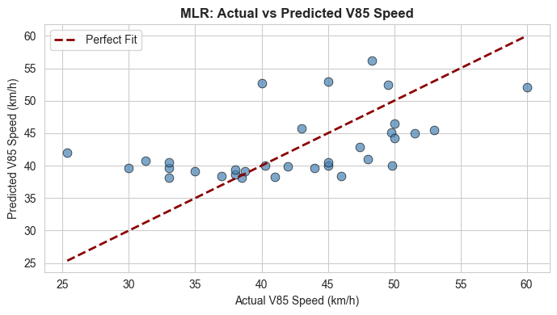
    


    

    


Residual Plot


```python
# MLR Residual Analysis

import seaborn as sns
import matplotlib.pyplot as plt

sns.set_style("whitegrid")

# Calculate residuals
mlr_residuals = y_test - y_test_pred_mlr

plt.figure(figsize=(7, 4))

# Scatter plot of residuals
sns.scatterplot(
    x=y_test_pred_mlr,
    y=mlr_residuals,
    color="steelblue",
    s=60,
    alpha=0.7,
    edgecolor="black"
)

# Reference line at zero residual
plt.axhline(
    y=0,
    linestyle="--",
    color="darkred",
    linewidth=2
)

plt.xlabel("Predicted V85 Speed (km/h)")
plt.ylabel("Residuals (km/h)")

plt.title(
    "MLR: Residuals vs Predicted V85 Speed",
    fontsize=12,
    fontweight="bold"
)

plt.tight_layout()
plt.show()
```


    

    


    
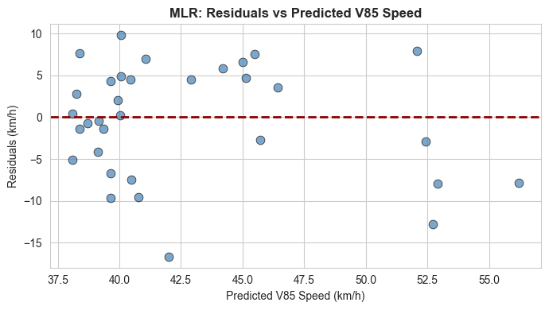
    


Result Table


```python
# Final MLR Performance Summary

mlr_final = pd.DataFrame({
    "Model": ["MLR"],
    "R2": [round(mlr_test_r2, 3)],
    "RMSE": [round(mlr_test_rmse, 3)],
    "MAE": [round(mlr_test_mae, 3)]
})

# Display results
display(mlr_final)
```


<div>
<style scoped>
    .dataframe tbody tr th:only-of-type {
        vertical-align: middle;
    }

    .dataframe tbody tr th {
        vertical-align: top;
    }

    .dataframe thead th {
        text-align: right;
    }
</style>
<table border="1" class="dataframe">
  <thead>
    <tr style="text-align: right;">
      <th></th>
      <th>Model</th>
      <th>R2</th>
      <th>RMSE</th>
      <th>MAE</th>
    </tr>
  </thead>
  <tbody>
    <tr>
      <th>0</th>
      <td>MLR</td>
      <td>0.246</td>
      <td>6.604</td>
      <td>5.493</td>
    </tr>
  </tbody>
</table>
</div>


<div>
<style scoped>
    .dataframe tbody tr th:only-of-type {
        vertical-align: middle;
    }

    .dataframe tbody tr th {
        vertical-align: top;
    }

    .dataframe thead th {
        text-align: right;
    }
</style>
<table border="1" class="dataframe">
  <thead>
    <tr style="text-align: right;">
      <th></th>
      <th>Model</th>
      <th>R2</th>
      <th>RMSE</th>
      <th>MAE</th>
    </tr>
  </thead>
  <tbody>
    <tr>
      <th>0</th>
      <td>MLR</td>
      <td>0.246</td>
      <td>6.604</td>
      <td>5.493</td>
    </tr>
  </tbody>
</table>
</div>


RANDOM FOREST MODEL

Random Forest Model Training


```python
# Random Forest Regression (RF)

from sklearn.ensemble import RandomForestRegressor

# Initialize Random Forest model
rf = RandomForestRegressor(
    random_state=42
)

# Train RF using unscaled training data
rf.fit(X_train, y_train)
```


<style>#sk-container-id-3 {
  /* Definition of color scheme common for light and dark mode */
  --sklearn-color-text: #000;
  --sklearn-color-text-muted: #666;
  --sklearn-color-line: gray;
  /* Definition of color scheme for unfitted estimators */
  --sklearn-color-unfitted-level-0: #fff5e6;
  --sklearn-color-unfitted-level-1: #f6e4d2;
  --sklearn-color-unfitted-level-2: #ffe0b3;
  --sklearn-color-unfitted-level-3: chocolate;
  /* Definition of color scheme for fitted estimators */
  --sklearn-color-fitted-level-0: #f0f8ff;
  --sklearn-color-fitted-level-1: #d4ebff;
  --sklearn-color-fitted-level-2: #b3dbfd;
  --sklearn-color-fitted-level-3: cornflowerblue;
}

#sk-container-id-3.light {
  /* Specific color for light theme */
  --sklearn-color-text-on-default-background: black;
  --sklearn-color-background: white;
  --sklearn-color-border-box: black;
  --sklearn-color-icon: #696969;
}

#sk-container-id-3.dark {
  --sklearn-color-text-on-default-background: white;
  --sklearn-color-background: #111;
  --sklearn-color-border-box: white;
  --sklearn-color-icon: #878787;
}

#sk-container-id-3 {
  color: var(--sklearn-color-text);
}

#sk-container-id-3 pre {
  padding: 0;
}

#sk-container-id-3 input.sk-hidden--visually {
  border: 0;
  clip: rect(1px 1px 1px 1px);
  clip: rect(1px, 1px, 1px, 1px);
  height: 1px;
  margin: -1px;
  overflow: hidden;
  padding: 0;
  position: absolute;
  width: 1px;
}

#sk-container-id-3 div.sk-dashed-wrapped {
  border: 1px dashed var(--sklearn-color-line);
  margin: 0 0.4em 0.5em 0.4em;
  box-sizing: border-box;
  padding-bottom: 0.4em;
  background-color: var(--sklearn-color-background);
}

#sk-container-id-3 div.sk-container {
  /* jupyter's `normalize.less` sets `[hidden] { display: none; }`
     but bootstrap.min.css set `[hidden] { display: none !important; }`
     so we also need the `!important` here to be able to override the
     default hidden behavior on the sphinx rendered scikit-learn.org.
     See: https://github.com/scikit-learn/scikit-learn/issues/21755 */
  display: inline-block !important;
  position: relative;
}

#sk-container-id-3 div.sk-text-repr-fallback {
  display: none;
}

div.sk-parallel-item,
div.sk-serial,
div.sk-item {
  /* draw centered vertical line to link estimators */
  background-image: linear-gradient(var(--sklearn-color-text-on-default-background), var(--sklearn-color-text-on-default-background));
  background-size: 2px 100%;
  background-repeat: no-repeat;
  background-position: center center;
}

/* Parallel-specific style estimator block */

#sk-container-id-3 div.sk-parallel-item::after {
  content: "";
  width: 100%;
  border-bottom: 2px solid var(--sklearn-color-text-on-default-background);
  flex-grow: 1;
}

#sk-container-id-3 div.sk-parallel {
  display: flex;
  align-items: stretch;
  justify-content: center;
  background-color: var(--sklearn-color-background);
  position: relative;
}

#sk-container-id-3 div.sk-parallel-item {
  display: flex;
  flex-direction: column;
}

#sk-container-id-3 div.sk-parallel-item:first-child::after {
  align-self: flex-end;
  width: 50%;
}

#sk-container-id-3 div.sk-parallel-item:last-child::after {
  align-self: flex-start;
  width: 50%;
}

#sk-container-id-3 div.sk-parallel-item:only-child::after {
  width: 0;
}

/* Serial-specific style estimator block */

#sk-container-id-3 div.sk-serial {
  display: flex;
  flex-direction: column;
  align-items: center;
  background-color: var(--sklearn-color-background);
  padding-right: 1em;
  padding-left: 1em;
}


/* Toggleable style: style used for estimator/Pipeline/ColumnTransformer box that is
clickable and can be expanded/collapsed.
- Pipeline and ColumnTransformer use this feature and define the default style
- Estimators will overwrite some part of the style using the `sk-estimator` class
*/

/* Pipeline and ColumnTransformer style (default) */

#sk-container-id-3 div.sk-toggleable {
  /* Default theme specific background. It is overwritten whether we have a
  specific estimator or a Pipeline/ColumnTransformer */
  background-color: var(--sklearn-color-background);
}

/* Toggleable label */
#sk-container-id-3 label.sk-toggleable__label {
  cursor: pointer;
  display: flex;
  width: 100%;
  margin-bottom: 0;
  padding: 0.5em;
  box-sizing: border-box;
  text-align: center;
  align-items: center;
  justify-content: center;
  gap: 0.5em;
}

#sk-container-id-3 label.sk-toggleable__label .caption {
  font-size: 0.6rem;
  font-weight: lighter;
  color: var(--sklearn-color-text-muted);
}

#sk-container-id-3 label.sk-toggleable__label-arrow:before {
  /* Arrow on the left of the label */
  content: "▸";
  float: left;
  margin-right: 0.25em;
  color: var(--sklearn-color-icon);
}

#sk-container-id-3 label.sk-toggleable__label-arrow:hover:before {
  color: var(--sklearn-color-text);
}

/* Toggleable content - dropdown */

#sk-container-id-3 div.sk-toggleable__content {
  display: none;
  text-align: left;
  /* unfitted */
  background-color: var(--sklearn-color-unfitted-level-0);
}

#sk-container-id-3 div.sk-toggleable__content.fitted {
  /* fitted */
  background-color: var(--sklearn-color-fitted-level-0);
}

#sk-container-id-3 div.sk-toggleable__content pre {
  margin: 0.2em;
  border-radius: 0.25em;
  color: var(--sklearn-color-text);
  /* unfitted */
  background-color: var(--sklearn-color-unfitted-level-0);
}

#sk-container-id-3 div.sk-toggleable__content.fitted pre {
  /* unfitted */
  background-color: var(--sklearn-color-fitted-level-0);
}

#sk-container-id-3 input.sk-toggleable__control:checked~div.sk-toggleable__content {
  /* Expand drop-down */
  display: block;
  width: 100%;
  overflow: visible;
}

#sk-container-id-3 input.sk-toggleable__control:checked~label.sk-toggleable__label-arrow:before {
  content: "▾";
}

/* Pipeline/ColumnTransformer-specific style */

#sk-container-id-3 div.sk-label input.sk-toggleable__control:checked~label.sk-toggleable__label {
  color: var(--sklearn-color-text);
  background-color: var(--sklearn-color-unfitted-level-2);
}

#sk-container-id-3 div.sk-label.fitted input.sk-toggleable__control:checked~label.sk-toggleable__label {
  background-color: var(--sklearn-color-fitted-level-2);
}

/* Estimator-specific style */

/* Colorize estimator box */
#sk-container-id-3 div.sk-estimator input.sk-toggleable__control:checked~label.sk-toggleable__label {
  /* unfitted */
  background-color: var(--sklearn-color-unfitted-level-2);
}

#sk-container-id-3 div.sk-estimator.fitted input.sk-toggleable__control:checked~label.sk-toggleable__label {
  /* fitted */
  background-color: var(--sklearn-color-fitted-level-2);
}

#sk-container-id-3 div.sk-label label.sk-toggleable__label,
#sk-container-id-3 div.sk-label label {
  /* The background is the default theme color */
  color: var(--sklearn-color-text-on-default-background);
}

/* On hover, darken the color of the background */
#sk-container-id-3 div.sk-label:hover label.sk-toggleable__label {
  color: var(--sklearn-color-text);
  background-color: var(--sklearn-color-unfitted-level-2);
}

/* Label box, darken color on hover, fitted */
#sk-container-id-3 div.sk-label.fitted:hover label.sk-toggleable__label.fitted {
  color: var(--sklearn-color-text);
  background-color: var(--sklearn-color-fitted-level-2);
}

/* Estimator label */

#sk-container-id-3 div.sk-label label {
  font-family: monospace;
  font-weight: bold;
  line-height: 1.2em;
}

#sk-container-id-3 div.sk-label-container {
  text-align: center;
}

/* Estimator-specific */
#sk-container-id-3 div.sk-estimator {
  font-family: monospace;
  border: 1px dotted var(--sklearn-color-border-box);
  border-radius: 0.25em;
  box-sizing: border-box;
  margin-bottom: 0.5em;
  /* unfitted */
  background-color: var(--sklearn-color-unfitted-level-0);
}

#sk-container-id-3 div.sk-estimator.fitted {
  /* fitted */
  background-color: var(--sklearn-color-fitted-level-0);
}

/* on hover */
#sk-container-id-3 div.sk-estimator:hover {
  /* unfitted */
  background-color: var(--sklearn-color-unfitted-level-2);
}

#sk-container-id-3 div.sk-estimator.fitted:hover {
  /* fitted */
  background-color: var(--sklearn-color-fitted-level-2);
}

/* Specification for estimator info (e.g. "i" and "?") */

/* Common style for "i" and "?" */

.sk-estimator-doc-link,
a:link.sk-estimator-doc-link,
a:visited.sk-estimator-doc-link {
  float: right;
  font-size: smaller;
  line-height: 1em;
  font-family: monospace;
  background-color: var(--sklearn-color-unfitted-level-0);
  border-radius: 1em;
  height: 1em;
  width: 1em;
  text-decoration: none !important;
  margin-left: 0.5em;
  text-align: center;
  /* unfitted */
  border: var(--sklearn-color-unfitted-level-3) 1pt solid;
  color: var(--sklearn-color-unfitted-level-3);
}

.sk-estimator-doc-link.fitted,
a:link.sk-estimator-doc-link.fitted,
a:visited.sk-estimator-doc-link.fitted {
  /* fitted */
  background-color: var(--sklearn-color-fitted-level-0);
  border: var(--sklearn-color-fitted-level-3) 1pt solid;
  color: var(--sklearn-color-fitted-level-3);
}

/* On hover */
div.sk-estimator:hover .sk-estimator-doc-link:hover,
.sk-estimator-doc-link:hover,
div.sk-label-container:hover .sk-estimator-doc-link:hover,
.sk-estimator-doc-link:hover {
  /* unfitted */
  background-color: var(--sklearn-color-unfitted-level-3);
  border: var(--sklearn-color-fitted-level-0) 1pt solid;
  color: var(--sklearn-color-unfitted-level-0);
  text-decoration: none;
}

div.sk-estimator.fitted:hover .sk-estimator-doc-link.fitted:hover,
.sk-estimator-doc-link.fitted:hover,
div.sk-label-container:hover .sk-estimator-doc-link.fitted:hover,
.sk-estimator-doc-link.fitted:hover {
  /* fitted */
  background-color: var(--sklearn-color-fitted-level-3);
  border: var(--sklearn-color-fitted-level-0) 1pt solid;
  color: var(--sklearn-color-fitted-level-0);
  text-decoration: none;
}

/* Span, style for the box shown on hovering the info icon */
.sk-estimator-doc-link span {
  display: none;
  z-index: 9999;
  position: relative;
  font-weight: normal;
  right: .2ex;
  padding: .5ex;
  margin: .5ex;
  width: min-content;
  min-width: 20ex;
  max-width: 50ex;
  color: var(--sklearn-color-text);
  box-shadow: 2pt 2pt 4pt #999;
  /* unfitted */
  background: var(--sklearn-color-unfitted-level-0);
  border: .5pt solid var(--sklearn-color-unfitted-level-3);
}

.sk-estimator-doc-link.fitted span {
  /* fitted */
  background: var(--sklearn-color-fitted-level-0);
  border: var(--sklearn-color-fitted-level-3);
}

.sk-estimator-doc-link:hover span {
  display: block;
}

/* "?"-specific style due to the `<a>` HTML tag */

#sk-container-id-3 a.estimator_doc_link {
  float: right;
  font-size: 1rem;
  line-height: 1em;
  font-family: monospace;
  background-color: var(--sklearn-color-unfitted-level-0);
  border-radius: 1rem;
  height: 1rem;
  width: 1rem;
  text-decoration: none;
  /* unfitted */
  color: var(--sklearn-color-unfitted-level-1);
  border: var(--sklearn-color-unfitted-level-1) 1pt solid;
}

#sk-container-id-3 a.estimator_doc_link.fitted {
  /* fitted */
  background-color: var(--sklearn-color-fitted-level-0);
  border: var(--sklearn-color-fitted-level-1) 1pt solid;
  color: var(--sklearn-color-fitted-level-1);
}

/* On hover */
#sk-container-id-3 a.estimator_doc_link:hover {
  /* unfitted */
  background-color: var(--sklearn-color-unfitted-level-3);
  color: var(--sklearn-color-background);
  text-decoration: none;
}

#sk-container-id-3 a.estimator_doc_link.fitted:hover {
  /* fitted */
  background-color: var(--sklearn-color-fitted-level-3);
}

.estimator-table {
    font-family: monospace;
}

.estimator-table summary {
    padding: .5rem;
    cursor: pointer;
}

.estimator-table summary::marker {
    font-size: 0.7rem;
}

.estimator-table details[open] {
    padding-left: 0.1rem;
    padding-right: 0.1rem;
    padding-bottom: 0.3rem;
}

.estimator-table .parameters-table {
    margin-left: auto !important;
    margin-right: auto !important;
    margin-top: 0;
}

.estimator-table .parameters-table tr:nth-child(odd) {
    background-color: #fff;
}

.estimator-table .parameters-table tr:nth-child(even) {
    background-color: #f6f6f6;
}

.estimator-table .parameters-table tr:hover {
    background-color: #e0e0e0;
}

.estimator-table table td {
    border: 1px solid rgba(106, 105, 104, 0.232);
}

/*
    `table td`is set in notebook with right text-align.
    We need to overwrite it.
*/
.estimator-table table td.param {
    text-align: left;
    position: relative;
    padding: 0;
}

.user-set td {
    color:rgb(255, 94, 0);
    text-align: left !important;
}

.user-set td.value {
    color:rgb(255, 94, 0);
    background-color: transparent;
}

.default td {
    color: black;
    text-align: left !important;
}

.user-set td i,
.default td i {
    color: black;
}

/*
    Styles for parameter documentation links
    We need styling for visited so jupyter doesn't overwrite it
*/
a.param-doc-link,
a.param-doc-link:link,
a.param-doc-link:visited {
    text-decoration: underline dashed;
    text-underline-offset: .3em;
    color: inherit;
    display: block;
    padding: .5em;
}

/* "hack" to make the entire area of the cell containing the link clickable */
a.param-doc-link::before {
    position: absolute;
    content: "";
    inset: 0;
}

.param-doc-description {
    display: none;
    position: absolute;
    z-index: 9999;
    left: 0;
    padding: .5ex;
    margin-left: 1.5em;
    color: var(--sklearn-color-text);
    box-shadow: .3em .3em .4em #999;
    width: max-content;
    text-align: left;
    max-height: 10em;
    overflow-y: auto;

    /* unfitted */
    background: var(--sklearn-color-unfitted-level-0);
    border: thin solid var(--sklearn-color-unfitted-level-3);
}

/* Fitted state for parameter tooltips */
.fitted .param-doc-description {
    /* fitted */
    background: var(--sklearn-color-fitted-level-0);
    border: thin solid var(--sklearn-color-fitted-level-3);
}

.param-doc-link:hover .param-doc-description {
    display: block;
}

.copy-paste-icon {
    background-image: url();
    background-repeat: no-repeat;
    background-size: 14px 14px;
    background-position: 0;
    display: inline-block;
    width: 14px;
    height: 14px;
    cursor: pointer;
}
</style><body><div id="sk-container-id-3" class="sk-top-container"><div class="sk-text-repr-fallback"><pre>RandomForestRegressor(random_state=42)</pre><b>In a Jupyter environment, please rerun this cell to show the HTML representation or trust the notebook. <br />On GitHub, the HTML representation is unable to render, please try loading this page with nbviewer.org.</b></div><div class="sk-container" hidden><div class="sk-item"><div class="sk-estimator fitted sk-toggleable"><input class="sk-toggleable__control sk-hidden--visually" id="sk-estimator-id-3" type="checkbox" checked><label for="sk-estimator-id-3" class="sk-toggleable__label fitted sk-toggleable__label-arrow"><div><div>RandomForestRegressor</div></div><div><a class="sk-estimator-doc-link fitted" rel="noreferrer" target="_blank" href="https://scikit-learn.org/1.8/modules/generated/sklearn.ensemble.RandomForestRegressor.html">?<span>Documentation for RandomForestRegressor</span></a><span class="sk-estimator-doc-link fitted">i<span>Fitted</span></span></div></label><div class="sk-toggleable__content fitted" data-param-prefix="">
        <div class="estimator-table">
            <details>
                <summary>Parameters</summary>
                <table class="parameters-table">
                  <tbody>

        <tr class="default">
            <td><i class="copy-paste-icon"
                 onclick="copyToClipboard('n_estimators',
                          this.parentElement.nextElementSibling)"
            ></i></td>
            <td class="param">
        <a class="param-doc-link"
            rel="noreferrer" target="_blank" href="https://scikit-learn.org/1.8/modules/generated/sklearn.ensemble.RandomForestRegressor.html#:~:text=n_estimators,-int%2C%20default%3D100">
            n_estimators
            <span class="param-doc-description">n_estimators: int, default=100<br><br>The number of trees in the forest.<br><br>.. versionchanged:: 0.22<br>   The default value of ``n_estimators`` changed from 10 to 100<br>   in 0.22.</span>
        </a>
    </td>
            <td class="value">100</td>
        </tr>


        <tr class="default">
            <td><i class="copy-paste-icon"
                 onclick="copyToClipboard('criterion',
                          this.parentElement.nextElementSibling)"
            ></i></td>
            <td class="param">
        <a class="param-doc-link"
            rel="noreferrer" target="_blank" href="https://scikit-learn.org/1.8/modules/generated/sklearn.ensemble.RandomForestRegressor.html#:~:text=criterion,-%7B%22squared_error%22%2C%20%22absolute_error%22%2C%20%22friedman_mse%22%2C%20%22poisson%22%7D%2C%20%20%20%20%20%20%20%20%20%20%20%20%20default%3D%22squared_error%22">
            criterion
            <span class="param-doc-description">criterion: {"squared_error", "absolute_error", "friedman_mse", "poisson"},             default="squared_error"<br><br>The function to measure the quality of a split. Supported criteria<br>are "squared_error" for the mean squared error, which is equal to<br>variance reduction as feature selection criterion and minimizes the L2<br>loss using the mean of each terminal node, "friedman_mse", which uses<br>mean squared error with Friedman's improvement score for potential<br>splits, "absolute_error" for the mean absolute error, which minimizes<br>the L1 loss using the median of each terminal node, and "poisson" which<br>uses reduction in Poisson deviance to find splits.<br>Training using "absolute_error" is significantly slower<br>than when using "squared_error".<br><br>.. versionadded:: 0.18<br>   Mean Absolute Error (MAE) criterion.<br><br>.. versionadded:: 1.0<br>   Poisson criterion.</span>
        </a>
    </td>
            <td class="value">&#x27;squared_error&#x27;</td>
        </tr>


        <tr class="default">
            <td><i class="copy-paste-icon"
                 onclick="copyToClipboard('max_depth',
                          this.parentElement.nextElementSibling)"
            ></i></td>
            <td class="param">
        <a class="param-doc-link"
            rel="noreferrer" target="_blank" href="https://scikit-learn.org/1.8/modules/generated/sklearn.ensemble.RandomForestRegressor.html#:~:text=max_depth,-int%2C%20default%3DNone">
            max_depth
            <span class="param-doc-description">max_depth: int, default=None<br><br>The maximum depth of the tree. If None, then nodes are expanded until<br>all leaves are pure or until all leaves contain less than<br>min_samples_split samples.</span>
        </a>
    </td>
            <td class="value">None</td>
        </tr>


        <tr class="default">
            <td><i class="copy-paste-icon"
                 onclick="copyToClipboard('min_samples_split',
                          this.parentElement.nextElementSibling)"
            ></i></td>
            <td class="param">
        <a class="param-doc-link"
            rel="noreferrer" target="_blank" href="https://scikit-learn.org/1.8/modules/generated/sklearn.ensemble.RandomForestRegressor.html#:~:text=min_samples_split,-int%20or%20float%2C%20default%3D2">
            min_samples_split
            <span class="param-doc-description">min_samples_split: int or float, default=2<br><br>The minimum number of samples required to split an internal node:<br><br>- If int, then consider `min_samples_split` as the minimum number.<br>- If float, then `min_samples_split` is a fraction and<br>  `ceil(min_samples_split * n_samples)` are the minimum<br>  number of samples for each split.<br><br>.. versionchanged:: 0.18<br>   Added float values for fractions.</span>
        </a>
    </td>
            <td class="value">2</td>
        </tr>


        <tr class="default">
            <td><i class="copy-paste-icon"
                 onclick="copyToClipboard('min_samples_leaf',
                          this.parentElement.nextElementSibling)"
            ></i></td>
            <td class="param">
        <a class="param-doc-link"
            rel="noreferrer" target="_blank" href="https://scikit-learn.org/1.8/modules/generated/sklearn.ensemble.RandomForestRegressor.html#:~:text=min_samples_leaf,-int%20or%20float%2C%20default%3D1">
            min_samples_leaf
            <span class="param-doc-description">min_samples_leaf: int or float, default=1<br><br>The minimum number of samples required to be at a leaf node.<br>A split point at any depth will only be considered if it leaves at<br>least ``min_samples_leaf`` training samples in each of the left and<br>right branches.  This may have the effect of smoothing the model,<br>especially in regression.<br><br>- If int, then consider `min_samples_leaf` as the minimum number.<br>- If float, then `min_samples_leaf` is a fraction and<br>  `ceil(min_samples_leaf * n_samples)` are the minimum<br>  number of samples for each node.<br><br>.. versionchanged:: 0.18<br>   Added float values for fractions.</span>
        </a>
    </td>
            <td class="value">1</td>
        </tr>


        <tr class="default">
            <td><i class="copy-paste-icon"
                 onclick="copyToClipboard('min_weight_fraction_leaf',
                          this.parentElement.nextElementSibling)"
            ></i></td>
            <td class="param">
        <a class="param-doc-link"
            rel="noreferrer" target="_blank" href="https://scikit-learn.org/1.8/modules/generated/sklearn.ensemble.RandomForestRegressor.html#:~:text=min_weight_fraction_leaf,-float%2C%20default%3D0.0">
            min_weight_fraction_leaf
            <span class="param-doc-description">min_weight_fraction_leaf: float, default=0.0<br><br>The minimum weighted fraction of the sum total of weights (of all<br>the input samples) required to be at a leaf node. Samples have<br>equal weight when sample_weight is not provided.</span>
        </a>
    </td>
            <td class="value">0.0</td>
        </tr>


        <tr class="default">
            <td><i class="copy-paste-icon"
                 onclick="copyToClipboard('max_features',
                          this.parentElement.nextElementSibling)"
            ></i></td>
            <td class="param">
        <a class="param-doc-link"
            rel="noreferrer" target="_blank" href="https://scikit-learn.org/1.8/modules/generated/sklearn.ensemble.RandomForestRegressor.html#:~:text=max_features,-%7B%22sqrt%22%2C%20%22log2%22%2C%20None%7D%2C%20int%20or%20float%2C%20default%3D1.0">
            max_features
            <span class="param-doc-description">max_features: {"sqrt", "log2", None}, int or float, default=1.0<br><br>The number of features to consider when looking for the best split:<br><br>- If int, then consider `max_features` features at each split.<br>- If float, then `max_features` is a fraction and<br>  `max(1, int(max_features * n_features_in_))` features are considered at each<br>  split.<br>- If "sqrt", then `max_features=sqrt(n_features)`.<br>- If "log2", then `max_features=log2(n_features)`.<br>- If None or 1.0, then `max_features=n_features`.<br><br>.. note::<br>    The default of 1.0 is equivalent to bagged trees and more<br>    randomness can be achieved by setting smaller values, e.g. 0.3.<br><br>.. versionchanged:: 1.1<br>    The default of `max_features` changed from `"auto"` to 1.0.<br><br>Note: the search for a split does not stop until at least one<br>valid partition of the node samples is found, even if it requires to<br>effectively inspect more than ``max_features`` features.</span>
        </a>
    </td>
            <td class="value">1.0</td>
        </tr>


        <tr class="default">
            <td><i class="copy-paste-icon"
                 onclick="copyToClipboard('max_leaf_nodes',
                          this.parentElement.nextElementSibling)"
            ></i></td>
            <td class="param">
        <a class="param-doc-link"
            rel="noreferrer" target="_blank" href="https://scikit-learn.org/1.8/modules/generated/sklearn.ensemble.RandomForestRegressor.html#:~:text=max_leaf_nodes,-int%2C%20default%3DNone">
            max_leaf_nodes
            <span class="param-doc-description">max_leaf_nodes: int, default=None<br><br>Grow trees with ``max_leaf_nodes`` in best-first fashion.<br>Best nodes are defined as relative reduction in impurity.<br>If None then unlimited number of leaf nodes.</span>
        </a>
    </td>
            <td class="value">None</td>
        </tr>


        <tr class="default">
            <td><i class="copy-paste-icon"
                 onclick="copyToClipboard('min_impurity_decrease',
                          this.parentElement.nextElementSibling)"
            ></i></td>
            <td class="param">
        <a class="param-doc-link"
            rel="noreferrer" target="_blank" href="https://scikit-learn.org/1.8/modules/generated/sklearn.ensemble.RandomForestRegressor.html#:~:text=min_impurity_decrease,-float%2C%20default%3D0.0">
            min_impurity_decrease
            <span class="param-doc-description">min_impurity_decrease: float, default=0.0<br><br>A node will be split if this split induces a decrease of the impurity<br>greater than or equal to this value.<br><br>The weighted impurity decrease equation is the following::<br><br>    N_t / N * (impurity - N_t_R / N_t * right_impurity<br>                        - N_t_L / N_t * left_impurity)<br><br>where ``N`` is the total number of samples, ``N_t`` is the number of<br>samples at the current node, ``N_t_L`` is the number of samples in the<br>left child, and ``N_t_R`` is the number of samples in the right child.<br><br>``N``, ``N_t``, ``N_t_R`` and ``N_t_L`` all refer to the weighted sum,<br>if ``sample_weight`` is passed.<br><br>.. versionadded:: 0.19</span>
        </a>
    </td>
            <td class="value">0.0</td>
        </tr>


        <tr class="default">
            <td><i class="copy-paste-icon"
                 onclick="copyToClipboard('bootstrap',
                          this.parentElement.nextElementSibling)"
            ></i></td>
            <td class="param">
        <a class="param-doc-link"
            rel="noreferrer" target="_blank" href="https://scikit-learn.org/1.8/modules/generated/sklearn.ensemble.RandomForestRegressor.html#:~:text=bootstrap,-bool%2C%20default%3DTrue">
            bootstrap
            <span class="param-doc-description">bootstrap: bool, default=True<br><br>Whether bootstrap samples are used when building trees. If False, the<br>whole dataset is used to build each tree.</span>
        </a>
    </td>
            <td class="value">True</td>
        </tr>


        <tr class="default">
            <td><i class="copy-paste-icon"
                 onclick="copyToClipboard('oob_score',
                          this.parentElement.nextElementSibling)"
            ></i></td>
            <td class="param">
        <a class="param-doc-link"
            rel="noreferrer" target="_blank" href="https://scikit-learn.org/1.8/modules/generated/sklearn.ensemble.RandomForestRegressor.html#:~:text=oob_score,-bool%20or%20callable%2C%20default%3DFalse">
            oob_score
            <span class="param-doc-description">oob_score: bool or callable, default=False<br><br>Whether to use out-of-bag samples to estimate the generalization score.<br>By default, :func:`~sklearn.metrics.r2_score` is used.<br>Provide a callable with signature `metric(y_true, y_pred)` to use a<br>custom metric. Only available if `bootstrap=True`.<br><br>For an illustration of out-of-bag (OOB) error estimation, see the example<br>:ref:`sphx_glr_auto_examples_ensemble_plot_ensemble_oob.py`.</span>
        </a>
    </td>
            <td class="value">False</td>
        </tr>


        <tr class="default">
            <td><i class="copy-paste-icon"
                 onclick="copyToClipboard('n_jobs',
                          this.parentElement.nextElementSibling)"
            ></i></td>
            <td class="param">
        <a class="param-doc-link"
            rel="noreferrer" target="_blank" href="https://scikit-learn.org/1.8/modules/generated/sklearn.ensemble.RandomForestRegressor.html#:~:text=n_jobs,-int%2C%20default%3DNone">
            n_jobs
            <span class="param-doc-description">n_jobs: int, default=None<br><br>The number of jobs to run in parallel. :meth:`fit`, :meth:`predict`,<br>:meth:`decision_path` and :meth:`apply` are all parallelized over the<br>trees. ``None`` means 1 unless in a :obj:`joblib.parallel_backend`<br>context. ``-1`` means using all processors. See :term:`Glossary<br><n_jobs>` for more details.</span>
        </a>
    </td>
            <td class="value">None</td>
        </tr>


        <tr class="user-set">
            <td><i class="copy-paste-icon"
                 onclick="copyToClipboard('random_state',
                          this.parentElement.nextElementSibling)"
            ></i></td>
            <td class="param">
        <a class="param-doc-link"
            rel="noreferrer" target="_blank" href="https://scikit-learn.org/1.8/modules/generated/sklearn.ensemble.RandomForestRegressor.html#:~:text=random_state,-int%2C%20RandomState%20instance%20or%20None%2C%20default%3DNone">
            random_state
            <span class="param-doc-description">random_state: int, RandomState instance or None, default=None<br><br>Controls both the randomness of the bootstrapping of the samples used<br>when building trees (if ``bootstrap=True``) and the sampling of the<br>features to consider when looking for the best split at each node<br>(if ``max_features < n_features``).<br>See :term:`Glossary <random_state>` for details.</span>
        </a>
    </td>
            <td class="value">42</td>
        </tr>


        <tr class="default">
            <td><i class="copy-paste-icon"
                 onclick="copyToClipboard('verbose',
                          this.parentElement.nextElementSibling)"
            ></i></td>
            <td class="param">
        <a class="param-doc-link"
            rel="noreferrer" target="_blank" href="https://scikit-learn.org/1.8/modules/generated/sklearn.ensemble.RandomForestRegressor.html#:~:text=verbose,-int%2C%20default%3D0">
            verbose
            <span class="param-doc-description">verbose: int, default=0<br><br>Controls the verbosity when fitting and predicting.</span>
        </a>
    </td>
            <td class="value">0</td>
        </tr>


        <tr class="default">
            <td><i class="copy-paste-icon"
                 onclick="copyToClipboard('warm_start',
                          this.parentElement.nextElementSibling)"
            ></i></td>
            <td class="param">
        <a class="param-doc-link"
            rel="noreferrer" target="_blank" href="https://scikit-learn.org/1.8/modules/generated/sklearn.ensemble.RandomForestRegressor.html#:~:text=warm_start,-bool%2C%20default%3DFalse">
            warm_start
            <span class="param-doc-description">warm_start: bool, default=False<br><br>When set to ``True``, reuse the solution of the previous call to fit<br>and add more estimators to the ensemble, otherwise, just fit a whole<br>new forest. See :term:`Glossary <warm_start>` and<br>:ref:`tree_ensemble_warm_start` for details.</span>
        </a>
    </td>
            <td class="value">False</td>
        </tr>


        <tr class="default">
            <td><i class="copy-paste-icon"
                 onclick="copyToClipboard('ccp_alpha',
                          this.parentElement.nextElementSibling)"
            ></i></td>
            <td class="param">
        <a class="param-doc-link"
            rel="noreferrer" target="_blank" href="https://scikit-learn.org/1.8/modules/generated/sklearn.ensemble.RandomForestRegressor.html#:~:text=ccp_alpha,-non-negative%20float%2C%20default%3D0.0">
            ccp_alpha
            <span class="param-doc-description">ccp_alpha: non-negative float, default=0.0<br><br>Complexity parameter used for Minimal Cost-Complexity Pruning. The<br>subtree with the largest cost complexity that is smaller than<br>``ccp_alpha`` will be chosen. By default, no pruning is performed. See<br>:ref:`minimal_cost_complexity_pruning` for details. See<br>:ref:`sphx_glr_auto_examples_tree_plot_cost_complexity_pruning.py`<br>for an example of such pruning.<br><br>.. versionadded:: 0.22</span>
        </a>
    </td>
            <td class="value">0.0</td>
        </tr>


        <tr class="default">
            <td><i class="copy-paste-icon"
                 onclick="copyToClipboard('max_samples',
                          this.parentElement.nextElementSibling)"
            ></i></td>
            <td class="param">
        <a class="param-doc-link"
            rel="noreferrer" target="_blank" href="https://scikit-learn.org/1.8/modules/generated/sklearn.ensemble.RandomForestRegressor.html#:~:text=max_samples,-int%20or%20float%2C%20default%3DNone">
            max_samples
            <span class="param-doc-description">max_samples: int or float, default=None<br><br>If bootstrap is True, the number of samples to draw from X<br>to train each base estimator.<br><br>- If None (default), then draw `X.shape[0]` samples.<br>- If int, then draw `max_samples` samples.<br>- If float, then draw `max(round(n_samples * max_samples), 1)` samples. Thus,<br>  `max_samples` should be in the interval `(0.0, 1.0]`.<br><br>.. versionadded:: 0.22</span>
        </a>
    </td>
            <td class="value">None</td>
        </tr>


        <tr class="default">
            <td><i class="copy-paste-icon"
                 onclick="copyToClipboard('monotonic_cst',
                          this.parentElement.nextElementSibling)"
            ></i></td>
            <td class="param">
        <a class="param-doc-link"
            rel="noreferrer" target="_blank" href="https://scikit-learn.org/1.8/modules/generated/sklearn.ensemble.RandomForestRegressor.html#:~:text=monotonic_cst,-array-like%20of%20int%20of%20shape%20%28n_features%29%2C%20default%3DNone">
            monotonic_cst
            <span class="param-doc-description">monotonic_cst: array-like of int of shape (n_features), default=None<br><br>Indicates the monotonicity constraint to enforce on each feature.<br>  - 1: monotonically increasing<br>  - 0: no constraint<br>  - -1: monotonically decreasing<br><br>If monotonic_cst is None, no constraints are applied.<br><br>Monotonicity constraints are not supported for:<br>  - multioutput regressions (i.e. when `n_outputs_ > 1`),<br>  - regressions trained on data with missing values.<br><br>Read more in the :ref:`User Guide <monotonic_cst_gbdt>`.<br><br>.. versionadded:: 1.4</span>
        </a>
    </td>
            <td class="value">None</td>
        </tr>

                  </tbody>
                </table>
            </details>
        </div>
    </div></div></div></div></div><script>function copyToClipboard(text, element) {
    // Get the parameter prefix from the closest toggleable content
    const toggleableContent = element.closest('.sk-toggleable__content');
    const paramPrefix = toggleableContent ? toggleableContent.dataset.paramPrefix : '';
    const fullParamName = paramPrefix ? `${paramPrefix}${text}` : text;

    const originalStyle = element.style;
    const computedStyle = window.getComputedStyle(element);
    const originalWidth = computedStyle.width;
    const originalHTML = element.innerHTML.replace('Copied!', '');

    navigator.clipboard.writeText(fullParamName)
        .then(() => {
            element.style.width = originalWidth;
            element.style.color = 'green';
            element.innerHTML = "Copied!";

            setTimeout(() => {
                element.innerHTML = originalHTML;
                element.style = originalStyle;
            }, 2000);
        })
        .catch(err => {
            console.error('Failed to copy:', err);
            element.style.color = 'red';
            element.innerHTML = "Failed!";
            setTimeout(() => {
                element.innerHTML = originalHTML;
                element.style = originalStyle;
            }, 2000);
        });
    return false;
}

document.querySelectorAll('.copy-paste-icon').forEach(function(element) {
    const toggleableContent = element.closest('.sk-toggleable__content');
    const paramPrefix = toggleableContent ? toggleableContent.dataset.paramPrefix : '';
    const paramName = element.parentElement.nextElementSibling
        .textContent.trim().split(' ')[0];
    const fullParamName = paramPrefix ? `${paramPrefix}${paramName}` : paramName;

    element.setAttribute('title', fullParamName);
});


/**
 * Adapted from Skrub
 * https://github.com/skrub-data/skrub/blob/403466d1d5d4dc76a7ef569b3f8228db59a31dc3/skrub/_reporting/_data/templates/report.js#L789
 * @returns "light" or "dark"
 */
function detectTheme(element) {
    const body = document.querySelector('body');

    // Check VSCode theme
    const themeKindAttr = body.getAttribute('data-vscode-theme-kind');
    const themeNameAttr = body.getAttribute('data-vscode-theme-name');

    if (themeKindAttr && themeNameAttr) {
        const themeKind = themeKindAttr.toLowerCase();
        const themeName = themeNameAttr.toLowerCase();

        if (themeKind.includes("dark") || themeName.includes("dark")) {
            return "dark";
        }
        if (themeKind.includes("light") || themeName.includes("light")) {
            return "light";
        }
    }

    // Check Jupyter theme
    if (body.getAttribute('data-jp-theme-light') === 'false') {
        return 'dark';
    } else if (body.getAttribute('data-jp-theme-light') === 'true') {
        return 'light';
    }

    // Guess based on a parent element's color
    const color = window.getComputedStyle(element.parentNode, null).getPropertyValue('color');
    const match = color.match(/^rgb\s*\(\s*(\d+)\s*,\s*(\d+)\s*,\s*(\d+)\s*\)\s*$/i);
    if (match) {
        const [r, g, b] = [
            parseFloat(match[1]),
            parseFloat(match[2]),
            parseFloat(match[3])
        ];

        // https://en.wikipedia.org/wiki/HSL_and_HSV#Lightness
        const luma = 0.299 * r + 0.587 * g + 0.114 * b;

        if (luma > 180) {
            // If the text is very bright we have a dark theme
            return 'dark';
        }
        if (luma < 75) {
            // If the text is very dark we have a light theme
            return 'light';
        }
        // Otherwise fall back to the next heuristic.
    }

    // Fallback to system preference
    return window.matchMedia('(prefers-color-scheme: dark)').matches ? 'dark' : 'light';
}


function forceTheme(elementId) {
    const estimatorElement = document.querySelector(`#${elementId}`);
    if (estimatorElement === null) {
        console.error(`Element with id ${elementId} not found.`);
    } else {
        const theme = detectTheme(estimatorElement);
        estimatorElement.classList.add(theme);
    }
}

forceTheme('sk-container-id-3');</script></body>


<style>#sk-container-id-4 {
  /* Definition of color scheme common for light and dark mode */
  --sklearn-color-text: #000;
  --sklearn-color-text-muted: #666;
  --sklearn-color-line: gray;
  /* Definition of color scheme for unfitted estimators */
  --sklearn-color-unfitted-level-0: #fff5e6;
  --sklearn-color-unfitted-level-1: #f6e4d2;
  --sklearn-color-unfitted-level-2: #ffe0b3;
  --sklearn-color-unfitted-level-3: chocolate;
  /* Definition of color scheme for fitted estimators */
  --sklearn-color-fitted-level-0: #f0f8ff;
  --sklearn-color-fitted-level-1: #d4ebff;
  --sklearn-color-fitted-level-2: #b3dbfd;
  --sklearn-color-fitted-level-3: cornflowerblue;
}

#sk-container-id-4.light {
  /* Specific color for light theme */
  --sklearn-color-text-on-default-background: black;
  --sklearn-color-background: white;
  --sklearn-color-border-box: black;
  --sklearn-color-icon: #696969;
}

#sk-container-id-4.dark {
  --sklearn-color-text-on-default-background: white;
  --sklearn-color-background: #111;
  --sklearn-color-border-box: white;
  --sklearn-color-icon: #878787;
}

#sk-container-id-4 {
  color: var(--sklearn-color-text);
}

#sk-container-id-4 pre {
  padding: 0;
}

#sk-container-id-4 input.sk-hidden--visually {
  border: 0;
  clip: rect(1px 1px 1px 1px);
  clip: rect(1px, 1px, 1px, 1px);
  height: 1px;
  margin: -1px;
  overflow: hidden;
  padding: 0;
  position: absolute;
  width: 1px;
}

#sk-container-id-4 div.sk-dashed-wrapped {
  border: 1px dashed var(--sklearn-color-line);
  margin: 0 0.4em 0.5em 0.4em;
  box-sizing: border-box;
  padding-bottom: 0.4em;
  background-color: var(--sklearn-color-background);
}

#sk-container-id-4 div.sk-container {
  /* jupyter's `normalize.less` sets `[hidden] { display: none; }`
     but bootstrap.min.css set `[hidden] { display: none !important; }`
     so we also need the `!important` here to be able to override the
     default hidden behavior on the sphinx rendered scikit-learn.org.
     See: https://github.com/scikit-learn/scikit-learn/issues/21755 */
  display: inline-block !important;
  position: relative;
}

#sk-container-id-4 div.sk-text-repr-fallback {
  display: none;
}

div.sk-parallel-item,
div.sk-serial,
div.sk-item {
  /* draw centered vertical line to link estimators */
  background-image: linear-gradient(var(--sklearn-color-text-on-default-background), var(--sklearn-color-text-on-default-background));
  background-size: 2px 100%;
  background-repeat: no-repeat;
  background-position: center center;
}

/* Parallel-specific style estimator block */

#sk-container-id-4 div.sk-parallel-item::after {
  content: "";
  width: 100%;
  border-bottom: 2px solid var(--sklearn-color-text-on-default-background);
  flex-grow: 1;
}

#sk-container-id-4 div.sk-parallel {
  display: flex;
  align-items: stretch;
  justify-content: center;
  background-color: var(--sklearn-color-background);
  position: relative;
}

#sk-container-id-4 div.sk-parallel-item {
  display: flex;
  flex-direction: column;
}

#sk-container-id-4 div.sk-parallel-item:first-child::after {
  align-self: flex-end;
  width: 50%;
}

#sk-container-id-4 div.sk-parallel-item:last-child::after {
  align-self: flex-start;
  width: 50%;
}

#sk-container-id-4 div.sk-parallel-item:only-child::after {
  width: 0;
}

/* Serial-specific style estimator block */

#sk-container-id-4 div.sk-serial {
  display: flex;
  flex-direction: column;
  align-items: center;
  background-color: var(--sklearn-color-background);
  padding-right: 1em;
  padding-left: 1em;
}


/* Toggleable style: style used for estimator/Pipeline/ColumnTransformer box that is
clickable and can be expanded/collapsed.
- Pipeline and ColumnTransformer use this feature and define the default style
- Estimators will overwrite some part of the style using the `sk-estimator` class
*/

/* Pipeline and ColumnTransformer style (default) */

#sk-container-id-4 div.sk-toggleable {
  /* Default theme specific background. It is overwritten whether we have a
  specific estimator or a Pipeline/ColumnTransformer */
  background-color: var(--sklearn-color-background);
}

/* Toggleable label */
#sk-container-id-4 label.sk-toggleable__label {
  cursor: pointer;
  display: flex;
  width: 100%;
  margin-bottom: 0;
  padding: 0.5em;
  box-sizing: border-box;
  text-align: center;
  align-items: center;
  justify-content: center;
  gap: 0.5em;
}

#sk-container-id-4 label.sk-toggleable__label .caption {
  font-size: 0.6rem;
  font-weight: lighter;
  color: var(--sklearn-color-text-muted);
}

#sk-container-id-4 label.sk-toggleable__label-arrow:before {
  /* Arrow on the left of the label */
  content: "▸";
  float: left;
  margin-right: 0.25em;
  color: var(--sklearn-color-icon);
}

#sk-container-id-4 label.sk-toggleable__label-arrow:hover:before {
  color: var(--sklearn-color-text);
}

/* Toggleable content - dropdown */

#sk-container-id-4 div.sk-toggleable__content {
  display: none;
  text-align: left;
  /* unfitted */
  background-color: var(--sklearn-color-unfitted-level-0);
}

#sk-container-id-4 div.sk-toggleable__content.fitted {
  /* fitted */
  background-color: var(--sklearn-color-fitted-level-0);
}

#sk-container-id-4 div.sk-toggleable__content pre {
  margin: 0.2em;
  border-radius: 0.25em;
  color: var(--sklearn-color-text);
  /* unfitted */
  background-color: var(--sklearn-color-unfitted-level-0);
}

#sk-container-id-4 div.sk-toggleable__content.fitted pre {
  /* unfitted */
  background-color: var(--sklearn-color-fitted-level-0);
}

#sk-container-id-4 input.sk-toggleable__control:checked~div.sk-toggleable__content {
  /* Expand drop-down */
  display: block;
  width: 100%;
  overflow: visible;
}

#sk-container-id-4 input.sk-toggleable__control:checked~label.sk-toggleable__label-arrow:before {
  content: "▾";
}

/* Pipeline/ColumnTransformer-specific style */

#sk-container-id-4 div.sk-label input.sk-toggleable__control:checked~label.sk-toggleable__label {
  color: var(--sklearn-color-text);
  background-color: var(--sklearn-color-unfitted-level-2);
}

#sk-container-id-4 div.sk-label.fitted input.sk-toggleable__control:checked~label.sk-toggleable__label {
  background-color: var(--sklearn-color-fitted-level-2);
}

/* Estimator-specific style */

/* Colorize estimator box */
#sk-container-id-4 div.sk-estimator input.sk-toggleable__control:checked~label.sk-toggleable__label {
  /* unfitted */
  background-color: var(--sklearn-color-unfitted-level-2);
}

#sk-container-id-4 div.sk-estimator.fitted input.sk-toggleable__control:checked~label.sk-toggleable__label {
  /* fitted */
  background-color: var(--sklearn-color-fitted-level-2);
}

#sk-container-id-4 div.sk-label label.sk-toggleable__label,
#sk-container-id-4 div.sk-label label {
  /* The background is the default theme color */
  color: var(--sklearn-color-text-on-default-background);
}

/* On hover, darken the color of the background */
#sk-container-id-4 div.sk-label:hover label.sk-toggleable__label {
  color: var(--sklearn-color-text);
  background-color: var(--sklearn-color-unfitted-level-2);
}

/* Label box, darken color on hover, fitted */
#sk-container-id-4 div.sk-label.fitted:hover label.sk-toggleable__label.fitted {
  color: var(--sklearn-color-text);
  background-color: var(--sklearn-color-fitted-level-2);
}

/* Estimator label */

#sk-container-id-4 div.sk-label label {
  font-family: monospace;
  font-weight: bold;
  line-height: 1.2em;
}

#sk-container-id-4 div.sk-label-container {
  text-align: center;
}

/* Estimator-specific */
#sk-container-id-4 div.sk-estimator {
  font-family: monospace;
  border: 1px dotted var(--sklearn-color-border-box);
  border-radius: 0.25em;
  box-sizing: border-box;
  margin-bottom: 0.5em;
  /* unfitted */
  background-color: var(--sklearn-color-unfitted-level-0);
}

#sk-container-id-4 div.sk-estimator.fitted {
  /* fitted */
  background-color: var(--sklearn-color-fitted-level-0);
}

/* on hover */
#sk-container-id-4 div.sk-estimator:hover {
  /* unfitted */
  background-color: var(--sklearn-color-unfitted-level-2);
}

#sk-container-id-4 div.sk-estimator.fitted:hover {
  /* fitted */
  background-color: var(--sklearn-color-fitted-level-2);
}

/* Specification for estimator info (e.g. "i" and "?") */

/* Common style for "i" and "?" */

.sk-estimator-doc-link,
a:link.sk-estimator-doc-link,
a:visited.sk-estimator-doc-link {
  float: right;
  font-size: smaller;
  line-height: 1em;
  font-family: monospace;
  background-color: var(--sklearn-color-unfitted-level-0);
  border-radius: 1em;
  height: 1em;
  width: 1em;
  text-decoration: none !important;
  margin-left: 0.5em;
  text-align: center;
  /* unfitted */
  border: var(--sklearn-color-unfitted-level-3) 1pt solid;
  color: var(--sklearn-color-unfitted-level-3);
}

.sk-estimator-doc-link.fitted,
a:link.sk-estimator-doc-link.fitted,
a:visited.sk-estimator-doc-link.fitted {
  /* fitted */
  background-color: var(--sklearn-color-fitted-level-0);
  border: var(--sklearn-color-fitted-level-3) 1pt solid;
  color: var(--sklearn-color-fitted-level-3);
}

/* On hover */
div.sk-estimator:hover .sk-estimator-doc-link:hover,
.sk-estimator-doc-link:hover,
div.sk-label-container:hover .sk-estimator-doc-link:hover,
.sk-estimator-doc-link:hover {
  /* unfitted */
  background-color: var(--sklearn-color-unfitted-level-3);
  border: var(--sklearn-color-fitted-level-0) 1pt solid;
  color: var(--sklearn-color-unfitted-level-0);
  text-decoration: none;
}

div.sk-estimator.fitted:hover .sk-estimator-doc-link.fitted:hover,
.sk-estimator-doc-link.fitted:hover,
div.sk-label-container:hover .sk-estimator-doc-link.fitted:hover,
.sk-estimator-doc-link.fitted:hover {
  /* fitted */
  background-color: var(--sklearn-color-fitted-level-3);
  border: var(--sklearn-color-fitted-level-0) 1pt solid;
  color: var(--sklearn-color-fitted-level-0);
  text-decoration: none;
}

/* Span, style for the box shown on hovering the info icon */
.sk-estimator-doc-link span {
  display: none;
  z-index: 9999;
  position: relative;
  font-weight: normal;
  right: .2ex;
  padding: .5ex;
  margin: .5ex;
  width: min-content;
  min-width: 20ex;
  max-width: 50ex;
  color: var(--sklearn-color-text);
  box-shadow: 2pt 2pt 4pt #999;
  /* unfitted */
  background: var(--sklearn-color-unfitted-level-0);
  border: .5pt solid var(--sklearn-color-unfitted-level-3);
}

.sk-estimator-doc-link.fitted span {
  /* fitted */
  background: var(--sklearn-color-fitted-level-0);
  border: var(--sklearn-color-fitted-level-3);
}

.sk-estimator-doc-link:hover span {
  display: block;
}

/* "?"-specific style due to the `<a>` HTML tag */

#sk-container-id-4 a.estimator_doc_link {
  float: right;
  font-size: 1rem;
  line-height: 1em;
  font-family: monospace;
  background-color: var(--sklearn-color-unfitted-level-0);
  border-radius: 1rem;
  height: 1rem;
  width: 1rem;
  text-decoration: none;
  /* unfitted */
  color: var(--sklearn-color-unfitted-level-1);
  border: var(--sklearn-color-unfitted-level-1) 1pt solid;
}

#sk-container-id-4 a.estimator_doc_link.fitted {
  /* fitted */
  background-color: var(--sklearn-color-fitted-level-0);
  border: var(--sklearn-color-fitted-level-1) 1pt solid;
  color: var(--sklearn-color-fitted-level-1);
}

/* On hover */
#sk-container-id-4 a.estimator_doc_link:hover {
  /* unfitted */
  background-color: var(--sklearn-color-unfitted-level-3);
  color: var(--sklearn-color-background);
  text-decoration: none;
}

#sk-container-id-4 a.estimator_doc_link.fitted:hover {
  /* fitted */
  background-color: var(--sklearn-color-fitted-level-3);
}

.estimator-table {
    font-family: monospace;
}

.estimator-table summary {
    padding: .5rem;
    cursor: pointer;
}

.estimator-table summary::marker {
    font-size: 0.7rem;
}

.estimator-table details[open] {
    padding-left: 0.1rem;
    padding-right: 0.1rem;
    padding-bottom: 0.3rem;
}

.estimator-table .parameters-table {
    margin-left: auto !important;
    margin-right: auto !important;
    margin-top: 0;
}

.estimator-table .parameters-table tr:nth-child(odd) {
    background-color: #fff;
}

.estimator-table .parameters-table tr:nth-child(even) {
    background-color: #f6f6f6;
}

.estimator-table .parameters-table tr:hover {
    background-color: #e0e0e0;
}

.estimator-table table td {
    border: 1px solid rgba(106, 105, 104, 0.232);
}

/*
    `table td`is set in notebook with right text-align.
    We need to overwrite it.
*/
.estimator-table table td.param {
    text-align: left;
    position: relative;
    padding: 0;
}

.user-set td {
    color:rgb(255, 94, 0);
    text-align: left !important;
}

.user-set td.value {
    color:rgb(255, 94, 0);
    background-color: transparent;
}

.default td {
    color: black;
    text-align: left !important;
}

.user-set td i,
.default td i {
    color: black;
}

/*
    Styles for parameter documentation links
    We need styling for visited so jupyter doesn't overwrite it
*/
a.param-doc-link,
a.param-doc-link:link,
a.param-doc-link:visited {
    text-decoration: underline dashed;
    text-underline-offset: .3em;
    color: inherit;
    display: block;
    padding: .5em;
}

/* "hack" to make the entire area of the cell containing the link clickable */
a.param-doc-link::before {
    position: absolute;
    content: "";
    inset: 0;
}

.param-doc-description {
    display: none;
    position: absolute;
    z-index: 9999;
    left: 0;
    padding: .5ex;
    margin-left: 1.5em;
    color: var(--sklearn-color-text);
    box-shadow: .3em .3em .4em #999;
    width: max-content;
    text-align: left;
    max-height: 10em;
    overflow-y: auto;

    /* unfitted */
    background: var(--sklearn-color-unfitted-level-0);
    border: thin solid var(--sklearn-color-unfitted-level-3);
}

/* Fitted state for parameter tooltips */
.fitted .param-doc-description {
    /* fitted */
    background: var(--sklearn-color-fitted-level-0);
    border: thin solid var(--sklearn-color-fitted-level-3);
}

.param-doc-link:hover .param-doc-description {
    display: block;
}

.copy-paste-icon {
    background-image: url();
    background-repeat: no-repeat;
    background-size: 14px 14px;
    background-position: 0;
    display: inline-block;
    width: 14px;
    height: 14px;
    cursor: pointer;
}
</style><body><div id="sk-container-id-4" class="sk-top-container"><div class="sk-text-repr-fallback"><pre>RandomForestRegressor(random_state=42)</pre><b>In a Jupyter environment, please rerun this cell to show the HTML representation or trust the notebook. <br />On GitHub, the HTML representation is unable to render, please try loading this page with nbviewer.org.</b></div><div class="sk-container" hidden><div class="sk-item"><div class="sk-estimator fitted sk-toggleable"><input class="sk-toggleable__control sk-hidden--visually" id="sk-estimator-id-4" type="checkbox" checked><label for="sk-estimator-id-4" class="sk-toggleable__label fitted sk-toggleable__label-arrow"><div><div>RandomForestRegressor</div></div><div><a class="sk-estimator-doc-link fitted" rel="noreferrer" target="_blank" href="https://scikit-learn.org/1.8/modules/generated/sklearn.ensemble.RandomForestRegressor.html">?<span>Documentation for RandomForestRegressor</span></a><span class="sk-estimator-doc-link fitted">i<span>Fitted</span></span></div></label><div class="sk-toggleable__content fitted" data-param-prefix="">
        <div class="estimator-table">
            <details>
                <summary>Parameters</summary>
                <table class="parameters-table">
                  <tbody>

        <tr class="default">
            <td><i class="copy-paste-icon"
                 onclick="copyToClipboard('n_estimators',
                          this.parentElement.nextElementSibling)"
            ></i></td>
            <td class="param">
        <a class="param-doc-link"
            rel="noreferrer" target="_blank" href="https://scikit-learn.org/1.8/modules/generated/sklearn.ensemble.RandomForestRegressor.html#:~:text=n_estimators,-int%2C%20default%3D100">
            n_estimators
            <span class="param-doc-description">n_estimators: int, default=100<br><br>The number of trees in the forest.<br><br>.. versionchanged:: 0.22<br>   The default value of ``n_estimators`` changed from 10 to 100<br>   in 0.22.</span>
        </a>
    </td>
            <td class="value">100</td>
        </tr>


        <tr class="default">
            <td><i class="copy-paste-icon"
                 onclick="copyToClipboard('criterion',
                          this.parentElement.nextElementSibling)"
            ></i></td>
            <td class="param">
        <a class="param-doc-link"
            rel="noreferrer" target="_blank" href="https://scikit-learn.org/1.8/modules/generated/sklearn.ensemble.RandomForestRegressor.html#:~:text=criterion,-%7B%22squared_error%22%2C%20%22absolute_error%22%2C%20%22friedman_mse%22%2C%20%22poisson%22%7D%2C%20%20%20%20%20%20%20%20%20%20%20%20%20default%3D%22squared_error%22">
            criterion
            <span class="param-doc-description">criterion: {"squared_error", "absolute_error", "friedman_mse", "poisson"},             default="squared_error"<br><br>The function to measure the quality of a split. Supported criteria<br>are "squared_error" for the mean squared error, which is equal to<br>variance reduction as feature selection criterion and minimizes the L2<br>loss using the mean of each terminal node, "friedman_mse", which uses<br>mean squared error with Friedman's improvement score for potential<br>splits, "absolute_error" for the mean absolute error, which minimizes<br>the L1 loss using the median of each terminal node, and "poisson" which<br>uses reduction in Poisson deviance to find splits.<br>Training using "absolute_error" is significantly slower<br>than when using "squared_error".<br><br>.. versionadded:: 0.18<br>   Mean Absolute Error (MAE) criterion.<br><br>.. versionadded:: 1.0<br>   Poisson criterion.</span>
        </a>
    </td>
            <td class="value">&#x27;squared_error&#x27;</td>
        </tr>


        <tr class="default">
            <td><i class="copy-paste-icon"
                 onclick="copyToClipboard('max_depth',
                          this.parentElement.nextElementSibling)"
            ></i></td>
            <td class="param">
        <a class="param-doc-link"
            rel="noreferrer" target="_blank" href="https://scikit-learn.org/1.8/modules/generated/sklearn.ensemble.RandomForestRegressor.html#:~:text=max_depth,-int%2C%20default%3DNone">
            max_depth
            <span class="param-doc-description">max_depth: int, default=None<br><br>The maximum depth of the tree. If None, then nodes are expanded until<br>all leaves are pure or until all leaves contain less than<br>min_samples_split samples.</span>
        </a>
    </td>
            <td class="value">None</td>
        </tr>


        <tr class="default">
            <td><i class="copy-paste-icon"
                 onclick="copyToClipboard('min_samples_split',
                          this.parentElement.nextElementSibling)"
            ></i></td>
            <td class="param">
        <a class="param-doc-link"
            rel="noreferrer" target="_blank" href="https://scikit-learn.org/1.8/modules/generated/sklearn.ensemble.RandomForestRegressor.html#:~:text=min_samples_split,-int%20or%20float%2C%20default%3D2">
            min_samples_split
            <span class="param-doc-description">min_samples_split: int or float, default=2<br><br>The minimum number of samples required to split an internal node:<br><br>- If int, then consider `min_samples_split` as the minimum number.<br>- If float, then `min_samples_split` is a fraction and<br>  `ceil(min_samples_split * n_samples)` are the minimum<br>  number of samples for each split.<br><br>.. versionchanged:: 0.18<br>   Added float values for fractions.</span>
        </a>
    </td>
            <td class="value">2</td>
        </tr>


        <tr class="default">
            <td><i class="copy-paste-icon"
                 onclick="copyToClipboard('min_samples_leaf',
                          this.parentElement.nextElementSibling)"
            ></i></td>
            <td class="param">
        <a class="param-doc-link"
            rel="noreferrer" target="_blank" href="https://scikit-learn.org/1.8/modules/generated/sklearn.ensemble.RandomForestRegressor.html#:~:text=min_samples_leaf,-int%20or%20float%2C%20default%3D1">
            min_samples_leaf
            <span class="param-doc-description">min_samples_leaf: int or float, default=1<br><br>The minimum number of samples required to be at a leaf node.<br>A split point at any depth will only be considered if it leaves at<br>least ``min_samples_leaf`` training samples in each of the left and<br>right branches.  This may have the effect of smoothing the model,<br>especially in regression.<br><br>- If int, then consider `min_samples_leaf` as the minimum number.<br>- If float, then `min_samples_leaf` is a fraction and<br>  `ceil(min_samples_leaf * n_samples)` are the minimum<br>  number of samples for each node.<br><br>.. versionchanged:: 0.18<br>   Added float values for fractions.</span>
        </a>
    </td>
            <td class="value">1</td>
        </tr>


        <tr class="default">
            <td><i class="copy-paste-icon"
                 onclick="copyToClipboard('min_weight_fraction_leaf',
                          this.parentElement.nextElementSibling)"
            ></i></td>
            <td class="param">
        <a class="param-doc-link"
            rel="noreferrer" target="_blank" href="https://scikit-learn.org/1.8/modules/generated/sklearn.ensemble.RandomForestRegressor.html#:~:text=min_weight_fraction_leaf,-float%2C%20default%3D0.0">
            min_weight_fraction_leaf
            <span class="param-doc-description">min_weight_fraction_leaf: float, default=0.0<br><br>The minimum weighted fraction of the sum total of weights (of all<br>the input samples) required to be at a leaf node. Samples have<br>equal weight when sample_weight is not provided.</span>
        </a>
    </td>
            <td class="value">0.0</td>
        </tr>


        <tr class="default">
            <td><i class="copy-paste-icon"
                 onclick="copyToClipboard('max_features',
                          this.parentElement.nextElementSibling)"
            ></i></td>
            <td class="param">
        <a class="param-doc-link"
            rel="noreferrer" target="_blank" href="https://scikit-learn.org/1.8/modules/generated/sklearn.ensemble.RandomForestRegressor.html#:~:text=max_features,-%7B%22sqrt%22%2C%20%22log2%22%2C%20None%7D%2C%20int%20or%20float%2C%20default%3D1.0">
            max_features
            <span class="param-doc-description">max_features: {"sqrt", "log2", None}, int or float, default=1.0<br><br>The number of features to consider when looking for the best split:<br><br>- If int, then consider `max_features` features at each split.<br>- If float, then `max_features` is a fraction and<br>  `max(1, int(max_features * n_features_in_))` features are considered at each<br>  split.<br>- If "sqrt", then `max_features=sqrt(n_features)`.<br>- If "log2", then `max_features=log2(n_features)`.<br>- If None or 1.0, then `max_features=n_features`.<br><br>.. note::<br>    The default of 1.0 is equivalent to bagged trees and more<br>    randomness can be achieved by setting smaller values, e.g. 0.3.<br><br>.. versionchanged:: 1.1<br>    The default of `max_features` changed from `"auto"` to 1.0.<br><br>Note: the search for a split does not stop until at least one<br>valid partition of the node samples is found, even if it requires to<br>effectively inspect more than ``max_features`` features.</span>
        </a>
    </td>
            <td class="value">1.0</td>
        </tr>


        <tr class="default">
            <td><i class="copy-paste-icon"
                 onclick="copyToClipboard('max_leaf_nodes',
                          this.parentElement.nextElementSibling)"
            ></i></td>
            <td class="param">
        <a class="param-doc-link"
            rel="noreferrer" target="_blank" href="https://scikit-learn.org/1.8/modules/generated/sklearn.ensemble.RandomForestRegressor.html#:~:text=max_leaf_nodes,-int%2C%20default%3DNone">
            max_leaf_nodes
            <span class="param-doc-description">max_leaf_nodes: int, default=None<br><br>Grow trees with ``max_leaf_nodes`` in best-first fashion.<br>Best nodes are defined as relative reduction in impurity.<br>If None then unlimited number of leaf nodes.</span>
        </a>
    </td>
            <td class="value">None</td>
        </tr>


        <tr class="default">
            <td><i class="copy-paste-icon"
                 onclick="copyToClipboard('min_impurity_decrease',
                          this.parentElement.nextElementSibling)"
            ></i></td>
            <td class="param">
        <a class="param-doc-link"
            rel="noreferrer" target="_blank" href="https://scikit-learn.org/1.8/modules/generated/sklearn.ensemble.RandomForestRegressor.html#:~:text=min_impurity_decrease,-float%2C%20default%3D0.0">
            min_impurity_decrease
            <span class="param-doc-description">min_impurity_decrease: float, default=0.0<br><br>A node will be split if this split induces a decrease of the impurity<br>greater than or equal to this value.<br><br>The weighted impurity decrease equation is the following::<br><br>    N_t / N * (impurity - N_t_R / N_t * right_impurity<br>                        - N_t_L / N_t * left_impurity)<br><br>where ``N`` is the total number of samples, ``N_t`` is the number of<br>samples at the current node, ``N_t_L`` is the number of samples in the<br>left child, and ``N_t_R`` is the number of samples in the right child.<br><br>``N``, ``N_t``, ``N_t_R`` and ``N_t_L`` all refer to the weighted sum,<br>if ``sample_weight`` is passed.<br><br>.. versionadded:: 0.19</span>
        </a>
    </td>
            <td class="value">0.0</td>
        </tr>


        <tr class="default">
            <td><i class="copy-paste-icon"
                 onclick="copyToClipboard('bootstrap',
                          this.parentElement.nextElementSibling)"
            ></i></td>
            <td class="param">
        <a class="param-doc-link"
            rel="noreferrer" target="_blank" href="https://scikit-learn.org/1.8/modules/generated/sklearn.ensemble.RandomForestRegressor.html#:~:text=bootstrap,-bool%2C%20default%3DTrue">
            bootstrap
            <span class="param-doc-description">bootstrap: bool, default=True<br><br>Whether bootstrap samples are used when building trees. If False, the<br>whole dataset is used to build each tree.</span>
        </a>
    </td>
            <td class="value">True</td>
        </tr>


        <tr class="default">
            <td><i class="copy-paste-icon"
                 onclick="copyToClipboard('oob_score',
                          this.parentElement.nextElementSibling)"
            ></i></td>
            <td class="param">
        <a class="param-doc-link"
            rel="noreferrer" target="_blank" href="https://scikit-learn.org/1.8/modules/generated/sklearn.ensemble.RandomForestRegressor.html#:~:text=oob_score,-bool%20or%20callable%2C%20default%3DFalse">
            oob_score
            <span class="param-doc-description">oob_score: bool or callable, default=False<br><br>Whether to use out-of-bag samples to estimate the generalization score.<br>By default, :func:`~sklearn.metrics.r2_score` is used.<br>Provide a callable with signature `metric(y_true, y_pred)` to use a<br>custom metric. Only available if `bootstrap=True`.<br><br>For an illustration of out-of-bag (OOB) error estimation, see the example<br>:ref:`sphx_glr_auto_examples_ensemble_plot_ensemble_oob.py`.</span>
        </a>
    </td>
            <td class="value">False</td>
        </tr>


        <tr class="default">
            <td><i class="copy-paste-icon"
                 onclick="copyToClipboard('n_jobs',
                          this.parentElement.nextElementSibling)"
            ></i></td>
            <td class="param">
        <a class="param-doc-link"
            rel="noreferrer" target="_blank" href="https://scikit-learn.org/1.8/modules/generated/sklearn.ensemble.RandomForestRegressor.html#:~:text=n_jobs,-int%2C%20default%3DNone">
            n_jobs
            <span class="param-doc-description">n_jobs: int, default=None<br><br>The number of jobs to run in parallel. :meth:`fit`, :meth:`predict`,<br>:meth:`decision_path` and :meth:`apply` are all parallelized over the<br>trees. ``None`` means 1 unless in a :obj:`joblib.parallel_backend`<br>context. ``-1`` means using all processors. See :term:`Glossary<br><n_jobs>` for more details.</span>
        </a>
    </td>
            <td class="value">None</td>
        </tr>


        <tr class="user-set">
            <td><i class="copy-paste-icon"
                 onclick="copyToClipboard('random_state',
                          this.parentElement.nextElementSibling)"
            ></i></td>
            <td class="param">
        <a class="param-doc-link"
            rel="noreferrer" target="_blank" href="https://scikit-learn.org/1.8/modules/generated/sklearn.ensemble.RandomForestRegressor.html#:~:text=random_state,-int%2C%20RandomState%20instance%20or%20None%2C%20default%3DNone">
            random_state
            <span class="param-doc-description">random_state: int, RandomState instance or None, default=None<br><br>Controls both the randomness of the bootstrapping of the samples used<br>when building trees (if ``bootstrap=True``) and the sampling of the<br>features to consider when looking for the best split at each node<br>(if ``max_features < n_features``).<br>See :term:`Glossary <random_state>` for details.</span>
        </a>
    </td>
            <td class="value">42</td>
        </tr>


        <tr class="default">
            <td><i class="copy-paste-icon"
                 onclick="copyToClipboard('verbose',
                          this.parentElement.nextElementSibling)"
            ></i></td>
            <td class="param">
        <a class="param-doc-link"
            rel="noreferrer" target="_blank" href="https://scikit-learn.org/1.8/modules/generated/sklearn.ensemble.RandomForestRegressor.html#:~:text=verbose,-int%2C%20default%3D0">
            verbose
            <span class="param-doc-description">verbose: int, default=0<br><br>Controls the verbosity when fitting and predicting.</span>
        </a>
    </td>
            <td class="value">0</td>
        </tr>


        <tr class="default">
            <td><i class="copy-paste-icon"
                 onclick="copyToClipboard('warm_start',
                          this.parentElement.nextElementSibling)"
            ></i></td>
            <td class="param">
        <a class="param-doc-link"
            rel="noreferrer" target="_blank" href="https://scikit-learn.org/1.8/modules/generated/sklearn.ensemble.RandomForestRegressor.html#:~:text=warm_start,-bool%2C%20default%3DFalse">
            warm_start
            <span class="param-doc-description">warm_start: bool, default=False<br><br>When set to ``True``, reuse the solution of the previous call to fit<br>and add more estimators to the ensemble, otherwise, just fit a whole<br>new forest. See :term:`Glossary <warm_start>` and<br>:ref:`tree_ensemble_warm_start` for details.</span>
        </a>
    </td>
            <td class="value">False</td>
        </tr>


        <tr class="default">
            <td><i class="copy-paste-icon"
                 onclick="copyToClipboard('ccp_alpha',
                          this.parentElement.nextElementSibling)"
            ></i></td>
            <td class="param">
        <a class="param-doc-link"
            rel="noreferrer" target="_blank" href="https://scikit-learn.org/1.8/modules/generated/sklearn.ensemble.RandomForestRegressor.html#:~:text=ccp_alpha,-non-negative%20float%2C%20default%3D0.0">
            ccp_alpha
            <span class="param-doc-description">ccp_alpha: non-negative float, default=0.0<br><br>Complexity parameter used for Minimal Cost-Complexity Pruning. The<br>subtree with the largest cost complexity that is smaller than<br>``ccp_alpha`` will be chosen. By default, no pruning is performed. See<br>:ref:`minimal_cost_complexity_pruning` for details. See<br>:ref:`sphx_glr_auto_examples_tree_plot_cost_complexity_pruning.py`<br>for an example of such pruning.<br><br>.. versionadded:: 0.22</span>
        </a>
    </td>
            <td class="value">0.0</td>
        </tr>


        <tr class="default">
            <td><i class="copy-paste-icon"
                 onclick="copyToClipboard('max_samples',
                          this.parentElement.nextElementSibling)"
            ></i></td>
            <td class="param">
        <a class="param-doc-link"
            rel="noreferrer" target="_blank" href="https://scikit-learn.org/1.8/modules/generated/sklearn.ensemble.RandomForestRegressor.html#:~:text=max_samples,-int%20or%20float%2C%20default%3DNone">
            max_samples
            <span class="param-doc-description">max_samples: int or float, default=None<br><br>If bootstrap is True, the number of samples to draw from X<br>to train each base estimator.<br><br>- If None (default), then draw `X.shape[0]` samples.<br>- If int, then draw `max_samples` samples.<br>- If float, then draw `max(round(n_samples * max_samples), 1)` samples. Thus,<br>  `max_samples` should be in the interval `(0.0, 1.0]`.<br><br>.. versionadded:: 0.22</span>
        </a>
    </td>
            <td class="value">None</td>
        </tr>


        <tr class="default">
            <td><i class="copy-paste-icon"
                 onclick="copyToClipboard('monotonic_cst',
                          this.parentElement.nextElementSibling)"
            ></i></td>
            <td class="param">
        <a class="param-doc-link"
            rel="noreferrer" target="_blank" href="https://scikit-learn.org/1.8/modules/generated/sklearn.ensemble.RandomForestRegressor.html#:~:text=monotonic_cst,-array-like%20of%20int%20of%20shape%20%28n_features%29%2C%20default%3DNone">
            monotonic_cst
            <span class="param-doc-description">monotonic_cst: array-like of int of shape (n_features), default=None<br><br>Indicates the monotonicity constraint to enforce on each feature.<br>  - 1: monotonically increasing<br>  - 0: no constraint<br>  - -1: monotonically decreasing<br><br>If monotonic_cst is None, no constraints are applied.<br><br>Monotonicity constraints are not supported for:<br>  - multioutput regressions (i.e. when `n_outputs_ > 1`),<br>  - regressions trained on data with missing values.<br><br>Read more in the :ref:`User Guide <monotonic_cst_gbdt>`.<br><br>.. versionadded:: 1.4</span>
        </a>
    </td>
            <td class="value">None</td>
        </tr>

                  </tbody>
                </table>
            </details>
        </div>
    </div></div></div></div></div><script>function copyToClipboard(text, element) {
    // Get the parameter prefix from the closest toggleable content
    const toggleableContent = element.closest('.sk-toggleable__content');
    const paramPrefix = toggleableContent ? toggleableContent.dataset.paramPrefix : '';
    const fullParamName = paramPrefix ? `${paramPrefix}${text}` : text;

    const originalStyle = element.style;
    const computedStyle = window.getComputedStyle(element);
    const originalWidth = computedStyle.width;
    const originalHTML = element.innerHTML.replace('Copied!', '');

    navigator.clipboard.writeText(fullParamName)
        .then(() => {
            element.style.width = originalWidth;
            element.style.color = 'green';
            element.innerHTML = "Copied!";

            setTimeout(() => {
                element.innerHTML = originalHTML;
                element.style = originalStyle;
            }, 2000);
        })
        .catch(err => {
            console.error('Failed to copy:', err);
            element.style.color = 'red';
            element.innerHTML = "Failed!";
            setTimeout(() => {
                element.innerHTML = originalHTML;
                element.style = originalStyle;
            }, 2000);
        });
    return false;
}

document.querySelectorAll('.copy-paste-icon').forEach(function(element) {
    const toggleableContent = element.closest('.sk-toggleable__content');
    const paramPrefix = toggleableContent ? toggleableContent.dataset.paramPrefix : '';
    const paramName = element.parentElement.nextElementSibling
        .textContent.trim().split(' ')[0];
    const fullParamName = paramPrefix ? `${paramPrefix}${paramName}` : paramName;

    element.setAttribute('title', fullParamName);
});


/**
 * Adapted from Skrub
 * https://github.com/skrub-data/skrub/blob/403466d1d5d4dc76a7ef569b3f8228db59a31dc3/skrub/_reporting/_data/templates/report.js#L789
 * @returns "light" or "dark"
 */
function detectTheme(element) {
    const body = document.querySelector('body');

    // Check VSCode theme
    const themeKindAttr = body.getAttribute('data-vscode-theme-kind');
    const themeNameAttr = body.getAttribute('data-vscode-theme-name');

    if (themeKindAttr && themeNameAttr) {
        const themeKind = themeKindAttr.toLowerCase();
        const themeName = themeNameAttr.toLowerCase();

        if (themeKind.includes("dark") || themeName.includes("dark")) {
            return "dark";
        }
        if (themeKind.includes("light") || themeName.includes("light")) {
            return "light";
        }
    }

    // Check Jupyter theme
    if (body.getAttribute('data-jp-theme-light') === 'false') {
        return 'dark';
    } else if (body.getAttribute('data-jp-theme-light') === 'true') {
        return 'light';
    }

    // Guess based on a parent element's color
    const color = window.getComputedStyle(element.parentNode, null).getPropertyValue('color');
    const match = color.match(/^rgb\s*\(\s*(\d+)\s*,\s*(\d+)\s*,\s*(\d+)\s*\)\s*$/i);
    if (match) {
        const [r, g, b] = [
            parseFloat(match[1]),
            parseFloat(match[2]),
            parseFloat(match[3])
        ];

        // https://en.wikipedia.org/wiki/HSL_and_HSV#Lightness
        const luma = 0.299 * r + 0.587 * g + 0.114 * b;

        if (luma > 180) {
            // If the text is very bright we have a dark theme
            return 'dark';
        }
        if (luma < 75) {
            // If the text is very dark we have a light theme
            return 'light';
        }
        // Otherwise fall back to the next heuristic.
    }

    // Fallback to system preference
    return window.matchMedia('(prefers-color-scheme: dark)').matches ? 'dark' : 'light';
}


function forceTheme(elementId) {
    const estimatorElement = document.querySelector(`#${elementId}`);
    if (estimatorElement === null) {
        console.error(`Element with id ${elementId} not found.`);
    } else {
        const theme = detectTheme(estimatorElement);
        estimatorElement.classList.add(theme);
    }
}

forceTheme('sk-container-id-4');</script></body>


Predictions Using Random Forest Model


```python
# Random Forest Predictions

y_train_pred_rf = rf.predict(X_train)
y_test_pred_rf = rf.predict(X_test)
```

Model Evaluation Metrices


```python
# Random Forest Model Evaluation

# R² Score
rf_train_r2 = r2_score(y_train, y_train_pred_rf)
rf_test_r2 = r2_score(y_test, y_test_pred_rf)

# Root Mean Squared Error (RMSE)
rf_train_rmse = np.sqrt(mean_squared_error(y_train, y_train_pred_rf))
rf_test_rmse = np.sqrt(mean_squared_error(y_test, y_test_pred_rf))

# Mean Absolute Error (MAE)
rf_train_mae = mean_absolute_error(y_train, y_train_pred_rf)
rf_test_mae = mean_absolute_error(y_test, y_test_pred_rf)

# Results Table
rf_results = pd.DataFrame({
    "Metric": ["R2", "RMSE", "MAE"],
    "Training": [rf_train_r2, rf_train_rmse, rf_train_mae],
    "Testing": [rf_test_r2, rf_test_rmse, rf_test_mae]
})

# Display results
display(rf_results.round(4))
```


<div>
<style scoped>
    .dataframe tbody tr th:only-of-type {
        vertical-align: middle;
    }

    .dataframe tbody tr th {
        vertical-align: top;
    }

    .dataframe thead th {
        text-align: right;
    }
</style>
<table border="1" class="dataframe">
  <thead>
    <tr style="text-align: right;">
      <th></th>
      <th>Metric</th>
      <th>Training</th>
      <th>Testing</th>
    </tr>
  </thead>
  <tbody>
    <tr>
      <th>0</th>
      <td>R2</td>
      <td>0.9263</td>
      <td>0.5103</td>
    </tr>
    <tr>
      <th>1</th>
      <td>RMSE</td>
      <td>2.6583</td>
      <td>5.3216</td>
    </tr>
    <tr>
      <th>2</th>
      <td>MAE</td>
      <td>2.0257</td>
      <td>4.2005</td>
    </tr>
  </tbody>
</table>
</div>


<div>
<style scoped>
    .dataframe tbody tr th:only-of-type {
        vertical-align: middle;
    }

    .dataframe tbody tr th {
        vertical-align: top;
    }

    .dataframe thead th {
        text-align: right;
    }
</style>
<table border="1" class="dataframe">
  <thead>
    <tr style="text-align: right;">
      <th></th>
      <th>Metric</th>
      <th>Training</th>
      <th>Testing</th>
    </tr>
  </thead>
  <tbody>
    <tr>
      <th>0</th>
      <td>R2</td>
      <td>0.9263</td>
      <td>0.5103</td>
    </tr>
    <tr>
      <th>1</th>
      <td>RMSE</td>
      <td>2.6583</td>
      <td>5.3216</td>
    </tr>
    <tr>
      <th>2</th>
      <td>MAE</td>
      <td>2.0257</td>
      <td>4.2005</td>
    </tr>
  </tbody>
</table>
</div>


Feature Importance Plot and Table


```python
# Random Forest Feature Importance

rf_importance = pd.DataFrame({
    "Feature": X.columns,
    "Importance": rf.feature_importances_
}).sort_values(by="Importance", ascending=False)

# Display feature importance table
display(rf_importance.round(4))
```


<div>
<style scoped>
    .dataframe tbody tr th:only-of-type {
        vertical-align: middle;
    }

    .dataframe tbody tr th {
        vertical-align: top;
    }

    .dataframe thead th {
        text-align: right;
    }
</style>
<table border="1" class="dataframe">
  <thead>
    <tr style="text-align: right;">
      <th></th>
      <th>Feature</th>
      <th>Importance</th>
    </tr>
  </thead>
  <tbody>
    <tr>
      <th>1</th>
      <td>Radius of Curve</td>
      <td>0.6119</td>
    </tr>
    <tr>
      <th>0</th>
      <td>Gradient</td>
      <td>0.1573</td>
    </tr>
    <tr>
      <th>4</th>
      <td>IRI</td>
      <td>0.1149</td>
    </tr>
    <tr>
      <th>2</th>
      <td>Carriageway Width</td>
      <td>0.0587</td>
    </tr>
    <tr>
      <th>3</th>
      <td>Average Shoulder Width</td>
      <td>0.0571</td>
    </tr>
  </tbody>
</table>
</div>


<div>
<style scoped>
    .dataframe tbody tr th:only-of-type {
        vertical-align: middle;
    }

    .dataframe tbody tr th {
        vertical-align: top;
    }

    .dataframe thead th {
        text-align: right;
    }
</style>
<table border="1" class="dataframe">
  <thead>
    <tr style="text-align: right;">
      <th></th>
      <th>Feature</th>
      <th>Importance</th>
    </tr>
  </thead>
  <tbody>
    <tr>
      <th>1</th>
      <td>Radius of Curve</td>
      <td>0.6119</td>
    </tr>
    <tr>
      <th>0</th>
      <td>Gradient</td>
      <td>0.1573</td>
    </tr>
    <tr>
      <th>4</th>
      <td>IRI</td>
      <td>0.1149</td>
    </tr>
    <tr>
      <th>2</th>
      <td>Carriageway Width</td>
      <td>0.0587</td>
    </tr>
    <tr>
      <th>3</th>
      <td>Average Shoulder Width</td>
      <td>0.0571</td>
    </tr>
  </tbody>
</table>
</div>


```python
import matplotlib.pyplot as plt
import seaborn as sns

sns.set_style("whitegrid")

plt.figure(figsize=(7, 4))

sns.barplot(
    x="Importance",
    y="Feature",
    data=rf_importance,
    color="skyblue",
    edgecolor="black"
)

plt.title(
    "Feature Importance (Random Forest)",
    fontsize=12,
    fontweight="bold"
)

plt.xlabel("Feature Importance")
plt.ylabel("Independent Variables")

plt.tight_layout()
plt.show()
```


    

    


    
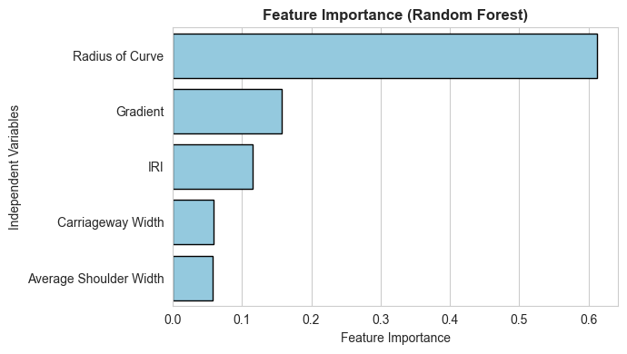
    


Actual vs Predicted Plot


```python
# Random Forest: Actual vs Predicted V85 Speed

import matplotlib.pyplot as plt
import seaborn as sns

sns.set_style("whitegrid")

plt.figure(figsize=(7, 4))

# Scatter plot
sns.scatterplot(
    x=y_test,
    y=y_test_pred_rf,
    color="steelblue",
    s=60,
    alpha=0.7,
    edgecolor="black"
)

# Perfect fit line
min_val = min(y_test.min(), y_test_pred_rf.min())
max_val = max(y_test.max(), y_test_pred_rf.max())

plt.plot(
    [min_val, max_val],
    [min_val, max_val],
    color="darkred",
    linestyle="--",
    linewidth=2,
    label="Perfect Fit"
)

plt.xlabel("Actual V85 Speed (km/h)")
plt.ylabel("Predicted V85 Speed (km/h)")

plt.title(
    "Random Forest: Actual vs Predicted V85 Speed",
    fontsize=12,
    fontweight="bold"
)

plt.legend()
plt.tight_layout()
plt.show()
```


    

    


    
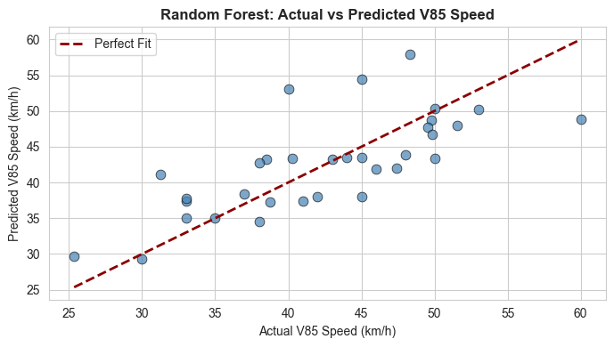
    


Residual Plot


```python
# Random Forest Residual Analysis

import seaborn as sns
import matplotlib.pyplot as plt

sns.set_style("whitegrid")

# Calculate residuals
rf_residuals = y_test - y_test_pred_rf

plt.figure(figsize=(7, 4))

# Scatter plot
sns.scatterplot(
    x=y_test_pred_rf,
    y=rf_residuals,
    color="steelblue",
    s=60,
    alpha=0.7,
    edgecolor="black"
)

# Reference line at zero
plt.axhline(
    y=0,
    linestyle="--",
    color="darkred",
    linewidth=2
)

plt.xlabel("Predicted V85 Speed (km/h)")
plt.ylabel("Residuals (km/h)")

plt.title(
    "Random Forest: Residuals vs Predicted V85 Speed",
    fontsize=12,
    fontweight="bold"
)

plt.tight_layout()
plt.show()
```


    

    


    
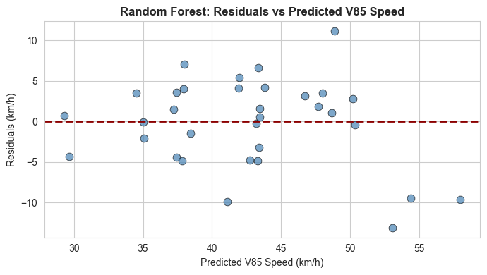
    


Result Table


```python
# Final Random Forest Performance Summary

rf_final = pd.DataFrame({
    "Model": ["Random Forest"],
    "R2": [round(rf_test_r2, 3)],
    "RMSE": [round(rf_test_rmse, 3)],
    "MAE": [round(rf_test_mae, 3)]
})

# Display results
display(rf_final)
```


<div>
<style scoped>
    .dataframe tbody tr th:only-of-type {
        vertical-align: middle;
    }

    .dataframe tbody tr th {
        vertical-align: top;
    }

    .dataframe thead th {
        text-align: right;
    }
</style>
<table border="1" class="dataframe">
  <thead>
    <tr style="text-align: right;">
      <th></th>
      <th>Model</th>
      <th>R2</th>
      <th>RMSE</th>
      <th>MAE</th>
    </tr>
  </thead>
  <tbody>
    <tr>
      <th>0</th>
      <td>Random Forest</td>
      <td>0.51</td>
      <td>5.322</td>
      <td>4.201</td>
    </tr>
  </tbody>
</table>
</div>


<div>
<style scoped>
    .dataframe tbody tr th:only-of-type {
        vertical-align: middle;
    }

    .dataframe tbody tr th {
        vertical-align: top;
    }

    .dataframe thead th {
        text-align: right;
    }
</style>
<table border="1" class="dataframe">
  <thead>
    <tr style="text-align: right;">
      <th></th>
      <th>Model</th>
      <th>R2</th>
      <th>RMSE</th>
      <th>MAE</th>
    </tr>
  </thead>
  <tbody>
    <tr>
      <th>0</th>
      <td>Random Forest</td>
      <td>0.51</td>
      <td>5.322</td>
      <td>4.201</td>
    </tr>
  </tbody>
</table>
</div>


Hyperparameter Tuned Random Forest Model


Hyperparameter Grid for Random Forest


```python
# Hyperparameter Grid for Random Forest

param_grid_rf = {
    "n_estimators": [100, 200, 300],
    "max_depth": [None, 5, 10, 15],
    "min_samples_split": [2, 5, 10],
    "min_samples_leaf": [1, 2, 4],
    "max_features": ["sqrt", "log2"]
}
```

Grid Search Setup and Training


```python
# Random Forest Hyperparameter Tuning

from sklearn.model_selection import GridSearchCV
from sklearn.ensemble import RandomForestRegressor

grid_rf = GridSearchCV(
    estimator=RandomForestRegressor(random_state=42),
    param_grid=param_grid_rf,
    cv=5,
    scoring="r2",
    n_jobs=-1,
    verbose=1
)

# Train using unscaled training data
grid_rf.fit(X_train, y_train)

print("Tuning completed")
print("Best Parameters:", grid_rf.best_params_)
print("Best CV Score:", round(grid_rf.best_score_, 3))
```

    Fitting 5 folds for each of 216 candidates, totalling 1080 fits
    Tuning completed
    Best Parameters: {'max_depth': None, 'max_features': 'sqrt', 'min_samples_leaf': 2, 'min_samples_split': 10, 'n_estimators': 100}
    Best CV Score: 0.448
    Fitting 5 folds for each of 216 candidates, totalling 1080 fits
    Tuning completed
    Best Parameters: {'max_depth': None, 'max_features': 'sqrt', 'min_samples_leaf': 2, 'min_samples_split': 10, 'n_estimators': 100}
    Best CV Score: 0.448
    

Extracting Best Tuned Random Forest Model


```python
# Extract Best Tuned Random Forest Model

best_rf = grid_rf.best_estimator_

best_rf
```


<style>#sk-container-id-5 {
  /* Definition of color scheme common for light and dark mode */
  --sklearn-color-text: #000;
  --sklearn-color-text-muted: #666;
  --sklearn-color-line: gray;
  /* Definition of color scheme for unfitted estimators */
  --sklearn-color-unfitted-level-0: #fff5e6;
  --sklearn-color-unfitted-level-1: #f6e4d2;
  --sklearn-color-unfitted-level-2: #ffe0b3;
  --sklearn-color-unfitted-level-3: chocolate;
  /* Definition of color scheme for fitted estimators */
  --sklearn-color-fitted-level-0: #f0f8ff;
  --sklearn-color-fitted-level-1: #d4ebff;
  --sklearn-color-fitted-level-2: #b3dbfd;
  --sklearn-color-fitted-level-3: cornflowerblue;
}

#sk-container-id-5.light {
  /* Specific color for light theme */
  --sklearn-color-text-on-default-background: black;
  --sklearn-color-background: white;
  --sklearn-color-border-box: black;
  --sklearn-color-icon: #696969;
}

#sk-container-id-5.dark {
  --sklearn-color-text-on-default-background: white;
  --sklearn-color-background: #111;
  --sklearn-color-border-box: white;
  --sklearn-color-icon: #878787;
}

#sk-container-id-5 {
  color: var(--sklearn-color-text);
}

#sk-container-id-5 pre {
  padding: 0;
}

#sk-container-id-5 input.sk-hidden--visually {
  border: 0;
  clip: rect(1px 1px 1px 1px);
  clip: rect(1px, 1px, 1px, 1px);
  height: 1px;
  margin: -1px;
  overflow: hidden;
  padding: 0;
  position: absolute;
  width: 1px;
}

#sk-container-id-5 div.sk-dashed-wrapped {
  border: 1px dashed var(--sklearn-color-line);
  margin: 0 0.4em 0.5em 0.4em;
  box-sizing: border-box;
  padding-bottom: 0.4em;
  background-color: var(--sklearn-color-background);
}

#sk-container-id-5 div.sk-container {
  /* jupyter's `normalize.less` sets `[hidden] { display: none; }`
     but bootstrap.min.css set `[hidden] { display: none !important; }`
     so we also need the `!important` here to be able to override the
     default hidden behavior on the sphinx rendered scikit-learn.org.
     See: https://github.com/scikit-learn/scikit-learn/issues/21755 */
  display: inline-block !important;
  position: relative;
}

#sk-container-id-5 div.sk-text-repr-fallback {
  display: none;
}

div.sk-parallel-item,
div.sk-serial,
div.sk-item {
  /* draw centered vertical line to link estimators */
  background-image: linear-gradient(var(--sklearn-color-text-on-default-background), var(--sklearn-color-text-on-default-background));
  background-size: 2px 100%;
  background-repeat: no-repeat;
  background-position: center center;
}

/* Parallel-specific style estimator block */

#sk-container-id-5 div.sk-parallel-item::after {
  content: "";
  width: 100%;
  border-bottom: 2px solid var(--sklearn-color-text-on-default-background);
  flex-grow: 1;
}

#sk-container-id-5 div.sk-parallel {
  display: flex;
  align-items: stretch;
  justify-content: center;
  background-color: var(--sklearn-color-background);
  position: relative;
}

#sk-container-id-5 div.sk-parallel-item {
  display: flex;
  flex-direction: column;
}

#sk-container-id-5 div.sk-parallel-item:first-child::after {
  align-self: flex-end;
  width: 50%;
}

#sk-container-id-5 div.sk-parallel-item:last-child::after {
  align-self: flex-start;
  width: 50%;
}

#sk-container-id-5 div.sk-parallel-item:only-child::after {
  width: 0;
}

/* Serial-specific style estimator block */

#sk-container-id-5 div.sk-serial {
  display: flex;
  flex-direction: column;
  align-items: center;
  background-color: var(--sklearn-color-background);
  padding-right: 1em;
  padding-left: 1em;
}


/* Toggleable style: style used for estimator/Pipeline/ColumnTransformer box that is
clickable and can be expanded/collapsed.
- Pipeline and ColumnTransformer use this feature and define the default style
- Estimators will overwrite some part of the style using the `sk-estimator` class
*/

/* Pipeline and ColumnTransformer style (default) */

#sk-container-id-5 div.sk-toggleable {
  /* Default theme specific background. It is overwritten whether we have a
  specific estimator or a Pipeline/ColumnTransformer */
  background-color: var(--sklearn-color-background);
}

/* Toggleable label */
#sk-container-id-5 label.sk-toggleable__label {
  cursor: pointer;
  display: flex;
  width: 100%;
  margin-bottom: 0;
  padding: 0.5em;
  box-sizing: border-box;
  text-align: center;
  align-items: center;
  justify-content: center;
  gap: 0.5em;
}

#sk-container-id-5 label.sk-toggleable__label .caption {
  font-size: 0.6rem;
  font-weight: lighter;
  color: var(--sklearn-color-text-muted);
}

#sk-container-id-5 label.sk-toggleable__label-arrow:before {
  /* Arrow on the left of the label */
  content: "▸";
  float: left;
  margin-right: 0.25em;
  color: var(--sklearn-color-icon);
}

#sk-container-id-5 label.sk-toggleable__label-arrow:hover:before {
  color: var(--sklearn-color-text);
}

/* Toggleable content - dropdown */

#sk-container-id-5 div.sk-toggleable__content {
  display: none;
  text-align: left;
  /* unfitted */
  background-color: var(--sklearn-color-unfitted-level-0);
}

#sk-container-id-5 div.sk-toggleable__content.fitted {
  /* fitted */
  background-color: var(--sklearn-color-fitted-level-0);
}

#sk-container-id-5 div.sk-toggleable__content pre {
  margin: 0.2em;
  border-radius: 0.25em;
  color: var(--sklearn-color-text);
  /* unfitted */
  background-color: var(--sklearn-color-unfitted-level-0);
}

#sk-container-id-5 div.sk-toggleable__content.fitted pre {
  /* unfitted */
  background-color: var(--sklearn-color-fitted-level-0);
}

#sk-container-id-5 input.sk-toggleable__control:checked~div.sk-toggleable__content {
  /* Expand drop-down */
  display: block;
  width: 100%;
  overflow: visible;
}

#sk-container-id-5 input.sk-toggleable__control:checked~label.sk-toggleable__label-arrow:before {
  content: "▾";
}

/* Pipeline/ColumnTransformer-specific style */

#sk-container-id-5 div.sk-label input.sk-toggleable__control:checked~label.sk-toggleable__label {
  color: var(--sklearn-color-text);
  background-color: var(--sklearn-color-unfitted-level-2);
}

#sk-container-id-5 div.sk-label.fitted input.sk-toggleable__control:checked~label.sk-toggleable__label {
  background-color: var(--sklearn-color-fitted-level-2);
}

/* Estimator-specific style */

/* Colorize estimator box */
#sk-container-id-5 div.sk-estimator input.sk-toggleable__control:checked~label.sk-toggleable__label {
  /* unfitted */
  background-color: var(--sklearn-color-unfitted-level-2);
}

#sk-container-id-5 div.sk-estimator.fitted input.sk-toggleable__control:checked~label.sk-toggleable__label {
  /* fitted */
  background-color: var(--sklearn-color-fitted-level-2);
}

#sk-container-id-5 div.sk-label label.sk-toggleable__label,
#sk-container-id-5 div.sk-label label {
  /* The background is the default theme color */
  color: var(--sklearn-color-text-on-default-background);
}

/* On hover, darken the color of the background */
#sk-container-id-5 div.sk-label:hover label.sk-toggleable__label {
  color: var(--sklearn-color-text);
  background-color: var(--sklearn-color-unfitted-level-2);
}

/* Label box, darken color on hover, fitted */
#sk-container-id-5 div.sk-label.fitted:hover label.sk-toggleable__label.fitted {
  color: var(--sklearn-color-text);
  background-color: var(--sklearn-color-fitted-level-2);
}

/* Estimator label */

#sk-container-id-5 div.sk-label label {
  font-family: monospace;
  font-weight: bold;
  line-height: 1.2em;
}

#sk-container-id-5 div.sk-label-container {
  text-align: center;
}

/* Estimator-specific */
#sk-container-id-5 div.sk-estimator {
  font-family: monospace;
  border: 1px dotted var(--sklearn-color-border-box);
  border-radius: 0.25em;
  box-sizing: border-box;
  margin-bottom: 0.5em;
  /* unfitted */
  background-color: var(--sklearn-color-unfitted-level-0);
}

#sk-container-id-5 div.sk-estimator.fitted {
  /* fitted */
  background-color: var(--sklearn-color-fitted-level-0);
}

/* on hover */
#sk-container-id-5 div.sk-estimator:hover {
  /* unfitted */
  background-color: var(--sklearn-color-unfitted-level-2);
}

#sk-container-id-5 div.sk-estimator.fitted:hover {
  /* fitted */
  background-color: var(--sklearn-color-fitted-level-2);
}

/* Specification for estimator info (e.g. "i" and "?") */

/* Common style for "i" and "?" */

.sk-estimator-doc-link,
a:link.sk-estimator-doc-link,
a:visited.sk-estimator-doc-link {
  float: right;
  font-size: smaller;
  line-height: 1em;
  font-family: monospace;
  background-color: var(--sklearn-color-unfitted-level-0);
  border-radius: 1em;
  height: 1em;
  width: 1em;
  text-decoration: none !important;
  margin-left: 0.5em;
  text-align: center;
  /* unfitted */
  border: var(--sklearn-color-unfitted-level-3) 1pt solid;
  color: var(--sklearn-color-unfitted-level-3);
}

.sk-estimator-doc-link.fitted,
a:link.sk-estimator-doc-link.fitted,
a:visited.sk-estimator-doc-link.fitted {
  /* fitted */
  background-color: var(--sklearn-color-fitted-level-0);
  border: var(--sklearn-color-fitted-level-3) 1pt solid;
  color: var(--sklearn-color-fitted-level-3);
}

/* On hover */
div.sk-estimator:hover .sk-estimator-doc-link:hover,
.sk-estimator-doc-link:hover,
div.sk-label-container:hover .sk-estimator-doc-link:hover,
.sk-estimator-doc-link:hover {
  /* unfitted */
  background-color: var(--sklearn-color-unfitted-level-3);
  border: var(--sklearn-color-fitted-level-0) 1pt solid;
  color: var(--sklearn-color-unfitted-level-0);
  text-decoration: none;
}

div.sk-estimator.fitted:hover .sk-estimator-doc-link.fitted:hover,
.sk-estimator-doc-link.fitted:hover,
div.sk-label-container:hover .sk-estimator-doc-link.fitted:hover,
.sk-estimator-doc-link.fitted:hover {
  /* fitted */
  background-color: var(--sklearn-color-fitted-level-3);
  border: var(--sklearn-color-fitted-level-0) 1pt solid;
  color: var(--sklearn-color-fitted-level-0);
  text-decoration: none;
}

/* Span, style for the box shown on hovering the info icon */
.sk-estimator-doc-link span {
  display: none;
  z-index: 9999;
  position: relative;
  font-weight: normal;
  right: .2ex;
  padding: .5ex;
  margin: .5ex;
  width: min-content;
  min-width: 20ex;
  max-width: 50ex;
  color: var(--sklearn-color-text);
  box-shadow: 2pt 2pt 4pt #999;
  /* unfitted */
  background: var(--sklearn-color-unfitted-level-0);
  border: .5pt solid var(--sklearn-color-unfitted-level-3);
}

.sk-estimator-doc-link.fitted span {
  /* fitted */
  background: var(--sklearn-color-fitted-level-0);
  border: var(--sklearn-color-fitted-level-3);
}

.sk-estimator-doc-link:hover span {
  display: block;
}

/* "?"-specific style due to the `<a>` HTML tag */

#sk-container-id-5 a.estimator_doc_link {
  float: right;
  font-size: 1rem;
  line-height: 1em;
  font-family: monospace;
  background-color: var(--sklearn-color-unfitted-level-0);
  border-radius: 1rem;
  height: 1rem;
  width: 1rem;
  text-decoration: none;
  /* unfitted */
  color: var(--sklearn-color-unfitted-level-1);
  border: var(--sklearn-color-unfitted-level-1) 1pt solid;
}

#sk-container-id-5 a.estimator_doc_link.fitted {
  /* fitted */
  background-color: var(--sklearn-color-fitted-level-0);
  border: var(--sklearn-color-fitted-level-1) 1pt solid;
  color: var(--sklearn-color-fitted-level-1);
}

/* On hover */
#sk-container-id-5 a.estimator_doc_link:hover {
  /* unfitted */
  background-color: var(--sklearn-color-unfitted-level-3);
  color: var(--sklearn-color-background);
  text-decoration: none;
}

#sk-container-id-5 a.estimator_doc_link.fitted:hover {
  /* fitted */
  background-color: var(--sklearn-color-fitted-level-3);
}

.estimator-table {
    font-family: monospace;
}

.estimator-table summary {
    padding: .5rem;
    cursor: pointer;
}

.estimator-table summary::marker {
    font-size: 0.7rem;
}

.estimator-table details[open] {
    padding-left: 0.1rem;
    padding-right: 0.1rem;
    padding-bottom: 0.3rem;
}

.estimator-table .parameters-table {
    margin-left: auto !important;
    margin-right: auto !important;
    margin-top: 0;
}

.estimator-table .parameters-table tr:nth-child(odd) {
    background-color: #fff;
}

.estimator-table .parameters-table tr:nth-child(even) {
    background-color: #f6f6f6;
}

.estimator-table .parameters-table tr:hover {
    background-color: #e0e0e0;
}

.estimator-table table td {
    border: 1px solid rgba(106, 105, 104, 0.232);
}

/*
    `table td`is set in notebook with right text-align.
    We need to overwrite it.
*/
.estimator-table table td.param {
    text-align: left;
    position: relative;
    padding: 0;
}

.user-set td {
    color:rgb(255, 94, 0);
    text-align: left !important;
}

.user-set td.value {
    color:rgb(255, 94, 0);
    background-color: transparent;
}

.default td {
    color: black;
    text-align: left !important;
}

.user-set td i,
.default td i {
    color: black;
}

/*
    Styles for parameter documentation links
    We need styling for visited so jupyter doesn't overwrite it
*/
a.param-doc-link,
a.param-doc-link:link,
a.param-doc-link:visited {
    text-decoration: underline dashed;
    text-underline-offset: .3em;
    color: inherit;
    display: block;
    padding: .5em;
}

/* "hack" to make the entire area of the cell containing the link clickable */
a.param-doc-link::before {
    position: absolute;
    content: "";
    inset: 0;
}

.param-doc-description {
    display: none;
    position: absolute;
    z-index: 9999;
    left: 0;
    padding: .5ex;
    margin-left: 1.5em;
    color: var(--sklearn-color-text);
    box-shadow: .3em .3em .4em #999;
    width: max-content;
    text-align: left;
    max-height: 10em;
    overflow-y: auto;

    /* unfitted */
    background: var(--sklearn-color-unfitted-level-0);
    border: thin solid var(--sklearn-color-unfitted-level-3);
}

/* Fitted state for parameter tooltips */
.fitted .param-doc-description {
    /* fitted */
    background: var(--sklearn-color-fitted-level-0);
    border: thin solid var(--sklearn-color-fitted-level-3);
}

.param-doc-link:hover .param-doc-description {
    display: block;
}

.copy-paste-icon {
    background-image: url();
    background-repeat: no-repeat;
    background-size: 14px 14px;
    background-position: 0;
    display: inline-block;
    width: 14px;
    height: 14px;
    cursor: pointer;
}
</style><body><div id="sk-container-id-5" class="sk-top-container"><div class="sk-text-repr-fallback"><pre>RandomForestRegressor(max_features=&#x27;sqrt&#x27;, min_samples_leaf=2,
                      min_samples_split=10, random_state=42)</pre><b>In a Jupyter environment, please rerun this cell to show the HTML representation or trust the notebook. <br />On GitHub, the HTML representation is unable to render, please try loading this page with nbviewer.org.</b></div><div class="sk-container" hidden><div class="sk-item"><div class="sk-estimator fitted sk-toggleable"><input class="sk-toggleable__control sk-hidden--visually" id="sk-estimator-id-5" type="checkbox" checked><label for="sk-estimator-id-5" class="sk-toggleable__label fitted sk-toggleable__label-arrow"><div><div>RandomForestRegressor</div></div><div><a class="sk-estimator-doc-link fitted" rel="noreferrer" target="_blank" href="https://scikit-learn.org/1.8/modules/generated/sklearn.ensemble.RandomForestRegressor.html">?<span>Documentation for RandomForestRegressor</span></a><span class="sk-estimator-doc-link fitted">i<span>Fitted</span></span></div></label><div class="sk-toggleable__content fitted" data-param-prefix="">
        <div class="estimator-table">
            <details>
                <summary>Parameters</summary>
                <table class="parameters-table">
                  <tbody>

        <tr class="default">
            <td><i class="copy-paste-icon"
                 onclick="copyToClipboard('n_estimators',
                          this.parentElement.nextElementSibling)"
            ></i></td>
            <td class="param">
        <a class="param-doc-link"
            rel="noreferrer" target="_blank" href="https://scikit-learn.org/1.8/modules/generated/sklearn.ensemble.RandomForestRegressor.html#:~:text=n_estimators,-int%2C%20default%3D100">
            n_estimators
            <span class="param-doc-description">n_estimators: int, default=100<br><br>The number of trees in the forest.<br><br>.. versionchanged:: 0.22<br>   The default value of ``n_estimators`` changed from 10 to 100<br>   in 0.22.</span>
        </a>
    </td>
            <td class="value">100</td>
        </tr>


        <tr class="default">
            <td><i class="copy-paste-icon"
                 onclick="copyToClipboard('criterion',
                          this.parentElement.nextElementSibling)"
            ></i></td>
            <td class="param">
        <a class="param-doc-link"
            rel="noreferrer" target="_blank" href="https://scikit-learn.org/1.8/modules/generated/sklearn.ensemble.RandomForestRegressor.html#:~:text=criterion,-%7B%22squared_error%22%2C%20%22absolute_error%22%2C%20%22friedman_mse%22%2C%20%22poisson%22%7D%2C%20%20%20%20%20%20%20%20%20%20%20%20%20default%3D%22squared_error%22">
            criterion
            <span class="param-doc-description">criterion: {"squared_error", "absolute_error", "friedman_mse", "poisson"},             default="squared_error"<br><br>The function to measure the quality of a split. Supported criteria<br>are "squared_error" for the mean squared error, which is equal to<br>variance reduction as feature selection criterion and minimizes the L2<br>loss using the mean of each terminal node, "friedman_mse", which uses<br>mean squared error with Friedman's improvement score for potential<br>splits, "absolute_error" for the mean absolute error, which minimizes<br>the L1 loss using the median of each terminal node, and "poisson" which<br>uses reduction in Poisson deviance to find splits.<br>Training using "absolute_error" is significantly slower<br>than when using "squared_error".<br><br>.. versionadded:: 0.18<br>   Mean Absolute Error (MAE) criterion.<br><br>.. versionadded:: 1.0<br>   Poisson criterion.</span>
        </a>
    </td>
            <td class="value">&#x27;squared_error&#x27;</td>
        </tr>


        <tr class="default">
            <td><i class="copy-paste-icon"
                 onclick="copyToClipboard('max_depth',
                          this.parentElement.nextElementSibling)"
            ></i></td>
            <td class="param">
        <a class="param-doc-link"
            rel="noreferrer" target="_blank" href="https://scikit-learn.org/1.8/modules/generated/sklearn.ensemble.RandomForestRegressor.html#:~:text=max_depth,-int%2C%20default%3DNone">
            max_depth
            <span class="param-doc-description">max_depth: int, default=None<br><br>The maximum depth of the tree. If None, then nodes are expanded until<br>all leaves are pure or until all leaves contain less than<br>min_samples_split samples.</span>
        </a>
    </td>
            <td class="value">None</td>
        </tr>


        <tr class="user-set">
            <td><i class="copy-paste-icon"
                 onclick="copyToClipboard('min_samples_split',
                          this.parentElement.nextElementSibling)"
            ></i></td>
            <td class="param">
        <a class="param-doc-link"
            rel="noreferrer" target="_blank" href="https://scikit-learn.org/1.8/modules/generated/sklearn.ensemble.RandomForestRegressor.html#:~:text=min_samples_split,-int%20or%20float%2C%20default%3D2">
            min_samples_split
            <span class="param-doc-description">min_samples_split: int or float, default=2<br><br>The minimum number of samples required to split an internal node:<br><br>- If int, then consider `min_samples_split` as the minimum number.<br>- If float, then `min_samples_split` is a fraction and<br>  `ceil(min_samples_split * n_samples)` are the minimum<br>  number of samples for each split.<br><br>.. versionchanged:: 0.18<br>   Added float values for fractions.</span>
        </a>
    </td>
            <td class="value">10</td>
        </tr>


        <tr class="user-set">
            <td><i class="copy-paste-icon"
                 onclick="copyToClipboard('min_samples_leaf',
                          this.parentElement.nextElementSibling)"
            ></i></td>
            <td class="param">
        <a class="param-doc-link"
            rel="noreferrer" target="_blank" href="https://scikit-learn.org/1.8/modules/generated/sklearn.ensemble.RandomForestRegressor.html#:~:text=min_samples_leaf,-int%20or%20float%2C%20default%3D1">
            min_samples_leaf
            <span class="param-doc-description">min_samples_leaf: int or float, default=1<br><br>The minimum number of samples required to be at a leaf node.<br>A split point at any depth will only be considered if it leaves at<br>least ``min_samples_leaf`` training samples in each of the left and<br>right branches.  This may have the effect of smoothing the model,<br>especially in regression.<br><br>- If int, then consider `min_samples_leaf` as the minimum number.<br>- If float, then `min_samples_leaf` is a fraction and<br>  `ceil(min_samples_leaf * n_samples)` are the minimum<br>  number of samples for each node.<br><br>.. versionchanged:: 0.18<br>   Added float values for fractions.</span>
        </a>
    </td>
            <td class="value">2</td>
        </tr>


        <tr class="default">
            <td><i class="copy-paste-icon"
                 onclick="copyToClipboard('min_weight_fraction_leaf',
                          this.parentElement.nextElementSibling)"
            ></i></td>
            <td class="param">
        <a class="param-doc-link"
            rel="noreferrer" target="_blank" href="https://scikit-learn.org/1.8/modules/generated/sklearn.ensemble.RandomForestRegressor.html#:~:text=min_weight_fraction_leaf,-float%2C%20default%3D0.0">
            min_weight_fraction_leaf
            <span class="param-doc-description">min_weight_fraction_leaf: float, default=0.0<br><br>The minimum weighted fraction of the sum total of weights (of all<br>the input samples) required to be at a leaf node. Samples have<br>equal weight when sample_weight is not provided.</span>
        </a>
    </td>
            <td class="value">0.0</td>
        </tr>


        <tr class="user-set">
            <td><i class="copy-paste-icon"
                 onclick="copyToClipboard('max_features',
                          this.parentElement.nextElementSibling)"
            ></i></td>
            <td class="param">
        <a class="param-doc-link"
            rel="noreferrer" target="_blank" href="https://scikit-learn.org/1.8/modules/generated/sklearn.ensemble.RandomForestRegressor.html#:~:text=max_features,-%7B%22sqrt%22%2C%20%22log2%22%2C%20None%7D%2C%20int%20or%20float%2C%20default%3D1.0">
            max_features
            <span class="param-doc-description">max_features: {"sqrt", "log2", None}, int or float, default=1.0<br><br>The number of features to consider when looking for the best split:<br><br>- If int, then consider `max_features` features at each split.<br>- If float, then `max_features` is a fraction and<br>  `max(1, int(max_features * n_features_in_))` features are considered at each<br>  split.<br>- If "sqrt", then `max_features=sqrt(n_features)`.<br>- If "log2", then `max_features=log2(n_features)`.<br>- If None or 1.0, then `max_features=n_features`.<br><br>.. note::<br>    The default of 1.0 is equivalent to bagged trees and more<br>    randomness can be achieved by setting smaller values, e.g. 0.3.<br><br>.. versionchanged:: 1.1<br>    The default of `max_features` changed from `"auto"` to 1.0.<br><br>Note: the search for a split does not stop until at least one<br>valid partition of the node samples is found, even if it requires to<br>effectively inspect more than ``max_features`` features.</span>
        </a>
    </td>
            <td class="value">&#x27;sqrt&#x27;</td>
        </tr>


        <tr class="default">
            <td><i class="copy-paste-icon"
                 onclick="copyToClipboard('max_leaf_nodes',
                          this.parentElement.nextElementSibling)"
            ></i></td>
            <td class="param">
        <a class="param-doc-link"
            rel="noreferrer" target="_blank" href="https://scikit-learn.org/1.8/modules/generated/sklearn.ensemble.RandomForestRegressor.html#:~:text=max_leaf_nodes,-int%2C%20default%3DNone">
            max_leaf_nodes
            <span class="param-doc-description">max_leaf_nodes: int, default=None<br><br>Grow trees with ``max_leaf_nodes`` in best-first fashion.<br>Best nodes are defined as relative reduction in impurity.<br>If None then unlimited number of leaf nodes.</span>
        </a>
    </td>
            <td class="value">None</td>
        </tr>


        <tr class="default">
            <td><i class="copy-paste-icon"
                 onclick="copyToClipboard('min_impurity_decrease',
                          this.parentElement.nextElementSibling)"
            ></i></td>
            <td class="param">
        <a class="param-doc-link"
            rel="noreferrer" target="_blank" href="https://scikit-learn.org/1.8/modules/generated/sklearn.ensemble.RandomForestRegressor.html#:~:text=min_impurity_decrease,-float%2C%20default%3D0.0">
            min_impurity_decrease
            <span class="param-doc-description">min_impurity_decrease: float, default=0.0<br><br>A node will be split if this split induces a decrease of the impurity<br>greater than or equal to this value.<br><br>The weighted impurity decrease equation is the following::<br><br>    N_t / N * (impurity - N_t_R / N_t * right_impurity<br>                        - N_t_L / N_t * left_impurity)<br><br>where ``N`` is the total number of samples, ``N_t`` is the number of<br>samples at the current node, ``N_t_L`` is the number of samples in the<br>left child, and ``N_t_R`` is the number of samples in the right child.<br><br>``N``, ``N_t``, ``N_t_R`` and ``N_t_L`` all refer to the weighted sum,<br>if ``sample_weight`` is passed.<br><br>.. versionadded:: 0.19</span>
        </a>
    </td>
            <td class="value">0.0</td>
        </tr>


        <tr class="default">
            <td><i class="copy-paste-icon"
                 onclick="copyToClipboard('bootstrap',
                          this.parentElement.nextElementSibling)"
            ></i></td>
            <td class="param">
        <a class="param-doc-link"
            rel="noreferrer" target="_blank" href="https://scikit-learn.org/1.8/modules/generated/sklearn.ensemble.RandomForestRegressor.html#:~:text=bootstrap,-bool%2C%20default%3DTrue">
            bootstrap
            <span class="param-doc-description">bootstrap: bool, default=True<br><br>Whether bootstrap samples are used when building trees. If False, the<br>whole dataset is used to build each tree.</span>
        </a>
    </td>
            <td class="value">True</td>
        </tr>


        <tr class="default">
            <td><i class="copy-paste-icon"
                 onclick="copyToClipboard('oob_score',
                          this.parentElement.nextElementSibling)"
            ></i></td>
            <td class="param">
        <a class="param-doc-link"
            rel="noreferrer" target="_blank" href="https://scikit-learn.org/1.8/modules/generated/sklearn.ensemble.RandomForestRegressor.html#:~:text=oob_score,-bool%20or%20callable%2C%20default%3DFalse">
            oob_score
            <span class="param-doc-description">oob_score: bool or callable, default=False<br><br>Whether to use out-of-bag samples to estimate the generalization score.<br>By default, :func:`~sklearn.metrics.r2_score` is used.<br>Provide a callable with signature `metric(y_true, y_pred)` to use a<br>custom metric. Only available if `bootstrap=True`.<br><br>For an illustration of out-of-bag (OOB) error estimation, see the example<br>:ref:`sphx_glr_auto_examples_ensemble_plot_ensemble_oob.py`.</span>
        </a>
    </td>
            <td class="value">False</td>
        </tr>


        <tr class="default">
            <td><i class="copy-paste-icon"
                 onclick="copyToClipboard('n_jobs',
                          this.parentElement.nextElementSibling)"
            ></i></td>
            <td class="param">
        <a class="param-doc-link"
            rel="noreferrer" target="_blank" href="https://scikit-learn.org/1.8/modules/generated/sklearn.ensemble.RandomForestRegressor.html#:~:text=n_jobs,-int%2C%20default%3DNone">
            n_jobs
            <span class="param-doc-description">n_jobs: int, default=None<br><br>The number of jobs to run in parallel. :meth:`fit`, :meth:`predict`,<br>:meth:`decision_path` and :meth:`apply` are all parallelized over the<br>trees. ``None`` means 1 unless in a :obj:`joblib.parallel_backend`<br>context. ``-1`` means using all processors. See :term:`Glossary<br><n_jobs>` for more details.</span>
        </a>
    </td>
            <td class="value">None</td>
        </tr>


        <tr class="user-set">
            <td><i class="copy-paste-icon"
                 onclick="copyToClipboard('random_state',
                          this.parentElement.nextElementSibling)"
            ></i></td>
            <td class="param">
        <a class="param-doc-link"
            rel="noreferrer" target="_blank" href="https://scikit-learn.org/1.8/modules/generated/sklearn.ensemble.RandomForestRegressor.html#:~:text=random_state,-int%2C%20RandomState%20instance%20or%20None%2C%20default%3DNone">
            random_state
            <span class="param-doc-description">random_state: int, RandomState instance or None, default=None<br><br>Controls both the randomness of the bootstrapping of the samples used<br>when building trees (if ``bootstrap=True``) and the sampling of the<br>features to consider when looking for the best split at each node<br>(if ``max_features < n_features``).<br>See :term:`Glossary <random_state>` for details.</span>
        </a>
    </td>
            <td class="value">42</td>
        </tr>


        <tr class="default">
            <td><i class="copy-paste-icon"
                 onclick="copyToClipboard('verbose',
                          this.parentElement.nextElementSibling)"
            ></i></td>
            <td class="param">
        <a class="param-doc-link"
            rel="noreferrer" target="_blank" href="https://scikit-learn.org/1.8/modules/generated/sklearn.ensemble.RandomForestRegressor.html#:~:text=verbose,-int%2C%20default%3D0">
            verbose
            <span class="param-doc-description">verbose: int, default=0<br><br>Controls the verbosity when fitting and predicting.</span>
        </a>
    </td>
            <td class="value">0</td>
        </tr>


        <tr class="default">
            <td><i class="copy-paste-icon"
                 onclick="copyToClipboard('warm_start',
                          this.parentElement.nextElementSibling)"
            ></i></td>
            <td class="param">
        <a class="param-doc-link"
            rel="noreferrer" target="_blank" href="https://scikit-learn.org/1.8/modules/generated/sklearn.ensemble.RandomForestRegressor.html#:~:text=warm_start,-bool%2C%20default%3DFalse">
            warm_start
            <span class="param-doc-description">warm_start: bool, default=False<br><br>When set to ``True``, reuse the solution of the previous call to fit<br>and add more estimators to the ensemble, otherwise, just fit a whole<br>new forest. See :term:`Glossary <warm_start>` and<br>:ref:`tree_ensemble_warm_start` for details.</span>
        </a>
    </td>
            <td class="value">False</td>
        </tr>


        <tr class="default">
            <td><i class="copy-paste-icon"
                 onclick="copyToClipboard('ccp_alpha',
                          this.parentElement.nextElementSibling)"
            ></i></td>
            <td class="param">
        <a class="param-doc-link"
            rel="noreferrer" target="_blank" href="https://scikit-learn.org/1.8/modules/generated/sklearn.ensemble.RandomForestRegressor.html#:~:text=ccp_alpha,-non-negative%20float%2C%20default%3D0.0">
            ccp_alpha
            <span class="param-doc-description">ccp_alpha: non-negative float, default=0.0<br><br>Complexity parameter used for Minimal Cost-Complexity Pruning. The<br>subtree with the largest cost complexity that is smaller than<br>``ccp_alpha`` will be chosen. By default, no pruning is performed. See<br>:ref:`minimal_cost_complexity_pruning` for details. See<br>:ref:`sphx_glr_auto_examples_tree_plot_cost_complexity_pruning.py`<br>for an example of such pruning.<br><br>.. versionadded:: 0.22</span>
        </a>
    </td>
            <td class="value">0.0</td>
        </tr>


        <tr class="default">
            <td><i class="copy-paste-icon"
                 onclick="copyToClipboard('max_samples',
                          this.parentElement.nextElementSibling)"
            ></i></td>
            <td class="param">
        <a class="param-doc-link"
            rel="noreferrer" target="_blank" href="https://scikit-learn.org/1.8/modules/generated/sklearn.ensemble.RandomForestRegressor.html#:~:text=max_samples,-int%20or%20float%2C%20default%3DNone">
            max_samples
            <span class="param-doc-description">max_samples: int or float, default=None<br><br>If bootstrap is True, the number of samples to draw from X<br>to train each base estimator.<br><br>- If None (default), then draw `X.shape[0]` samples.<br>- If int, then draw `max_samples` samples.<br>- If float, then draw `max(round(n_samples * max_samples), 1)` samples. Thus,<br>  `max_samples` should be in the interval `(0.0, 1.0]`.<br><br>.. versionadded:: 0.22</span>
        </a>
    </td>
            <td class="value">None</td>
        </tr>


        <tr class="default">
            <td><i class="copy-paste-icon"
                 onclick="copyToClipboard('monotonic_cst',
                          this.parentElement.nextElementSibling)"
            ></i></td>
            <td class="param">
        <a class="param-doc-link"
            rel="noreferrer" target="_blank" href="https://scikit-learn.org/1.8/modules/generated/sklearn.ensemble.RandomForestRegressor.html#:~:text=monotonic_cst,-array-like%20of%20int%20of%20shape%20%28n_features%29%2C%20default%3DNone">
            monotonic_cst
            <span class="param-doc-description">monotonic_cst: array-like of int of shape (n_features), default=None<br><br>Indicates the monotonicity constraint to enforce on each feature.<br>  - 1: monotonically increasing<br>  - 0: no constraint<br>  - -1: monotonically decreasing<br><br>If monotonic_cst is None, no constraints are applied.<br><br>Monotonicity constraints are not supported for:<br>  - multioutput regressions (i.e. when `n_outputs_ > 1`),<br>  - regressions trained on data with missing values.<br><br>Read more in the :ref:`User Guide <monotonic_cst_gbdt>`.<br><br>.. versionadded:: 1.4</span>
        </a>
    </td>
            <td class="value">None</td>
        </tr>

                  </tbody>
                </table>
            </details>
        </div>
    </div></div></div></div></div><script>function copyToClipboard(text, element) {
    // Get the parameter prefix from the closest toggleable content
    const toggleableContent = element.closest('.sk-toggleable__content');
    const paramPrefix = toggleableContent ? toggleableContent.dataset.paramPrefix : '';
    const fullParamName = paramPrefix ? `${paramPrefix}${text}` : text;

    const originalStyle = element.style;
    const computedStyle = window.getComputedStyle(element);
    const originalWidth = computedStyle.width;
    const originalHTML = element.innerHTML.replace('Copied!', '');

    navigator.clipboard.writeText(fullParamName)
        .then(() => {
            element.style.width = originalWidth;
            element.style.color = 'green';
            element.innerHTML = "Copied!";

            setTimeout(() => {
                element.innerHTML = originalHTML;
                element.style = originalStyle;
            }, 2000);
        })
        .catch(err => {
            console.error('Failed to copy:', err);
            element.style.color = 'red';
            element.innerHTML = "Failed!";
            setTimeout(() => {
                element.innerHTML = originalHTML;
                element.style = originalStyle;
            }, 2000);
        });
    return false;
}

document.querySelectorAll('.copy-paste-icon').forEach(function(element) {
    const toggleableContent = element.closest('.sk-toggleable__content');
    const paramPrefix = toggleableContent ? toggleableContent.dataset.paramPrefix : '';
    const paramName = element.parentElement.nextElementSibling
        .textContent.trim().split(' ')[0];
    const fullParamName = paramPrefix ? `${paramPrefix}${paramName}` : paramName;

    element.setAttribute('title', fullParamName);
});


/**
 * Adapted from Skrub
 * https://github.com/skrub-data/skrub/blob/403466d1d5d4dc76a7ef569b3f8228db59a31dc3/skrub/_reporting/_data/templates/report.js#L789
 * @returns "light" or "dark"
 */
function detectTheme(element) {
    const body = document.querySelector('body');

    // Check VSCode theme
    const themeKindAttr = body.getAttribute('data-vscode-theme-kind');
    const themeNameAttr = body.getAttribute('data-vscode-theme-name');

    if (themeKindAttr && themeNameAttr) {
        const themeKind = themeKindAttr.toLowerCase();
        const themeName = themeNameAttr.toLowerCase();

        if (themeKind.includes("dark") || themeName.includes("dark")) {
            return "dark";
        }
        if (themeKind.includes("light") || themeName.includes("light")) {
            return "light";
        }
    }

    // Check Jupyter theme
    if (body.getAttribute('data-jp-theme-light') === 'false') {
        return 'dark';
    } else if (body.getAttribute('data-jp-theme-light') === 'true') {
        return 'light';
    }

    // Guess based on a parent element's color
    const color = window.getComputedStyle(element.parentNode, null).getPropertyValue('color');
    const match = color.match(/^rgb\s*\(\s*(\d+)\s*,\s*(\d+)\s*,\s*(\d+)\s*\)\s*$/i);
    if (match) {
        const [r, g, b] = [
            parseFloat(match[1]),
            parseFloat(match[2]),
            parseFloat(match[3])
        ];

        // https://en.wikipedia.org/wiki/HSL_and_HSV#Lightness
        const luma = 0.299 * r + 0.587 * g + 0.114 * b;

        if (luma > 180) {
            // If the text is very bright we have a dark theme
            return 'dark';
        }
        if (luma < 75) {
            // If the text is very dark we have a light theme
            return 'light';
        }
        // Otherwise fall back to the next heuristic.
    }

    // Fallback to system preference
    return window.matchMedia('(prefers-color-scheme: dark)').matches ? 'dark' : 'light';
}


function forceTheme(elementId) {
    const estimatorElement = document.querySelector(`#${elementId}`);
    if (estimatorElement === null) {
        console.error(`Element with id ${elementId} not found.`);
    } else {
        const theme = detectTheme(estimatorElement);
        estimatorElement.classList.add(theme);
    }
}

forceTheme('sk-container-id-5');</script></body>


<style>#sk-container-id-6 {
  /* Definition of color scheme common for light and dark mode */
  --sklearn-color-text: #000;
  --sklearn-color-text-muted: #666;
  --sklearn-color-line: gray;
  /* Definition of color scheme for unfitted estimators */
  --sklearn-color-unfitted-level-0: #fff5e6;
  --sklearn-color-unfitted-level-1: #f6e4d2;
  --sklearn-color-unfitted-level-2: #ffe0b3;
  --sklearn-color-unfitted-level-3: chocolate;
  /* Definition of color scheme for fitted estimators */
  --sklearn-color-fitted-level-0: #f0f8ff;
  --sklearn-color-fitted-level-1: #d4ebff;
  --sklearn-color-fitted-level-2: #b3dbfd;
  --sklearn-color-fitted-level-3: cornflowerblue;
}

#sk-container-id-6.light {
  /* Specific color for light theme */
  --sklearn-color-text-on-default-background: black;
  --sklearn-color-background: white;
  --sklearn-color-border-box: black;
  --sklearn-color-icon: #696969;
}

#sk-container-id-6.dark {
  --sklearn-color-text-on-default-background: white;
  --sklearn-color-background: #111;
  --sklearn-color-border-box: white;
  --sklearn-color-icon: #878787;
}

#sk-container-id-6 {
  color: var(--sklearn-color-text);
}

#sk-container-id-6 pre {
  padding: 0;
}

#sk-container-id-6 input.sk-hidden--visually {
  border: 0;
  clip: rect(1px 1px 1px 1px);
  clip: rect(1px, 1px, 1px, 1px);
  height: 1px;
  margin: -1px;
  overflow: hidden;
  padding: 0;
  position: absolute;
  width: 1px;
}

#sk-container-id-6 div.sk-dashed-wrapped {
  border: 1px dashed var(--sklearn-color-line);
  margin: 0 0.4em 0.5em 0.4em;
  box-sizing: border-box;
  padding-bottom: 0.4em;
  background-color: var(--sklearn-color-background);
}

#sk-container-id-6 div.sk-container {
  /* jupyter's `normalize.less` sets `[hidden] { display: none; }`
     but bootstrap.min.css set `[hidden] { display: none !important; }`
     so we also need the `!important` here to be able to override the
     default hidden behavior on the sphinx rendered scikit-learn.org.
     See: https://github.com/scikit-learn/scikit-learn/issues/21755 */
  display: inline-block !important;
  position: relative;
}

#sk-container-id-6 div.sk-text-repr-fallback {
  display: none;
}

div.sk-parallel-item,
div.sk-serial,
div.sk-item {
  /* draw centered vertical line to link estimators */
  background-image: linear-gradient(var(--sklearn-color-text-on-default-background), var(--sklearn-color-text-on-default-background));
  background-size: 2px 100%;
  background-repeat: no-repeat;
  background-position: center center;
}

/* Parallel-specific style estimator block */

#sk-container-id-6 div.sk-parallel-item::after {
  content: "";
  width: 100%;
  border-bottom: 2px solid var(--sklearn-color-text-on-default-background);
  flex-grow: 1;
}

#sk-container-id-6 div.sk-parallel {
  display: flex;
  align-items: stretch;
  justify-content: center;
  background-color: var(--sklearn-color-background);
  position: relative;
}

#sk-container-id-6 div.sk-parallel-item {
  display: flex;
  flex-direction: column;
}

#sk-container-id-6 div.sk-parallel-item:first-child::after {
  align-self: flex-end;
  width: 50%;
}

#sk-container-id-6 div.sk-parallel-item:last-child::after {
  align-self: flex-start;
  width: 50%;
}

#sk-container-id-6 div.sk-parallel-item:only-child::after {
  width: 0;
}

/* Serial-specific style estimator block */

#sk-container-id-6 div.sk-serial {
  display: flex;
  flex-direction: column;
  align-items: center;
  background-color: var(--sklearn-color-background);
  padding-right: 1em;
  padding-left: 1em;
}


/* Toggleable style: style used for estimator/Pipeline/ColumnTransformer box that is
clickable and can be expanded/collapsed.
- Pipeline and ColumnTransformer use this feature and define the default style
- Estimators will overwrite some part of the style using the `sk-estimator` class
*/

/* Pipeline and ColumnTransformer style (default) */

#sk-container-id-6 div.sk-toggleable {
  /* Default theme specific background. It is overwritten whether we have a
  specific estimator or a Pipeline/ColumnTransformer */
  background-color: var(--sklearn-color-background);
}

/* Toggleable label */
#sk-container-id-6 label.sk-toggleable__label {
  cursor: pointer;
  display: flex;
  width: 100%;
  margin-bottom: 0;
  padding: 0.5em;
  box-sizing: border-box;
  text-align: center;
  align-items: center;
  justify-content: center;
  gap: 0.5em;
}

#sk-container-id-6 label.sk-toggleable__label .caption {
  font-size: 0.6rem;
  font-weight: lighter;
  color: var(--sklearn-color-text-muted);
}

#sk-container-id-6 label.sk-toggleable__label-arrow:before {
  /* Arrow on the left of the label */
  content: "▸";
  float: left;
  margin-right: 0.25em;
  color: var(--sklearn-color-icon);
}

#sk-container-id-6 label.sk-toggleable__label-arrow:hover:before {
  color: var(--sklearn-color-text);
}

/* Toggleable content - dropdown */

#sk-container-id-6 div.sk-toggleable__content {
  display: none;
  text-align: left;
  /* unfitted */
  background-color: var(--sklearn-color-unfitted-level-0);
}

#sk-container-id-6 div.sk-toggleable__content.fitted {
  /* fitted */
  background-color: var(--sklearn-color-fitted-level-0);
}

#sk-container-id-6 div.sk-toggleable__content pre {
  margin: 0.2em;
  border-radius: 0.25em;
  color: var(--sklearn-color-text);
  /* unfitted */
  background-color: var(--sklearn-color-unfitted-level-0);
}

#sk-container-id-6 div.sk-toggleable__content.fitted pre {
  /* unfitted */
  background-color: var(--sklearn-color-fitted-level-0);
}

#sk-container-id-6 input.sk-toggleable__control:checked~div.sk-toggleable__content {
  /* Expand drop-down */
  display: block;
  width: 100%;
  overflow: visible;
}

#sk-container-id-6 input.sk-toggleable__control:checked~label.sk-toggleable__label-arrow:before {
  content: "▾";
}

/* Pipeline/ColumnTransformer-specific style */

#sk-container-id-6 div.sk-label input.sk-toggleable__control:checked~label.sk-toggleable__label {
  color: var(--sklearn-color-text);
  background-color: var(--sklearn-color-unfitted-level-2);
}

#sk-container-id-6 div.sk-label.fitted input.sk-toggleable__control:checked~label.sk-toggleable__label {
  background-color: var(--sklearn-color-fitted-level-2);
}

/* Estimator-specific style */

/* Colorize estimator box */
#sk-container-id-6 div.sk-estimator input.sk-toggleable__control:checked~label.sk-toggleable__label {
  /* unfitted */
  background-color: var(--sklearn-color-unfitted-level-2);
}

#sk-container-id-6 div.sk-estimator.fitted input.sk-toggleable__control:checked~label.sk-toggleable__label {
  /* fitted */
  background-color: var(--sklearn-color-fitted-level-2);
}

#sk-container-id-6 div.sk-label label.sk-toggleable__label,
#sk-container-id-6 div.sk-label label {
  /* The background is the default theme color */
  color: var(--sklearn-color-text-on-default-background);
}

/* On hover, darken the color of the background */
#sk-container-id-6 div.sk-label:hover label.sk-toggleable__label {
  color: var(--sklearn-color-text);
  background-color: var(--sklearn-color-unfitted-level-2);
}

/* Label box, darken color on hover, fitted */
#sk-container-id-6 div.sk-label.fitted:hover label.sk-toggleable__label.fitted {
  color: var(--sklearn-color-text);
  background-color: var(--sklearn-color-fitted-level-2);
}

/* Estimator label */

#sk-container-id-6 div.sk-label label {
  font-family: monospace;
  font-weight: bold;
  line-height: 1.2em;
}

#sk-container-id-6 div.sk-label-container {
  text-align: center;
}

/* Estimator-specific */
#sk-container-id-6 div.sk-estimator {
  font-family: monospace;
  border: 1px dotted var(--sklearn-color-border-box);
  border-radius: 0.25em;
  box-sizing: border-box;
  margin-bottom: 0.5em;
  /* unfitted */
  background-color: var(--sklearn-color-unfitted-level-0);
}

#sk-container-id-6 div.sk-estimator.fitted {
  /* fitted */
  background-color: var(--sklearn-color-fitted-level-0);
}

/* on hover */
#sk-container-id-6 div.sk-estimator:hover {
  /* unfitted */
  background-color: var(--sklearn-color-unfitted-level-2);
}

#sk-container-id-6 div.sk-estimator.fitted:hover {
  /* fitted */
  background-color: var(--sklearn-color-fitted-level-2);
}

/* Specification for estimator info (e.g. "i" and "?") */

/* Common style for "i" and "?" */

.sk-estimator-doc-link,
a:link.sk-estimator-doc-link,
a:visited.sk-estimator-doc-link {
  float: right;
  font-size: smaller;
  line-height: 1em;
  font-family: monospace;
  background-color: var(--sklearn-color-unfitted-level-0);
  border-radius: 1em;
  height: 1em;
  width: 1em;
  text-decoration: none !important;
  margin-left: 0.5em;
  text-align: center;
  /* unfitted */
  border: var(--sklearn-color-unfitted-level-3) 1pt solid;
  color: var(--sklearn-color-unfitted-level-3);
}

.sk-estimator-doc-link.fitted,
a:link.sk-estimator-doc-link.fitted,
a:visited.sk-estimator-doc-link.fitted {
  /* fitted */
  background-color: var(--sklearn-color-fitted-level-0);
  border: var(--sklearn-color-fitted-level-3) 1pt solid;
  color: var(--sklearn-color-fitted-level-3);
}

/* On hover */
div.sk-estimator:hover .sk-estimator-doc-link:hover,
.sk-estimator-doc-link:hover,
div.sk-label-container:hover .sk-estimator-doc-link:hover,
.sk-estimator-doc-link:hover {
  /* unfitted */
  background-color: var(--sklearn-color-unfitted-level-3);
  border: var(--sklearn-color-fitted-level-0) 1pt solid;
  color: var(--sklearn-color-unfitted-level-0);
  text-decoration: none;
}

div.sk-estimator.fitted:hover .sk-estimator-doc-link.fitted:hover,
.sk-estimator-doc-link.fitted:hover,
div.sk-label-container:hover .sk-estimator-doc-link.fitted:hover,
.sk-estimator-doc-link.fitted:hover {
  /* fitted */
  background-color: var(--sklearn-color-fitted-level-3);
  border: var(--sklearn-color-fitted-level-0) 1pt solid;
  color: var(--sklearn-color-fitted-level-0);
  text-decoration: none;
}

/* Span, style for the box shown on hovering the info icon */
.sk-estimator-doc-link span {
  display: none;
  z-index: 9999;
  position: relative;
  font-weight: normal;
  right: .2ex;
  padding: .5ex;
  margin: .5ex;
  width: min-content;
  min-width: 20ex;
  max-width: 50ex;
  color: var(--sklearn-color-text);
  box-shadow: 2pt 2pt 4pt #999;
  /* unfitted */
  background: var(--sklearn-color-unfitted-level-0);
  border: .5pt solid var(--sklearn-color-unfitted-level-3);
}

.sk-estimator-doc-link.fitted span {
  /* fitted */
  background: var(--sklearn-color-fitted-level-0);
  border: var(--sklearn-color-fitted-level-3);
}

.sk-estimator-doc-link:hover span {
  display: block;
}

/* "?"-specific style due to the `<a>` HTML tag */

#sk-container-id-6 a.estimator_doc_link {
  float: right;
  font-size: 1rem;
  line-height: 1em;
  font-family: monospace;
  background-color: var(--sklearn-color-unfitted-level-0);
  border-radius: 1rem;
  height: 1rem;
  width: 1rem;
  text-decoration: none;
  /* unfitted */
  color: var(--sklearn-color-unfitted-level-1);
  border: var(--sklearn-color-unfitted-level-1) 1pt solid;
}

#sk-container-id-6 a.estimator_doc_link.fitted {
  /* fitted */
  background-color: var(--sklearn-color-fitted-level-0);
  border: var(--sklearn-color-fitted-level-1) 1pt solid;
  color: var(--sklearn-color-fitted-level-1);
}

/* On hover */
#sk-container-id-6 a.estimator_doc_link:hover {
  /* unfitted */
  background-color: var(--sklearn-color-unfitted-level-3);
  color: var(--sklearn-color-background);
  text-decoration: none;
}

#sk-container-id-6 a.estimator_doc_link.fitted:hover {
  /* fitted */
  background-color: var(--sklearn-color-fitted-level-3);
}

.estimator-table {
    font-family: monospace;
}

.estimator-table summary {
    padding: .5rem;
    cursor: pointer;
}

.estimator-table summary::marker {
    font-size: 0.7rem;
}

.estimator-table details[open] {
    padding-left: 0.1rem;
    padding-right: 0.1rem;
    padding-bottom: 0.3rem;
}

.estimator-table .parameters-table {
    margin-left: auto !important;
    margin-right: auto !important;
    margin-top: 0;
}

.estimator-table .parameters-table tr:nth-child(odd) {
    background-color: #fff;
}

.estimator-table .parameters-table tr:nth-child(even) {
    background-color: #f6f6f6;
}

.estimator-table .parameters-table tr:hover {
    background-color: #e0e0e0;
}

.estimator-table table td {
    border: 1px solid rgba(106, 105, 104, 0.232);
}

/*
    `table td`is set in notebook with right text-align.
    We need to overwrite it.
*/
.estimator-table table td.param {
    text-align: left;
    position: relative;
    padding: 0;
}

.user-set td {
    color:rgb(255, 94, 0);
    text-align: left !important;
}

.user-set td.value {
    color:rgb(255, 94, 0);
    background-color: transparent;
}

.default td {
    color: black;
    text-align: left !important;
}

.user-set td i,
.default td i {
    color: black;
}

/*
    Styles for parameter documentation links
    We need styling for visited so jupyter doesn't overwrite it
*/
a.param-doc-link,
a.param-doc-link:link,
a.param-doc-link:visited {
    text-decoration: underline dashed;
    text-underline-offset: .3em;
    color: inherit;
    display: block;
    padding: .5em;
}

/* "hack" to make the entire area of the cell containing the link clickable */
a.param-doc-link::before {
    position: absolute;
    content: "";
    inset: 0;
}

.param-doc-description {
    display: none;
    position: absolute;
    z-index: 9999;
    left: 0;
    padding: .5ex;
    margin-left: 1.5em;
    color: var(--sklearn-color-text);
    box-shadow: .3em .3em .4em #999;
    width: max-content;
    text-align: left;
    max-height: 10em;
    overflow-y: auto;

    /* unfitted */
    background: var(--sklearn-color-unfitted-level-0);
    border: thin solid var(--sklearn-color-unfitted-level-3);
}

/* Fitted state for parameter tooltips */
.fitted .param-doc-description {
    /* fitted */
    background: var(--sklearn-color-fitted-level-0);
    border: thin solid var(--sklearn-color-fitted-level-3);
}

.param-doc-link:hover .param-doc-description {
    display: block;
}

.copy-paste-icon {
    background-image: url();
    background-repeat: no-repeat;
    background-size: 14px 14px;
    background-position: 0;
    display: inline-block;
    width: 14px;
    height: 14px;
    cursor: pointer;
}
</style><body><div id="sk-container-id-6" class="sk-top-container"><div class="sk-text-repr-fallback"><pre>RandomForestRegressor(max_features=&#x27;sqrt&#x27;, min_samples_leaf=2,
                      min_samples_split=10, random_state=42)</pre><b>In a Jupyter environment, please rerun this cell to show the HTML representation or trust the notebook. <br />On GitHub, the HTML representation is unable to render, please try loading this page with nbviewer.org.</b></div><div class="sk-container" hidden><div class="sk-item"><div class="sk-estimator fitted sk-toggleable"><input class="sk-toggleable__control sk-hidden--visually" id="sk-estimator-id-6" type="checkbox" checked><label for="sk-estimator-id-6" class="sk-toggleable__label fitted sk-toggleable__label-arrow"><div><div>RandomForestRegressor</div></div><div><a class="sk-estimator-doc-link fitted" rel="noreferrer" target="_blank" href="https://scikit-learn.org/1.8/modules/generated/sklearn.ensemble.RandomForestRegressor.html">?<span>Documentation for RandomForestRegressor</span></a><span class="sk-estimator-doc-link fitted">i<span>Fitted</span></span></div></label><div class="sk-toggleable__content fitted" data-param-prefix="">
        <div class="estimator-table">
            <details>
                <summary>Parameters</summary>
                <table class="parameters-table">
                  <tbody>

        <tr class="default">
            <td><i class="copy-paste-icon"
                 onclick="copyToClipboard('n_estimators',
                          this.parentElement.nextElementSibling)"
            ></i></td>
            <td class="param">
        <a class="param-doc-link"
            rel="noreferrer" target="_blank" href="https://scikit-learn.org/1.8/modules/generated/sklearn.ensemble.RandomForestRegressor.html#:~:text=n_estimators,-int%2C%20default%3D100">
            n_estimators
            <span class="param-doc-description">n_estimators: int, default=100<br><br>The number of trees in the forest.<br><br>.. versionchanged:: 0.22<br>   The default value of ``n_estimators`` changed from 10 to 100<br>   in 0.22.</span>
        </a>
    </td>
            <td class="value">100</td>
        </tr>


        <tr class="default">
            <td><i class="copy-paste-icon"
                 onclick="copyToClipboard('criterion',
                          this.parentElement.nextElementSibling)"
            ></i></td>
            <td class="param">
        <a class="param-doc-link"
            rel="noreferrer" target="_blank" href="https://scikit-learn.org/1.8/modules/generated/sklearn.ensemble.RandomForestRegressor.html#:~:text=criterion,-%7B%22squared_error%22%2C%20%22absolute_error%22%2C%20%22friedman_mse%22%2C%20%22poisson%22%7D%2C%20%20%20%20%20%20%20%20%20%20%20%20%20default%3D%22squared_error%22">
            criterion
            <span class="param-doc-description">criterion: {"squared_error", "absolute_error", "friedman_mse", "poisson"},             default="squared_error"<br><br>The function to measure the quality of a split. Supported criteria<br>are "squared_error" for the mean squared error, which is equal to<br>variance reduction as feature selection criterion and minimizes the L2<br>loss using the mean of each terminal node, "friedman_mse", which uses<br>mean squared error with Friedman's improvement score for potential<br>splits, "absolute_error" for the mean absolute error, which minimizes<br>the L1 loss using the median of each terminal node, and "poisson" which<br>uses reduction in Poisson deviance to find splits.<br>Training using "absolute_error" is significantly slower<br>than when using "squared_error".<br><br>.. versionadded:: 0.18<br>   Mean Absolute Error (MAE) criterion.<br><br>.. versionadded:: 1.0<br>   Poisson criterion.</span>
        </a>
    </td>
            <td class="value">&#x27;squared_error&#x27;</td>
        </tr>


        <tr class="default">
            <td><i class="copy-paste-icon"
                 onclick="copyToClipboard('max_depth',
                          this.parentElement.nextElementSibling)"
            ></i></td>
            <td class="param">
        <a class="param-doc-link"
            rel="noreferrer" target="_blank" href="https://scikit-learn.org/1.8/modules/generated/sklearn.ensemble.RandomForestRegressor.html#:~:text=max_depth,-int%2C%20default%3DNone">
            max_depth
            <span class="param-doc-description">max_depth: int, default=None<br><br>The maximum depth of the tree. If None, then nodes are expanded until<br>all leaves are pure or until all leaves contain less than<br>min_samples_split samples.</span>
        </a>
    </td>
            <td class="value">None</td>
        </tr>


        <tr class="user-set">
            <td><i class="copy-paste-icon"
                 onclick="copyToClipboard('min_samples_split',
                          this.parentElement.nextElementSibling)"
            ></i></td>
            <td class="param">
        <a class="param-doc-link"
            rel="noreferrer" target="_blank" href="https://scikit-learn.org/1.8/modules/generated/sklearn.ensemble.RandomForestRegressor.html#:~:text=min_samples_split,-int%20or%20float%2C%20default%3D2">
            min_samples_split
            <span class="param-doc-description">min_samples_split: int or float, default=2<br><br>The minimum number of samples required to split an internal node:<br><br>- If int, then consider `min_samples_split` as the minimum number.<br>- If float, then `min_samples_split` is a fraction and<br>  `ceil(min_samples_split * n_samples)` are the minimum<br>  number of samples for each split.<br><br>.. versionchanged:: 0.18<br>   Added float values for fractions.</span>
        </a>
    </td>
            <td class="value">10</td>
        </tr>


        <tr class="user-set">
            <td><i class="copy-paste-icon"
                 onclick="copyToClipboard('min_samples_leaf',
                          this.parentElement.nextElementSibling)"
            ></i></td>
            <td class="param">
        <a class="param-doc-link"
            rel="noreferrer" target="_blank" href="https://scikit-learn.org/1.8/modules/generated/sklearn.ensemble.RandomForestRegressor.html#:~:text=min_samples_leaf,-int%20or%20float%2C%20default%3D1">
            min_samples_leaf
            <span class="param-doc-description">min_samples_leaf: int or float, default=1<br><br>The minimum number of samples required to be at a leaf node.<br>A split point at any depth will only be considered if it leaves at<br>least ``min_samples_leaf`` training samples in each of the left and<br>right branches.  This may have the effect of smoothing the model,<br>especially in regression.<br><br>- If int, then consider `min_samples_leaf` as the minimum number.<br>- If float, then `min_samples_leaf` is a fraction and<br>  `ceil(min_samples_leaf * n_samples)` are the minimum<br>  number of samples for each node.<br><br>.. versionchanged:: 0.18<br>   Added float values for fractions.</span>
        </a>
    </td>
            <td class="value">2</td>
        </tr>


        <tr class="default">
            <td><i class="copy-paste-icon"
                 onclick="copyToClipboard('min_weight_fraction_leaf',
                          this.parentElement.nextElementSibling)"
            ></i></td>
            <td class="param">
        <a class="param-doc-link"
            rel="noreferrer" target="_blank" href="https://scikit-learn.org/1.8/modules/generated/sklearn.ensemble.RandomForestRegressor.html#:~:text=min_weight_fraction_leaf,-float%2C%20default%3D0.0">
            min_weight_fraction_leaf
            <span class="param-doc-description">min_weight_fraction_leaf: float, default=0.0<br><br>The minimum weighted fraction of the sum total of weights (of all<br>the input samples) required to be at a leaf node. Samples have<br>equal weight when sample_weight is not provided.</span>
        </a>
    </td>
            <td class="value">0.0</td>
        </tr>


        <tr class="user-set">
            <td><i class="copy-paste-icon"
                 onclick="copyToClipboard('max_features',
                          this.parentElement.nextElementSibling)"
            ></i></td>
            <td class="param">
        <a class="param-doc-link"
            rel="noreferrer" target="_blank" href="https://scikit-learn.org/1.8/modules/generated/sklearn.ensemble.RandomForestRegressor.html#:~:text=max_features,-%7B%22sqrt%22%2C%20%22log2%22%2C%20None%7D%2C%20int%20or%20float%2C%20default%3D1.0">
            max_features
            <span class="param-doc-description">max_features: {"sqrt", "log2", None}, int or float, default=1.0<br><br>The number of features to consider when looking for the best split:<br><br>- If int, then consider `max_features` features at each split.<br>- If float, then `max_features` is a fraction and<br>  `max(1, int(max_features * n_features_in_))` features are considered at each<br>  split.<br>- If "sqrt", then `max_features=sqrt(n_features)`.<br>- If "log2", then `max_features=log2(n_features)`.<br>- If None or 1.0, then `max_features=n_features`.<br><br>.. note::<br>    The default of 1.0 is equivalent to bagged trees and more<br>    randomness can be achieved by setting smaller values, e.g. 0.3.<br><br>.. versionchanged:: 1.1<br>    The default of `max_features` changed from `"auto"` to 1.0.<br><br>Note: the search for a split does not stop until at least one<br>valid partition of the node samples is found, even if it requires to<br>effectively inspect more than ``max_features`` features.</span>
        </a>
    </td>
            <td class="value">&#x27;sqrt&#x27;</td>
        </tr>


        <tr class="default">
            <td><i class="copy-paste-icon"
                 onclick="copyToClipboard('max_leaf_nodes',
                          this.parentElement.nextElementSibling)"
            ></i></td>
            <td class="param">
        <a class="param-doc-link"
            rel="noreferrer" target="_blank" href="https://scikit-learn.org/1.8/modules/generated/sklearn.ensemble.RandomForestRegressor.html#:~:text=max_leaf_nodes,-int%2C%20default%3DNone">
            max_leaf_nodes
            <span class="param-doc-description">max_leaf_nodes: int, default=None<br><br>Grow trees with ``max_leaf_nodes`` in best-first fashion.<br>Best nodes are defined as relative reduction in impurity.<br>If None then unlimited number of leaf nodes.</span>
        </a>
    </td>
            <td class="value">None</td>
        </tr>


        <tr class="default">
            <td><i class="copy-paste-icon"
                 onclick="copyToClipboard('min_impurity_decrease',
                          this.parentElement.nextElementSibling)"
            ></i></td>
            <td class="param">
        <a class="param-doc-link"
            rel="noreferrer" target="_blank" href="https://scikit-learn.org/1.8/modules/generated/sklearn.ensemble.RandomForestRegressor.html#:~:text=min_impurity_decrease,-float%2C%20default%3D0.0">
            min_impurity_decrease
            <span class="param-doc-description">min_impurity_decrease: float, default=0.0<br><br>A node will be split if this split induces a decrease of the impurity<br>greater than or equal to this value.<br><br>The weighted impurity decrease equation is the following::<br><br>    N_t / N * (impurity - N_t_R / N_t * right_impurity<br>                        - N_t_L / N_t * left_impurity)<br><br>where ``N`` is the total number of samples, ``N_t`` is the number of<br>samples at the current node, ``N_t_L`` is the number of samples in the<br>left child, and ``N_t_R`` is the number of samples in the right child.<br><br>``N``, ``N_t``, ``N_t_R`` and ``N_t_L`` all refer to the weighted sum,<br>if ``sample_weight`` is passed.<br><br>.. versionadded:: 0.19</span>
        </a>
    </td>
            <td class="value">0.0</td>
        </tr>


        <tr class="default">
            <td><i class="copy-paste-icon"
                 onclick="copyToClipboard('bootstrap',
                          this.parentElement.nextElementSibling)"
            ></i></td>
            <td class="param">
        <a class="param-doc-link"
            rel="noreferrer" target="_blank" href="https://scikit-learn.org/1.8/modules/generated/sklearn.ensemble.RandomForestRegressor.html#:~:text=bootstrap,-bool%2C%20default%3DTrue">
            bootstrap
            <span class="param-doc-description">bootstrap: bool, default=True<br><br>Whether bootstrap samples are used when building trees. If False, the<br>whole dataset is used to build each tree.</span>
        </a>
    </td>
            <td class="value">True</td>
        </tr>


        <tr class="default">
            <td><i class="copy-paste-icon"
                 onclick="copyToClipboard('oob_score',
                          this.parentElement.nextElementSibling)"
            ></i></td>
            <td class="param">
        <a class="param-doc-link"
            rel="noreferrer" target="_blank" href="https://scikit-learn.org/1.8/modules/generated/sklearn.ensemble.RandomForestRegressor.html#:~:text=oob_score,-bool%20or%20callable%2C%20default%3DFalse">
            oob_score
            <span class="param-doc-description">oob_score: bool or callable, default=False<br><br>Whether to use out-of-bag samples to estimate the generalization score.<br>By default, :func:`~sklearn.metrics.r2_score` is used.<br>Provide a callable with signature `metric(y_true, y_pred)` to use a<br>custom metric. Only available if `bootstrap=True`.<br><br>For an illustration of out-of-bag (OOB) error estimation, see the example<br>:ref:`sphx_glr_auto_examples_ensemble_plot_ensemble_oob.py`.</span>
        </a>
    </td>
            <td class="value">False</td>
        </tr>


        <tr class="default">
            <td><i class="copy-paste-icon"
                 onclick="copyToClipboard('n_jobs',
                          this.parentElement.nextElementSibling)"
            ></i></td>
            <td class="param">
        <a class="param-doc-link"
            rel="noreferrer" target="_blank" href="https://scikit-learn.org/1.8/modules/generated/sklearn.ensemble.RandomForestRegressor.html#:~:text=n_jobs,-int%2C%20default%3DNone">
            n_jobs
            <span class="param-doc-description">n_jobs: int, default=None<br><br>The number of jobs to run in parallel. :meth:`fit`, :meth:`predict`,<br>:meth:`decision_path` and :meth:`apply` are all parallelized over the<br>trees. ``None`` means 1 unless in a :obj:`joblib.parallel_backend`<br>context. ``-1`` means using all processors. See :term:`Glossary<br><n_jobs>` for more details.</span>
        </a>
    </td>
            <td class="value">None</td>
        </tr>


        <tr class="user-set">
            <td><i class="copy-paste-icon"
                 onclick="copyToClipboard('random_state',
                          this.parentElement.nextElementSibling)"
            ></i></td>
            <td class="param">
        <a class="param-doc-link"
            rel="noreferrer" target="_blank" href="https://scikit-learn.org/1.8/modules/generated/sklearn.ensemble.RandomForestRegressor.html#:~:text=random_state,-int%2C%20RandomState%20instance%20or%20None%2C%20default%3DNone">
            random_state
            <span class="param-doc-description">random_state: int, RandomState instance or None, default=None<br><br>Controls both the randomness of the bootstrapping of the samples used<br>when building trees (if ``bootstrap=True``) and the sampling of the<br>features to consider when looking for the best split at each node<br>(if ``max_features < n_features``).<br>See :term:`Glossary <random_state>` for details.</span>
        </a>
    </td>
            <td class="value">42</td>
        </tr>


        <tr class="default">
            <td><i class="copy-paste-icon"
                 onclick="copyToClipboard('verbose',
                          this.parentElement.nextElementSibling)"
            ></i></td>
            <td class="param">
        <a class="param-doc-link"
            rel="noreferrer" target="_blank" href="https://scikit-learn.org/1.8/modules/generated/sklearn.ensemble.RandomForestRegressor.html#:~:text=verbose,-int%2C%20default%3D0">
            verbose
            <span class="param-doc-description">verbose: int, default=0<br><br>Controls the verbosity when fitting and predicting.</span>
        </a>
    </td>
            <td class="value">0</td>
        </tr>


        <tr class="default">
            <td><i class="copy-paste-icon"
                 onclick="copyToClipboard('warm_start',
                          this.parentElement.nextElementSibling)"
            ></i></td>
            <td class="param">
        <a class="param-doc-link"
            rel="noreferrer" target="_blank" href="https://scikit-learn.org/1.8/modules/generated/sklearn.ensemble.RandomForestRegressor.html#:~:text=warm_start,-bool%2C%20default%3DFalse">
            warm_start
            <span class="param-doc-description">warm_start: bool, default=False<br><br>When set to ``True``, reuse the solution of the previous call to fit<br>and add more estimators to the ensemble, otherwise, just fit a whole<br>new forest. See :term:`Glossary <warm_start>` and<br>:ref:`tree_ensemble_warm_start` for details.</span>
        </a>
    </td>
            <td class="value">False</td>
        </tr>


        <tr class="default">
            <td><i class="copy-paste-icon"
                 onclick="copyToClipboard('ccp_alpha',
                          this.parentElement.nextElementSibling)"
            ></i></td>
            <td class="param">
        <a class="param-doc-link"
            rel="noreferrer" target="_blank" href="https://scikit-learn.org/1.8/modules/generated/sklearn.ensemble.RandomForestRegressor.html#:~:text=ccp_alpha,-non-negative%20float%2C%20default%3D0.0">
            ccp_alpha
            <span class="param-doc-description">ccp_alpha: non-negative float, default=0.0<br><br>Complexity parameter used for Minimal Cost-Complexity Pruning. The<br>subtree with the largest cost complexity that is smaller than<br>``ccp_alpha`` will be chosen. By default, no pruning is performed. See<br>:ref:`minimal_cost_complexity_pruning` for details. See<br>:ref:`sphx_glr_auto_examples_tree_plot_cost_complexity_pruning.py`<br>for an example of such pruning.<br><br>.. versionadded:: 0.22</span>
        </a>
    </td>
            <td class="value">0.0</td>
        </tr>


        <tr class="default">
            <td><i class="copy-paste-icon"
                 onclick="copyToClipboard('max_samples',
                          this.parentElement.nextElementSibling)"
            ></i></td>
            <td class="param">
        <a class="param-doc-link"
            rel="noreferrer" target="_blank" href="https://scikit-learn.org/1.8/modules/generated/sklearn.ensemble.RandomForestRegressor.html#:~:text=max_samples,-int%20or%20float%2C%20default%3DNone">
            max_samples
            <span class="param-doc-description">max_samples: int or float, default=None<br><br>If bootstrap is True, the number of samples to draw from X<br>to train each base estimator.<br><br>- If None (default), then draw `X.shape[0]` samples.<br>- If int, then draw `max_samples` samples.<br>- If float, then draw `max(round(n_samples * max_samples), 1)` samples. Thus,<br>  `max_samples` should be in the interval `(0.0, 1.0]`.<br><br>.. versionadded:: 0.22</span>
        </a>
    </td>
            <td class="value">None</td>
        </tr>


        <tr class="default">
            <td><i class="copy-paste-icon"
                 onclick="copyToClipboard('monotonic_cst',
                          this.parentElement.nextElementSibling)"
            ></i></td>
            <td class="param">
        <a class="param-doc-link"
            rel="noreferrer" target="_blank" href="https://scikit-learn.org/1.8/modules/generated/sklearn.ensemble.RandomForestRegressor.html#:~:text=monotonic_cst,-array-like%20of%20int%20of%20shape%20%28n_features%29%2C%20default%3DNone">
            monotonic_cst
            <span class="param-doc-description">monotonic_cst: array-like of int of shape (n_features), default=None<br><br>Indicates the monotonicity constraint to enforce on each feature.<br>  - 1: monotonically increasing<br>  - 0: no constraint<br>  - -1: monotonically decreasing<br><br>If monotonic_cst is None, no constraints are applied.<br><br>Monotonicity constraints are not supported for:<br>  - multioutput regressions (i.e. when `n_outputs_ > 1`),<br>  - regressions trained on data with missing values.<br><br>Read more in the :ref:`User Guide <monotonic_cst_gbdt>`.<br><br>.. versionadded:: 1.4</span>
        </a>
    </td>
            <td class="value">None</td>
        </tr>

                  </tbody>
                </table>
            </details>
        </div>
    </div></div></div></div></div><script>function copyToClipboard(text, element) {
    // Get the parameter prefix from the closest toggleable content
    const toggleableContent = element.closest('.sk-toggleable__content');
    const paramPrefix = toggleableContent ? toggleableContent.dataset.paramPrefix : '';
    const fullParamName = paramPrefix ? `${paramPrefix}${text}` : text;

    const originalStyle = element.style;
    const computedStyle = window.getComputedStyle(element);
    const originalWidth = computedStyle.width;
    const originalHTML = element.innerHTML.replace('Copied!', '');

    navigator.clipboard.writeText(fullParamName)
        .then(() => {
            element.style.width = originalWidth;
            element.style.color = 'green';
            element.innerHTML = "Copied!";

            setTimeout(() => {
                element.innerHTML = originalHTML;
                element.style = originalStyle;
            }, 2000);
        })
        .catch(err => {
            console.error('Failed to copy:', err);
            element.style.color = 'red';
            element.innerHTML = "Failed!";
            setTimeout(() => {
                element.innerHTML = originalHTML;
                element.style = originalStyle;
            }, 2000);
        });
    return false;
}

document.querySelectorAll('.copy-paste-icon').forEach(function(element) {
    const toggleableContent = element.closest('.sk-toggleable__content');
    const paramPrefix = toggleableContent ? toggleableContent.dataset.paramPrefix : '';
    const paramName = element.parentElement.nextElementSibling
        .textContent.trim().split(' ')[0];
    const fullParamName = paramPrefix ? `${paramPrefix}${paramName}` : paramName;

    element.setAttribute('title', fullParamName);
});


/**
 * Adapted from Skrub
 * https://github.com/skrub-data/skrub/blob/403466d1d5d4dc76a7ef569b3f8228db59a31dc3/skrub/_reporting/_data/templates/report.js#L789
 * @returns "light" or "dark"
 */
function detectTheme(element) {
    const body = document.querySelector('body');

    // Check VSCode theme
    const themeKindAttr = body.getAttribute('data-vscode-theme-kind');
    const themeNameAttr = body.getAttribute('data-vscode-theme-name');

    if (themeKindAttr && themeNameAttr) {
        const themeKind = themeKindAttr.toLowerCase();
        const themeName = themeNameAttr.toLowerCase();

        if (themeKind.includes("dark") || themeName.includes("dark")) {
            return "dark";
        }
        if (themeKind.includes("light") || themeName.includes("light")) {
            return "light";
        }
    }

    // Check Jupyter theme
    if (body.getAttribute('data-jp-theme-light') === 'false') {
        return 'dark';
    } else if (body.getAttribute('data-jp-theme-light') === 'true') {
        return 'light';
    }

    // Guess based on a parent element's color
    const color = window.getComputedStyle(element.parentNode, null).getPropertyValue('color');
    const match = color.match(/^rgb\s*\(\s*(\d+)\s*,\s*(\d+)\s*,\s*(\d+)\s*\)\s*$/i);
    if (match) {
        const [r, g, b] = [
            parseFloat(match[1]),
            parseFloat(match[2]),
            parseFloat(match[3])
        ];

        // https://en.wikipedia.org/wiki/HSL_and_HSV#Lightness
        const luma = 0.299 * r + 0.587 * g + 0.114 * b;

        if (luma > 180) {
            // If the text is very bright we have a dark theme
            return 'dark';
        }
        if (luma < 75) {
            // If the text is very dark we have a light theme
            return 'light';
        }
        // Otherwise fall back to the next heuristic.
    }

    // Fallback to system preference
    return window.matchMedia('(prefers-color-scheme: dark)').matches ? 'dark' : 'light';
}


function forceTheme(elementId) {
    const estimatorElement = document.querySelector(`#${elementId}`);
    if (estimatorElement === null) {
        console.error(`Element with id ${elementId} not found.`);
    } else {
        const theme = detectTheme(estimatorElement);
        estimatorElement.classList.add(theme);
    }
}

forceTheme('sk-container-id-6');</script></body>


Predictions Using Tuned Random Forest Model


```python
# Predictions Using Tuned Random Forest Model

y_train_pred_rf_tuned = best_rf.predict(X_train)
y_test_pred_rf_tuned = best_rf.predict(X_test)
```

Model Evaluation Metrices


```python
# Tuned Random Forest Model Evaluation

# R² Score
rf_tuned_train_r2 = r2_score(y_train, y_train_pred_rf_tuned)
rf_tuned_test_r2 = r2_score(y_test, y_test_pred_rf_tuned)

# Root Mean Squared Error (RMSE)
rf_tuned_train_rmse = np.sqrt(mean_squared_error(y_train, y_train_pred_rf_tuned))
rf_tuned_test_rmse = np.sqrt(mean_squared_error(y_test, y_test_pred_rf_tuned))

# Mean Absolute Error (MAE)
rf_tuned_train_mae = mean_absolute_error(y_train, y_train_pred_rf_tuned)
rf_tuned_test_mae = mean_absolute_error(y_test, y_test_pred_rf_tuned)

# Results Table
rf_tuned_results = pd.DataFrame({
    "Metric": ["R2", "RMSE", "MAE"],
    "Training": [
        rf_tuned_train_r2,
        rf_tuned_train_rmse,
        rf_tuned_train_mae
    ],
    "Testing": [
        rf_tuned_test_r2,
        rf_tuned_test_rmse,
        rf_tuned_test_mae
    ]
})

# Display Results
display(rf_tuned_results.round(4))
```


<div>
<style scoped>
    .dataframe tbody tr th:only-of-type {
        vertical-align: middle;
    }

    .dataframe tbody tr th {
        vertical-align: top;
    }

    .dataframe thead th {
        text-align: right;
    }
</style>
<table border="1" class="dataframe">
  <thead>
    <tr style="text-align: right;">
      <th></th>
      <th>Metric</th>
      <th>Training</th>
      <th>Testing</th>
    </tr>
  </thead>
  <tbody>
    <tr>
      <th>0</th>
      <td>R2</td>
      <td>0.7358</td>
      <td>0.5968</td>
    </tr>
    <tr>
      <th>1</th>
      <td>RMSE</td>
      <td>5.0344</td>
      <td>4.8285</td>
    </tr>
    <tr>
      <th>2</th>
      <td>MAE</td>
      <td>3.9157</td>
      <td>3.7643</td>
    </tr>
  </tbody>
</table>
</div>


<div>
<style scoped>
    .dataframe tbody tr th:only-of-type {
        vertical-align: middle;
    }

    .dataframe tbody tr th {
        vertical-align: top;
    }

    .dataframe thead th {
        text-align: right;
    }
</style>
<table border="1" class="dataframe">
  <thead>
    <tr style="text-align: right;">
      <th></th>
      <th>Metric</th>
      <th>Training</th>
      <th>Testing</th>
    </tr>
  </thead>
  <tbody>
    <tr>
      <th>0</th>
      <td>R2</td>
      <td>0.7358</td>
      <td>0.5968</td>
    </tr>
    <tr>
      <th>1</th>
      <td>RMSE</td>
      <td>5.0344</td>
      <td>4.8285</td>
    </tr>
    <tr>
      <th>2</th>
      <td>MAE</td>
      <td>3.9157</td>
      <td>3.7643</td>
    </tr>
  </tbody>
</table>
</div>


Feature Importance Table and PLot


```python
# Feature Importance of Tuned Random Forest

rf_tuned_importance = pd.DataFrame({
    "Feature": X.columns,
    "Importance": best_rf.feature_importances_
}).sort_values(by="Importance", ascending=False)

# Display results
display(rf_tuned_importance.round(4))
```


<div>
<style scoped>
    .dataframe tbody tr th:only-of-type {
        vertical-align: middle;
    }

    .dataframe tbody tr th {
        vertical-align: top;
    }

    .dataframe thead th {
        text-align: right;
    }
</style>
<table border="1" class="dataframe">
  <thead>
    <tr style="text-align: right;">
      <th></th>
      <th>Feature</th>
      <th>Importance</th>
    </tr>
  </thead>
  <tbody>
    <tr>
      <th>1</th>
      <td>Radius of Curve</td>
      <td>0.5977</td>
    </tr>
    <tr>
      <th>4</th>
      <td>IRI</td>
      <td>0.1522</td>
    </tr>
    <tr>
      <th>0</th>
      <td>Gradient</td>
      <td>0.1437</td>
    </tr>
    <tr>
      <th>2</th>
      <td>Carriageway Width</td>
      <td>0.0547</td>
    </tr>
    <tr>
      <th>3</th>
      <td>Average Shoulder Width</td>
      <td>0.0517</td>
    </tr>
  </tbody>
</table>
</div>


<div>
<style scoped>
    .dataframe tbody tr th:only-of-type {
        vertical-align: middle;
    }

    .dataframe tbody tr th {
        vertical-align: top;
    }

    .dataframe thead th {
        text-align: right;
    }
</style>
<table border="1" class="dataframe">
  <thead>
    <tr style="text-align: right;">
      <th></th>
      <th>Feature</th>
      <th>Importance</th>
    </tr>
  </thead>
  <tbody>
    <tr>
      <th>1</th>
      <td>Radius of Curve</td>
      <td>0.5977</td>
    </tr>
    <tr>
      <th>4</th>
      <td>IRI</td>
      <td>0.1522</td>
    </tr>
    <tr>
      <th>0</th>
      <td>Gradient</td>
      <td>0.1437</td>
    </tr>
    <tr>
      <th>2</th>
      <td>Carriageway Width</td>
      <td>0.0547</td>
    </tr>
    <tr>
      <th>3</th>
      <td>Average Shoulder Width</td>
      <td>0.0517</td>
    </tr>
  </tbody>
</table>
</div>


```python
# Feature Importance Plot (Tuned Random Forest)

import matplotlib.pyplot as plt
import seaborn as sns

sns.set_style("whitegrid")

plt.figure(figsize=(7, 4))

sns.barplot(
    x="Importance",
    y="Feature",
    data=rf_tuned_importance,
    color="skyblue",
    edgecolor="black"
)

plt.title(
    "Feature Importance (Tuned Random Forest)",
    fontsize=12,
    fontweight="bold"
)

plt.xlabel("Feature Importance")
plt.ylabel("Independent Variables")

plt.tight_layout()
plt.show()
```


    
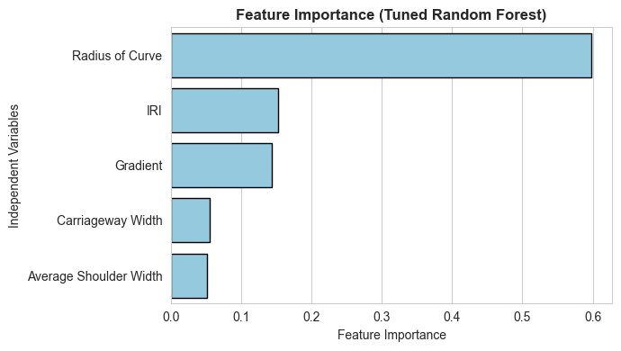
    


    

    


Actual vs Predicted Plot


```python
# Tuned Random Forest: Actual vs Predicted V85 Speed

import matplotlib.pyplot as plt
import seaborn as sns

sns.set_style("whitegrid")

plt.figure(figsize=(7, 4))

# Scatter plot
sns.scatterplot(
    x=y_test,
    y=y_test_pred_rf_tuned,
    color="steelblue",
    s=60,
    alpha=0.7,
    edgecolor="black"
)

# Perfect fit line
min_val = min(y_test.min(), y_test_pred_rf_tuned.min())
max_val = max(y_test.max(), y_test_pred_rf_tuned.max())

plt.plot(
    [min_val, max_val],
    [min_val, max_val],
    color="darkred",
    linestyle="--",
    linewidth=2,
    label="Perfect Fit"
)

plt.xlabel("Actual V85 Speed (km/h)")
plt.ylabel("Predicted V85 Speed (km/h)")

plt.title(
    "Tuned Random Forest: Actual vs Predicted V85 Speed",
    fontsize=12,
    fontweight="bold"
)

plt.legend()
plt.tight_layout()
plt.show()
```


    

    


    
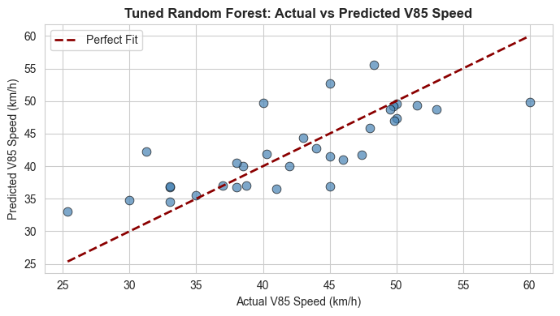
    


Residual Plot


```python
# Tuned Random Forest Residual Analysis

import matplotlib.pyplot as plt
import seaborn as sns

# Calculate residuals
rf_tuned_residuals = y_test - y_test_pred_rf_tuned

# Set plot style
sns.set_style("whitegrid")

plt.figure(figsize=(7, 4))

# Scatter plot
sns.scatterplot(
    x=y_test_pred_rf_tuned,
    y=rf_tuned_residuals,
    color="steelblue",
    s=60,
    alpha=0.7,
    edgecolor="black"
)

# Reference line at zero
plt.axhline(
    y=0,
    linestyle="--",
    color="darkred",
    linewidth=2
)

plt.xlabel("Predicted V85 Speed (km/h)")
plt.ylabel("Residuals (km/h)")

plt.title(
    "Tuned Random Forest: Residual Plot",
    fontsize=12,
    fontweight="bold"
)

plt.tight_layout()
plt.show()
```


    
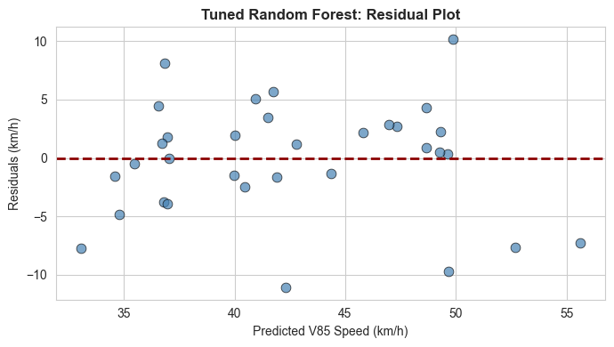
    


    

    


Result Table


```python
# Final Tuned Random Forest Performance Summary

rf_tuned_final = pd.DataFrame({
    "Model": ["Tuned Random Forest"],
    "R2": [round(rf_tuned_test_r2, 3)],
    "RMSE": [round(rf_tuned_test_rmse, 3)],
    "MAE": [round(rf_tuned_test_mae, 3)]
})

# Display results
display(rf_tuned_final)
```


<div>
<style scoped>
    .dataframe tbody tr th:only-of-type {
        vertical-align: middle;
    }

    .dataframe tbody tr th {
        vertical-align: top;
    }

    .dataframe thead th {
        text-align: right;
    }
</style>
<table border="1" class="dataframe">
  <thead>
    <tr style="text-align: right;">
      <th></th>
      <th>Model</th>
      <th>R2</th>
      <th>RMSE</th>
      <th>MAE</th>
    </tr>
  </thead>
  <tbody>
    <tr>
      <th>0</th>
      <td>Tuned Random Forest</td>
      <td>0.597</td>
      <td>4.829</td>
      <td>3.764</td>
    </tr>
  </tbody>
</table>
</div>


<div>
<style scoped>
    .dataframe tbody tr th:only-of-type {
        vertical-align: middle;
    }

    .dataframe tbody tr th {
        vertical-align: top;
    }

    .dataframe thead th {
        text-align: right;
    }
</style>
<table border="1" class="dataframe">
  <thead>
    <tr style="text-align: right;">
      <th></th>
      <th>Model</th>
      <th>R2</th>
      <th>RMSE</th>
      <th>MAE</th>
    </tr>
  </thead>
  <tbody>
    <tr>
      <th>0</th>
      <td>Tuned Random Forest</td>
      <td>0.597</td>
      <td>4.829</td>
      <td>3.764</td>
    </tr>
  </tbody>
</table>
</div>


Base vs Tuned Comparison Table


```python
# Comparison of Baseline and Tuned Random Forest

rf_comparison = pd.concat(
    [rf_final, rf_tuned_final],
    ignore_index=True
)

# Display comparison table
display(rf_comparison)
```


<div>
<style scoped>
    .dataframe tbody tr th:only-of-type {
        vertical-align: middle;
    }

    .dataframe tbody tr th {
        vertical-align: top;
    }

    .dataframe thead th {
        text-align: right;
    }
</style>
<table border="1" class="dataframe">
  <thead>
    <tr style="text-align: right;">
      <th></th>
      <th>Model</th>
      <th>R2</th>
      <th>RMSE</th>
      <th>MAE</th>
    </tr>
  </thead>
  <tbody>
    <tr>
      <th>0</th>
      <td>Random Forest</td>
      <td>0.510</td>
      <td>5.322</td>
      <td>4.201</td>
    </tr>
    <tr>
      <th>1</th>
      <td>Tuned Random Forest</td>
      <td>0.597</td>
      <td>4.829</td>
      <td>3.764</td>
    </tr>
  </tbody>
</table>
</div>


<div>
<style scoped>
    .dataframe tbody tr th:only-of-type {
        vertical-align: middle;
    }

    .dataframe tbody tr th {
        vertical-align: top;
    }

    .dataframe thead th {
        text-align: right;
    }
</style>
<table border="1" class="dataframe">
  <thead>
    <tr style="text-align: right;">
      <th></th>
      <th>Model</th>
      <th>R2</th>
      <th>RMSE</th>
      <th>MAE</th>
    </tr>
  </thead>
  <tbody>
    <tr>
      <th>0</th>
      <td>Random Forest</td>
      <td>0.510</td>
      <td>5.322</td>
      <td>4.201</td>
    </tr>
    <tr>
      <th>1</th>
      <td>Tuned Random Forest</td>
      <td>0.597</td>
      <td>4.829</td>
      <td>3.764</td>
    </tr>
  </tbody>
</table>
</div>


Best Hyperparameters Table


```python
# Best Hyperparameters of Tuned Random Forest

best_rf_params = pd.DataFrame(
    list(grid_rf.best_params_.items()),
    columns=["Parameter", "Best Value"]
)

# Display results
display(best_rf_params)
```


<div>
<style scoped>
    .dataframe tbody tr th:only-of-type {
        vertical-align: middle;
    }

    .dataframe tbody tr th {
        vertical-align: top;
    }

    .dataframe thead th {
        text-align: right;
    }
</style>
<table border="1" class="dataframe">
  <thead>
    <tr style="text-align: right;">
      <th></th>
      <th>Parameter</th>
      <th>Best Value</th>
    </tr>
  </thead>
  <tbody>
    <tr>
      <th>0</th>
      <td>max_depth</td>
      <td>None</td>
    </tr>
    <tr>
      <th>1</th>
      <td>max_features</td>
      <td>sqrt</td>
    </tr>
    <tr>
      <th>2</th>
      <td>min_samples_leaf</td>
      <td>2</td>
    </tr>
    <tr>
      <th>3</th>
      <td>min_samples_split</td>
      <td>10</td>
    </tr>
    <tr>
      <th>4</th>
      <td>n_estimators</td>
      <td>100</td>
    </tr>
  </tbody>
</table>
</div>


<div>
<style scoped>
    .dataframe tbody tr th:only-of-type {
        vertical-align: middle;
    }

    .dataframe tbody tr th {
        vertical-align: top;
    }

    .dataframe thead th {
        text-align: right;
    }
</style>
<table border="1" class="dataframe">
  <thead>
    <tr style="text-align: right;">
      <th></th>
      <th>Parameter</th>
      <th>Best Value</th>
    </tr>
  </thead>
  <tbody>
    <tr>
      <th>0</th>
      <td>max_depth</td>
      <td>None</td>
    </tr>
    <tr>
      <th>1</th>
      <td>max_features</td>
      <td>sqrt</td>
    </tr>
    <tr>
      <th>2</th>
      <td>min_samples_leaf</td>
      <td>2</td>
    </tr>
    <tr>
      <th>3</th>
      <td>min_samples_split</td>
      <td>10</td>
    </tr>
    <tr>
      <th>4</th>
      <td>n_estimators</td>
      <td>100</td>
    </tr>
  </tbody>
</table>
</div>


XGBOOST MODEL

Model Training


```python
# XGBoost Regression Model

from xgboost import XGBRegressor

# Initialize XGBoost model
xgb = XGBRegressor(
    random_state=42,
    objective="reg:squarederror"
)

# Train XGBoost using unscaled training data
xgb.fit(X_train, y_train)
```


<style>#sk-container-id-7 {
  /* Definition of color scheme common for light and dark mode */
  --sklearn-color-text: #000;
  --sklearn-color-text-muted: #666;
  --sklearn-color-line: gray;
  /* Definition of color scheme for unfitted estimators */
  --sklearn-color-unfitted-level-0: #fff5e6;
  --sklearn-color-unfitted-level-1: #f6e4d2;
  --sklearn-color-unfitted-level-2: #ffe0b3;
  --sklearn-color-unfitted-level-3: chocolate;
  /* Definition of color scheme for fitted estimators */
  --sklearn-color-fitted-level-0: #f0f8ff;
  --sklearn-color-fitted-level-1: #d4ebff;
  --sklearn-color-fitted-level-2: #b3dbfd;
  --sklearn-color-fitted-level-3: cornflowerblue;
}

#sk-container-id-7.light {
  /* Specific color for light theme */
  --sklearn-color-text-on-default-background: black;
  --sklearn-color-background: white;
  --sklearn-color-border-box: black;
  --sklearn-color-icon: #696969;
}

#sk-container-id-7.dark {
  --sklearn-color-text-on-default-background: white;
  --sklearn-color-background: #111;
  --sklearn-color-border-box: white;
  --sklearn-color-icon: #878787;
}

#sk-container-id-7 {
  color: var(--sklearn-color-text);
}

#sk-container-id-7 pre {
  padding: 0;
}

#sk-container-id-7 input.sk-hidden--visually {
  border: 0;
  clip: rect(1px 1px 1px 1px);
  clip: rect(1px, 1px, 1px, 1px);
  height: 1px;
  margin: -1px;
  overflow: hidden;
  padding: 0;
  position: absolute;
  width: 1px;
}

#sk-container-id-7 div.sk-dashed-wrapped {
  border: 1px dashed var(--sklearn-color-line);
  margin: 0 0.4em 0.5em 0.4em;
  box-sizing: border-box;
  padding-bottom: 0.4em;
  background-color: var(--sklearn-color-background);
}

#sk-container-id-7 div.sk-container {
  /* jupyter's `normalize.less` sets `[hidden] { display: none; }`
     but bootstrap.min.css set `[hidden] { display: none !important; }`
     so we also need the `!important` here to be able to override the
     default hidden behavior on the sphinx rendered scikit-learn.org.
     See: https://github.com/scikit-learn/scikit-learn/issues/21755 */
  display: inline-block !important;
  position: relative;
}

#sk-container-id-7 div.sk-text-repr-fallback {
  display: none;
}

div.sk-parallel-item,
div.sk-serial,
div.sk-item {
  /* draw centered vertical line to link estimators */
  background-image: linear-gradient(var(--sklearn-color-text-on-default-background), var(--sklearn-color-text-on-default-background));
  background-size: 2px 100%;
  background-repeat: no-repeat;
  background-position: center center;
}

/* Parallel-specific style estimator block */

#sk-container-id-7 div.sk-parallel-item::after {
  content: "";
  width: 100%;
  border-bottom: 2px solid var(--sklearn-color-text-on-default-background);
  flex-grow: 1;
}

#sk-container-id-7 div.sk-parallel {
  display: flex;
  align-items: stretch;
  justify-content: center;
  background-color: var(--sklearn-color-background);
  position: relative;
}

#sk-container-id-7 div.sk-parallel-item {
  display: flex;
  flex-direction: column;
}

#sk-container-id-7 div.sk-parallel-item:first-child::after {
  align-self: flex-end;
  width: 50%;
}

#sk-container-id-7 div.sk-parallel-item:last-child::after {
  align-self: flex-start;
  width: 50%;
}

#sk-container-id-7 div.sk-parallel-item:only-child::after {
  width: 0;
}

/* Serial-specific style estimator block */

#sk-container-id-7 div.sk-serial {
  display: flex;
  flex-direction: column;
  align-items: center;
  background-color: var(--sklearn-color-background);
  padding-right: 1em;
  padding-left: 1em;
}


/* Toggleable style: style used for estimator/Pipeline/ColumnTransformer box that is
clickable and can be expanded/collapsed.
- Pipeline and ColumnTransformer use this feature and define the default style
- Estimators will overwrite some part of the style using the `sk-estimator` class
*/

/* Pipeline and ColumnTransformer style (default) */

#sk-container-id-7 div.sk-toggleable {
  /* Default theme specific background. It is overwritten whether we have a
  specific estimator or a Pipeline/ColumnTransformer */
  background-color: var(--sklearn-color-background);
}

/* Toggleable label */
#sk-container-id-7 label.sk-toggleable__label {
  cursor: pointer;
  display: flex;
  width: 100%;
  margin-bottom: 0;
  padding: 0.5em;
  box-sizing: border-box;
  text-align: center;
  align-items: center;
  justify-content: center;
  gap: 0.5em;
}

#sk-container-id-7 label.sk-toggleable__label .caption {
  font-size: 0.6rem;
  font-weight: lighter;
  color: var(--sklearn-color-text-muted);
}

#sk-container-id-7 label.sk-toggleable__label-arrow:before {
  /* Arrow on the left of the label */
  content: "▸";
  float: left;
  margin-right: 0.25em;
  color: var(--sklearn-color-icon);
}

#sk-container-id-7 label.sk-toggleable__label-arrow:hover:before {
  color: var(--sklearn-color-text);
}

/* Toggleable content - dropdown */

#sk-container-id-7 div.sk-toggleable__content {
  display: none;
  text-align: left;
  /* unfitted */
  background-color: var(--sklearn-color-unfitted-level-0);
}

#sk-container-id-7 div.sk-toggleable__content.fitted {
  /* fitted */
  background-color: var(--sklearn-color-fitted-level-0);
}

#sk-container-id-7 div.sk-toggleable__content pre {
  margin: 0.2em;
  border-radius: 0.25em;
  color: var(--sklearn-color-text);
  /* unfitted */
  background-color: var(--sklearn-color-unfitted-level-0);
}

#sk-container-id-7 div.sk-toggleable__content.fitted pre {
  /* unfitted */
  background-color: var(--sklearn-color-fitted-level-0);
}

#sk-container-id-7 input.sk-toggleable__control:checked~div.sk-toggleable__content {
  /* Expand drop-down */
  display: block;
  width: 100%;
  overflow: visible;
}

#sk-container-id-7 input.sk-toggleable__control:checked~label.sk-toggleable__label-arrow:before {
  content: "▾";
}

/* Pipeline/ColumnTransformer-specific style */

#sk-container-id-7 div.sk-label input.sk-toggleable__control:checked~label.sk-toggleable__label {
  color: var(--sklearn-color-text);
  background-color: var(--sklearn-color-unfitted-level-2);
}

#sk-container-id-7 div.sk-label.fitted input.sk-toggleable__control:checked~label.sk-toggleable__label {
  background-color: var(--sklearn-color-fitted-level-2);
}

/* Estimator-specific style */

/* Colorize estimator box */
#sk-container-id-7 div.sk-estimator input.sk-toggleable__control:checked~label.sk-toggleable__label {
  /* unfitted */
  background-color: var(--sklearn-color-unfitted-level-2);
}

#sk-container-id-7 div.sk-estimator.fitted input.sk-toggleable__control:checked~label.sk-toggleable__label {
  /* fitted */
  background-color: var(--sklearn-color-fitted-level-2);
}

#sk-container-id-7 div.sk-label label.sk-toggleable__label,
#sk-container-id-7 div.sk-label label {
  /* The background is the default theme color */
  color: var(--sklearn-color-text-on-default-background);
}

/* On hover, darken the color of the background */
#sk-container-id-7 div.sk-label:hover label.sk-toggleable__label {
  color: var(--sklearn-color-text);
  background-color: var(--sklearn-color-unfitted-level-2);
}

/* Label box, darken color on hover, fitted */
#sk-container-id-7 div.sk-label.fitted:hover label.sk-toggleable__label.fitted {
  color: var(--sklearn-color-text);
  background-color: var(--sklearn-color-fitted-level-2);
}

/* Estimator label */

#sk-container-id-7 div.sk-label label {
  font-family: monospace;
  font-weight: bold;
  line-height: 1.2em;
}

#sk-container-id-7 div.sk-label-container {
  text-align: center;
}

/* Estimator-specific */
#sk-container-id-7 div.sk-estimator {
  font-family: monospace;
  border: 1px dotted var(--sklearn-color-border-box);
  border-radius: 0.25em;
  box-sizing: border-box;
  margin-bottom: 0.5em;
  /* unfitted */
  background-color: var(--sklearn-color-unfitted-level-0);
}

#sk-container-id-7 div.sk-estimator.fitted {
  /* fitted */
  background-color: var(--sklearn-color-fitted-level-0);
}

/* on hover */
#sk-container-id-7 div.sk-estimator:hover {
  /* unfitted */
  background-color: var(--sklearn-color-unfitted-level-2);
}

#sk-container-id-7 div.sk-estimator.fitted:hover {
  /* fitted */
  background-color: var(--sklearn-color-fitted-level-2);
}

/* Specification for estimator info (e.g. "i" and "?") */

/* Common style for "i" and "?" */

.sk-estimator-doc-link,
a:link.sk-estimator-doc-link,
a:visited.sk-estimator-doc-link {
  float: right;
  font-size: smaller;
  line-height: 1em;
  font-family: monospace;
  background-color: var(--sklearn-color-unfitted-level-0);
  border-radius: 1em;
  height: 1em;
  width: 1em;
  text-decoration: none !important;
  margin-left: 0.5em;
  text-align: center;
  /* unfitted */
  border: var(--sklearn-color-unfitted-level-3) 1pt solid;
  color: var(--sklearn-color-unfitted-level-3);
}

.sk-estimator-doc-link.fitted,
a:link.sk-estimator-doc-link.fitted,
a:visited.sk-estimator-doc-link.fitted {
  /* fitted */
  background-color: var(--sklearn-color-fitted-level-0);
  border: var(--sklearn-color-fitted-level-3) 1pt solid;
  color: var(--sklearn-color-fitted-level-3);
}

/* On hover */
div.sk-estimator:hover .sk-estimator-doc-link:hover,
.sk-estimator-doc-link:hover,
div.sk-label-container:hover .sk-estimator-doc-link:hover,
.sk-estimator-doc-link:hover {
  /* unfitted */
  background-color: var(--sklearn-color-unfitted-level-3);
  border: var(--sklearn-color-fitted-level-0) 1pt solid;
  color: var(--sklearn-color-unfitted-level-0);
  text-decoration: none;
}

div.sk-estimator.fitted:hover .sk-estimator-doc-link.fitted:hover,
.sk-estimator-doc-link.fitted:hover,
div.sk-label-container:hover .sk-estimator-doc-link.fitted:hover,
.sk-estimator-doc-link.fitted:hover {
  /* fitted */
  background-color: var(--sklearn-color-fitted-level-3);
  border: var(--sklearn-color-fitted-level-0) 1pt solid;
  color: var(--sklearn-color-fitted-level-0);
  text-decoration: none;
}

/* Span, style for the box shown on hovering the info icon */
.sk-estimator-doc-link span {
  display: none;
  z-index: 9999;
  position: relative;
  font-weight: normal;
  right: .2ex;
  padding: .5ex;
  margin: .5ex;
  width: min-content;
  min-width: 20ex;
  max-width: 50ex;
  color: var(--sklearn-color-text);
  box-shadow: 2pt 2pt 4pt #999;
  /* unfitted */
  background: var(--sklearn-color-unfitted-level-0);
  border: .5pt solid var(--sklearn-color-unfitted-level-3);
}

.sk-estimator-doc-link.fitted span {
  /* fitted */
  background: var(--sklearn-color-fitted-level-0);
  border: var(--sklearn-color-fitted-level-3);
}

.sk-estimator-doc-link:hover span {
  display: block;
}

/* "?"-specific style due to the `<a>` HTML tag */

#sk-container-id-7 a.estimator_doc_link {
  float: right;
  font-size: 1rem;
  line-height: 1em;
  font-family: monospace;
  background-color: var(--sklearn-color-unfitted-level-0);
  border-radius: 1rem;
  height: 1rem;
  width: 1rem;
  text-decoration: none;
  /* unfitted */
  color: var(--sklearn-color-unfitted-level-1);
  border: var(--sklearn-color-unfitted-level-1) 1pt solid;
}

#sk-container-id-7 a.estimator_doc_link.fitted {
  /* fitted */
  background-color: var(--sklearn-color-fitted-level-0);
  border: var(--sklearn-color-fitted-level-1) 1pt solid;
  color: var(--sklearn-color-fitted-level-1);
}

/* On hover */
#sk-container-id-7 a.estimator_doc_link:hover {
  /* unfitted */
  background-color: var(--sklearn-color-unfitted-level-3);
  color: var(--sklearn-color-background);
  text-decoration: none;
}

#sk-container-id-7 a.estimator_doc_link.fitted:hover {
  /* fitted */
  background-color: var(--sklearn-color-fitted-level-3);
}

.estimator-table {
    font-family: monospace;
}

.estimator-table summary {
    padding: .5rem;
    cursor: pointer;
}

.estimator-table summary::marker {
    font-size: 0.7rem;
}

.estimator-table details[open] {
    padding-left: 0.1rem;
    padding-right: 0.1rem;
    padding-bottom: 0.3rem;
}

.estimator-table .parameters-table {
    margin-left: auto !important;
    margin-right: auto !important;
    margin-top: 0;
}

.estimator-table .parameters-table tr:nth-child(odd) {
    background-color: #fff;
}

.estimator-table .parameters-table tr:nth-child(even) {
    background-color: #f6f6f6;
}

.estimator-table .parameters-table tr:hover {
    background-color: #e0e0e0;
}

.estimator-table table td {
    border: 1px solid rgba(106, 105, 104, 0.232);
}

/*
    `table td`is set in notebook with right text-align.
    We need to overwrite it.
*/
.estimator-table table td.param {
    text-align: left;
    position: relative;
    padding: 0;
}

.user-set td {
    color:rgb(255, 94, 0);
    text-align: left !important;
}

.user-set td.value {
    color:rgb(255, 94, 0);
    background-color: transparent;
}

.default td {
    color: black;
    text-align: left !important;
}

.user-set td i,
.default td i {
    color: black;
}

/*
    Styles for parameter documentation links
    We need styling for visited so jupyter doesn't overwrite it
*/
a.param-doc-link,
a.param-doc-link:link,
a.param-doc-link:visited {
    text-decoration: underline dashed;
    text-underline-offset: .3em;
    color: inherit;
    display: block;
    padding: .5em;
}

/* "hack" to make the entire area of the cell containing the link clickable */
a.param-doc-link::before {
    position: absolute;
    content: "";
    inset: 0;
}

.param-doc-description {
    display: none;
    position: absolute;
    z-index: 9999;
    left: 0;
    padding: .5ex;
    margin-left: 1.5em;
    color: var(--sklearn-color-text);
    box-shadow: .3em .3em .4em #999;
    width: max-content;
    text-align: left;
    max-height: 10em;
    overflow-y: auto;

    /* unfitted */
    background: var(--sklearn-color-unfitted-level-0);
    border: thin solid var(--sklearn-color-unfitted-level-3);
}

/* Fitted state for parameter tooltips */
.fitted .param-doc-description {
    /* fitted */
    background: var(--sklearn-color-fitted-level-0);
    border: thin solid var(--sklearn-color-fitted-level-3);
}

.param-doc-link:hover .param-doc-description {
    display: block;
}

.copy-paste-icon {
    background-image: url();
    background-repeat: no-repeat;
    background-size: 14px 14px;
    background-position: 0;
    display: inline-block;
    width: 14px;
    height: 14px;
    cursor: pointer;
}
</style><body><div id="sk-container-id-7" class="sk-top-container"><div class="sk-text-repr-fallback"><pre>XGBRegressor(base_score=None, booster=None, callbacks=None,
             colsample_bylevel=None, colsample_bynode=None,
             colsample_bytree=None, device=None, early_stopping_rounds=None,
             enable_categorical=False, eval_metric=None, feature_types=None,
             feature_weights=None, gamma=None, grow_policy=None,
             importance_type=None, interaction_constraints=None,
             learning_rate=None, max_bin=None, max_cat_threshold=None,
             max_cat_to_onehot=None, max_delta_step=None, max_depth=None,
             max_leaves=None, min_child_weight=None, missing=nan,
             monotone_constraints=None, multi_strategy=None, n_estimators=None,
             n_jobs=None, num_parallel_tree=None, ...)</pre><b>In a Jupyter environment, please rerun this cell to show the HTML representation or trust the notebook. <br />On GitHub, the HTML representation is unable to render, please try loading this page with nbviewer.org.</b></div><div class="sk-container" hidden><div class="sk-item"><div class="sk-estimator fitted sk-toggleable"><input class="sk-toggleable__control sk-hidden--visually" id="sk-estimator-id-7" type="checkbox" checked><label for="sk-estimator-id-7" class="sk-toggleable__label fitted sk-toggleable__label-arrow"><div><div>XGBRegressor</div></div><div><a class="sk-estimator-doc-link fitted" rel="noreferrer" target="_blank" href="https://xgboost.readthedocs.io/en/release_3.2.0/python/python_api.html#xgboost.XGBRegressor">?<span>Documentation for XGBRegressor</span></a><span class="sk-estimator-doc-link fitted">i<span>Fitted</span></span></div></label><div class="sk-toggleable__content fitted" data-param-prefix="">
        <div class="estimator-table">
            <details>
                <summary>Parameters</summary>
                <table class="parameters-table">
                  <tbody>

        <tr class="default">
            <td><i class="copy-paste-icon"
                 onclick="copyToClipboard('objective',
                          this.parentElement.nextElementSibling)"
            ></i></td>
            <td class="param">
        <a class="param-doc-link"
            rel="noreferrer" target="_blank" href="https://xgboost.readthedocs.io/en/release_3.2.0/python/python_api.html#xgboost.XGBRegressor#:~:text=objective,-typing.Union%5Bstr%2C%20xgboost.sklearn._SklObjWProto%2C%20typing.Callable%5B%5Btyping.Any%2C%20typing.Any%5D%2C%20typing.Tuple%5Bnumpy.ndarray%2C%20numpy.ndarray%5D%5D%2C%20NoneType%5D">
            objective
            <span class="param-doc-description">objective: typing.Union[str, xgboost.sklearn._SklObjWProto, typing.Callable[[typing.Any, typing.Any], typing.Tuple[numpy.ndarray, numpy.ndarray]], NoneType]<br><br>Specify the learning task and the corresponding learning objective or a custom<br>objective function to be used.<br><br>For custom objective, see :doc:`/tutorials/custom_metric_obj` and<br>:ref:`custom-obj-metric` for more information, along with the end note for<br>function signatures.</span>
        </a>
    </td>
            <td class="value">&#x27;reg:squarederror&#x27;</td>
        </tr>


        <tr class="user-set">
            <td><i class="copy-paste-icon"
                 onclick="copyToClipboard('base_score',
                          this.parentElement.nextElementSibling)"
            ></i></td>
            <td class="param">
        <a class="param-doc-link"
            rel="noreferrer" target="_blank" href="https://xgboost.readthedocs.io/en/release_3.2.0/python/python_api.html#xgboost.XGBRegressor#:~:text=base_score,-typing.Union%5Bfloat%2C%20typing.List%5Bfloat%5D%2C%20NoneType%5D">
            base_score
            <span class="param-doc-description">base_score: typing.Union[float, typing.List[float], NoneType]<br><br>The initial prediction score of all instances, global bias.</span>
        </a>
    </td>
            <td class="value">None</td>
        </tr>


        <tr class="user-set">
            <td><i class="copy-paste-icon"
                 onclick="copyToClipboard('booster',
                          this.parentElement.nextElementSibling)"
            ></i></td>
            <td class="param">booster</td>
            <td class="value">None</td>
        </tr>


        <tr class="user-set">
            <td><i class="copy-paste-icon"
                 onclick="copyToClipboard('callbacks',
                          this.parentElement.nextElementSibling)"
            ></i></td>
            <td class="param">
        <a class="param-doc-link"
            rel="noreferrer" target="_blank" href="https://xgboost.readthedocs.io/en/release_3.2.0/python/python_api.html#xgboost.XGBRegressor#:~:text=callbacks,-typing.Optional%5Btyping.List%5Bxgboost.callback.TrainingCallback%5D%5D">
            callbacks
            <span class="param-doc-description">callbacks: typing.Optional[typing.List[xgboost.callback.TrainingCallback]]<br><br>List of callback functions that are applied at end of each iteration.<br>It is possible to use predefined callbacks by using<br>:ref:`Callback API <callback_api>`.<br><br>.. note::<br><br>   States in callback are not preserved during training, which means callback<br>   objects can not be reused for multiple training sessions without<br>   reinitialization or deepcopy.<br><br>.. code-block:: python<br><br>    for params in parameters_grid:<br>        # be sure to (re)initialize the callbacks before each run<br>        callbacks = [xgb.callback.LearningRateScheduler(custom_rates)]<br>        reg = xgboost.XGBRegressor(**params, callbacks=callbacks)<br>        reg.fit(X, y)</span>
        </a>
    </td>
            <td class="value">None</td>
        </tr>


        <tr class="user-set">
            <td><i class="copy-paste-icon"
                 onclick="copyToClipboard('colsample_bylevel',
                          this.parentElement.nextElementSibling)"
            ></i></td>
            <td class="param">
        <a class="param-doc-link"
            rel="noreferrer" target="_blank" href="https://xgboost.readthedocs.io/en/release_3.2.0/python/python_api.html#xgboost.XGBRegressor#:~:text=colsample_bylevel,-typing.Optional%5Bfloat%5D">
            colsample_bylevel
            <span class="param-doc-description">colsample_bylevel: typing.Optional[float]<br><br>Subsample ratio of columns for each level.</span>
        </a>
    </td>
            <td class="value">None</td>
        </tr>


        <tr class="user-set">
            <td><i class="copy-paste-icon"
                 onclick="copyToClipboard('colsample_bynode',
                          this.parentElement.nextElementSibling)"
            ></i></td>
            <td class="param">
        <a class="param-doc-link"
            rel="noreferrer" target="_blank" href="https://xgboost.readthedocs.io/en/release_3.2.0/python/python_api.html#xgboost.XGBRegressor#:~:text=colsample_bynode,-typing.Optional%5Bfloat%5D">
            colsample_bynode
            <span class="param-doc-description">colsample_bynode: typing.Optional[float]<br><br>Subsample ratio of columns for each split.</span>
        </a>
    </td>
            <td class="value">None</td>
        </tr>


        <tr class="user-set">
            <td><i class="copy-paste-icon"
                 onclick="copyToClipboard('colsample_bytree',
                          this.parentElement.nextElementSibling)"
            ></i></td>
            <td class="param">
        <a class="param-doc-link"
            rel="noreferrer" target="_blank" href="https://xgboost.readthedocs.io/en/release_3.2.0/python/python_api.html#xgboost.XGBRegressor#:~:text=colsample_bytree,-typing.Optional%5Bfloat%5D">
            colsample_bytree
            <span class="param-doc-description">colsample_bytree: typing.Optional[float]<br><br>Subsample ratio of columns when constructing each tree.</span>
        </a>
    </td>
            <td class="value">None</td>
        </tr>


        <tr class="user-set">
            <td><i class="copy-paste-icon"
                 onclick="copyToClipboard('device',
                          this.parentElement.nextElementSibling)"
            ></i></td>
            <td class="param">
        <a class="param-doc-link"
            rel="noreferrer" target="_blank" href="https://xgboost.readthedocs.io/en/release_3.2.0/python/python_api.html#xgboost.XGBRegressor#:~:text=device,-typing.Optional%5Bstr%5D">
            device
            <span class="param-doc-description">device: typing.Optional[str]<br><br>.. versionadded:: 2.0.0<br><br>Device ordinal, available options are `cpu`, `cuda`, and `gpu`.</span>
        </a>
    </td>
            <td class="value">None</td>
        </tr>


        <tr class="user-set">
            <td><i class="copy-paste-icon"
                 onclick="copyToClipboard('early_stopping_rounds',
                          this.parentElement.nextElementSibling)"
            ></i></td>
            <td class="param">
        <a class="param-doc-link"
            rel="noreferrer" target="_blank" href="https://xgboost.readthedocs.io/en/release_3.2.0/python/python_api.html#xgboost.XGBRegressor#:~:text=early_stopping_rounds,-typing.Optional%5Bint%5D">
            early_stopping_rounds
            <span class="param-doc-description">early_stopping_rounds: typing.Optional[int]<br><br>.. versionadded:: 1.6.0<br><br>- Activates early stopping. Validation metric needs to improve at least once in<br>  every **early_stopping_rounds** round(s) to continue training.  Requires at<br>  least one item in **eval_set** in :py:meth:`fit`.<br><br>- If early stopping occurs, the model will have two additional attributes:<br>  :py:attr:`best_score` and :py:attr:`best_iteration`. These are used by the<br>  :py:meth:`predict` and :py:meth:`apply` methods to determine the optimal<br>  number of trees during inference. If users want to access the full model<br>  (including trees built after early stopping), they can specify the<br>  `iteration_range` in these inference methods. In addition, other utilities<br>  like model plotting can also use the entire model.<br><br>- If you prefer to discard the trees after `best_iteration`, consider using the<br>  callback function :py:class:`xgboost.callback.EarlyStopping`.<br><br>- If there's more than one item in **eval_set**, the last entry will be used for<br>  early stopping.  If there's more than one metric in **eval_metric**, the last<br>  metric will be used for early stopping.</span>
        </a>
    </td>
            <td class="value">None</td>
        </tr>


        <tr class="user-set">
            <td><i class="copy-paste-icon"
                 onclick="copyToClipboard('enable_categorical',
                          this.parentElement.nextElementSibling)"
            ></i></td>
            <td class="param">
        <a class="param-doc-link"
            rel="noreferrer" target="_blank" href="https://xgboost.readthedocs.io/en/release_3.2.0/python/python_api.html#xgboost.XGBRegressor#:~:text=enable_categorical,-bool">
            enable_categorical
            <span class="param-doc-description">enable_categorical: bool<br><br>See the same parameter of :py:class:`DMatrix` for details.</span>
        </a>
    </td>
            <td class="value">False</td>
        </tr>


        <tr class="user-set">
            <td><i class="copy-paste-icon"
                 onclick="copyToClipboard('eval_metric',
                          this.parentElement.nextElementSibling)"
            ></i></td>
            <td class="param">
        <a class="param-doc-link"
            rel="noreferrer" target="_blank" href="https://xgboost.readthedocs.io/en/release_3.2.0/python/python_api.html#xgboost.XGBRegressor#:~:text=eval_metric,-typing.Union%5Bstr%2C%20typing.List%5Btyping.Union%5Bstr%2C%20typing.Callable%5D%5D%2C%20typing.Callable%2C%20NoneType%5D">
            eval_metric
            <span class="param-doc-description">eval_metric: typing.Union[str, typing.List[typing.Union[str, typing.Callable]], typing.Callable, NoneType]<br><br>.. versionadded:: 1.6.0<br><br>Metric used for monitoring the training result and early stopping.  It can be a<br>string or list of strings as names of predefined metric in XGBoost (See<br>:doc:`/parameter`), one of the metrics in :py:mod:`sklearn.metrics`, or any<br>other user defined metric that looks like `sklearn.metrics`.<br><br>If custom objective is also provided, then custom metric should implement the<br>corresponding reverse link function.<br><br>Unlike the `scoring` parameter commonly used in scikit-learn, when a callable<br>object is provided, it's assumed to be a cost function and by default XGBoost<br>will minimize the result during early stopping.<br><br>For advanced usage on Early stopping like directly choosing to maximize instead<br>of minimize, see :py:obj:`xgboost.callback.EarlyStopping`.<br><br>See :doc:`/tutorials/custom_metric_obj` and :ref:`custom-obj-metric` for more<br>information.<br><br>.. code-block:: python<br><br>    from sklearn.datasets import load_diabetes<br>    from sklearn.metrics import mean_absolute_error<br>    X, y = load_diabetes(return_X_y=True)<br>    reg = xgb.XGBRegressor(<br>        tree_method="hist",<br>        eval_metric=mean_absolute_error,<br>    )<br>    reg.fit(X, y, eval_set=[(X, y)])</span>
        </a>
    </td>
            <td class="value">None</td>
        </tr>


        <tr class="user-set">
            <td><i class="copy-paste-icon"
                 onclick="copyToClipboard('feature_types',
                          this.parentElement.nextElementSibling)"
            ></i></td>
            <td class="param">
        <a class="param-doc-link"
            rel="noreferrer" target="_blank" href="https://xgboost.readthedocs.io/en/release_3.2.0/python/python_api.html#xgboost.XGBRegressor#:~:text=feature_types,-typing.Optional%5Btyping.Sequence%5Bstr%5D%5D">
            feature_types
            <span class="param-doc-description">feature_types: typing.Optional[typing.Sequence[str]]<br><br>.. versionadded:: 1.7.0<br><br>Used for specifying feature types without constructing a dataframe. See<br>the :py:class:`DMatrix` for details.</span>
        </a>
    </td>
            <td class="value">None</td>
        </tr>


        <tr class="user-set">
            <td><i class="copy-paste-icon"
                 onclick="copyToClipboard('feature_weights',
                          this.parentElement.nextElementSibling)"
            ></i></td>
            <td class="param">
        <a class="param-doc-link"
            rel="noreferrer" target="_blank" href="https://xgboost.readthedocs.io/en/release_3.2.0/python/python_api.html#xgboost.XGBRegressor#:~:text=feature_weights,-Optional%5BArrayLike%5D">
            feature_weights
            <span class="param-doc-description">feature_weights: Optional[ArrayLike]<br><br>Weight for each feature, defines the probability of each feature being selected<br>when colsample is being used.  All values must be greater than 0, otherwise a<br>`ValueError` is thrown.</span>
        </a>
    </td>
            <td class="value">None</td>
        </tr>


        <tr class="user-set">
            <td><i class="copy-paste-icon"
                 onclick="copyToClipboard('gamma',
                          this.parentElement.nextElementSibling)"
            ></i></td>
            <td class="param">
        <a class="param-doc-link"
            rel="noreferrer" target="_blank" href="https://xgboost.readthedocs.io/en/release_3.2.0/python/python_api.html#xgboost.XGBRegressor#:~:text=gamma,-typing.Optional%5Bfloat%5D">
            gamma
            <span class="param-doc-description">gamma: typing.Optional[float]<br><br>(min_split_loss) Minimum loss reduction required to make a further partition on<br>a leaf node of the tree.</span>
        </a>
    </td>
            <td class="value">None</td>
        </tr>


        <tr class="user-set">
            <td><i class="copy-paste-icon"
                 onclick="copyToClipboard('grow_policy',
                          this.parentElement.nextElementSibling)"
            ></i></td>
            <td class="param">
        <a class="param-doc-link"
            rel="noreferrer" target="_blank" href="https://xgboost.readthedocs.io/en/release_3.2.0/python/python_api.html#xgboost.XGBRegressor#:~:text=grow_policy,-typing.Optional%5Bstr%5D">
            grow_policy
            <span class="param-doc-description">grow_policy: typing.Optional[str]<br><br>Tree growing policy.<br><br>- depthwise: Favors splitting at nodes closest to the node,<br>- lossguide: Favors splitting at nodes with highest loss change.</span>
        </a>
    </td>
            <td class="value">None</td>
        </tr>


        <tr class="user-set">
            <td><i class="copy-paste-icon"
                 onclick="copyToClipboard('importance_type',
                          this.parentElement.nextElementSibling)"
            ></i></td>
            <td class="param">importance_type</td>
            <td class="value">None</td>
        </tr>


        <tr class="user-set">
            <td><i class="copy-paste-icon"
                 onclick="copyToClipboard('interaction_constraints',
                          this.parentElement.nextElementSibling)"
            ></i></td>
            <td class="param">
        <a class="param-doc-link"
            rel="noreferrer" target="_blank" href="https://xgboost.readthedocs.io/en/release_3.2.0/python/python_api.html#xgboost.XGBRegressor#:~:text=interaction_constraints,-typing.Union%5Bstr%2C%20typing.List%5Btyping.Tuple%5Bstr%5D%5D%2C%20NoneType%5D">
            interaction_constraints
            <span class="param-doc-description">interaction_constraints: typing.Union[str, typing.List[typing.Tuple[str]], NoneType]<br><br>Constraints for interaction representing permitted interactions.  The<br>constraints must be specified in the form of a nested list, e.g. ``[[0, 1], [2,<br>3, 4]]``, where each inner list is a group of indices of features that are<br>allowed to interact with each other.  See :doc:`tutorial<br></tutorials/feature_interaction_constraint>` for more information</span>
        </a>
    </td>
            <td class="value">None</td>
        </tr>


        <tr class="user-set">
            <td><i class="copy-paste-icon"
                 onclick="copyToClipboard('learning_rate',
                          this.parentElement.nextElementSibling)"
            ></i></td>
            <td class="param">
        <a class="param-doc-link"
            rel="noreferrer" target="_blank" href="https://xgboost.readthedocs.io/en/release_3.2.0/python/python_api.html#xgboost.XGBRegressor#:~:text=learning_rate,-typing.Optional%5Bfloat%5D">
            learning_rate
            <span class="param-doc-description">learning_rate: typing.Optional[float]<br><br>Boosting learning rate (xgb's "eta")</span>
        </a>
    </td>
            <td class="value">None</td>
        </tr>


        <tr class="user-set">
            <td><i class="copy-paste-icon"
                 onclick="copyToClipboard('max_bin',
                          this.parentElement.nextElementSibling)"
            ></i></td>
            <td class="param">
        <a class="param-doc-link"
            rel="noreferrer" target="_blank" href="https://xgboost.readthedocs.io/en/release_3.2.0/python/python_api.html#xgboost.XGBRegressor#:~:text=max_bin,-typing.Optional%5Bint%5D">
            max_bin
            <span class="param-doc-description">max_bin: typing.Optional[int]<br><br>If using histogram-based algorithm, maximum number of bins per feature</span>
        </a>
    </td>
            <td class="value">None</td>
        </tr>


        <tr class="user-set">
            <td><i class="copy-paste-icon"
                 onclick="copyToClipboard('max_cat_threshold',
                          this.parentElement.nextElementSibling)"
            ></i></td>
            <td class="param">
        <a class="param-doc-link"
            rel="noreferrer" target="_blank" href="https://xgboost.readthedocs.io/en/release_3.2.0/python/python_api.html#xgboost.XGBRegressor#:~:text=max_cat_threshold,-typing.Optional%5Bint%5D">
            max_cat_threshold
            <span class="param-doc-description">max_cat_threshold: typing.Optional[int]<br><br>.. versionadded:: 1.7.0<br><br>.. note:: This parameter is experimental<br><br>Maximum number of categories considered for each split. Used only by<br>partition-based splits for preventing over-fitting. Also, `enable_categorical`<br>needs to be set to have categorical feature support. See :doc:`Categorical Data<br></tutorials/categorical>` and :ref:`cat-param` for details.</span>
        </a>
    </td>
            <td class="value">None</td>
        </tr>


        <tr class="user-set">
            <td><i class="copy-paste-icon"
                 onclick="copyToClipboard('max_cat_to_onehot',
                          this.parentElement.nextElementSibling)"
            ></i></td>
            <td class="param">
        <a class="param-doc-link"
            rel="noreferrer" target="_blank" href="https://xgboost.readthedocs.io/en/release_3.2.0/python/python_api.html#xgboost.XGBRegressor#:~:text=max_cat_to_onehot,-Optional%5Bint%5D">
            max_cat_to_onehot
            <span class="param-doc-description">max_cat_to_onehot: Optional[int]<br><br>.. versionadded:: 1.6.0<br><br>.. note:: This parameter is experimental<br><br>A threshold for deciding whether XGBoost should use one-hot encoding based split<br>for categorical data.  When number of categories is lesser than the threshold<br>then one-hot encoding is chosen, otherwise the categories will be partitioned<br>into children nodes. Also, `enable_categorical` needs to be set to have<br>categorical feature support. See :doc:`Categorical Data<br></tutorials/categorical>` and :ref:`cat-param` for details.</span>
        </a>
    </td>
            <td class="value">None</td>
        </tr>


        <tr class="user-set">
            <td><i class="copy-paste-icon"
                 onclick="copyToClipboard('max_delta_step',
                          this.parentElement.nextElementSibling)"
            ></i></td>
            <td class="param">
        <a class="param-doc-link"
            rel="noreferrer" target="_blank" href="https://xgboost.readthedocs.io/en/release_3.2.0/python/python_api.html#xgboost.XGBRegressor#:~:text=max_delta_step,-typing.Optional%5Bfloat%5D">
            max_delta_step
            <span class="param-doc-description">max_delta_step: typing.Optional[float]<br><br>Maximum delta step we allow each tree's weight estimation to be.</span>
        </a>
    </td>
            <td class="value">None</td>
        </tr>


        <tr class="user-set">
            <td><i class="copy-paste-icon"
                 onclick="copyToClipboard('max_depth',
                          this.parentElement.nextElementSibling)"
            ></i></td>
            <td class="param">
        <a class="param-doc-link"
            rel="noreferrer" target="_blank" href="https://xgboost.readthedocs.io/en/release_3.2.0/python/python_api.html#xgboost.XGBRegressor#:~:text=max_depth,-%20typing.Optional%5Bint%5D">
            max_depth
            <span class="param-doc-description">max_depth:  typing.Optional[int]<br><br>Maximum tree depth for base learners.</span>
        </a>
    </td>
            <td class="value">None</td>
        </tr>


        <tr class="user-set">
            <td><i class="copy-paste-icon"
                 onclick="copyToClipboard('max_leaves',
                          this.parentElement.nextElementSibling)"
            ></i></td>
            <td class="param">
        <a class="param-doc-link"
            rel="noreferrer" target="_blank" href="https://xgboost.readthedocs.io/en/release_3.2.0/python/python_api.html#xgboost.XGBRegressor#:~:text=max_leaves,-typing.Optional%5Bint%5D">
            max_leaves
            <span class="param-doc-description">max_leaves: typing.Optional[int]<br><br>Maximum number of leaves; 0 indicates no limit.</span>
        </a>
    </td>
            <td class="value">None</td>
        </tr>


        <tr class="user-set">
            <td><i class="copy-paste-icon"
                 onclick="copyToClipboard('min_child_weight',
                          this.parentElement.nextElementSibling)"
            ></i></td>
            <td class="param">
        <a class="param-doc-link"
            rel="noreferrer" target="_blank" href="https://xgboost.readthedocs.io/en/release_3.2.0/python/python_api.html#xgboost.XGBRegressor#:~:text=min_child_weight,-typing.Optional%5Bfloat%5D">
            min_child_weight
            <span class="param-doc-description">min_child_weight: typing.Optional[float]<br><br>Minimum sum of instance weight(hessian) needed in a child.</span>
        </a>
    </td>
            <td class="value">None</td>
        </tr>


        <tr class="user-set">
            <td><i class="copy-paste-icon"
                 onclick="copyToClipboard('missing',
                          this.parentElement.nextElementSibling)"
            ></i></td>
            <td class="param">
        <a class="param-doc-link"
            rel="noreferrer" target="_blank" href="https://xgboost.readthedocs.io/en/release_3.2.0/python/python_api.html#xgboost.XGBRegressor#:~:text=missing,-float">
            missing
            <span class="param-doc-description">missing: float<br><br>Value in the data which needs to be present as a missing value. Default to<br>:py:data:`numpy.nan`.</span>
        </a>
    </td>
            <td class="value">nan</td>
        </tr>


        <tr class="user-set">
            <td><i class="copy-paste-icon"
                 onclick="copyToClipboard('monotone_constraints',
                          this.parentElement.nextElementSibling)"
            ></i></td>
            <td class="param">
        <a class="param-doc-link"
            rel="noreferrer" target="_blank" href="https://xgboost.readthedocs.io/en/release_3.2.0/python/python_api.html#xgboost.XGBRegressor#:~:text=monotone_constraints,-typing.Union%5Btyping.Dict%5Bstr%2C%20int%5D%2C%20str%2C%20NoneType%5D">
            monotone_constraints
            <span class="param-doc-description">monotone_constraints: typing.Union[typing.Dict[str, int], str, NoneType]<br><br>Constraint of variable monotonicity.  See :doc:`tutorial </tutorials/monotonic>`<br>for more information.</span>
        </a>
    </td>
            <td class="value">None</td>
        </tr>


        <tr class="user-set">
            <td><i class="copy-paste-icon"
                 onclick="copyToClipboard('multi_strategy',
                          this.parentElement.nextElementSibling)"
            ></i></td>
            <td class="param">
        <a class="param-doc-link"
            rel="noreferrer" target="_blank" href="https://xgboost.readthedocs.io/en/release_3.2.0/python/python_api.html#xgboost.XGBRegressor#:~:text=multi_strategy,-typing.Optional%5Bstr%5D">
            multi_strategy
            <span class="param-doc-description">multi_strategy: typing.Optional[str]<br><br>.. versionadded:: 2.0.0<br><br>.. note:: This parameter is working-in-progress.<br><br>The strategy used for training multi-target models, including multi-target<br>regression and multi-class classification. See :doc:`/tutorials/multioutput` for<br>more information.<br><br>- ``one_output_per_tree``: One model for each target.<br>- ``multi_output_tree``:  Use multi-target trees.</span>
        </a>
    </td>
            <td class="value">None</td>
        </tr>


        <tr class="user-set">
            <td><i class="copy-paste-icon"
                 onclick="copyToClipboard('n_estimators',
                          this.parentElement.nextElementSibling)"
            ></i></td>
            <td class="param">
        <a class="param-doc-link"
            rel="noreferrer" target="_blank" href="https://xgboost.readthedocs.io/en/release_3.2.0/python/python_api.html#xgboost.XGBRegressor#:~:text=n_estimators,-typing.Optional%5Bint%5D">
            n_estimators
            <span class="param-doc-description">n_estimators: typing.Optional[int]<br><br>Number of gradient boosted trees.  Equivalent to number of boosting<br>rounds.</span>
        </a>
    </td>
            <td class="value">None</td>
        </tr>


        <tr class="user-set">
            <td><i class="copy-paste-icon"
                 onclick="copyToClipboard('n_jobs',
                          this.parentElement.nextElementSibling)"
            ></i></td>
            <td class="param">
        <a class="param-doc-link"
            rel="noreferrer" target="_blank" href="https://xgboost.readthedocs.io/en/release_3.2.0/python/python_api.html#xgboost.XGBRegressor#:~:text=n_jobs,-typing.Optional%5Bint%5D">
            n_jobs
            <span class="param-doc-description">n_jobs: typing.Optional[int]<br><br>Number of parallel threads used to run xgboost.  When used with other<br>Scikit-Learn algorithms like grid search, you may choose which algorithm to<br>parallelize and balance the threads.  Creating thread contention will<br>significantly slow down both algorithms.</span>
        </a>
    </td>
            <td class="value">None</td>
        </tr>


        <tr class="user-set">
            <td><i class="copy-paste-icon"
                 onclick="copyToClipboard('num_parallel_tree',
                          this.parentElement.nextElementSibling)"
            ></i></td>
            <td class="param">num_parallel_tree</td>
            <td class="value">None</td>
        </tr>


        <tr class="user-set">
            <td><i class="copy-paste-icon"
                 onclick="copyToClipboard('random_state',
                          this.parentElement.nextElementSibling)"
            ></i></td>
            <td class="param">
        <a class="param-doc-link"
            rel="noreferrer" target="_blank" href="https://xgboost.readthedocs.io/en/release_3.2.0/python/python_api.html#xgboost.XGBRegressor#:~:text=random_state,-typing.Union%5Bnumpy.random.mtrand.RandomState%2C%20numpy.random._generator.Generator%2C%20int%2C%20NoneType%5D">
            random_state
            <span class="param-doc-description">random_state: typing.Union[numpy.random.mtrand.RandomState, numpy.random._generator.Generator, int, NoneType]<br><br>Random number seed.<br><br>.. note::<br><br>   Using gblinear booster with shotgun updater is nondeterministic as<br>   it uses Hogwild algorithm.</span>
        </a>
    </td>
            <td class="value">42</td>
        </tr>


        <tr class="user-set">
            <td><i class="copy-paste-icon"
                 onclick="copyToClipboard('reg_alpha',
                          this.parentElement.nextElementSibling)"
            ></i></td>
            <td class="param">
        <a class="param-doc-link"
            rel="noreferrer" target="_blank" href="https://xgboost.readthedocs.io/en/release_3.2.0/python/python_api.html#xgboost.XGBRegressor#:~:text=reg_alpha,-typing.Optional%5Bfloat%5D">
            reg_alpha
            <span class="param-doc-description">reg_alpha: typing.Optional[float]<br><br>L1 regularization term on weights (xgb's alpha).</span>
        </a>
    </td>
            <td class="value">None</td>
        </tr>


        <tr class="user-set">
            <td><i class="copy-paste-icon"
                 onclick="copyToClipboard('reg_lambda',
                          this.parentElement.nextElementSibling)"
            ></i></td>
            <td class="param">
        <a class="param-doc-link"
            rel="noreferrer" target="_blank" href="https://xgboost.readthedocs.io/en/release_3.2.0/python/python_api.html#xgboost.XGBRegressor#:~:text=reg_lambda,-typing.Optional%5Bfloat%5D">
            reg_lambda
            <span class="param-doc-description">reg_lambda: typing.Optional[float]<br><br>L2 regularization term on weights (xgb's lambda).</span>
        </a>
    </td>
            <td class="value">None</td>
        </tr>


        <tr class="user-set">
            <td><i class="copy-paste-icon"
                 onclick="copyToClipboard('sampling_method',
                          this.parentElement.nextElementSibling)"
            ></i></td>
            <td class="param">
        <a class="param-doc-link"
            rel="noreferrer" target="_blank" href="https://xgboost.readthedocs.io/en/release_3.2.0/python/python_api.html#xgboost.XGBRegressor#:~:text=sampling_method,-typing.Optional%5Bstr%5D">
            sampling_method
            <span class="param-doc-description">sampling_method: typing.Optional[str]<br><br>Sampling method. Used only by the GPU version of ``hist`` tree method.<br><br>- ``uniform``: Select random training instances uniformly.<br>- ``gradient_based``: Select random training instances with higher probability<br>    when the gradient and hessian are larger. (cf. CatBoost)</span>
        </a>
    </td>
            <td class="value">None</td>
        </tr>


        <tr class="user-set">
            <td><i class="copy-paste-icon"
                 onclick="copyToClipboard('scale_pos_weight',
                          this.parentElement.nextElementSibling)"
            ></i></td>
            <td class="param">
        <a class="param-doc-link"
            rel="noreferrer" target="_blank" href="https://xgboost.readthedocs.io/en/release_3.2.0/python/python_api.html#xgboost.XGBRegressor#:~:text=scale_pos_weight,-typing.Optional%5Bfloat%5D">
            scale_pos_weight
            <span class="param-doc-description">scale_pos_weight: typing.Optional[float]<br><br>Balancing of positive and negative weights.</span>
        </a>
    </td>
            <td class="value">None</td>
        </tr>


        <tr class="user-set">
            <td><i class="copy-paste-icon"
                 onclick="copyToClipboard('subsample',
                          this.parentElement.nextElementSibling)"
            ></i></td>
            <td class="param">
        <a class="param-doc-link"
            rel="noreferrer" target="_blank" href="https://xgboost.readthedocs.io/en/release_3.2.0/python/python_api.html#xgboost.XGBRegressor#:~:text=subsample,-typing.Optional%5Bfloat%5D">
            subsample
            <span class="param-doc-description">subsample: typing.Optional[float]<br><br>Subsample ratio of the training instance.</span>
        </a>
    </td>
            <td class="value">None</td>
        </tr>


        <tr class="user-set">
            <td><i class="copy-paste-icon"
                 onclick="copyToClipboard('tree_method',
                          this.parentElement.nextElementSibling)"
            ></i></td>
            <td class="param">
        <a class="param-doc-link"
            rel="noreferrer" target="_blank" href="https://xgboost.readthedocs.io/en/release_3.2.0/python/python_api.html#xgboost.XGBRegressor#:~:text=tree_method,-typing.Optional%5Bstr%5D">
            tree_method
            <span class="param-doc-description">tree_method: typing.Optional[str]<br><br>Specify which tree method to use.  Default to auto.  If this parameter is set to<br>default, XGBoost will choose the most conservative option available.  It's<br>recommended to study this option from the parameters document :doc:`tree method<br></treemethod>`</span>
        </a>
    </td>
            <td class="value">None</td>
        </tr>


        <tr class="user-set">
            <td><i class="copy-paste-icon"
                 onclick="copyToClipboard('validate_parameters',
                          this.parentElement.nextElementSibling)"
            ></i></td>
            <td class="param">
        <a class="param-doc-link"
            rel="noreferrer" target="_blank" href="https://xgboost.readthedocs.io/en/release_3.2.0/python/python_api.html#xgboost.XGBRegressor#:~:text=validate_parameters,-typing.Optional%5Bbool%5D">
            validate_parameters
            <span class="param-doc-description">validate_parameters: typing.Optional[bool]<br><br>Give warnings for unknown parameter.</span>
        </a>
    </td>
            <td class="value">None</td>
        </tr>


        <tr class="user-set">
            <td><i class="copy-paste-icon"
                 onclick="copyToClipboard('verbosity',
                          this.parentElement.nextElementSibling)"
            ></i></td>
            <td class="param">
        <a class="param-doc-link"
            rel="noreferrer" target="_blank" href="https://xgboost.readthedocs.io/en/release_3.2.0/python/python_api.html#xgboost.XGBRegressor#:~:text=verbosity,-typing.Optional%5Bint%5D">
            verbosity
            <span class="param-doc-description">verbosity: typing.Optional[int]<br><br>The degree of verbosity. Valid values are 0 (silent) - 3 (debug).</span>
        </a>
    </td>
            <td class="value">None</td>
        </tr>

                  </tbody>
                </table>
            </details>
        </div>
    </div></div></div></div></div><script>function copyToClipboard(text, element) {
    // Get the parameter prefix from the closest toggleable content
    const toggleableContent = element.closest('.sk-toggleable__content');
    const paramPrefix = toggleableContent ? toggleableContent.dataset.paramPrefix : '';
    const fullParamName = paramPrefix ? `${paramPrefix}${text}` : text;

    const originalStyle = element.style;
    const computedStyle = window.getComputedStyle(element);
    const originalWidth = computedStyle.width;
    const originalHTML = element.innerHTML.replace('Copied!', '');

    navigator.clipboard.writeText(fullParamName)
        .then(() => {
            element.style.width = originalWidth;
            element.style.color = 'green';
            element.innerHTML = "Copied!";

            setTimeout(() => {
                element.innerHTML = originalHTML;
                element.style = originalStyle;
            }, 2000);
        })
        .catch(err => {
            console.error('Failed to copy:', err);
            element.style.color = 'red';
            element.innerHTML = "Failed!";
            setTimeout(() => {
                element.innerHTML = originalHTML;
                element.style = originalStyle;
            }, 2000);
        });
    return false;
}

document.querySelectorAll('.copy-paste-icon').forEach(function(element) {
    const toggleableContent = element.closest('.sk-toggleable__content');
    const paramPrefix = toggleableContent ? toggleableContent.dataset.paramPrefix : '';
    const paramName = element.parentElement.nextElementSibling
        .textContent.trim().split(' ')[0];
    const fullParamName = paramPrefix ? `${paramPrefix}${paramName}` : paramName;

    element.setAttribute('title', fullParamName);
});


/**
 * Adapted from Skrub
 * https://github.com/skrub-data/skrub/blob/403466d1d5d4dc76a7ef569b3f8228db59a31dc3/skrub/_reporting/_data/templates/report.js#L789
 * @returns "light" or "dark"
 */
function detectTheme(element) {
    const body = document.querySelector('body');

    // Check VSCode theme
    const themeKindAttr = body.getAttribute('data-vscode-theme-kind');
    const themeNameAttr = body.getAttribute('data-vscode-theme-name');

    if (themeKindAttr && themeNameAttr) {
        const themeKind = themeKindAttr.toLowerCase();
        const themeName = themeNameAttr.toLowerCase();

        if (themeKind.includes("dark") || themeName.includes("dark")) {
            return "dark";
        }
        if (themeKind.includes("light") || themeName.includes("light")) {
            return "light";
        }
    }

    // Check Jupyter theme
    if (body.getAttribute('data-jp-theme-light') === 'false') {
        return 'dark';
    } else if (body.getAttribute('data-jp-theme-light') === 'true') {
        return 'light';
    }

    // Guess based on a parent element's color
    const color = window.getComputedStyle(element.parentNode, null).getPropertyValue('color');
    const match = color.match(/^rgb\s*\(\s*(\d+)\s*,\s*(\d+)\s*,\s*(\d+)\s*\)\s*$/i);
    if (match) {
        const [r, g, b] = [
            parseFloat(match[1]),
            parseFloat(match[2]),
            parseFloat(match[3])
        ];

        // https://en.wikipedia.org/wiki/HSL_and_HSV#Lightness
        const luma = 0.299 * r + 0.587 * g + 0.114 * b;

        if (luma > 180) {
            // If the text is very bright we have a dark theme
            return 'dark';
        }
        if (luma < 75) {
            // If the text is very dark we have a light theme
            return 'light';
        }
        // Otherwise fall back to the next heuristic.
    }

    // Fallback to system preference
    return window.matchMedia('(prefers-color-scheme: dark)').matches ? 'dark' : 'light';
}


function forceTheme(elementId) {
    const estimatorElement = document.querySelector(`#${elementId}`);
    if (estimatorElement === null) {
        console.error(`Element with id ${elementId} not found.`);
    } else {
        const theme = detectTheme(estimatorElement);
        estimatorElement.classList.add(theme);
    }
}

forceTheme('sk-container-id-7');</script></body>


<style>#sk-container-id-8 {
  /* Definition of color scheme common for light and dark mode */
  --sklearn-color-text: #000;
  --sklearn-color-text-muted: #666;
  --sklearn-color-line: gray;
  /* Definition of color scheme for unfitted estimators */
  --sklearn-color-unfitted-level-0: #fff5e6;
  --sklearn-color-unfitted-level-1: #f6e4d2;
  --sklearn-color-unfitted-level-2: #ffe0b3;
  --sklearn-color-unfitted-level-3: chocolate;
  /* Definition of color scheme for fitted estimators */
  --sklearn-color-fitted-level-0: #f0f8ff;
  --sklearn-color-fitted-level-1: #d4ebff;
  --sklearn-color-fitted-level-2: #b3dbfd;
  --sklearn-color-fitted-level-3: cornflowerblue;
}

#sk-container-id-8.light {
  /* Specific color for light theme */
  --sklearn-color-text-on-default-background: black;
  --sklearn-color-background: white;
  --sklearn-color-border-box: black;
  --sklearn-color-icon: #696969;
}

#sk-container-id-8.dark {
  --sklearn-color-text-on-default-background: white;
  --sklearn-color-background: #111;
  --sklearn-color-border-box: white;
  --sklearn-color-icon: #878787;
}

#sk-container-id-8 {
  color: var(--sklearn-color-text);
}

#sk-container-id-8 pre {
  padding: 0;
}

#sk-container-id-8 input.sk-hidden--visually {
  border: 0;
  clip: rect(1px 1px 1px 1px);
  clip: rect(1px, 1px, 1px, 1px);
  height: 1px;
  margin: -1px;
  overflow: hidden;
  padding: 0;
  position: absolute;
  width: 1px;
}

#sk-container-id-8 div.sk-dashed-wrapped {
  border: 1px dashed var(--sklearn-color-line);
  margin: 0 0.4em 0.5em 0.4em;
  box-sizing: border-box;
  padding-bottom: 0.4em;
  background-color: var(--sklearn-color-background);
}

#sk-container-id-8 div.sk-container {
  /* jupyter's `normalize.less` sets `[hidden] { display: none; }`
     but bootstrap.min.css set `[hidden] { display: none !important; }`
     so we also need the `!important` here to be able to override the
     default hidden behavior on the sphinx rendered scikit-learn.org.
     See: https://github.com/scikit-learn/scikit-learn/issues/21755 */
  display: inline-block !important;
  position: relative;
}

#sk-container-id-8 div.sk-text-repr-fallback {
  display: none;
}

div.sk-parallel-item,
div.sk-serial,
div.sk-item {
  /* draw centered vertical line to link estimators */
  background-image: linear-gradient(var(--sklearn-color-text-on-default-background), var(--sklearn-color-text-on-default-background));
  background-size: 2px 100%;
  background-repeat: no-repeat;
  background-position: center center;
}

/* Parallel-specific style estimator block */

#sk-container-id-8 div.sk-parallel-item::after {
  content: "";
  width: 100%;
  border-bottom: 2px solid var(--sklearn-color-text-on-default-background);
  flex-grow: 1;
}

#sk-container-id-8 div.sk-parallel {
  display: flex;
  align-items: stretch;
  justify-content: center;
  background-color: var(--sklearn-color-background);
  position: relative;
}

#sk-container-id-8 div.sk-parallel-item {
  display: flex;
  flex-direction: column;
}

#sk-container-id-8 div.sk-parallel-item:first-child::after {
  align-self: flex-end;
  width: 50%;
}

#sk-container-id-8 div.sk-parallel-item:last-child::after {
  align-self: flex-start;
  width: 50%;
}

#sk-container-id-8 div.sk-parallel-item:only-child::after {
  width: 0;
}

/* Serial-specific style estimator block */

#sk-container-id-8 div.sk-serial {
  display: flex;
  flex-direction: column;
  align-items: center;
  background-color: var(--sklearn-color-background);
  padding-right: 1em;
  padding-left: 1em;
}


/* Toggleable style: style used for estimator/Pipeline/ColumnTransformer box that is
clickable and can be expanded/collapsed.
- Pipeline and ColumnTransformer use this feature and define the default style
- Estimators will overwrite some part of the style using the `sk-estimator` class
*/

/* Pipeline and ColumnTransformer style (default) */

#sk-container-id-8 div.sk-toggleable {
  /* Default theme specific background. It is overwritten whether we have a
  specific estimator or a Pipeline/ColumnTransformer */
  background-color: var(--sklearn-color-background);
}

/* Toggleable label */
#sk-container-id-8 label.sk-toggleable__label {
  cursor: pointer;
  display: flex;
  width: 100%;
  margin-bottom: 0;
  padding: 0.5em;
  box-sizing: border-box;
  text-align: center;
  align-items: center;
  justify-content: center;
  gap: 0.5em;
}

#sk-container-id-8 label.sk-toggleable__label .caption {
  font-size: 0.6rem;
  font-weight: lighter;
  color: var(--sklearn-color-text-muted);
}

#sk-container-id-8 label.sk-toggleable__label-arrow:before {
  /* Arrow on the left of the label */
  content: "▸";
  float: left;
  margin-right: 0.25em;
  color: var(--sklearn-color-icon);
}

#sk-container-id-8 label.sk-toggleable__label-arrow:hover:before {
  color: var(--sklearn-color-text);
}

/* Toggleable content - dropdown */

#sk-container-id-8 div.sk-toggleable__content {
  display: none;
  text-align: left;
  /* unfitted */
  background-color: var(--sklearn-color-unfitted-level-0);
}

#sk-container-id-8 div.sk-toggleable__content.fitted {
  /* fitted */
  background-color: var(--sklearn-color-fitted-level-0);
}

#sk-container-id-8 div.sk-toggleable__content pre {
  margin: 0.2em;
  border-radius: 0.25em;
  color: var(--sklearn-color-text);
  /* unfitted */
  background-color: var(--sklearn-color-unfitted-level-0);
}

#sk-container-id-8 div.sk-toggleable__content.fitted pre {
  /* unfitted */
  background-color: var(--sklearn-color-fitted-level-0);
}

#sk-container-id-8 input.sk-toggleable__control:checked~div.sk-toggleable__content {
  /* Expand drop-down */
  display: block;
  width: 100%;
  overflow: visible;
}

#sk-container-id-8 input.sk-toggleable__control:checked~label.sk-toggleable__label-arrow:before {
  content: "▾";
}

/* Pipeline/ColumnTransformer-specific style */

#sk-container-id-8 div.sk-label input.sk-toggleable__control:checked~label.sk-toggleable__label {
  color: var(--sklearn-color-text);
  background-color: var(--sklearn-color-unfitted-level-2);
}

#sk-container-id-8 div.sk-label.fitted input.sk-toggleable__control:checked~label.sk-toggleable__label {
  background-color: var(--sklearn-color-fitted-level-2);
}

/* Estimator-specific style */

/* Colorize estimator box */
#sk-container-id-8 div.sk-estimator input.sk-toggleable__control:checked~label.sk-toggleable__label {
  /* unfitted */
  background-color: var(--sklearn-color-unfitted-level-2);
}

#sk-container-id-8 div.sk-estimator.fitted input.sk-toggleable__control:checked~label.sk-toggleable__label {
  /* fitted */
  background-color: var(--sklearn-color-fitted-level-2);
}

#sk-container-id-8 div.sk-label label.sk-toggleable__label,
#sk-container-id-8 div.sk-label label {
  /* The background is the default theme color */
  color: var(--sklearn-color-text-on-default-background);
}

/* On hover, darken the color of the background */
#sk-container-id-8 div.sk-label:hover label.sk-toggleable__label {
  color: var(--sklearn-color-text);
  background-color: var(--sklearn-color-unfitted-level-2);
}

/* Label box, darken color on hover, fitted */
#sk-container-id-8 div.sk-label.fitted:hover label.sk-toggleable__label.fitted {
  color: var(--sklearn-color-text);
  background-color: var(--sklearn-color-fitted-level-2);
}

/* Estimator label */

#sk-container-id-8 div.sk-label label {
  font-family: monospace;
  font-weight: bold;
  line-height: 1.2em;
}

#sk-container-id-8 div.sk-label-container {
  text-align: center;
}

/* Estimator-specific */
#sk-container-id-8 div.sk-estimator {
  font-family: monospace;
  border: 1px dotted var(--sklearn-color-border-box);
  border-radius: 0.25em;
  box-sizing: border-box;
  margin-bottom: 0.5em;
  /* unfitted */
  background-color: var(--sklearn-color-unfitted-level-0);
}

#sk-container-id-8 div.sk-estimator.fitted {
  /* fitted */
  background-color: var(--sklearn-color-fitted-level-0);
}

/* on hover */
#sk-container-id-8 div.sk-estimator:hover {
  /* unfitted */
  background-color: var(--sklearn-color-unfitted-level-2);
}

#sk-container-id-8 div.sk-estimator.fitted:hover {
  /* fitted */
  background-color: var(--sklearn-color-fitted-level-2);
}

/* Specification for estimator info (e.g. "i" and "?") */

/* Common style for "i" and "?" */

.sk-estimator-doc-link,
a:link.sk-estimator-doc-link,
a:visited.sk-estimator-doc-link {
  float: right;
  font-size: smaller;
  line-height: 1em;
  font-family: monospace;
  background-color: var(--sklearn-color-unfitted-level-0);
  border-radius: 1em;
  height: 1em;
  width: 1em;
  text-decoration: none !important;
  margin-left: 0.5em;
  text-align: center;
  /* unfitted */
  border: var(--sklearn-color-unfitted-level-3) 1pt solid;
  color: var(--sklearn-color-unfitted-level-3);
}

.sk-estimator-doc-link.fitted,
a:link.sk-estimator-doc-link.fitted,
a:visited.sk-estimator-doc-link.fitted {
  /* fitted */
  background-color: var(--sklearn-color-fitted-level-0);
  border: var(--sklearn-color-fitted-level-3) 1pt solid;
  color: var(--sklearn-color-fitted-level-3);
}

/* On hover */
div.sk-estimator:hover .sk-estimator-doc-link:hover,
.sk-estimator-doc-link:hover,
div.sk-label-container:hover .sk-estimator-doc-link:hover,
.sk-estimator-doc-link:hover {
  /* unfitted */
  background-color: var(--sklearn-color-unfitted-level-3);
  border: var(--sklearn-color-fitted-level-0) 1pt solid;
  color: var(--sklearn-color-unfitted-level-0);
  text-decoration: none;
}

div.sk-estimator.fitted:hover .sk-estimator-doc-link.fitted:hover,
.sk-estimator-doc-link.fitted:hover,
div.sk-label-container:hover .sk-estimator-doc-link.fitted:hover,
.sk-estimator-doc-link.fitted:hover {
  /* fitted */
  background-color: var(--sklearn-color-fitted-level-3);
  border: var(--sklearn-color-fitted-level-0) 1pt solid;
  color: var(--sklearn-color-fitted-level-0);
  text-decoration: none;
}

/* Span, style for the box shown on hovering the info icon */
.sk-estimator-doc-link span {
  display: none;
  z-index: 9999;
  position: relative;
  font-weight: normal;
  right: .2ex;
  padding: .5ex;
  margin: .5ex;
  width: min-content;
  min-width: 20ex;
  max-width: 50ex;
  color: var(--sklearn-color-text);
  box-shadow: 2pt 2pt 4pt #999;
  /* unfitted */
  background: var(--sklearn-color-unfitted-level-0);
  border: .5pt solid var(--sklearn-color-unfitted-level-3);
}

.sk-estimator-doc-link.fitted span {
  /* fitted */
  background: var(--sklearn-color-fitted-level-0);
  border: var(--sklearn-color-fitted-level-3);
}

.sk-estimator-doc-link:hover span {
  display: block;
}

/* "?"-specific style due to the `<a>` HTML tag */

#sk-container-id-8 a.estimator_doc_link {
  float: right;
  font-size: 1rem;
  line-height: 1em;
  font-family: monospace;
  background-color: var(--sklearn-color-unfitted-level-0);
  border-radius: 1rem;
  height: 1rem;
  width: 1rem;
  text-decoration: none;
  /* unfitted */
  color: var(--sklearn-color-unfitted-level-1);
  border: var(--sklearn-color-unfitted-level-1) 1pt solid;
}

#sk-container-id-8 a.estimator_doc_link.fitted {
  /* fitted */
  background-color: var(--sklearn-color-fitted-level-0);
  border: var(--sklearn-color-fitted-level-1) 1pt solid;
  color: var(--sklearn-color-fitted-level-1);
}

/* On hover */
#sk-container-id-8 a.estimator_doc_link:hover {
  /* unfitted */
  background-color: var(--sklearn-color-unfitted-level-3);
  color: var(--sklearn-color-background);
  text-decoration: none;
}

#sk-container-id-8 a.estimator_doc_link.fitted:hover {
  /* fitted */
  background-color: var(--sklearn-color-fitted-level-3);
}

.estimator-table {
    font-family: monospace;
}

.estimator-table summary {
    padding: .5rem;
    cursor: pointer;
}

.estimator-table summary::marker {
    font-size: 0.7rem;
}

.estimator-table details[open] {
    padding-left: 0.1rem;
    padding-right: 0.1rem;
    padding-bottom: 0.3rem;
}

.estimator-table .parameters-table {
    margin-left: auto !important;
    margin-right: auto !important;
    margin-top: 0;
}

.estimator-table .parameters-table tr:nth-child(odd) {
    background-color: #fff;
}

.estimator-table .parameters-table tr:nth-child(even) {
    background-color: #f6f6f6;
}

.estimator-table .parameters-table tr:hover {
    background-color: #e0e0e0;
}

.estimator-table table td {
    border: 1px solid rgba(106, 105, 104, 0.232);
}

/*
    `table td`is set in notebook with right text-align.
    We need to overwrite it.
*/
.estimator-table table td.param {
    text-align: left;
    position: relative;
    padding: 0;
}

.user-set td {
    color:rgb(255, 94, 0);
    text-align: left !important;
}

.user-set td.value {
    color:rgb(255, 94, 0);
    background-color: transparent;
}

.default td {
    color: black;
    text-align: left !important;
}

.user-set td i,
.default td i {
    color: black;
}

/*
    Styles for parameter documentation links
    We need styling for visited so jupyter doesn't overwrite it
*/
a.param-doc-link,
a.param-doc-link:link,
a.param-doc-link:visited {
    text-decoration: underline dashed;
    text-underline-offset: .3em;
    color: inherit;
    display: block;
    padding: .5em;
}

/* "hack" to make the entire area of the cell containing the link clickable */
a.param-doc-link::before {
    position: absolute;
    content: "";
    inset: 0;
}

.param-doc-description {
    display: none;
    position: absolute;
    z-index: 9999;
    left: 0;
    padding: .5ex;
    margin-left: 1.5em;
    color: var(--sklearn-color-text);
    box-shadow: .3em .3em .4em #999;
    width: max-content;
    text-align: left;
    max-height: 10em;
    overflow-y: auto;

    /* unfitted */
    background: var(--sklearn-color-unfitted-level-0);
    border: thin solid var(--sklearn-color-unfitted-level-3);
}

/* Fitted state for parameter tooltips */
.fitted .param-doc-description {
    /* fitted */
    background: var(--sklearn-color-fitted-level-0);
    border: thin solid var(--sklearn-color-fitted-level-3);
}

.param-doc-link:hover .param-doc-description {
    display: block;
}

.copy-paste-icon {
    background-image: url();
    background-repeat: no-repeat;
    background-size: 14px 14px;
    background-position: 0;
    display: inline-block;
    width: 14px;
    height: 14px;
    cursor: pointer;
}
</style><body><div id="sk-container-id-8" class="sk-top-container"><div class="sk-text-repr-fallback"><pre>XGBRegressor(base_score=None, booster=None, callbacks=None,
             colsample_bylevel=None, colsample_bynode=None,
             colsample_bytree=None, device=None, early_stopping_rounds=None,
             enable_categorical=False, eval_metric=None, feature_types=None,
             feature_weights=None, gamma=None, grow_policy=None,
             importance_type=None, interaction_constraints=None,
             learning_rate=None, max_bin=None, max_cat_threshold=None,
             max_cat_to_onehot=None, max_delta_step=None, max_depth=None,
             max_leaves=None, min_child_weight=None, missing=nan,
             monotone_constraints=None, multi_strategy=None, n_estimators=None,
             n_jobs=None, num_parallel_tree=None, ...)</pre><b>In a Jupyter environment, please rerun this cell to show the HTML representation or trust the notebook. <br />On GitHub, the HTML representation is unable to render, please try loading this page with nbviewer.org.</b></div><div class="sk-container" hidden><div class="sk-item"><div class="sk-estimator fitted sk-toggleable"><input class="sk-toggleable__control sk-hidden--visually" id="sk-estimator-id-8" type="checkbox" checked><label for="sk-estimator-id-8" class="sk-toggleable__label fitted sk-toggleable__label-arrow"><div><div>XGBRegressor</div></div><div><a class="sk-estimator-doc-link fitted" rel="noreferrer" target="_blank" href="https://xgboost.readthedocs.io/en/release_3.2.0/python/python_api.html#xgboost.XGBRegressor">?<span>Documentation for XGBRegressor</span></a><span class="sk-estimator-doc-link fitted">i<span>Fitted</span></span></div></label><div class="sk-toggleable__content fitted" data-param-prefix="">
        <div class="estimator-table">
            <details>
                <summary>Parameters</summary>
                <table class="parameters-table">
                  <tbody>

        <tr class="default">
            <td><i class="copy-paste-icon"
                 onclick="copyToClipboard('objective',
                          this.parentElement.nextElementSibling)"
            ></i></td>
            <td class="param">
        <a class="param-doc-link"
            rel="noreferrer" target="_blank" href="https://xgboost.readthedocs.io/en/release_3.2.0/python/python_api.html#xgboost.XGBRegressor#:~:text=objective,-typing.Union%5Bstr%2C%20xgboost.sklearn._SklObjWProto%2C%20typing.Callable%5B%5Btyping.Any%2C%20typing.Any%5D%2C%20typing.Tuple%5Bnumpy.ndarray%2C%20numpy.ndarray%5D%5D%2C%20NoneType%5D">
            objective
            <span class="param-doc-description">objective: typing.Union[str, xgboost.sklearn._SklObjWProto, typing.Callable[[typing.Any, typing.Any], typing.Tuple[numpy.ndarray, numpy.ndarray]], NoneType]<br><br>Specify the learning task and the corresponding learning objective or a custom<br>objective function to be used.<br><br>For custom objective, see :doc:`/tutorials/custom_metric_obj` and<br>:ref:`custom-obj-metric` for more information, along with the end note for<br>function signatures.</span>
        </a>
    </td>
            <td class="value">&#x27;reg:squarederror&#x27;</td>
        </tr>


        <tr class="user-set">
            <td><i class="copy-paste-icon"
                 onclick="copyToClipboard('base_score',
                          this.parentElement.nextElementSibling)"
            ></i></td>
            <td class="param">
        <a class="param-doc-link"
            rel="noreferrer" target="_blank" href="https://xgboost.readthedocs.io/en/release_3.2.0/python/python_api.html#xgboost.XGBRegressor#:~:text=base_score,-typing.Union%5Bfloat%2C%20typing.List%5Bfloat%5D%2C%20NoneType%5D">
            base_score
            <span class="param-doc-description">base_score: typing.Union[float, typing.List[float], NoneType]<br><br>The initial prediction score of all instances, global bias.</span>
        </a>
    </td>
            <td class="value">None</td>
        </tr>


        <tr class="user-set">
            <td><i class="copy-paste-icon"
                 onclick="copyToClipboard('booster',
                          this.parentElement.nextElementSibling)"
            ></i></td>
            <td class="param">booster</td>
            <td class="value">None</td>
        </tr>


        <tr class="user-set">
            <td><i class="copy-paste-icon"
                 onclick="copyToClipboard('callbacks',
                          this.parentElement.nextElementSibling)"
            ></i></td>
            <td class="param">
        <a class="param-doc-link"
            rel="noreferrer" target="_blank" href="https://xgboost.readthedocs.io/en/release_3.2.0/python/python_api.html#xgboost.XGBRegressor#:~:text=callbacks,-typing.Optional%5Btyping.List%5Bxgboost.callback.TrainingCallback%5D%5D">
            callbacks
            <span class="param-doc-description">callbacks: typing.Optional[typing.List[xgboost.callback.TrainingCallback]]<br><br>List of callback functions that are applied at end of each iteration.<br>It is possible to use predefined callbacks by using<br>:ref:`Callback API <callback_api>`.<br><br>.. note::<br><br>   States in callback are not preserved during training, which means callback<br>   objects can not be reused for multiple training sessions without<br>   reinitialization or deepcopy.<br><br>.. code-block:: python<br><br>    for params in parameters_grid:<br>        # be sure to (re)initialize the callbacks before each run<br>        callbacks = [xgb.callback.LearningRateScheduler(custom_rates)]<br>        reg = xgboost.XGBRegressor(**params, callbacks=callbacks)<br>        reg.fit(X, y)</span>
        </a>
    </td>
            <td class="value">None</td>
        </tr>


        <tr class="user-set">
            <td><i class="copy-paste-icon"
                 onclick="copyToClipboard('colsample_bylevel',
                          this.parentElement.nextElementSibling)"
            ></i></td>
            <td class="param">
        <a class="param-doc-link"
            rel="noreferrer" target="_blank" href="https://xgboost.readthedocs.io/en/release_3.2.0/python/python_api.html#xgboost.XGBRegressor#:~:text=colsample_bylevel,-typing.Optional%5Bfloat%5D">
            colsample_bylevel
            <span class="param-doc-description">colsample_bylevel: typing.Optional[float]<br><br>Subsample ratio of columns for each level.</span>
        </a>
    </td>
            <td class="value">None</td>
        </tr>


        <tr class="user-set">
            <td><i class="copy-paste-icon"
                 onclick="copyToClipboard('colsample_bynode',
                          this.parentElement.nextElementSibling)"
            ></i></td>
            <td class="param">
        <a class="param-doc-link"
            rel="noreferrer" target="_blank" href="https://xgboost.readthedocs.io/en/release_3.2.0/python/python_api.html#xgboost.XGBRegressor#:~:text=colsample_bynode,-typing.Optional%5Bfloat%5D">
            colsample_bynode
            <span class="param-doc-description">colsample_bynode: typing.Optional[float]<br><br>Subsample ratio of columns for each split.</span>
        </a>
    </td>
            <td class="value">None</td>
        </tr>


        <tr class="user-set">
            <td><i class="copy-paste-icon"
                 onclick="copyToClipboard('colsample_bytree',
                          this.parentElement.nextElementSibling)"
            ></i></td>
            <td class="param">
        <a class="param-doc-link"
            rel="noreferrer" target="_blank" href="https://xgboost.readthedocs.io/en/release_3.2.0/python/python_api.html#xgboost.XGBRegressor#:~:text=colsample_bytree,-typing.Optional%5Bfloat%5D">
            colsample_bytree
            <span class="param-doc-description">colsample_bytree: typing.Optional[float]<br><br>Subsample ratio of columns when constructing each tree.</span>
        </a>
    </td>
            <td class="value">None</td>
        </tr>


        <tr class="user-set">
            <td><i class="copy-paste-icon"
                 onclick="copyToClipboard('device',
                          this.parentElement.nextElementSibling)"
            ></i></td>
            <td class="param">
        <a class="param-doc-link"
            rel="noreferrer" target="_blank" href="https://xgboost.readthedocs.io/en/release_3.2.0/python/python_api.html#xgboost.XGBRegressor#:~:text=device,-typing.Optional%5Bstr%5D">
            device
            <span class="param-doc-description">device: typing.Optional[str]<br><br>.. versionadded:: 2.0.0<br><br>Device ordinal, available options are `cpu`, `cuda`, and `gpu`.</span>
        </a>
    </td>
            <td class="value">None</td>
        </tr>


        <tr class="user-set">
            <td><i class="copy-paste-icon"
                 onclick="copyToClipboard('early_stopping_rounds',
                          this.parentElement.nextElementSibling)"
            ></i></td>
            <td class="param">
        <a class="param-doc-link"
            rel="noreferrer" target="_blank" href="https://xgboost.readthedocs.io/en/release_3.2.0/python/python_api.html#xgboost.XGBRegressor#:~:text=early_stopping_rounds,-typing.Optional%5Bint%5D">
            early_stopping_rounds
            <span class="param-doc-description">early_stopping_rounds: typing.Optional[int]<br><br>.. versionadded:: 1.6.0<br><br>- Activates early stopping. Validation metric needs to improve at least once in<br>  every **early_stopping_rounds** round(s) to continue training.  Requires at<br>  least one item in **eval_set** in :py:meth:`fit`.<br><br>- If early stopping occurs, the model will have two additional attributes:<br>  :py:attr:`best_score` and :py:attr:`best_iteration`. These are used by the<br>  :py:meth:`predict` and :py:meth:`apply` methods to determine the optimal<br>  number of trees during inference. If users want to access the full model<br>  (including trees built after early stopping), they can specify the<br>  `iteration_range` in these inference methods. In addition, other utilities<br>  like model plotting can also use the entire model.<br><br>- If you prefer to discard the trees after `best_iteration`, consider using the<br>  callback function :py:class:`xgboost.callback.EarlyStopping`.<br><br>- If there's more than one item in **eval_set**, the last entry will be used for<br>  early stopping.  If there's more than one metric in **eval_metric**, the last<br>  metric will be used for early stopping.</span>
        </a>
    </td>
            <td class="value">None</td>
        </tr>


        <tr class="user-set">
            <td><i class="copy-paste-icon"
                 onclick="copyToClipboard('enable_categorical',
                          this.parentElement.nextElementSibling)"
            ></i></td>
            <td class="param">
        <a class="param-doc-link"
            rel="noreferrer" target="_blank" href="https://xgboost.readthedocs.io/en/release_3.2.0/python/python_api.html#xgboost.XGBRegressor#:~:text=enable_categorical,-bool">
            enable_categorical
            <span class="param-doc-description">enable_categorical: bool<br><br>See the same parameter of :py:class:`DMatrix` for details.</span>
        </a>
    </td>
            <td class="value">False</td>
        </tr>


        <tr class="user-set">
            <td><i class="copy-paste-icon"
                 onclick="copyToClipboard('eval_metric',
                          this.parentElement.nextElementSibling)"
            ></i></td>
            <td class="param">
        <a class="param-doc-link"
            rel="noreferrer" target="_blank" href="https://xgboost.readthedocs.io/en/release_3.2.0/python/python_api.html#xgboost.XGBRegressor#:~:text=eval_metric,-typing.Union%5Bstr%2C%20typing.List%5Btyping.Union%5Bstr%2C%20typing.Callable%5D%5D%2C%20typing.Callable%2C%20NoneType%5D">
            eval_metric
            <span class="param-doc-description">eval_metric: typing.Union[str, typing.List[typing.Union[str, typing.Callable]], typing.Callable, NoneType]<br><br>.. versionadded:: 1.6.0<br><br>Metric used for monitoring the training result and early stopping.  It can be a<br>string or list of strings as names of predefined metric in XGBoost (See<br>:doc:`/parameter`), one of the metrics in :py:mod:`sklearn.metrics`, or any<br>other user defined metric that looks like `sklearn.metrics`.<br><br>If custom objective is also provided, then custom metric should implement the<br>corresponding reverse link function.<br><br>Unlike the `scoring` parameter commonly used in scikit-learn, when a callable<br>object is provided, it's assumed to be a cost function and by default XGBoost<br>will minimize the result during early stopping.<br><br>For advanced usage on Early stopping like directly choosing to maximize instead<br>of minimize, see :py:obj:`xgboost.callback.EarlyStopping`.<br><br>See :doc:`/tutorials/custom_metric_obj` and :ref:`custom-obj-metric` for more<br>information.<br><br>.. code-block:: python<br><br>    from sklearn.datasets import load_diabetes<br>    from sklearn.metrics import mean_absolute_error<br>    X, y = load_diabetes(return_X_y=True)<br>    reg = xgb.XGBRegressor(<br>        tree_method="hist",<br>        eval_metric=mean_absolute_error,<br>    )<br>    reg.fit(X, y, eval_set=[(X, y)])</span>
        </a>
    </td>
            <td class="value">None</td>
        </tr>


        <tr class="user-set">
            <td><i class="copy-paste-icon"
                 onclick="copyToClipboard('feature_types',
                          this.parentElement.nextElementSibling)"
            ></i></td>
            <td class="param">
        <a class="param-doc-link"
            rel="noreferrer" target="_blank" href="https://xgboost.readthedocs.io/en/release_3.2.0/python/python_api.html#xgboost.XGBRegressor#:~:text=feature_types,-typing.Optional%5Btyping.Sequence%5Bstr%5D%5D">
            feature_types
            <span class="param-doc-description">feature_types: typing.Optional[typing.Sequence[str]]<br><br>.. versionadded:: 1.7.0<br><br>Used for specifying feature types without constructing a dataframe. See<br>the :py:class:`DMatrix` for details.</span>
        </a>
    </td>
            <td class="value">None</td>
        </tr>


        <tr class="user-set">
            <td><i class="copy-paste-icon"
                 onclick="copyToClipboard('feature_weights',
                          this.parentElement.nextElementSibling)"
            ></i></td>
            <td class="param">
        <a class="param-doc-link"
            rel="noreferrer" target="_blank" href="https://xgboost.readthedocs.io/en/release_3.2.0/python/python_api.html#xgboost.XGBRegressor#:~:text=feature_weights,-Optional%5BArrayLike%5D">
            feature_weights
            <span class="param-doc-description">feature_weights: Optional[ArrayLike]<br><br>Weight for each feature, defines the probability of each feature being selected<br>when colsample is being used.  All values must be greater than 0, otherwise a<br>`ValueError` is thrown.</span>
        </a>
    </td>
            <td class="value">None</td>
        </tr>


        <tr class="user-set">
            <td><i class="copy-paste-icon"
                 onclick="copyToClipboard('gamma',
                          this.parentElement.nextElementSibling)"
            ></i></td>
            <td class="param">
        <a class="param-doc-link"
            rel="noreferrer" target="_blank" href="https://xgboost.readthedocs.io/en/release_3.2.0/python/python_api.html#xgboost.XGBRegressor#:~:text=gamma,-typing.Optional%5Bfloat%5D">
            gamma
            <span class="param-doc-description">gamma: typing.Optional[float]<br><br>(min_split_loss) Minimum loss reduction required to make a further partition on<br>a leaf node of the tree.</span>
        </a>
    </td>
            <td class="value">None</td>
        </tr>


        <tr class="user-set">
            <td><i class="copy-paste-icon"
                 onclick="copyToClipboard('grow_policy',
                          this.parentElement.nextElementSibling)"
            ></i></td>
            <td class="param">
        <a class="param-doc-link"
            rel="noreferrer" target="_blank" href="https://xgboost.readthedocs.io/en/release_3.2.0/python/python_api.html#xgboost.XGBRegressor#:~:text=grow_policy,-typing.Optional%5Bstr%5D">
            grow_policy
            <span class="param-doc-description">grow_policy: typing.Optional[str]<br><br>Tree growing policy.<br><br>- depthwise: Favors splitting at nodes closest to the node,<br>- lossguide: Favors splitting at nodes with highest loss change.</span>
        </a>
    </td>
            <td class="value">None</td>
        </tr>


        <tr class="user-set">
            <td><i class="copy-paste-icon"
                 onclick="copyToClipboard('importance_type',
                          this.parentElement.nextElementSibling)"
            ></i></td>
            <td class="param">importance_type</td>
            <td class="value">None</td>
        </tr>


        <tr class="user-set">
            <td><i class="copy-paste-icon"
                 onclick="copyToClipboard('interaction_constraints',
                          this.parentElement.nextElementSibling)"
            ></i></td>
            <td class="param">
        <a class="param-doc-link"
            rel="noreferrer" target="_blank" href="https://xgboost.readthedocs.io/en/release_3.2.0/python/python_api.html#xgboost.XGBRegressor#:~:text=interaction_constraints,-typing.Union%5Bstr%2C%20typing.List%5Btyping.Tuple%5Bstr%5D%5D%2C%20NoneType%5D">
            interaction_constraints
            <span class="param-doc-description">interaction_constraints: typing.Union[str, typing.List[typing.Tuple[str]], NoneType]<br><br>Constraints for interaction representing permitted interactions.  The<br>constraints must be specified in the form of a nested list, e.g. ``[[0, 1], [2,<br>3, 4]]``, where each inner list is a group of indices of features that are<br>allowed to interact with each other.  See :doc:`tutorial<br></tutorials/feature_interaction_constraint>` for more information</span>
        </a>
    </td>
            <td class="value">None</td>
        </tr>


        <tr class="user-set">
            <td><i class="copy-paste-icon"
                 onclick="copyToClipboard('learning_rate',
                          this.parentElement.nextElementSibling)"
            ></i></td>
            <td class="param">
        <a class="param-doc-link"
            rel="noreferrer" target="_blank" href="https://xgboost.readthedocs.io/en/release_3.2.0/python/python_api.html#xgboost.XGBRegressor#:~:text=learning_rate,-typing.Optional%5Bfloat%5D">
            learning_rate
            <span class="param-doc-description">learning_rate: typing.Optional[float]<br><br>Boosting learning rate (xgb's "eta")</span>
        </a>
    </td>
            <td class="value">None</td>
        </tr>


        <tr class="user-set">
            <td><i class="copy-paste-icon"
                 onclick="copyToClipboard('max_bin',
                          this.parentElement.nextElementSibling)"
            ></i></td>
            <td class="param">
        <a class="param-doc-link"
            rel="noreferrer" target="_blank" href="https://xgboost.readthedocs.io/en/release_3.2.0/python/python_api.html#xgboost.XGBRegressor#:~:text=max_bin,-typing.Optional%5Bint%5D">
            max_bin
            <span class="param-doc-description">max_bin: typing.Optional[int]<br><br>If using histogram-based algorithm, maximum number of bins per feature</span>
        </a>
    </td>
            <td class="value">None</td>
        </tr>


        <tr class="user-set">
            <td><i class="copy-paste-icon"
                 onclick="copyToClipboard('max_cat_threshold',
                          this.parentElement.nextElementSibling)"
            ></i></td>
            <td class="param">
        <a class="param-doc-link"
            rel="noreferrer" target="_blank" href="https://xgboost.readthedocs.io/en/release_3.2.0/python/python_api.html#xgboost.XGBRegressor#:~:text=max_cat_threshold,-typing.Optional%5Bint%5D">
            max_cat_threshold
            <span class="param-doc-description">max_cat_threshold: typing.Optional[int]<br><br>.. versionadded:: 1.7.0<br><br>.. note:: This parameter is experimental<br><br>Maximum number of categories considered for each split. Used only by<br>partition-based splits for preventing over-fitting. Also, `enable_categorical`<br>needs to be set to have categorical feature support. See :doc:`Categorical Data<br></tutorials/categorical>` and :ref:`cat-param` for details.</span>
        </a>
    </td>
            <td class="value">None</td>
        </tr>


        <tr class="user-set">
            <td><i class="copy-paste-icon"
                 onclick="copyToClipboard('max_cat_to_onehot',
                          this.parentElement.nextElementSibling)"
            ></i></td>
            <td class="param">
        <a class="param-doc-link"
            rel="noreferrer" target="_blank" href="https://xgboost.readthedocs.io/en/release_3.2.0/python/python_api.html#xgboost.XGBRegressor#:~:text=max_cat_to_onehot,-Optional%5Bint%5D">
            max_cat_to_onehot
            <span class="param-doc-description">max_cat_to_onehot: Optional[int]<br><br>.. versionadded:: 1.6.0<br><br>.. note:: This parameter is experimental<br><br>A threshold for deciding whether XGBoost should use one-hot encoding based split<br>for categorical data.  When number of categories is lesser than the threshold<br>then one-hot encoding is chosen, otherwise the categories will be partitioned<br>into children nodes. Also, `enable_categorical` needs to be set to have<br>categorical feature support. See :doc:`Categorical Data<br></tutorials/categorical>` and :ref:`cat-param` for details.</span>
        </a>
    </td>
            <td class="value">None</td>
        </tr>


        <tr class="user-set">
            <td><i class="copy-paste-icon"
                 onclick="copyToClipboard('max_delta_step',
                          this.parentElement.nextElementSibling)"
            ></i></td>
            <td class="param">
        <a class="param-doc-link"
            rel="noreferrer" target="_blank" href="https://xgboost.readthedocs.io/en/release_3.2.0/python/python_api.html#xgboost.XGBRegressor#:~:text=max_delta_step,-typing.Optional%5Bfloat%5D">
            max_delta_step
            <span class="param-doc-description">max_delta_step: typing.Optional[float]<br><br>Maximum delta step we allow each tree's weight estimation to be.</span>
        </a>
    </td>
            <td class="value">None</td>
        </tr>


        <tr class="user-set">
            <td><i class="copy-paste-icon"
                 onclick="copyToClipboard('max_depth',
                          this.parentElement.nextElementSibling)"
            ></i></td>
            <td class="param">
        <a class="param-doc-link"
            rel="noreferrer" target="_blank" href="https://xgboost.readthedocs.io/en/release_3.2.0/python/python_api.html#xgboost.XGBRegressor#:~:text=max_depth,-%20typing.Optional%5Bint%5D">
            max_depth
            <span class="param-doc-description">max_depth:  typing.Optional[int]<br><br>Maximum tree depth for base learners.</span>
        </a>
    </td>
            <td class="value">None</td>
        </tr>


        <tr class="user-set">
            <td><i class="copy-paste-icon"
                 onclick="copyToClipboard('max_leaves',
                          this.parentElement.nextElementSibling)"
            ></i></td>
            <td class="param">
        <a class="param-doc-link"
            rel="noreferrer" target="_blank" href="https://xgboost.readthedocs.io/en/release_3.2.0/python/python_api.html#xgboost.XGBRegressor#:~:text=max_leaves,-typing.Optional%5Bint%5D">
            max_leaves
            <span class="param-doc-description">max_leaves: typing.Optional[int]<br><br>Maximum number of leaves; 0 indicates no limit.</span>
        </a>
    </td>
            <td class="value">None</td>
        </tr>


        <tr class="user-set">
            <td><i class="copy-paste-icon"
                 onclick="copyToClipboard('min_child_weight',
                          this.parentElement.nextElementSibling)"
            ></i></td>
            <td class="param">
        <a class="param-doc-link"
            rel="noreferrer" target="_blank" href="https://xgboost.readthedocs.io/en/release_3.2.0/python/python_api.html#xgboost.XGBRegressor#:~:text=min_child_weight,-typing.Optional%5Bfloat%5D">
            min_child_weight
            <span class="param-doc-description">min_child_weight: typing.Optional[float]<br><br>Minimum sum of instance weight(hessian) needed in a child.</span>
        </a>
    </td>
            <td class="value">None</td>
        </tr>


        <tr class="user-set">
            <td><i class="copy-paste-icon"
                 onclick="copyToClipboard('missing',
                          this.parentElement.nextElementSibling)"
            ></i></td>
            <td class="param">
        <a class="param-doc-link"
            rel="noreferrer" target="_blank" href="https://xgboost.readthedocs.io/en/release_3.2.0/python/python_api.html#xgboost.XGBRegressor#:~:text=missing,-float">
            missing
            <span class="param-doc-description">missing: float<br><br>Value in the data which needs to be present as a missing value. Default to<br>:py:data:`numpy.nan`.</span>
        </a>
    </td>
            <td class="value">nan</td>
        </tr>


        <tr class="user-set">
            <td><i class="copy-paste-icon"
                 onclick="copyToClipboard('monotone_constraints',
                          this.parentElement.nextElementSibling)"
            ></i></td>
            <td class="param">
        <a class="param-doc-link"
            rel="noreferrer" target="_blank" href="https://xgboost.readthedocs.io/en/release_3.2.0/python/python_api.html#xgboost.XGBRegressor#:~:text=monotone_constraints,-typing.Union%5Btyping.Dict%5Bstr%2C%20int%5D%2C%20str%2C%20NoneType%5D">
            monotone_constraints
            <span class="param-doc-description">monotone_constraints: typing.Union[typing.Dict[str, int], str, NoneType]<br><br>Constraint of variable monotonicity.  See :doc:`tutorial </tutorials/monotonic>`<br>for more information.</span>
        </a>
    </td>
            <td class="value">None</td>
        </tr>


        <tr class="user-set">
            <td><i class="copy-paste-icon"
                 onclick="copyToClipboard('multi_strategy',
                          this.parentElement.nextElementSibling)"
            ></i></td>
            <td class="param">
        <a class="param-doc-link"
            rel="noreferrer" target="_blank" href="https://xgboost.readthedocs.io/en/release_3.2.0/python/python_api.html#xgboost.XGBRegressor#:~:text=multi_strategy,-typing.Optional%5Bstr%5D">
            multi_strategy
            <span class="param-doc-description">multi_strategy: typing.Optional[str]<br><br>.. versionadded:: 2.0.0<br><br>.. note:: This parameter is working-in-progress.<br><br>The strategy used for training multi-target models, including multi-target<br>regression and multi-class classification. See :doc:`/tutorials/multioutput` for<br>more information.<br><br>- ``one_output_per_tree``: One model for each target.<br>- ``multi_output_tree``:  Use multi-target trees.</span>
        </a>
    </td>
            <td class="value">None</td>
        </tr>


        <tr class="user-set">
            <td><i class="copy-paste-icon"
                 onclick="copyToClipboard('n_estimators',
                          this.parentElement.nextElementSibling)"
            ></i></td>
            <td class="param">
        <a class="param-doc-link"
            rel="noreferrer" target="_blank" href="https://xgboost.readthedocs.io/en/release_3.2.0/python/python_api.html#xgboost.XGBRegressor#:~:text=n_estimators,-typing.Optional%5Bint%5D">
            n_estimators
            <span class="param-doc-description">n_estimators: typing.Optional[int]<br><br>Number of gradient boosted trees.  Equivalent to number of boosting<br>rounds.</span>
        </a>
    </td>
            <td class="value">None</td>
        </tr>


        <tr class="user-set">
            <td><i class="copy-paste-icon"
                 onclick="copyToClipboard('n_jobs',
                          this.parentElement.nextElementSibling)"
            ></i></td>
            <td class="param">
        <a class="param-doc-link"
            rel="noreferrer" target="_blank" href="https://xgboost.readthedocs.io/en/release_3.2.0/python/python_api.html#xgboost.XGBRegressor#:~:text=n_jobs,-typing.Optional%5Bint%5D">
            n_jobs
            <span class="param-doc-description">n_jobs: typing.Optional[int]<br><br>Number of parallel threads used to run xgboost.  When used with other<br>Scikit-Learn algorithms like grid search, you may choose which algorithm to<br>parallelize and balance the threads.  Creating thread contention will<br>significantly slow down both algorithms.</span>
        </a>
    </td>
            <td class="value">None</td>
        </tr>


        <tr class="user-set">
            <td><i class="copy-paste-icon"
                 onclick="copyToClipboard('num_parallel_tree',
                          this.parentElement.nextElementSibling)"
            ></i></td>
            <td class="param">num_parallel_tree</td>
            <td class="value">None</td>
        </tr>


        <tr class="user-set">
            <td><i class="copy-paste-icon"
                 onclick="copyToClipboard('random_state',
                          this.parentElement.nextElementSibling)"
            ></i></td>
            <td class="param">
        <a class="param-doc-link"
            rel="noreferrer" target="_blank" href="https://xgboost.readthedocs.io/en/release_3.2.0/python/python_api.html#xgboost.XGBRegressor#:~:text=random_state,-typing.Union%5Bnumpy.random.mtrand.RandomState%2C%20numpy.random._generator.Generator%2C%20int%2C%20NoneType%5D">
            random_state
            <span class="param-doc-description">random_state: typing.Union[numpy.random.mtrand.RandomState, numpy.random._generator.Generator, int, NoneType]<br><br>Random number seed.<br><br>.. note::<br><br>   Using gblinear booster with shotgun updater is nondeterministic as<br>   it uses Hogwild algorithm.</span>
        </a>
    </td>
            <td class="value">42</td>
        </tr>


        <tr class="user-set">
            <td><i class="copy-paste-icon"
                 onclick="copyToClipboard('reg_alpha',
                          this.parentElement.nextElementSibling)"
            ></i></td>
            <td class="param">
        <a class="param-doc-link"
            rel="noreferrer" target="_blank" href="https://xgboost.readthedocs.io/en/release_3.2.0/python/python_api.html#xgboost.XGBRegressor#:~:text=reg_alpha,-typing.Optional%5Bfloat%5D">
            reg_alpha
            <span class="param-doc-description">reg_alpha: typing.Optional[float]<br><br>L1 regularization term on weights (xgb's alpha).</span>
        </a>
    </td>
            <td class="value">None</td>
        </tr>


        <tr class="user-set">
            <td><i class="copy-paste-icon"
                 onclick="copyToClipboard('reg_lambda',
                          this.parentElement.nextElementSibling)"
            ></i></td>
            <td class="param">
        <a class="param-doc-link"
            rel="noreferrer" target="_blank" href="https://xgboost.readthedocs.io/en/release_3.2.0/python/python_api.html#xgboost.XGBRegressor#:~:text=reg_lambda,-typing.Optional%5Bfloat%5D">
            reg_lambda
            <span class="param-doc-description">reg_lambda: typing.Optional[float]<br><br>L2 regularization term on weights (xgb's lambda).</span>
        </a>
    </td>
            <td class="value">None</td>
        </tr>


        <tr class="user-set">
            <td><i class="copy-paste-icon"
                 onclick="copyToClipboard('sampling_method',
                          this.parentElement.nextElementSibling)"
            ></i></td>
            <td class="param">
        <a class="param-doc-link"
            rel="noreferrer" target="_blank" href="https://xgboost.readthedocs.io/en/release_3.2.0/python/python_api.html#xgboost.XGBRegressor#:~:text=sampling_method,-typing.Optional%5Bstr%5D">
            sampling_method
            <span class="param-doc-description">sampling_method: typing.Optional[str]<br><br>Sampling method. Used only by the GPU version of ``hist`` tree method.<br><br>- ``uniform``: Select random training instances uniformly.<br>- ``gradient_based``: Select random training instances with higher probability<br>    when the gradient and hessian are larger. (cf. CatBoost)</span>
        </a>
    </td>
            <td class="value">None</td>
        </tr>


        <tr class="user-set">
            <td><i class="copy-paste-icon"
                 onclick="copyToClipboard('scale_pos_weight',
                          this.parentElement.nextElementSibling)"
            ></i></td>
            <td class="param">
        <a class="param-doc-link"
            rel="noreferrer" target="_blank" href="https://xgboost.readthedocs.io/en/release_3.2.0/python/python_api.html#xgboost.XGBRegressor#:~:text=scale_pos_weight,-typing.Optional%5Bfloat%5D">
            scale_pos_weight
            <span class="param-doc-description">scale_pos_weight: typing.Optional[float]<br><br>Balancing of positive and negative weights.</span>
        </a>
    </td>
            <td class="value">None</td>
        </tr>


        <tr class="user-set">
            <td><i class="copy-paste-icon"
                 onclick="copyToClipboard('subsample',
                          this.parentElement.nextElementSibling)"
            ></i></td>
            <td class="param">
        <a class="param-doc-link"
            rel="noreferrer" target="_blank" href="https://xgboost.readthedocs.io/en/release_3.2.0/python/python_api.html#xgboost.XGBRegressor#:~:text=subsample,-typing.Optional%5Bfloat%5D">
            subsample
            <span class="param-doc-description">subsample: typing.Optional[float]<br><br>Subsample ratio of the training instance.</span>
        </a>
    </td>
            <td class="value">None</td>
        </tr>


        <tr class="user-set">
            <td><i class="copy-paste-icon"
                 onclick="copyToClipboard('tree_method',
                          this.parentElement.nextElementSibling)"
            ></i></td>
            <td class="param">
        <a class="param-doc-link"
            rel="noreferrer" target="_blank" href="https://xgboost.readthedocs.io/en/release_3.2.0/python/python_api.html#xgboost.XGBRegressor#:~:text=tree_method,-typing.Optional%5Bstr%5D">
            tree_method
            <span class="param-doc-description">tree_method: typing.Optional[str]<br><br>Specify which tree method to use.  Default to auto.  If this parameter is set to<br>default, XGBoost will choose the most conservative option available.  It's<br>recommended to study this option from the parameters document :doc:`tree method<br></treemethod>`</span>
        </a>
    </td>
            <td class="value">None</td>
        </tr>


        <tr class="user-set">
            <td><i class="copy-paste-icon"
                 onclick="copyToClipboard('validate_parameters',
                          this.parentElement.nextElementSibling)"
            ></i></td>
            <td class="param">
        <a class="param-doc-link"
            rel="noreferrer" target="_blank" href="https://xgboost.readthedocs.io/en/release_3.2.0/python/python_api.html#xgboost.XGBRegressor#:~:text=validate_parameters,-typing.Optional%5Bbool%5D">
            validate_parameters
            <span class="param-doc-description">validate_parameters: typing.Optional[bool]<br><br>Give warnings for unknown parameter.</span>
        </a>
    </td>
            <td class="value">None</td>
        </tr>


        <tr class="user-set">
            <td><i class="copy-paste-icon"
                 onclick="copyToClipboard('verbosity',
                          this.parentElement.nextElementSibling)"
            ></i></td>
            <td class="param">
        <a class="param-doc-link"
            rel="noreferrer" target="_blank" href="https://xgboost.readthedocs.io/en/release_3.2.0/python/python_api.html#xgboost.XGBRegressor#:~:text=verbosity,-typing.Optional%5Bint%5D">
            verbosity
            <span class="param-doc-description">verbosity: typing.Optional[int]<br><br>The degree of verbosity. Valid values are 0 (silent) - 3 (debug).</span>
        </a>
    </td>
            <td class="value">None</td>
        </tr>

                  </tbody>
                </table>
            </details>
        </div>
    </div></div></div></div></div><script>function copyToClipboard(text, element) {
    // Get the parameter prefix from the closest toggleable content
    const toggleableContent = element.closest('.sk-toggleable__content');
    const paramPrefix = toggleableContent ? toggleableContent.dataset.paramPrefix : '';
    const fullParamName = paramPrefix ? `${paramPrefix}${text}` : text;

    const originalStyle = element.style;
    const computedStyle = window.getComputedStyle(element);
    const originalWidth = computedStyle.width;
    const originalHTML = element.innerHTML.replace('Copied!', '');

    navigator.clipboard.writeText(fullParamName)
        .then(() => {
            element.style.width = originalWidth;
            element.style.color = 'green';
            element.innerHTML = "Copied!";

            setTimeout(() => {
                element.innerHTML = originalHTML;
                element.style = originalStyle;
            }, 2000);
        })
        .catch(err => {
            console.error('Failed to copy:', err);
            element.style.color = 'red';
            element.innerHTML = "Failed!";
            setTimeout(() => {
                element.innerHTML = originalHTML;
                element.style = originalStyle;
            }, 2000);
        });
    return false;
}

document.querySelectorAll('.copy-paste-icon').forEach(function(element) {
    const toggleableContent = element.closest('.sk-toggleable__content');
    const paramPrefix = toggleableContent ? toggleableContent.dataset.paramPrefix : '';
    const paramName = element.parentElement.nextElementSibling
        .textContent.trim().split(' ')[0];
    const fullParamName = paramPrefix ? `${paramPrefix}${paramName}` : paramName;

    element.setAttribute('title', fullParamName);
});


/**
 * Adapted from Skrub
 * https://github.com/skrub-data/skrub/blob/403466d1d5d4dc76a7ef569b3f8228db59a31dc3/skrub/_reporting/_data/templates/report.js#L789
 * @returns "light" or "dark"
 */
function detectTheme(element) {
    const body = document.querySelector('body');

    // Check VSCode theme
    const themeKindAttr = body.getAttribute('data-vscode-theme-kind');
    const themeNameAttr = body.getAttribute('data-vscode-theme-name');

    if (themeKindAttr && themeNameAttr) {
        const themeKind = themeKindAttr.toLowerCase();
        const themeName = themeNameAttr.toLowerCase();

        if (themeKind.includes("dark") || themeName.includes("dark")) {
            return "dark";
        }
        if (themeKind.includes("light") || themeName.includes("light")) {
            return "light";
        }
    }

    // Check Jupyter theme
    if (body.getAttribute('data-jp-theme-light') === 'false') {
        return 'dark';
    } else if (body.getAttribute('data-jp-theme-light') === 'true') {
        return 'light';
    }

    // Guess based on a parent element's color
    const color = window.getComputedStyle(element.parentNode, null).getPropertyValue('color');
    const match = color.match(/^rgb\s*\(\s*(\d+)\s*,\s*(\d+)\s*,\s*(\d+)\s*\)\s*$/i);
    if (match) {
        const [r, g, b] = [
            parseFloat(match[1]),
            parseFloat(match[2]),
            parseFloat(match[3])
        ];

        // https://en.wikipedia.org/wiki/HSL_and_HSV#Lightness
        const luma = 0.299 * r + 0.587 * g + 0.114 * b;

        if (luma > 180) {
            // If the text is very bright we have a dark theme
            return 'dark';
        }
        if (luma < 75) {
            // If the text is very dark we have a light theme
            return 'light';
        }
        // Otherwise fall back to the next heuristic.
    }

    // Fallback to system preference
    return window.matchMedia('(prefers-color-scheme: dark)').matches ? 'dark' : 'light';
}


function forceTheme(elementId) {
    const estimatorElement = document.querySelector(`#${elementId}`);
    if (estimatorElement === null) {
        console.error(`Element with id ${elementId} not found.`);
    } else {
        const theme = detectTheme(estimatorElement);
        estimatorElement.classList.add(theme);
    }
}

forceTheme('sk-container-id-8');</script></body>


Model Predictions


```python
# XGBoost Predictions

y_train_pred_xgb = xgb.predict(X_train)
y_test_pred_xgb = xgb.predict(X_test)
```

Model Evaluation Metrices


```python
# XGBoost Model Evaluation

# R² Score
xgb_train_r2 = r2_score(y_train, y_train_pred_xgb)
xgb_test_r2 = r2_score(y_test, y_test_pred_xgb)

# Root Mean Squared Error (RMSE)
xgb_train_rmse = np.sqrt(mean_squared_error(y_train, y_train_pred_xgb))
xgb_test_rmse = np.sqrt(mean_squared_error(y_test, y_test_pred_xgb))

# Mean Absolute Error (MAE)
xgb_train_mae = mean_absolute_error(y_train, y_train_pred_xgb)
xgb_test_mae = mean_absolute_error(y_test, y_test_pred_xgb)

# Results Table
xgb_results = pd.DataFrame({
    "Metric": ["R2", "RMSE", "MAE"],
    "Training": [
        xgb_train_r2,
        xgb_train_rmse,
        xgb_train_mae
    ],
    "Testing": [
        xgb_test_r2,
        xgb_test_rmse,
        xgb_test_mae
    ]
})

# Display Results
display(xgb_results.round(4))
```


<div>
<style scoped>
    .dataframe tbody tr th:only-of-type {
        vertical-align: middle;
    }

    .dataframe tbody tr th {
        vertical-align: top;
    }

    .dataframe thead th {
        text-align: right;
    }
</style>
<table border="1" class="dataframe">
  <thead>
    <tr style="text-align: right;">
      <th></th>
      <th>Metric</th>
      <th>Training</th>
      <th>Testing</th>
    </tr>
  </thead>
  <tbody>
    <tr>
      <th>0</th>
      <td>R2</td>
      <td>1.0000</td>
      <td>0.3866</td>
    </tr>
    <tr>
      <th>1</th>
      <td>RMSE</td>
      <td>0.0089</td>
      <td>5.9557</td>
    </tr>
    <tr>
      <th>2</th>
      <td>MAE</td>
      <td>0.0063</td>
      <td>4.7715</td>
    </tr>
  </tbody>
</table>
</div>


<div>
<style scoped>
    .dataframe tbody tr th:only-of-type {
        vertical-align: middle;
    }

    .dataframe tbody tr th {
        vertical-align: top;
    }

    .dataframe thead th {
        text-align: right;
    }
</style>
<table border="1" class="dataframe">
  <thead>
    <tr style="text-align: right;">
      <th></th>
      <th>Metric</th>
      <th>Training</th>
      <th>Testing</th>
    </tr>
  </thead>
  <tbody>
    <tr>
      <th>0</th>
      <td>R2</td>
      <td>1.0000</td>
      <td>0.3866</td>
    </tr>
    <tr>
      <th>1</th>
      <td>RMSE</td>
      <td>0.0089</td>
      <td>5.9557</td>
    </tr>
    <tr>
      <th>2</th>
      <td>MAE</td>
      <td>0.0063</td>
      <td>4.7715</td>
    </tr>
  </tbody>
</table>
</div>


Feature Importance Table and Plot


```python
# XGBoost Feature Importance

xgb_importance = pd.DataFrame({
    "Feature": X.columns,
    "Importance": xgb.feature_importances_
}).sort_values(by="Importance", ascending=False)

# Display feature importance table
display(xgb_importance.round(4))
```


<div>
<style scoped>
    .dataframe tbody tr th:only-of-type {
        vertical-align: middle;
    }

    .dataframe tbody tr th {
        vertical-align: top;
    }

    .dataframe thead th {
        text-align: right;
    }
</style>
<table border="1" class="dataframe">
  <thead>
    <tr style="text-align: right;">
      <th></th>
      <th>Feature</th>
      <th>Importance</th>
    </tr>
  </thead>
  <tbody>
    <tr>
      <th>1</th>
      <td>Radius of Curve</td>
      <td>0.6076</td>
    </tr>
    <tr>
      <th>2</th>
      <td>Carriageway Width</td>
      <td>0.1880</td>
    </tr>
    <tr>
      <th>3</th>
      <td>Average Shoulder Width</td>
      <td>0.1027</td>
    </tr>
    <tr>
      <th>0</th>
      <td>Gradient</td>
      <td>0.0514</td>
    </tr>
    <tr>
      <th>4</th>
      <td>IRI</td>
      <td>0.0503</td>
    </tr>
  </tbody>
</table>
</div>


<div>
<style scoped>
    .dataframe tbody tr th:only-of-type {
        vertical-align: middle;
    }

    .dataframe tbody tr th {
        vertical-align: top;
    }

    .dataframe thead th {
        text-align: right;
    }
</style>
<table border="1" class="dataframe">
  <thead>
    <tr style="text-align: right;">
      <th></th>
      <th>Feature</th>
      <th>Importance</th>
    </tr>
  </thead>
  <tbody>
    <tr>
      <th>1</th>
      <td>Radius of Curve</td>
      <td>0.6076</td>
    </tr>
    <tr>
      <th>2</th>
      <td>Carriageway Width</td>
      <td>0.1880</td>
    </tr>
    <tr>
      <th>3</th>
      <td>Average Shoulder Width</td>
      <td>0.1027</td>
    </tr>
    <tr>
      <th>0</th>
      <td>Gradient</td>
      <td>0.0514</td>
    </tr>
    <tr>
      <th>4</th>
      <td>IRI</td>
      <td>0.0503</td>
    </tr>
  </tbody>
</table>
</div>


```python
# XGBoost Feature Importance Plot

import matplotlib.pyplot as plt
import seaborn as sns

sns.set_style("whitegrid")

plt.figure(figsize=(7, 4))

sns.barplot(
    x="Importance",
    y="Feature",
    data=xgb_importance,
    color="skyblue",
    edgecolor="black"
)

plt.title(
    "Feature Importance (XGBoost)",
    fontsize=12,
    fontweight="bold"
)

plt.xlabel("Feature Importance")
plt.ylabel("Independent Variables")

plt.tight_layout()
plt.show()
```


    
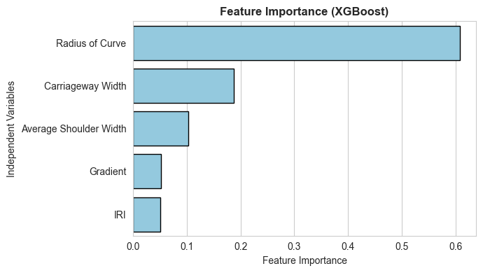
    


    

    


Actual vs Predicted Plot


```python
# XGBoost: Actual vs Predicted V85 Speed

import matplotlib.pyplot as plt
import seaborn as sns

sns.set_style("whitegrid")

plt.figure(figsize=(7, 4))

# Scatter plot
sns.scatterplot(
    x=y_test,
    y=y_test_pred_xgb,
    color="steelblue",
    s=60,
    alpha=0.7,
    edgecolor="black"
)

# Perfect fit line
min_val = min(y_test.min(), y_test_pred_xgb.min())
max_val = max(y_test.max(), y_test_pred_xgb.max())

plt.plot(
    [min_val, max_val],
    [min_val, max_val],
    color="darkred",
    linestyle="--",
    linewidth=2,
    label="Perfect Fit"
)

plt.xlabel("Actual V85 Speed (km/h)")
plt.ylabel("Predicted V85 Speed (km/h)")

plt.title(
    "XGBoost: Actual vs Predicted V85 Speed",
    fontsize=12,
    fontweight="bold"
)

plt.legend()
plt.tight_layout()
plt.show()
```


    
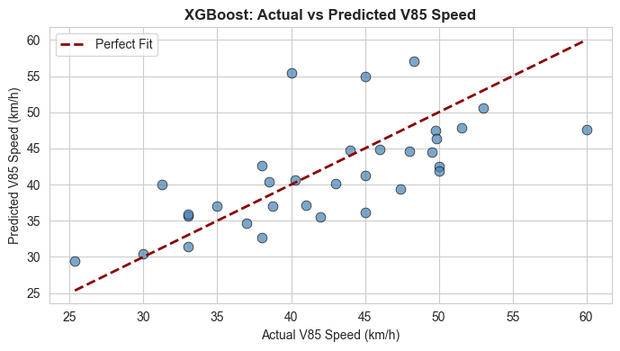
    


    

    


Residual PLot


```python
# XGBoost Residual Analysis

import matplotlib.pyplot as plt
import seaborn as sns

# Calculate residuals
xgb_residuals = y_test - y_test_pred_xgb

# Set plot style
sns.set_style("whitegrid")

plt.figure(figsize=(7, 4))

# Scatter plot
sns.scatterplot(
    x=y_test_pred_xgb,
    y=xgb_residuals,
    color="steelblue",
    s=60,
    alpha=0.7,
    edgecolor="black"
)

# Reference line at zero
plt.axhline(
    y=0,
    linestyle="--",
    color="darkred",
    linewidth=2
)

plt.xlabel("Predicted V85 Speed (km/h)")
plt.ylabel("Residuals (km/h)")

plt.title(
    "XGBoost: Residual Plot",
    fontsize=12,
    fontweight="bold"
)

plt.tight_layout()
plt.show()
```


    
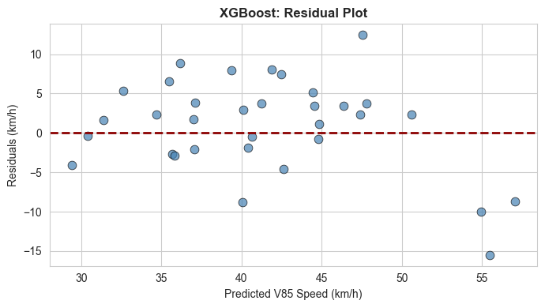
    


    

    


Result Table


```python
# Final XGBoost Performance Summary

xgb_final = pd.DataFrame({
    "Model": ["XGBoost"],
    "R2": [round(xgb_test_r2, 3)],
    "RMSE": [round(xgb_test_rmse, 3)],
    "MAE": [round(xgb_test_mae, 3)]
})

# Display results
display(xgb_final)
```


<div>
<style scoped>
    .dataframe tbody tr th:only-of-type {
        vertical-align: middle;
    }

    .dataframe tbody tr th {
        vertical-align: top;
    }

    .dataframe thead th {
        text-align: right;
    }
</style>
<table border="1" class="dataframe">
  <thead>
    <tr style="text-align: right;">
      <th></th>
      <th>Model</th>
      <th>R2</th>
      <th>RMSE</th>
      <th>MAE</th>
    </tr>
  </thead>
  <tbody>
    <tr>
      <th>0</th>
      <td>XGBoost</td>
      <td>0.387</td>
      <td>5.956</td>
      <td>4.772</td>
    </tr>
  </tbody>
</table>
</div>


<div>
<style scoped>
    .dataframe tbody tr th:only-of-type {
        vertical-align: middle;
    }

    .dataframe tbody tr th {
        vertical-align: top;
    }

    .dataframe thead th {
        text-align: right;
    }
</style>
<table border="1" class="dataframe">
  <thead>
    <tr style="text-align: right;">
      <th></th>
      <th>Model</th>
      <th>R2</th>
      <th>RMSE</th>
      <th>MAE</th>
    </tr>
  </thead>
  <tbody>
    <tr>
      <th>0</th>
      <td>XGBoost</td>
      <td>0.387</td>
      <td>5.956</td>
      <td>4.772</td>
    </tr>
  </tbody>
</table>
</div>


Hyperparameter Tuned XGBoost Model


Hyperparameter Grid Definition


```python
# Hyperparameter Grid for XGBoost

param_grid_xgb = {
    "n_estimators": [100, 200],
    "max_depth": [3, 4, 5],
    "learning_rate": [0.01, 0.05, 0.1],
    "subsample": [0.7, 0.8, 1.0],
    "colsample_bytree": [0.7, 0.8, 1.0]
}
```

Grid Search Setup and Training


```python
# XGBoost Hyperparameter Tuning

from sklearn.model_selection import GridSearchCV
from xgboost import XGBRegressor

grid_xgb = GridSearchCV(
    estimator=XGBRegressor(
        random_state=42,
        objective="reg:squarederror",
        n_jobs=1
    ),
    param_grid=param_grid_xgb,
    cv=5,
    scoring="r2",
    n_jobs=-1,
    verbose=1
)

# Train using unscaled training data
grid_xgb.fit(X_train, y_train)

print("Tuning completed")
print("Best Parameters:", grid_xgb.best_params_)
print("Best CV Score:", round(grid_xgb.best_score_, 3))
```

    Fitting 5 folds for each of 162 candidates, totalling 810 fits
    Tuning completed
    Best Parameters: {'colsample_bytree': 1.0, 'learning_rate': 0.01, 'max_depth': 3, 'n_estimators': 200, 'subsample': 0.7}
    Best CV Score: 0.449
    Fitting 5 folds for each of 162 candidates, totalling 810 fits
    Tuning completed
    Best Parameters: {'colsample_bytree': 1.0, 'learning_rate': 0.01, 'max_depth': 3, 'n_estimators': 200, 'subsample': 0.7}
    Best CV Score: 0.449
    

Best Model Extraction


```python
# Extract Best Tuned XGBoost Model

best_xgb = grid_xgb.best_estimator_

best_xgb
```


<style>#sk-container-id-9 {
  /* Definition of color scheme common for light and dark mode */
  --sklearn-color-text: #000;
  --sklearn-color-text-muted: #666;
  --sklearn-color-line: gray;
  /* Definition of color scheme for unfitted estimators */
  --sklearn-color-unfitted-level-0: #fff5e6;
  --sklearn-color-unfitted-level-1: #f6e4d2;
  --sklearn-color-unfitted-level-2: #ffe0b3;
  --sklearn-color-unfitted-level-3: chocolate;
  /* Definition of color scheme for fitted estimators */
  --sklearn-color-fitted-level-0: #f0f8ff;
  --sklearn-color-fitted-level-1: #d4ebff;
  --sklearn-color-fitted-level-2: #b3dbfd;
  --sklearn-color-fitted-level-3: cornflowerblue;
}

#sk-container-id-9.light {
  /* Specific color for light theme */
  --sklearn-color-text-on-default-background: black;
  --sklearn-color-background: white;
  --sklearn-color-border-box: black;
  --sklearn-color-icon: #696969;
}

#sk-container-id-9.dark {
  --sklearn-color-text-on-default-background: white;
  --sklearn-color-background: #111;
  --sklearn-color-border-box: white;
  --sklearn-color-icon: #878787;
}

#sk-container-id-9 {
  color: var(--sklearn-color-text);
}

#sk-container-id-9 pre {
  padding: 0;
}

#sk-container-id-9 input.sk-hidden--visually {
  border: 0;
  clip: rect(1px 1px 1px 1px);
  clip: rect(1px, 1px, 1px, 1px);
  height: 1px;
  margin: -1px;
  overflow: hidden;
  padding: 0;
  position: absolute;
  width: 1px;
}

#sk-container-id-9 div.sk-dashed-wrapped {
  border: 1px dashed var(--sklearn-color-line);
  margin: 0 0.4em 0.5em 0.4em;
  box-sizing: border-box;
  padding-bottom: 0.4em;
  background-color: var(--sklearn-color-background);
}

#sk-container-id-9 div.sk-container {
  /* jupyter's `normalize.less` sets `[hidden] { display: none; }`
     but bootstrap.min.css set `[hidden] { display: none !important; }`
     so we also need the `!important` here to be able to override the
     default hidden behavior on the sphinx rendered scikit-learn.org.
     See: https://github.com/scikit-learn/scikit-learn/issues/21755 */
  display: inline-block !important;
  position: relative;
}

#sk-container-id-9 div.sk-text-repr-fallback {
  display: none;
}

div.sk-parallel-item,
div.sk-serial,
div.sk-item {
  /* draw centered vertical line to link estimators */
  background-image: linear-gradient(var(--sklearn-color-text-on-default-background), var(--sklearn-color-text-on-default-background));
  background-size: 2px 100%;
  background-repeat: no-repeat;
  background-position: center center;
}

/* Parallel-specific style estimator block */

#sk-container-id-9 div.sk-parallel-item::after {
  content: "";
  width: 100%;
  border-bottom: 2px solid var(--sklearn-color-text-on-default-background);
  flex-grow: 1;
}

#sk-container-id-9 div.sk-parallel {
  display: flex;
  align-items: stretch;
  justify-content: center;
  background-color: var(--sklearn-color-background);
  position: relative;
}

#sk-container-id-9 div.sk-parallel-item {
  display: flex;
  flex-direction: column;
}

#sk-container-id-9 div.sk-parallel-item:first-child::after {
  align-self: flex-end;
  width: 50%;
}

#sk-container-id-9 div.sk-parallel-item:last-child::after {
  align-self: flex-start;
  width: 50%;
}

#sk-container-id-9 div.sk-parallel-item:only-child::after {
  width: 0;
}

/* Serial-specific style estimator block */

#sk-container-id-9 div.sk-serial {
  display: flex;
  flex-direction: column;
  align-items: center;
  background-color: var(--sklearn-color-background);
  padding-right: 1em;
  padding-left: 1em;
}


/* Toggleable style: style used for estimator/Pipeline/ColumnTransformer box that is
clickable and can be expanded/collapsed.
- Pipeline and ColumnTransformer use this feature and define the default style
- Estimators will overwrite some part of the style using the `sk-estimator` class
*/

/* Pipeline and ColumnTransformer style (default) */

#sk-container-id-9 div.sk-toggleable {
  /* Default theme specific background. It is overwritten whether we have a
  specific estimator or a Pipeline/ColumnTransformer */
  background-color: var(--sklearn-color-background);
}

/* Toggleable label */
#sk-container-id-9 label.sk-toggleable__label {
  cursor: pointer;
  display: flex;
  width: 100%;
  margin-bottom: 0;
  padding: 0.5em;
  box-sizing: border-box;
  text-align: center;
  align-items: center;
  justify-content: center;
  gap: 0.5em;
}

#sk-container-id-9 label.sk-toggleable__label .caption {
  font-size: 0.6rem;
  font-weight: lighter;
  color: var(--sklearn-color-text-muted);
}

#sk-container-id-9 label.sk-toggleable__label-arrow:before {
  /* Arrow on the left of the label */
  content: "▸";
  float: left;
  margin-right: 0.25em;
  color: var(--sklearn-color-icon);
}

#sk-container-id-9 label.sk-toggleable__label-arrow:hover:before {
  color: var(--sklearn-color-text);
}

/* Toggleable content - dropdown */

#sk-container-id-9 div.sk-toggleable__content {
  display: none;
  text-align: left;
  /* unfitted */
  background-color: var(--sklearn-color-unfitted-level-0);
}

#sk-container-id-9 div.sk-toggleable__content.fitted {
  /* fitted */
  background-color: var(--sklearn-color-fitted-level-0);
}

#sk-container-id-9 div.sk-toggleable__content pre {
  margin: 0.2em;
  border-radius: 0.25em;
  color: var(--sklearn-color-text);
  /* unfitted */
  background-color: var(--sklearn-color-unfitted-level-0);
}

#sk-container-id-9 div.sk-toggleable__content.fitted pre {
  /* unfitted */
  background-color: var(--sklearn-color-fitted-level-0);
}

#sk-container-id-9 input.sk-toggleable__control:checked~div.sk-toggleable__content {
  /* Expand drop-down */
  display: block;
  width: 100%;
  overflow: visible;
}

#sk-container-id-9 input.sk-toggleable__control:checked~label.sk-toggleable__label-arrow:before {
  content: "▾";
}

/* Pipeline/ColumnTransformer-specific style */

#sk-container-id-9 div.sk-label input.sk-toggleable__control:checked~label.sk-toggleable__label {
  color: var(--sklearn-color-text);
  background-color: var(--sklearn-color-unfitted-level-2);
}

#sk-container-id-9 div.sk-label.fitted input.sk-toggleable__control:checked~label.sk-toggleable__label {
  background-color: var(--sklearn-color-fitted-level-2);
}

/* Estimator-specific style */

/* Colorize estimator box */
#sk-container-id-9 div.sk-estimator input.sk-toggleable__control:checked~label.sk-toggleable__label {
  /* unfitted */
  background-color: var(--sklearn-color-unfitted-level-2);
}

#sk-container-id-9 div.sk-estimator.fitted input.sk-toggleable__control:checked~label.sk-toggleable__label {
  /* fitted */
  background-color: var(--sklearn-color-fitted-level-2);
}

#sk-container-id-9 div.sk-label label.sk-toggleable__label,
#sk-container-id-9 div.sk-label label {
  /* The background is the default theme color */
  color: var(--sklearn-color-text-on-default-background);
}

/* On hover, darken the color of the background */
#sk-container-id-9 div.sk-label:hover label.sk-toggleable__label {
  color: var(--sklearn-color-text);
  background-color: var(--sklearn-color-unfitted-level-2);
}

/* Label box, darken color on hover, fitted */
#sk-container-id-9 div.sk-label.fitted:hover label.sk-toggleable__label.fitted {
  color: var(--sklearn-color-text);
  background-color: var(--sklearn-color-fitted-level-2);
}

/* Estimator label */

#sk-container-id-9 div.sk-label label {
  font-family: monospace;
  font-weight: bold;
  line-height: 1.2em;
}

#sk-container-id-9 div.sk-label-container {
  text-align: center;
}

/* Estimator-specific */
#sk-container-id-9 div.sk-estimator {
  font-family: monospace;
  border: 1px dotted var(--sklearn-color-border-box);
  border-radius: 0.25em;
  box-sizing: border-box;
  margin-bottom: 0.5em;
  /* unfitted */
  background-color: var(--sklearn-color-unfitted-level-0);
}

#sk-container-id-9 div.sk-estimator.fitted {
  /* fitted */
  background-color: var(--sklearn-color-fitted-level-0);
}

/* on hover */
#sk-container-id-9 div.sk-estimator:hover {
  /* unfitted */
  background-color: var(--sklearn-color-unfitted-level-2);
}

#sk-container-id-9 div.sk-estimator.fitted:hover {
  /* fitted */
  background-color: var(--sklearn-color-fitted-level-2);
}

/* Specification for estimator info (e.g. "i" and "?") */

/* Common style for "i" and "?" */

.sk-estimator-doc-link,
a:link.sk-estimator-doc-link,
a:visited.sk-estimator-doc-link {
  float: right;
  font-size: smaller;
  line-height: 1em;
  font-family: monospace;
  background-color: var(--sklearn-color-unfitted-level-0);
  border-radius: 1em;
  height: 1em;
  width: 1em;
  text-decoration: none !important;
  margin-left: 0.5em;
  text-align: center;
  /* unfitted */
  border: var(--sklearn-color-unfitted-level-3) 1pt solid;
  color: var(--sklearn-color-unfitted-level-3);
}

.sk-estimator-doc-link.fitted,
a:link.sk-estimator-doc-link.fitted,
a:visited.sk-estimator-doc-link.fitted {
  /* fitted */
  background-color: var(--sklearn-color-fitted-level-0);
  border: var(--sklearn-color-fitted-level-3) 1pt solid;
  color: var(--sklearn-color-fitted-level-3);
}

/* On hover */
div.sk-estimator:hover .sk-estimator-doc-link:hover,
.sk-estimator-doc-link:hover,
div.sk-label-container:hover .sk-estimator-doc-link:hover,
.sk-estimator-doc-link:hover {
  /* unfitted */
  background-color: var(--sklearn-color-unfitted-level-3);
  border: var(--sklearn-color-fitted-level-0) 1pt solid;
  color: var(--sklearn-color-unfitted-level-0);
  text-decoration: none;
}

div.sk-estimator.fitted:hover .sk-estimator-doc-link.fitted:hover,
.sk-estimator-doc-link.fitted:hover,
div.sk-label-container:hover .sk-estimator-doc-link.fitted:hover,
.sk-estimator-doc-link.fitted:hover {
  /* fitted */
  background-color: var(--sklearn-color-fitted-level-3);
  border: var(--sklearn-color-fitted-level-0) 1pt solid;
  color: var(--sklearn-color-fitted-level-0);
  text-decoration: none;
}

/* Span, style for the box shown on hovering the info icon */
.sk-estimator-doc-link span {
  display: none;
  z-index: 9999;
  position: relative;
  font-weight: normal;
  right: .2ex;
  padding: .5ex;
  margin: .5ex;
  width: min-content;
  min-width: 20ex;
  max-width: 50ex;
  color: var(--sklearn-color-text);
  box-shadow: 2pt 2pt 4pt #999;
  /* unfitted */
  background: var(--sklearn-color-unfitted-level-0);
  border: .5pt solid var(--sklearn-color-unfitted-level-3);
}

.sk-estimator-doc-link.fitted span {
  /* fitted */
  background: var(--sklearn-color-fitted-level-0);
  border: var(--sklearn-color-fitted-level-3);
}

.sk-estimator-doc-link:hover span {
  display: block;
}

/* "?"-specific style due to the `<a>` HTML tag */

#sk-container-id-9 a.estimator_doc_link {
  float: right;
  font-size: 1rem;
  line-height: 1em;
  font-family: monospace;
  background-color: var(--sklearn-color-unfitted-level-0);
  border-radius: 1rem;
  height: 1rem;
  width: 1rem;
  text-decoration: none;
  /* unfitted */
  color: var(--sklearn-color-unfitted-level-1);
  border: var(--sklearn-color-unfitted-level-1) 1pt solid;
}

#sk-container-id-9 a.estimator_doc_link.fitted {
  /* fitted */
  background-color: var(--sklearn-color-fitted-level-0);
  border: var(--sklearn-color-fitted-level-1) 1pt solid;
  color: var(--sklearn-color-fitted-level-1);
}

/* On hover */
#sk-container-id-9 a.estimator_doc_link:hover {
  /* unfitted */
  background-color: var(--sklearn-color-unfitted-level-3);
  color: var(--sklearn-color-background);
  text-decoration: none;
}

#sk-container-id-9 a.estimator_doc_link.fitted:hover {
  /* fitted */
  background-color: var(--sklearn-color-fitted-level-3);
}

.estimator-table {
    font-family: monospace;
}

.estimator-table summary {
    padding: .5rem;
    cursor: pointer;
}

.estimator-table summary::marker {
    font-size: 0.7rem;
}

.estimator-table details[open] {
    padding-left: 0.1rem;
    padding-right: 0.1rem;
    padding-bottom: 0.3rem;
}

.estimator-table .parameters-table {
    margin-left: auto !important;
    margin-right: auto !important;
    margin-top: 0;
}

.estimator-table .parameters-table tr:nth-child(odd) {
    background-color: #fff;
}

.estimator-table .parameters-table tr:nth-child(even) {
    background-color: #f6f6f6;
}

.estimator-table .parameters-table tr:hover {
    background-color: #e0e0e0;
}

.estimator-table table td {
    border: 1px solid rgba(106, 105, 104, 0.232);
}

/*
    `table td`is set in notebook with right text-align.
    We need to overwrite it.
*/
.estimator-table table td.param {
    text-align: left;
    position: relative;
    padding: 0;
}

.user-set td {
    color:rgb(255, 94, 0);
    text-align: left !important;
}

.user-set td.value {
    color:rgb(255, 94, 0);
    background-color: transparent;
}

.default td {
    color: black;
    text-align: left !important;
}

.user-set td i,
.default td i {
    color: black;
}

/*
    Styles for parameter documentation links
    We need styling for visited so jupyter doesn't overwrite it
*/
a.param-doc-link,
a.param-doc-link:link,
a.param-doc-link:visited {
    text-decoration: underline dashed;
    text-underline-offset: .3em;
    color: inherit;
    display: block;
    padding: .5em;
}

/* "hack" to make the entire area of the cell containing the link clickable */
a.param-doc-link::before {
    position: absolute;
    content: "";
    inset: 0;
}

.param-doc-description {
    display: none;
    position: absolute;
    z-index: 9999;
    left: 0;
    padding: .5ex;
    margin-left: 1.5em;
    color: var(--sklearn-color-text);
    box-shadow: .3em .3em .4em #999;
    width: max-content;
    text-align: left;
    max-height: 10em;
    overflow-y: auto;

    /* unfitted */
    background: var(--sklearn-color-unfitted-level-0);
    border: thin solid var(--sklearn-color-unfitted-level-3);
}

/* Fitted state for parameter tooltips */
.fitted .param-doc-description {
    /* fitted */
    background: var(--sklearn-color-fitted-level-0);
    border: thin solid var(--sklearn-color-fitted-level-3);
}

.param-doc-link:hover .param-doc-description {
    display: block;
}

.copy-paste-icon {
    background-image: url();
    background-repeat: no-repeat;
    background-size: 14px 14px;
    background-position: 0;
    display: inline-block;
    width: 14px;
    height: 14px;
    cursor: pointer;
}
</style><body><div id="sk-container-id-9" class="sk-top-container"><div class="sk-text-repr-fallback"><pre>XGBRegressor(base_score=None, booster=None, callbacks=None,
             colsample_bylevel=None, colsample_bynode=None,
             colsample_bytree=1.0, device=None, early_stopping_rounds=None,
             enable_categorical=False, eval_metric=None, feature_types=None,
             feature_weights=None, gamma=None, grow_policy=None,
             importance_type=None, interaction_constraints=None,
             learning_rate=0.01, max_bin=None, max_cat_threshold=None,
             max_cat_to_onehot=None, max_delta_step=None, max_depth=3,
             max_leaves=None, min_child_weight=None, missing=nan,
             monotone_constraints=None, multi_strategy=None, n_estimators=200,
             n_jobs=1, num_parallel_tree=None, ...)</pre><b>In a Jupyter environment, please rerun this cell to show the HTML representation or trust the notebook. <br />On GitHub, the HTML representation is unable to render, please try loading this page with nbviewer.org.</b></div><div class="sk-container" hidden><div class="sk-item"><div class="sk-estimator fitted sk-toggleable"><input class="sk-toggleable__control sk-hidden--visually" id="sk-estimator-id-9" type="checkbox" checked><label for="sk-estimator-id-9" class="sk-toggleable__label fitted sk-toggleable__label-arrow"><div><div>XGBRegressor</div></div><div><a class="sk-estimator-doc-link fitted" rel="noreferrer" target="_blank" href="https://xgboost.readthedocs.io/en/release_3.2.0/python/python_api.html#xgboost.XGBRegressor">?<span>Documentation for XGBRegressor</span></a><span class="sk-estimator-doc-link fitted">i<span>Fitted</span></span></div></label><div class="sk-toggleable__content fitted" data-param-prefix="">
        <div class="estimator-table">
            <details>
                <summary>Parameters</summary>
                <table class="parameters-table">
                  <tbody>

        <tr class="default">
            <td><i class="copy-paste-icon"
                 onclick="copyToClipboard('objective',
                          this.parentElement.nextElementSibling)"
            ></i></td>
            <td class="param">
        <a class="param-doc-link"
            rel="noreferrer" target="_blank" href="https://xgboost.readthedocs.io/en/release_3.2.0/python/python_api.html#xgboost.XGBRegressor#:~:text=objective,-typing.Union%5Bstr%2C%20xgboost.sklearn._SklObjWProto%2C%20typing.Callable%5B%5Btyping.Any%2C%20typing.Any%5D%2C%20typing.Tuple%5Bnumpy.ndarray%2C%20numpy.ndarray%5D%5D%2C%20NoneType%5D">
            objective
            <span class="param-doc-description">objective: typing.Union[str, xgboost.sklearn._SklObjWProto, typing.Callable[[typing.Any, typing.Any], typing.Tuple[numpy.ndarray, numpy.ndarray]], NoneType]<br><br>Specify the learning task and the corresponding learning objective or a custom<br>objective function to be used.<br><br>For custom objective, see :doc:`/tutorials/custom_metric_obj` and<br>:ref:`custom-obj-metric` for more information, along with the end note for<br>function signatures.</span>
        </a>
    </td>
            <td class="value">&#x27;reg:squarederror&#x27;</td>
        </tr>


        <tr class="user-set">
            <td><i class="copy-paste-icon"
                 onclick="copyToClipboard('base_score',
                          this.parentElement.nextElementSibling)"
            ></i></td>
            <td class="param">
        <a class="param-doc-link"
            rel="noreferrer" target="_blank" href="https://xgboost.readthedocs.io/en/release_3.2.0/python/python_api.html#xgboost.XGBRegressor#:~:text=base_score,-typing.Union%5Bfloat%2C%20typing.List%5Bfloat%5D%2C%20NoneType%5D">
            base_score
            <span class="param-doc-description">base_score: typing.Union[float, typing.List[float], NoneType]<br><br>The initial prediction score of all instances, global bias.</span>
        </a>
    </td>
            <td class="value">None</td>
        </tr>


        <tr class="user-set">
            <td><i class="copy-paste-icon"
                 onclick="copyToClipboard('booster',
                          this.parentElement.nextElementSibling)"
            ></i></td>
            <td class="param">booster</td>
            <td class="value">None</td>
        </tr>


        <tr class="user-set">
            <td><i class="copy-paste-icon"
                 onclick="copyToClipboard('callbacks',
                          this.parentElement.nextElementSibling)"
            ></i></td>
            <td class="param">
        <a class="param-doc-link"
            rel="noreferrer" target="_blank" href="https://xgboost.readthedocs.io/en/release_3.2.0/python/python_api.html#xgboost.XGBRegressor#:~:text=callbacks,-typing.Optional%5Btyping.List%5Bxgboost.callback.TrainingCallback%5D%5D">
            callbacks
            <span class="param-doc-description">callbacks: typing.Optional[typing.List[xgboost.callback.TrainingCallback]]<br><br>List of callback functions that are applied at end of each iteration.<br>It is possible to use predefined callbacks by using<br>:ref:`Callback API <callback_api>`.<br><br>.. note::<br><br>   States in callback are not preserved during training, which means callback<br>   objects can not be reused for multiple training sessions without<br>   reinitialization or deepcopy.<br><br>.. code-block:: python<br><br>    for params in parameters_grid:<br>        # be sure to (re)initialize the callbacks before each run<br>        callbacks = [xgb.callback.LearningRateScheduler(custom_rates)]<br>        reg = xgboost.XGBRegressor(**params, callbacks=callbacks)<br>        reg.fit(X, y)</span>
        </a>
    </td>
            <td class="value">None</td>
        </tr>


        <tr class="user-set">
            <td><i class="copy-paste-icon"
                 onclick="copyToClipboard('colsample_bylevel',
                          this.parentElement.nextElementSibling)"
            ></i></td>
            <td class="param">
        <a class="param-doc-link"
            rel="noreferrer" target="_blank" href="https://xgboost.readthedocs.io/en/release_3.2.0/python/python_api.html#xgboost.XGBRegressor#:~:text=colsample_bylevel,-typing.Optional%5Bfloat%5D">
            colsample_bylevel
            <span class="param-doc-description">colsample_bylevel: typing.Optional[float]<br><br>Subsample ratio of columns for each level.</span>
        </a>
    </td>
            <td class="value">None</td>
        </tr>


        <tr class="user-set">
            <td><i class="copy-paste-icon"
                 onclick="copyToClipboard('colsample_bynode',
                          this.parentElement.nextElementSibling)"
            ></i></td>
            <td class="param">
        <a class="param-doc-link"
            rel="noreferrer" target="_blank" href="https://xgboost.readthedocs.io/en/release_3.2.0/python/python_api.html#xgboost.XGBRegressor#:~:text=colsample_bynode,-typing.Optional%5Bfloat%5D">
            colsample_bynode
            <span class="param-doc-description">colsample_bynode: typing.Optional[float]<br><br>Subsample ratio of columns for each split.</span>
        </a>
    </td>
            <td class="value">None</td>
        </tr>


        <tr class="user-set">
            <td><i class="copy-paste-icon"
                 onclick="copyToClipboard('colsample_bytree',
                          this.parentElement.nextElementSibling)"
            ></i></td>
            <td class="param">
        <a class="param-doc-link"
            rel="noreferrer" target="_blank" href="https://xgboost.readthedocs.io/en/release_3.2.0/python/python_api.html#xgboost.XGBRegressor#:~:text=colsample_bytree,-typing.Optional%5Bfloat%5D">
            colsample_bytree
            <span class="param-doc-description">colsample_bytree: typing.Optional[float]<br><br>Subsample ratio of columns when constructing each tree.</span>
        </a>
    </td>
            <td class="value">1.0</td>
        </tr>


        <tr class="user-set">
            <td><i class="copy-paste-icon"
                 onclick="copyToClipboard('device',
                          this.parentElement.nextElementSibling)"
            ></i></td>
            <td class="param">
        <a class="param-doc-link"
            rel="noreferrer" target="_blank" href="https://xgboost.readthedocs.io/en/release_3.2.0/python/python_api.html#xgboost.XGBRegressor#:~:text=device,-typing.Optional%5Bstr%5D">
            device
            <span class="param-doc-description">device: typing.Optional[str]<br><br>.. versionadded:: 2.0.0<br><br>Device ordinal, available options are `cpu`, `cuda`, and `gpu`.</span>
        </a>
    </td>
            <td class="value">None</td>
        </tr>


        <tr class="user-set">
            <td><i class="copy-paste-icon"
                 onclick="copyToClipboard('early_stopping_rounds',
                          this.parentElement.nextElementSibling)"
            ></i></td>
            <td class="param">
        <a class="param-doc-link"
            rel="noreferrer" target="_blank" href="https://xgboost.readthedocs.io/en/release_3.2.0/python/python_api.html#xgboost.XGBRegressor#:~:text=early_stopping_rounds,-typing.Optional%5Bint%5D">
            early_stopping_rounds
            <span class="param-doc-description">early_stopping_rounds: typing.Optional[int]<br><br>.. versionadded:: 1.6.0<br><br>- Activates early stopping. Validation metric needs to improve at least once in<br>  every **early_stopping_rounds** round(s) to continue training.  Requires at<br>  least one item in **eval_set** in :py:meth:`fit`.<br><br>- If early stopping occurs, the model will have two additional attributes:<br>  :py:attr:`best_score` and :py:attr:`best_iteration`. These are used by the<br>  :py:meth:`predict` and :py:meth:`apply` methods to determine the optimal<br>  number of trees during inference. If users want to access the full model<br>  (including trees built after early stopping), they can specify the<br>  `iteration_range` in these inference methods. In addition, other utilities<br>  like model plotting can also use the entire model.<br><br>- If you prefer to discard the trees after `best_iteration`, consider using the<br>  callback function :py:class:`xgboost.callback.EarlyStopping`.<br><br>- If there's more than one item in **eval_set**, the last entry will be used for<br>  early stopping.  If there's more than one metric in **eval_metric**, the last<br>  metric will be used for early stopping.</span>
        </a>
    </td>
            <td class="value">None</td>
        </tr>


        <tr class="user-set">
            <td><i class="copy-paste-icon"
                 onclick="copyToClipboard('enable_categorical',
                          this.parentElement.nextElementSibling)"
            ></i></td>
            <td class="param">
        <a class="param-doc-link"
            rel="noreferrer" target="_blank" href="https://xgboost.readthedocs.io/en/release_3.2.0/python/python_api.html#xgboost.XGBRegressor#:~:text=enable_categorical,-bool">
            enable_categorical
            <span class="param-doc-description">enable_categorical: bool<br><br>See the same parameter of :py:class:`DMatrix` for details.</span>
        </a>
    </td>
            <td class="value">False</td>
        </tr>


        <tr class="user-set">
            <td><i class="copy-paste-icon"
                 onclick="copyToClipboard('eval_metric',
                          this.parentElement.nextElementSibling)"
            ></i></td>
            <td class="param">
        <a class="param-doc-link"
            rel="noreferrer" target="_blank" href="https://xgboost.readthedocs.io/en/release_3.2.0/python/python_api.html#xgboost.XGBRegressor#:~:text=eval_metric,-typing.Union%5Bstr%2C%20typing.List%5Btyping.Union%5Bstr%2C%20typing.Callable%5D%5D%2C%20typing.Callable%2C%20NoneType%5D">
            eval_metric
            <span class="param-doc-description">eval_metric: typing.Union[str, typing.List[typing.Union[str, typing.Callable]], typing.Callable, NoneType]<br><br>.. versionadded:: 1.6.0<br><br>Metric used for monitoring the training result and early stopping.  It can be a<br>string or list of strings as names of predefined metric in XGBoost (See<br>:doc:`/parameter`), one of the metrics in :py:mod:`sklearn.metrics`, or any<br>other user defined metric that looks like `sklearn.metrics`.<br><br>If custom objective is also provided, then custom metric should implement the<br>corresponding reverse link function.<br><br>Unlike the `scoring` parameter commonly used in scikit-learn, when a callable<br>object is provided, it's assumed to be a cost function and by default XGBoost<br>will minimize the result during early stopping.<br><br>For advanced usage on Early stopping like directly choosing to maximize instead<br>of minimize, see :py:obj:`xgboost.callback.EarlyStopping`.<br><br>See :doc:`/tutorials/custom_metric_obj` and :ref:`custom-obj-metric` for more<br>information.<br><br>.. code-block:: python<br><br>    from sklearn.datasets import load_diabetes<br>    from sklearn.metrics import mean_absolute_error<br>    X, y = load_diabetes(return_X_y=True)<br>    reg = xgb.XGBRegressor(<br>        tree_method="hist",<br>        eval_metric=mean_absolute_error,<br>    )<br>    reg.fit(X, y, eval_set=[(X, y)])</span>
        </a>
    </td>
            <td class="value">None</td>
        </tr>


        <tr class="user-set">
            <td><i class="copy-paste-icon"
                 onclick="copyToClipboard('feature_types',
                          this.parentElement.nextElementSibling)"
            ></i></td>
            <td class="param">
        <a class="param-doc-link"
            rel="noreferrer" target="_blank" href="https://xgboost.readthedocs.io/en/release_3.2.0/python/python_api.html#xgboost.XGBRegressor#:~:text=feature_types,-typing.Optional%5Btyping.Sequence%5Bstr%5D%5D">
            feature_types
            <span class="param-doc-description">feature_types: typing.Optional[typing.Sequence[str]]<br><br>.. versionadded:: 1.7.0<br><br>Used for specifying feature types without constructing a dataframe. See<br>the :py:class:`DMatrix` for details.</span>
        </a>
    </td>
            <td class="value">None</td>
        </tr>


        <tr class="user-set">
            <td><i class="copy-paste-icon"
                 onclick="copyToClipboard('feature_weights',
                          this.parentElement.nextElementSibling)"
            ></i></td>
            <td class="param">
        <a class="param-doc-link"
            rel="noreferrer" target="_blank" href="https://xgboost.readthedocs.io/en/release_3.2.0/python/python_api.html#xgboost.XGBRegressor#:~:text=feature_weights,-Optional%5BArrayLike%5D">
            feature_weights
            <span class="param-doc-description">feature_weights: Optional[ArrayLike]<br><br>Weight for each feature, defines the probability of each feature being selected<br>when colsample is being used.  All values must be greater than 0, otherwise a<br>`ValueError` is thrown.</span>
        </a>
    </td>
            <td class="value">None</td>
        </tr>


        <tr class="user-set">
            <td><i class="copy-paste-icon"
                 onclick="copyToClipboard('gamma',
                          this.parentElement.nextElementSibling)"
            ></i></td>
            <td class="param">
        <a class="param-doc-link"
            rel="noreferrer" target="_blank" href="https://xgboost.readthedocs.io/en/release_3.2.0/python/python_api.html#xgboost.XGBRegressor#:~:text=gamma,-typing.Optional%5Bfloat%5D">
            gamma
            <span class="param-doc-description">gamma: typing.Optional[float]<br><br>(min_split_loss) Minimum loss reduction required to make a further partition on<br>a leaf node of the tree.</span>
        </a>
    </td>
            <td class="value">None</td>
        </tr>


        <tr class="user-set">
            <td><i class="copy-paste-icon"
                 onclick="copyToClipboard('grow_policy',
                          this.parentElement.nextElementSibling)"
            ></i></td>
            <td class="param">
        <a class="param-doc-link"
            rel="noreferrer" target="_blank" href="https://xgboost.readthedocs.io/en/release_3.2.0/python/python_api.html#xgboost.XGBRegressor#:~:text=grow_policy,-typing.Optional%5Bstr%5D">
            grow_policy
            <span class="param-doc-description">grow_policy: typing.Optional[str]<br><br>Tree growing policy.<br><br>- depthwise: Favors splitting at nodes closest to the node,<br>- lossguide: Favors splitting at nodes with highest loss change.</span>
        </a>
    </td>
            <td class="value">None</td>
        </tr>


        <tr class="user-set">
            <td><i class="copy-paste-icon"
                 onclick="copyToClipboard('importance_type',
                          this.parentElement.nextElementSibling)"
            ></i></td>
            <td class="param">importance_type</td>
            <td class="value">None</td>
        </tr>


        <tr class="user-set">
            <td><i class="copy-paste-icon"
                 onclick="copyToClipboard('interaction_constraints',
                          this.parentElement.nextElementSibling)"
            ></i></td>
            <td class="param">
        <a class="param-doc-link"
            rel="noreferrer" target="_blank" href="https://xgboost.readthedocs.io/en/release_3.2.0/python/python_api.html#xgboost.XGBRegressor#:~:text=interaction_constraints,-typing.Union%5Bstr%2C%20typing.List%5Btyping.Tuple%5Bstr%5D%5D%2C%20NoneType%5D">
            interaction_constraints
            <span class="param-doc-description">interaction_constraints: typing.Union[str, typing.List[typing.Tuple[str]], NoneType]<br><br>Constraints for interaction representing permitted interactions.  The<br>constraints must be specified in the form of a nested list, e.g. ``[[0, 1], [2,<br>3, 4]]``, where each inner list is a group of indices of features that are<br>allowed to interact with each other.  See :doc:`tutorial<br></tutorials/feature_interaction_constraint>` for more information</span>
        </a>
    </td>
            <td class="value">None</td>
        </tr>


        <tr class="user-set">
            <td><i class="copy-paste-icon"
                 onclick="copyToClipboard('learning_rate',
                          this.parentElement.nextElementSibling)"
            ></i></td>
            <td class="param">
        <a class="param-doc-link"
            rel="noreferrer" target="_blank" href="https://xgboost.readthedocs.io/en/release_3.2.0/python/python_api.html#xgboost.XGBRegressor#:~:text=learning_rate,-typing.Optional%5Bfloat%5D">
            learning_rate
            <span class="param-doc-description">learning_rate: typing.Optional[float]<br><br>Boosting learning rate (xgb's "eta")</span>
        </a>
    </td>
            <td class="value">0.01</td>
        </tr>


        <tr class="user-set">
            <td><i class="copy-paste-icon"
                 onclick="copyToClipboard('max_bin',
                          this.parentElement.nextElementSibling)"
            ></i></td>
            <td class="param">
        <a class="param-doc-link"
            rel="noreferrer" target="_blank" href="https://xgboost.readthedocs.io/en/release_3.2.0/python/python_api.html#xgboost.XGBRegressor#:~:text=max_bin,-typing.Optional%5Bint%5D">
            max_bin
            <span class="param-doc-description">max_bin: typing.Optional[int]<br><br>If using histogram-based algorithm, maximum number of bins per feature</span>
        </a>
    </td>
            <td class="value">None</td>
        </tr>


        <tr class="user-set">
            <td><i class="copy-paste-icon"
                 onclick="copyToClipboard('max_cat_threshold',
                          this.parentElement.nextElementSibling)"
            ></i></td>
            <td class="param">
        <a class="param-doc-link"
            rel="noreferrer" target="_blank" href="https://xgboost.readthedocs.io/en/release_3.2.0/python/python_api.html#xgboost.XGBRegressor#:~:text=max_cat_threshold,-typing.Optional%5Bint%5D">
            max_cat_threshold
            <span class="param-doc-description">max_cat_threshold: typing.Optional[int]<br><br>.. versionadded:: 1.7.0<br><br>.. note:: This parameter is experimental<br><br>Maximum number of categories considered for each split. Used only by<br>partition-based splits for preventing over-fitting. Also, `enable_categorical`<br>needs to be set to have categorical feature support. See :doc:`Categorical Data<br></tutorials/categorical>` and :ref:`cat-param` for details.</span>
        </a>
    </td>
            <td class="value">None</td>
        </tr>


        <tr class="user-set">
            <td><i class="copy-paste-icon"
                 onclick="copyToClipboard('max_cat_to_onehot',
                          this.parentElement.nextElementSibling)"
            ></i></td>
            <td class="param">
        <a class="param-doc-link"
            rel="noreferrer" target="_blank" href="https://xgboost.readthedocs.io/en/release_3.2.0/python/python_api.html#xgboost.XGBRegressor#:~:text=max_cat_to_onehot,-Optional%5Bint%5D">
            max_cat_to_onehot
            <span class="param-doc-description">max_cat_to_onehot: Optional[int]<br><br>.. versionadded:: 1.6.0<br><br>.. note:: This parameter is experimental<br><br>A threshold for deciding whether XGBoost should use one-hot encoding based split<br>for categorical data.  When number of categories is lesser than the threshold<br>then one-hot encoding is chosen, otherwise the categories will be partitioned<br>into children nodes. Also, `enable_categorical` needs to be set to have<br>categorical feature support. See :doc:`Categorical Data<br></tutorials/categorical>` and :ref:`cat-param` for details.</span>
        </a>
    </td>
            <td class="value">None</td>
        </tr>


        <tr class="user-set">
            <td><i class="copy-paste-icon"
                 onclick="copyToClipboard('max_delta_step',
                          this.parentElement.nextElementSibling)"
            ></i></td>
            <td class="param">
        <a class="param-doc-link"
            rel="noreferrer" target="_blank" href="https://xgboost.readthedocs.io/en/release_3.2.0/python/python_api.html#xgboost.XGBRegressor#:~:text=max_delta_step,-typing.Optional%5Bfloat%5D">
            max_delta_step
            <span class="param-doc-description">max_delta_step: typing.Optional[float]<br><br>Maximum delta step we allow each tree's weight estimation to be.</span>
        </a>
    </td>
            <td class="value">None</td>
        </tr>


        <tr class="user-set">
            <td><i class="copy-paste-icon"
                 onclick="copyToClipboard('max_depth',
                          this.parentElement.nextElementSibling)"
            ></i></td>
            <td class="param">
        <a class="param-doc-link"
            rel="noreferrer" target="_blank" href="https://xgboost.readthedocs.io/en/release_3.2.0/python/python_api.html#xgboost.XGBRegressor#:~:text=max_depth,-%20typing.Optional%5Bint%5D">
            max_depth
            <span class="param-doc-description">max_depth:  typing.Optional[int]<br><br>Maximum tree depth for base learners.</span>
        </a>
    </td>
            <td class="value">3</td>
        </tr>


        <tr class="user-set">
            <td><i class="copy-paste-icon"
                 onclick="copyToClipboard('max_leaves',
                          this.parentElement.nextElementSibling)"
            ></i></td>
            <td class="param">
        <a class="param-doc-link"
            rel="noreferrer" target="_blank" href="https://xgboost.readthedocs.io/en/release_3.2.0/python/python_api.html#xgboost.XGBRegressor#:~:text=max_leaves,-typing.Optional%5Bint%5D">
            max_leaves
            <span class="param-doc-description">max_leaves: typing.Optional[int]<br><br>Maximum number of leaves; 0 indicates no limit.</span>
        </a>
    </td>
            <td class="value">None</td>
        </tr>


        <tr class="user-set">
            <td><i class="copy-paste-icon"
                 onclick="copyToClipboard('min_child_weight',
                          this.parentElement.nextElementSibling)"
            ></i></td>
            <td class="param">
        <a class="param-doc-link"
            rel="noreferrer" target="_blank" href="https://xgboost.readthedocs.io/en/release_3.2.0/python/python_api.html#xgboost.XGBRegressor#:~:text=min_child_weight,-typing.Optional%5Bfloat%5D">
            min_child_weight
            <span class="param-doc-description">min_child_weight: typing.Optional[float]<br><br>Minimum sum of instance weight(hessian) needed in a child.</span>
        </a>
    </td>
            <td class="value">None</td>
        </tr>


        <tr class="user-set">
            <td><i class="copy-paste-icon"
                 onclick="copyToClipboard('missing',
                          this.parentElement.nextElementSibling)"
            ></i></td>
            <td class="param">
        <a class="param-doc-link"
            rel="noreferrer" target="_blank" href="https://xgboost.readthedocs.io/en/release_3.2.0/python/python_api.html#xgboost.XGBRegressor#:~:text=missing,-float">
            missing
            <span class="param-doc-description">missing: float<br><br>Value in the data which needs to be present as a missing value. Default to<br>:py:data:`numpy.nan`.</span>
        </a>
    </td>
            <td class="value">nan</td>
        </tr>


        <tr class="user-set">
            <td><i class="copy-paste-icon"
                 onclick="copyToClipboard('monotone_constraints',
                          this.parentElement.nextElementSibling)"
            ></i></td>
            <td class="param">
        <a class="param-doc-link"
            rel="noreferrer" target="_blank" href="https://xgboost.readthedocs.io/en/release_3.2.0/python/python_api.html#xgboost.XGBRegressor#:~:text=monotone_constraints,-typing.Union%5Btyping.Dict%5Bstr%2C%20int%5D%2C%20str%2C%20NoneType%5D">
            monotone_constraints
            <span class="param-doc-description">monotone_constraints: typing.Union[typing.Dict[str, int], str, NoneType]<br><br>Constraint of variable monotonicity.  See :doc:`tutorial </tutorials/monotonic>`<br>for more information.</span>
        </a>
    </td>
            <td class="value">None</td>
        </tr>


        <tr class="user-set">
            <td><i class="copy-paste-icon"
                 onclick="copyToClipboard('multi_strategy',
                          this.parentElement.nextElementSibling)"
            ></i></td>
            <td class="param">
        <a class="param-doc-link"
            rel="noreferrer" target="_blank" href="https://xgboost.readthedocs.io/en/release_3.2.0/python/python_api.html#xgboost.XGBRegressor#:~:text=multi_strategy,-typing.Optional%5Bstr%5D">
            multi_strategy
            <span class="param-doc-description">multi_strategy: typing.Optional[str]<br><br>.. versionadded:: 2.0.0<br><br>.. note:: This parameter is working-in-progress.<br><br>The strategy used for training multi-target models, including multi-target<br>regression and multi-class classification. See :doc:`/tutorials/multioutput` for<br>more information.<br><br>- ``one_output_per_tree``: One model for each target.<br>- ``multi_output_tree``:  Use multi-target trees.</span>
        </a>
    </td>
            <td class="value">None</td>
        </tr>


        <tr class="user-set">
            <td><i class="copy-paste-icon"
                 onclick="copyToClipboard('n_estimators',
                          this.parentElement.nextElementSibling)"
            ></i></td>
            <td class="param">
        <a class="param-doc-link"
            rel="noreferrer" target="_blank" href="https://xgboost.readthedocs.io/en/release_3.2.0/python/python_api.html#xgboost.XGBRegressor#:~:text=n_estimators,-typing.Optional%5Bint%5D">
            n_estimators
            <span class="param-doc-description">n_estimators: typing.Optional[int]<br><br>Number of gradient boosted trees.  Equivalent to number of boosting<br>rounds.</span>
        </a>
    </td>
            <td class="value">200</td>
        </tr>


        <tr class="user-set">
            <td><i class="copy-paste-icon"
                 onclick="copyToClipboard('n_jobs',
                          this.parentElement.nextElementSibling)"
            ></i></td>
            <td class="param">
        <a class="param-doc-link"
            rel="noreferrer" target="_blank" href="https://xgboost.readthedocs.io/en/release_3.2.0/python/python_api.html#xgboost.XGBRegressor#:~:text=n_jobs,-typing.Optional%5Bint%5D">
            n_jobs
            <span class="param-doc-description">n_jobs: typing.Optional[int]<br><br>Number of parallel threads used to run xgboost.  When used with other<br>Scikit-Learn algorithms like grid search, you may choose which algorithm to<br>parallelize and balance the threads.  Creating thread contention will<br>significantly slow down both algorithms.</span>
        </a>
    </td>
            <td class="value">1</td>
        </tr>


        <tr class="user-set">
            <td><i class="copy-paste-icon"
                 onclick="copyToClipboard('num_parallel_tree',
                          this.parentElement.nextElementSibling)"
            ></i></td>
            <td class="param">num_parallel_tree</td>
            <td class="value">None</td>
        </tr>


        <tr class="user-set">
            <td><i class="copy-paste-icon"
                 onclick="copyToClipboard('random_state',
                          this.parentElement.nextElementSibling)"
            ></i></td>
            <td class="param">
        <a class="param-doc-link"
            rel="noreferrer" target="_blank" href="https://xgboost.readthedocs.io/en/release_3.2.0/python/python_api.html#xgboost.XGBRegressor#:~:text=random_state,-typing.Union%5Bnumpy.random.mtrand.RandomState%2C%20numpy.random._generator.Generator%2C%20int%2C%20NoneType%5D">
            random_state
            <span class="param-doc-description">random_state: typing.Union[numpy.random.mtrand.RandomState, numpy.random._generator.Generator, int, NoneType]<br><br>Random number seed.<br><br>.. note::<br><br>   Using gblinear booster with shotgun updater is nondeterministic as<br>   it uses Hogwild algorithm.</span>
        </a>
    </td>
            <td class="value">42</td>
        </tr>


        <tr class="user-set">
            <td><i class="copy-paste-icon"
                 onclick="copyToClipboard('reg_alpha',
                          this.parentElement.nextElementSibling)"
            ></i></td>
            <td class="param">
        <a class="param-doc-link"
            rel="noreferrer" target="_blank" href="https://xgboost.readthedocs.io/en/release_3.2.0/python/python_api.html#xgboost.XGBRegressor#:~:text=reg_alpha,-typing.Optional%5Bfloat%5D">
            reg_alpha
            <span class="param-doc-description">reg_alpha: typing.Optional[float]<br><br>L1 regularization term on weights (xgb's alpha).</span>
        </a>
    </td>
            <td class="value">None</td>
        </tr>


        <tr class="user-set">
            <td><i class="copy-paste-icon"
                 onclick="copyToClipboard('reg_lambda',
                          this.parentElement.nextElementSibling)"
            ></i></td>
            <td class="param">
        <a class="param-doc-link"
            rel="noreferrer" target="_blank" href="https://xgboost.readthedocs.io/en/release_3.2.0/python/python_api.html#xgboost.XGBRegressor#:~:text=reg_lambda,-typing.Optional%5Bfloat%5D">
            reg_lambda
            <span class="param-doc-description">reg_lambda: typing.Optional[float]<br><br>L2 regularization term on weights (xgb's lambda).</span>
        </a>
    </td>
            <td class="value">None</td>
        </tr>


        <tr class="user-set">
            <td><i class="copy-paste-icon"
                 onclick="copyToClipboard('sampling_method',
                          this.parentElement.nextElementSibling)"
            ></i></td>
            <td class="param">
        <a class="param-doc-link"
            rel="noreferrer" target="_blank" href="https://xgboost.readthedocs.io/en/release_3.2.0/python/python_api.html#xgboost.XGBRegressor#:~:text=sampling_method,-typing.Optional%5Bstr%5D">
            sampling_method
            <span class="param-doc-description">sampling_method: typing.Optional[str]<br><br>Sampling method. Used only by the GPU version of ``hist`` tree method.<br><br>- ``uniform``: Select random training instances uniformly.<br>- ``gradient_based``: Select random training instances with higher probability<br>    when the gradient and hessian are larger. (cf. CatBoost)</span>
        </a>
    </td>
            <td class="value">None</td>
        </tr>


        <tr class="user-set">
            <td><i class="copy-paste-icon"
                 onclick="copyToClipboard('scale_pos_weight',
                          this.parentElement.nextElementSibling)"
            ></i></td>
            <td class="param">
        <a class="param-doc-link"
            rel="noreferrer" target="_blank" href="https://xgboost.readthedocs.io/en/release_3.2.0/python/python_api.html#xgboost.XGBRegressor#:~:text=scale_pos_weight,-typing.Optional%5Bfloat%5D">
            scale_pos_weight
            <span class="param-doc-description">scale_pos_weight: typing.Optional[float]<br><br>Balancing of positive and negative weights.</span>
        </a>
    </td>
            <td class="value">None</td>
        </tr>


        <tr class="user-set">
            <td><i class="copy-paste-icon"
                 onclick="copyToClipboard('subsample',
                          this.parentElement.nextElementSibling)"
            ></i></td>
            <td class="param">
        <a class="param-doc-link"
            rel="noreferrer" target="_blank" href="https://xgboost.readthedocs.io/en/release_3.2.0/python/python_api.html#xgboost.XGBRegressor#:~:text=subsample,-typing.Optional%5Bfloat%5D">
            subsample
            <span class="param-doc-description">subsample: typing.Optional[float]<br><br>Subsample ratio of the training instance.</span>
        </a>
    </td>
            <td class="value">0.7</td>
        </tr>


        <tr class="user-set">
            <td><i class="copy-paste-icon"
                 onclick="copyToClipboard('tree_method',
                          this.parentElement.nextElementSibling)"
            ></i></td>
            <td class="param">
        <a class="param-doc-link"
            rel="noreferrer" target="_blank" href="https://xgboost.readthedocs.io/en/release_3.2.0/python/python_api.html#xgboost.XGBRegressor#:~:text=tree_method,-typing.Optional%5Bstr%5D">
            tree_method
            <span class="param-doc-description">tree_method: typing.Optional[str]<br><br>Specify which tree method to use.  Default to auto.  If this parameter is set to<br>default, XGBoost will choose the most conservative option available.  It's<br>recommended to study this option from the parameters document :doc:`tree method<br></treemethod>`</span>
        </a>
    </td>
            <td class="value">None</td>
        </tr>


        <tr class="user-set">
            <td><i class="copy-paste-icon"
                 onclick="copyToClipboard('validate_parameters',
                          this.parentElement.nextElementSibling)"
            ></i></td>
            <td class="param">
        <a class="param-doc-link"
            rel="noreferrer" target="_blank" href="https://xgboost.readthedocs.io/en/release_3.2.0/python/python_api.html#xgboost.XGBRegressor#:~:text=validate_parameters,-typing.Optional%5Bbool%5D">
            validate_parameters
            <span class="param-doc-description">validate_parameters: typing.Optional[bool]<br><br>Give warnings for unknown parameter.</span>
        </a>
    </td>
            <td class="value">None</td>
        </tr>


        <tr class="user-set">
            <td><i class="copy-paste-icon"
                 onclick="copyToClipboard('verbosity',
                          this.parentElement.nextElementSibling)"
            ></i></td>
            <td class="param">
        <a class="param-doc-link"
            rel="noreferrer" target="_blank" href="https://xgboost.readthedocs.io/en/release_3.2.0/python/python_api.html#xgboost.XGBRegressor#:~:text=verbosity,-typing.Optional%5Bint%5D">
            verbosity
            <span class="param-doc-description">verbosity: typing.Optional[int]<br><br>The degree of verbosity. Valid values are 0 (silent) - 3 (debug).</span>
        </a>
    </td>
            <td class="value">None</td>
        </tr>

                  </tbody>
                </table>
            </details>
        </div>
    </div></div></div></div></div><script>function copyToClipboard(text, element) {
    // Get the parameter prefix from the closest toggleable content
    const toggleableContent = element.closest('.sk-toggleable__content');
    const paramPrefix = toggleableContent ? toggleableContent.dataset.paramPrefix : '';
    const fullParamName = paramPrefix ? `${paramPrefix}${text}` : text;

    const originalStyle = element.style;
    const computedStyle = window.getComputedStyle(element);
    const originalWidth = computedStyle.width;
    const originalHTML = element.innerHTML.replace('Copied!', '');

    navigator.clipboard.writeText(fullParamName)
        .then(() => {
            element.style.width = originalWidth;
            element.style.color = 'green';
            element.innerHTML = "Copied!";

            setTimeout(() => {
                element.innerHTML = originalHTML;
                element.style = originalStyle;
            }, 2000);
        })
        .catch(err => {
            console.error('Failed to copy:', err);
            element.style.color = 'red';
            element.innerHTML = "Failed!";
            setTimeout(() => {
                element.innerHTML = originalHTML;
                element.style = originalStyle;
            }, 2000);
        });
    return false;
}

document.querySelectorAll('.copy-paste-icon').forEach(function(element) {
    const toggleableContent = element.closest('.sk-toggleable__content');
    const paramPrefix = toggleableContent ? toggleableContent.dataset.paramPrefix : '';
    const paramName = element.parentElement.nextElementSibling
        .textContent.trim().split(' ')[0];
    const fullParamName = paramPrefix ? `${paramPrefix}${paramName}` : paramName;

    element.setAttribute('title', fullParamName);
});


/**
 * Adapted from Skrub
 * https://github.com/skrub-data/skrub/blob/403466d1d5d4dc76a7ef569b3f8228db59a31dc3/skrub/_reporting/_data/templates/report.js#L789
 * @returns "light" or "dark"
 */
function detectTheme(element) {
    const body = document.querySelector('body');

    // Check VSCode theme
    const themeKindAttr = body.getAttribute('data-vscode-theme-kind');
    const themeNameAttr = body.getAttribute('data-vscode-theme-name');

    if (themeKindAttr && themeNameAttr) {
        const themeKind = themeKindAttr.toLowerCase();
        const themeName = themeNameAttr.toLowerCase();

        if (themeKind.includes("dark") || themeName.includes("dark")) {
            return "dark";
        }
        if (themeKind.includes("light") || themeName.includes("light")) {
            return "light";
        }
    }

    // Check Jupyter theme
    if (body.getAttribute('data-jp-theme-light') === 'false') {
        return 'dark';
    } else if (body.getAttribute('data-jp-theme-light') === 'true') {
        return 'light';
    }

    // Guess based on a parent element's color
    const color = window.getComputedStyle(element.parentNode, null).getPropertyValue('color');
    const match = color.match(/^rgb\s*\(\s*(\d+)\s*,\s*(\d+)\s*,\s*(\d+)\s*\)\s*$/i);
    if (match) {
        const [r, g, b] = [
            parseFloat(match[1]),
            parseFloat(match[2]),
            parseFloat(match[3])
        ];

        // https://en.wikipedia.org/wiki/HSL_and_HSV#Lightness
        const luma = 0.299 * r + 0.587 * g + 0.114 * b;

        if (luma > 180) {
            // If the text is very bright we have a dark theme
            return 'dark';
        }
        if (luma < 75) {
            // If the text is very dark we have a light theme
            return 'light';
        }
        // Otherwise fall back to the next heuristic.
    }

    // Fallback to system preference
    return window.matchMedia('(prefers-color-scheme: dark)').matches ? 'dark' : 'light';
}


function forceTheme(elementId) {
    const estimatorElement = document.querySelector(`#${elementId}`);
    if (estimatorElement === null) {
        console.error(`Element with id ${elementId} not found.`);
    } else {
        const theme = detectTheme(estimatorElement);
        estimatorElement.classList.add(theme);
    }
}

forceTheme('sk-container-id-9');</script></body>


<style>#sk-container-id-10 {
  /* Definition of color scheme common for light and dark mode */
  --sklearn-color-text: #000;
  --sklearn-color-text-muted: #666;
  --sklearn-color-line: gray;
  /* Definition of color scheme for unfitted estimators */
  --sklearn-color-unfitted-level-0: #fff5e6;
  --sklearn-color-unfitted-level-1: #f6e4d2;
  --sklearn-color-unfitted-level-2: #ffe0b3;
  --sklearn-color-unfitted-level-3: chocolate;
  /* Definition of color scheme for fitted estimators */
  --sklearn-color-fitted-level-0: #f0f8ff;
  --sklearn-color-fitted-level-1: #d4ebff;
  --sklearn-color-fitted-level-2: #b3dbfd;
  --sklearn-color-fitted-level-3: cornflowerblue;
}

#sk-container-id-10.light {
  /* Specific color for light theme */
  --sklearn-color-text-on-default-background: black;
  --sklearn-color-background: white;
  --sklearn-color-border-box: black;
  --sklearn-color-icon: #696969;
}

#sk-container-id-10.dark {
  --sklearn-color-text-on-default-background: white;
  --sklearn-color-background: #111;
  --sklearn-color-border-box: white;
  --sklearn-color-icon: #878787;
}

#sk-container-id-10 {
  color: var(--sklearn-color-text);
}

#sk-container-id-10 pre {
  padding: 0;
}

#sk-container-id-10 input.sk-hidden--visually {
  border: 0;
  clip: rect(1px 1px 1px 1px);
  clip: rect(1px, 1px, 1px, 1px);
  height: 1px;
  margin: -1px;
  overflow: hidden;
  padding: 0;
  position: absolute;
  width: 1px;
}

#sk-container-id-10 div.sk-dashed-wrapped {
  border: 1px dashed var(--sklearn-color-line);
  margin: 0 0.4em 0.5em 0.4em;
  box-sizing: border-box;
  padding-bottom: 0.4em;
  background-color: var(--sklearn-color-background);
}

#sk-container-id-10 div.sk-container {
  /* jupyter's `normalize.less` sets `[hidden] { display: none; }`
     but bootstrap.min.css set `[hidden] { display: none !important; }`
     so we also need the `!important` here to be able to override the
     default hidden behavior on the sphinx rendered scikit-learn.org.
     See: https://github.com/scikit-learn/scikit-learn/issues/21755 */
  display: inline-block !important;
  position: relative;
}

#sk-container-id-10 div.sk-text-repr-fallback {
  display: none;
}

div.sk-parallel-item,
div.sk-serial,
div.sk-item {
  /* draw centered vertical line to link estimators */
  background-image: linear-gradient(var(--sklearn-color-text-on-default-background), var(--sklearn-color-text-on-default-background));
  background-size: 2px 100%;
  background-repeat: no-repeat;
  background-position: center center;
}

/* Parallel-specific style estimator block */

#sk-container-id-10 div.sk-parallel-item::after {
  content: "";
  width: 100%;
  border-bottom: 2px solid var(--sklearn-color-text-on-default-background);
  flex-grow: 1;
}

#sk-container-id-10 div.sk-parallel {
  display: flex;
  align-items: stretch;
  justify-content: center;
  background-color: var(--sklearn-color-background);
  position: relative;
}

#sk-container-id-10 div.sk-parallel-item {
  display: flex;
  flex-direction: column;
}

#sk-container-id-10 div.sk-parallel-item:first-child::after {
  align-self: flex-end;
  width: 50%;
}

#sk-container-id-10 div.sk-parallel-item:last-child::after {
  align-self: flex-start;
  width: 50%;
}

#sk-container-id-10 div.sk-parallel-item:only-child::after {
  width: 0;
}

/* Serial-specific style estimator block */

#sk-container-id-10 div.sk-serial {
  display: flex;
  flex-direction: column;
  align-items: center;
  background-color: var(--sklearn-color-background);
  padding-right: 1em;
  padding-left: 1em;
}


/* Toggleable style: style used for estimator/Pipeline/ColumnTransformer box that is
clickable and can be expanded/collapsed.
- Pipeline and ColumnTransformer use this feature and define the default style
- Estimators will overwrite some part of the style using the `sk-estimator` class
*/

/* Pipeline and ColumnTransformer style (default) */

#sk-container-id-10 div.sk-toggleable {
  /* Default theme specific background. It is overwritten whether we have a
  specific estimator or a Pipeline/ColumnTransformer */
  background-color: var(--sklearn-color-background);
}

/* Toggleable label */
#sk-container-id-10 label.sk-toggleable__label {
  cursor: pointer;
  display: flex;
  width: 100%;
  margin-bottom: 0;
  padding: 0.5em;
  box-sizing: border-box;
  text-align: center;
  align-items: center;
  justify-content: center;
  gap: 0.5em;
}

#sk-container-id-10 label.sk-toggleable__label .caption {
  font-size: 0.6rem;
  font-weight: lighter;
  color: var(--sklearn-color-text-muted);
}

#sk-container-id-10 label.sk-toggleable__label-arrow:before {
  /* Arrow on the left of the label */
  content: "▸";
  float: left;
  margin-right: 0.25em;
  color: var(--sklearn-color-icon);
}

#sk-container-id-10 label.sk-toggleable__label-arrow:hover:before {
  color: var(--sklearn-color-text);
}

/* Toggleable content - dropdown */

#sk-container-id-10 div.sk-toggleable__content {
  display: none;
  text-align: left;
  /* unfitted */
  background-color: var(--sklearn-color-unfitted-level-0);
}

#sk-container-id-10 div.sk-toggleable__content.fitted {
  /* fitted */
  background-color: var(--sklearn-color-fitted-level-0);
}

#sk-container-id-10 div.sk-toggleable__content pre {
  margin: 0.2em;
  border-radius: 0.25em;
  color: var(--sklearn-color-text);
  /* unfitted */
  background-color: var(--sklearn-color-unfitted-level-0);
}

#sk-container-id-10 div.sk-toggleable__content.fitted pre {
  /* unfitted */
  background-color: var(--sklearn-color-fitted-level-0);
}

#sk-container-id-10 input.sk-toggleable__control:checked~div.sk-toggleable__content {
  /* Expand drop-down */
  display: block;
  width: 100%;
  overflow: visible;
}

#sk-container-id-10 input.sk-toggleable__control:checked~label.sk-toggleable__label-arrow:before {
  content: "▾";
}

/* Pipeline/ColumnTransformer-specific style */

#sk-container-id-10 div.sk-label input.sk-toggleable__control:checked~label.sk-toggleable__label {
  color: var(--sklearn-color-text);
  background-color: var(--sklearn-color-unfitted-level-2);
}

#sk-container-id-10 div.sk-label.fitted input.sk-toggleable__control:checked~label.sk-toggleable__label {
  background-color: var(--sklearn-color-fitted-level-2);
}

/* Estimator-specific style */

/* Colorize estimator box */
#sk-container-id-10 div.sk-estimator input.sk-toggleable__control:checked~label.sk-toggleable__label {
  /* unfitted */
  background-color: var(--sklearn-color-unfitted-level-2);
}

#sk-container-id-10 div.sk-estimator.fitted input.sk-toggleable__control:checked~label.sk-toggleable__label {
  /* fitted */
  background-color: var(--sklearn-color-fitted-level-2);
}

#sk-container-id-10 div.sk-label label.sk-toggleable__label,
#sk-container-id-10 div.sk-label label {
  /* The background is the default theme color */
  color: var(--sklearn-color-text-on-default-background);
}

/* On hover, darken the color of the background */
#sk-container-id-10 div.sk-label:hover label.sk-toggleable__label {
  color: var(--sklearn-color-text);
  background-color: var(--sklearn-color-unfitted-level-2);
}

/* Label box, darken color on hover, fitted */
#sk-container-id-10 div.sk-label.fitted:hover label.sk-toggleable__label.fitted {
  color: var(--sklearn-color-text);
  background-color: var(--sklearn-color-fitted-level-2);
}

/* Estimator label */

#sk-container-id-10 div.sk-label label {
  font-family: monospace;
  font-weight: bold;
  line-height: 1.2em;
}

#sk-container-id-10 div.sk-label-container {
  text-align: center;
}

/* Estimator-specific */
#sk-container-id-10 div.sk-estimator {
  font-family: monospace;
  border: 1px dotted var(--sklearn-color-border-box);
  border-radius: 0.25em;
  box-sizing: border-box;
  margin-bottom: 0.5em;
  /* unfitted */
  background-color: var(--sklearn-color-unfitted-level-0);
}

#sk-container-id-10 div.sk-estimator.fitted {
  /* fitted */
  background-color: var(--sklearn-color-fitted-level-0);
}

/* on hover */
#sk-container-id-10 div.sk-estimator:hover {
  /* unfitted */
  background-color: var(--sklearn-color-unfitted-level-2);
}

#sk-container-id-10 div.sk-estimator.fitted:hover {
  /* fitted */
  background-color: var(--sklearn-color-fitted-level-2);
}

/* Specification for estimator info (e.g. "i" and "?") */

/* Common style for "i" and "?" */

.sk-estimator-doc-link,
a:link.sk-estimator-doc-link,
a:visited.sk-estimator-doc-link {
  float: right;
  font-size: smaller;
  line-height: 1em;
  font-family: monospace;
  background-color: var(--sklearn-color-unfitted-level-0);
  border-radius: 1em;
  height: 1em;
  width: 1em;
  text-decoration: none !important;
  margin-left: 0.5em;
  text-align: center;
  /* unfitted */
  border: var(--sklearn-color-unfitted-level-3) 1pt solid;
  color: var(--sklearn-color-unfitted-level-3);
}

.sk-estimator-doc-link.fitted,
a:link.sk-estimator-doc-link.fitted,
a:visited.sk-estimator-doc-link.fitted {
  /* fitted */
  background-color: var(--sklearn-color-fitted-level-0);
  border: var(--sklearn-color-fitted-level-3) 1pt solid;
  color: var(--sklearn-color-fitted-level-3);
}

/* On hover */
div.sk-estimator:hover .sk-estimator-doc-link:hover,
.sk-estimator-doc-link:hover,
div.sk-label-container:hover .sk-estimator-doc-link:hover,
.sk-estimator-doc-link:hover {
  /* unfitted */
  background-color: var(--sklearn-color-unfitted-level-3);
  border: var(--sklearn-color-fitted-level-0) 1pt solid;
  color: var(--sklearn-color-unfitted-level-0);
  text-decoration: none;
}

div.sk-estimator.fitted:hover .sk-estimator-doc-link.fitted:hover,
.sk-estimator-doc-link.fitted:hover,
div.sk-label-container:hover .sk-estimator-doc-link.fitted:hover,
.sk-estimator-doc-link.fitted:hover {
  /* fitted */
  background-color: var(--sklearn-color-fitted-level-3);
  border: var(--sklearn-color-fitted-level-0) 1pt solid;
  color: var(--sklearn-color-fitted-level-0);
  text-decoration: none;
}

/* Span, style for the box shown on hovering the info icon */
.sk-estimator-doc-link span {
  display: none;
  z-index: 9999;
  position: relative;
  font-weight: normal;
  right: .2ex;
  padding: .5ex;
  margin: .5ex;
  width: min-content;
  min-width: 20ex;
  max-width: 50ex;
  color: var(--sklearn-color-text);
  box-shadow: 2pt 2pt 4pt #999;
  /* unfitted */
  background: var(--sklearn-color-unfitted-level-0);
  border: .5pt solid var(--sklearn-color-unfitted-level-3);
}

.sk-estimator-doc-link.fitted span {
  /* fitted */
  background: var(--sklearn-color-fitted-level-0);
  border: var(--sklearn-color-fitted-level-3);
}

.sk-estimator-doc-link:hover span {
  display: block;
}

/* "?"-specific style due to the `<a>` HTML tag */

#sk-container-id-10 a.estimator_doc_link {
  float: right;
  font-size: 1rem;
  line-height: 1em;
  font-family: monospace;
  background-color: var(--sklearn-color-unfitted-level-0);
  border-radius: 1rem;
  height: 1rem;
  width: 1rem;
  text-decoration: none;
  /* unfitted */
  color: var(--sklearn-color-unfitted-level-1);
  border: var(--sklearn-color-unfitted-level-1) 1pt solid;
}

#sk-container-id-10 a.estimator_doc_link.fitted {
  /* fitted */
  background-color: var(--sklearn-color-fitted-level-0);
  border: var(--sklearn-color-fitted-level-1) 1pt solid;
  color: var(--sklearn-color-fitted-level-1);
}

/* On hover */
#sk-container-id-10 a.estimator_doc_link:hover {
  /* unfitted */
  background-color: var(--sklearn-color-unfitted-level-3);
  color: var(--sklearn-color-background);
  text-decoration: none;
}

#sk-container-id-10 a.estimator_doc_link.fitted:hover {
  /* fitted */
  background-color: var(--sklearn-color-fitted-level-3);
}

.estimator-table {
    font-family: monospace;
}

.estimator-table summary {
    padding: .5rem;
    cursor: pointer;
}

.estimator-table summary::marker {
    font-size: 0.7rem;
}

.estimator-table details[open] {
    padding-left: 0.1rem;
    padding-right: 0.1rem;
    padding-bottom: 0.3rem;
}

.estimator-table .parameters-table {
    margin-left: auto !important;
    margin-right: auto !important;
    margin-top: 0;
}

.estimator-table .parameters-table tr:nth-child(odd) {
    background-color: #fff;
}

.estimator-table .parameters-table tr:nth-child(even) {
    background-color: #f6f6f6;
}

.estimator-table .parameters-table tr:hover {
    background-color: #e0e0e0;
}

.estimator-table table td {
    border: 1px solid rgba(106, 105, 104, 0.232);
}

/*
    `table td`is set in notebook with right text-align.
    We need to overwrite it.
*/
.estimator-table table td.param {
    text-align: left;
    position: relative;
    padding: 0;
}

.user-set td {
    color:rgb(255, 94, 0);
    text-align: left !important;
}

.user-set td.value {
    color:rgb(255, 94, 0);
    background-color: transparent;
}

.default td {
    color: black;
    text-align: left !important;
}

.user-set td i,
.default td i {
    color: black;
}

/*
    Styles for parameter documentation links
    We need styling for visited so jupyter doesn't overwrite it
*/
a.param-doc-link,
a.param-doc-link:link,
a.param-doc-link:visited {
    text-decoration: underline dashed;
    text-underline-offset: .3em;
    color: inherit;
    display: block;
    padding: .5em;
}

/* "hack" to make the entire area of the cell containing the link clickable */
a.param-doc-link::before {
    position: absolute;
    content: "";
    inset: 0;
}

.param-doc-description {
    display: none;
    position: absolute;
    z-index: 9999;
    left: 0;
    padding: .5ex;
    margin-left: 1.5em;
    color: var(--sklearn-color-text);
    box-shadow: .3em .3em .4em #999;
    width: max-content;
    text-align: left;
    max-height: 10em;
    overflow-y: auto;

    /* unfitted */
    background: var(--sklearn-color-unfitted-level-0);
    border: thin solid var(--sklearn-color-unfitted-level-3);
}

/* Fitted state for parameter tooltips */
.fitted .param-doc-description {
    /* fitted */
    background: var(--sklearn-color-fitted-level-0);
    border: thin solid var(--sklearn-color-fitted-level-3);
}

.param-doc-link:hover .param-doc-description {
    display: block;
}

.copy-paste-icon {
    background-image: url();
    background-repeat: no-repeat;
    background-size: 14px 14px;
    background-position: 0;
    display: inline-block;
    width: 14px;
    height: 14px;
    cursor: pointer;
}
</style><body><div id="sk-container-id-10" class="sk-top-container"><div class="sk-text-repr-fallback"><pre>XGBRegressor(base_score=None, booster=None, callbacks=None,
             colsample_bylevel=None, colsample_bynode=None,
             colsample_bytree=1.0, device=None, early_stopping_rounds=None,
             enable_categorical=False, eval_metric=None, feature_types=None,
             feature_weights=None, gamma=None, grow_policy=None,
             importance_type=None, interaction_constraints=None,
             learning_rate=0.01, max_bin=None, max_cat_threshold=None,
             max_cat_to_onehot=None, max_delta_step=None, max_depth=3,
             max_leaves=None, min_child_weight=None, missing=nan,
             monotone_constraints=None, multi_strategy=None, n_estimators=200,
             n_jobs=1, num_parallel_tree=None, ...)</pre><b>In a Jupyter environment, please rerun this cell to show the HTML representation or trust the notebook. <br />On GitHub, the HTML representation is unable to render, please try loading this page with nbviewer.org.</b></div><div class="sk-container" hidden><div class="sk-item"><div class="sk-estimator fitted sk-toggleable"><input class="sk-toggleable__control sk-hidden--visually" id="sk-estimator-id-10" type="checkbox" checked><label for="sk-estimator-id-10" class="sk-toggleable__label fitted sk-toggleable__label-arrow"><div><div>XGBRegressor</div></div><div><a class="sk-estimator-doc-link fitted" rel="noreferrer" target="_blank" href="https://xgboost.readthedocs.io/en/release_3.2.0/python/python_api.html#xgboost.XGBRegressor">?<span>Documentation for XGBRegressor</span></a><span class="sk-estimator-doc-link fitted">i<span>Fitted</span></span></div></label><div class="sk-toggleable__content fitted" data-param-prefix="">
        <div class="estimator-table">
            <details>
                <summary>Parameters</summary>
                <table class="parameters-table">
                  <tbody>

        <tr class="default">
            <td><i class="copy-paste-icon"
                 onclick="copyToClipboard('objective',
                          this.parentElement.nextElementSibling)"
            ></i></td>
            <td class="param">
        <a class="param-doc-link"
            rel="noreferrer" target="_blank" href="https://xgboost.readthedocs.io/en/release_3.2.0/python/python_api.html#xgboost.XGBRegressor#:~:text=objective,-typing.Union%5Bstr%2C%20xgboost.sklearn._SklObjWProto%2C%20typing.Callable%5B%5Btyping.Any%2C%20typing.Any%5D%2C%20typing.Tuple%5Bnumpy.ndarray%2C%20numpy.ndarray%5D%5D%2C%20NoneType%5D">
            objective
            <span class="param-doc-description">objective: typing.Union[str, xgboost.sklearn._SklObjWProto, typing.Callable[[typing.Any, typing.Any], typing.Tuple[numpy.ndarray, numpy.ndarray]], NoneType]<br><br>Specify the learning task and the corresponding learning objective or a custom<br>objective function to be used.<br><br>For custom objective, see :doc:`/tutorials/custom_metric_obj` and<br>:ref:`custom-obj-metric` for more information, along with the end note for<br>function signatures.</span>
        </a>
    </td>
            <td class="value">&#x27;reg:squarederror&#x27;</td>
        </tr>


        <tr class="user-set">
            <td><i class="copy-paste-icon"
                 onclick="copyToClipboard('base_score',
                          this.parentElement.nextElementSibling)"
            ></i></td>
            <td class="param">
        <a class="param-doc-link"
            rel="noreferrer" target="_blank" href="https://xgboost.readthedocs.io/en/release_3.2.0/python/python_api.html#xgboost.XGBRegressor#:~:text=base_score,-typing.Union%5Bfloat%2C%20typing.List%5Bfloat%5D%2C%20NoneType%5D">
            base_score
            <span class="param-doc-description">base_score: typing.Union[float, typing.List[float], NoneType]<br><br>The initial prediction score of all instances, global bias.</span>
        </a>
    </td>
            <td class="value">None</td>
        </tr>


        <tr class="user-set">
            <td><i class="copy-paste-icon"
                 onclick="copyToClipboard('booster',
                          this.parentElement.nextElementSibling)"
            ></i></td>
            <td class="param">booster</td>
            <td class="value">None</td>
        </tr>


        <tr class="user-set">
            <td><i class="copy-paste-icon"
                 onclick="copyToClipboard('callbacks',
                          this.parentElement.nextElementSibling)"
            ></i></td>
            <td class="param">
        <a class="param-doc-link"
            rel="noreferrer" target="_blank" href="https://xgboost.readthedocs.io/en/release_3.2.0/python/python_api.html#xgboost.XGBRegressor#:~:text=callbacks,-typing.Optional%5Btyping.List%5Bxgboost.callback.TrainingCallback%5D%5D">
            callbacks
            <span class="param-doc-description">callbacks: typing.Optional[typing.List[xgboost.callback.TrainingCallback]]<br><br>List of callback functions that are applied at end of each iteration.<br>It is possible to use predefined callbacks by using<br>:ref:`Callback API <callback_api>`.<br><br>.. note::<br><br>   States in callback are not preserved during training, which means callback<br>   objects can not be reused for multiple training sessions without<br>   reinitialization or deepcopy.<br><br>.. code-block:: python<br><br>    for params in parameters_grid:<br>        # be sure to (re)initialize the callbacks before each run<br>        callbacks = [xgb.callback.LearningRateScheduler(custom_rates)]<br>        reg = xgboost.XGBRegressor(**params, callbacks=callbacks)<br>        reg.fit(X, y)</span>
        </a>
    </td>
            <td class="value">None</td>
        </tr>


        <tr class="user-set">
            <td><i class="copy-paste-icon"
                 onclick="copyToClipboard('colsample_bylevel',
                          this.parentElement.nextElementSibling)"
            ></i></td>
            <td class="param">
        <a class="param-doc-link"
            rel="noreferrer" target="_blank" href="https://xgboost.readthedocs.io/en/release_3.2.0/python/python_api.html#xgboost.XGBRegressor#:~:text=colsample_bylevel,-typing.Optional%5Bfloat%5D">
            colsample_bylevel
            <span class="param-doc-description">colsample_bylevel: typing.Optional[float]<br><br>Subsample ratio of columns for each level.</span>
        </a>
    </td>
            <td class="value">None</td>
        </tr>


        <tr class="user-set">
            <td><i class="copy-paste-icon"
                 onclick="copyToClipboard('colsample_bynode',
                          this.parentElement.nextElementSibling)"
            ></i></td>
            <td class="param">
        <a class="param-doc-link"
            rel="noreferrer" target="_blank" href="https://xgboost.readthedocs.io/en/release_3.2.0/python/python_api.html#xgboost.XGBRegressor#:~:text=colsample_bynode,-typing.Optional%5Bfloat%5D">
            colsample_bynode
            <span class="param-doc-description">colsample_bynode: typing.Optional[float]<br><br>Subsample ratio of columns for each split.</span>
        </a>
    </td>
            <td class="value">None</td>
        </tr>


        <tr class="user-set">
            <td><i class="copy-paste-icon"
                 onclick="copyToClipboard('colsample_bytree',
                          this.parentElement.nextElementSibling)"
            ></i></td>
            <td class="param">
        <a class="param-doc-link"
            rel="noreferrer" target="_blank" href="https://xgboost.readthedocs.io/en/release_3.2.0/python/python_api.html#xgboost.XGBRegressor#:~:text=colsample_bytree,-typing.Optional%5Bfloat%5D">
            colsample_bytree
            <span class="param-doc-description">colsample_bytree: typing.Optional[float]<br><br>Subsample ratio of columns when constructing each tree.</span>
        </a>
    </td>
            <td class="value">1.0</td>
        </tr>


        <tr class="user-set">
            <td><i class="copy-paste-icon"
                 onclick="copyToClipboard('device',
                          this.parentElement.nextElementSibling)"
            ></i></td>
            <td class="param">
        <a class="param-doc-link"
            rel="noreferrer" target="_blank" href="https://xgboost.readthedocs.io/en/release_3.2.0/python/python_api.html#xgboost.XGBRegressor#:~:text=device,-typing.Optional%5Bstr%5D">
            device
            <span class="param-doc-description">device: typing.Optional[str]<br><br>.. versionadded:: 2.0.0<br><br>Device ordinal, available options are `cpu`, `cuda`, and `gpu`.</span>
        </a>
    </td>
            <td class="value">None</td>
        </tr>


        <tr class="user-set">
            <td><i class="copy-paste-icon"
                 onclick="copyToClipboard('early_stopping_rounds',
                          this.parentElement.nextElementSibling)"
            ></i></td>
            <td class="param">
        <a class="param-doc-link"
            rel="noreferrer" target="_blank" href="https://xgboost.readthedocs.io/en/release_3.2.0/python/python_api.html#xgboost.XGBRegressor#:~:text=early_stopping_rounds,-typing.Optional%5Bint%5D">
            early_stopping_rounds
            <span class="param-doc-description">early_stopping_rounds: typing.Optional[int]<br><br>.. versionadded:: 1.6.0<br><br>- Activates early stopping. Validation metric needs to improve at least once in<br>  every **early_stopping_rounds** round(s) to continue training.  Requires at<br>  least one item in **eval_set** in :py:meth:`fit`.<br><br>- If early stopping occurs, the model will have two additional attributes:<br>  :py:attr:`best_score` and :py:attr:`best_iteration`. These are used by the<br>  :py:meth:`predict` and :py:meth:`apply` methods to determine the optimal<br>  number of trees during inference. If users want to access the full model<br>  (including trees built after early stopping), they can specify the<br>  `iteration_range` in these inference methods. In addition, other utilities<br>  like model plotting can also use the entire model.<br><br>- If you prefer to discard the trees after `best_iteration`, consider using the<br>  callback function :py:class:`xgboost.callback.EarlyStopping`.<br><br>- If there's more than one item in **eval_set**, the last entry will be used for<br>  early stopping.  If there's more than one metric in **eval_metric**, the last<br>  metric will be used for early stopping.</span>
        </a>
    </td>
            <td class="value">None</td>
        </tr>


        <tr class="user-set">
            <td><i class="copy-paste-icon"
                 onclick="copyToClipboard('enable_categorical',
                          this.parentElement.nextElementSibling)"
            ></i></td>
            <td class="param">
        <a class="param-doc-link"
            rel="noreferrer" target="_blank" href="https://xgboost.readthedocs.io/en/release_3.2.0/python/python_api.html#xgboost.XGBRegressor#:~:text=enable_categorical,-bool">
            enable_categorical
            <span class="param-doc-description">enable_categorical: bool<br><br>See the same parameter of :py:class:`DMatrix` for details.</span>
        </a>
    </td>
            <td class="value">False</td>
        </tr>


        <tr class="user-set">
            <td><i class="copy-paste-icon"
                 onclick="copyToClipboard('eval_metric',
                          this.parentElement.nextElementSibling)"
            ></i></td>
            <td class="param">
        <a class="param-doc-link"
            rel="noreferrer" target="_blank" href="https://xgboost.readthedocs.io/en/release_3.2.0/python/python_api.html#xgboost.XGBRegressor#:~:text=eval_metric,-typing.Union%5Bstr%2C%20typing.List%5Btyping.Union%5Bstr%2C%20typing.Callable%5D%5D%2C%20typing.Callable%2C%20NoneType%5D">
            eval_metric
            <span class="param-doc-description">eval_metric: typing.Union[str, typing.List[typing.Union[str, typing.Callable]], typing.Callable, NoneType]<br><br>.. versionadded:: 1.6.0<br><br>Metric used for monitoring the training result and early stopping.  It can be a<br>string or list of strings as names of predefined metric in XGBoost (See<br>:doc:`/parameter`), one of the metrics in :py:mod:`sklearn.metrics`, or any<br>other user defined metric that looks like `sklearn.metrics`.<br><br>If custom objective is also provided, then custom metric should implement the<br>corresponding reverse link function.<br><br>Unlike the `scoring` parameter commonly used in scikit-learn, when a callable<br>object is provided, it's assumed to be a cost function and by default XGBoost<br>will minimize the result during early stopping.<br><br>For advanced usage on Early stopping like directly choosing to maximize instead<br>of minimize, see :py:obj:`xgboost.callback.EarlyStopping`.<br><br>See :doc:`/tutorials/custom_metric_obj` and :ref:`custom-obj-metric` for more<br>information.<br><br>.. code-block:: python<br><br>    from sklearn.datasets import load_diabetes<br>    from sklearn.metrics import mean_absolute_error<br>    X, y = load_diabetes(return_X_y=True)<br>    reg = xgb.XGBRegressor(<br>        tree_method="hist",<br>        eval_metric=mean_absolute_error,<br>    )<br>    reg.fit(X, y, eval_set=[(X, y)])</span>
        </a>
    </td>
            <td class="value">None</td>
        </tr>


        <tr class="user-set">
            <td><i class="copy-paste-icon"
                 onclick="copyToClipboard('feature_types',
                          this.parentElement.nextElementSibling)"
            ></i></td>
            <td class="param">
        <a class="param-doc-link"
            rel="noreferrer" target="_blank" href="https://xgboost.readthedocs.io/en/release_3.2.0/python/python_api.html#xgboost.XGBRegressor#:~:text=feature_types,-typing.Optional%5Btyping.Sequence%5Bstr%5D%5D">
            feature_types
            <span class="param-doc-description">feature_types: typing.Optional[typing.Sequence[str]]<br><br>.. versionadded:: 1.7.0<br><br>Used for specifying feature types without constructing a dataframe. See<br>the :py:class:`DMatrix` for details.</span>
        </a>
    </td>
            <td class="value">None</td>
        </tr>


        <tr class="user-set">
            <td><i class="copy-paste-icon"
                 onclick="copyToClipboard('feature_weights',
                          this.parentElement.nextElementSibling)"
            ></i></td>
            <td class="param">
        <a class="param-doc-link"
            rel="noreferrer" target="_blank" href="https://xgboost.readthedocs.io/en/release_3.2.0/python/python_api.html#xgboost.XGBRegressor#:~:text=feature_weights,-Optional%5BArrayLike%5D">
            feature_weights
            <span class="param-doc-description">feature_weights: Optional[ArrayLike]<br><br>Weight for each feature, defines the probability of each feature being selected<br>when colsample is being used.  All values must be greater than 0, otherwise a<br>`ValueError` is thrown.</span>
        </a>
    </td>
            <td class="value">None</td>
        </tr>


        <tr class="user-set">
            <td><i class="copy-paste-icon"
                 onclick="copyToClipboard('gamma',
                          this.parentElement.nextElementSibling)"
            ></i></td>
            <td class="param">
        <a class="param-doc-link"
            rel="noreferrer" target="_blank" href="https://xgboost.readthedocs.io/en/release_3.2.0/python/python_api.html#xgboost.XGBRegressor#:~:text=gamma,-typing.Optional%5Bfloat%5D">
            gamma
            <span class="param-doc-description">gamma: typing.Optional[float]<br><br>(min_split_loss) Minimum loss reduction required to make a further partition on<br>a leaf node of the tree.</span>
        </a>
    </td>
            <td class="value">None</td>
        </tr>


        <tr class="user-set">
            <td><i class="copy-paste-icon"
                 onclick="copyToClipboard('grow_policy',
                          this.parentElement.nextElementSibling)"
            ></i></td>
            <td class="param">
        <a class="param-doc-link"
            rel="noreferrer" target="_blank" href="https://xgboost.readthedocs.io/en/release_3.2.0/python/python_api.html#xgboost.XGBRegressor#:~:text=grow_policy,-typing.Optional%5Bstr%5D">
            grow_policy
            <span class="param-doc-description">grow_policy: typing.Optional[str]<br><br>Tree growing policy.<br><br>- depthwise: Favors splitting at nodes closest to the node,<br>- lossguide: Favors splitting at nodes with highest loss change.</span>
        </a>
    </td>
            <td class="value">None</td>
        </tr>


        <tr class="user-set">
            <td><i class="copy-paste-icon"
                 onclick="copyToClipboard('importance_type',
                          this.parentElement.nextElementSibling)"
            ></i></td>
            <td class="param">importance_type</td>
            <td class="value">None</td>
        </tr>


        <tr class="user-set">
            <td><i class="copy-paste-icon"
                 onclick="copyToClipboard('interaction_constraints',
                          this.parentElement.nextElementSibling)"
            ></i></td>
            <td class="param">
        <a class="param-doc-link"
            rel="noreferrer" target="_blank" href="https://xgboost.readthedocs.io/en/release_3.2.0/python/python_api.html#xgboost.XGBRegressor#:~:text=interaction_constraints,-typing.Union%5Bstr%2C%20typing.List%5Btyping.Tuple%5Bstr%5D%5D%2C%20NoneType%5D">
            interaction_constraints
            <span class="param-doc-description">interaction_constraints: typing.Union[str, typing.List[typing.Tuple[str]], NoneType]<br><br>Constraints for interaction representing permitted interactions.  The<br>constraints must be specified in the form of a nested list, e.g. ``[[0, 1], [2,<br>3, 4]]``, where each inner list is a group of indices of features that are<br>allowed to interact with each other.  See :doc:`tutorial<br></tutorials/feature_interaction_constraint>` for more information</span>
        </a>
    </td>
            <td class="value">None</td>
        </tr>


        <tr class="user-set">
            <td><i class="copy-paste-icon"
                 onclick="copyToClipboard('learning_rate',
                          this.parentElement.nextElementSibling)"
            ></i></td>
            <td class="param">
        <a class="param-doc-link"
            rel="noreferrer" target="_blank" href="https://xgboost.readthedocs.io/en/release_3.2.0/python/python_api.html#xgboost.XGBRegressor#:~:text=learning_rate,-typing.Optional%5Bfloat%5D">
            learning_rate
            <span class="param-doc-description">learning_rate: typing.Optional[float]<br><br>Boosting learning rate (xgb's "eta")</span>
        </a>
    </td>
            <td class="value">0.01</td>
        </tr>


        <tr class="user-set">
            <td><i class="copy-paste-icon"
                 onclick="copyToClipboard('max_bin',
                          this.parentElement.nextElementSibling)"
            ></i></td>
            <td class="param">
        <a class="param-doc-link"
            rel="noreferrer" target="_blank" href="https://xgboost.readthedocs.io/en/release_3.2.0/python/python_api.html#xgboost.XGBRegressor#:~:text=max_bin,-typing.Optional%5Bint%5D">
            max_bin
            <span class="param-doc-description">max_bin: typing.Optional[int]<br><br>If using histogram-based algorithm, maximum number of bins per feature</span>
        </a>
    </td>
            <td class="value">None</td>
        </tr>


        <tr class="user-set">
            <td><i class="copy-paste-icon"
                 onclick="copyToClipboard('max_cat_threshold',
                          this.parentElement.nextElementSibling)"
            ></i></td>
            <td class="param">
        <a class="param-doc-link"
            rel="noreferrer" target="_blank" href="https://xgboost.readthedocs.io/en/release_3.2.0/python/python_api.html#xgboost.XGBRegressor#:~:text=max_cat_threshold,-typing.Optional%5Bint%5D">
            max_cat_threshold
            <span class="param-doc-description">max_cat_threshold: typing.Optional[int]<br><br>.. versionadded:: 1.7.0<br><br>.. note:: This parameter is experimental<br><br>Maximum number of categories considered for each split. Used only by<br>partition-based splits for preventing over-fitting. Also, `enable_categorical`<br>needs to be set to have categorical feature support. See :doc:`Categorical Data<br></tutorials/categorical>` and :ref:`cat-param` for details.</span>
        </a>
    </td>
            <td class="value">None</td>
        </tr>


        <tr class="user-set">
            <td><i class="copy-paste-icon"
                 onclick="copyToClipboard('max_cat_to_onehot',
                          this.parentElement.nextElementSibling)"
            ></i></td>
            <td class="param">
        <a class="param-doc-link"
            rel="noreferrer" target="_blank" href="https://xgboost.readthedocs.io/en/release_3.2.0/python/python_api.html#xgboost.XGBRegressor#:~:text=max_cat_to_onehot,-Optional%5Bint%5D">
            max_cat_to_onehot
            <span class="param-doc-description">max_cat_to_onehot: Optional[int]<br><br>.. versionadded:: 1.6.0<br><br>.. note:: This parameter is experimental<br><br>A threshold for deciding whether XGBoost should use one-hot encoding based split<br>for categorical data.  When number of categories is lesser than the threshold<br>then one-hot encoding is chosen, otherwise the categories will be partitioned<br>into children nodes. Also, `enable_categorical` needs to be set to have<br>categorical feature support. See :doc:`Categorical Data<br></tutorials/categorical>` and :ref:`cat-param` for details.</span>
        </a>
    </td>
            <td class="value">None</td>
        </tr>


        <tr class="user-set">
            <td><i class="copy-paste-icon"
                 onclick="copyToClipboard('max_delta_step',
                          this.parentElement.nextElementSibling)"
            ></i></td>
            <td class="param">
        <a class="param-doc-link"
            rel="noreferrer" target="_blank" href="https://xgboost.readthedocs.io/en/release_3.2.0/python/python_api.html#xgboost.XGBRegressor#:~:text=max_delta_step,-typing.Optional%5Bfloat%5D">
            max_delta_step
            <span class="param-doc-description">max_delta_step: typing.Optional[float]<br><br>Maximum delta step we allow each tree's weight estimation to be.</span>
        </a>
    </td>
            <td class="value">None</td>
        </tr>


        <tr class="user-set">
            <td><i class="copy-paste-icon"
                 onclick="copyToClipboard('max_depth',
                          this.parentElement.nextElementSibling)"
            ></i></td>
            <td class="param">
        <a class="param-doc-link"
            rel="noreferrer" target="_blank" href="https://xgboost.readthedocs.io/en/release_3.2.0/python/python_api.html#xgboost.XGBRegressor#:~:text=max_depth,-%20typing.Optional%5Bint%5D">
            max_depth
            <span class="param-doc-description">max_depth:  typing.Optional[int]<br><br>Maximum tree depth for base learners.</span>
        </a>
    </td>
            <td class="value">3</td>
        </tr>


        <tr class="user-set">
            <td><i class="copy-paste-icon"
                 onclick="copyToClipboard('max_leaves',
                          this.parentElement.nextElementSibling)"
            ></i></td>
            <td class="param">
        <a class="param-doc-link"
            rel="noreferrer" target="_blank" href="https://xgboost.readthedocs.io/en/release_3.2.0/python/python_api.html#xgboost.XGBRegressor#:~:text=max_leaves,-typing.Optional%5Bint%5D">
            max_leaves
            <span class="param-doc-description">max_leaves: typing.Optional[int]<br><br>Maximum number of leaves; 0 indicates no limit.</span>
        </a>
    </td>
            <td class="value">None</td>
        </tr>


        <tr class="user-set">
            <td><i class="copy-paste-icon"
                 onclick="copyToClipboard('min_child_weight',
                          this.parentElement.nextElementSibling)"
            ></i></td>
            <td class="param">
        <a class="param-doc-link"
            rel="noreferrer" target="_blank" href="https://xgboost.readthedocs.io/en/release_3.2.0/python/python_api.html#xgboost.XGBRegressor#:~:text=min_child_weight,-typing.Optional%5Bfloat%5D">
            min_child_weight
            <span class="param-doc-description">min_child_weight: typing.Optional[float]<br><br>Minimum sum of instance weight(hessian) needed in a child.</span>
        </a>
    </td>
            <td class="value">None</td>
        </tr>


        <tr class="user-set">
            <td><i class="copy-paste-icon"
                 onclick="copyToClipboard('missing',
                          this.parentElement.nextElementSibling)"
            ></i></td>
            <td class="param">
        <a class="param-doc-link"
            rel="noreferrer" target="_blank" href="https://xgboost.readthedocs.io/en/release_3.2.0/python/python_api.html#xgboost.XGBRegressor#:~:text=missing,-float">
            missing
            <span class="param-doc-description">missing: float<br><br>Value in the data which needs to be present as a missing value. Default to<br>:py:data:`numpy.nan`.</span>
        </a>
    </td>
            <td class="value">nan</td>
        </tr>


        <tr class="user-set">
            <td><i class="copy-paste-icon"
                 onclick="copyToClipboard('monotone_constraints',
                          this.parentElement.nextElementSibling)"
            ></i></td>
            <td class="param">
        <a class="param-doc-link"
            rel="noreferrer" target="_blank" href="https://xgboost.readthedocs.io/en/release_3.2.0/python/python_api.html#xgboost.XGBRegressor#:~:text=monotone_constraints,-typing.Union%5Btyping.Dict%5Bstr%2C%20int%5D%2C%20str%2C%20NoneType%5D">
            monotone_constraints
            <span class="param-doc-description">monotone_constraints: typing.Union[typing.Dict[str, int], str, NoneType]<br><br>Constraint of variable monotonicity.  See :doc:`tutorial </tutorials/monotonic>`<br>for more information.</span>
        </a>
    </td>
            <td class="value">None</td>
        </tr>


        <tr class="user-set">
            <td><i class="copy-paste-icon"
                 onclick="copyToClipboard('multi_strategy',
                          this.parentElement.nextElementSibling)"
            ></i></td>
            <td class="param">
        <a class="param-doc-link"
            rel="noreferrer" target="_blank" href="https://xgboost.readthedocs.io/en/release_3.2.0/python/python_api.html#xgboost.XGBRegressor#:~:text=multi_strategy,-typing.Optional%5Bstr%5D">
            multi_strategy
            <span class="param-doc-description">multi_strategy: typing.Optional[str]<br><br>.. versionadded:: 2.0.0<br><br>.. note:: This parameter is working-in-progress.<br><br>The strategy used for training multi-target models, including multi-target<br>regression and multi-class classification. See :doc:`/tutorials/multioutput` for<br>more information.<br><br>- ``one_output_per_tree``: One model for each target.<br>- ``multi_output_tree``:  Use multi-target trees.</span>
        </a>
    </td>
            <td class="value">None</td>
        </tr>


        <tr class="user-set">
            <td><i class="copy-paste-icon"
                 onclick="copyToClipboard('n_estimators',
                          this.parentElement.nextElementSibling)"
            ></i></td>
            <td class="param">
        <a class="param-doc-link"
            rel="noreferrer" target="_blank" href="https://xgboost.readthedocs.io/en/release_3.2.0/python/python_api.html#xgboost.XGBRegressor#:~:text=n_estimators,-typing.Optional%5Bint%5D">
            n_estimators
            <span class="param-doc-description">n_estimators: typing.Optional[int]<br><br>Number of gradient boosted trees.  Equivalent to number of boosting<br>rounds.</span>
        </a>
    </td>
            <td class="value">200</td>
        </tr>


        <tr class="user-set">
            <td><i class="copy-paste-icon"
                 onclick="copyToClipboard('n_jobs',
                          this.parentElement.nextElementSibling)"
            ></i></td>
            <td class="param">
        <a class="param-doc-link"
            rel="noreferrer" target="_blank" href="https://xgboost.readthedocs.io/en/release_3.2.0/python/python_api.html#xgboost.XGBRegressor#:~:text=n_jobs,-typing.Optional%5Bint%5D">
            n_jobs
            <span class="param-doc-description">n_jobs: typing.Optional[int]<br><br>Number of parallel threads used to run xgboost.  When used with other<br>Scikit-Learn algorithms like grid search, you may choose which algorithm to<br>parallelize and balance the threads.  Creating thread contention will<br>significantly slow down both algorithms.</span>
        </a>
    </td>
            <td class="value">1</td>
        </tr>


        <tr class="user-set">
            <td><i class="copy-paste-icon"
                 onclick="copyToClipboard('num_parallel_tree',
                          this.parentElement.nextElementSibling)"
            ></i></td>
            <td class="param">num_parallel_tree</td>
            <td class="value">None</td>
        </tr>


        <tr class="user-set">
            <td><i class="copy-paste-icon"
                 onclick="copyToClipboard('random_state',
                          this.parentElement.nextElementSibling)"
            ></i></td>
            <td class="param">
        <a class="param-doc-link"
            rel="noreferrer" target="_blank" href="https://xgboost.readthedocs.io/en/release_3.2.0/python/python_api.html#xgboost.XGBRegressor#:~:text=random_state,-typing.Union%5Bnumpy.random.mtrand.RandomState%2C%20numpy.random._generator.Generator%2C%20int%2C%20NoneType%5D">
            random_state
            <span class="param-doc-description">random_state: typing.Union[numpy.random.mtrand.RandomState, numpy.random._generator.Generator, int, NoneType]<br><br>Random number seed.<br><br>.. note::<br><br>   Using gblinear booster with shotgun updater is nondeterministic as<br>   it uses Hogwild algorithm.</span>
        </a>
    </td>
            <td class="value">42</td>
        </tr>


        <tr class="user-set">
            <td><i class="copy-paste-icon"
                 onclick="copyToClipboard('reg_alpha',
                          this.parentElement.nextElementSibling)"
            ></i></td>
            <td class="param">
        <a class="param-doc-link"
            rel="noreferrer" target="_blank" href="https://xgboost.readthedocs.io/en/release_3.2.0/python/python_api.html#xgboost.XGBRegressor#:~:text=reg_alpha,-typing.Optional%5Bfloat%5D">
            reg_alpha
            <span class="param-doc-description">reg_alpha: typing.Optional[float]<br><br>L1 regularization term on weights (xgb's alpha).</span>
        </a>
    </td>
            <td class="value">None</td>
        </tr>


        <tr class="user-set">
            <td><i class="copy-paste-icon"
                 onclick="copyToClipboard('reg_lambda',
                          this.parentElement.nextElementSibling)"
            ></i></td>
            <td class="param">
        <a class="param-doc-link"
            rel="noreferrer" target="_blank" href="https://xgboost.readthedocs.io/en/release_3.2.0/python/python_api.html#xgboost.XGBRegressor#:~:text=reg_lambda,-typing.Optional%5Bfloat%5D">
            reg_lambda
            <span class="param-doc-description">reg_lambda: typing.Optional[float]<br><br>L2 regularization term on weights (xgb's lambda).</span>
        </a>
    </td>
            <td class="value">None</td>
        </tr>


        <tr class="user-set">
            <td><i class="copy-paste-icon"
                 onclick="copyToClipboard('sampling_method',
                          this.parentElement.nextElementSibling)"
            ></i></td>
            <td class="param">
        <a class="param-doc-link"
            rel="noreferrer" target="_blank" href="https://xgboost.readthedocs.io/en/release_3.2.0/python/python_api.html#xgboost.XGBRegressor#:~:text=sampling_method,-typing.Optional%5Bstr%5D">
            sampling_method
            <span class="param-doc-description">sampling_method: typing.Optional[str]<br><br>Sampling method. Used only by the GPU version of ``hist`` tree method.<br><br>- ``uniform``: Select random training instances uniformly.<br>- ``gradient_based``: Select random training instances with higher probability<br>    when the gradient and hessian are larger. (cf. CatBoost)</span>
        </a>
    </td>
            <td class="value">None</td>
        </tr>


        <tr class="user-set">
            <td><i class="copy-paste-icon"
                 onclick="copyToClipboard('scale_pos_weight',
                          this.parentElement.nextElementSibling)"
            ></i></td>
            <td class="param">
        <a class="param-doc-link"
            rel="noreferrer" target="_blank" href="https://xgboost.readthedocs.io/en/release_3.2.0/python/python_api.html#xgboost.XGBRegressor#:~:text=scale_pos_weight,-typing.Optional%5Bfloat%5D">
            scale_pos_weight
            <span class="param-doc-description">scale_pos_weight: typing.Optional[float]<br><br>Balancing of positive and negative weights.</span>
        </a>
    </td>
            <td class="value">None</td>
        </tr>


        <tr class="user-set">
            <td><i class="copy-paste-icon"
                 onclick="copyToClipboard('subsample',
                          this.parentElement.nextElementSibling)"
            ></i></td>
            <td class="param">
        <a class="param-doc-link"
            rel="noreferrer" target="_blank" href="https://xgboost.readthedocs.io/en/release_3.2.0/python/python_api.html#xgboost.XGBRegressor#:~:text=subsample,-typing.Optional%5Bfloat%5D">
            subsample
            <span class="param-doc-description">subsample: typing.Optional[float]<br><br>Subsample ratio of the training instance.</span>
        </a>
    </td>
            <td class="value">0.7</td>
        </tr>


        <tr class="user-set">
            <td><i class="copy-paste-icon"
                 onclick="copyToClipboard('tree_method',
                          this.parentElement.nextElementSibling)"
            ></i></td>
            <td class="param">
        <a class="param-doc-link"
            rel="noreferrer" target="_blank" href="https://xgboost.readthedocs.io/en/release_3.2.0/python/python_api.html#xgboost.XGBRegressor#:~:text=tree_method,-typing.Optional%5Bstr%5D">
            tree_method
            <span class="param-doc-description">tree_method: typing.Optional[str]<br><br>Specify which tree method to use.  Default to auto.  If this parameter is set to<br>default, XGBoost will choose the most conservative option available.  It's<br>recommended to study this option from the parameters document :doc:`tree method<br></treemethod>`</span>
        </a>
    </td>
            <td class="value">None</td>
        </tr>


        <tr class="user-set">
            <td><i class="copy-paste-icon"
                 onclick="copyToClipboard('validate_parameters',
                          this.parentElement.nextElementSibling)"
            ></i></td>
            <td class="param">
        <a class="param-doc-link"
            rel="noreferrer" target="_blank" href="https://xgboost.readthedocs.io/en/release_3.2.0/python/python_api.html#xgboost.XGBRegressor#:~:text=validate_parameters,-typing.Optional%5Bbool%5D">
            validate_parameters
            <span class="param-doc-description">validate_parameters: typing.Optional[bool]<br><br>Give warnings for unknown parameter.</span>
        </a>
    </td>
            <td class="value">None</td>
        </tr>


        <tr class="user-set">
            <td><i class="copy-paste-icon"
                 onclick="copyToClipboard('verbosity',
                          this.parentElement.nextElementSibling)"
            ></i></td>
            <td class="param">
        <a class="param-doc-link"
            rel="noreferrer" target="_blank" href="https://xgboost.readthedocs.io/en/release_3.2.0/python/python_api.html#xgboost.XGBRegressor#:~:text=verbosity,-typing.Optional%5Bint%5D">
            verbosity
            <span class="param-doc-description">verbosity: typing.Optional[int]<br><br>The degree of verbosity. Valid values are 0 (silent) - 3 (debug).</span>
        </a>
    </td>
            <td class="value">None</td>
        </tr>

                  </tbody>
                </table>
            </details>
        </div>
    </div></div></div></div></div><script>function copyToClipboard(text, element) {
    // Get the parameter prefix from the closest toggleable content
    const toggleableContent = element.closest('.sk-toggleable__content');
    const paramPrefix = toggleableContent ? toggleableContent.dataset.paramPrefix : '';
    const fullParamName = paramPrefix ? `${paramPrefix}${text}` : text;

    const originalStyle = element.style;
    const computedStyle = window.getComputedStyle(element);
    const originalWidth = computedStyle.width;
    const originalHTML = element.innerHTML.replace('Copied!', '');

    navigator.clipboard.writeText(fullParamName)
        .then(() => {
            element.style.width = originalWidth;
            element.style.color = 'green';
            element.innerHTML = "Copied!";

            setTimeout(() => {
                element.innerHTML = originalHTML;
                element.style = originalStyle;
            }, 2000);
        })
        .catch(err => {
            console.error('Failed to copy:', err);
            element.style.color = 'red';
            element.innerHTML = "Failed!";
            setTimeout(() => {
                element.innerHTML = originalHTML;
                element.style = originalStyle;
            }, 2000);
        });
    return false;
}

document.querySelectorAll('.copy-paste-icon').forEach(function(element) {
    const toggleableContent = element.closest('.sk-toggleable__content');
    const paramPrefix = toggleableContent ? toggleableContent.dataset.paramPrefix : '';
    const paramName = element.parentElement.nextElementSibling
        .textContent.trim().split(' ')[0];
    const fullParamName = paramPrefix ? `${paramPrefix}${paramName}` : paramName;

    element.setAttribute('title', fullParamName);
});


/**
 * Adapted from Skrub
 * https://github.com/skrub-data/skrub/blob/403466d1d5d4dc76a7ef569b3f8228db59a31dc3/skrub/_reporting/_data/templates/report.js#L789
 * @returns "light" or "dark"
 */
function detectTheme(element) {
    const body = document.querySelector('body');

    // Check VSCode theme
    const themeKindAttr = body.getAttribute('data-vscode-theme-kind');
    const themeNameAttr = body.getAttribute('data-vscode-theme-name');

    if (themeKindAttr && themeNameAttr) {
        const themeKind = themeKindAttr.toLowerCase();
        const themeName = themeNameAttr.toLowerCase();

        if (themeKind.includes("dark") || themeName.includes("dark")) {
            return "dark";
        }
        if (themeKind.includes("light") || themeName.includes("light")) {
            return "light";
        }
    }

    // Check Jupyter theme
    if (body.getAttribute('data-jp-theme-light') === 'false') {
        return 'dark';
    } else if (body.getAttribute('data-jp-theme-light') === 'true') {
        return 'light';
    }

    // Guess based on a parent element's color
    const color = window.getComputedStyle(element.parentNode, null).getPropertyValue('color');
    const match = color.match(/^rgb\s*\(\s*(\d+)\s*,\s*(\d+)\s*,\s*(\d+)\s*\)\s*$/i);
    if (match) {
        const [r, g, b] = [
            parseFloat(match[1]),
            parseFloat(match[2]),
            parseFloat(match[3])
        ];

        // https://en.wikipedia.org/wiki/HSL_and_HSV#Lightness
        const luma = 0.299 * r + 0.587 * g + 0.114 * b;

        if (luma > 180) {
            // If the text is very bright we have a dark theme
            return 'dark';
        }
        if (luma < 75) {
            // If the text is very dark we have a light theme
            return 'light';
        }
        // Otherwise fall back to the next heuristic.
    }

    // Fallback to system preference
    return window.matchMedia('(prefers-color-scheme: dark)').matches ? 'dark' : 'light';
}


function forceTheme(elementId) {
    const estimatorElement = document.querySelector(`#${elementId}`);
    if (estimatorElement === null) {
        console.error(`Element with id ${elementId} not found.`);
    } else {
        const theme = detectTheme(estimatorElement);
        estimatorElement.classList.add(theme);
    }
}

forceTheme('sk-container-id-10');</script></body>


Predictions Using Tuned Model


```python
# Predictions Using Tuned XGBoost Model

y_train_pred_xgb_tuned = best_xgb.predict(X_train)
y_test_pred_xgb_tuned = best_xgb.predict(X_test)
```

Model Evaluation Metrices


```python
# Tuned XGBoost Model Evaluation

# R² Score
xgb_tuned_train_r2 = r2_score(y_train, y_train_pred_xgb_tuned)
xgb_tuned_test_r2 = r2_score(y_test, y_test_pred_xgb_tuned)

# Root Mean Squared Error (RMSE)
xgb_tuned_train_rmse = np.sqrt(mean_squared_error(y_train, y_train_pred_xgb_tuned))
xgb_tuned_test_rmse = np.sqrt(mean_squared_error(y_test, y_test_pred_xgb_tuned))

# Mean Absolute Error (MAE)
xgb_tuned_train_mae = mean_absolute_error(y_train, y_train_pred_xgb_tuned)
xgb_tuned_test_mae = mean_absolute_error(y_test, y_test_pred_xgb_tuned)

# Results Table
xgb_tuned_results = pd.DataFrame({
    "Metric": ["R2", "RMSE", "MAE"],
    "Training": [
        xgb_tuned_train_r2,
        xgb_tuned_train_rmse,
        xgb_tuned_train_mae
    ],
    "Testing": [
        xgb_tuned_test_r2,
        xgb_tuned_test_rmse,
        xgb_tuned_test_mae
    ]
})

# Display Results
display(xgb_tuned_results.round(4))
```


<div>
<style scoped>
    .dataframe tbody tr th:only-of-type {
        vertical-align: middle;
    }

    .dataframe tbody tr th {
        vertical-align: top;
    }

    .dataframe thead th {
        text-align: right;
    }
</style>
<table border="1" class="dataframe">
  <thead>
    <tr style="text-align: right;">
      <th></th>
      <th>Metric</th>
      <th>Training</th>
      <th>Testing</th>
    </tr>
  </thead>
  <tbody>
    <tr>
      <th>0</th>
      <td>R2</td>
      <td>0.7062</td>
      <td>0.5453</td>
    </tr>
    <tr>
      <th>1</th>
      <td>RMSE</td>
      <td>5.3089</td>
      <td>5.1275</td>
    </tr>
    <tr>
      <th>2</th>
      <td>MAE</td>
      <td>4.1120</td>
      <td>4.1258</td>
    </tr>
  </tbody>
</table>
</div>


<div>
<style scoped>
    .dataframe tbody tr th:only-of-type {
        vertical-align: middle;
    }

    .dataframe tbody tr th {
        vertical-align: top;
    }

    .dataframe thead th {
        text-align: right;
    }
</style>
<table border="1" class="dataframe">
  <thead>
    <tr style="text-align: right;">
      <th></th>
      <th>Metric</th>
      <th>Training</th>
      <th>Testing</th>
    </tr>
  </thead>
  <tbody>
    <tr>
      <th>0</th>
      <td>R2</td>
      <td>0.7062</td>
      <td>0.5453</td>
    </tr>
    <tr>
      <th>1</th>
      <td>RMSE</td>
      <td>5.3089</td>
      <td>5.1275</td>
    </tr>
    <tr>
      <th>2</th>
      <td>MAE</td>
      <td>4.1120</td>
      <td>4.1258</td>
    </tr>
  </tbody>
</table>
</div>


Feature Importance Table and Plot


```python
# Feature Importance of Tuned XGBoost

xgb_tuned_importance = pd.DataFrame({
    "Feature": X.columns,
    "Importance": best_xgb.feature_importances_
})

# Sort from highest to lowest importance
xgb_tuned_importance = xgb_tuned_importance.sort_values(
    by="Importance",
    ascending=False
).reset_index(drop=True)

# Round values for presentation
xgb_tuned_importance["Importance"] = (
    xgb_tuned_importance["Importance"].round(4)
)

# Display results
display(xgb_tuned_importance)
```


<div>
<style scoped>
    .dataframe tbody tr th:only-of-type {
        vertical-align: middle;
    }

    .dataframe tbody tr th {
        vertical-align: top;
    }

    .dataframe thead th {
        text-align: right;
    }
</style>
<table border="1" class="dataframe">
  <thead>
    <tr style="text-align: right;">
      <th></th>
      <th>Feature</th>
      <th>Importance</th>
    </tr>
  </thead>
  <tbody>
    <tr>
      <th>0</th>
      <td>Radius of Curve</td>
      <td>0.5522</td>
    </tr>
    <tr>
      <th>1</th>
      <td>Carriageway Width</td>
      <td>0.1241</td>
    </tr>
    <tr>
      <th>2</th>
      <td>IRI</td>
      <td>0.1123</td>
    </tr>
    <tr>
      <th>3</th>
      <td>Gradient</td>
      <td>0.1074</td>
    </tr>
    <tr>
      <th>4</th>
      <td>Average Shoulder Width</td>
      <td>0.1041</td>
    </tr>
  </tbody>
</table>
</div>


<div>
<style scoped>
    .dataframe tbody tr th:only-of-type {
        vertical-align: middle;
    }

    .dataframe tbody tr th {
        vertical-align: top;
    }

    .dataframe thead th {
        text-align: right;
    }
</style>
<table border="1" class="dataframe">
  <thead>
    <tr style="text-align: right;">
      <th></th>
      <th>Feature</th>
      <th>Importance</th>
    </tr>
  </thead>
  <tbody>
    <tr>
      <th>0</th>
      <td>Radius of Curve</td>
      <td>0.5522</td>
    </tr>
    <tr>
      <th>1</th>
      <td>Carriageway Width</td>
      <td>0.1241</td>
    </tr>
    <tr>
      <th>2</th>
      <td>IRI</td>
      <td>0.1123</td>
    </tr>
    <tr>
      <th>3</th>
      <td>Gradient</td>
      <td>0.1074</td>
    </tr>
    <tr>
      <th>4</th>
      <td>Average Shoulder Width</td>
      <td>0.1041</td>
    </tr>
  </tbody>
</table>
</div>


```python
# Tuned XGBoost Feature Importance Plot

import matplotlib.pyplot as plt
import seaborn as sns

sns.set_style("whitegrid")

plt.figure(figsize=(7, 4))

sns.barplot(
    x="Importance",
    y="Feature",
    data=xgb_tuned_importance,
    color="skyblue",
    edgecolor="black"
)

plt.title(
    "Feature Importance (Tuned XGBoost)",
    fontsize=12,
    fontweight="bold"
)

plt.xlabel("Feature Importance")
plt.ylabel("Independent Variables")

plt.tight_layout()
plt.show()
```


    

    


    
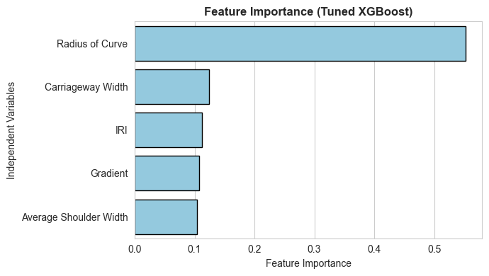
    


Actual vs Predicted Plot


```python
# Tuned XGBoost: Actual vs Predicted V85 Speed

import matplotlib.pyplot as plt
import seaborn as sns

sns.set_style("whitegrid")

plt.figure(figsize=(7, 4))

# Scatter plot
sns.scatterplot(
    x=y_test,
    y=y_test_pred_xgb_tuned,
    color="steelblue",
    s=60,
    alpha=0.7,
    edgecolor="black"
)

# Perfect fit line
min_val = min(y_test.min(), y_test_pred_xgb_tuned.min())
max_val = max(y_test.max(), y_test_pred_xgb_tuned.max())

plt.plot(
    [min_val, max_val],
    [min_val, max_val],
    color="darkred",
    linestyle="--",
    linewidth=2,
    label="Perfect Fit"
)

plt.xlabel("Actual V85 Speed (km/h)")
plt.ylabel("Predicted V85 Speed (km/h)")

plt.title(
    "Tuned XGBoost: Actual vs Predicted V85 Speed",
    fontsize=12,
    fontweight="bold"
)

plt.legend()
plt.tight_layout()
plt.show()
```


    
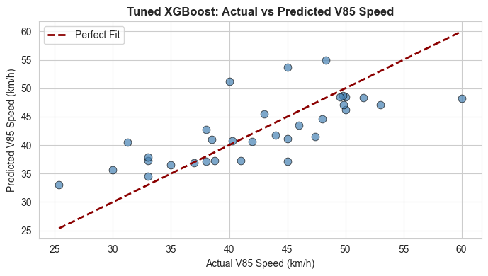
    


    

    


Residual Plot


```python
# Tuned XGBoost Residual Analysis

import matplotlib.pyplot as plt
import seaborn as sns

# Calculate residuals
xgb_tuned_residuals = y_test - y_test_pred_xgb_tuned

# Set plot style
sns.set_style("whitegrid")

plt.figure(figsize=(7, 4))

# Scatter plot
sns.scatterplot(
    x=y_test_pred_xgb_tuned,
    y=xgb_tuned_residuals,
    color="steelblue",
    s=60,
    alpha=0.7,
    edgecolor="black"
)

# Reference line at zero
plt.axhline(
    y=0,
    linestyle="--",
    color="darkred",
    linewidth=2
)

plt.xlabel("Predicted V85 Speed (km/h)")
plt.ylabel("Residuals (km/h)")

plt.title(
    "Tuned XGBoost: Residual Plot",
    fontsize=12,
    fontweight="bold"
)

plt.tight_layout()
plt.show()
```


    

    


    
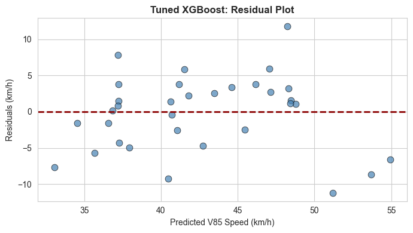
    


Result Table


```python
# Final Tuned XGBoost Performance Summary

xgb_tuned_final = pd.DataFrame({
    "Model": ["Tuned XGBoost"],
    "R2": [round(xgb_tuned_test_r2, 3)],
    "RMSE": [round(xgb_tuned_test_rmse, 3)],
    "MAE": [round(xgb_tuned_test_mae, 3)]
})

# Display results
display(xgb_tuned_final)
```


<div>
<style scoped>
    .dataframe tbody tr th:only-of-type {
        vertical-align: middle;
    }

    .dataframe tbody tr th {
        vertical-align: top;
    }

    .dataframe thead th {
        text-align: right;
    }
</style>
<table border="1" class="dataframe">
  <thead>
    <tr style="text-align: right;">
      <th></th>
      <th>Model</th>
      <th>R2</th>
      <th>RMSE</th>
      <th>MAE</th>
    </tr>
  </thead>
  <tbody>
    <tr>
      <th>0</th>
      <td>Tuned XGBoost</td>
      <td>0.545</td>
      <td>5.127</td>
      <td>4.126</td>
    </tr>
  </tbody>
</table>
</div>


<div>
<style scoped>
    .dataframe tbody tr th:only-of-type {
        vertical-align: middle;
    }

    .dataframe tbody tr th {
        vertical-align: top;
    }

    .dataframe thead th {
        text-align: right;
    }
</style>
<table border="1" class="dataframe">
  <thead>
    <tr style="text-align: right;">
      <th></th>
      <th>Model</th>
      <th>R2</th>
      <th>RMSE</th>
      <th>MAE</th>
    </tr>
  </thead>
  <tbody>
    <tr>
      <th>0</th>
      <td>Tuned XGBoost</td>
      <td>0.545</td>
      <td>5.127</td>
      <td>4.126</td>
    </tr>
  </tbody>
</table>
</div>


Base vs Tuned Model Comparison


```python
# Comparison of Baseline and Tuned XGBoost

xgb_comparison = pd.concat(
    [xgb_final, xgb_tuned_final],
    ignore_index=True
)

# Display comparison table
display(xgb_comparison)
```


<div>
<style scoped>
    .dataframe tbody tr th:only-of-type {
        vertical-align: middle;
    }

    .dataframe tbody tr th {
        vertical-align: top;
    }

    .dataframe thead th {
        text-align: right;
    }
</style>
<table border="1" class="dataframe">
  <thead>
    <tr style="text-align: right;">
      <th></th>
      <th>Model</th>
      <th>R2</th>
      <th>RMSE</th>
      <th>MAE</th>
    </tr>
  </thead>
  <tbody>
    <tr>
      <th>0</th>
      <td>XGBoost</td>
      <td>0.387</td>
      <td>5.956</td>
      <td>4.772</td>
    </tr>
    <tr>
      <th>1</th>
      <td>Tuned XGBoost</td>
      <td>0.545</td>
      <td>5.127</td>
      <td>4.126</td>
    </tr>
  </tbody>
</table>
</div>


<div>
<style scoped>
    .dataframe tbody tr th:only-of-type {
        vertical-align: middle;
    }

    .dataframe tbody tr th {
        vertical-align: top;
    }

    .dataframe thead th {
        text-align: right;
    }
</style>
<table border="1" class="dataframe">
  <thead>
    <tr style="text-align: right;">
      <th></th>
      <th>Model</th>
      <th>R2</th>
      <th>RMSE</th>
      <th>MAE</th>
    </tr>
  </thead>
  <tbody>
    <tr>
      <th>0</th>
      <td>XGBoost</td>
      <td>0.387</td>
      <td>5.956</td>
      <td>4.772</td>
    </tr>
    <tr>
      <th>1</th>
      <td>Tuned XGBoost</td>
      <td>0.545</td>
      <td>5.127</td>
      <td>4.126</td>
    </tr>
  </tbody>
</table>
</div>


Best Hyperparameters Table


```python
# Best Hyperparameters of Tuned XGBoost

best_xgb_params = pd.DataFrame(
    list(grid_xgb.best_params_.items()),
    columns=["Parameter", "Best Value"]
)

# Display results
display(best_xgb_params)
```


<div>
<style scoped>
    .dataframe tbody tr th:only-of-type {
        vertical-align: middle;
    }

    .dataframe tbody tr th {
        vertical-align: top;
    }

    .dataframe thead th {
        text-align: right;
    }
</style>
<table border="1" class="dataframe">
  <thead>
    <tr style="text-align: right;">
      <th></th>
      <th>Parameter</th>
      <th>Best Value</th>
    </tr>
  </thead>
  <tbody>
    <tr>
      <th>0</th>
      <td>colsample_bytree</td>
      <td>1.00</td>
    </tr>
    <tr>
      <th>1</th>
      <td>learning_rate</td>
      <td>0.01</td>
    </tr>
    <tr>
      <th>2</th>
      <td>max_depth</td>
      <td>3.00</td>
    </tr>
    <tr>
      <th>3</th>
      <td>n_estimators</td>
      <td>200.00</td>
    </tr>
    <tr>
      <th>4</th>
      <td>subsample</td>
      <td>0.70</td>
    </tr>
  </tbody>
</table>
</div>


<div>
<style scoped>
    .dataframe tbody tr th:only-of-type {
        vertical-align: middle;
    }

    .dataframe tbody tr th {
        vertical-align: top;
    }

    .dataframe thead th {
        text-align: right;
    }
</style>
<table border="1" class="dataframe">
  <thead>
    <tr style="text-align: right;">
      <th></th>
      <th>Parameter</th>
      <th>Best Value</th>
    </tr>
  </thead>
  <tbody>
    <tr>
      <th>0</th>
      <td>colsample_bytree</td>
      <td>1.00</td>
    </tr>
    <tr>
      <th>1</th>
      <td>learning_rate</td>
      <td>0.01</td>
    </tr>
    <tr>
      <th>2</th>
      <td>max_depth</td>
      <td>3.00</td>
    </tr>
    <tr>
      <th>3</th>
      <td>n_estimators</td>
      <td>200.00</td>
    </tr>
    <tr>
      <th>4</th>
      <td>subsample</td>
      <td>0.70</td>
    </tr>
  </tbody>
</table>
</div>


SUPPORT VECTOR REGRESSION MODEL (SVR)

Model Training


```python
# Support Vector Regression (SVR)

from sklearn.svm import SVR

# Initialize SVR model
svr = SVR(
    kernel="rbf",
    C=100,
    epsilon=0.1,
    gamma="scale"
)

# Train SVR using scaled training data
svr.fit(X_train_scaled, y_train)
```


<style>#sk-container-id-11 {
  /* Definition of color scheme common for light and dark mode */
  --sklearn-color-text: #000;
  --sklearn-color-text-muted: #666;
  --sklearn-color-line: gray;
  /* Definition of color scheme for unfitted estimators */
  --sklearn-color-unfitted-level-0: #fff5e6;
  --sklearn-color-unfitted-level-1: #f6e4d2;
  --sklearn-color-unfitted-level-2: #ffe0b3;
  --sklearn-color-unfitted-level-3: chocolate;
  /* Definition of color scheme for fitted estimators */
  --sklearn-color-fitted-level-0: #f0f8ff;
  --sklearn-color-fitted-level-1: #d4ebff;
  --sklearn-color-fitted-level-2: #b3dbfd;
  --sklearn-color-fitted-level-3: cornflowerblue;
}

#sk-container-id-11.light {
  /* Specific color for light theme */
  --sklearn-color-text-on-default-background: black;
  --sklearn-color-background: white;
  --sklearn-color-border-box: black;
  --sklearn-color-icon: #696969;
}

#sk-container-id-11.dark {
  --sklearn-color-text-on-default-background: white;
  --sklearn-color-background: #111;
  --sklearn-color-border-box: white;
  --sklearn-color-icon: #878787;
}

#sk-container-id-11 {
  color: var(--sklearn-color-text);
}

#sk-container-id-11 pre {
  padding: 0;
}

#sk-container-id-11 input.sk-hidden--visually {
  border: 0;
  clip: rect(1px 1px 1px 1px);
  clip: rect(1px, 1px, 1px, 1px);
  height: 1px;
  margin: -1px;
  overflow: hidden;
  padding: 0;
  position: absolute;
  width: 1px;
}

#sk-container-id-11 div.sk-dashed-wrapped {
  border: 1px dashed var(--sklearn-color-line);
  margin: 0 0.4em 0.5em 0.4em;
  box-sizing: border-box;
  padding-bottom: 0.4em;
  background-color: var(--sklearn-color-background);
}

#sk-container-id-11 div.sk-container {
  /* jupyter's `normalize.less` sets `[hidden] { display: none; }`
     but bootstrap.min.css set `[hidden] { display: none !important; }`
     so we also need the `!important` here to be able to override the
     default hidden behavior on the sphinx rendered scikit-learn.org.
     See: https://github.com/scikit-learn/scikit-learn/issues/21755 */
  display: inline-block !important;
  position: relative;
}

#sk-container-id-11 div.sk-text-repr-fallback {
  display: none;
}

div.sk-parallel-item,
div.sk-serial,
div.sk-item {
  /* draw centered vertical line to link estimators */
  background-image: linear-gradient(var(--sklearn-color-text-on-default-background), var(--sklearn-color-text-on-default-background));
  background-size: 2px 100%;
  background-repeat: no-repeat;
  background-position: center center;
}

/* Parallel-specific style estimator block */

#sk-container-id-11 div.sk-parallel-item::after {
  content: "";
  width: 100%;
  border-bottom: 2px solid var(--sklearn-color-text-on-default-background);
  flex-grow: 1;
}

#sk-container-id-11 div.sk-parallel {
  display: flex;
  align-items: stretch;
  justify-content: center;
  background-color: var(--sklearn-color-background);
  position: relative;
}

#sk-container-id-11 div.sk-parallel-item {
  display: flex;
  flex-direction: column;
}

#sk-container-id-11 div.sk-parallel-item:first-child::after {
  align-self: flex-end;
  width: 50%;
}

#sk-container-id-11 div.sk-parallel-item:last-child::after {
  align-self: flex-start;
  width: 50%;
}

#sk-container-id-11 div.sk-parallel-item:only-child::after {
  width: 0;
}

/* Serial-specific style estimator block */

#sk-container-id-11 div.sk-serial {
  display: flex;
  flex-direction: column;
  align-items: center;
  background-color: var(--sklearn-color-background);
  padding-right: 1em;
  padding-left: 1em;
}


/* Toggleable style: style used for estimator/Pipeline/ColumnTransformer box that is
clickable and can be expanded/collapsed.
- Pipeline and ColumnTransformer use this feature and define the default style
- Estimators will overwrite some part of the style using the `sk-estimator` class
*/

/* Pipeline and ColumnTransformer style (default) */

#sk-container-id-11 div.sk-toggleable {
  /* Default theme specific background. It is overwritten whether we have a
  specific estimator or a Pipeline/ColumnTransformer */
  background-color: var(--sklearn-color-background);
}

/* Toggleable label */
#sk-container-id-11 label.sk-toggleable__label {
  cursor: pointer;
  display: flex;
  width: 100%;
  margin-bottom: 0;
  padding: 0.5em;
  box-sizing: border-box;
  text-align: center;
  align-items: center;
  justify-content: center;
  gap: 0.5em;
}

#sk-container-id-11 label.sk-toggleable__label .caption {
  font-size: 0.6rem;
  font-weight: lighter;
  color: var(--sklearn-color-text-muted);
}

#sk-container-id-11 label.sk-toggleable__label-arrow:before {
  /* Arrow on the left of the label */
  content: "▸";
  float: left;
  margin-right: 0.25em;
  color: var(--sklearn-color-icon);
}

#sk-container-id-11 label.sk-toggleable__label-arrow:hover:before {
  color: var(--sklearn-color-text);
}

/* Toggleable content - dropdown */

#sk-container-id-11 div.sk-toggleable__content {
  display: none;
  text-align: left;
  /* unfitted */
  background-color: var(--sklearn-color-unfitted-level-0);
}

#sk-container-id-11 div.sk-toggleable__content.fitted {
  /* fitted */
  background-color: var(--sklearn-color-fitted-level-0);
}

#sk-container-id-11 div.sk-toggleable__content pre {
  margin: 0.2em;
  border-radius: 0.25em;
  color: var(--sklearn-color-text);
  /* unfitted */
  background-color: var(--sklearn-color-unfitted-level-0);
}

#sk-container-id-11 div.sk-toggleable__content.fitted pre {
  /* unfitted */
  background-color: var(--sklearn-color-fitted-level-0);
}

#sk-container-id-11 input.sk-toggleable__control:checked~div.sk-toggleable__content {
  /* Expand drop-down */
  display: block;
  width: 100%;
  overflow: visible;
}

#sk-container-id-11 input.sk-toggleable__control:checked~label.sk-toggleable__label-arrow:before {
  content: "▾";
}

/* Pipeline/ColumnTransformer-specific style */

#sk-container-id-11 div.sk-label input.sk-toggleable__control:checked~label.sk-toggleable__label {
  color: var(--sklearn-color-text);
  background-color: var(--sklearn-color-unfitted-level-2);
}

#sk-container-id-11 div.sk-label.fitted input.sk-toggleable__control:checked~label.sk-toggleable__label {
  background-color: var(--sklearn-color-fitted-level-2);
}

/* Estimator-specific style */

/* Colorize estimator box */
#sk-container-id-11 div.sk-estimator input.sk-toggleable__control:checked~label.sk-toggleable__label {
  /* unfitted */
  background-color: var(--sklearn-color-unfitted-level-2);
}

#sk-container-id-11 div.sk-estimator.fitted input.sk-toggleable__control:checked~label.sk-toggleable__label {
  /* fitted */
  background-color: var(--sklearn-color-fitted-level-2);
}

#sk-container-id-11 div.sk-label label.sk-toggleable__label,
#sk-container-id-11 div.sk-label label {
  /* The background is the default theme color */
  color: var(--sklearn-color-text-on-default-background);
}

/* On hover, darken the color of the background */
#sk-container-id-11 div.sk-label:hover label.sk-toggleable__label {
  color: var(--sklearn-color-text);
  background-color: var(--sklearn-color-unfitted-level-2);
}

/* Label box, darken color on hover, fitted */
#sk-container-id-11 div.sk-label.fitted:hover label.sk-toggleable__label.fitted {
  color: var(--sklearn-color-text);
  background-color: var(--sklearn-color-fitted-level-2);
}

/* Estimator label */

#sk-container-id-11 div.sk-label label {
  font-family: monospace;
  font-weight: bold;
  line-height: 1.2em;
}

#sk-container-id-11 div.sk-label-container {
  text-align: center;
}

/* Estimator-specific */
#sk-container-id-11 div.sk-estimator {
  font-family: monospace;
  border: 1px dotted var(--sklearn-color-border-box);
  border-radius: 0.25em;
  box-sizing: border-box;
  margin-bottom: 0.5em;
  /* unfitted */
  background-color: var(--sklearn-color-unfitted-level-0);
}

#sk-container-id-11 div.sk-estimator.fitted {
  /* fitted */
  background-color: var(--sklearn-color-fitted-level-0);
}

/* on hover */
#sk-container-id-11 div.sk-estimator:hover {
  /* unfitted */
  background-color: var(--sklearn-color-unfitted-level-2);
}

#sk-container-id-11 div.sk-estimator.fitted:hover {
  /* fitted */
  background-color: var(--sklearn-color-fitted-level-2);
}

/* Specification for estimator info (e.g. "i" and "?") */

/* Common style for "i" and "?" */

.sk-estimator-doc-link,
a:link.sk-estimator-doc-link,
a:visited.sk-estimator-doc-link {
  float: right;
  font-size: smaller;
  line-height: 1em;
  font-family: monospace;
  background-color: var(--sklearn-color-unfitted-level-0);
  border-radius: 1em;
  height: 1em;
  width: 1em;
  text-decoration: none !important;
  margin-left: 0.5em;
  text-align: center;
  /* unfitted */
  border: var(--sklearn-color-unfitted-level-3) 1pt solid;
  color: var(--sklearn-color-unfitted-level-3);
}

.sk-estimator-doc-link.fitted,
a:link.sk-estimator-doc-link.fitted,
a:visited.sk-estimator-doc-link.fitted {
  /* fitted */
  background-color: var(--sklearn-color-fitted-level-0);
  border: var(--sklearn-color-fitted-level-3) 1pt solid;
  color: var(--sklearn-color-fitted-level-3);
}

/* On hover */
div.sk-estimator:hover .sk-estimator-doc-link:hover,
.sk-estimator-doc-link:hover,
div.sk-label-container:hover .sk-estimator-doc-link:hover,
.sk-estimator-doc-link:hover {
  /* unfitted */
  background-color: var(--sklearn-color-unfitted-level-3);
  border: var(--sklearn-color-fitted-level-0) 1pt solid;
  color: var(--sklearn-color-unfitted-level-0);
  text-decoration: none;
}

div.sk-estimator.fitted:hover .sk-estimator-doc-link.fitted:hover,
.sk-estimator-doc-link.fitted:hover,
div.sk-label-container:hover .sk-estimator-doc-link.fitted:hover,
.sk-estimator-doc-link.fitted:hover {
  /* fitted */
  background-color: var(--sklearn-color-fitted-level-3);
  border: var(--sklearn-color-fitted-level-0) 1pt solid;
  color: var(--sklearn-color-fitted-level-0);
  text-decoration: none;
}

/* Span, style for the box shown on hovering the info icon */
.sk-estimator-doc-link span {
  display: none;
  z-index: 9999;
  position: relative;
  font-weight: normal;
  right: .2ex;
  padding: .5ex;
  margin: .5ex;
  width: min-content;
  min-width: 20ex;
  max-width: 50ex;
  color: var(--sklearn-color-text);
  box-shadow: 2pt 2pt 4pt #999;
  /* unfitted */
  background: var(--sklearn-color-unfitted-level-0);
  border: .5pt solid var(--sklearn-color-unfitted-level-3);
}

.sk-estimator-doc-link.fitted span {
  /* fitted */
  background: var(--sklearn-color-fitted-level-0);
  border: var(--sklearn-color-fitted-level-3);
}

.sk-estimator-doc-link:hover span {
  display: block;
}

/* "?"-specific style due to the `<a>` HTML tag */

#sk-container-id-11 a.estimator_doc_link {
  float: right;
  font-size: 1rem;
  line-height: 1em;
  font-family: monospace;
  background-color: var(--sklearn-color-unfitted-level-0);
  border-radius: 1rem;
  height: 1rem;
  width: 1rem;
  text-decoration: none;
  /* unfitted */
  color: var(--sklearn-color-unfitted-level-1);
  border: var(--sklearn-color-unfitted-level-1) 1pt solid;
}

#sk-container-id-11 a.estimator_doc_link.fitted {
  /* fitted */
  background-color: var(--sklearn-color-fitted-level-0);
  border: var(--sklearn-color-fitted-level-1) 1pt solid;
  color: var(--sklearn-color-fitted-level-1);
}

/* On hover */
#sk-container-id-11 a.estimator_doc_link:hover {
  /* unfitted */
  background-color: var(--sklearn-color-unfitted-level-3);
  color: var(--sklearn-color-background);
  text-decoration: none;
}

#sk-container-id-11 a.estimator_doc_link.fitted:hover {
  /* fitted */
  background-color: var(--sklearn-color-fitted-level-3);
}

.estimator-table {
    font-family: monospace;
}

.estimator-table summary {
    padding: .5rem;
    cursor: pointer;
}

.estimator-table summary::marker {
    font-size: 0.7rem;
}

.estimator-table details[open] {
    padding-left: 0.1rem;
    padding-right: 0.1rem;
    padding-bottom: 0.3rem;
}

.estimator-table .parameters-table {
    margin-left: auto !important;
    margin-right: auto !important;
    margin-top: 0;
}

.estimator-table .parameters-table tr:nth-child(odd) {
    background-color: #fff;
}

.estimator-table .parameters-table tr:nth-child(even) {
    background-color: #f6f6f6;
}

.estimator-table .parameters-table tr:hover {
    background-color: #e0e0e0;
}

.estimator-table table td {
    border: 1px solid rgba(106, 105, 104, 0.232);
}

/*
    `table td`is set in notebook with right text-align.
    We need to overwrite it.
*/
.estimator-table table td.param {
    text-align: left;
    position: relative;
    padding: 0;
}

.user-set td {
    color:rgb(255, 94, 0);
    text-align: left !important;
}

.user-set td.value {
    color:rgb(255, 94, 0);
    background-color: transparent;
}

.default td {
    color: black;
    text-align: left !important;
}

.user-set td i,
.default td i {
    color: black;
}

/*
    Styles for parameter documentation links
    We need styling for visited so jupyter doesn't overwrite it
*/
a.param-doc-link,
a.param-doc-link:link,
a.param-doc-link:visited {
    text-decoration: underline dashed;
    text-underline-offset: .3em;
    color: inherit;
    display: block;
    padding: .5em;
}

/* "hack" to make the entire area of the cell containing the link clickable */
a.param-doc-link::before {
    position: absolute;
    content: "";
    inset: 0;
}

.param-doc-description {
    display: none;
    position: absolute;
    z-index: 9999;
    left: 0;
    padding: .5ex;
    margin-left: 1.5em;
    color: var(--sklearn-color-text);
    box-shadow: .3em .3em .4em #999;
    width: max-content;
    text-align: left;
    max-height: 10em;
    overflow-y: auto;

    /* unfitted */
    background: var(--sklearn-color-unfitted-level-0);
    border: thin solid var(--sklearn-color-unfitted-level-3);
}

/* Fitted state for parameter tooltips */
.fitted .param-doc-description {
    /* fitted */
    background: var(--sklearn-color-fitted-level-0);
    border: thin solid var(--sklearn-color-fitted-level-3);
}

.param-doc-link:hover .param-doc-description {
    display: block;
}

.copy-paste-icon {
    background-image: url();
    background-repeat: no-repeat;
    background-size: 14px 14px;
    background-position: 0;
    display: inline-block;
    width: 14px;
    height: 14px;
    cursor: pointer;
}
</style><body><div id="sk-container-id-11" class="sk-top-container"><div class="sk-text-repr-fallback"><pre>SVR(C=100)</pre><b>In a Jupyter environment, please rerun this cell to show the HTML representation or trust the notebook. <br />On GitHub, the HTML representation is unable to render, please try loading this page with nbviewer.org.</b></div><div class="sk-container" hidden><div class="sk-item"><div class="sk-estimator fitted sk-toggleable"><input class="sk-toggleable__control sk-hidden--visually" id="sk-estimator-id-11" type="checkbox" checked><label for="sk-estimator-id-11" class="sk-toggleable__label fitted sk-toggleable__label-arrow"><div><div>SVR</div></div><div><a class="sk-estimator-doc-link fitted" rel="noreferrer" target="_blank" href="https://scikit-learn.org/1.8/modules/generated/sklearn.svm.SVR.html">?<span>Documentation for SVR</span></a><span class="sk-estimator-doc-link fitted">i<span>Fitted</span></span></div></label><div class="sk-toggleable__content fitted" data-param-prefix="">
        <div class="estimator-table">
            <details>
                <summary>Parameters</summary>
                <table class="parameters-table">
                  <tbody>

        <tr class="default">
            <td><i class="copy-paste-icon"
                 onclick="copyToClipboard('kernel',
                          this.parentElement.nextElementSibling)"
            ></i></td>
            <td class="param">
        <a class="param-doc-link"
            rel="noreferrer" target="_blank" href="https://scikit-learn.org/1.8/modules/generated/sklearn.svm.SVR.html#:~:text=kernel,-%7B%27linear%27%2C%20%27poly%27%2C%20%27rbf%27%2C%20%27sigmoid%27%2C%20%27precomputed%27%7D%20or%20callable%2C%20%20%20%20%20%20%20%20%20%20default%3D%27rbf%27">
            kernel
            <span class="param-doc-description">kernel: {'linear', 'poly', 'rbf', 'sigmoid', 'precomputed'} or callable,          default='rbf'<br><br>Specifies the kernel type to be used in the algorithm.<br>If none is given, 'rbf' will be used. If a callable is given it is<br>used to precompute the kernel matrix.<br>For an intuitive visualization of different kernel types<br>see :ref:`sphx_glr_auto_examples_svm_plot_svm_regression.py`</span>
        </a>
    </td>
            <td class="value">&#x27;rbf&#x27;</td>
        </tr>


        <tr class="default">
            <td><i class="copy-paste-icon"
                 onclick="copyToClipboard('degree',
                          this.parentElement.nextElementSibling)"
            ></i></td>
            <td class="param">
        <a class="param-doc-link"
            rel="noreferrer" target="_blank" href="https://scikit-learn.org/1.8/modules/generated/sklearn.svm.SVR.html#:~:text=degree,-int%2C%20default%3D3">
            degree
            <span class="param-doc-description">degree: int, default=3<br><br>Degree of the polynomial kernel function ('poly').<br>Must be non-negative. Ignored by all other kernels.</span>
        </a>
    </td>
            <td class="value">3</td>
        </tr>


        <tr class="default">
            <td><i class="copy-paste-icon"
                 onclick="copyToClipboard('gamma',
                          this.parentElement.nextElementSibling)"
            ></i></td>
            <td class="param">
        <a class="param-doc-link"
            rel="noreferrer" target="_blank" href="https://scikit-learn.org/1.8/modules/generated/sklearn.svm.SVR.html#:~:text=gamma,-%7B%27scale%27%2C%20%27auto%27%7D%20or%20float%2C%20default%3D%27scale%27">
            gamma
            <span class="param-doc-description">gamma: {'scale', 'auto'} or float, default='scale'<br><br>Kernel coefficient for 'rbf', 'poly' and 'sigmoid'.<br><br>- if ``gamma='scale'`` (default) is passed then it uses<br>  1 / (n_features * X.var()) as value of gamma,<br>- if 'auto', uses 1 / n_features<br>- if float, must be non-negative.<br><br>.. versionchanged:: 0.22<br>   The default value of ``gamma`` changed from 'auto' to 'scale'.</span>
        </a>
    </td>
            <td class="value">&#x27;scale&#x27;</td>
        </tr>


        <tr class="default">
            <td><i class="copy-paste-icon"
                 onclick="copyToClipboard('coef0',
                          this.parentElement.nextElementSibling)"
            ></i></td>
            <td class="param">
        <a class="param-doc-link"
            rel="noreferrer" target="_blank" href="https://scikit-learn.org/1.8/modules/generated/sklearn.svm.SVR.html#:~:text=coef0,-float%2C%20default%3D0.0">
            coef0
            <span class="param-doc-description">coef0: float, default=0.0<br><br>Independent term in kernel function.<br>It is only significant in 'poly' and 'sigmoid'.</span>
        </a>
    </td>
            <td class="value">0.0</td>
        </tr>


        <tr class="default">
            <td><i class="copy-paste-icon"
                 onclick="copyToClipboard('tol',
                          this.parentElement.nextElementSibling)"
            ></i></td>
            <td class="param">
        <a class="param-doc-link"
            rel="noreferrer" target="_blank" href="https://scikit-learn.org/1.8/modules/generated/sklearn.svm.SVR.html#:~:text=tol,-float%2C%20default%3D1e-3">
            tol
            <span class="param-doc-description">tol: float, default=1e-3<br><br>Tolerance for stopping criterion.</span>
        </a>
    </td>
            <td class="value">0.001</td>
        </tr>


        <tr class="user-set">
            <td><i class="copy-paste-icon"
                 onclick="copyToClipboard('C',
                          this.parentElement.nextElementSibling)"
            ></i></td>
            <td class="param">
        <a class="param-doc-link"
            rel="noreferrer" target="_blank" href="https://scikit-learn.org/1.8/modules/generated/sklearn.svm.SVR.html#:~:text=C,-float%2C%20default%3D1.0">
            C
            <span class="param-doc-description">C: float, default=1.0<br><br>Regularization parameter. The strength of the regularization is<br>inversely proportional to C. Must be strictly positive.<br>The penalty is a squared l2. For an intuitive visualization of the<br>effects of scaling the regularization parameter C, see<br>:ref:`sphx_glr_auto_examples_svm_plot_svm_scale_c.py`.</span>
        </a>
    </td>
            <td class="value">100</td>
        </tr>


        <tr class="default">
            <td><i class="copy-paste-icon"
                 onclick="copyToClipboard('epsilon',
                          this.parentElement.nextElementSibling)"
            ></i></td>
            <td class="param">
        <a class="param-doc-link"
            rel="noreferrer" target="_blank" href="https://scikit-learn.org/1.8/modules/generated/sklearn.svm.SVR.html#:~:text=epsilon,-float%2C%20default%3D0.1">
            epsilon
            <span class="param-doc-description">epsilon: float, default=0.1<br><br>Epsilon in the epsilon-SVR model. It specifies the epsilon-tube<br>within which no penalty is associated in the training loss function<br>with points predicted within a distance epsilon from the actual<br>value. Must be non-negative.</span>
        </a>
    </td>
            <td class="value">0.1</td>
        </tr>


        <tr class="default">
            <td><i class="copy-paste-icon"
                 onclick="copyToClipboard('shrinking',
                          this.parentElement.nextElementSibling)"
            ></i></td>
            <td class="param">
        <a class="param-doc-link"
            rel="noreferrer" target="_blank" href="https://scikit-learn.org/1.8/modules/generated/sklearn.svm.SVR.html#:~:text=shrinking,-bool%2C%20default%3DTrue">
            shrinking
            <span class="param-doc-description">shrinking: bool, default=True<br><br>Whether to use the shrinking heuristic.<br>See the :ref:`User Guide <shrinking_svm>`.</span>
        </a>
    </td>
            <td class="value">True</td>
        </tr>


        <tr class="default">
            <td><i class="copy-paste-icon"
                 onclick="copyToClipboard('cache_size',
                          this.parentElement.nextElementSibling)"
            ></i></td>
            <td class="param">
        <a class="param-doc-link"
            rel="noreferrer" target="_blank" href="https://scikit-learn.org/1.8/modules/generated/sklearn.svm.SVR.html#:~:text=cache_size,-float%2C%20default%3D200">
            cache_size
            <span class="param-doc-description">cache_size: float, default=200<br><br>Specify the size of the kernel cache (in MB).</span>
        </a>
    </td>
            <td class="value">200</td>
        </tr>


        <tr class="default">
            <td><i class="copy-paste-icon"
                 onclick="copyToClipboard('verbose',
                          this.parentElement.nextElementSibling)"
            ></i></td>
            <td class="param">
        <a class="param-doc-link"
            rel="noreferrer" target="_blank" href="https://scikit-learn.org/1.8/modules/generated/sklearn.svm.SVR.html#:~:text=verbose,-bool%2C%20default%3DFalse">
            verbose
            <span class="param-doc-description">verbose: bool, default=False<br><br>Enable verbose output. Note that this setting takes advantage of a<br>per-process runtime setting in libsvm that, if enabled, may not work<br>properly in a multithreaded context.</span>
        </a>
    </td>
            <td class="value">False</td>
        </tr>


        <tr class="default">
            <td><i class="copy-paste-icon"
                 onclick="copyToClipboard('max_iter',
                          this.parentElement.nextElementSibling)"
            ></i></td>
            <td class="param">
        <a class="param-doc-link"
            rel="noreferrer" target="_blank" href="https://scikit-learn.org/1.8/modules/generated/sklearn.svm.SVR.html#:~:text=max_iter,-int%2C%20default%3D-1">
            max_iter
            <span class="param-doc-description">max_iter: int, default=-1<br><br>Hard limit on iterations within solver, or -1 for no limit.</span>
        </a>
    </td>
            <td class="value">-1</td>
        </tr>

                  </tbody>
                </table>
            </details>
        </div>
    </div></div></div></div></div><script>function copyToClipboard(text, element) {
    // Get the parameter prefix from the closest toggleable content
    const toggleableContent = element.closest('.sk-toggleable__content');
    const paramPrefix = toggleableContent ? toggleableContent.dataset.paramPrefix : '';
    const fullParamName = paramPrefix ? `${paramPrefix}${text}` : text;

    const originalStyle = element.style;
    const computedStyle = window.getComputedStyle(element);
    const originalWidth = computedStyle.width;
    const originalHTML = element.innerHTML.replace('Copied!', '');

    navigator.clipboard.writeText(fullParamName)
        .then(() => {
            element.style.width = originalWidth;
            element.style.color = 'green';
            element.innerHTML = "Copied!";

            setTimeout(() => {
                element.innerHTML = originalHTML;
                element.style = originalStyle;
            }, 2000);
        })
        .catch(err => {
            console.error('Failed to copy:', err);
            element.style.color = 'red';
            element.innerHTML = "Failed!";
            setTimeout(() => {
                element.innerHTML = originalHTML;
                element.style = originalStyle;
            }, 2000);
        });
    return false;
}

document.querySelectorAll('.copy-paste-icon').forEach(function(element) {
    const toggleableContent = element.closest('.sk-toggleable__content');
    const paramPrefix = toggleableContent ? toggleableContent.dataset.paramPrefix : '';
    const paramName = element.parentElement.nextElementSibling
        .textContent.trim().split(' ')[0];
    const fullParamName = paramPrefix ? `${paramPrefix}${paramName}` : paramName;

    element.setAttribute('title', fullParamName);
});


/**
 * Adapted from Skrub
 * https://github.com/skrub-data/skrub/blob/403466d1d5d4dc76a7ef569b3f8228db59a31dc3/skrub/_reporting/_data/templates/report.js#L789
 * @returns "light" or "dark"
 */
function detectTheme(element) {
    const body = document.querySelector('body');

    // Check VSCode theme
    const themeKindAttr = body.getAttribute('data-vscode-theme-kind');
    const themeNameAttr = body.getAttribute('data-vscode-theme-name');

    if (themeKindAttr && themeNameAttr) {
        const themeKind = themeKindAttr.toLowerCase();
        const themeName = themeNameAttr.toLowerCase();

        if (themeKind.includes("dark") || themeName.includes("dark")) {
            return "dark";
        }
        if (themeKind.includes("light") || themeName.includes("light")) {
            return "light";
        }
    }

    // Check Jupyter theme
    if (body.getAttribute('data-jp-theme-light') === 'false') {
        return 'dark';
    } else if (body.getAttribute('data-jp-theme-light') === 'true') {
        return 'light';
    }

    // Guess based on a parent element's color
    const color = window.getComputedStyle(element.parentNode, null).getPropertyValue('color');
    const match = color.match(/^rgb\s*\(\s*(\d+)\s*,\s*(\d+)\s*,\s*(\d+)\s*\)\s*$/i);
    if (match) {
        const [r, g, b] = [
            parseFloat(match[1]),
            parseFloat(match[2]),
            parseFloat(match[3])
        ];

        // https://en.wikipedia.org/wiki/HSL_and_HSV#Lightness
        const luma = 0.299 * r + 0.587 * g + 0.114 * b;

        if (luma > 180) {
            // If the text is very bright we have a dark theme
            return 'dark';
        }
        if (luma < 75) {
            // If the text is very dark we have a light theme
            return 'light';
        }
        // Otherwise fall back to the next heuristic.
    }

    // Fallback to system preference
    return window.matchMedia('(prefers-color-scheme: dark)').matches ? 'dark' : 'light';
}


function forceTheme(elementId) {
    const estimatorElement = document.querySelector(`#${elementId}`);
    if (estimatorElement === null) {
        console.error(`Element with id ${elementId} not found.`);
    } else {
        const theme = detectTheme(estimatorElement);
        estimatorElement.classList.add(theme);
    }
}

forceTheme('sk-container-id-11');</script></body>


<style>#sk-container-id-12 {
  /* Definition of color scheme common for light and dark mode */
  --sklearn-color-text: #000;
  --sklearn-color-text-muted: #666;
  --sklearn-color-line: gray;
  /* Definition of color scheme for unfitted estimators */
  --sklearn-color-unfitted-level-0: #fff5e6;
  --sklearn-color-unfitted-level-1: #f6e4d2;
  --sklearn-color-unfitted-level-2: #ffe0b3;
  --sklearn-color-unfitted-level-3: chocolate;
  /* Definition of color scheme for fitted estimators */
  --sklearn-color-fitted-level-0: #f0f8ff;
  --sklearn-color-fitted-level-1: #d4ebff;
  --sklearn-color-fitted-level-2: #b3dbfd;
  --sklearn-color-fitted-level-3: cornflowerblue;
}

#sk-container-id-12.light {
  /* Specific color for light theme */
  --sklearn-color-text-on-default-background: black;
  --sklearn-color-background: white;
  --sklearn-color-border-box: black;
  --sklearn-color-icon: #696969;
}

#sk-container-id-12.dark {
  --sklearn-color-text-on-default-background: white;
  --sklearn-color-background: #111;
  --sklearn-color-border-box: white;
  --sklearn-color-icon: #878787;
}

#sk-container-id-12 {
  color: var(--sklearn-color-text);
}

#sk-container-id-12 pre {
  padding: 0;
}

#sk-container-id-12 input.sk-hidden--visually {
  border: 0;
  clip: rect(1px 1px 1px 1px);
  clip: rect(1px, 1px, 1px, 1px);
  height: 1px;
  margin: -1px;
  overflow: hidden;
  padding: 0;
  position: absolute;
  width: 1px;
}

#sk-container-id-12 div.sk-dashed-wrapped {
  border: 1px dashed var(--sklearn-color-line);
  margin: 0 0.4em 0.5em 0.4em;
  box-sizing: border-box;
  padding-bottom: 0.4em;
  background-color: var(--sklearn-color-background);
}

#sk-container-id-12 div.sk-container {
  /* jupyter's `normalize.less` sets `[hidden] { display: none; }`
     but bootstrap.min.css set `[hidden] { display: none !important; }`
     so we also need the `!important` here to be able to override the
     default hidden behavior on the sphinx rendered scikit-learn.org.
     See: https://github.com/scikit-learn/scikit-learn/issues/21755 */
  display: inline-block !important;
  position: relative;
}

#sk-container-id-12 div.sk-text-repr-fallback {
  display: none;
}

div.sk-parallel-item,
div.sk-serial,
div.sk-item {
  /* draw centered vertical line to link estimators */
  background-image: linear-gradient(var(--sklearn-color-text-on-default-background), var(--sklearn-color-text-on-default-background));
  background-size: 2px 100%;
  background-repeat: no-repeat;
  background-position: center center;
}

/* Parallel-specific style estimator block */

#sk-container-id-12 div.sk-parallel-item::after {
  content: "";
  width: 100%;
  border-bottom: 2px solid var(--sklearn-color-text-on-default-background);
  flex-grow: 1;
}

#sk-container-id-12 div.sk-parallel {
  display: flex;
  align-items: stretch;
  justify-content: center;
  background-color: var(--sklearn-color-background);
  position: relative;
}

#sk-container-id-12 div.sk-parallel-item {
  display: flex;
  flex-direction: column;
}

#sk-container-id-12 div.sk-parallel-item:first-child::after {
  align-self: flex-end;
  width: 50%;
}

#sk-container-id-12 div.sk-parallel-item:last-child::after {
  align-self: flex-start;
  width: 50%;
}

#sk-container-id-12 div.sk-parallel-item:only-child::after {
  width: 0;
}

/* Serial-specific style estimator block */

#sk-container-id-12 div.sk-serial {
  display: flex;
  flex-direction: column;
  align-items: center;
  background-color: var(--sklearn-color-background);
  padding-right: 1em;
  padding-left: 1em;
}


/* Toggleable style: style used for estimator/Pipeline/ColumnTransformer box that is
clickable and can be expanded/collapsed.
- Pipeline and ColumnTransformer use this feature and define the default style
- Estimators will overwrite some part of the style using the `sk-estimator` class
*/

/* Pipeline and ColumnTransformer style (default) */

#sk-container-id-12 div.sk-toggleable {
  /* Default theme specific background. It is overwritten whether we have a
  specific estimator or a Pipeline/ColumnTransformer */
  background-color: var(--sklearn-color-background);
}

/* Toggleable label */
#sk-container-id-12 label.sk-toggleable__label {
  cursor: pointer;
  display: flex;
  width: 100%;
  margin-bottom: 0;
  padding: 0.5em;
  box-sizing: border-box;
  text-align: center;
  align-items: center;
  justify-content: center;
  gap: 0.5em;
}

#sk-container-id-12 label.sk-toggleable__label .caption {
  font-size: 0.6rem;
  font-weight: lighter;
  color: var(--sklearn-color-text-muted);
}

#sk-container-id-12 label.sk-toggleable__label-arrow:before {
  /* Arrow on the left of the label */
  content: "▸";
  float: left;
  margin-right: 0.25em;
  color: var(--sklearn-color-icon);
}

#sk-container-id-12 label.sk-toggleable__label-arrow:hover:before {
  color: var(--sklearn-color-text);
}

/* Toggleable content - dropdown */

#sk-container-id-12 div.sk-toggleable__content {
  display: none;
  text-align: left;
  /* unfitted */
  background-color: var(--sklearn-color-unfitted-level-0);
}

#sk-container-id-12 div.sk-toggleable__content.fitted {
  /* fitted */
  background-color: var(--sklearn-color-fitted-level-0);
}

#sk-container-id-12 div.sk-toggleable__content pre {
  margin: 0.2em;
  border-radius: 0.25em;
  color: var(--sklearn-color-text);
  /* unfitted */
  background-color: var(--sklearn-color-unfitted-level-0);
}

#sk-container-id-12 div.sk-toggleable__content.fitted pre {
  /* unfitted */
  background-color: var(--sklearn-color-fitted-level-0);
}

#sk-container-id-12 input.sk-toggleable__control:checked~div.sk-toggleable__content {
  /* Expand drop-down */
  display: block;
  width: 100%;
  overflow: visible;
}

#sk-container-id-12 input.sk-toggleable__control:checked~label.sk-toggleable__label-arrow:before {
  content: "▾";
}

/* Pipeline/ColumnTransformer-specific style */

#sk-container-id-12 div.sk-label input.sk-toggleable__control:checked~label.sk-toggleable__label {
  color: var(--sklearn-color-text);
  background-color: var(--sklearn-color-unfitted-level-2);
}

#sk-container-id-12 div.sk-label.fitted input.sk-toggleable__control:checked~label.sk-toggleable__label {
  background-color: var(--sklearn-color-fitted-level-2);
}

/* Estimator-specific style */

/* Colorize estimator box */
#sk-container-id-12 div.sk-estimator input.sk-toggleable__control:checked~label.sk-toggleable__label {
  /* unfitted */
  background-color: var(--sklearn-color-unfitted-level-2);
}

#sk-container-id-12 div.sk-estimator.fitted input.sk-toggleable__control:checked~label.sk-toggleable__label {
  /* fitted */
  background-color: var(--sklearn-color-fitted-level-2);
}

#sk-container-id-12 div.sk-label label.sk-toggleable__label,
#sk-container-id-12 div.sk-label label {
  /* The background is the default theme color */
  color: var(--sklearn-color-text-on-default-background);
}

/* On hover, darken the color of the background */
#sk-container-id-12 div.sk-label:hover label.sk-toggleable__label {
  color: var(--sklearn-color-text);
  background-color: var(--sklearn-color-unfitted-level-2);
}

/* Label box, darken color on hover, fitted */
#sk-container-id-12 div.sk-label.fitted:hover label.sk-toggleable__label.fitted {
  color: var(--sklearn-color-text);
  background-color: var(--sklearn-color-fitted-level-2);
}

/* Estimator label */

#sk-container-id-12 div.sk-label label {
  font-family: monospace;
  font-weight: bold;
  line-height: 1.2em;
}

#sk-container-id-12 div.sk-label-container {
  text-align: center;
}

/* Estimator-specific */
#sk-container-id-12 div.sk-estimator {
  font-family: monospace;
  border: 1px dotted var(--sklearn-color-border-box);
  border-radius: 0.25em;
  box-sizing: border-box;
  margin-bottom: 0.5em;
  /* unfitted */
  background-color: var(--sklearn-color-unfitted-level-0);
}

#sk-container-id-12 div.sk-estimator.fitted {
  /* fitted */
  background-color: var(--sklearn-color-fitted-level-0);
}

/* on hover */
#sk-container-id-12 div.sk-estimator:hover {
  /* unfitted */
  background-color: var(--sklearn-color-unfitted-level-2);
}

#sk-container-id-12 div.sk-estimator.fitted:hover {
  /* fitted */
  background-color: var(--sklearn-color-fitted-level-2);
}

/* Specification for estimator info (e.g. "i" and "?") */

/* Common style for "i" and "?" */

.sk-estimator-doc-link,
a:link.sk-estimator-doc-link,
a:visited.sk-estimator-doc-link {
  float: right;
  font-size: smaller;
  line-height: 1em;
  font-family: monospace;
  background-color: var(--sklearn-color-unfitted-level-0);
  border-radius: 1em;
  height: 1em;
  width: 1em;
  text-decoration: none !important;
  margin-left: 0.5em;
  text-align: center;
  /* unfitted */
  border: var(--sklearn-color-unfitted-level-3) 1pt solid;
  color: var(--sklearn-color-unfitted-level-3);
}

.sk-estimator-doc-link.fitted,
a:link.sk-estimator-doc-link.fitted,
a:visited.sk-estimator-doc-link.fitted {
  /* fitted */
  background-color: var(--sklearn-color-fitted-level-0);
  border: var(--sklearn-color-fitted-level-3) 1pt solid;
  color: var(--sklearn-color-fitted-level-3);
}

/* On hover */
div.sk-estimator:hover .sk-estimator-doc-link:hover,
.sk-estimator-doc-link:hover,
div.sk-label-container:hover .sk-estimator-doc-link:hover,
.sk-estimator-doc-link:hover {
  /* unfitted */
  background-color: var(--sklearn-color-unfitted-level-3);
  border: var(--sklearn-color-fitted-level-0) 1pt solid;
  color: var(--sklearn-color-unfitted-level-0);
  text-decoration: none;
}

div.sk-estimator.fitted:hover .sk-estimator-doc-link.fitted:hover,
.sk-estimator-doc-link.fitted:hover,
div.sk-label-container:hover .sk-estimator-doc-link.fitted:hover,
.sk-estimator-doc-link.fitted:hover {
  /* fitted */
  background-color: var(--sklearn-color-fitted-level-3);
  border: var(--sklearn-color-fitted-level-0) 1pt solid;
  color: var(--sklearn-color-fitted-level-0);
  text-decoration: none;
}

/* Span, style for the box shown on hovering the info icon */
.sk-estimator-doc-link span {
  display: none;
  z-index: 9999;
  position: relative;
  font-weight: normal;
  right: .2ex;
  padding: .5ex;
  margin: .5ex;
  width: min-content;
  min-width: 20ex;
  max-width: 50ex;
  color: var(--sklearn-color-text);
  box-shadow: 2pt 2pt 4pt #999;
  /* unfitted */
  background: var(--sklearn-color-unfitted-level-0);
  border: .5pt solid var(--sklearn-color-unfitted-level-3);
}

.sk-estimator-doc-link.fitted span {
  /* fitted */
  background: var(--sklearn-color-fitted-level-0);
  border: var(--sklearn-color-fitted-level-3);
}

.sk-estimator-doc-link:hover span {
  display: block;
}

/* "?"-specific style due to the `<a>` HTML tag */

#sk-container-id-12 a.estimator_doc_link {
  float: right;
  font-size: 1rem;
  line-height: 1em;
  font-family: monospace;
  background-color: var(--sklearn-color-unfitted-level-0);
  border-radius: 1rem;
  height: 1rem;
  width: 1rem;
  text-decoration: none;
  /* unfitted */
  color: var(--sklearn-color-unfitted-level-1);
  border: var(--sklearn-color-unfitted-level-1) 1pt solid;
}

#sk-container-id-12 a.estimator_doc_link.fitted {
  /* fitted */
  background-color: var(--sklearn-color-fitted-level-0);
  border: var(--sklearn-color-fitted-level-1) 1pt solid;
  color: var(--sklearn-color-fitted-level-1);
}

/* On hover */
#sk-container-id-12 a.estimator_doc_link:hover {
  /* unfitted */
  background-color: var(--sklearn-color-unfitted-level-3);
  color: var(--sklearn-color-background);
  text-decoration: none;
}

#sk-container-id-12 a.estimator_doc_link.fitted:hover {
  /* fitted */
  background-color: var(--sklearn-color-fitted-level-3);
}

.estimator-table {
    font-family: monospace;
}

.estimator-table summary {
    padding: .5rem;
    cursor: pointer;
}

.estimator-table summary::marker {
    font-size: 0.7rem;
}

.estimator-table details[open] {
    padding-left: 0.1rem;
    padding-right: 0.1rem;
    padding-bottom: 0.3rem;
}

.estimator-table .parameters-table {
    margin-left: auto !important;
    margin-right: auto !important;
    margin-top: 0;
}

.estimator-table .parameters-table tr:nth-child(odd) {
    background-color: #fff;
}

.estimator-table .parameters-table tr:nth-child(even) {
    background-color: #f6f6f6;
}

.estimator-table .parameters-table tr:hover {
    background-color: #e0e0e0;
}

.estimator-table table td {
    border: 1px solid rgba(106, 105, 104, 0.232);
}

/*
    `table td`is set in notebook with right text-align.
    We need to overwrite it.
*/
.estimator-table table td.param {
    text-align: left;
    position: relative;
    padding: 0;
}

.user-set td {
    color:rgb(255, 94, 0);
    text-align: left !important;
}

.user-set td.value {
    color:rgb(255, 94, 0);
    background-color: transparent;
}

.default td {
    color: black;
    text-align: left !important;
}

.user-set td i,
.default td i {
    color: black;
}

/*
    Styles for parameter documentation links
    We need styling for visited so jupyter doesn't overwrite it
*/
a.param-doc-link,
a.param-doc-link:link,
a.param-doc-link:visited {
    text-decoration: underline dashed;
    text-underline-offset: .3em;
    color: inherit;
    display: block;
    padding: .5em;
}

/* "hack" to make the entire area of the cell containing the link clickable */
a.param-doc-link::before {
    position: absolute;
    content: "";
    inset: 0;
}

.param-doc-description {
    display: none;
    position: absolute;
    z-index: 9999;
    left: 0;
    padding: .5ex;
    margin-left: 1.5em;
    color: var(--sklearn-color-text);
    box-shadow: .3em .3em .4em #999;
    width: max-content;
    text-align: left;
    max-height: 10em;
    overflow-y: auto;

    /* unfitted */
    background: var(--sklearn-color-unfitted-level-0);
    border: thin solid var(--sklearn-color-unfitted-level-3);
}

/* Fitted state for parameter tooltips */
.fitted .param-doc-description {
    /* fitted */
    background: var(--sklearn-color-fitted-level-0);
    border: thin solid var(--sklearn-color-fitted-level-3);
}

.param-doc-link:hover .param-doc-description {
    display: block;
}

.copy-paste-icon {
    background-image: url();
    background-repeat: no-repeat;
    background-size: 14px 14px;
    background-position: 0;
    display: inline-block;
    width: 14px;
    height: 14px;
    cursor: pointer;
}
</style><body><div id="sk-container-id-12" class="sk-top-container"><div class="sk-text-repr-fallback"><pre>SVR(C=100)</pre><b>In a Jupyter environment, please rerun this cell to show the HTML representation or trust the notebook. <br />On GitHub, the HTML representation is unable to render, please try loading this page with nbviewer.org.</b></div><div class="sk-container" hidden><div class="sk-item"><div class="sk-estimator fitted sk-toggleable"><input class="sk-toggleable__control sk-hidden--visually" id="sk-estimator-id-12" type="checkbox" checked><label for="sk-estimator-id-12" class="sk-toggleable__label fitted sk-toggleable__label-arrow"><div><div>SVR</div></div><div><a class="sk-estimator-doc-link fitted" rel="noreferrer" target="_blank" href="https://scikit-learn.org/1.8/modules/generated/sklearn.svm.SVR.html">?<span>Documentation for SVR</span></a><span class="sk-estimator-doc-link fitted">i<span>Fitted</span></span></div></label><div class="sk-toggleable__content fitted" data-param-prefix="">
        <div class="estimator-table">
            <details>
                <summary>Parameters</summary>
                <table class="parameters-table">
                  <tbody>

        <tr class="default">
            <td><i class="copy-paste-icon"
                 onclick="copyToClipboard('kernel',
                          this.parentElement.nextElementSibling)"
            ></i></td>
            <td class="param">
        <a class="param-doc-link"
            rel="noreferrer" target="_blank" href="https://scikit-learn.org/1.8/modules/generated/sklearn.svm.SVR.html#:~:text=kernel,-%7B%27linear%27%2C%20%27poly%27%2C%20%27rbf%27%2C%20%27sigmoid%27%2C%20%27precomputed%27%7D%20or%20callable%2C%20%20%20%20%20%20%20%20%20%20default%3D%27rbf%27">
            kernel
            <span class="param-doc-description">kernel: {'linear', 'poly', 'rbf', 'sigmoid', 'precomputed'} or callable,          default='rbf'<br><br>Specifies the kernel type to be used in the algorithm.<br>If none is given, 'rbf' will be used. If a callable is given it is<br>used to precompute the kernel matrix.<br>For an intuitive visualization of different kernel types<br>see :ref:`sphx_glr_auto_examples_svm_plot_svm_regression.py`</span>
        </a>
    </td>
            <td class="value">&#x27;rbf&#x27;</td>
        </tr>


        <tr class="default">
            <td><i class="copy-paste-icon"
                 onclick="copyToClipboard('degree',
                          this.parentElement.nextElementSibling)"
            ></i></td>
            <td class="param">
        <a class="param-doc-link"
            rel="noreferrer" target="_blank" href="https://scikit-learn.org/1.8/modules/generated/sklearn.svm.SVR.html#:~:text=degree,-int%2C%20default%3D3">
            degree
            <span class="param-doc-description">degree: int, default=3<br><br>Degree of the polynomial kernel function ('poly').<br>Must be non-negative. Ignored by all other kernels.</span>
        </a>
    </td>
            <td class="value">3</td>
        </tr>


        <tr class="default">
            <td><i class="copy-paste-icon"
                 onclick="copyToClipboard('gamma',
                          this.parentElement.nextElementSibling)"
            ></i></td>
            <td class="param">
        <a class="param-doc-link"
            rel="noreferrer" target="_blank" href="https://scikit-learn.org/1.8/modules/generated/sklearn.svm.SVR.html#:~:text=gamma,-%7B%27scale%27%2C%20%27auto%27%7D%20or%20float%2C%20default%3D%27scale%27">
            gamma
            <span class="param-doc-description">gamma: {'scale', 'auto'} or float, default='scale'<br><br>Kernel coefficient for 'rbf', 'poly' and 'sigmoid'.<br><br>- if ``gamma='scale'`` (default) is passed then it uses<br>  1 / (n_features * X.var()) as value of gamma,<br>- if 'auto', uses 1 / n_features<br>- if float, must be non-negative.<br><br>.. versionchanged:: 0.22<br>   The default value of ``gamma`` changed from 'auto' to 'scale'.</span>
        </a>
    </td>
            <td class="value">&#x27;scale&#x27;</td>
        </tr>


        <tr class="default">
            <td><i class="copy-paste-icon"
                 onclick="copyToClipboard('coef0',
                          this.parentElement.nextElementSibling)"
            ></i></td>
            <td class="param">
        <a class="param-doc-link"
            rel="noreferrer" target="_blank" href="https://scikit-learn.org/1.8/modules/generated/sklearn.svm.SVR.html#:~:text=coef0,-float%2C%20default%3D0.0">
            coef0
            <span class="param-doc-description">coef0: float, default=0.0<br><br>Independent term in kernel function.<br>It is only significant in 'poly' and 'sigmoid'.</span>
        </a>
    </td>
            <td class="value">0.0</td>
        </tr>


        <tr class="default">
            <td><i class="copy-paste-icon"
                 onclick="copyToClipboard('tol',
                          this.parentElement.nextElementSibling)"
            ></i></td>
            <td class="param">
        <a class="param-doc-link"
            rel="noreferrer" target="_blank" href="https://scikit-learn.org/1.8/modules/generated/sklearn.svm.SVR.html#:~:text=tol,-float%2C%20default%3D1e-3">
            tol
            <span class="param-doc-description">tol: float, default=1e-3<br><br>Tolerance for stopping criterion.</span>
        </a>
    </td>
            <td class="value">0.001</td>
        </tr>


        <tr class="user-set">
            <td><i class="copy-paste-icon"
                 onclick="copyToClipboard('C',
                          this.parentElement.nextElementSibling)"
            ></i></td>
            <td class="param">
        <a class="param-doc-link"
            rel="noreferrer" target="_blank" href="https://scikit-learn.org/1.8/modules/generated/sklearn.svm.SVR.html#:~:text=C,-float%2C%20default%3D1.0">
            C
            <span class="param-doc-description">C: float, default=1.0<br><br>Regularization parameter. The strength of the regularization is<br>inversely proportional to C. Must be strictly positive.<br>The penalty is a squared l2. For an intuitive visualization of the<br>effects of scaling the regularization parameter C, see<br>:ref:`sphx_glr_auto_examples_svm_plot_svm_scale_c.py`.</span>
        </a>
    </td>
            <td class="value">100</td>
        </tr>


        <tr class="default">
            <td><i class="copy-paste-icon"
                 onclick="copyToClipboard('epsilon',
                          this.parentElement.nextElementSibling)"
            ></i></td>
            <td class="param">
        <a class="param-doc-link"
            rel="noreferrer" target="_blank" href="https://scikit-learn.org/1.8/modules/generated/sklearn.svm.SVR.html#:~:text=epsilon,-float%2C%20default%3D0.1">
            epsilon
            <span class="param-doc-description">epsilon: float, default=0.1<br><br>Epsilon in the epsilon-SVR model. It specifies the epsilon-tube<br>within which no penalty is associated in the training loss function<br>with points predicted within a distance epsilon from the actual<br>value. Must be non-negative.</span>
        </a>
    </td>
            <td class="value">0.1</td>
        </tr>


        <tr class="default">
            <td><i class="copy-paste-icon"
                 onclick="copyToClipboard('shrinking',
                          this.parentElement.nextElementSibling)"
            ></i></td>
            <td class="param">
        <a class="param-doc-link"
            rel="noreferrer" target="_blank" href="https://scikit-learn.org/1.8/modules/generated/sklearn.svm.SVR.html#:~:text=shrinking,-bool%2C%20default%3DTrue">
            shrinking
            <span class="param-doc-description">shrinking: bool, default=True<br><br>Whether to use the shrinking heuristic.<br>See the :ref:`User Guide <shrinking_svm>`.</span>
        </a>
    </td>
            <td class="value">True</td>
        </tr>


        <tr class="default">
            <td><i class="copy-paste-icon"
                 onclick="copyToClipboard('cache_size',
                          this.parentElement.nextElementSibling)"
            ></i></td>
            <td class="param">
        <a class="param-doc-link"
            rel="noreferrer" target="_blank" href="https://scikit-learn.org/1.8/modules/generated/sklearn.svm.SVR.html#:~:text=cache_size,-float%2C%20default%3D200">
            cache_size
            <span class="param-doc-description">cache_size: float, default=200<br><br>Specify the size of the kernel cache (in MB).</span>
        </a>
    </td>
            <td class="value">200</td>
        </tr>


        <tr class="default">
            <td><i class="copy-paste-icon"
                 onclick="copyToClipboard('verbose',
                          this.parentElement.nextElementSibling)"
            ></i></td>
            <td class="param">
        <a class="param-doc-link"
            rel="noreferrer" target="_blank" href="https://scikit-learn.org/1.8/modules/generated/sklearn.svm.SVR.html#:~:text=verbose,-bool%2C%20default%3DFalse">
            verbose
            <span class="param-doc-description">verbose: bool, default=False<br><br>Enable verbose output. Note that this setting takes advantage of a<br>per-process runtime setting in libsvm that, if enabled, may not work<br>properly in a multithreaded context.</span>
        </a>
    </td>
            <td class="value">False</td>
        </tr>


        <tr class="default">
            <td><i class="copy-paste-icon"
                 onclick="copyToClipboard('max_iter',
                          this.parentElement.nextElementSibling)"
            ></i></td>
            <td class="param">
        <a class="param-doc-link"
            rel="noreferrer" target="_blank" href="https://scikit-learn.org/1.8/modules/generated/sklearn.svm.SVR.html#:~:text=max_iter,-int%2C%20default%3D-1">
            max_iter
            <span class="param-doc-description">max_iter: int, default=-1<br><br>Hard limit on iterations within solver, or -1 for no limit.</span>
        </a>
    </td>
            <td class="value">-1</td>
        </tr>

                  </tbody>
                </table>
            </details>
        </div>
    </div></div></div></div></div><script>function copyToClipboard(text, element) {
    // Get the parameter prefix from the closest toggleable content
    const toggleableContent = element.closest('.sk-toggleable__content');
    const paramPrefix = toggleableContent ? toggleableContent.dataset.paramPrefix : '';
    const fullParamName = paramPrefix ? `${paramPrefix}${text}` : text;

    const originalStyle = element.style;
    const computedStyle = window.getComputedStyle(element);
    const originalWidth = computedStyle.width;
    const originalHTML = element.innerHTML.replace('Copied!', '');

    navigator.clipboard.writeText(fullParamName)
        .then(() => {
            element.style.width = originalWidth;
            element.style.color = 'green';
            element.innerHTML = "Copied!";

            setTimeout(() => {
                element.innerHTML = originalHTML;
                element.style = originalStyle;
            }, 2000);
        })
        .catch(err => {
            console.error('Failed to copy:', err);
            element.style.color = 'red';
            element.innerHTML = "Failed!";
            setTimeout(() => {
                element.innerHTML = originalHTML;
                element.style = originalStyle;
            }, 2000);
        });
    return false;
}

document.querySelectorAll('.copy-paste-icon').forEach(function(element) {
    const toggleableContent = element.closest('.sk-toggleable__content');
    const paramPrefix = toggleableContent ? toggleableContent.dataset.paramPrefix : '';
    const paramName = element.parentElement.nextElementSibling
        .textContent.trim().split(' ')[0];
    const fullParamName = paramPrefix ? `${paramPrefix}${paramName}` : paramName;

    element.setAttribute('title', fullParamName);
});


/**
 * Adapted from Skrub
 * https://github.com/skrub-data/skrub/blob/403466d1d5d4dc76a7ef569b3f8228db59a31dc3/skrub/_reporting/_data/templates/report.js#L789
 * @returns "light" or "dark"
 */
function detectTheme(element) {
    const body = document.querySelector('body');

    // Check VSCode theme
    const themeKindAttr = body.getAttribute('data-vscode-theme-kind');
    const themeNameAttr = body.getAttribute('data-vscode-theme-name');

    if (themeKindAttr && themeNameAttr) {
        const themeKind = themeKindAttr.toLowerCase();
        const themeName = themeNameAttr.toLowerCase();

        if (themeKind.includes("dark") || themeName.includes("dark")) {
            return "dark";
        }
        if (themeKind.includes("light") || themeName.includes("light")) {
            return "light";
        }
    }

    // Check Jupyter theme
    if (body.getAttribute('data-jp-theme-light') === 'false') {
        return 'dark';
    } else if (body.getAttribute('data-jp-theme-light') === 'true') {
        return 'light';
    }

    // Guess based on a parent element's color
    const color = window.getComputedStyle(element.parentNode, null).getPropertyValue('color');
    const match = color.match(/^rgb\s*\(\s*(\d+)\s*,\s*(\d+)\s*,\s*(\d+)\s*\)\s*$/i);
    if (match) {
        const [r, g, b] = [
            parseFloat(match[1]),
            parseFloat(match[2]),
            parseFloat(match[3])
        ];

        // https://en.wikipedia.org/wiki/HSL_and_HSV#Lightness
        const luma = 0.299 * r + 0.587 * g + 0.114 * b;

        if (luma > 180) {
            // If the text is very bright we have a dark theme
            return 'dark';
        }
        if (luma < 75) {
            // If the text is very dark we have a light theme
            return 'light';
        }
        // Otherwise fall back to the next heuristic.
    }

    // Fallback to system preference
    return window.matchMedia('(prefers-color-scheme: dark)').matches ? 'dark' : 'light';
}


function forceTheme(elementId) {
    const estimatorElement = document.querySelector(`#${elementId}`);
    if (estimatorElement === null) {
        console.error(`Element with id ${elementId} not found.`);
    } else {
        const theme = detectTheme(estimatorElement);
        estimatorElement.classList.add(theme);
    }
}

forceTheme('sk-container-id-12');</script></body>


Model Prediction


```python
# SVR Model Predictions

y_train_pred_svr = svr.predict(X_train_scaled)
y_test_pred_svr = svr.predict(X_test_scaled)
```

Model Evaluation Metrices


```python
# SVR Model Evaluation

# R² Score
svr_train_r2 = r2_score(y_train, y_train_pred_svr)
svr_test_r2 = r2_score(y_test, y_test_pred_svr)

# Root Mean Squared Error (RMSE)
svr_train_rmse = np.sqrt(mean_squared_error(y_train, y_train_pred_svr))
svr_test_rmse = np.sqrt(mean_squared_error(y_test, y_test_pred_svr))

# Mean Absolute Error (MAE)
svr_train_mae = mean_absolute_error(y_train, y_train_pred_svr)
svr_test_mae = mean_absolute_error(y_test, y_test_pred_svr)

# Results Table
svr_results = pd.DataFrame({
    "Metric": ["R2", "RMSE", "MAE"],
    "Training": [
        svr_train_r2,
        svr_train_rmse,
        svr_train_mae
    ],
    "Testing": [
        svr_test_r2,
        svr_test_rmse,
        svr_test_mae
    ]
})

# Display Results
display(svr_results.round(4))
```


<div>
<style scoped>
    .dataframe tbody tr th:only-of-type {
        vertical-align: middle;
    }

    .dataframe tbody tr th {
        vertical-align: top;
    }

    .dataframe thead th {
        text-align: right;
    }
</style>
<table border="1" class="dataframe">
  <thead>
    <tr style="text-align: right;">
      <th></th>
      <th>Metric</th>
      <th>Training</th>
      <th>Testing</th>
    </tr>
  </thead>
  <tbody>
    <tr>
      <th>0</th>
      <td>R2</td>
      <td>0.6571</td>
      <td>-0.0675</td>
    </tr>
    <tr>
      <th>1</th>
      <td>RMSE</td>
      <td>5.7359</td>
      <td>7.8566</td>
    </tr>
    <tr>
      <th>2</th>
      <td>MAE</td>
      <td>3.3379</td>
      <td>6.1901</td>
    </tr>
  </tbody>
</table>
</div>


<div>
<style scoped>
    .dataframe tbody tr th:only-of-type {
        vertical-align: middle;
    }

    .dataframe tbody tr th {
        vertical-align: top;
    }

    .dataframe thead th {
        text-align: right;
    }
</style>
<table border="1" class="dataframe">
  <thead>
    <tr style="text-align: right;">
      <th></th>
      <th>Metric</th>
      <th>Training</th>
      <th>Testing</th>
    </tr>
  </thead>
  <tbody>
    <tr>
      <th>0</th>
      <td>R2</td>
      <td>0.6571</td>
      <td>-0.0675</td>
    </tr>
    <tr>
      <th>1</th>
      <td>RMSE</td>
      <td>5.7359</td>
      <td>7.8566</td>
    </tr>
    <tr>
      <th>2</th>
      <td>MAE</td>
      <td>3.3379</td>
      <td>6.1901</td>
    </tr>
  </tbody>
</table>
</div>


Actual vs Predicted Plot


```python
# SVR: Actual vs Predicted V85 Speed

import matplotlib.pyplot as plt
import seaborn as sns

sns.set_style("whitegrid")

plt.figure(figsize=(7, 4))

# Scatter plot
sns.scatterplot(
    x=y_test,
    y=y_test_pred_svr,
    color="steelblue",
    s=60,
    alpha=0.7,
    edgecolor="black"
)

# Perfect fit line
min_val = min(y_test.min(), y_test_pred_svr.min())
max_val = max(y_test.max(), y_test_pred_svr.max())

plt.plot(
    [min_val, max_val],
    [min_val, max_val],
    color="darkred",
    linestyle="--",
    linewidth=2,
    label="Perfect Fit"
)

plt.xlabel("Actual V85 Speed (km/h)")
plt.ylabel("Predicted V85 Speed (km/h)")

plt.title(
    "SVR: Actual vs Predicted V85 Speed",
    fontsize=12,
    fontweight="bold"
)

plt.legend()
plt.tight_layout()
plt.show()
```


    

    


    
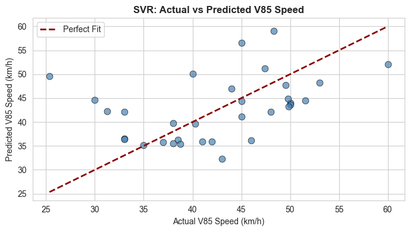
    


Residual Plot


```python
# SVR Residual Analysis

import matplotlib.pyplot as plt
import seaborn as sns

# Calculate residuals
svr_residuals = y_test - y_test_pred_svr

# Set plot style
sns.set_style("whitegrid")

plt.figure(figsize=(7, 4))

# Scatter plot
sns.scatterplot(
    x=y_test_pred_svr,
    y=svr_residuals,
    color="steelblue",
    s=60,
    alpha=0.7,
    edgecolor="black"
)

# Reference line at zero
plt.axhline(
    y=0,
    linestyle="--",
    color="darkred",
    linewidth=2
)

plt.xlabel("Predicted V85 Speed (km/h)")
plt.ylabel("Residuals (km/h)")

plt.title(
    "SVR: Residual Plot",
    fontsize=12,
    fontweight="bold"
)

plt.tight_layout()
plt.show()
```


    

    


    
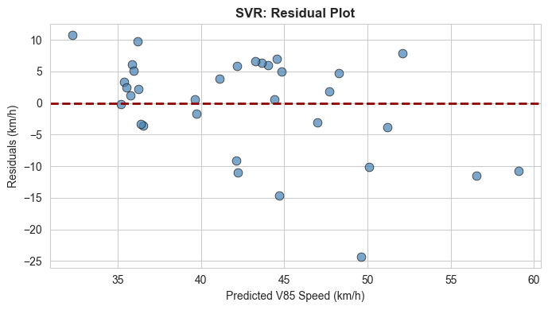
    


Result Table


```python
# Final SVR Performance Summary

svr_final = pd.DataFrame({
    "Model": ["SVR"],
    "R2": [round(svr_test_r2, 3)],
    "RMSE": [round(svr_test_rmse, 3)],
    "MAE": [round(svr_test_mae, 3)]
})

# Display results
display(svr_final)
```


<div>
<style scoped>
    .dataframe tbody tr th:only-of-type {
        vertical-align: middle;
    }

    .dataframe tbody tr th {
        vertical-align: top;
    }

    .dataframe thead th {
        text-align: right;
    }
</style>
<table border="1" class="dataframe">
  <thead>
    <tr style="text-align: right;">
      <th></th>
      <th>Model</th>
      <th>R2</th>
      <th>RMSE</th>
      <th>MAE</th>
    </tr>
  </thead>
  <tbody>
    <tr>
      <th>0</th>
      <td>SVR</td>
      <td>-0.067</td>
      <td>7.857</td>
      <td>6.19</td>
    </tr>
  </tbody>
</table>
</div>


<div>
<style scoped>
    .dataframe tbody tr th:only-of-type {
        vertical-align: middle;
    }

    .dataframe tbody tr th {
        vertical-align: top;
    }

    .dataframe thead th {
        text-align: right;
    }
</style>
<table border="1" class="dataframe">
  <thead>
    <tr style="text-align: right;">
      <th></th>
      <th>Model</th>
      <th>R2</th>
      <th>RMSE</th>
      <th>MAE</th>
    </tr>
  </thead>
  <tbody>
    <tr>
      <th>0</th>
      <td>SVR</td>
      <td>-0.067</td>
      <td>7.857</td>
      <td>6.19</td>
    </tr>
  </tbody>
</table>
</div>


Hyperparameter Tuned SVR Model


Hyperparameter Grid Definition


```python
# Hyperparameter Grid for SVR

param_grid_svr = {
    "svr__C": [1, 10, 100, 1000],
    "svr__epsilon": [0.01, 0.1, 0.5, 1],
    "svr__gamma": ["scale", 0.01, 0.1, 1],
    "svr__kernel": ["rbf"]
}
```

Grid Search Setup and Training


```python
# SVR Hyperparameter Tuning

from sklearn.model_selection import GridSearchCV
from sklearn.pipeline import Pipeline
from sklearn.preprocessing import StandardScaler
from sklearn.svm import SVR

# Create pipeline
svr_pipeline = Pipeline([
    ("scaler", StandardScaler()),
    ("svr", SVR())
])

# Grid Search
grid_svr = GridSearchCV(
    estimator=svr_pipeline,
    param_grid=param_grid_svr,
    cv=5,
    scoring="r2",
    n_jobs=-1,
    verbose=1
)

# Train using unscaled data (pipeline handles scaling)
grid_svr.fit(X_train, y_train)

print("Tuning completed")
print("Best Parameters:", grid_svr.best_params_)
print("Best CV Score:", round(grid_svr.best_score_, 3))
```

    Fitting 5 folds for each of 64 candidates, totalling 320 fits
    Tuning completed
    Best Parameters: {'svr__C': 100, 'svr__epsilon': 0.01, 'svr__gamma': 0.01, 'svr__kernel': 'rbf'}
    Best CV Score: 0.332
    Fitting 5 folds for each of 64 candidates, totalling 320 fits
    Tuning completed
    Best Parameters: {'svr__C': 100, 'svr__epsilon': 0.01, 'svr__gamma': 0.01, 'svr__kernel': 'rbf'}
    Best CV Score: 0.332
    

Best Model Extraction


```python
# Best Model Extraction

best_svr = grid_svr.best_estimator_

best_svr
```


<style>#sk-container-id-13 {
  /* Definition of color scheme common for light and dark mode */
  --sklearn-color-text: #000;
  --sklearn-color-text-muted: #666;
  --sklearn-color-line: gray;
  /* Definition of color scheme for unfitted estimators */
  --sklearn-color-unfitted-level-0: #fff5e6;
  --sklearn-color-unfitted-level-1: #f6e4d2;
  --sklearn-color-unfitted-level-2: #ffe0b3;
  --sklearn-color-unfitted-level-3: chocolate;
  /* Definition of color scheme for fitted estimators */
  --sklearn-color-fitted-level-0: #f0f8ff;
  --sklearn-color-fitted-level-1: #d4ebff;
  --sklearn-color-fitted-level-2: #b3dbfd;
  --sklearn-color-fitted-level-3: cornflowerblue;
}

#sk-container-id-13.light {
  /* Specific color for light theme */
  --sklearn-color-text-on-default-background: black;
  --sklearn-color-background: white;
  --sklearn-color-border-box: black;
  --sklearn-color-icon: #696969;
}

#sk-container-id-13.dark {
  --sklearn-color-text-on-default-background: white;
  --sklearn-color-background: #111;
  --sklearn-color-border-box: white;
  --sklearn-color-icon: #878787;
}

#sk-container-id-13 {
  color: var(--sklearn-color-text);
}

#sk-container-id-13 pre {
  padding: 0;
}

#sk-container-id-13 input.sk-hidden--visually {
  border: 0;
  clip: rect(1px 1px 1px 1px);
  clip: rect(1px, 1px, 1px, 1px);
  height: 1px;
  margin: -1px;
  overflow: hidden;
  padding: 0;
  position: absolute;
  width: 1px;
}

#sk-container-id-13 div.sk-dashed-wrapped {
  border: 1px dashed var(--sklearn-color-line);
  margin: 0 0.4em 0.5em 0.4em;
  box-sizing: border-box;
  padding-bottom: 0.4em;
  background-color: var(--sklearn-color-background);
}

#sk-container-id-13 div.sk-container {
  /* jupyter's `normalize.less` sets `[hidden] { display: none; }`
     but bootstrap.min.css set `[hidden] { display: none !important; }`
     so we also need the `!important` here to be able to override the
     default hidden behavior on the sphinx rendered scikit-learn.org.
     See: https://github.com/scikit-learn/scikit-learn/issues/21755 */
  display: inline-block !important;
  position: relative;
}

#sk-container-id-13 div.sk-text-repr-fallback {
  display: none;
}

div.sk-parallel-item,
div.sk-serial,
div.sk-item {
  /* draw centered vertical line to link estimators */
  background-image: linear-gradient(var(--sklearn-color-text-on-default-background), var(--sklearn-color-text-on-default-background));
  background-size: 2px 100%;
  background-repeat: no-repeat;
  background-position: center center;
}

/* Parallel-specific style estimator block */

#sk-container-id-13 div.sk-parallel-item::after {
  content: "";
  width: 100%;
  border-bottom: 2px solid var(--sklearn-color-text-on-default-background);
  flex-grow: 1;
}

#sk-container-id-13 div.sk-parallel {
  display: flex;
  align-items: stretch;
  justify-content: center;
  background-color: var(--sklearn-color-background);
  position: relative;
}

#sk-container-id-13 div.sk-parallel-item {
  display: flex;
  flex-direction: column;
}

#sk-container-id-13 div.sk-parallel-item:first-child::after {
  align-self: flex-end;
  width: 50%;
}

#sk-container-id-13 div.sk-parallel-item:last-child::after {
  align-self: flex-start;
  width: 50%;
}

#sk-container-id-13 div.sk-parallel-item:only-child::after {
  width: 0;
}

/* Serial-specific style estimator block */

#sk-container-id-13 div.sk-serial {
  display: flex;
  flex-direction: column;
  align-items: center;
  background-color: var(--sklearn-color-background);
  padding-right: 1em;
  padding-left: 1em;
}


/* Toggleable style: style used for estimator/Pipeline/ColumnTransformer box that is
clickable and can be expanded/collapsed.
- Pipeline and ColumnTransformer use this feature and define the default style
- Estimators will overwrite some part of the style using the `sk-estimator` class
*/

/* Pipeline and ColumnTransformer style (default) */

#sk-container-id-13 div.sk-toggleable {
  /* Default theme specific background. It is overwritten whether we have a
  specific estimator or a Pipeline/ColumnTransformer */
  background-color: var(--sklearn-color-background);
}

/* Toggleable label */
#sk-container-id-13 label.sk-toggleable__label {
  cursor: pointer;
  display: flex;
  width: 100%;
  margin-bottom: 0;
  padding: 0.5em;
  box-sizing: border-box;
  text-align: center;
  align-items: center;
  justify-content: center;
  gap: 0.5em;
}

#sk-container-id-13 label.sk-toggleable__label .caption {
  font-size: 0.6rem;
  font-weight: lighter;
  color: var(--sklearn-color-text-muted);
}

#sk-container-id-13 label.sk-toggleable__label-arrow:before {
  /* Arrow on the left of the label */
  content: "▸";
  float: left;
  margin-right: 0.25em;
  color: var(--sklearn-color-icon);
}

#sk-container-id-13 label.sk-toggleable__label-arrow:hover:before {
  color: var(--sklearn-color-text);
}

/* Toggleable content - dropdown */

#sk-container-id-13 div.sk-toggleable__content {
  display: none;
  text-align: left;
  /* unfitted */
  background-color: var(--sklearn-color-unfitted-level-0);
}

#sk-container-id-13 div.sk-toggleable__content.fitted {
  /* fitted */
  background-color: var(--sklearn-color-fitted-level-0);
}

#sk-container-id-13 div.sk-toggleable__content pre {
  margin: 0.2em;
  border-radius: 0.25em;
  color: var(--sklearn-color-text);
  /* unfitted */
  background-color: var(--sklearn-color-unfitted-level-0);
}

#sk-container-id-13 div.sk-toggleable__content.fitted pre {
  /* unfitted */
  background-color: var(--sklearn-color-fitted-level-0);
}

#sk-container-id-13 input.sk-toggleable__control:checked~div.sk-toggleable__content {
  /* Expand drop-down */
  display: block;
  width: 100%;
  overflow: visible;
}

#sk-container-id-13 input.sk-toggleable__control:checked~label.sk-toggleable__label-arrow:before {
  content: "▾";
}

/* Pipeline/ColumnTransformer-specific style */

#sk-container-id-13 div.sk-label input.sk-toggleable__control:checked~label.sk-toggleable__label {
  color: var(--sklearn-color-text);
  background-color: var(--sklearn-color-unfitted-level-2);
}

#sk-container-id-13 div.sk-label.fitted input.sk-toggleable__control:checked~label.sk-toggleable__label {
  background-color: var(--sklearn-color-fitted-level-2);
}

/* Estimator-specific style */

/* Colorize estimator box */
#sk-container-id-13 div.sk-estimator input.sk-toggleable__control:checked~label.sk-toggleable__label {
  /* unfitted */
  background-color: var(--sklearn-color-unfitted-level-2);
}

#sk-container-id-13 div.sk-estimator.fitted input.sk-toggleable__control:checked~label.sk-toggleable__label {
  /* fitted */
  background-color: var(--sklearn-color-fitted-level-2);
}

#sk-container-id-13 div.sk-label label.sk-toggleable__label,
#sk-container-id-13 div.sk-label label {
  /* The background is the default theme color */
  color: var(--sklearn-color-text-on-default-background);
}

/* On hover, darken the color of the background */
#sk-container-id-13 div.sk-label:hover label.sk-toggleable__label {
  color: var(--sklearn-color-text);
  background-color: var(--sklearn-color-unfitted-level-2);
}

/* Label box, darken color on hover, fitted */
#sk-container-id-13 div.sk-label.fitted:hover label.sk-toggleable__label.fitted {
  color: var(--sklearn-color-text);
  background-color: var(--sklearn-color-fitted-level-2);
}

/* Estimator label */

#sk-container-id-13 div.sk-label label {
  font-family: monospace;
  font-weight: bold;
  line-height: 1.2em;
}

#sk-container-id-13 div.sk-label-container {
  text-align: center;
}

/* Estimator-specific */
#sk-container-id-13 div.sk-estimator {
  font-family: monospace;
  border: 1px dotted var(--sklearn-color-border-box);
  border-radius: 0.25em;
  box-sizing: border-box;
  margin-bottom: 0.5em;
  /* unfitted */
  background-color: var(--sklearn-color-unfitted-level-0);
}

#sk-container-id-13 div.sk-estimator.fitted {
  /* fitted */
  background-color: var(--sklearn-color-fitted-level-0);
}

/* on hover */
#sk-container-id-13 div.sk-estimator:hover {
  /* unfitted */
  background-color: var(--sklearn-color-unfitted-level-2);
}

#sk-container-id-13 div.sk-estimator.fitted:hover {
  /* fitted */
  background-color: var(--sklearn-color-fitted-level-2);
}

/* Specification for estimator info (e.g. "i" and "?") */

/* Common style for "i" and "?" */

.sk-estimator-doc-link,
a:link.sk-estimator-doc-link,
a:visited.sk-estimator-doc-link {
  float: right;
  font-size: smaller;
  line-height: 1em;
  font-family: monospace;
  background-color: var(--sklearn-color-unfitted-level-0);
  border-radius: 1em;
  height: 1em;
  width: 1em;
  text-decoration: none !important;
  margin-left: 0.5em;
  text-align: center;
  /* unfitted */
  border: var(--sklearn-color-unfitted-level-3) 1pt solid;
  color: var(--sklearn-color-unfitted-level-3);
}

.sk-estimator-doc-link.fitted,
a:link.sk-estimator-doc-link.fitted,
a:visited.sk-estimator-doc-link.fitted {
  /* fitted */
  background-color: var(--sklearn-color-fitted-level-0);
  border: var(--sklearn-color-fitted-level-3) 1pt solid;
  color: var(--sklearn-color-fitted-level-3);
}

/* On hover */
div.sk-estimator:hover .sk-estimator-doc-link:hover,
.sk-estimator-doc-link:hover,
div.sk-label-container:hover .sk-estimator-doc-link:hover,
.sk-estimator-doc-link:hover {
  /* unfitted */
  background-color: var(--sklearn-color-unfitted-level-3);
  border: var(--sklearn-color-fitted-level-0) 1pt solid;
  color: var(--sklearn-color-unfitted-level-0);
  text-decoration: none;
}

div.sk-estimator.fitted:hover .sk-estimator-doc-link.fitted:hover,
.sk-estimator-doc-link.fitted:hover,
div.sk-label-container:hover .sk-estimator-doc-link.fitted:hover,
.sk-estimator-doc-link.fitted:hover {
  /* fitted */
  background-color: var(--sklearn-color-fitted-level-3);
  border: var(--sklearn-color-fitted-level-0) 1pt solid;
  color: var(--sklearn-color-fitted-level-0);
  text-decoration: none;
}

/* Span, style for the box shown on hovering the info icon */
.sk-estimator-doc-link span {
  display: none;
  z-index: 9999;
  position: relative;
  font-weight: normal;
  right: .2ex;
  padding: .5ex;
  margin: .5ex;
  width: min-content;
  min-width: 20ex;
  max-width: 50ex;
  color: var(--sklearn-color-text);
  box-shadow: 2pt 2pt 4pt #999;
  /* unfitted */
  background: var(--sklearn-color-unfitted-level-0);
  border: .5pt solid var(--sklearn-color-unfitted-level-3);
}

.sk-estimator-doc-link.fitted span {
  /* fitted */
  background: var(--sklearn-color-fitted-level-0);
  border: var(--sklearn-color-fitted-level-3);
}

.sk-estimator-doc-link:hover span {
  display: block;
}

/* "?"-specific style due to the `<a>` HTML tag */

#sk-container-id-13 a.estimator_doc_link {
  float: right;
  font-size: 1rem;
  line-height: 1em;
  font-family: monospace;
  background-color: var(--sklearn-color-unfitted-level-0);
  border-radius: 1rem;
  height: 1rem;
  width: 1rem;
  text-decoration: none;
  /* unfitted */
  color: var(--sklearn-color-unfitted-level-1);
  border: var(--sklearn-color-unfitted-level-1) 1pt solid;
}

#sk-container-id-13 a.estimator_doc_link.fitted {
  /* fitted */
  background-color: var(--sklearn-color-fitted-level-0);
  border: var(--sklearn-color-fitted-level-1) 1pt solid;
  color: var(--sklearn-color-fitted-level-1);
}

/* On hover */
#sk-container-id-13 a.estimator_doc_link:hover {
  /* unfitted */
  background-color: var(--sklearn-color-unfitted-level-3);
  color: var(--sklearn-color-background);
  text-decoration: none;
}

#sk-container-id-13 a.estimator_doc_link.fitted:hover {
  /* fitted */
  background-color: var(--sklearn-color-fitted-level-3);
}

.estimator-table {
    font-family: monospace;
}

.estimator-table summary {
    padding: .5rem;
    cursor: pointer;
}

.estimator-table summary::marker {
    font-size: 0.7rem;
}

.estimator-table details[open] {
    padding-left: 0.1rem;
    padding-right: 0.1rem;
    padding-bottom: 0.3rem;
}

.estimator-table .parameters-table {
    margin-left: auto !important;
    margin-right: auto !important;
    margin-top: 0;
}

.estimator-table .parameters-table tr:nth-child(odd) {
    background-color: #fff;
}

.estimator-table .parameters-table tr:nth-child(even) {
    background-color: #f6f6f6;
}

.estimator-table .parameters-table tr:hover {
    background-color: #e0e0e0;
}

.estimator-table table td {
    border: 1px solid rgba(106, 105, 104, 0.232);
}

/*
    `table td`is set in notebook with right text-align.
    We need to overwrite it.
*/
.estimator-table table td.param {
    text-align: left;
    position: relative;
    padding: 0;
}

.user-set td {
    color:rgb(255, 94, 0);
    text-align: left !important;
}

.user-set td.value {
    color:rgb(255, 94, 0);
    background-color: transparent;
}

.default td {
    color: black;
    text-align: left !important;
}

.user-set td i,
.default td i {
    color: black;
}

/*
    Styles for parameter documentation links
    We need styling for visited so jupyter doesn't overwrite it
*/
a.param-doc-link,
a.param-doc-link:link,
a.param-doc-link:visited {
    text-decoration: underline dashed;
    text-underline-offset: .3em;
    color: inherit;
    display: block;
    padding: .5em;
}

/* "hack" to make the entire area of the cell containing the link clickable */
a.param-doc-link::before {
    position: absolute;
    content: "";
    inset: 0;
}

.param-doc-description {
    display: none;
    position: absolute;
    z-index: 9999;
    left: 0;
    padding: .5ex;
    margin-left: 1.5em;
    color: var(--sklearn-color-text);
    box-shadow: .3em .3em .4em #999;
    width: max-content;
    text-align: left;
    max-height: 10em;
    overflow-y: auto;

    /* unfitted */
    background: var(--sklearn-color-unfitted-level-0);
    border: thin solid var(--sklearn-color-unfitted-level-3);
}

/* Fitted state for parameter tooltips */
.fitted .param-doc-description {
    /* fitted */
    background: var(--sklearn-color-fitted-level-0);
    border: thin solid var(--sklearn-color-fitted-level-3);
}

.param-doc-link:hover .param-doc-description {
    display: block;
}

.copy-paste-icon {
    background-image: url();
    background-repeat: no-repeat;
    background-size: 14px 14px;
    background-position: 0;
    display: inline-block;
    width: 14px;
    height: 14px;
    cursor: pointer;
}
</style><body><div id="sk-container-id-13" class="sk-top-container"><div class="sk-text-repr-fallback"><pre>Pipeline(steps=[(&#x27;scaler&#x27;, StandardScaler()),
                (&#x27;svr&#x27;, SVR(C=100, epsilon=0.01, gamma=0.01))])</pre><b>In a Jupyter environment, please rerun this cell to show the HTML representation or trust the notebook. <br />On GitHub, the HTML representation is unable to render, please try loading this page with nbviewer.org.</b></div><div class="sk-container" hidden><div class="sk-item sk-dashed-wrapped"><div class="sk-label-container"><div class="sk-label fitted sk-toggleable"><input class="sk-toggleable__control sk-hidden--visually" id="sk-estimator-id-13" type="checkbox" ><label for="sk-estimator-id-13" class="sk-toggleable__label fitted sk-toggleable__label-arrow"><div><div>Pipeline</div></div><div><a class="sk-estimator-doc-link fitted" rel="noreferrer" target="_blank" href="https://scikit-learn.org/1.8/modules/generated/sklearn.pipeline.Pipeline.html">?<span>Documentation for Pipeline</span></a><span class="sk-estimator-doc-link fitted">i<span>Fitted</span></span></div></label><div class="sk-toggleable__content fitted" data-param-prefix="">
        <div class="estimator-table">
            <details>
                <summary>Parameters</summary>
                <table class="parameters-table">
                  <tbody>

        <tr class="user-set">
            <td><i class="copy-paste-icon"
                 onclick="copyToClipboard('steps',
                          this.parentElement.nextElementSibling)"
            ></i></td>
            <td class="param">
        <a class="param-doc-link"
            rel="noreferrer" target="_blank" href="https://scikit-learn.org/1.8/modules/generated/sklearn.pipeline.Pipeline.html#:~:text=steps,-list%20of%20tuples">
            steps
            <span class="param-doc-description">steps: list of tuples<br><br>List of (name of step, estimator) tuples that are to be chained in<br>sequential order. To be compatible with the scikit-learn API, all steps<br>must define `fit`. All non-last steps must also define `transform`. See<br>:ref:`Combining Estimators <combining_estimators>` for more details.</span>
        </a>
    </td>
            <td class="value">[(&#x27;scaler&#x27;, ...), (&#x27;svr&#x27;, ...)]</td>
        </tr>


        <tr class="default">
            <td><i class="copy-paste-icon"
                 onclick="copyToClipboard('transform_input',
                          this.parentElement.nextElementSibling)"
            ></i></td>
            <td class="param">
        <a class="param-doc-link"
            rel="noreferrer" target="_blank" href="https://scikit-learn.org/1.8/modules/generated/sklearn.pipeline.Pipeline.html#:~:text=transform_input,-list%20of%20str%2C%20default%3DNone">
            transform_input
            <span class="param-doc-description">transform_input: list of str, default=None<br><br>The names of the :term:`metadata` parameters that should be transformed by the<br>pipeline before passing it to the step consuming it.<br><br>This enables transforming some input arguments to ``fit`` (other than ``X``)<br>to be transformed by the steps of the pipeline up to the step which requires<br>them. Requirement is defined via :ref:`metadata routing <metadata_routing>`.<br>For instance, this can be used to pass a validation set through the pipeline.<br><br>You can only set this if metadata routing is enabled, which you<br>can enable using ``sklearn.set_config(enable_metadata_routing=True)``.<br><br>.. versionadded:: 1.6</span>
        </a>
    </td>
            <td class="value">None</td>
        </tr>


        <tr class="default">
            <td><i class="copy-paste-icon"
                 onclick="copyToClipboard('memory',
                          this.parentElement.nextElementSibling)"
            ></i></td>
            <td class="param">
        <a class="param-doc-link"
            rel="noreferrer" target="_blank" href="https://scikit-learn.org/1.8/modules/generated/sklearn.pipeline.Pipeline.html#:~:text=memory,-str%20or%20object%20with%20the%20joblib.Memory%20interface%2C%20default%3DNone">
            memory
            <span class="param-doc-description">memory: str or object with the joblib.Memory interface, default=None<br><br>Used to cache the fitted transformers of the pipeline. The last step<br>will never be cached, even if it is a transformer. By default, no<br>caching is performed. If a string is given, it is the path to the<br>caching directory. Enabling caching triggers a clone of the transformers<br>before fitting. Therefore, the transformer instance given to the<br>pipeline cannot be inspected directly. Use the attribute ``named_steps``<br>or ``steps`` to inspect estimators within the pipeline. Caching the<br>transformers is advantageous when fitting is time consuming. See<br>:ref:`sphx_glr_auto_examples_neighbors_plot_caching_nearest_neighbors.py`<br>for an example on how to enable caching.</span>
        </a>
    </td>
            <td class="value">None</td>
        </tr>


        <tr class="default">
            <td><i class="copy-paste-icon"
                 onclick="copyToClipboard('verbose',
                          this.parentElement.nextElementSibling)"
            ></i></td>
            <td class="param">
        <a class="param-doc-link"
            rel="noreferrer" target="_blank" href="https://scikit-learn.org/1.8/modules/generated/sklearn.pipeline.Pipeline.html#:~:text=verbose,-bool%2C%20default%3DFalse">
            verbose
            <span class="param-doc-description">verbose: bool, default=False<br><br>If True, the time elapsed while fitting each step will be printed as it<br>is completed.</span>
        </a>
    </td>
            <td class="value">False</td>
        </tr>

                  </tbody>
                </table>
            </details>
        </div>
    </div></div></div><div class="sk-serial"><div class="sk-item"><div class="sk-estimator fitted sk-toggleable"><input class="sk-toggleable__control sk-hidden--visually" id="sk-estimator-id-14" type="checkbox" ><label for="sk-estimator-id-14" class="sk-toggleable__label fitted sk-toggleable__label-arrow"><div><div>StandardScaler</div></div><div><a class="sk-estimator-doc-link fitted" rel="noreferrer" target="_blank" href="https://scikit-learn.org/1.8/modules/generated/sklearn.preprocessing.StandardScaler.html">?<span>Documentation for StandardScaler</span></a></div></label><div class="sk-toggleable__content fitted" data-param-prefix="scaler__">
        <div class="estimator-table">
            <details>
                <summary>Parameters</summary>
                <table class="parameters-table">
                  <tbody>

        <tr class="default">
            <td><i class="copy-paste-icon"
                 onclick="copyToClipboard('copy',
                          this.parentElement.nextElementSibling)"
            ></i></td>
            <td class="param">
        <a class="param-doc-link"
            rel="noreferrer" target="_blank" href="https://scikit-learn.org/1.8/modules/generated/sklearn.preprocessing.StandardScaler.html#:~:text=copy,-bool%2C%20default%3DTrue">
            copy
            <span class="param-doc-description">copy: bool, default=True<br><br>If False, try to avoid a copy and do inplace scaling instead.<br>This is not guaranteed to always work inplace; e.g. if the data is<br>not a NumPy array or scipy.sparse CSR matrix, a copy may still be<br>returned.</span>
        </a>
    </td>
            <td class="value">True</td>
        </tr>


        <tr class="default">
            <td><i class="copy-paste-icon"
                 onclick="copyToClipboard('with_mean',
                          this.parentElement.nextElementSibling)"
            ></i></td>
            <td class="param">
        <a class="param-doc-link"
            rel="noreferrer" target="_blank" href="https://scikit-learn.org/1.8/modules/generated/sklearn.preprocessing.StandardScaler.html#:~:text=with_mean,-bool%2C%20default%3DTrue">
            with_mean
            <span class="param-doc-description">with_mean: bool, default=True<br><br>If True, center the data before scaling.<br>This does not work (and will raise an exception) when attempted on<br>sparse matrices, because centering them entails building a dense<br>matrix which in common use cases is likely to be too large to fit in<br>memory.</span>
        </a>
    </td>
            <td class="value">True</td>
        </tr>


        <tr class="default">
            <td><i class="copy-paste-icon"
                 onclick="copyToClipboard('with_std',
                          this.parentElement.nextElementSibling)"
            ></i></td>
            <td class="param">
        <a class="param-doc-link"
            rel="noreferrer" target="_blank" href="https://scikit-learn.org/1.8/modules/generated/sklearn.preprocessing.StandardScaler.html#:~:text=with_std,-bool%2C%20default%3DTrue">
            with_std
            <span class="param-doc-description">with_std: bool, default=True<br><br>If True, scale the data to unit variance (or equivalently,<br>unit standard deviation).</span>
        </a>
    </td>
            <td class="value">True</td>
        </tr>

                  </tbody>
                </table>
            </details>
        </div>
    </div></div></div><div class="sk-item"><div class="sk-estimator fitted sk-toggleable"><input class="sk-toggleable__control sk-hidden--visually" id="sk-estimator-id-15" type="checkbox" ><label for="sk-estimator-id-15" class="sk-toggleable__label fitted sk-toggleable__label-arrow"><div><div>SVR</div></div><div><a class="sk-estimator-doc-link fitted" rel="noreferrer" target="_blank" href="https://scikit-learn.org/1.8/modules/generated/sklearn.svm.SVR.html">?<span>Documentation for SVR</span></a></div></label><div class="sk-toggleable__content fitted" data-param-prefix="svr__">
        <div class="estimator-table">
            <details>
                <summary>Parameters</summary>
                <table class="parameters-table">
                  <tbody>

        <tr class="default">
            <td><i class="copy-paste-icon"
                 onclick="copyToClipboard('kernel',
                          this.parentElement.nextElementSibling)"
            ></i></td>
            <td class="param">
        <a class="param-doc-link"
            rel="noreferrer" target="_blank" href="https://scikit-learn.org/1.8/modules/generated/sklearn.svm.SVR.html#:~:text=kernel,-%7B%27linear%27%2C%20%27poly%27%2C%20%27rbf%27%2C%20%27sigmoid%27%2C%20%27precomputed%27%7D%20or%20callable%2C%20%20%20%20%20%20%20%20%20%20default%3D%27rbf%27">
            kernel
            <span class="param-doc-description">kernel: {'linear', 'poly', 'rbf', 'sigmoid', 'precomputed'} or callable,          default='rbf'<br><br>Specifies the kernel type to be used in the algorithm.<br>If none is given, 'rbf' will be used. If a callable is given it is<br>used to precompute the kernel matrix.<br>For an intuitive visualization of different kernel types<br>see :ref:`sphx_glr_auto_examples_svm_plot_svm_regression.py`</span>
        </a>
    </td>
            <td class="value">&#x27;rbf&#x27;</td>
        </tr>


        <tr class="default">
            <td><i class="copy-paste-icon"
                 onclick="copyToClipboard('degree',
                          this.parentElement.nextElementSibling)"
            ></i></td>
            <td class="param">
        <a class="param-doc-link"
            rel="noreferrer" target="_blank" href="https://scikit-learn.org/1.8/modules/generated/sklearn.svm.SVR.html#:~:text=degree,-int%2C%20default%3D3">
            degree
            <span class="param-doc-description">degree: int, default=3<br><br>Degree of the polynomial kernel function ('poly').<br>Must be non-negative. Ignored by all other kernels.</span>
        </a>
    </td>
            <td class="value">3</td>
        </tr>


        <tr class="user-set">
            <td><i class="copy-paste-icon"
                 onclick="copyToClipboard('gamma',
                          this.parentElement.nextElementSibling)"
            ></i></td>
            <td class="param">
        <a class="param-doc-link"
            rel="noreferrer" target="_blank" href="https://scikit-learn.org/1.8/modules/generated/sklearn.svm.SVR.html#:~:text=gamma,-%7B%27scale%27%2C%20%27auto%27%7D%20or%20float%2C%20default%3D%27scale%27">
            gamma
            <span class="param-doc-description">gamma: {'scale', 'auto'} or float, default='scale'<br><br>Kernel coefficient for 'rbf', 'poly' and 'sigmoid'.<br><br>- if ``gamma='scale'`` (default) is passed then it uses<br>  1 / (n_features * X.var()) as value of gamma,<br>- if 'auto', uses 1 / n_features<br>- if float, must be non-negative.<br><br>.. versionchanged:: 0.22<br>   The default value of ``gamma`` changed from 'auto' to 'scale'.</span>
        </a>
    </td>
            <td class="value">0.01</td>
        </tr>


        <tr class="default">
            <td><i class="copy-paste-icon"
                 onclick="copyToClipboard('coef0',
                          this.parentElement.nextElementSibling)"
            ></i></td>
            <td class="param">
        <a class="param-doc-link"
            rel="noreferrer" target="_blank" href="https://scikit-learn.org/1.8/modules/generated/sklearn.svm.SVR.html#:~:text=coef0,-float%2C%20default%3D0.0">
            coef0
            <span class="param-doc-description">coef0: float, default=0.0<br><br>Independent term in kernel function.<br>It is only significant in 'poly' and 'sigmoid'.</span>
        </a>
    </td>
            <td class="value">0.0</td>
        </tr>


        <tr class="default">
            <td><i class="copy-paste-icon"
                 onclick="copyToClipboard('tol',
                          this.parentElement.nextElementSibling)"
            ></i></td>
            <td class="param">
        <a class="param-doc-link"
            rel="noreferrer" target="_blank" href="https://scikit-learn.org/1.8/modules/generated/sklearn.svm.SVR.html#:~:text=tol,-float%2C%20default%3D1e-3">
            tol
            <span class="param-doc-description">tol: float, default=1e-3<br><br>Tolerance for stopping criterion.</span>
        </a>
    </td>
            <td class="value">0.001</td>
        </tr>


        <tr class="user-set">
            <td><i class="copy-paste-icon"
                 onclick="copyToClipboard('C',
                          this.parentElement.nextElementSibling)"
            ></i></td>
            <td class="param">
        <a class="param-doc-link"
            rel="noreferrer" target="_blank" href="https://scikit-learn.org/1.8/modules/generated/sklearn.svm.SVR.html#:~:text=C,-float%2C%20default%3D1.0">
            C
            <span class="param-doc-description">C: float, default=1.0<br><br>Regularization parameter. The strength of the regularization is<br>inversely proportional to C. Must be strictly positive.<br>The penalty is a squared l2. For an intuitive visualization of the<br>effects of scaling the regularization parameter C, see<br>:ref:`sphx_glr_auto_examples_svm_plot_svm_scale_c.py`.</span>
        </a>
    </td>
            <td class="value">100</td>
        </tr>


        <tr class="user-set">
            <td><i class="copy-paste-icon"
                 onclick="copyToClipboard('epsilon',
                          this.parentElement.nextElementSibling)"
            ></i></td>
            <td class="param">
        <a class="param-doc-link"
            rel="noreferrer" target="_blank" href="https://scikit-learn.org/1.8/modules/generated/sklearn.svm.SVR.html#:~:text=epsilon,-float%2C%20default%3D0.1">
            epsilon
            <span class="param-doc-description">epsilon: float, default=0.1<br><br>Epsilon in the epsilon-SVR model. It specifies the epsilon-tube<br>within which no penalty is associated in the training loss function<br>with points predicted within a distance epsilon from the actual<br>value. Must be non-negative.</span>
        </a>
    </td>
            <td class="value">0.01</td>
        </tr>


        <tr class="default">
            <td><i class="copy-paste-icon"
                 onclick="copyToClipboard('shrinking',
                          this.parentElement.nextElementSibling)"
            ></i></td>
            <td class="param">
        <a class="param-doc-link"
            rel="noreferrer" target="_blank" href="https://scikit-learn.org/1.8/modules/generated/sklearn.svm.SVR.html#:~:text=shrinking,-bool%2C%20default%3DTrue">
            shrinking
            <span class="param-doc-description">shrinking: bool, default=True<br><br>Whether to use the shrinking heuristic.<br>See the :ref:`User Guide <shrinking_svm>`.</span>
        </a>
    </td>
            <td class="value">True</td>
        </tr>


        <tr class="default">
            <td><i class="copy-paste-icon"
                 onclick="copyToClipboard('cache_size',
                          this.parentElement.nextElementSibling)"
            ></i></td>
            <td class="param">
        <a class="param-doc-link"
            rel="noreferrer" target="_blank" href="https://scikit-learn.org/1.8/modules/generated/sklearn.svm.SVR.html#:~:text=cache_size,-float%2C%20default%3D200">
            cache_size
            <span class="param-doc-description">cache_size: float, default=200<br><br>Specify the size of the kernel cache (in MB).</span>
        </a>
    </td>
            <td class="value">200</td>
        </tr>


        <tr class="default">
            <td><i class="copy-paste-icon"
                 onclick="copyToClipboard('verbose',
                          this.parentElement.nextElementSibling)"
            ></i></td>
            <td class="param">
        <a class="param-doc-link"
            rel="noreferrer" target="_blank" href="https://scikit-learn.org/1.8/modules/generated/sklearn.svm.SVR.html#:~:text=verbose,-bool%2C%20default%3DFalse">
            verbose
            <span class="param-doc-description">verbose: bool, default=False<br><br>Enable verbose output. Note that this setting takes advantage of a<br>per-process runtime setting in libsvm that, if enabled, may not work<br>properly in a multithreaded context.</span>
        </a>
    </td>
            <td class="value">False</td>
        </tr>


        <tr class="default">
            <td><i class="copy-paste-icon"
                 onclick="copyToClipboard('max_iter',
                          this.parentElement.nextElementSibling)"
            ></i></td>
            <td class="param">
        <a class="param-doc-link"
            rel="noreferrer" target="_blank" href="https://scikit-learn.org/1.8/modules/generated/sklearn.svm.SVR.html#:~:text=max_iter,-int%2C%20default%3D-1">
            max_iter
            <span class="param-doc-description">max_iter: int, default=-1<br><br>Hard limit on iterations within solver, or -1 for no limit.</span>
        </a>
    </td>
            <td class="value">-1</td>
        </tr>

                  </tbody>
                </table>
            </details>
        </div>
    </div></div></div></div></div></div></div><script>function copyToClipboard(text, element) {
    // Get the parameter prefix from the closest toggleable content
    const toggleableContent = element.closest('.sk-toggleable__content');
    const paramPrefix = toggleableContent ? toggleableContent.dataset.paramPrefix : '';
    const fullParamName = paramPrefix ? `${paramPrefix}${text}` : text;

    const originalStyle = element.style;
    const computedStyle = window.getComputedStyle(element);
    const originalWidth = computedStyle.width;
    const originalHTML = element.innerHTML.replace('Copied!', '');

    navigator.clipboard.writeText(fullParamName)
        .then(() => {
            element.style.width = originalWidth;
            element.style.color = 'green';
            element.innerHTML = "Copied!";

            setTimeout(() => {
                element.innerHTML = originalHTML;
                element.style = originalStyle;
            }, 2000);
        })
        .catch(err => {
            console.error('Failed to copy:', err);
            element.style.color = 'red';
            element.innerHTML = "Failed!";
            setTimeout(() => {
                element.innerHTML = originalHTML;
                element.style = originalStyle;
            }, 2000);
        });
    return false;
}

document.querySelectorAll('.copy-paste-icon').forEach(function(element) {
    const toggleableContent = element.closest('.sk-toggleable__content');
    const paramPrefix = toggleableContent ? toggleableContent.dataset.paramPrefix : '';
    const paramName = element.parentElement.nextElementSibling
        .textContent.trim().split(' ')[0];
    const fullParamName = paramPrefix ? `${paramPrefix}${paramName}` : paramName;

    element.setAttribute('title', fullParamName);
});


/**
 * Adapted from Skrub
 * https://github.com/skrub-data/skrub/blob/403466d1d5d4dc76a7ef569b3f8228db59a31dc3/skrub/_reporting/_data/templates/report.js#L789
 * @returns "light" or "dark"
 */
function detectTheme(element) {
    const body = document.querySelector('body');

    // Check VSCode theme
    const themeKindAttr = body.getAttribute('data-vscode-theme-kind');
    const themeNameAttr = body.getAttribute('data-vscode-theme-name');

    if (themeKindAttr && themeNameAttr) {
        const themeKind = themeKindAttr.toLowerCase();
        const themeName = themeNameAttr.toLowerCase();

        if (themeKind.includes("dark") || themeName.includes("dark")) {
            return "dark";
        }
        if (themeKind.includes("light") || themeName.includes("light")) {
            return "light";
        }
    }

    // Check Jupyter theme
    if (body.getAttribute('data-jp-theme-light') === 'false') {
        return 'dark';
    } else if (body.getAttribute('data-jp-theme-light') === 'true') {
        return 'light';
    }

    // Guess based on a parent element's color
    const color = window.getComputedStyle(element.parentNode, null).getPropertyValue('color');
    const match = color.match(/^rgb\s*\(\s*(\d+)\s*,\s*(\d+)\s*,\s*(\d+)\s*\)\s*$/i);
    if (match) {
        const [r, g, b] = [
            parseFloat(match[1]),
            parseFloat(match[2]),
            parseFloat(match[3])
        ];

        // https://en.wikipedia.org/wiki/HSL_and_HSV#Lightness
        const luma = 0.299 * r + 0.587 * g + 0.114 * b;

        if (luma > 180) {
            // If the text is very bright we have a dark theme
            return 'dark';
        }
        if (luma < 75) {
            // If the text is very dark we have a light theme
            return 'light';
        }
        // Otherwise fall back to the next heuristic.
    }

    // Fallback to system preference
    return window.matchMedia('(prefers-color-scheme: dark)').matches ? 'dark' : 'light';
}


function forceTheme(elementId) {
    const estimatorElement = document.querySelector(`#${elementId}`);
    if (estimatorElement === null) {
        console.error(`Element with id ${elementId} not found.`);
    } else {
        const theme = detectTheme(estimatorElement);
        estimatorElement.classList.add(theme);
    }
}

forceTheme('sk-container-id-13');</script></body>


<style>#sk-container-id-14 {
  /* Definition of color scheme common for light and dark mode */
  --sklearn-color-text: #000;
  --sklearn-color-text-muted: #666;
  --sklearn-color-line: gray;
  /* Definition of color scheme for unfitted estimators */
  --sklearn-color-unfitted-level-0: #fff5e6;
  --sklearn-color-unfitted-level-1: #f6e4d2;
  --sklearn-color-unfitted-level-2: #ffe0b3;
  --sklearn-color-unfitted-level-3: chocolate;
  /* Definition of color scheme for fitted estimators */
  --sklearn-color-fitted-level-0: #f0f8ff;
  --sklearn-color-fitted-level-1: #d4ebff;
  --sklearn-color-fitted-level-2: #b3dbfd;
  --sklearn-color-fitted-level-3: cornflowerblue;
}

#sk-container-id-14.light {
  /* Specific color for light theme */
  --sklearn-color-text-on-default-background: black;
  --sklearn-color-background: white;
  --sklearn-color-border-box: black;
  --sklearn-color-icon: #696969;
}

#sk-container-id-14.dark {
  --sklearn-color-text-on-default-background: white;
  --sklearn-color-background: #111;
  --sklearn-color-border-box: white;
  --sklearn-color-icon: #878787;
}

#sk-container-id-14 {
  color: var(--sklearn-color-text);
}

#sk-container-id-14 pre {
  padding: 0;
}

#sk-container-id-14 input.sk-hidden--visually {
  border: 0;
  clip: rect(1px 1px 1px 1px);
  clip: rect(1px, 1px, 1px, 1px);
  height: 1px;
  margin: -1px;
  overflow: hidden;
  padding: 0;
  position: absolute;
  width: 1px;
}

#sk-container-id-14 div.sk-dashed-wrapped {
  border: 1px dashed var(--sklearn-color-line);
  margin: 0 0.4em 0.5em 0.4em;
  box-sizing: border-box;
  padding-bottom: 0.4em;
  background-color: var(--sklearn-color-background);
}

#sk-container-id-14 div.sk-container {
  /* jupyter's `normalize.less` sets `[hidden] { display: none; }`
     but bootstrap.min.css set `[hidden] { display: none !important; }`
     so we also need the `!important` here to be able to override the
     default hidden behavior on the sphinx rendered scikit-learn.org.
     See: https://github.com/scikit-learn/scikit-learn/issues/21755 */
  display: inline-block !important;
  position: relative;
}

#sk-container-id-14 div.sk-text-repr-fallback {
  display: none;
}

div.sk-parallel-item,
div.sk-serial,
div.sk-item {
  /* draw centered vertical line to link estimators */
  background-image: linear-gradient(var(--sklearn-color-text-on-default-background), var(--sklearn-color-text-on-default-background));
  background-size: 2px 100%;
  background-repeat: no-repeat;
  background-position: center center;
}

/* Parallel-specific style estimator block */

#sk-container-id-14 div.sk-parallel-item::after {
  content: "";
  width: 100%;
  border-bottom: 2px solid var(--sklearn-color-text-on-default-background);
  flex-grow: 1;
}

#sk-container-id-14 div.sk-parallel {
  display: flex;
  align-items: stretch;
  justify-content: center;
  background-color: var(--sklearn-color-background);
  position: relative;
}

#sk-container-id-14 div.sk-parallel-item {
  display: flex;
  flex-direction: column;
}

#sk-container-id-14 div.sk-parallel-item:first-child::after {
  align-self: flex-end;
  width: 50%;
}

#sk-container-id-14 div.sk-parallel-item:last-child::after {
  align-self: flex-start;
  width: 50%;
}

#sk-container-id-14 div.sk-parallel-item:only-child::after {
  width: 0;
}

/* Serial-specific style estimator block */

#sk-container-id-14 div.sk-serial {
  display: flex;
  flex-direction: column;
  align-items: center;
  background-color: var(--sklearn-color-background);
  padding-right: 1em;
  padding-left: 1em;
}


/* Toggleable style: style used for estimator/Pipeline/ColumnTransformer box that is
clickable and can be expanded/collapsed.
- Pipeline and ColumnTransformer use this feature and define the default style
- Estimators will overwrite some part of the style using the `sk-estimator` class
*/

/* Pipeline and ColumnTransformer style (default) */

#sk-container-id-14 div.sk-toggleable {
  /* Default theme specific background. It is overwritten whether we have a
  specific estimator or a Pipeline/ColumnTransformer */
  background-color: var(--sklearn-color-background);
}

/* Toggleable label */
#sk-container-id-14 label.sk-toggleable__label {
  cursor: pointer;
  display: flex;
  width: 100%;
  margin-bottom: 0;
  padding: 0.5em;
  box-sizing: border-box;
  text-align: center;
  align-items: center;
  justify-content: center;
  gap: 0.5em;
}

#sk-container-id-14 label.sk-toggleable__label .caption {
  font-size: 0.6rem;
  font-weight: lighter;
  color: var(--sklearn-color-text-muted);
}

#sk-container-id-14 label.sk-toggleable__label-arrow:before {
  /* Arrow on the left of the label */
  content: "▸";
  float: left;
  margin-right: 0.25em;
  color: var(--sklearn-color-icon);
}

#sk-container-id-14 label.sk-toggleable__label-arrow:hover:before {
  color: var(--sklearn-color-text);
}

/* Toggleable content - dropdown */

#sk-container-id-14 div.sk-toggleable__content {
  display: none;
  text-align: left;
  /* unfitted */
  background-color: var(--sklearn-color-unfitted-level-0);
}

#sk-container-id-14 div.sk-toggleable__content.fitted {
  /* fitted */
  background-color: var(--sklearn-color-fitted-level-0);
}

#sk-container-id-14 div.sk-toggleable__content pre {
  margin: 0.2em;
  border-radius: 0.25em;
  color: var(--sklearn-color-text);
  /* unfitted */
  background-color: var(--sklearn-color-unfitted-level-0);
}

#sk-container-id-14 div.sk-toggleable__content.fitted pre {
  /* unfitted */
  background-color: var(--sklearn-color-fitted-level-0);
}

#sk-container-id-14 input.sk-toggleable__control:checked~div.sk-toggleable__content {
  /* Expand drop-down */
  display: block;
  width: 100%;
  overflow: visible;
}

#sk-container-id-14 input.sk-toggleable__control:checked~label.sk-toggleable__label-arrow:before {
  content: "▾";
}

/* Pipeline/ColumnTransformer-specific style */

#sk-container-id-14 div.sk-label input.sk-toggleable__control:checked~label.sk-toggleable__label {
  color: var(--sklearn-color-text);
  background-color: var(--sklearn-color-unfitted-level-2);
}

#sk-container-id-14 div.sk-label.fitted input.sk-toggleable__control:checked~label.sk-toggleable__label {
  background-color: var(--sklearn-color-fitted-level-2);
}

/* Estimator-specific style */

/* Colorize estimator box */
#sk-container-id-14 div.sk-estimator input.sk-toggleable__control:checked~label.sk-toggleable__label {
  /* unfitted */
  background-color: var(--sklearn-color-unfitted-level-2);
}

#sk-container-id-14 div.sk-estimator.fitted input.sk-toggleable__control:checked~label.sk-toggleable__label {
  /* fitted */
  background-color: var(--sklearn-color-fitted-level-2);
}

#sk-container-id-14 div.sk-label label.sk-toggleable__label,
#sk-container-id-14 div.sk-label label {
  /* The background is the default theme color */
  color: var(--sklearn-color-text-on-default-background);
}

/* On hover, darken the color of the background */
#sk-container-id-14 div.sk-label:hover label.sk-toggleable__label {
  color: var(--sklearn-color-text);
  background-color: var(--sklearn-color-unfitted-level-2);
}

/* Label box, darken color on hover, fitted */
#sk-container-id-14 div.sk-label.fitted:hover label.sk-toggleable__label.fitted {
  color: var(--sklearn-color-text);
  background-color: var(--sklearn-color-fitted-level-2);
}

/* Estimator label */

#sk-container-id-14 div.sk-label label {
  font-family: monospace;
  font-weight: bold;
  line-height: 1.2em;
}

#sk-container-id-14 div.sk-label-container {
  text-align: center;
}

/* Estimator-specific */
#sk-container-id-14 div.sk-estimator {
  font-family: monospace;
  border: 1px dotted var(--sklearn-color-border-box);
  border-radius: 0.25em;
  box-sizing: border-box;
  margin-bottom: 0.5em;
  /* unfitted */
  background-color: var(--sklearn-color-unfitted-level-0);
}

#sk-container-id-14 div.sk-estimator.fitted {
  /* fitted */
  background-color: var(--sklearn-color-fitted-level-0);
}

/* on hover */
#sk-container-id-14 div.sk-estimator:hover {
  /* unfitted */
  background-color: var(--sklearn-color-unfitted-level-2);
}

#sk-container-id-14 div.sk-estimator.fitted:hover {
  /* fitted */
  background-color: var(--sklearn-color-fitted-level-2);
}

/* Specification for estimator info (e.g. "i" and "?") */

/* Common style for "i" and "?" */

.sk-estimator-doc-link,
a:link.sk-estimator-doc-link,
a:visited.sk-estimator-doc-link {
  float: right;
  font-size: smaller;
  line-height: 1em;
  font-family: monospace;
  background-color: var(--sklearn-color-unfitted-level-0);
  border-radius: 1em;
  height: 1em;
  width: 1em;
  text-decoration: none !important;
  margin-left: 0.5em;
  text-align: center;
  /* unfitted */
  border: var(--sklearn-color-unfitted-level-3) 1pt solid;
  color: var(--sklearn-color-unfitted-level-3);
}

.sk-estimator-doc-link.fitted,
a:link.sk-estimator-doc-link.fitted,
a:visited.sk-estimator-doc-link.fitted {
  /* fitted */
  background-color: var(--sklearn-color-fitted-level-0);
  border: var(--sklearn-color-fitted-level-3) 1pt solid;
  color: var(--sklearn-color-fitted-level-3);
}

/* On hover */
div.sk-estimator:hover .sk-estimator-doc-link:hover,
.sk-estimator-doc-link:hover,
div.sk-label-container:hover .sk-estimator-doc-link:hover,
.sk-estimator-doc-link:hover {
  /* unfitted */
  background-color: var(--sklearn-color-unfitted-level-3);
  border: var(--sklearn-color-fitted-level-0) 1pt solid;
  color: var(--sklearn-color-unfitted-level-0);
  text-decoration: none;
}

div.sk-estimator.fitted:hover .sk-estimator-doc-link.fitted:hover,
.sk-estimator-doc-link.fitted:hover,
div.sk-label-container:hover .sk-estimator-doc-link.fitted:hover,
.sk-estimator-doc-link.fitted:hover {
  /* fitted */
  background-color: var(--sklearn-color-fitted-level-3);
  border: var(--sklearn-color-fitted-level-0) 1pt solid;
  color: var(--sklearn-color-fitted-level-0);
  text-decoration: none;
}

/* Span, style for the box shown on hovering the info icon */
.sk-estimator-doc-link span {
  display: none;
  z-index: 9999;
  position: relative;
  font-weight: normal;
  right: .2ex;
  padding: .5ex;
  margin: .5ex;
  width: min-content;
  min-width: 20ex;
  max-width: 50ex;
  color: var(--sklearn-color-text);
  box-shadow: 2pt 2pt 4pt #999;
  /* unfitted */
  background: var(--sklearn-color-unfitted-level-0);
  border: .5pt solid var(--sklearn-color-unfitted-level-3);
}

.sk-estimator-doc-link.fitted span {
  /* fitted */
  background: var(--sklearn-color-fitted-level-0);
  border: var(--sklearn-color-fitted-level-3);
}

.sk-estimator-doc-link:hover span {
  display: block;
}

/* "?"-specific style due to the `<a>` HTML tag */

#sk-container-id-14 a.estimator_doc_link {
  float: right;
  font-size: 1rem;
  line-height: 1em;
  font-family: monospace;
  background-color: var(--sklearn-color-unfitted-level-0);
  border-radius: 1rem;
  height: 1rem;
  width: 1rem;
  text-decoration: none;
  /* unfitted */
  color: var(--sklearn-color-unfitted-level-1);
  border: var(--sklearn-color-unfitted-level-1) 1pt solid;
}

#sk-container-id-14 a.estimator_doc_link.fitted {
  /* fitted */
  background-color: var(--sklearn-color-fitted-level-0);
  border: var(--sklearn-color-fitted-level-1) 1pt solid;
  color: var(--sklearn-color-fitted-level-1);
}

/* On hover */
#sk-container-id-14 a.estimator_doc_link:hover {
  /* unfitted */
  background-color: var(--sklearn-color-unfitted-level-3);
  color: var(--sklearn-color-background);
  text-decoration: none;
}

#sk-container-id-14 a.estimator_doc_link.fitted:hover {
  /* fitted */
  background-color: var(--sklearn-color-fitted-level-3);
}

.estimator-table {
    font-family: monospace;
}

.estimator-table summary {
    padding: .5rem;
    cursor: pointer;
}

.estimator-table summary::marker {
    font-size: 0.7rem;
}

.estimator-table details[open] {
    padding-left: 0.1rem;
    padding-right: 0.1rem;
    padding-bottom: 0.3rem;
}

.estimator-table .parameters-table {
    margin-left: auto !important;
    margin-right: auto !important;
    margin-top: 0;
}

.estimator-table .parameters-table tr:nth-child(odd) {
    background-color: #fff;
}

.estimator-table .parameters-table tr:nth-child(even) {
    background-color: #f6f6f6;
}

.estimator-table .parameters-table tr:hover {
    background-color: #e0e0e0;
}

.estimator-table table td {
    border: 1px solid rgba(106, 105, 104, 0.232);
}

/*
    `table td`is set in notebook with right text-align.
    We need to overwrite it.
*/
.estimator-table table td.param {
    text-align: left;
    position: relative;
    padding: 0;
}

.user-set td {
    color:rgb(255, 94, 0);
    text-align: left !important;
}

.user-set td.value {
    color:rgb(255, 94, 0);
    background-color: transparent;
}

.default td {
    color: black;
    text-align: left !important;
}

.user-set td i,
.default td i {
    color: black;
}

/*
    Styles for parameter documentation links
    We need styling for visited so jupyter doesn't overwrite it
*/
a.param-doc-link,
a.param-doc-link:link,
a.param-doc-link:visited {
    text-decoration: underline dashed;
    text-underline-offset: .3em;
    color: inherit;
    display: block;
    padding: .5em;
}

/* "hack" to make the entire area of the cell containing the link clickable */
a.param-doc-link::before {
    position: absolute;
    content: "";
    inset: 0;
}

.param-doc-description {
    display: none;
    position: absolute;
    z-index: 9999;
    left: 0;
    padding: .5ex;
    margin-left: 1.5em;
    color: var(--sklearn-color-text);
    box-shadow: .3em .3em .4em #999;
    width: max-content;
    text-align: left;
    max-height: 10em;
    overflow-y: auto;

    /* unfitted */
    background: var(--sklearn-color-unfitted-level-0);
    border: thin solid var(--sklearn-color-unfitted-level-3);
}

/* Fitted state for parameter tooltips */
.fitted .param-doc-description {
    /* fitted */
    background: var(--sklearn-color-fitted-level-0);
    border: thin solid var(--sklearn-color-fitted-level-3);
}

.param-doc-link:hover .param-doc-description {
    display: block;
}

.copy-paste-icon {
    background-image: url();
    background-repeat: no-repeat;
    background-size: 14px 14px;
    background-position: 0;
    display: inline-block;
    width: 14px;
    height: 14px;
    cursor: pointer;
}
</style><body><div id="sk-container-id-14" class="sk-top-container"><div class="sk-text-repr-fallback"><pre>Pipeline(steps=[(&#x27;scaler&#x27;, StandardScaler()),
                (&#x27;svr&#x27;, SVR(C=100, epsilon=0.01, gamma=0.01))])</pre><b>In a Jupyter environment, please rerun this cell to show the HTML representation or trust the notebook. <br />On GitHub, the HTML representation is unable to render, please try loading this page with nbviewer.org.</b></div><div class="sk-container" hidden><div class="sk-item sk-dashed-wrapped"><div class="sk-label-container"><div class="sk-label fitted sk-toggleable"><input class="sk-toggleable__control sk-hidden--visually" id="sk-estimator-id-16" type="checkbox" ><label for="sk-estimator-id-16" class="sk-toggleable__label fitted sk-toggleable__label-arrow"><div><div>Pipeline</div></div><div><a class="sk-estimator-doc-link fitted" rel="noreferrer" target="_blank" href="https://scikit-learn.org/1.8/modules/generated/sklearn.pipeline.Pipeline.html">?<span>Documentation for Pipeline</span></a><span class="sk-estimator-doc-link fitted">i<span>Fitted</span></span></div></label><div class="sk-toggleable__content fitted" data-param-prefix="">
        <div class="estimator-table">
            <details>
                <summary>Parameters</summary>
                <table class="parameters-table">
                  <tbody>

        <tr class="user-set">
            <td><i class="copy-paste-icon"
                 onclick="copyToClipboard('steps',
                          this.parentElement.nextElementSibling)"
            ></i></td>
            <td class="param">
        <a class="param-doc-link"
            rel="noreferrer" target="_blank" href="https://scikit-learn.org/1.8/modules/generated/sklearn.pipeline.Pipeline.html#:~:text=steps,-list%20of%20tuples">
            steps
            <span class="param-doc-description">steps: list of tuples<br><br>List of (name of step, estimator) tuples that are to be chained in<br>sequential order. To be compatible with the scikit-learn API, all steps<br>must define `fit`. All non-last steps must also define `transform`. See<br>:ref:`Combining Estimators <combining_estimators>` for more details.</span>
        </a>
    </td>
            <td class="value">[(&#x27;scaler&#x27;, ...), (&#x27;svr&#x27;, ...)]</td>
        </tr>


        <tr class="default">
            <td><i class="copy-paste-icon"
                 onclick="copyToClipboard('transform_input',
                          this.parentElement.nextElementSibling)"
            ></i></td>
            <td class="param">
        <a class="param-doc-link"
            rel="noreferrer" target="_blank" href="https://scikit-learn.org/1.8/modules/generated/sklearn.pipeline.Pipeline.html#:~:text=transform_input,-list%20of%20str%2C%20default%3DNone">
            transform_input
            <span class="param-doc-description">transform_input: list of str, default=None<br><br>The names of the :term:`metadata` parameters that should be transformed by the<br>pipeline before passing it to the step consuming it.<br><br>This enables transforming some input arguments to ``fit`` (other than ``X``)<br>to be transformed by the steps of the pipeline up to the step which requires<br>them. Requirement is defined via :ref:`metadata routing <metadata_routing>`.<br>For instance, this can be used to pass a validation set through the pipeline.<br><br>You can only set this if metadata routing is enabled, which you<br>can enable using ``sklearn.set_config(enable_metadata_routing=True)``.<br><br>.. versionadded:: 1.6</span>
        </a>
    </td>
            <td class="value">None</td>
        </tr>


        <tr class="default">
            <td><i class="copy-paste-icon"
                 onclick="copyToClipboard('memory',
                          this.parentElement.nextElementSibling)"
            ></i></td>
            <td class="param">
        <a class="param-doc-link"
            rel="noreferrer" target="_blank" href="https://scikit-learn.org/1.8/modules/generated/sklearn.pipeline.Pipeline.html#:~:text=memory,-str%20or%20object%20with%20the%20joblib.Memory%20interface%2C%20default%3DNone">
            memory
            <span class="param-doc-description">memory: str or object with the joblib.Memory interface, default=None<br><br>Used to cache the fitted transformers of the pipeline. The last step<br>will never be cached, even if it is a transformer. By default, no<br>caching is performed. If a string is given, it is the path to the<br>caching directory. Enabling caching triggers a clone of the transformers<br>before fitting. Therefore, the transformer instance given to the<br>pipeline cannot be inspected directly. Use the attribute ``named_steps``<br>or ``steps`` to inspect estimators within the pipeline. Caching the<br>transformers is advantageous when fitting is time consuming. See<br>:ref:`sphx_glr_auto_examples_neighbors_plot_caching_nearest_neighbors.py`<br>for an example on how to enable caching.</span>
        </a>
    </td>
            <td class="value">None</td>
        </tr>


        <tr class="default">
            <td><i class="copy-paste-icon"
                 onclick="copyToClipboard('verbose',
                          this.parentElement.nextElementSibling)"
            ></i></td>
            <td class="param">
        <a class="param-doc-link"
            rel="noreferrer" target="_blank" href="https://scikit-learn.org/1.8/modules/generated/sklearn.pipeline.Pipeline.html#:~:text=verbose,-bool%2C%20default%3DFalse">
            verbose
            <span class="param-doc-description">verbose: bool, default=False<br><br>If True, the time elapsed while fitting each step will be printed as it<br>is completed.</span>
        </a>
    </td>
            <td class="value">False</td>
        </tr>

                  </tbody>
                </table>
            </details>
        </div>
    </div></div></div><div class="sk-serial"><div class="sk-item"><div class="sk-estimator fitted sk-toggleable"><input class="sk-toggleable__control sk-hidden--visually" id="sk-estimator-id-17" type="checkbox" ><label for="sk-estimator-id-17" class="sk-toggleable__label fitted sk-toggleable__label-arrow"><div><div>StandardScaler</div></div><div><a class="sk-estimator-doc-link fitted" rel="noreferrer" target="_blank" href="https://scikit-learn.org/1.8/modules/generated/sklearn.preprocessing.StandardScaler.html">?<span>Documentation for StandardScaler</span></a></div></label><div class="sk-toggleable__content fitted" data-param-prefix="scaler__">
        <div class="estimator-table">
            <details>
                <summary>Parameters</summary>
                <table class="parameters-table">
                  <tbody>

        <tr class="default">
            <td><i class="copy-paste-icon"
                 onclick="copyToClipboard('copy',
                          this.parentElement.nextElementSibling)"
            ></i></td>
            <td class="param">
        <a class="param-doc-link"
            rel="noreferrer" target="_blank" href="https://scikit-learn.org/1.8/modules/generated/sklearn.preprocessing.StandardScaler.html#:~:text=copy,-bool%2C%20default%3DTrue">
            copy
            <span class="param-doc-description">copy: bool, default=True<br><br>If False, try to avoid a copy and do inplace scaling instead.<br>This is not guaranteed to always work inplace; e.g. if the data is<br>not a NumPy array or scipy.sparse CSR matrix, a copy may still be<br>returned.</span>
        </a>
    </td>
            <td class="value">True</td>
        </tr>


        <tr class="default">
            <td><i class="copy-paste-icon"
                 onclick="copyToClipboard('with_mean',
                          this.parentElement.nextElementSibling)"
            ></i></td>
            <td class="param">
        <a class="param-doc-link"
            rel="noreferrer" target="_blank" href="https://scikit-learn.org/1.8/modules/generated/sklearn.preprocessing.StandardScaler.html#:~:text=with_mean,-bool%2C%20default%3DTrue">
            with_mean
            <span class="param-doc-description">with_mean: bool, default=True<br><br>If True, center the data before scaling.<br>This does not work (and will raise an exception) when attempted on<br>sparse matrices, because centering them entails building a dense<br>matrix which in common use cases is likely to be too large to fit in<br>memory.</span>
        </a>
    </td>
            <td class="value">True</td>
        </tr>


        <tr class="default">
            <td><i class="copy-paste-icon"
                 onclick="copyToClipboard('with_std',
                          this.parentElement.nextElementSibling)"
            ></i></td>
            <td class="param">
        <a class="param-doc-link"
            rel="noreferrer" target="_blank" href="https://scikit-learn.org/1.8/modules/generated/sklearn.preprocessing.StandardScaler.html#:~:text=with_std,-bool%2C%20default%3DTrue">
            with_std
            <span class="param-doc-description">with_std: bool, default=True<br><br>If True, scale the data to unit variance (or equivalently,<br>unit standard deviation).</span>
        </a>
    </td>
            <td class="value">True</td>
        </tr>

                  </tbody>
                </table>
            </details>
        </div>
    </div></div></div><div class="sk-item"><div class="sk-estimator fitted sk-toggleable"><input class="sk-toggleable__control sk-hidden--visually" id="sk-estimator-id-18" type="checkbox" ><label for="sk-estimator-id-18" class="sk-toggleable__label fitted sk-toggleable__label-arrow"><div><div>SVR</div></div><div><a class="sk-estimator-doc-link fitted" rel="noreferrer" target="_blank" href="https://scikit-learn.org/1.8/modules/generated/sklearn.svm.SVR.html">?<span>Documentation for SVR</span></a></div></label><div class="sk-toggleable__content fitted" data-param-prefix="svr__">
        <div class="estimator-table">
            <details>
                <summary>Parameters</summary>
                <table class="parameters-table">
                  <tbody>

        <tr class="default">
            <td><i class="copy-paste-icon"
                 onclick="copyToClipboard('kernel',
                          this.parentElement.nextElementSibling)"
            ></i></td>
            <td class="param">
        <a class="param-doc-link"
            rel="noreferrer" target="_blank" href="https://scikit-learn.org/1.8/modules/generated/sklearn.svm.SVR.html#:~:text=kernel,-%7B%27linear%27%2C%20%27poly%27%2C%20%27rbf%27%2C%20%27sigmoid%27%2C%20%27precomputed%27%7D%20or%20callable%2C%20%20%20%20%20%20%20%20%20%20default%3D%27rbf%27">
            kernel
            <span class="param-doc-description">kernel: {'linear', 'poly', 'rbf', 'sigmoid', 'precomputed'} or callable,          default='rbf'<br><br>Specifies the kernel type to be used in the algorithm.<br>If none is given, 'rbf' will be used. If a callable is given it is<br>used to precompute the kernel matrix.<br>For an intuitive visualization of different kernel types<br>see :ref:`sphx_glr_auto_examples_svm_plot_svm_regression.py`</span>
        </a>
    </td>
            <td class="value">&#x27;rbf&#x27;</td>
        </tr>


        <tr class="default">
            <td><i class="copy-paste-icon"
                 onclick="copyToClipboard('degree',
                          this.parentElement.nextElementSibling)"
            ></i></td>
            <td class="param">
        <a class="param-doc-link"
            rel="noreferrer" target="_blank" href="https://scikit-learn.org/1.8/modules/generated/sklearn.svm.SVR.html#:~:text=degree,-int%2C%20default%3D3">
            degree
            <span class="param-doc-description">degree: int, default=3<br><br>Degree of the polynomial kernel function ('poly').<br>Must be non-negative. Ignored by all other kernels.</span>
        </a>
    </td>
            <td class="value">3</td>
        </tr>


        <tr class="user-set">
            <td><i class="copy-paste-icon"
                 onclick="copyToClipboard('gamma',
                          this.parentElement.nextElementSibling)"
            ></i></td>
            <td class="param">
        <a class="param-doc-link"
            rel="noreferrer" target="_blank" href="https://scikit-learn.org/1.8/modules/generated/sklearn.svm.SVR.html#:~:text=gamma,-%7B%27scale%27%2C%20%27auto%27%7D%20or%20float%2C%20default%3D%27scale%27">
            gamma
            <span class="param-doc-description">gamma: {'scale', 'auto'} or float, default='scale'<br><br>Kernel coefficient for 'rbf', 'poly' and 'sigmoid'.<br><br>- if ``gamma='scale'`` (default) is passed then it uses<br>  1 / (n_features * X.var()) as value of gamma,<br>- if 'auto', uses 1 / n_features<br>- if float, must be non-negative.<br><br>.. versionchanged:: 0.22<br>   The default value of ``gamma`` changed from 'auto' to 'scale'.</span>
        </a>
    </td>
            <td class="value">0.01</td>
        </tr>


        <tr class="default">
            <td><i class="copy-paste-icon"
                 onclick="copyToClipboard('coef0',
                          this.parentElement.nextElementSibling)"
            ></i></td>
            <td class="param">
        <a class="param-doc-link"
            rel="noreferrer" target="_blank" href="https://scikit-learn.org/1.8/modules/generated/sklearn.svm.SVR.html#:~:text=coef0,-float%2C%20default%3D0.0">
            coef0
            <span class="param-doc-description">coef0: float, default=0.0<br><br>Independent term in kernel function.<br>It is only significant in 'poly' and 'sigmoid'.</span>
        </a>
    </td>
            <td class="value">0.0</td>
        </tr>


        <tr class="default">
            <td><i class="copy-paste-icon"
                 onclick="copyToClipboard('tol',
                          this.parentElement.nextElementSibling)"
            ></i></td>
            <td class="param">
        <a class="param-doc-link"
            rel="noreferrer" target="_blank" href="https://scikit-learn.org/1.8/modules/generated/sklearn.svm.SVR.html#:~:text=tol,-float%2C%20default%3D1e-3">
            tol
            <span class="param-doc-description">tol: float, default=1e-3<br><br>Tolerance for stopping criterion.</span>
        </a>
    </td>
            <td class="value">0.001</td>
        </tr>


        <tr class="user-set">
            <td><i class="copy-paste-icon"
                 onclick="copyToClipboard('C',
                          this.parentElement.nextElementSibling)"
            ></i></td>
            <td class="param">
        <a class="param-doc-link"
            rel="noreferrer" target="_blank" href="https://scikit-learn.org/1.8/modules/generated/sklearn.svm.SVR.html#:~:text=C,-float%2C%20default%3D1.0">
            C
            <span class="param-doc-description">C: float, default=1.0<br><br>Regularization parameter. The strength of the regularization is<br>inversely proportional to C. Must be strictly positive.<br>The penalty is a squared l2. For an intuitive visualization of the<br>effects of scaling the regularization parameter C, see<br>:ref:`sphx_glr_auto_examples_svm_plot_svm_scale_c.py`.</span>
        </a>
    </td>
            <td class="value">100</td>
        </tr>


        <tr class="user-set">
            <td><i class="copy-paste-icon"
                 onclick="copyToClipboard('epsilon',
                          this.parentElement.nextElementSibling)"
            ></i></td>
            <td class="param">
        <a class="param-doc-link"
            rel="noreferrer" target="_blank" href="https://scikit-learn.org/1.8/modules/generated/sklearn.svm.SVR.html#:~:text=epsilon,-float%2C%20default%3D0.1">
            epsilon
            <span class="param-doc-description">epsilon: float, default=0.1<br><br>Epsilon in the epsilon-SVR model. It specifies the epsilon-tube<br>within which no penalty is associated in the training loss function<br>with points predicted within a distance epsilon from the actual<br>value. Must be non-negative.</span>
        </a>
    </td>
            <td class="value">0.01</td>
        </tr>


        <tr class="default">
            <td><i class="copy-paste-icon"
                 onclick="copyToClipboard('shrinking',
                          this.parentElement.nextElementSibling)"
            ></i></td>
            <td class="param">
        <a class="param-doc-link"
            rel="noreferrer" target="_blank" href="https://scikit-learn.org/1.8/modules/generated/sklearn.svm.SVR.html#:~:text=shrinking,-bool%2C%20default%3DTrue">
            shrinking
            <span class="param-doc-description">shrinking: bool, default=True<br><br>Whether to use the shrinking heuristic.<br>See the :ref:`User Guide <shrinking_svm>`.</span>
        </a>
    </td>
            <td class="value">True</td>
        </tr>


        <tr class="default">
            <td><i class="copy-paste-icon"
                 onclick="copyToClipboard('cache_size',
                          this.parentElement.nextElementSibling)"
            ></i></td>
            <td class="param">
        <a class="param-doc-link"
            rel="noreferrer" target="_blank" href="https://scikit-learn.org/1.8/modules/generated/sklearn.svm.SVR.html#:~:text=cache_size,-float%2C%20default%3D200">
            cache_size
            <span class="param-doc-description">cache_size: float, default=200<br><br>Specify the size of the kernel cache (in MB).</span>
        </a>
    </td>
            <td class="value">200</td>
        </tr>


        <tr class="default">
            <td><i class="copy-paste-icon"
                 onclick="copyToClipboard('verbose',
                          this.parentElement.nextElementSibling)"
            ></i></td>
            <td class="param">
        <a class="param-doc-link"
            rel="noreferrer" target="_blank" href="https://scikit-learn.org/1.8/modules/generated/sklearn.svm.SVR.html#:~:text=verbose,-bool%2C%20default%3DFalse">
            verbose
            <span class="param-doc-description">verbose: bool, default=False<br><br>Enable verbose output. Note that this setting takes advantage of a<br>per-process runtime setting in libsvm that, if enabled, may not work<br>properly in a multithreaded context.</span>
        </a>
    </td>
            <td class="value">False</td>
        </tr>


        <tr class="default">
            <td><i class="copy-paste-icon"
                 onclick="copyToClipboard('max_iter',
                          this.parentElement.nextElementSibling)"
            ></i></td>
            <td class="param">
        <a class="param-doc-link"
            rel="noreferrer" target="_blank" href="https://scikit-learn.org/1.8/modules/generated/sklearn.svm.SVR.html#:~:text=max_iter,-int%2C%20default%3D-1">
            max_iter
            <span class="param-doc-description">max_iter: int, default=-1<br><br>Hard limit on iterations within solver, or -1 for no limit.</span>
        </a>
    </td>
            <td class="value">-1</td>
        </tr>

                  </tbody>
                </table>
            </details>
        </div>
    </div></div></div></div></div></div></div><script>function copyToClipboard(text, element) {
    // Get the parameter prefix from the closest toggleable content
    const toggleableContent = element.closest('.sk-toggleable__content');
    const paramPrefix = toggleableContent ? toggleableContent.dataset.paramPrefix : '';
    const fullParamName = paramPrefix ? `${paramPrefix}${text}` : text;

    const originalStyle = element.style;
    const computedStyle = window.getComputedStyle(element);
    const originalWidth = computedStyle.width;
    const originalHTML = element.innerHTML.replace('Copied!', '');

    navigator.clipboard.writeText(fullParamName)
        .then(() => {
            element.style.width = originalWidth;
            element.style.color = 'green';
            element.innerHTML = "Copied!";

            setTimeout(() => {
                element.innerHTML = originalHTML;
                element.style = originalStyle;
            }, 2000);
        })
        .catch(err => {
            console.error('Failed to copy:', err);
            element.style.color = 'red';
            element.innerHTML = "Failed!";
            setTimeout(() => {
                element.innerHTML = originalHTML;
                element.style = originalStyle;
            }, 2000);
        });
    return false;
}

document.querySelectorAll('.copy-paste-icon').forEach(function(element) {
    const toggleableContent = element.closest('.sk-toggleable__content');
    const paramPrefix = toggleableContent ? toggleableContent.dataset.paramPrefix : '';
    const paramName = element.parentElement.nextElementSibling
        .textContent.trim().split(' ')[0];
    const fullParamName = paramPrefix ? `${paramPrefix}${paramName}` : paramName;

    element.setAttribute('title', fullParamName);
});


/**
 * Adapted from Skrub
 * https://github.com/skrub-data/skrub/blob/403466d1d5d4dc76a7ef569b3f8228db59a31dc3/skrub/_reporting/_data/templates/report.js#L789
 * @returns "light" or "dark"
 */
function detectTheme(element) {
    const body = document.querySelector('body');

    // Check VSCode theme
    const themeKindAttr = body.getAttribute('data-vscode-theme-kind');
    const themeNameAttr = body.getAttribute('data-vscode-theme-name');

    if (themeKindAttr && themeNameAttr) {
        const themeKind = themeKindAttr.toLowerCase();
        const themeName = themeNameAttr.toLowerCase();

        if (themeKind.includes("dark") || themeName.includes("dark")) {
            return "dark";
        }
        if (themeKind.includes("light") || themeName.includes("light")) {
            return "light";
        }
    }

    // Check Jupyter theme
    if (body.getAttribute('data-jp-theme-light') === 'false') {
        return 'dark';
    } else if (body.getAttribute('data-jp-theme-light') === 'true') {
        return 'light';
    }

    // Guess based on a parent element's color
    const color = window.getComputedStyle(element.parentNode, null).getPropertyValue('color');
    const match = color.match(/^rgb\s*\(\s*(\d+)\s*,\s*(\d+)\s*,\s*(\d+)\s*\)\s*$/i);
    if (match) {
        const [r, g, b] = [
            parseFloat(match[1]),
            parseFloat(match[2]),
            parseFloat(match[3])
        ];

        // https://en.wikipedia.org/wiki/HSL_and_HSV#Lightness
        const luma = 0.299 * r + 0.587 * g + 0.114 * b;

        if (luma > 180) {
            // If the text is very bright we have a dark theme
            return 'dark';
        }
        if (luma < 75) {
            // If the text is very dark we have a light theme
            return 'light';
        }
        // Otherwise fall back to the next heuristic.
    }

    // Fallback to system preference
    return window.matchMedia('(prefers-color-scheme: dark)').matches ? 'dark' : 'light';
}


function forceTheme(elementId) {
    const estimatorElement = document.querySelector(`#${elementId}`);
    if (estimatorElement === null) {
        console.error(`Element with id ${elementId} not found.`);
    } else {
        const theme = detectTheme(estimatorElement);
        estimatorElement.classList.add(theme);
    }
}

forceTheme('sk-container-id-14');</script></body>


Predictions Using Tuned Model


```python
# Predictions Using Tuned SVR Model

y_train_pred_svr_tuned = best_svr.predict(X_train)
y_test_pred_svr_tuned = best_svr.predict(X_test)
```

Model Evaluation Metrices


```python
# Tuned SVR Model Evaluation

# R² Score
svr_tuned_train_r2 = r2_score(y_train, y_train_pred_svr_tuned)
svr_tuned_test_r2 = r2_score(y_test, y_test_pred_svr_tuned)

# Root Mean Squared Error (RMSE)
svr_tuned_train_rmse = np.sqrt(mean_squared_error(y_train, y_train_pred_svr_tuned))
svr_tuned_test_rmse = np.sqrt(mean_squared_error(y_test, y_test_pred_svr_tuned))

# Mean Absolute Error (MAE)
svr_tuned_train_mae = mean_absolute_error(y_train, y_train_pred_svr_tuned)
svr_tuned_test_mae = mean_absolute_error(y_test, y_test_pred_svr_tuned)

# Results Table
svr_tuned_results = pd.DataFrame({
    "Metric": ["R2", "RMSE", "MAE"],
    "Training": [
        svr_tuned_train_r2,
        svr_tuned_train_rmse,
        svr_tuned_train_mae
    ],
    "Testing": [
        svr_tuned_test_r2,
        svr_tuned_test_rmse,
        svr_tuned_test_mae
    ]
})

# Display Results
display(svr_tuned_results.round(4))
```


<div>
<style scoped>
    .dataframe tbody tr th:only-of-type {
        vertical-align: middle;
    }

    .dataframe tbody tr th {
        vertical-align: top;
    }

    .dataframe thead th {
        text-align: right;
    }
</style>
<table border="1" class="dataframe">
  <thead>
    <tr style="text-align: right;">
      <th></th>
      <th>Metric</th>
      <th>Training</th>
      <th>Testing</th>
    </tr>
  </thead>
  <tbody>
    <tr>
      <th>0</th>
      <td>R2</td>
      <td>0.4496</td>
      <td>0.1816</td>
    </tr>
    <tr>
      <th>1</th>
      <td>RMSE</td>
      <td>7.2669</td>
      <td>6.8793</td>
    </tr>
    <tr>
      <th>2</th>
      <td>MAE</td>
      <td>5.4137</td>
      <td>5.5586</td>
    </tr>
  </tbody>
</table>
</div>


<div>
<style scoped>
    .dataframe tbody tr th:only-of-type {
        vertical-align: middle;
    }

    .dataframe tbody tr th {
        vertical-align: top;
    }

    .dataframe thead th {
        text-align: right;
    }
</style>
<table border="1" class="dataframe">
  <thead>
    <tr style="text-align: right;">
      <th></th>
      <th>Metric</th>
      <th>Training</th>
      <th>Testing</th>
    </tr>
  </thead>
  <tbody>
    <tr>
      <th>0</th>
      <td>R2</td>
      <td>0.4496</td>
      <td>0.1816</td>
    </tr>
    <tr>
      <th>1</th>
      <td>RMSE</td>
      <td>7.2669</td>
      <td>6.8793</td>
    </tr>
    <tr>
      <th>2</th>
      <td>MAE</td>
      <td>5.4137</td>
      <td>5.5586</td>
    </tr>
  </tbody>
</table>
</div>


Actual vs Predicted Plot


```python
# Tuned SVR: Actual vs Predicted

import matplotlib.pyplot as plt
import seaborn as sns

sns.set_style("whitegrid")

plt.figure(figsize=(7, 4))

sns.scatterplot(
    x=y_test,
    y=y_test_pred_svr_tuned,
    color="steelblue",
    s=60,
    alpha=0.7,
    edgecolor="black"
)

# Perfect fit line
min_val = min(y_test.min(), y_test_pred_svr_tuned.min())
max_val = max(y_test.max(), y_test_pred_svr_tuned.max())

plt.plot(
    [min_val, max_val],
    [min_val, max_val],
    color="darkred",
    linestyle="--",
    linewidth=2,
    label="Perfect Fit"
)

plt.xlabel("Actual V85 Speed (km/h)")
plt.ylabel("Predicted V85 Speed (km/h)")

plt.title(
    "Tuned SVR: Actual vs Predicted V85 Speed",
    fontsize=12,
    fontweight="bold"
)

plt.legend()
plt.tight_layout()
plt.show()
```


    

    


    
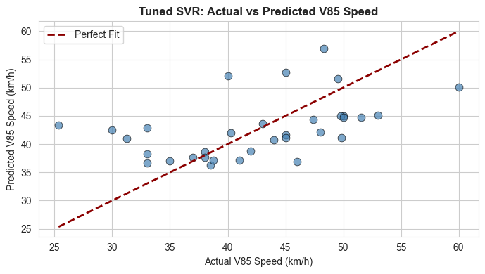
    


Residual Plot


```python
# Tuned SVR Residual Analysis

svr_tuned_residuals = y_test - y_test_pred_svr_tuned

sns.set_style("whitegrid")

plt.figure(figsize=(7, 4))

sns.scatterplot(
    x=y_test_pred_svr_tuned,
    y=svr_tuned_residuals,
    color="steelblue",
    s=60,
    alpha=0.7,
    edgecolor="black"
)

# Reference line at zero
plt.axhline(
    y=0,
    linestyle="--",
    color="darkred",
    linewidth=2
)

plt.xlabel("Predicted V85 Speed (km/h)")
plt.ylabel("Residuals (km/h)")

plt.title(
    "Tuned SVR: Residual Plot",
    fontsize=12,
    fontweight="bold"
)

plt.tight_layout()
plt.show()
```


    

    


    
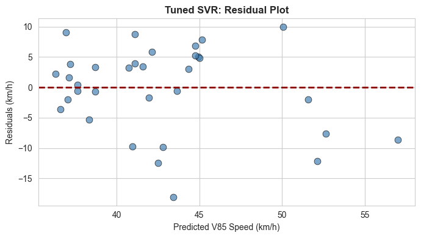
    


Result Table


```python
# Tuned SVR Performance Summary

svr_tuned_final = pd.DataFrame({
    "Model": ["Tuned SVR"],
    "R2": [round(svr_tuned_test_r2, 3)],
    "RMSE": [round(svr_tuned_test_rmse, 3)],
    "MAE": [round(svr_tuned_test_mae, 3)]
})

# Display results
display(svr_tuned_final)
```


<div>
<style scoped>
    .dataframe tbody tr th:only-of-type {
        vertical-align: middle;
    }

    .dataframe tbody tr th {
        vertical-align: top;
    }

    .dataframe thead th {
        text-align: right;
    }
</style>
<table border="1" class="dataframe">
  <thead>
    <tr style="text-align: right;">
      <th></th>
      <th>Model</th>
      <th>R2</th>
      <th>RMSE</th>
      <th>MAE</th>
    </tr>
  </thead>
  <tbody>
    <tr>
      <th>0</th>
      <td>Tuned SVR</td>
      <td>0.182</td>
      <td>6.879</td>
      <td>5.559</td>
    </tr>
  </tbody>
</table>
</div>


<div>
<style scoped>
    .dataframe tbody tr th:only-of-type {
        vertical-align: middle;
    }

    .dataframe tbody tr th {
        vertical-align: top;
    }

    .dataframe thead th {
        text-align: right;
    }
</style>
<table border="1" class="dataframe">
  <thead>
    <tr style="text-align: right;">
      <th></th>
      <th>Model</th>
      <th>R2</th>
      <th>RMSE</th>
      <th>MAE</th>
    </tr>
  </thead>
  <tbody>
    <tr>
      <th>0</th>
      <td>Tuned SVR</td>
      <td>0.182</td>
      <td>6.879</td>
      <td>5.559</td>
    </tr>
  </tbody>
</table>
</div>


Base vs Tuned Comparison Table


```python
# Baseline vs Tuned SVR Comparison

svr_comparison = pd.concat(
    [svr_final, svr_tuned_final],
    ignore_index=True
)

# Display comparison
display(svr_comparison)
```


<div>
<style scoped>
    .dataframe tbody tr th:only-of-type {
        vertical-align: middle;
    }

    .dataframe tbody tr th {
        vertical-align: top;
    }

    .dataframe thead th {
        text-align: right;
    }
</style>
<table border="1" class="dataframe">
  <thead>
    <tr style="text-align: right;">
      <th></th>
      <th>Model</th>
      <th>R2</th>
      <th>RMSE</th>
      <th>MAE</th>
    </tr>
  </thead>
  <tbody>
    <tr>
      <th>0</th>
      <td>SVR</td>
      <td>-0.067</td>
      <td>7.857</td>
      <td>6.190</td>
    </tr>
    <tr>
      <th>1</th>
      <td>Tuned SVR</td>
      <td>0.182</td>
      <td>6.879</td>
      <td>5.559</td>
    </tr>
  </tbody>
</table>
</div>


<div>
<style scoped>
    .dataframe tbody tr th:only-of-type {
        vertical-align: middle;
    }

    .dataframe tbody tr th {
        vertical-align: top;
    }

    .dataframe thead th {
        text-align: right;
    }
</style>
<table border="1" class="dataframe">
  <thead>
    <tr style="text-align: right;">
      <th></th>
      <th>Model</th>
      <th>R2</th>
      <th>RMSE</th>
      <th>MAE</th>
    </tr>
  </thead>
  <tbody>
    <tr>
      <th>0</th>
      <td>SVR</td>
      <td>-0.067</td>
      <td>7.857</td>
      <td>6.190</td>
    </tr>
    <tr>
      <th>1</th>
      <td>Tuned SVR</td>
      <td>0.182</td>
      <td>6.879</td>
      <td>5.559</td>
    </tr>
  </tbody>
</table>
</div>


Best Hyperparameters Table


```python
# Best Hyperparameters of Tuned SVR

best_svr_params = pd.DataFrame(
    list(grid_svr.best_params_.items()),
    columns=["Parameter", "Best Value"]
)

# Remove pipeline prefix for presentation
best_svr_params["Parameter"] = (
    best_svr_params["Parameter"].str.replace(
        "svr__", "", regex=False
    )
)

# Display results
display(best_svr_params)
```


<div>
<style scoped>
    .dataframe tbody tr th:only-of-type {
        vertical-align: middle;
    }

    .dataframe tbody tr th {
        vertical-align: top;
    }

    .dataframe thead th {
        text-align: right;
    }
</style>
<table border="1" class="dataframe">
  <thead>
    <tr style="text-align: right;">
      <th></th>
      <th>Parameter</th>
      <th>Best Value</th>
    </tr>
  </thead>
  <tbody>
    <tr>
      <th>0</th>
      <td>C</td>
      <td>100</td>
    </tr>
    <tr>
      <th>1</th>
      <td>epsilon</td>
      <td>0.01</td>
    </tr>
    <tr>
      <th>2</th>
      <td>gamma</td>
      <td>0.01</td>
    </tr>
    <tr>
      <th>3</th>
      <td>kernel</td>
      <td>rbf</td>
    </tr>
  </tbody>
</table>
</div>


<div>
<style scoped>
    .dataframe tbody tr th:only-of-type {
        vertical-align: middle;
    }

    .dataframe tbody tr th {
        vertical-align: top;
    }

    .dataframe thead th {
        text-align: right;
    }
</style>
<table border="1" class="dataframe">
  <thead>
    <tr style="text-align: right;">
      <th></th>
      <th>Parameter</th>
      <th>Best Value</th>
    </tr>
  </thead>
  <tbody>
    <tr>
      <th>0</th>
      <td>C</td>
      <td>100</td>
    </tr>
    <tr>
      <th>1</th>
      <td>epsilon</td>
      <td>0.01</td>
    </tr>
    <tr>
      <th>2</th>
      <td>gamma</td>
      <td>0.01</td>
    </tr>
    <tr>
      <th>3</th>
      <td>kernel</td>
      <td>rbf</td>
    </tr>
  </tbody>
</table>
</div>


Artificial Neural Network (ANN) Model

Model Training


```python
# Artificial Neural Network (ANN)

from sklearn.neural_network import MLPRegressor

# Initialize ANN model
ann = MLPRegressor(
    hidden_layer_sizes=(64, 32),
    activation="relu",
    solver="adam",
    alpha=0.001,
    learning_rate_init=0.01,
    max_iter=2000,
    random_state=42
)

# Train ANN using scaled training data
ann.fit(X_train_scaled, y_train)
```


<style>#sk-container-id-15 {
  /* Definition of color scheme common for light and dark mode */
  --sklearn-color-text: #000;
  --sklearn-color-text-muted: #666;
  --sklearn-color-line: gray;
  /* Definition of color scheme for unfitted estimators */
  --sklearn-color-unfitted-level-0: #fff5e6;
  --sklearn-color-unfitted-level-1: #f6e4d2;
  --sklearn-color-unfitted-level-2: #ffe0b3;
  --sklearn-color-unfitted-level-3: chocolate;
  /* Definition of color scheme for fitted estimators */
  --sklearn-color-fitted-level-0: #f0f8ff;
  --sklearn-color-fitted-level-1: #d4ebff;
  --sklearn-color-fitted-level-2: #b3dbfd;
  --sklearn-color-fitted-level-3: cornflowerblue;
}

#sk-container-id-15.light {
  /* Specific color for light theme */
  --sklearn-color-text-on-default-background: black;
  --sklearn-color-background: white;
  --sklearn-color-border-box: black;
  --sklearn-color-icon: #696969;
}

#sk-container-id-15.dark {
  --sklearn-color-text-on-default-background: white;
  --sklearn-color-background: #111;
  --sklearn-color-border-box: white;
  --sklearn-color-icon: #878787;
}

#sk-container-id-15 {
  color: var(--sklearn-color-text);
}

#sk-container-id-15 pre {
  padding: 0;
}

#sk-container-id-15 input.sk-hidden--visually {
  border: 0;
  clip: rect(1px 1px 1px 1px);
  clip: rect(1px, 1px, 1px, 1px);
  height: 1px;
  margin: -1px;
  overflow: hidden;
  padding: 0;
  position: absolute;
  width: 1px;
}

#sk-container-id-15 div.sk-dashed-wrapped {
  border: 1px dashed var(--sklearn-color-line);
  margin: 0 0.4em 0.5em 0.4em;
  box-sizing: border-box;
  padding-bottom: 0.4em;
  background-color: var(--sklearn-color-background);
}

#sk-container-id-15 div.sk-container {
  /* jupyter's `normalize.less` sets `[hidden] { display: none; }`
     but bootstrap.min.css set `[hidden] { display: none !important; }`
     so we also need the `!important` here to be able to override the
     default hidden behavior on the sphinx rendered scikit-learn.org.
     See: https://github.com/scikit-learn/scikit-learn/issues/21755 */
  display: inline-block !important;
  position: relative;
}

#sk-container-id-15 div.sk-text-repr-fallback {
  display: none;
}

div.sk-parallel-item,
div.sk-serial,
div.sk-item {
  /* draw centered vertical line to link estimators */
  background-image: linear-gradient(var(--sklearn-color-text-on-default-background), var(--sklearn-color-text-on-default-background));
  background-size: 2px 100%;
  background-repeat: no-repeat;
  background-position: center center;
}

/* Parallel-specific style estimator block */

#sk-container-id-15 div.sk-parallel-item::after {
  content: "";
  width: 100%;
  border-bottom: 2px solid var(--sklearn-color-text-on-default-background);
  flex-grow: 1;
}

#sk-container-id-15 div.sk-parallel {
  display: flex;
  align-items: stretch;
  justify-content: center;
  background-color: var(--sklearn-color-background);
  position: relative;
}

#sk-container-id-15 div.sk-parallel-item {
  display: flex;
  flex-direction: column;
}

#sk-container-id-15 div.sk-parallel-item:first-child::after {
  align-self: flex-end;
  width: 50%;
}

#sk-container-id-15 div.sk-parallel-item:last-child::after {
  align-self: flex-start;
  width: 50%;
}

#sk-container-id-15 div.sk-parallel-item:only-child::after {
  width: 0;
}

/* Serial-specific style estimator block */

#sk-container-id-15 div.sk-serial {
  display: flex;
  flex-direction: column;
  align-items: center;
  background-color: var(--sklearn-color-background);
  padding-right: 1em;
  padding-left: 1em;
}


/* Toggleable style: style used for estimator/Pipeline/ColumnTransformer box that is
clickable and can be expanded/collapsed.
- Pipeline and ColumnTransformer use this feature and define the default style
- Estimators will overwrite some part of the style using the `sk-estimator` class
*/

/* Pipeline and ColumnTransformer style (default) */

#sk-container-id-15 div.sk-toggleable {
  /* Default theme specific background. It is overwritten whether we have a
  specific estimator or a Pipeline/ColumnTransformer */
  background-color: var(--sklearn-color-background);
}

/* Toggleable label */
#sk-container-id-15 label.sk-toggleable__label {
  cursor: pointer;
  display: flex;
  width: 100%;
  margin-bottom: 0;
  padding: 0.5em;
  box-sizing: border-box;
  text-align: center;
  align-items: center;
  justify-content: center;
  gap: 0.5em;
}

#sk-container-id-15 label.sk-toggleable__label .caption {
  font-size: 0.6rem;
  font-weight: lighter;
  color: var(--sklearn-color-text-muted);
}

#sk-container-id-15 label.sk-toggleable__label-arrow:before {
  /* Arrow on the left of the label */
  content: "▸";
  float: left;
  margin-right: 0.25em;
  color: var(--sklearn-color-icon);
}

#sk-container-id-15 label.sk-toggleable__label-arrow:hover:before {
  color: var(--sklearn-color-text);
}

/* Toggleable content - dropdown */

#sk-container-id-15 div.sk-toggleable__content {
  display: none;
  text-align: left;
  /* unfitted */
  background-color: var(--sklearn-color-unfitted-level-0);
}

#sk-container-id-15 div.sk-toggleable__content.fitted {
  /* fitted */
  background-color: var(--sklearn-color-fitted-level-0);
}

#sk-container-id-15 div.sk-toggleable__content pre {
  margin: 0.2em;
  border-radius: 0.25em;
  color: var(--sklearn-color-text);
  /* unfitted */
  background-color: var(--sklearn-color-unfitted-level-0);
}

#sk-container-id-15 div.sk-toggleable__content.fitted pre {
  /* unfitted */
  background-color: var(--sklearn-color-fitted-level-0);
}

#sk-container-id-15 input.sk-toggleable__control:checked~div.sk-toggleable__content {
  /* Expand drop-down */
  display: block;
  width: 100%;
  overflow: visible;
}

#sk-container-id-15 input.sk-toggleable__control:checked~label.sk-toggleable__label-arrow:before {
  content: "▾";
}

/* Pipeline/ColumnTransformer-specific style */

#sk-container-id-15 div.sk-label input.sk-toggleable__control:checked~label.sk-toggleable__label {
  color: var(--sklearn-color-text);
  background-color: var(--sklearn-color-unfitted-level-2);
}

#sk-container-id-15 div.sk-label.fitted input.sk-toggleable__control:checked~label.sk-toggleable__label {
  background-color: var(--sklearn-color-fitted-level-2);
}

/* Estimator-specific style */

/* Colorize estimator box */
#sk-container-id-15 div.sk-estimator input.sk-toggleable__control:checked~label.sk-toggleable__label {
  /* unfitted */
  background-color: var(--sklearn-color-unfitted-level-2);
}

#sk-container-id-15 div.sk-estimator.fitted input.sk-toggleable__control:checked~label.sk-toggleable__label {
  /* fitted */
  background-color: var(--sklearn-color-fitted-level-2);
}

#sk-container-id-15 div.sk-label label.sk-toggleable__label,
#sk-container-id-15 div.sk-label label {
  /* The background is the default theme color */
  color: var(--sklearn-color-text-on-default-background);
}

/* On hover, darken the color of the background */
#sk-container-id-15 div.sk-label:hover label.sk-toggleable__label {
  color: var(--sklearn-color-text);
  background-color: var(--sklearn-color-unfitted-level-2);
}

/* Label box, darken color on hover, fitted */
#sk-container-id-15 div.sk-label.fitted:hover label.sk-toggleable__label.fitted {
  color: var(--sklearn-color-text);
  background-color: var(--sklearn-color-fitted-level-2);
}

/* Estimator label */

#sk-container-id-15 div.sk-label label {
  font-family: monospace;
  font-weight: bold;
  line-height: 1.2em;
}

#sk-container-id-15 div.sk-label-container {
  text-align: center;
}

/* Estimator-specific */
#sk-container-id-15 div.sk-estimator {
  font-family: monospace;
  border: 1px dotted var(--sklearn-color-border-box);
  border-radius: 0.25em;
  box-sizing: border-box;
  margin-bottom: 0.5em;
  /* unfitted */
  background-color: var(--sklearn-color-unfitted-level-0);
}

#sk-container-id-15 div.sk-estimator.fitted {
  /* fitted */
  background-color: var(--sklearn-color-fitted-level-0);
}

/* on hover */
#sk-container-id-15 div.sk-estimator:hover {
  /* unfitted */
  background-color: var(--sklearn-color-unfitted-level-2);
}

#sk-container-id-15 div.sk-estimator.fitted:hover {
  /* fitted */
  background-color: var(--sklearn-color-fitted-level-2);
}

/* Specification for estimator info (e.g. "i" and "?") */

/* Common style for "i" and "?" */

.sk-estimator-doc-link,
a:link.sk-estimator-doc-link,
a:visited.sk-estimator-doc-link {
  float: right;
  font-size: smaller;
  line-height: 1em;
  font-family: monospace;
  background-color: var(--sklearn-color-unfitted-level-0);
  border-radius: 1em;
  height: 1em;
  width: 1em;
  text-decoration: none !important;
  margin-left: 0.5em;
  text-align: center;
  /* unfitted */
  border: var(--sklearn-color-unfitted-level-3) 1pt solid;
  color: var(--sklearn-color-unfitted-level-3);
}

.sk-estimator-doc-link.fitted,
a:link.sk-estimator-doc-link.fitted,
a:visited.sk-estimator-doc-link.fitted {
  /* fitted */
  background-color: var(--sklearn-color-fitted-level-0);
  border: var(--sklearn-color-fitted-level-3) 1pt solid;
  color: var(--sklearn-color-fitted-level-3);
}

/* On hover */
div.sk-estimator:hover .sk-estimator-doc-link:hover,
.sk-estimator-doc-link:hover,
div.sk-label-container:hover .sk-estimator-doc-link:hover,
.sk-estimator-doc-link:hover {
  /* unfitted */
  background-color: var(--sklearn-color-unfitted-level-3);
  border: var(--sklearn-color-fitted-level-0) 1pt solid;
  color: var(--sklearn-color-unfitted-level-0);
  text-decoration: none;
}

div.sk-estimator.fitted:hover .sk-estimator-doc-link.fitted:hover,
.sk-estimator-doc-link.fitted:hover,
div.sk-label-container:hover .sk-estimator-doc-link.fitted:hover,
.sk-estimator-doc-link.fitted:hover {
  /* fitted */
  background-color: var(--sklearn-color-fitted-level-3);
  border: var(--sklearn-color-fitted-level-0) 1pt solid;
  color: var(--sklearn-color-fitted-level-0);
  text-decoration: none;
}

/* Span, style for the box shown on hovering the info icon */
.sk-estimator-doc-link span {
  display: none;
  z-index: 9999;
  position: relative;
  font-weight: normal;
  right: .2ex;
  padding: .5ex;
  margin: .5ex;
  width: min-content;
  min-width: 20ex;
  max-width: 50ex;
  color: var(--sklearn-color-text);
  box-shadow: 2pt 2pt 4pt #999;
  /* unfitted */
  background: var(--sklearn-color-unfitted-level-0);
  border: .5pt solid var(--sklearn-color-unfitted-level-3);
}

.sk-estimator-doc-link.fitted span {
  /* fitted */
  background: var(--sklearn-color-fitted-level-0);
  border: var(--sklearn-color-fitted-level-3);
}

.sk-estimator-doc-link:hover span {
  display: block;
}

/* "?"-specific style due to the `<a>` HTML tag */

#sk-container-id-15 a.estimator_doc_link {
  float: right;
  font-size: 1rem;
  line-height: 1em;
  font-family: monospace;
  background-color: var(--sklearn-color-unfitted-level-0);
  border-radius: 1rem;
  height: 1rem;
  width: 1rem;
  text-decoration: none;
  /* unfitted */
  color: var(--sklearn-color-unfitted-level-1);
  border: var(--sklearn-color-unfitted-level-1) 1pt solid;
}

#sk-container-id-15 a.estimator_doc_link.fitted {
  /* fitted */
  background-color: var(--sklearn-color-fitted-level-0);
  border: var(--sklearn-color-fitted-level-1) 1pt solid;
  color: var(--sklearn-color-fitted-level-1);
}

/* On hover */
#sk-container-id-15 a.estimator_doc_link:hover {
  /* unfitted */
  background-color: var(--sklearn-color-unfitted-level-3);
  color: var(--sklearn-color-background);
  text-decoration: none;
}

#sk-container-id-15 a.estimator_doc_link.fitted:hover {
  /* fitted */
  background-color: var(--sklearn-color-fitted-level-3);
}

.estimator-table {
    font-family: monospace;
}

.estimator-table summary {
    padding: .5rem;
    cursor: pointer;
}

.estimator-table summary::marker {
    font-size: 0.7rem;
}

.estimator-table details[open] {
    padding-left: 0.1rem;
    padding-right: 0.1rem;
    padding-bottom: 0.3rem;
}

.estimator-table .parameters-table {
    margin-left: auto !important;
    margin-right: auto !important;
    margin-top: 0;
}

.estimator-table .parameters-table tr:nth-child(odd) {
    background-color: #fff;
}

.estimator-table .parameters-table tr:nth-child(even) {
    background-color: #f6f6f6;
}

.estimator-table .parameters-table tr:hover {
    background-color: #e0e0e0;
}

.estimator-table table td {
    border: 1px solid rgba(106, 105, 104, 0.232);
}

/*
    `table td`is set in notebook with right text-align.
    We need to overwrite it.
*/
.estimator-table table td.param {
    text-align: left;
    position: relative;
    padding: 0;
}

.user-set td {
    color:rgb(255, 94, 0);
    text-align: left !important;
}

.user-set td.value {
    color:rgb(255, 94, 0);
    background-color: transparent;
}

.default td {
    color: black;
    text-align: left !important;
}

.user-set td i,
.default td i {
    color: black;
}

/*
    Styles for parameter documentation links
    We need styling for visited so jupyter doesn't overwrite it
*/
a.param-doc-link,
a.param-doc-link:link,
a.param-doc-link:visited {
    text-decoration: underline dashed;
    text-underline-offset: .3em;
    color: inherit;
    display: block;
    padding: .5em;
}

/* "hack" to make the entire area of the cell containing the link clickable */
a.param-doc-link::before {
    position: absolute;
    content: "";
    inset: 0;
}

.param-doc-description {
    display: none;
    position: absolute;
    z-index: 9999;
    left: 0;
    padding: .5ex;
    margin-left: 1.5em;
    color: var(--sklearn-color-text);
    box-shadow: .3em .3em .4em #999;
    width: max-content;
    text-align: left;
    max-height: 10em;
    overflow-y: auto;

    /* unfitted */
    background: var(--sklearn-color-unfitted-level-0);
    border: thin solid var(--sklearn-color-unfitted-level-3);
}

/* Fitted state for parameter tooltips */
.fitted .param-doc-description {
    /* fitted */
    background: var(--sklearn-color-fitted-level-0);
    border: thin solid var(--sklearn-color-fitted-level-3);
}

.param-doc-link:hover .param-doc-description {
    display: block;
}

.copy-paste-icon {
    background-image: url();
    background-repeat: no-repeat;
    background-size: 14px 14px;
    background-position: 0;
    display: inline-block;
    width: 14px;
    height: 14px;
    cursor: pointer;
}
</style><body><div id="sk-container-id-15" class="sk-top-container"><div class="sk-text-repr-fallback"><pre>MLPRegressor(alpha=0.001, hidden_layer_sizes=(64, 32), learning_rate_init=0.01,
             max_iter=2000, random_state=42)</pre><b>In a Jupyter environment, please rerun this cell to show the HTML representation or trust the notebook. <br />On GitHub, the HTML representation is unable to render, please try loading this page with nbviewer.org.</b></div><div class="sk-container" hidden><div class="sk-item"><div class="sk-estimator fitted sk-toggleable"><input class="sk-toggleable__control sk-hidden--visually" id="sk-estimator-id-19" type="checkbox" checked><label for="sk-estimator-id-19" class="sk-toggleable__label fitted sk-toggleable__label-arrow"><div><div>MLPRegressor</div></div><div><a class="sk-estimator-doc-link fitted" rel="noreferrer" target="_blank" href="https://scikit-learn.org/1.8/modules/generated/sklearn.neural_network.MLPRegressor.html">?<span>Documentation for MLPRegressor</span></a><span class="sk-estimator-doc-link fitted">i<span>Fitted</span></span></div></label><div class="sk-toggleable__content fitted" data-param-prefix="">
        <div class="estimator-table">
            <details>
                <summary>Parameters</summary>
                <table class="parameters-table">
                  <tbody>

        <tr class="default">
            <td><i class="copy-paste-icon"
                 onclick="copyToClipboard('loss',
                          this.parentElement.nextElementSibling)"
            ></i></td>
            <td class="param">
        <a class="param-doc-link"
            rel="noreferrer" target="_blank" href="https://scikit-learn.org/1.8/modules/generated/sklearn.neural_network.MLPRegressor.html#:~:text=loss,-%7B%27squared_error%27%2C%20%27poisson%27%7D%2C%20default%3D%27squared_error%27">
            loss
            <span class="param-doc-description">loss: {'squared_error', 'poisson'}, default='squared_error'<br><br>The loss function to use when training the weights. Note that the<br>"squared error" and "poisson" losses actually implement<br>"half squares error" and "half poisson deviance" to simplify the<br>computation of the gradient. Furthermore, the "poisson" loss internally uses<br>a log-link (exponential as the output activation function) and requires<br>``y >= 0``.<br><br>.. versionchanged:: 1.7<br>   Added parameter `loss` and option 'poisson'.</span>
        </a>
    </td>
            <td class="value">&#x27;squared_error&#x27;</td>
        </tr>


        <tr class="user-set">
            <td><i class="copy-paste-icon"
                 onclick="copyToClipboard('hidden_layer_sizes',
                          this.parentElement.nextElementSibling)"
            ></i></td>
            <td class="param">
        <a class="param-doc-link"
            rel="noreferrer" target="_blank" href="https://scikit-learn.org/1.8/modules/generated/sklearn.neural_network.MLPRegressor.html#:~:text=hidden_layer_sizes,-array-like%20of%20shape%28n_layers%20-%202%2C%29%2C%20default%3D%28100%2C%29">
            hidden_layer_sizes
            <span class="param-doc-description">hidden_layer_sizes: array-like of shape(n_layers - 2,), default=(100,)<br><br>The ith element represents the number of neurons in the ith<br>hidden layer.</span>
        </a>
    </td>
            <td class="value">(64, ...)</td>
        </tr>


        <tr class="default">
            <td><i class="copy-paste-icon"
                 onclick="copyToClipboard('activation',
                          this.parentElement.nextElementSibling)"
            ></i></td>
            <td class="param">
        <a class="param-doc-link"
            rel="noreferrer" target="_blank" href="https://scikit-learn.org/1.8/modules/generated/sklearn.neural_network.MLPRegressor.html#:~:text=activation,-%7B%27identity%27%2C%20%27logistic%27%2C%20%27tanh%27%2C%20%27relu%27%7D%2C%20default%3D%27relu%27">
            activation
            <span class="param-doc-description">activation: {'identity', 'logistic', 'tanh', 'relu'}, default='relu'<br><br>Activation function for the hidden layer.<br><br>- 'identity', no-op activation, useful to implement linear bottleneck,<br>  returns f(x) = x<br><br>- 'logistic', the logistic sigmoid function,<br>  returns f(x) = 1 / (1 + exp(-x)).<br><br>- 'tanh', the hyperbolic tan function,<br>  returns f(x) = tanh(x).<br><br>- 'relu', the rectified linear unit function,<br>  returns f(x) = max(0, x)</span>
        </a>
    </td>
            <td class="value">&#x27;relu&#x27;</td>
        </tr>


        <tr class="default">
            <td><i class="copy-paste-icon"
                 onclick="copyToClipboard('solver',
                          this.parentElement.nextElementSibling)"
            ></i></td>
            <td class="param">
        <a class="param-doc-link"
            rel="noreferrer" target="_blank" href="https://scikit-learn.org/1.8/modules/generated/sklearn.neural_network.MLPRegressor.html#:~:text=solver,-%7B%27lbfgs%27%2C%20%27sgd%27%2C%20%27adam%27%7D%2C%20default%3D%27adam%27">
            solver
            <span class="param-doc-description">solver: {'lbfgs', 'sgd', 'adam'}, default='adam'<br><br>The solver for weight optimization.<br><br>- 'lbfgs' is an optimizer in the family of quasi-Newton methods.<br><br>- 'sgd' refers to stochastic gradient descent.<br><br>- 'adam' refers to a stochastic gradient-based optimizer proposed by<br>  Kingma, Diederik, and Jimmy Ba<br><br>For a comparison between Adam optimizer and SGD, see<br>:ref:`sphx_glr_auto_examples_neural_networks_plot_mlp_training_curves.py`.<br><br>Note: The default solver 'adam' works pretty well on relatively<br>large datasets (with thousands of training samples or more) in terms of<br>both training time and validation score.<br>For small datasets, however, 'lbfgs' can converge faster and perform<br>better.</span>
        </a>
    </td>
            <td class="value">&#x27;adam&#x27;</td>
        </tr>


        <tr class="user-set">
            <td><i class="copy-paste-icon"
                 onclick="copyToClipboard('alpha',
                          this.parentElement.nextElementSibling)"
            ></i></td>
            <td class="param">
        <a class="param-doc-link"
            rel="noreferrer" target="_blank" href="https://scikit-learn.org/1.8/modules/generated/sklearn.neural_network.MLPRegressor.html#:~:text=alpha,-float%2C%20default%3D0.0001">
            alpha
            <span class="param-doc-description">alpha: float, default=0.0001<br><br>Strength of the L2 regularization term. The L2 regularization term<br>is divided by the sample size when added to the loss.</span>
        </a>
    </td>
            <td class="value">0.001</td>
        </tr>


        <tr class="default">
            <td><i class="copy-paste-icon"
                 onclick="copyToClipboard('batch_size',
                          this.parentElement.nextElementSibling)"
            ></i></td>
            <td class="param">
        <a class="param-doc-link"
            rel="noreferrer" target="_blank" href="https://scikit-learn.org/1.8/modules/generated/sklearn.neural_network.MLPRegressor.html#:~:text=batch_size,-int%2C%20default%3D%27auto%27">
            batch_size
            <span class="param-doc-description">batch_size: int, default='auto'<br><br>Size of minibatches for stochastic optimizers.<br>If the solver is 'lbfgs', the regressor will not use minibatch.<br>When set to "auto", `batch_size=min(200, n_samples)`.</span>
        </a>
    </td>
            <td class="value">&#x27;auto&#x27;</td>
        </tr>


        <tr class="default">
            <td><i class="copy-paste-icon"
                 onclick="copyToClipboard('learning_rate',
                          this.parentElement.nextElementSibling)"
            ></i></td>
            <td class="param">
        <a class="param-doc-link"
            rel="noreferrer" target="_blank" href="https://scikit-learn.org/1.8/modules/generated/sklearn.neural_network.MLPRegressor.html#:~:text=learning_rate,-%7B%27constant%27%2C%20%27invscaling%27%2C%20%27adaptive%27%7D%2C%20default%3D%27constant%27">
            learning_rate
            <span class="param-doc-description">learning_rate: {'constant', 'invscaling', 'adaptive'}, default='constant'<br><br>Learning rate schedule for weight updates.<br><br>- 'constant' is a constant learning rate given by<br>  'learning_rate_init'.<br><br>- 'invscaling' gradually decreases the learning rate ``learning_rate_``<br>  at each time step 't' using an inverse scaling exponent of 'power_t'.<br>  effective_learning_rate = learning_rate_init / pow(t, power_t)<br><br>- 'adaptive' keeps the learning rate constant to<br>  'learning_rate_init' as long as training loss keeps decreasing.<br>  Each time two consecutive epochs fail to decrease training loss by at<br>  least tol, or fail to increase validation score by at least tol if<br>  'early_stopping' is on, the current learning rate is divided by 5.<br><br>Only used when solver='sgd'.</span>
        </a>
    </td>
            <td class="value">&#x27;constant&#x27;</td>
        </tr>


        <tr class="user-set">
            <td><i class="copy-paste-icon"
                 onclick="copyToClipboard('learning_rate_init',
                          this.parentElement.nextElementSibling)"
            ></i></td>
            <td class="param">
        <a class="param-doc-link"
            rel="noreferrer" target="_blank" href="https://scikit-learn.org/1.8/modules/generated/sklearn.neural_network.MLPRegressor.html#:~:text=learning_rate_init,-float%2C%20default%3D0.001">
            learning_rate_init
            <span class="param-doc-description">learning_rate_init: float, default=0.001<br><br>The initial learning rate used. It controls the step-size<br>in updating the weights. Only used when solver='sgd' or 'adam'.</span>
        </a>
    </td>
            <td class="value">0.01</td>
        </tr>


        <tr class="default">
            <td><i class="copy-paste-icon"
                 onclick="copyToClipboard('power_t',
                          this.parentElement.nextElementSibling)"
            ></i></td>
            <td class="param">
        <a class="param-doc-link"
            rel="noreferrer" target="_blank" href="https://scikit-learn.org/1.8/modules/generated/sklearn.neural_network.MLPRegressor.html#:~:text=power_t,-float%2C%20default%3D0.5">
            power_t
            <span class="param-doc-description">power_t: float, default=0.5<br><br>The exponent for inverse scaling learning rate.<br>It is used in updating effective learning rate when the learning_rate<br>is set to 'invscaling'. Only used when solver='sgd'.</span>
        </a>
    </td>
            <td class="value">0.5</td>
        </tr>


        <tr class="user-set">
            <td><i class="copy-paste-icon"
                 onclick="copyToClipboard('max_iter',
                          this.parentElement.nextElementSibling)"
            ></i></td>
            <td class="param">
        <a class="param-doc-link"
            rel="noreferrer" target="_blank" href="https://scikit-learn.org/1.8/modules/generated/sklearn.neural_network.MLPRegressor.html#:~:text=max_iter,-int%2C%20default%3D200">
            max_iter
            <span class="param-doc-description">max_iter: int, default=200<br><br>Maximum number of iterations. The solver iterates until convergence<br>(determined by 'tol') or this number of iterations. For stochastic<br>solvers ('sgd', 'adam'), note that this determines the number of epochs<br>(how many times each data point will be used), not the number of<br>gradient steps.</span>
        </a>
    </td>
            <td class="value">2000</td>
        </tr>


        <tr class="default">
            <td><i class="copy-paste-icon"
                 onclick="copyToClipboard('shuffle',
                          this.parentElement.nextElementSibling)"
            ></i></td>
            <td class="param">
        <a class="param-doc-link"
            rel="noreferrer" target="_blank" href="https://scikit-learn.org/1.8/modules/generated/sklearn.neural_network.MLPRegressor.html#:~:text=shuffle,-bool%2C%20default%3DTrue">
            shuffle
            <span class="param-doc-description">shuffle: bool, default=True<br><br>Whether to shuffle samples in each iteration. Only used when<br>solver='sgd' or 'adam'.</span>
        </a>
    </td>
            <td class="value">True</td>
        </tr>


        <tr class="user-set">
            <td><i class="copy-paste-icon"
                 onclick="copyToClipboard('random_state',
                          this.parentElement.nextElementSibling)"
            ></i></td>
            <td class="param">
        <a class="param-doc-link"
            rel="noreferrer" target="_blank" href="https://scikit-learn.org/1.8/modules/generated/sklearn.neural_network.MLPRegressor.html#:~:text=random_state,-int%2C%20RandomState%20instance%2C%20default%3DNone">
            random_state
            <span class="param-doc-description">random_state: int, RandomState instance, default=None<br><br>Determines random number generation for weights and bias<br>initialization, train-test split if early stopping is used, and batch<br>sampling when solver='sgd' or 'adam'.<br>Pass an int for reproducible results across multiple function calls.<br>See :term:`Glossary <random_state>`.</span>
        </a>
    </td>
            <td class="value">42</td>
        </tr>


        <tr class="default">
            <td><i class="copy-paste-icon"
                 onclick="copyToClipboard('tol',
                          this.parentElement.nextElementSibling)"
            ></i></td>
            <td class="param">
        <a class="param-doc-link"
            rel="noreferrer" target="_blank" href="https://scikit-learn.org/1.8/modules/generated/sklearn.neural_network.MLPRegressor.html#:~:text=tol,-float%2C%20default%3D1e-4">
            tol
            <span class="param-doc-description">tol: float, default=1e-4<br><br>Tolerance for the optimization. When the loss or score is not improving<br>by at least ``tol`` for ``n_iter_no_change`` consecutive iterations,<br>unless ``learning_rate`` is set to 'adaptive', convergence is<br>considered to be reached and training stops.</span>
        </a>
    </td>
            <td class="value">0.0001</td>
        </tr>


        <tr class="default">
            <td><i class="copy-paste-icon"
                 onclick="copyToClipboard('verbose',
                          this.parentElement.nextElementSibling)"
            ></i></td>
            <td class="param">
        <a class="param-doc-link"
            rel="noreferrer" target="_blank" href="https://scikit-learn.org/1.8/modules/generated/sklearn.neural_network.MLPRegressor.html#:~:text=verbose,-bool%2C%20default%3DFalse">
            verbose
            <span class="param-doc-description">verbose: bool, default=False<br><br>Whether to print progress messages to stdout.</span>
        </a>
    </td>
            <td class="value">False</td>
        </tr>


        <tr class="default">
            <td><i class="copy-paste-icon"
                 onclick="copyToClipboard('warm_start',
                          this.parentElement.nextElementSibling)"
            ></i></td>
            <td class="param">
        <a class="param-doc-link"
            rel="noreferrer" target="_blank" href="https://scikit-learn.org/1.8/modules/generated/sklearn.neural_network.MLPRegressor.html#:~:text=warm_start,-bool%2C%20default%3DFalse">
            warm_start
            <span class="param-doc-description">warm_start: bool, default=False<br><br>When set to True, reuse the solution of the previous<br>call to fit as initialization, otherwise, just erase the<br>previous solution. See :term:`the Glossary <warm_start>`.</span>
        </a>
    </td>
            <td class="value">False</td>
        </tr>


        <tr class="default">
            <td><i class="copy-paste-icon"
                 onclick="copyToClipboard('momentum',
                          this.parentElement.nextElementSibling)"
            ></i></td>
            <td class="param">
        <a class="param-doc-link"
            rel="noreferrer" target="_blank" href="https://scikit-learn.org/1.8/modules/generated/sklearn.neural_network.MLPRegressor.html#:~:text=momentum,-float%2C%20default%3D0.9">
            momentum
            <span class="param-doc-description">momentum: float, default=0.9<br><br>Momentum for gradient descent update. Should be between 0 and 1. Only<br>used when solver='sgd'.</span>
        </a>
    </td>
            <td class="value">0.9</td>
        </tr>


        <tr class="default">
            <td><i class="copy-paste-icon"
                 onclick="copyToClipboard('nesterovs_momentum',
                          this.parentElement.nextElementSibling)"
            ></i></td>
            <td class="param">
        <a class="param-doc-link"
            rel="noreferrer" target="_blank" href="https://scikit-learn.org/1.8/modules/generated/sklearn.neural_network.MLPRegressor.html#:~:text=nesterovs_momentum,-bool%2C%20default%3DTrue">
            nesterovs_momentum
            <span class="param-doc-description">nesterovs_momentum: bool, default=True<br><br>Whether to use Nesterov's momentum. Only used when solver='sgd' and<br>momentum > 0.</span>
        </a>
    </td>
            <td class="value">True</td>
        </tr>


        <tr class="default">
            <td><i class="copy-paste-icon"
                 onclick="copyToClipboard('early_stopping',
                          this.parentElement.nextElementSibling)"
            ></i></td>
            <td class="param">
        <a class="param-doc-link"
            rel="noreferrer" target="_blank" href="https://scikit-learn.org/1.8/modules/generated/sklearn.neural_network.MLPRegressor.html#:~:text=early_stopping,-bool%2C%20default%3DFalse">
            early_stopping
            <span class="param-doc-description">early_stopping: bool, default=False<br><br>Whether to use early stopping to terminate training when validation<br>score is not improving. If set to True, it will automatically set<br>aside ``validation_fraction`` of training data as validation and<br>terminate training when validation score is not improving by at<br>least ``tol`` for ``n_iter_no_change`` consecutive epochs.<br>Only effective when solver='sgd' or 'adam'.</span>
        </a>
    </td>
            <td class="value">False</td>
        </tr>


        <tr class="default">
            <td><i class="copy-paste-icon"
                 onclick="copyToClipboard('validation_fraction',
                          this.parentElement.nextElementSibling)"
            ></i></td>
            <td class="param">
        <a class="param-doc-link"
            rel="noreferrer" target="_blank" href="https://scikit-learn.org/1.8/modules/generated/sklearn.neural_network.MLPRegressor.html#:~:text=validation_fraction,-float%2C%20default%3D0.1">
            validation_fraction
            <span class="param-doc-description">validation_fraction: float, default=0.1<br><br>The proportion of training data to set aside as validation set for<br>early stopping. Must be between 0 and 1.<br>Only used if early_stopping is True.</span>
        </a>
    </td>
            <td class="value">0.1</td>
        </tr>


        <tr class="default">
            <td><i class="copy-paste-icon"
                 onclick="copyToClipboard('beta_1',
                          this.parentElement.nextElementSibling)"
            ></i></td>
            <td class="param">
        <a class="param-doc-link"
            rel="noreferrer" target="_blank" href="https://scikit-learn.org/1.8/modules/generated/sklearn.neural_network.MLPRegressor.html#:~:text=beta_1,-float%2C%20default%3D0.9">
            beta_1
            <span class="param-doc-description">beta_1: float, default=0.9<br><br>Exponential decay rate for estimates of first moment vector in adam,<br>should be in [0, 1). Only used when solver='adam'.</span>
        </a>
    </td>
            <td class="value">0.9</td>
        </tr>


        <tr class="default">
            <td><i class="copy-paste-icon"
                 onclick="copyToClipboard('beta_2',
                          this.parentElement.nextElementSibling)"
            ></i></td>
            <td class="param">
        <a class="param-doc-link"
            rel="noreferrer" target="_blank" href="https://scikit-learn.org/1.8/modules/generated/sklearn.neural_network.MLPRegressor.html#:~:text=beta_2,-float%2C%20default%3D0.999">
            beta_2
            <span class="param-doc-description">beta_2: float, default=0.999<br><br>Exponential decay rate for estimates of second moment vector in adam,<br>should be in [0, 1). Only used when solver='adam'.</span>
        </a>
    </td>
            <td class="value">0.999</td>
        </tr>


        <tr class="default">
            <td><i class="copy-paste-icon"
                 onclick="copyToClipboard('epsilon',
                          this.parentElement.nextElementSibling)"
            ></i></td>
            <td class="param">
        <a class="param-doc-link"
            rel="noreferrer" target="_blank" href="https://scikit-learn.org/1.8/modules/generated/sklearn.neural_network.MLPRegressor.html#:~:text=epsilon,-float%2C%20default%3D1e-8">
            epsilon
            <span class="param-doc-description">epsilon: float, default=1e-8<br><br>Value for numerical stability in adam. Only used when solver='adam'.</span>
        </a>
    </td>
            <td class="value">1e-08</td>
        </tr>


        <tr class="default">
            <td><i class="copy-paste-icon"
                 onclick="copyToClipboard('n_iter_no_change',
                          this.parentElement.nextElementSibling)"
            ></i></td>
            <td class="param">
        <a class="param-doc-link"
            rel="noreferrer" target="_blank" href="https://scikit-learn.org/1.8/modules/generated/sklearn.neural_network.MLPRegressor.html#:~:text=n_iter_no_change,-int%2C%20default%3D10">
            n_iter_no_change
            <span class="param-doc-description">n_iter_no_change: int, default=10<br><br>Maximum number of epochs to not meet ``tol`` improvement.<br>Only effective when solver='sgd' or 'adam'.<br><br>.. versionadded:: 0.20</span>
        </a>
    </td>
            <td class="value">10</td>
        </tr>


        <tr class="default">
            <td><i class="copy-paste-icon"
                 onclick="copyToClipboard('max_fun',
                          this.parentElement.nextElementSibling)"
            ></i></td>
            <td class="param">
        <a class="param-doc-link"
            rel="noreferrer" target="_blank" href="https://scikit-learn.org/1.8/modules/generated/sklearn.neural_network.MLPRegressor.html#:~:text=max_fun,-int%2C%20default%3D15000">
            max_fun
            <span class="param-doc-description">max_fun: int, default=15000<br><br>Only used when solver='lbfgs'. Maximum number of function calls.<br>The solver iterates until convergence (determined by ``tol``), number<br>of iterations reaches max_iter, or this number of function calls.<br>Note that number of function calls will be greater than or equal to<br>the number of iterations for the MLPRegressor.<br><br>.. versionadded:: 0.22</span>
        </a>
    </td>
            <td class="value">15000</td>
        </tr>

                  </tbody>
                </table>
            </details>
        </div>
    </div></div></div></div></div><script>function copyToClipboard(text, element) {
    // Get the parameter prefix from the closest toggleable content
    const toggleableContent = element.closest('.sk-toggleable__content');
    const paramPrefix = toggleableContent ? toggleableContent.dataset.paramPrefix : '';
    const fullParamName = paramPrefix ? `${paramPrefix}${text}` : text;

    const originalStyle = element.style;
    const computedStyle = window.getComputedStyle(element);
    const originalWidth = computedStyle.width;
    const originalHTML = element.innerHTML.replace('Copied!', '');

    navigator.clipboard.writeText(fullParamName)
        .then(() => {
            element.style.width = originalWidth;
            element.style.color = 'green';
            element.innerHTML = "Copied!";

            setTimeout(() => {
                element.innerHTML = originalHTML;
                element.style = originalStyle;
            }, 2000);
        })
        .catch(err => {
            console.error('Failed to copy:', err);
            element.style.color = 'red';
            element.innerHTML = "Failed!";
            setTimeout(() => {
                element.innerHTML = originalHTML;
                element.style = originalStyle;
            }, 2000);
        });
    return false;
}

document.querySelectorAll('.copy-paste-icon').forEach(function(element) {
    const toggleableContent = element.closest('.sk-toggleable__content');
    const paramPrefix = toggleableContent ? toggleableContent.dataset.paramPrefix : '';
    const paramName = element.parentElement.nextElementSibling
        .textContent.trim().split(' ')[0];
    const fullParamName = paramPrefix ? `${paramPrefix}${paramName}` : paramName;

    element.setAttribute('title', fullParamName);
});


/**
 * Adapted from Skrub
 * https://github.com/skrub-data/skrub/blob/403466d1d5d4dc76a7ef569b3f8228db59a31dc3/skrub/_reporting/_data/templates/report.js#L789
 * @returns "light" or "dark"
 */
function detectTheme(element) {
    const body = document.querySelector('body');

    // Check VSCode theme
    const themeKindAttr = body.getAttribute('data-vscode-theme-kind');
    const themeNameAttr = body.getAttribute('data-vscode-theme-name');

    if (themeKindAttr && themeNameAttr) {
        const themeKind = themeKindAttr.toLowerCase();
        const themeName = themeNameAttr.toLowerCase();

        if (themeKind.includes("dark") || themeName.includes("dark")) {
            return "dark";
        }
        if (themeKind.includes("light") || themeName.includes("light")) {
            return "light";
        }
    }

    // Check Jupyter theme
    if (body.getAttribute('data-jp-theme-light') === 'false') {
        return 'dark';
    } else if (body.getAttribute('data-jp-theme-light') === 'true') {
        return 'light';
    }

    // Guess based on a parent element's color
    const color = window.getComputedStyle(element.parentNode, null).getPropertyValue('color');
    const match = color.match(/^rgb\s*\(\s*(\d+)\s*,\s*(\d+)\s*,\s*(\d+)\s*\)\s*$/i);
    if (match) {
        const [r, g, b] = [
            parseFloat(match[1]),
            parseFloat(match[2]),
            parseFloat(match[3])
        ];

        // https://en.wikipedia.org/wiki/HSL_and_HSV#Lightness
        const luma = 0.299 * r + 0.587 * g + 0.114 * b;

        if (luma > 180) {
            // If the text is very bright we have a dark theme
            return 'dark';
        }
        if (luma < 75) {
            // If the text is very dark we have a light theme
            return 'light';
        }
        // Otherwise fall back to the next heuristic.
    }

    // Fallback to system preference
    return window.matchMedia('(prefers-color-scheme: dark)').matches ? 'dark' : 'light';
}


function forceTheme(elementId) {
    const estimatorElement = document.querySelector(`#${elementId}`);
    if (estimatorElement === null) {
        console.error(`Element with id ${elementId} not found.`);
    } else {
        const theme = detectTheme(estimatorElement);
        estimatorElement.classList.add(theme);
    }
}

forceTheme('sk-container-id-15');</script></body>


<style>#sk-container-id-16 {
  /* Definition of color scheme common for light and dark mode */
  --sklearn-color-text: #000;
  --sklearn-color-text-muted: #666;
  --sklearn-color-line: gray;
  /* Definition of color scheme for unfitted estimators */
  --sklearn-color-unfitted-level-0: #fff5e6;
  --sklearn-color-unfitted-level-1: #f6e4d2;
  --sklearn-color-unfitted-level-2: #ffe0b3;
  --sklearn-color-unfitted-level-3: chocolate;
  /* Definition of color scheme for fitted estimators */
  --sklearn-color-fitted-level-0: #f0f8ff;
  --sklearn-color-fitted-level-1: #d4ebff;
  --sklearn-color-fitted-level-2: #b3dbfd;
  --sklearn-color-fitted-level-3: cornflowerblue;
}

#sk-container-id-16.light {
  /* Specific color for light theme */
  --sklearn-color-text-on-default-background: black;
  --sklearn-color-background: white;
  --sklearn-color-border-box: black;
  --sklearn-color-icon: #696969;
}

#sk-container-id-16.dark {
  --sklearn-color-text-on-default-background: white;
  --sklearn-color-background: #111;
  --sklearn-color-border-box: white;
  --sklearn-color-icon: #878787;
}

#sk-container-id-16 {
  color: var(--sklearn-color-text);
}

#sk-container-id-16 pre {
  padding: 0;
}

#sk-container-id-16 input.sk-hidden--visually {
  border: 0;
  clip: rect(1px 1px 1px 1px);
  clip: rect(1px, 1px, 1px, 1px);
  height: 1px;
  margin: -1px;
  overflow: hidden;
  padding: 0;
  position: absolute;
  width: 1px;
}

#sk-container-id-16 div.sk-dashed-wrapped {
  border: 1px dashed var(--sklearn-color-line);
  margin: 0 0.4em 0.5em 0.4em;
  box-sizing: border-box;
  padding-bottom: 0.4em;
  background-color: var(--sklearn-color-background);
}

#sk-container-id-16 div.sk-container {
  /* jupyter's `normalize.less` sets `[hidden] { display: none; }`
     but bootstrap.min.css set `[hidden] { display: none !important; }`
     so we also need the `!important` here to be able to override the
     default hidden behavior on the sphinx rendered scikit-learn.org.
     See: https://github.com/scikit-learn/scikit-learn/issues/21755 */
  display: inline-block !important;
  position: relative;
}

#sk-container-id-16 div.sk-text-repr-fallback {
  display: none;
}

div.sk-parallel-item,
div.sk-serial,
div.sk-item {
  /* draw centered vertical line to link estimators */
  background-image: linear-gradient(var(--sklearn-color-text-on-default-background), var(--sklearn-color-text-on-default-background));
  background-size: 2px 100%;
  background-repeat: no-repeat;
  background-position: center center;
}

/* Parallel-specific style estimator block */

#sk-container-id-16 div.sk-parallel-item::after {
  content: "";
  width: 100%;
  border-bottom: 2px solid var(--sklearn-color-text-on-default-background);
  flex-grow: 1;
}

#sk-container-id-16 div.sk-parallel {
  display: flex;
  align-items: stretch;
  justify-content: center;
  background-color: var(--sklearn-color-background);
  position: relative;
}

#sk-container-id-16 div.sk-parallel-item {
  display: flex;
  flex-direction: column;
}

#sk-container-id-16 div.sk-parallel-item:first-child::after {
  align-self: flex-end;
  width: 50%;
}

#sk-container-id-16 div.sk-parallel-item:last-child::after {
  align-self: flex-start;
  width: 50%;
}

#sk-container-id-16 div.sk-parallel-item:only-child::after {
  width: 0;
}

/* Serial-specific style estimator block */

#sk-container-id-16 div.sk-serial {
  display: flex;
  flex-direction: column;
  align-items: center;
  background-color: var(--sklearn-color-background);
  padding-right: 1em;
  padding-left: 1em;
}


/* Toggleable style: style used for estimator/Pipeline/ColumnTransformer box that is
clickable and can be expanded/collapsed.
- Pipeline and ColumnTransformer use this feature and define the default style
- Estimators will overwrite some part of the style using the `sk-estimator` class
*/

/* Pipeline and ColumnTransformer style (default) */

#sk-container-id-16 div.sk-toggleable {
  /* Default theme specific background. It is overwritten whether we have a
  specific estimator or a Pipeline/ColumnTransformer */
  background-color: var(--sklearn-color-background);
}

/* Toggleable label */
#sk-container-id-16 label.sk-toggleable__label {
  cursor: pointer;
  display: flex;
  width: 100%;
  margin-bottom: 0;
  padding: 0.5em;
  box-sizing: border-box;
  text-align: center;
  align-items: center;
  justify-content: center;
  gap: 0.5em;
}

#sk-container-id-16 label.sk-toggleable__label .caption {
  font-size: 0.6rem;
  font-weight: lighter;
  color: var(--sklearn-color-text-muted);
}

#sk-container-id-16 label.sk-toggleable__label-arrow:before {
  /* Arrow on the left of the label */
  content: "▸";
  float: left;
  margin-right: 0.25em;
  color: var(--sklearn-color-icon);
}

#sk-container-id-16 label.sk-toggleable__label-arrow:hover:before {
  color: var(--sklearn-color-text);
}

/* Toggleable content - dropdown */

#sk-container-id-16 div.sk-toggleable__content {
  display: none;
  text-align: left;
  /* unfitted */
  background-color: var(--sklearn-color-unfitted-level-0);
}

#sk-container-id-16 div.sk-toggleable__content.fitted {
  /* fitted */
  background-color: var(--sklearn-color-fitted-level-0);
}

#sk-container-id-16 div.sk-toggleable__content pre {
  margin: 0.2em;
  border-radius: 0.25em;
  color: var(--sklearn-color-text);
  /* unfitted */
  background-color: var(--sklearn-color-unfitted-level-0);
}

#sk-container-id-16 div.sk-toggleable__content.fitted pre {
  /* unfitted */
  background-color: var(--sklearn-color-fitted-level-0);
}

#sk-container-id-16 input.sk-toggleable__control:checked~div.sk-toggleable__content {
  /* Expand drop-down */
  display: block;
  width: 100%;
  overflow: visible;
}

#sk-container-id-16 input.sk-toggleable__control:checked~label.sk-toggleable__label-arrow:before {
  content: "▾";
}

/* Pipeline/ColumnTransformer-specific style */

#sk-container-id-16 div.sk-label input.sk-toggleable__control:checked~label.sk-toggleable__label {
  color: var(--sklearn-color-text);
  background-color: var(--sklearn-color-unfitted-level-2);
}

#sk-container-id-16 div.sk-label.fitted input.sk-toggleable__control:checked~label.sk-toggleable__label {
  background-color: var(--sklearn-color-fitted-level-2);
}

/* Estimator-specific style */

/* Colorize estimator box */
#sk-container-id-16 div.sk-estimator input.sk-toggleable__control:checked~label.sk-toggleable__label {
  /* unfitted */
  background-color: var(--sklearn-color-unfitted-level-2);
}

#sk-container-id-16 div.sk-estimator.fitted input.sk-toggleable__control:checked~label.sk-toggleable__label {
  /* fitted */
  background-color: var(--sklearn-color-fitted-level-2);
}

#sk-container-id-16 div.sk-label label.sk-toggleable__label,
#sk-container-id-16 div.sk-label label {
  /* The background is the default theme color */
  color: var(--sklearn-color-text-on-default-background);
}

/* On hover, darken the color of the background */
#sk-container-id-16 div.sk-label:hover label.sk-toggleable__label {
  color: var(--sklearn-color-text);
  background-color: var(--sklearn-color-unfitted-level-2);
}

/* Label box, darken color on hover, fitted */
#sk-container-id-16 div.sk-label.fitted:hover label.sk-toggleable__label.fitted {
  color: var(--sklearn-color-text);
  background-color: var(--sklearn-color-fitted-level-2);
}

/* Estimator label */

#sk-container-id-16 div.sk-label label {
  font-family: monospace;
  font-weight: bold;
  line-height: 1.2em;
}

#sk-container-id-16 div.sk-label-container {
  text-align: center;
}

/* Estimator-specific */
#sk-container-id-16 div.sk-estimator {
  font-family: monospace;
  border: 1px dotted var(--sklearn-color-border-box);
  border-radius: 0.25em;
  box-sizing: border-box;
  margin-bottom: 0.5em;
  /* unfitted */
  background-color: var(--sklearn-color-unfitted-level-0);
}

#sk-container-id-16 div.sk-estimator.fitted {
  /* fitted */
  background-color: var(--sklearn-color-fitted-level-0);
}

/* on hover */
#sk-container-id-16 div.sk-estimator:hover {
  /* unfitted */
  background-color: var(--sklearn-color-unfitted-level-2);
}

#sk-container-id-16 div.sk-estimator.fitted:hover {
  /* fitted */
  background-color: var(--sklearn-color-fitted-level-2);
}

/* Specification for estimator info (e.g. "i" and "?") */

/* Common style for "i" and "?" */

.sk-estimator-doc-link,
a:link.sk-estimator-doc-link,
a:visited.sk-estimator-doc-link {
  float: right;
  font-size: smaller;
  line-height: 1em;
  font-family: monospace;
  background-color: var(--sklearn-color-unfitted-level-0);
  border-radius: 1em;
  height: 1em;
  width: 1em;
  text-decoration: none !important;
  margin-left: 0.5em;
  text-align: center;
  /* unfitted */
  border: var(--sklearn-color-unfitted-level-3) 1pt solid;
  color: var(--sklearn-color-unfitted-level-3);
}

.sk-estimator-doc-link.fitted,
a:link.sk-estimator-doc-link.fitted,
a:visited.sk-estimator-doc-link.fitted {
  /* fitted */
  background-color: var(--sklearn-color-fitted-level-0);
  border: var(--sklearn-color-fitted-level-3) 1pt solid;
  color: var(--sklearn-color-fitted-level-3);
}

/* On hover */
div.sk-estimator:hover .sk-estimator-doc-link:hover,
.sk-estimator-doc-link:hover,
div.sk-label-container:hover .sk-estimator-doc-link:hover,
.sk-estimator-doc-link:hover {
  /* unfitted */
  background-color: var(--sklearn-color-unfitted-level-3);
  border: var(--sklearn-color-fitted-level-0) 1pt solid;
  color: var(--sklearn-color-unfitted-level-0);
  text-decoration: none;
}

div.sk-estimator.fitted:hover .sk-estimator-doc-link.fitted:hover,
.sk-estimator-doc-link.fitted:hover,
div.sk-label-container:hover .sk-estimator-doc-link.fitted:hover,
.sk-estimator-doc-link.fitted:hover {
  /* fitted */
  background-color: var(--sklearn-color-fitted-level-3);
  border: var(--sklearn-color-fitted-level-0) 1pt solid;
  color: var(--sklearn-color-fitted-level-0);
  text-decoration: none;
}

/* Span, style for the box shown on hovering the info icon */
.sk-estimator-doc-link span {
  display: none;
  z-index: 9999;
  position: relative;
  font-weight: normal;
  right: .2ex;
  padding: .5ex;
  margin: .5ex;
  width: min-content;
  min-width: 20ex;
  max-width: 50ex;
  color: var(--sklearn-color-text);
  box-shadow: 2pt 2pt 4pt #999;
  /* unfitted */
  background: var(--sklearn-color-unfitted-level-0);
  border: .5pt solid var(--sklearn-color-unfitted-level-3);
}

.sk-estimator-doc-link.fitted span {
  /* fitted */
  background: var(--sklearn-color-fitted-level-0);
  border: var(--sklearn-color-fitted-level-3);
}

.sk-estimator-doc-link:hover span {
  display: block;
}

/* "?"-specific style due to the `<a>` HTML tag */

#sk-container-id-16 a.estimator_doc_link {
  float: right;
  font-size: 1rem;
  line-height: 1em;
  font-family: monospace;
  background-color: var(--sklearn-color-unfitted-level-0);
  border-radius: 1rem;
  height: 1rem;
  width: 1rem;
  text-decoration: none;
  /* unfitted */
  color: var(--sklearn-color-unfitted-level-1);
  border: var(--sklearn-color-unfitted-level-1) 1pt solid;
}

#sk-container-id-16 a.estimator_doc_link.fitted {
  /* fitted */
  background-color: var(--sklearn-color-fitted-level-0);
  border: var(--sklearn-color-fitted-level-1) 1pt solid;
  color: var(--sklearn-color-fitted-level-1);
}

/* On hover */
#sk-container-id-16 a.estimator_doc_link:hover {
  /* unfitted */
  background-color: var(--sklearn-color-unfitted-level-3);
  color: var(--sklearn-color-background);
  text-decoration: none;
}

#sk-container-id-16 a.estimator_doc_link.fitted:hover {
  /* fitted */
  background-color: var(--sklearn-color-fitted-level-3);
}

.estimator-table {
    font-family: monospace;
}

.estimator-table summary {
    padding: .5rem;
    cursor: pointer;
}

.estimator-table summary::marker {
    font-size: 0.7rem;
}

.estimator-table details[open] {
    padding-left: 0.1rem;
    padding-right: 0.1rem;
    padding-bottom: 0.3rem;
}

.estimator-table .parameters-table {
    margin-left: auto !important;
    margin-right: auto !important;
    margin-top: 0;
}

.estimator-table .parameters-table tr:nth-child(odd) {
    background-color: #fff;
}

.estimator-table .parameters-table tr:nth-child(even) {
    background-color: #f6f6f6;
}

.estimator-table .parameters-table tr:hover {
    background-color: #e0e0e0;
}

.estimator-table table td {
    border: 1px solid rgba(106, 105, 104, 0.232);
}

/*
    `table td`is set in notebook with right text-align.
    We need to overwrite it.
*/
.estimator-table table td.param {
    text-align: left;
    position: relative;
    padding: 0;
}

.user-set td {
    color:rgb(255, 94, 0);
    text-align: left !important;
}

.user-set td.value {
    color:rgb(255, 94, 0);
    background-color: transparent;
}

.default td {
    color: black;
    text-align: left !important;
}

.user-set td i,
.default td i {
    color: black;
}

/*
    Styles for parameter documentation links
    We need styling for visited so jupyter doesn't overwrite it
*/
a.param-doc-link,
a.param-doc-link:link,
a.param-doc-link:visited {
    text-decoration: underline dashed;
    text-underline-offset: .3em;
    color: inherit;
    display: block;
    padding: .5em;
}

/* "hack" to make the entire area of the cell containing the link clickable */
a.param-doc-link::before {
    position: absolute;
    content: "";
    inset: 0;
}

.param-doc-description {
    display: none;
    position: absolute;
    z-index: 9999;
    left: 0;
    padding: .5ex;
    margin-left: 1.5em;
    color: var(--sklearn-color-text);
    box-shadow: .3em .3em .4em #999;
    width: max-content;
    text-align: left;
    max-height: 10em;
    overflow-y: auto;

    /* unfitted */
    background: var(--sklearn-color-unfitted-level-0);
    border: thin solid var(--sklearn-color-unfitted-level-3);
}

/* Fitted state for parameter tooltips */
.fitted .param-doc-description {
    /* fitted */
    background: var(--sklearn-color-fitted-level-0);
    border: thin solid var(--sklearn-color-fitted-level-3);
}

.param-doc-link:hover .param-doc-description {
    display: block;
}

.copy-paste-icon {
    background-image: url();
    background-repeat: no-repeat;
    background-size: 14px 14px;
    background-position: 0;
    display: inline-block;
    width: 14px;
    height: 14px;
    cursor: pointer;
}
</style><body><div id="sk-container-id-16" class="sk-top-container"><div class="sk-text-repr-fallback"><pre>MLPRegressor(alpha=0.001, hidden_layer_sizes=(64, 32), learning_rate_init=0.01,
             max_iter=2000, random_state=42)</pre><b>In a Jupyter environment, please rerun this cell to show the HTML representation or trust the notebook. <br />On GitHub, the HTML representation is unable to render, please try loading this page with nbviewer.org.</b></div><div class="sk-container" hidden><div class="sk-item"><div class="sk-estimator fitted sk-toggleable"><input class="sk-toggleable__control sk-hidden--visually" id="sk-estimator-id-20" type="checkbox" checked><label for="sk-estimator-id-20" class="sk-toggleable__label fitted sk-toggleable__label-arrow"><div><div>MLPRegressor</div></div><div><a class="sk-estimator-doc-link fitted" rel="noreferrer" target="_blank" href="https://scikit-learn.org/1.8/modules/generated/sklearn.neural_network.MLPRegressor.html">?<span>Documentation for MLPRegressor</span></a><span class="sk-estimator-doc-link fitted">i<span>Fitted</span></span></div></label><div class="sk-toggleable__content fitted" data-param-prefix="">
        <div class="estimator-table">
            <details>
                <summary>Parameters</summary>
                <table class="parameters-table">
                  <tbody>

        <tr class="default">
            <td><i class="copy-paste-icon"
                 onclick="copyToClipboard('loss',
                          this.parentElement.nextElementSibling)"
            ></i></td>
            <td class="param">
        <a class="param-doc-link"
            rel="noreferrer" target="_blank" href="https://scikit-learn.org/1.8/modules/generated/sklearn.neural_network.MLPRegressor.html#:~:text=loss,-%7B%27squared_error%27%2C%20%27poisson%27%7D%2C%20default%3D%27squared_error%27">
            loss
            <span class="param-doc-description">loss: {'squared_error', 'poisson'}, default='squared_error'<br><br>The loss function to use when training the weights. Note that the<br>"squared error" and "poisson" losses actually implement<br>"half squares error" and "half poisson deviance" to simplify the<br>computation of the gradient. Furthermore, the "poisson" loss internally uses<br>a log-link (exponential as the output activation function) and requires<br>``y >= 0``.<br><br>.. versionchanged:: 1.7<br>   Added parameter `loss` and option 'poisson'.</span>
        </a>
    </td>
            <td class="value">&#x27;squared_error&#x27;</td>
        </tr>


        <tr class="user-set">
            <td><i class="copy-paste-icon"
                 onclick="copyToClipboard('hidden_layer_sizes',
                          this.parentElement.nextElementSibling)"
            ></i></td>
            <td class="param">
        <a class="param-doc-link"
            rel="noreferrer" target="_blank" href="https://scikit-learn.org/1.8/modules/generated/sklearn.neural_network.MLPRegressor.html#:~:text=hidden_layer_sizes,-array-like%20of%20shape%28n_layers%20-%202%2C%29%2C%20default%3D%28100%2C%29">
            hidden_layer_sizes
            <span class="param-doc-description">hidden_layer_sizes: array-like of shape(n_layers - 2,), default=(100,)<br><br>The ith element represents the number of neurons in the ith<br>hidden layer.</span>
        </a>
    </td>
            <td class="value">(64, ...)</td>
        </tr>


        <tr class="default">
            <td><i class="copy-paste-icon"
                 onclick="copyToClipboard('activation',
                          this.parentElement.nextElementSibling)"
            ></i></td>
            <td class="param">
        <a class="param-doc-link"
            rel="noreferrer" target="_blank" href="https://scikit-learn.org/1.8/modules/generated/sklearn.neural_network.MLPRegressor.html#:~:text=activation,-%7B%27identity%27%2C%20%27logistic%27%2C%20%27tanh%27%2C%20%27relu%27%7D%2C%20default%3D%27relu%27">
            activation
            <span class="param-doc-description">activation: {'identity', 'logistic', 'tanh', 'relu'}, default='relu'<br><br>Activation function for the hidden layer.<br><br>- 'identity', no-op activation, useful to implement linear bottleneck,<br>  returns f(x) = x<br><br>- 'logistic', the logistic sigmoid function,<br>  returns f(x) = 1 / (1 + exp(-x)).<br><br>- 'tanh', the hyperbolic tan function,<br>  returns f(x) = tanh(x).<br><br>- 'relu', the rectified linear unit function,<br>  returns f(x) = max(0, x)</span>
        </a>
    </td>
            <td class="value">&#x27;relu&#x27;</td>
        </tr>


        <tr class="default">
            <td><i class="copy-paste-icon"
                 onclick="copyToClipboard('solver',
                          this.parentElement.nextElementSibling)"
            ></i></td>
            <td class="param">
        <a class="param-doc-link"
            rel="noreferrer" target="_blank" href="https://scikit-learn.org/1.8/modules/generated/sklearn.neural_network.MLPRegressor.html#:~:text=solver,-%7B%27lbfgs%27%2C%20%27sgd%27%2C%20%27adam%27%7D%2C%20default%3D%27adam%27">
            solver
            <span class="param-doc-description">solver: {'lbfgs', 'sgd', 'adam'}, default='adam'<br><br>The solver for weight optimization.<br><br>- 'lbfgs' is an optimizer in the family of quasi-Newton methods.<br><br>- 'sgd' refers to stochastic gradient descent.<br><br>- 'adam' refers to a stochastic gradient-based optimizer proposed by<br>  Kingma, Diederik, and Jimmy Ba<br><br>For a comparison between Adam optimizer and SGD, see<br>:ref:`sphx_glr_auto_examples_neural_networks_plot_mlp_training_curves.py`.<br><br>Note: The default solver 'adam' works pretty well on relatively<br>large datasets (with thousands of training samples or more) in terms of<br>both training time and validation score.<br>For small datasets, however, 'lbfgs' can converge faster and perform<br>better.</span>
        </a>
    </td>
            <td class="value">&#x27;adam&#x27;</td>
        </tr>


        <tr class="user-set">
            <td><i class="copy-paste-icon"
                 onclick="copyToClipboard('alpha',
                          this.parentElement.nextElementSibling)"
            ></i></td>
            <td class="param">
        <a class="param-doc-link"
            rel="noreferrer" target="_blank" href="https://scikit-learn.org/1.8/modules/generated/sklearn.neural_network.MLPRegressor.html#:~:text=alpha,-float%2C%20default%3D0.0001">
            alpha
            <span class="param-doc-description">alpha: float, default=0.0001<br><br>Strength of the L2 regularization term. The L2 regularization term<br>is divided by the sample size when added to the loss.</span>
        </a>
    </td>
            <td class="value">0.001</td>
        </tr>


        <tr class="default">
            <td><i class="copy-paste-icon"
                 onclick="copyToClipboard('batch_size',
                          this.parentElement.nextElementSibling)"
            ></i></td>
            <td class="param">
        <a class="param-doc-link"
            rel="noreferrer" target="_blank" href="https://scikit-learn.org/1.8/modules/generated/sklearn.neural_network.MLPRegressor.html#:~:text=batch_size,-int%2C%20default%3D%27auto%27">
            batch_size
            <span class="param-doc-description">batch_size: int, default='auto'<br><br>Size of minibatches for stochastic optimizers.<br>If the solver is 'lbfgs', the regressor will not use minibatch.<br>When set to "auto", `batch_size=min(200, n_samples)`.</span>
        </a>
    </td>
            <td class="value">&#x27;auto&#x27;</td>
        </tr>


        <tr class="default">
            <td><i class="copy-paste-icon"
                 onclick="copyToClipboard('learning_rate',
                          this.parentElement.nextElementSibling)"
            ></i></td>
            <td class="param">
        <a class="param-doc-link"
            rel="noreferrer" target="_blank" href="https://scikit-learn.org/1.8/modules/generated/sklearn.neural_network.MLPRegressor.html#:~:text=learning_rate,-%7B%27constant%27%2C%20%27invscaling%27%2C%20%27adaptive%27%7D%2C%20default%3D%27constant%27">
            learning_rate
            <span class="param-doc-description">learning_rate: {'constant', 'invscaling', 'adaptive'}, default='constant'<br><br>Learning rate schedule for weight updates.<br><br>- 'constant' is a constant learning rate given by<br>  'learning_rate_init'.<br><br>- 'invscaling' gradually decreases the learning rate ``learning_rate_``<br>  at each time step 't' using an inverse scaling exponent of 'power_t'.<br>  effective_learning_rate = learning_rate_init / pow(t, power_t)<br><br>- 'adaptive' keeps the learning rate constant to<br>  'learning_rate_init' as long as training loss keeps decreasing.<br>  Each time two consecutive epochs fail to decrease training loss by at<br>  least tol, or fail to increase validation score by at least tol if<br>  'early_stopping' is on, the current learning rate is divided by 5.<br><br>Only used when solver='sgd'.</span>
        </a>
    </td>
            <td class="value">&#x27;constant&#x27;</td>
        </tr>


        <tr class="user-set">
            <td><i class="copy-paste-icon"
                 onclick="copyToClipboard('learning_rate_init',
                          this.parentElement.nextElementSibling)"
            ></i></td>
            <td class="param">
        <a class="param-doc-link"
            rel="noreferrer" target="_blank" href="https://scikit-learn.org/1.8/modules/generated/sklearn.neural_network.MLPRegressor.html#:~:text=learning_rate_init,-float%2C%20default%3D0.001">
            learning_rate_init
            <span class="param-doc-description">learning_rate_init: float, default=0.001<br><br>The initial learning rate used. It controls the step-size<br>in updating the weights. Only used when solver='sgd' or 'adam'.</span>
        </a>
    </td>
            <td class="value">0.01</td>
        </tr>


        <tr class="default">
            <td><i class="copy-paste-icon"
                 onclick="copyToClipboard('power_t',
                          this.parentElement.nextElementSibling)"
            ></i></td>
            <td class="param">
        <a class="param-doc-link"
            rel="noreferrer" target="_blank" href="https://scikit-learn.org/1.8/modules/generated/sklearn.neural_network.MLPRegressor.html#:~:text=power_t,-float%2C%20default%3D0.5">
            power_t
            <span class="param-doc-description">power_t: float, default=0.5<br><br>The exponent for inverse scaling learning rate.<br>It is used in updating effective learning rate when the learning_rate<br>is set to 'invscaling'. Only used when solver='sgd'.</span>
        </a>
    </td>
            <td class="value">0.5</td>
        </tr>


        <tr class="user-set">
            <td><i class="copy-paste-icon"
                 onclick="copyToClipboard('max_iter',
                          this.parentElement.nextElementSibling)"
            ></i></td>
            <td class="param">
        <a class="param-doc-link"
            rel="noreferrer" target="_blank" href="https://scikit-learn.org/1.8/modules/generated/sklearn.neural_network.MLPRegressor.html#:~:text=max_iter,-int%2C%20default%3D200">
            max_iter
            <span class="param-doc-description">max_iter: int, default=200<br><br>Maximum number of iterations. The solver iterates until convergence<br>(determined by 'tol') or this number of iterations. For stochastic<br>solvers ('sgd', 'adam'), note that this determines the number of epochs<br>(how many times each data point will be used), not the number of<br>gradient steps.</span>
        </a>
    </td>
            <td class="value">2000</td>
        </tr>


        <tr class="default">
            <td><i class="copy-paste-icon"
                 onclick="copyToClipboard('shuffle',
                          this.parentElement.nextElementSibling)"
            ></i></td>
            <td class="param">
        <a class="param-doc-link"
            rel="noreferrer" target="_blank" href="https://scikit-learn.org/1.8/modules/generated/sklearn.neural_network.MLPRegressor.html#:~:text=shuffle,-bool%2C%20default%3DTrue">
            shuffle
            <span class="param-doc-description">shuffle: bool, default=True<br><br>Whether to shuffle samples in each iteration. Only used when<br>solver='sgd' or 'adam'.</span>
        </a>
    </td>
            <td class="value">True</td>
        </tr>


        <tr class="user-set">
            <td><i class="copy-paste-icon"
                 onclick="copyToClipboard('random_state',
                          this.parentElement.nextElementSibling)"
            ></i></td>
            <td class="param">
        <a class="param-doc-link"
            rel="noreferrer" target="_blank" href="https://scikit-learn.org/1.8/modules/generated/sklearn.neural_network.MLPRegressor.html#:~:text=random_state,-int%2C%20RandomState%20instance%2C%20default%3DNone">
            random_state
            <span class="param-doc-description">random_state: int, RandomState instance, default=None<br><br>Determines random number generation for weights and bias<br>initialization, train-test split if early stopping is used, and batch<br>sampling when solver='sgd' or 'adam'.<br>Pass an int for reproducible results across multiple function calls.<br>See :term:`Glossary <random_state>`.</span>
        </a>
    </td>
            <td class="value">42</td>
        </tr>


        <tr class="default">
            <td><i class="copy-paste-icon"
                 onclick="copyToClipboard('tol',
                          this.parentElement.nextElementSibling)"
            ></i></td>
            <td class="param">
        <a class="param-doc-link"
            rel="noreferrer" target="_blank" href="https://scikit-learn.org/1.8/modules/generated/sklearn.neural_network.MLPRegressor.html#:~:text=tol,-float%2C%20default%3D1e-4">
            tol
            <span class="param-doc-description">tol: float, default=1e-4<br><br>Tolerance for the optimization. When the loss or score is not improving<br>by at least ``tol`` for ``n_iter_no_change`` consecutive iterations,<br>unless ``learning_rate`` is set to 'adaptive', convergence is<br>considered to be reached and training stops.</span>
        </a>
    </td>
            <td class="value">0.0001</td>
        </tr>


        <tr class="default">
            <td><i class="copy-paste-icon"
                 onclick="copyToClipboard('verbose',
                          this.parentElement.nextElementSibling)"
            ></i></td>
            <td class="param">
        <a class="param-doc-link"
            rel="noreferrer" target="_blank" href="https://scikit-learn.org/1.8/modules/generated/sklearn.neural_network.MLPRegressor.html#:~:text=verbose,-bool%2C%20default%3DFalse">
            verbose
            <span class="param-doc-description">verbose: bool, default=False<br><br>Whether to print progress messages to stdout.</span>
        </a>
    </td>
            <td class="value">False</td>
        </tr>


        <tr class="default">
            <td><i class="copy-paste-icon"
                 onclick="copyToClipboard('warm_start',
                          this.parentElement.nextElementSibling)"
            ></i></td>
            <td class="param">
        <a class="param-doc-link"
            rel="noreferrer" target="_blank" href="https://scikit-learn.org/1.8/modules/generated/sklearn.neural_network.MLPRegressor.html#:~:text=warm_start,-bool%2C%20default%3DFalse">
            warm_start
            <span class="param-doc-description">warm_start: bool, default=False<br><br>When set to True, reuse the solution of the previous<br>call to fit as initialization, otherwise, just erase the<br>previous solution. See :term:`the Glossary <warm_start>`.</span>
        </a>
    </td>
            <td class="value">False</td>
        </tr>


        <tr class="default">
            <td><i class="copy-paste-icon"
                 onclick="copyToClipboard('momentum',
                          this.parentElement.nextElementSibling)"
            ></i></td>
            <td class="param">
        <a class="param-doc-link"
            rel="noreferrer" target="_blank" href="https://scikit-learn.org/1.8/modules/generated/sklearn.neural_network.MLPRegressor.html#:~:text=momentum,-float%2C%20default%3D0.9">
            momentum
            <span class="param-doc-description">momentum: float, default=0.9<br><br>Momentum for gradient descent update. Should be between 0 and 1. Only<br>used when solver='sgd'.</span>
        </a>
    </td>
            <td class="value">0.9</td>
        </tr>


        <tr class="default">
            <td><i class="copy-paste-icon"
                 onclick="copyToClipboard('nesterovs_momentum',
                          this.parentElement.nextElementSibling)"
            ></i></td>
            <td class="param">
        <a class="param-doc-link"
            rel="noreferrer" target="_blank" href="https://scikit-learn.org/1.8/modules/generated/sklearn.neural_network.MLPRegressor.html#:~:text=nesterovs_momentum,-bool%2C%20default%3DTrue">
            nesterovs_momentum
            <span class="param-doc-description">nesterovs_momentum: bool, default=True<br><br>Whether to use Nesterov's momentum. Only used when solver='sgd' and<br>momentum > 0.</span>
        </a>
    </td>
            <td class="value">True</td>
        </tr>


        <tr class="default">
            <td><i class="copy-paste-icon"
                 onclick="copyToClipboard('early_stopping',
                          this.parentElement.nextElementSibling)"
            ></i></td>
            <td class="param">
        <a class="param-doc-link"
            rel="noreferrer" target="_blank" href="https://scikit-learn.org/1.8/modules/generated/sklearn.neural_network.MLPRegressor.html#:~:text=early_stopping,-bool%2C%20default%3DFalse">
            early_stopping
            <span class="param-doc-description">early_stopping: bool, default=False<br><br>Whether to use early stopping to terminate training when validation<br>score is not improving. If set to True, it will automatically set<br>aside ``validation_fraction`` of training data as validation and<br>terminate training when validation score is not improving by at<br>least ``tol`` for ``n_iter_no_change`` consecutive epochs.<br>Only effective when solver='sgd' or 'adam'.</span>
        </a>
    </td>
            <td class="value">False</td>
        </tr>


        <tr class="default">
            <td><i class="copy-paste-icon"
                 onclick="copyToClipboard('validation_fraction',
                          this.parentElement.nextElementSibling)"
            ></i></td>
            <td class="param">
        <a class="param-doc-link"
            rel="noreferrer" target="_blank" href="https://scikit-learn.org/1.8/modules/generated/sklearn.neural_network.MLPRegressor.html#:~:text=validation_fraction,-float%2C%20default%3D0.1">
            validation_fraction
            <span class="param-doc-description">validation_fraction: float, default=0.1<br><br>The proportion of training data to set aside as validation set for<br>early stopping. Must be between 0 and 1.<br>Only used if early_stopping is True.</span>
        </a>
    </td>
            <td class="value">0.1</td>
        </tr>


        <tr class="default">
            <td><i class="copy-paste-icon"
                 onclick="copyToClipboard('beta_1',
                          this.parentElement.nextElementSibling)"
            ></i></td>
            <td class="param">
        <a class="param-doc-link"
            rel="noreferrer" target="_blank" href="https://scikit-learn.org/1.8/modules/generated/sklearn.neural_network.MLPRegressor.html#:~:text=beta_1,-float%2C%20default%3D0.9">
            beta_1
            <span class="param-doc-description">beta_1: float, default=0.9<br><br>Exponential decay rate for estimates of first moment vector in adam,<br>should be in [0, 1). Only used when solver='adam'.</span>
        </a>
    </td>
            <td class="value">0.9</td>
        </tr>


        <tr class="default">
            <td><i class="copy-paste-icon"
                 onclick="copyToClipboard('beta_2',
                          this.parentElement.nextElementSibling)"
            ></i></td>
            <td class="param">
        <a class="param-doc-link"
            rel="noreferrer" target="_blank" href="https://scikit-learn.org/1.8/modules/generated/sklearn.neural_network.MLPRegressor.html#:~:text=beta_2,-float%2C%20default%3D0.999">
            beta_2
            <span class="param-doc-description">beta_2: float, default=0.999<br><br>Exponential decay rate for estimates of second moment vector in adam,<br>should be in [0, 1). Only used when solver='adam'.</span>
        </a>
    </td>
            <td class="value">0.999</td>
        </tr>


        <tr class="default">
            <td><i class="copy-paste-icon"
                 onclick="copyToClipboard('epsilon',
                          this.parentElement.nextElementSibling)"
            ></i></td>
            <td class="param">
        <a class="param-doc-link"
            rel="noreferrer" target="_blank" href="https://scikit-learn.org/1.8/modules/generated/sklearn.neural_network.MLPRegressor.html#:~:text=epsilon,-float%2C%20default%3D1e-8">
            epsilon
            <span class="param-doc-description">epsilon: float, default=1e-8<br><br>Value for numerical stability in adam. Only used when solver='adam'.</span>
        </a>
    </td>
            <td class="value">1e-08</td>
        </tr>


        <tr class="default">
            <td><i class="copy-paste-icon"
                 onclick="copyToClipboard('n_iter_no_change',
                          this.parentElement.nextElementSibling)"
            ></i></td>
            <td class="param">
        <a class="param-doc-link"
            rel="noreferrer" target="_blank" href="https://scikit-learn.org/1.8/modules/generated/sklearn.neural_network.MLPRegressor.html#:~:text=n_iter_no_change,-int%2C%20default%3D10">
            n_iter_no_change
            <span class="param-doc-description">n_iter_no_change: int, default=10<br><br>Maximum number of epochs to not meet ``tol`` improvement.<br>Only effective when solver='sgd' or 'adam'.<br><br>.. versionadded:: 0.20</span>
        </a>
    </td>
            <td class="value">10</td>
        </tr>


        <tr class="default">
            <td><i class="copy-paste-icon"
                 onclick="copyToClipboard('max_fun',
                          this.parentElement.nextElementSibling)"
            ></i></td>
            <td class="param">
        <a class="param-doc-link"
            rel="noreferrer" target="_blank" href="https://scikit-learn.org/1.8/modules/generated/sklearn.neural_network.MLPRegressor.html#:~:text=max_fun,-int%2C%20default%3D15000">
            max_fun
            <span class="param-doc-description">max_fun: int, default=15000<br><br>Only used when solver='lbfgs'. Maximum number of function calls.<br>The solver iterates until convergence (determined by ``tol``), number<br>of iterations reaches max_iter, or this number of function calls.<br>Note that number of function calls will be greater than or equal to<br>the number of iterations for the MLPRegressor.<br><br>.. versionadded:: 0.22</span>
        </a>
    </td>
            <td class="value">15000</td>
        </tr>

                  </tbody>
                </table>
            </details>
        </div>
    </div></div></div></div></div><script>function copyToClipboard(text, element) {
    // Get the parameter prefix from the closest toggleable content
    const toggleableContent = element.closest('.sk-toggleable__content');
    const paramPrefix = toggleableContent ? toggleableContent.dataset.paramPrefix : '';
    const fullParamName = paramPrefix ? `${paramPrefix}${text}` : text;

    const originalStyle = element.style;
    const computedStyle = window.getComputedStyle(element);
    const originalWidth = computedStyle.width;
    const originalHTML = element.innerHTML.replace('Copied!', '');

    navigator.clipboard.writeText(fullParamName)
        .then(() => {
            element.style.width = originalWidth;
            element.style.color = 'green';
            element.innerHTML = "Copied!";

            setTimeout(() => {
                element.innerHTML = originalHTML;
                element.style = originalStyle;
            }, 2000);
        })
        .catch(err => {
            console.error('Failed to copy:', err);
            element.style.color = 'red';
            element.innerHTML = "Failed!";
            setTimeout(() => {
                element.innerHTML = originalHTML;
                element.style = originalStyle;
            }, 2000);
        });
    return false;
}

document.querySelectorAll('.copy-paste-icon').forEach(function(element) {
    const toggleableContent = element.closest('.sk-toggleable__content');
    const paramPrefix = toggleableContent ? toggleableContent.dataset.paramPrefix : '';
    const paramName = element.parentElement.nextElementSibling
        .textContent.trim().split(' ')[0];
    const fullParamName = paramPrefix ? `${paramPrefix}${paramName}` : paramName;

    element.setAttribute('title', fullParamName);
});


/**
 * Adapted from Skrub
 * https://github.com/skrub-data/skrub/blob/403466d1d5d4dc76a7ef569b3f8228db59a31dc3/skrub/_reporting/_data/templates/report.js#L789
 * @returns "light" or "dark"
 */
function detectTheme(element) {
    const body = document.querySelector('body');

    // Check VSCode theme
    const themeKindAttr = body.getAttribute('data-vscode-theme-kind');
    const themeNameAttr = body.getAttribute('data-vscode-theme-name');

    if (themeKindAttr && themeNameAttr) {
        const themeKind = themeKindAttr.toLowerCase();
        const themeName = themeNameAttr.toLowerCase();

        if (themeKind.includes("dark") || themeName.includes("dark")) {
            return "dark";
        }
        if (themeKind.includes("light") || themeName.includes("light")) {
            return "light";
        }
    }

    // Check Jupyter theme
    if (body.getAttribute('data-jp-theme-light') === 'false') {
        return 'dark';
    } else if (body.getAttribute('data-jp-theme-light') === 'true') {
        return 'light';
    }

    // Guess based on a parent element's color
    const color = window.getComputedStyle(element.parentNode, null).getPropertyValue('color');
    const match = color.match(/^rgb\s*\(\s*(\d+)\s*,\s*(\d+)\s*,\s*(\d+)\s*\)\s*$/i);
    if (match) {
        const [r, g, b] = [
            parseFloat(match[1]),
            parseFloat(match[2]),
            parseFloat(match[3])
        ];

        // https://en.wikipedia.org/wiki/HSL_and_HSV#Lightness
        const luma = 0.299 * r + 0.587 * g + 0.114 * b;

        if (luma > 180) {
            // If the text is very bright we have a dark theme
            return 'dark';
        }
        if (luma < 75) {
            // If the text is very dark we have a light theme
            return 'light';
        }
        // Otherwise fall back to the next heuristic.
    }

    // Fallback to system preference
    return window.matchMedia('(prefers-color-scheme: dark)').matches ? 'dark' : 'light';
}


function forceTheme(elementId) {
    const estimatorElement = document.querySelector(`#${elementId}`);
    if (estimatorElement === null) {
        console.error(`Element with id ${elementId} not found.`);
    } else {
        const theme = detectTheme(estimatorElement);
        estimatorElement.classList.add(theme);
    }
}

forceTheme('sk-container-id-16');</script></body>


Model Predictions


```python
# ANN Model Predictions

y_train_pred_ann = ann.predict(X_train_scaled)
y_test_pred_ann = ann.predict(X_test_scaled)
```

Model Evaluation Metrices


```python
# ANN Model Evaluation

# R² Score
ann_train_r2 = r2_score(y_train, y_train_pred_ann)
ann_test_r2 = r2_score(y_test, y_test_pred_ann)

# Root Mean Squared Error (RMSE)
ann_train_rmse = np.sqrt(mean_squared_error(y_train, y_train_pred_ann))
ann_test_rmse = np.sqrt(mean_squared_error(y_test, y_test_pred_ann))

# Mean Absolute Error (MAE)
ann_train_mae = mean_absolute_error(y_train, y_train_pred_ann)
ann_test_mae = mean_absolute_error(y_test, y_test_pred_ann)

# Results Table
ann_results = pd.DataFrame({
    "Metric": ["R2", "RMSE", "MAE"],
    "Training": [
        ann_train_r2,
        ann_train_rmse,
        ann_train_mae
    ],
    "Testing": [
        ann_test_r2,
        ann_test_rmse,
        ann_test_mae
    ]
})

# Display results
display(ann_results.round(4))
```


<div>
<style scoped>
    .dataframe tbody tr th:only-of-type {
        vertical-align: middle;
    }

    .dataframe tbody tr th {
        vertical-align: top;
    }

    .dataframe thead th {
        text-align: right;
    }
</style>
<table border="1" class="dataframe">
  <thead>
    <tr style="text-align: right;">
      <th></th>
      <th>Metric</th>
      <th>Training</th>
      <th>Testing</th>
    </tr>
  </thead>
  <tbody>
    <tr>
      <th>0</th>
      <td>R2</td>
      <td>0.9109</td>
      <td>-0.0879</td>
    </tr>
    <tr>
      <th>1</th>
      <td>RMSE</td>
      <td>2.9237</td>
      <td>7.9315</td>
    </tr>
    <tr>
      <th>2</th>
      <td>MAE</td>
      <td>1.9474</td>
      <td>6.2032</td>
    </tr>
  </tbody>
</table>
</div>


<div>
<style scoped>
    .dataframe tbody tr th:only-of-type {
        vertical-align: middle;
    }

    .dataframe tbody tr th {
        vertical-align: top;
    }

    .dataframe thead th {
        text-align: right;
    }
</style>
<table border="1" class="dataframe">
  <thead>
    <tr style="text-align: right;">
      <th></th>
      <th>Metric</th>
      <th>Training</th>
      <th>Testing</th>
    </tr>
  </thead>
  <tbody>
    <tr>
      <th>0</th>
      <td>R2</td>
      <td>0.9109</td>
      <td>-0.0879</td>
    </tr>
    <tr>
      <th>1</th>
      <td>RMSE</td>
      <td>2.9237</td>
      <td>7.9315</td>
    </tr>
    <tr>
      <th>2</th>
      <td>MAE</td>
      <td>1.9474</td>
      <td>6.2032</td>
    </tr>
  </tbody>
</table>
</div>


Actual vs Predicted Plot


```python
# ANN: Actual vs Predicted V85 Speed

import matplotlib.pyplot as plt
import seaborn as sns

sns.set_style("whitegrid")

plt.figure(figsize=(7, 4))

# Scatter plot
sns.scatterplot(
    x=y_test,
    y=y_test_pred_ann,
    color="steelblue",
    s=60,
    alpha=0.7,
    edgecolor="black"
)

# Perfect fit line
min_val = min(y_test.min(), y_test_pred_ann.min())
max_val = max(y_test.max(), y_test_pred_ann.max())

plt.plot(
    [min_val, max_val],
    [min_val, max_val],
    color="darkred",
    linestyle="--",
    linewidth=2,
    label="Perfect Fit"
)

plt.xlabel("Actual V85 Speed (km/h)")
plt.ylabel("Predicted V85 Speed (km/h)")

plt.title(
    "ANN: Actual vs Predicted V85 Speed",
    fontsize=12,
    fontweight="bold"
)

plt.legend()
plt.tight_layout()
plt.show()
```


    
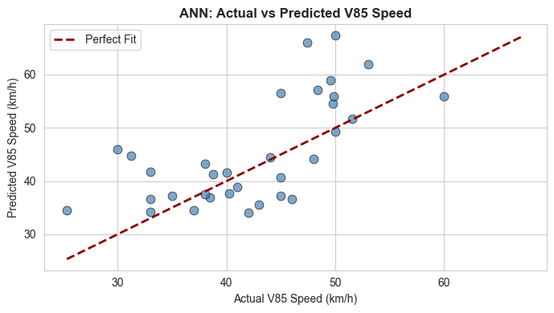
    


    

    


Residual Plot


```python
# ANN Residual Analysis

# Calculate residuals
ann_residuals = y_test - y_test_pred_ann

sns.set_style("whitegrid")

plt.figure(figsize=(7, 4))

# Scatter plot
sns.scatterplot(
    x=y_test_pred_ann,
    y=ann_residuals,
    color="steelblue",
    s=60,
    alpha=0.7,
    edgecolor="black"
)

# Reference line at zero
plt.axhline(
    y=0,
    linestyle="--",
    color="darkred",
    linewidth=2
)

plt.xlabel("Predicted V85 Speed (km/h)")
plt.ylabel("Residuals (km/h)")

plt.title(
    "ANN: Residual Plot",
    fontsize=12,
    fontweight="bold"
)

plt.tight_layout()
plt.show()
```


    
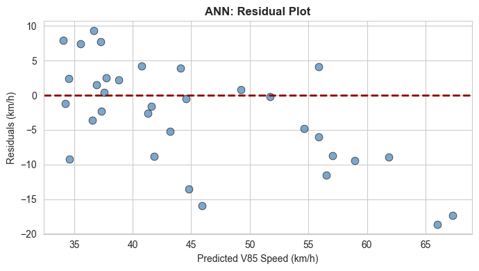
    


    

    


Result Table


```python
# Final ANN Performance Summary

ann_final = pd.DataFrame({
    "Model": ["ANN"],
    "R2": [round(ann_test_r2, 3)],
    "RMSE": [round(ann_test_rmse, 3)],
    "MAE": [round(ann_test_mae, 3)]
})

# Display results
display(ann_final)
```


<div>
<style scoped>
    .dataframe tbody tr th:only-of-type {
        vertical-align: middle;
    }

    .dataframe tbody tr th {
        vertical-align: top;
    }

    .dataframe thead th {
        text-align: right;
    }
</style>
<table border="1" class="dataframe">
  <thead>
    <tr style="text-align: right;">
      <th></th>
      <th>Model</th>
      <th>R2</th>
      <th>RMSE</th>
      <th>MAE</th>
    </tr>
  </thead>
  <tbody>
    <tr>
      <th>0</th>
      <td>ANN</td>
      <td>-0.088</td>
      <td>7.931</td>
      <td>6.203</td>
    </tr>
  </tbody>
</table>
</div>


<div>
<style scoped>
    .dataframe tbody tr th:only-of-type {
        vertical-align: middle;
    }

    .dataframe tbody tr th {
        vertical-align: top;
    }

    .dataframe thead th {
        text-align: right;
    }
</style>
<table border="1" class="dataframe">
  <thead>
    <tr style="text-align: right;">
      <th></th>
      <th>Model</th>
      <th>R2</th>
      <th>RMSE</th>
      <th>MAE</th>
    </tr>
  </thead>
  <tbody>
    <tr>
      <th>0</th>
      <td>ANN</td>
      <td>-0.088</td>
      <td>7.931</td>
      <td>6.203</td>
    </tr>
  </tbody>
</table>
</div>


Hyperparameter Tuned ANN Model


Hyperparameter Grid Definition


```python
# Hyperparameter Grid for ANN

param_grid_ann = {
    "ann__hidden_layer_sizes": [(32,), (64,), (64, 32), (128, 64)],
    "ann__activation": ["relu", "tanh"],
    "ann__alpha": [0.0001, 0.001, 0.01],
    "ann__learning_rate_init": [0.001, 0.01]
}
```

Grid Search Setup and Training


```python
# ANN Hyperparameter Tuning

from sklearn.model_selection import GridSearchCV
from sklearn.neural_network import MLPRegressor
from sklearn.preprocessing import StandardScaler
from sklearn.pipeline import Pipeline

# Create pipeline
ann_pipeline = Pipeline([
    ("scaler", StandardScaler()),
    ("ann", MLPRegressor(
        max_iter=3000,
        random_state=42
    ))
])

# Grid Search
grid_ann = GridSearchCV(
    estimator=ann_pipeline,
    param_grid=param_grid_ann,
    cv=5,
    scoring="r2",
    n_jobs=-1,
    verbose=1
)

# Train using unscaled data (pipeline handles scaling)
grid_ann.fit(X_train, y_train)

print("Tuning completed")
print("Best Parameters:", grid_ann.best_params_)
print("Best CV Score:", round(grid_ann.best_score_, 3))
```

    Fitting 5 folds for each of 48 candidates, totalling 240 fits
    Tuning completed
    Best Parameters: {'ann__activation': 'tanh', 'ann__alpha': 0.01, 'ann__hidden_layer_sizes': (32,), 'ann__learning_rate_init': 0.001}
    Best CV Score: 0.353
    Fitting 5 folds for each of 48 candidates, totalling 240 fits
    Tuning completed
    Best Parameters: {'ann__activation': 'tanh', 'ann__alpha': 0.01, 'ann__hidden_layer_sizes': (32,), 'ann__learning_rate_init': 0.001}
    Best CV Score: 0.353
    

Best Model Extraction


```python
# Best Model Extraction

best_ann = grid_ann.best_estimator_

best_ann
```


<style>#sk-container-id-17 {
  /* Definition of color scheme common for light and dark mode */
  --sklearn-color-text: #000;
  --sklearn-color-text-muted: #666;
  --sklearn-color-line: gray;
  /* Definition of color scheme for unfitted estimators */
  --sklearn-color-unfitted-level-0: #fff5e6;
  --sklearn-color-unfitted-level-1: #f6e4d2;
  --sklearn-color-unfitted-level-2: #ffe0b3;
  --sklearn-color-unfitted-level-3: chocolate;
  /* Definition of color scheme for fitted estimators */
  --sklearn-color-fitted-level-0: #f0f8ff;
  --sklearn-color-fitted-level-1: #d4ebff;
  --sklearn-color-fitted-level-2: #b3dbfd;
  --sklearn-color-fitted-level-3: cornflowerblue;
}

#sk-container-id-17.light {
  /* Specific color for light theme */
  --sklearn-color-text-on-default-background: black;
  --sklearn-color-background: white;
  --sklearn-color-border-box: black;
  --sklearn-color-icon: #696969;
}

#sk-container-id-17.dark {
  --sklearn-color-text-on-default-background: white;
  --sklearn-color-background: #111;
  --sklearn-color-border-box: white;
  --sklearn-color-icon: #878787;
}

#sk-container-id-17 {
  color: var(--sklearn-color-text);
}

#sk-container-id-17 pre {
  padding: 0;
}

#sk-container-id-17 input.sk-hidden--visually {
  border: 0;
  clip: rect(1px 1px 1px 1px);
  clip: rect(1px, 1px, 1px, 1px);
  height: 1px;
  margin: -1px;
  overflow: hidden;
  padding: 0;
  position: absolute;
  width: 1px;
}

#sk-container-id-17 div.sk-dashed-wrapped {
  border: 1px dashed var(--sklearn-color-line);
  margin: 0 0.4em 0.5em 0.4em;
  box-sizing: border-box;
  padding-bottom: 0.4em;
  background-color: var(--sklearn-color-background);
}

#sk-container-id-17 div.sk-container {
  /* jupyter's `normalize.less` sets `[hidden] { display: none; }`
     but bootstrap.min.css set `[hidden] { display: none !important; }`
     so we also need the `!important` here to be able to override the
     default hidden behavior on the sphinx rendered scikit-learn.org.
     See: https://github.com/scikit-learn/scikit-learn/issues/21755 */
  display: inline-block !important;
  position: relative;
}

#sk-container-id-17 div.sk-text-repr-fallback {
  display: none;
}

div.sk-parallel-item,
div.sk-serial,
div.sk-item {
  /* draw centered vertical line to link estimators */
  background-image: linear-gradient(var(--sklearn-color-text-on-default-background), var(--sklearn-color-text-on-default-background));
  background-size: 2px 100%;
  background-repeat: no-repeat;
  background-position: center center;
}

/* Parallel-specific style estimator block */

#sk-container-id-17 div.sk-parallel-item::after {
  content: "";
  width: 100%;
  border-bottom: 2px solid var(--sklearn-color-text-on-default-background);
  flex-grow: 1;
}

#sk-container-id-17 div.sk-parallel {
  display: flex;
  align-items: stretch;
  justify-content: center;
  background-color: var(--sklearn-color-background);
  position: relative;
}

#sk-container-id-17 div.sk-parallel-item {
  display: flex;
  flex-direction: column;
}

#sk-container-id-17 div.sk-parallel-item:first-child::after {
  align-self: flex-end;
  width: 50%;
}

#sk-container-id-17 div.sk-parallel-item:last-child::after {
  align-self: flex-start;
  width: 50%;
}

#sk-container-id-17 div.sk-parallel-item:only-child::after {
  width: 0;
}

/* Serial-specific style estimator block */

#sk-container-id-17 div.sk-serial {
  display: flex;
  flex-direction: column;
  align-items: center;
  background-color: var(--sklearn-color-background);
  padding-right: 1em;
  padding-left: 1em;
}


/* Toggleable style: style used for estimator/Pipeline/ColumnTransformer box that is
clickable and can be expanded/collapsed.
- Pipeline and ColumnTransformer use this feature and define the default style
- Estimators will overwrite some part of the style using the `sk-estimator` class
*/

/* Pipeline and ColumnTransformer style (default) */

#sk-container-id-17 div.sk-toggleable {
  /* Default theme specific background. It is overwritten whether we have a
  specific estimator or a Pipeline/ColumnTransformer */
  background-color: var(--sklearn-color-background);
}

/* Toggleable label */
#sk-container-id-17 label.sk-toggleable__label {
  cursor: pointer;
  display: flex;
  width: 100%;
  margin-bottom: 0;
  padding: 0.5em;
  box-sizing: border-box;
  text-align: center;
  align-items: center;
  justify-content: center;
  gap: 0.5em;
}

#sk-container-id-17 label.sk-toggleable__label .caption {
  font-size: 0.6rem;
  font-weight: lighter;
  color: var(--sklearn-color-text-muted);
}

#sk-container-id-17 label.sk-toggleable__label-arrow:before {
  /* Arrow on the left of the label */
  content: "▸";
  float: left;
  margin-right: 0.25em;
  color: var(--sklearn-color-icon);
}

#sk-container-id-17 label.sk-toggleable__label-arrow:hover:before {
  color: var(--sklearn-color-text);
}

/* Toggleable content - dropdown */

#sk-container-id-17 div.sk-toggleable__content {
  display: none;
  text-align: left;
  /* unfitted */
  background-color: var(--sklearn-color-unfitted-level-0);
}

#sk-container-id-17 div.sk-toggleable__content.fitted {
  /* fitted */
  background-color: var(--sklearn-color-fitted-level-0);
}

#sk-container-id-17 div.sk-toggleable__content pre {
  margin: 0.2em;
  border-radius: 0.25em;
  color: var(--sklearn-color-text);
  /* unfitted */
  background-color: var(--sklearn-color-unfitted-level-0);
}

#sk-container-id-17 div.sk-toggleable__content.fitted pre {
  /* unfitted */
  background-color: var(--sklearn-color-fitted-level-0);
}

#sk-container-id-17 input.sk-toggleable__control:checked~div.sk-toggleable__content {
  /* Expand drop-down */
  display: block;
  width: 100%;
  overflow: visible;
}

#sk-container-id-17 input.sk-toggleable__control:checked~label.sk-toggleable__label-arrow:before {
  content: "▾";
}

/* Pipeline/ColumnTransformer-specific style */

#sk-container-id-17 div.sk-label input.sk-toggleable__control:checked~label.sk-toggleable__label {
  color: var(--sklearn-color-text);
  background-color: var(--sklearn-color-unfitted-level-2);
}

#sk-container-id-17 div.sk-label.fitted input.sk-toggleable__control:checked~label.sk-toggleable__label {
  background-color: var(--sklearn-color-fitted-level-2);
}

/* Estimator-specific style */

/* Colorize estimator box */
#sk-container-id-17 div.sk-estimator input.sk-toggleable__control:checked~label.sk-toggleable__label {
  /* unfitted */
  background-color: var(--sklearn-color-unfitted-level-2);
}

#sk-container-id-17 div.sk-estimator.fitted input.sk-toggleable__control:checked~label.sk-toggleable__label {
  /* fitted */
  background-color: var(--sklearn-color-fitted-level-2);
}

#sk-container-id-17 div.sk-label label.sk-toggleable__label,
#sk-container-id-17 div.sk-label label {
  /* The background is the default theme color */
  color: var(--sklearn-color-text-on-default-background);
}

/* On hover, darken the color of the background */
#sk-container-id-17 div.sk-label:hover label.sk-toggleable__label {
  color: var(--sklearn-color-text);
  background-color: var(--sklearn-color-unfitted-level-2);
}

/* Label box, darken color on hover, fitted */
#sk-container-id-17 div.sk-label.fitted:hover label.sk-toggleable__label.fitted {
  color: var(--sklearn-color-text);
  background-color: var(--sklearn-color-fitted-level-2);
}

/* Estimator label */

#sk-container-id-17 div.sk-label label {
  font-family: monospace;
  font-weight: bold;
  line-height: 1.2em;
}

#sk-container-id-17 div.sk-label-container {
  text-align: center;
}

/* Estimator-specific */
#sk-container-id-17 div.sk-estimator {
  font-family: monospace;
  border: 1px dotted var(--sklearn-color-border-box);
  border-radius: 0.25em;
  box-sizing: border-box;
  margin-bottom: 0.5em;
  /* unfitted */
  background-color: var(--sklearn-color-unfitted-level-0);
}

#sk-container-id-17 div.sk-estimator.fitted {
  /* fitted */
  background-color: var(--sklearn-color-fitted-level-0);
}

/* on hover */
#sk-container-id-17 div.sk-estimator:hover {
  /* unfitted */
  background-color: var(--sklearn-color-unfitted-level-2);
}

#sk-container-id-17 div.sk-estimator.fitted:hover {
  /* fitted */
  background-color: var(--sklearn-color-fitted-level-2);
}

/* Specification for estimator info (e.g. "i" and "?") */

/* Common style for "i" and "?" */

.sk-estimator-doc-link,
a:link.sk-estimator-doc-link,
a:visited.sk-estimator-doc-link {
  float: right;
  font-size: smaller;
  line-height: 1em;
  font-family: monospace;
  background-color: var(--sklearn-color-unfitted-level-0);
  border-radius: 1em;
  height: 1em;
  width: 1em;
  text-decoration: none !important;
  margin-left: 0.5em;
  text-align: center;
  /* unfitted */
  border: var(--sklearn-color-unfitted-level-3) 1pt solid;
  color: var(--sklearn-color-unfitted-level-3);
}

.sk-estimator-doc-link.fitted,
a:link.sk-estimator-doc-link.fitted,
a:visited.sk-estimator-doc-link.fitted {
  /* fitted */
  background-color: var(--sklearn-color-fitted-level-0);
  border: var(--sklearn-color-fitted-level-3) 1pt solid;
  color: var(--sklearn-color-fitted-level-3);
}

/* On hover */
div.sk-estimator:hover .sk-estimator-doc-link:hover,
.sk-estimator-doc-link:hover,
div.sk-label-container:hover .sk-estimator-doc-link:hover,
.sk-estimator-doc-link:hover {
  /* unfitted */
  background-color: var(--sklearn-color-unfitted-level-3);
  border: var(--sklearn-color-fitted-level-0) 1pt solid;
  color: var(--sklearn-color-unfitted-level-0);
  text-decoration: none;
}

div.sk-estimator.fitted:hover .sk-estimator-doc-link.fitted:hover,
.sk-estimator-doc-link.fitted:hover,
div.sk-label-container:hover .sk-estimator-doc-link.fitted:hover,
.sk-estimator-doc-link.fitted:hover {
  /* fitted */
  background-color: var(--sklearn-color-fitted-level-3);
  border: var(--sklearn-color-fitted-level-0) 1pt solid;
  color: var(--sklearn-color-fitted-level-0);
  text-decoration: none;
}

/* Span, style for the box shown on hovering the info icon */
.sk-estimator-doc-link span {
  display: none;
  z-index: 9999;
  position: relative;
  font-weight: normal;
  right: .2ex;
  padding: .5ex;
  margin: .5ex;
  width: min-content;
  min-width: 20ex;
  max-width: 50ex;
  color: var(--sklearn-color-text);
  box-shadow: 2pt 2pt 4pt #999;
  /* unfitted */
  background: var(--sklearn-color-unfitted-level-0);
  border: .5pt solid var(--sklearn-color-unfitted-level-3);
}

.sk-estimator-doc-link.fitted span {
  /* fitted */
  background: var(--sklearn-color-fitted-level-0);
  border: var(--sklearn-color-fitted-level-3);
}

.sk-estimator-doc-link:hover span {
  display: block;
}

/* "?"-specific style due to the `<a>` HTML tag */

#sk-container-id-17 a.estimator_doc_link {
  float: right;
  font-size: 1rem;
  line-height: 1em;
  font-family: monospace;
  background-color: var(--sklearn-color-unfitted-level-0);
  border-radius: 1rem;
  height: 1rem;
  width: 1rem;
  text-decoration: none;
  /* unfitted */
  color: var(--sklearn-color-unfitted-level-1);
  border: var(--sklearn-color-unfitted-level-1) 1pt solid;
}

#sk-container-id-17 a.estimator_doc_link.fitted {
  /* fitted */
  background-color: var(--sklearn-color-fitted-level-0);
  border: var(--sklearn-color-fitted-level-1) 1pt solid;
  color: var(--sklearn-color-fitted-level-1);
}

/* On hover */
#sk-container-id-17 a.estimator_doc_link:hover {
  /* unfitted */
  background-color: var(--sklearn-color-unfitted-level-3);
  color: var(--sklearn-color-background);
  text-decoration: none;
}

#sk-container-id-17 a.estimator_doc_link.fitted:hover {
  /* fitted */
  background-color: var(--sklearn-color-fitted-level-3);
}

.estimator-table {
    font-family: monospace;
}

.estimator-table summary {
    padding: .5rem;
    cursor: pointer;
}

.estimator-table summary::marker {
    font-size: 0.7rem;
}

.estimator-table details[open] {
    padding-left: 0.1rem;
    padding-right: 0.1rem;
    padding-bottom: 0.3rem;
}

.estimator-table .parameters-table {
    margin-left: auto !important;
    margin-right: auto !important;
    margin-top: 0;
}

.estimator-table .parameters-table tr:nth-child(odd) {
    background-color: #fff;
}

.estimator-table .parameters-table tr:nth-child(even) {
    background-color: #f6f6f6;
}

.estimator-table .parameters-table tr:hover {
    background-color: #e0e0e0;
}

.estimator-table table td {
    border: 1px solid rgba(106, 105, 104, 0.232);
}

/*
    `table td`is set in notebook with right text-align.
    We need to overwrite it.
*/
.estimator-table table td.param {
    text-align: left;
    position: relative;
    padding: 0;
}

.user-set td {
    color:rgb(255, 94, 0);
    text-align: left !important;
}

.user-set td.value {
    color:rgb(255, 94, 0);
    background-color: transparent;
}

.default td {
    color: black;
    text-align: left !important;
}

.user-set td i,
.default td i {
    color: black;
}

/*
    Styles for parameter documentation links
    We need styling for visited so jupyter doesn't overwrite it
*/
a.param-doc-link,
a.param-doc-link:link,
a.param-doc-link:visited {
    text-decoration: underline dashed;
    text-underline-offset: .3em;
    color: inherit;
    display: block;
    padding: .5em;
}

/* "hack" to make the entire area of the cell containing the link clickable */
a.param-doc-link::before {
    position: absolute;
    content: "";
    inset: 0;
}

.param-doc-description {
    display: none;
    position: absolute;
    z-index: 9999;
    left: 0;
    padding: .5ex;
    margin-left: 1.5em;
    color: var(--sklearn-color-text);
    box-shadow: .3em .3em .4em #999;
    width: max-content;
    text-align: left;
    max-height: 10em;
    overflow-y: auto;

    /* unfitted */
    background: var(--sklearn-color-unfitted-level-0);
    border: thin solid var(--sklearn-color-unfitted-level-3);
}

/* Fitted state for parameter tooltips */
.fitted .param-doc-description {
    /* fitted */
    background: var(--sklearn-color-fitted-level-0);
    border: thin solid var(--sklearn-color-fitted-level-3);
}

.param-doc-link:hover .param-doc-description {
    display: block;
}

.copy-paste-icon {
    background-image: url();
    background-repeat: no-repeat;
    background-size: 14px 14px;
    background-position: 0;
    display: inline-block;
    width: 14px;
    height: 14px;
    cursor: pointer;
}
</style><body><div id="sk-container-id-17" class="sk-top-container"><div class="sk-text-repr-fallback"><pre>Pipeline(steps=[(&#x27;scaler&#x27;, StandardScaler()),
                (&#x27;ann&#x27;,
                 MLPRegressor(activation=&#x27;tanh&#x27;, alpha=0.01,
                              hidden_layer_sizes=(32,), max_iter=3000,
                              random_state=42))])</pre><b>In a Jupyter environment, please rerun this cell to show the HTML representation or trust the notebook. <br />On GitHub, the HTML representation is unable to render, please try loading this page with nbviewer.org.</b></div><div class="sk-container" hidden><div class="sk-item sk-dashed-wrapped"><div class="sk-label-container"><div class="sk-label fitted sk-toggleable"><input class="sk-toggleable__control sk-hidden--visually" id="sk-estimator-id-21" type="checkbox" ><label for="sk-estimator-id-21" class="sk-toggleable__label fitted sk-toggleable__label-arrow"><div><div>Pipeline</div></div><div><a class="sk-estimator-doc-link fitted" rel="noreferrer" target="_blank" href="https://scikit-learn.org/1.8/modules/generated/sklearn.pipeline.Pipeline.html">?<span>Documentation for Pipeline</span></a><span class="sk-estimator-doc-link fitted">i<span>Fitted</span></span></div></label><div class="sk-toggleable__content fitted" data-param-prefix="">
        <div class="estimator-table">
            <details>
                <summary>Parameters</summary>
                <table class="parameters-table">
                  <tbody>

        <tr class="user-set">
            <td><i class="copy-paste-icon"
                 onclick="copyToClipboard('steps',
                          this.parentElement.nextElementSibling)"
            ></i></td>
            <td class="param">
        <a class="param-doc-link"
            rel="noreferrer" target="_blank" href="https://scikit-learn.org/1.8/modules/generated/sklearn.pipeline.Pipeline.html#:~:text=steps,-list%20of%20tuples">
            steps
            <span class="param-doc-description">steps: list of tuples<br><br>List of (name of step, estimator) tuples that are to be chained in<br>sequential order. To be compatible with the scikit-learn API, all steps<br>must define `fit`. All non-last steps must also define `transform`. See<br>:ref:`Combining Estimators <combining_estimators>` for more details.</span>
        </a>
    </td>
            <td class="value">[(&#x27;scaler&#x27;, ...), (&#x27;ann&#x27;, ...)]</td>
        </tr>


        <tr class="default">
            <td><i class="copy-paste-icon"
                 onclick="copyToClipboard('transform_input',
                          this.parentElement.nextElementSibling)"
            ></i></td>
            <td class="param">
        <a class="param-doc-link"
            rel="noreferrer" target="_blank" href="https://scikit-learn.org/1.8/modules/generated/sklearn.pipeline.Pipeline.html#:~:text=transform_input,-list%20of%20str%2C%20default%3DNone">
            transform_input
            <span class="param-doc-description">transform_input: list of str, default=None<br><br>The names of the :term:`metadata` parameters that should be transformed by the<br>pipeline before passing it to the step consuming it.<br><br>This enables transforming some input arguments to ``fit`` (other than ``X``)<br>to be transformed by the steps of the pipeline up to the step which requires<br>them. Requirement is defined via :ref:`metadata routing <metadata_routing>`.<br>For instance, this can be used to pass a validation set through the pipeline.<br><br>You can only set this if metadata routing is enabled, which you<br>can enable using ``sklearn.set_config(enable_metadata_routing=True)``.<br><br>.. versionadded:: 1.6</span>
        </a>
    </td>
            <td class="value">None</td>
        </tr>


        <tr class="default">
            <td><i class="copy-paste-icon"
                 onclick="copyToClipboard('memory',
                          this.parentElement.nextElementSibling)"
            ></i></td>
            <td class="param">
        <a class="param-doc-link"
            rel="noreferrer" target="_blank" href="https://scikit-learn.org/1.8/modules/generated/sklearn.pipeline.Pipeline.html#:~:text=memory,-str%20or%20object%20with%20the%20joblib.Memory%20interface%2C%20default%3DNone">
            memory
            <span class="param-doc-description">memory: str or object with the joblib.Memory interface, default=None<br><br>Used to cache the fitted transformers of the pipeline. The last step<br>will never be cached, even if it is a transformer. By default, no<br>caching is performed. If a string is given, it is the path to the<br>caching directory. Enabling caching triggers a clone of the transformers<br>before fitting. Therefore, the transformer instance given to the<br>pipeline cannot be inspected directly. Use the attribute ``named_steps``<br>or ``steps`` to inspect estimators within the pipeline. Caching the<br>transformers is advantageous when fitting is time consuming. See<br>:ref:`sphx_glr_auto_examples_neighbors_plot_caching_nearest_neighbors.py`<br>for an example on how to enable caching.</span>
        </a>
    </td>
            <td class="value">None</td>
        </tr>


        <tr class="default">
            <td><i class="copy-paste-icon"
                 onclick="copyToClipboard('verbose',
                          this.parentElement.nextElementSibling)"
            ></i></td>
            <td class="param">
        <a class="param-doc-link"
            rel="noreferrer" target="_blank" href="https://scikit-learn.org/1.8/modules/generated/sklearn.pipeline.Pipeline.html#:~:text=verbose,-bool%2C%20default%3DFalse">
            verbose
            <span class="param-doc-description">verbose: bool, default=False<br><br>If True, the time elapsed while fitting each step will be printed as it<br>is completed.</span>
        </a>
    </td>
            <td class="value">False</td>
        </tr>

                  </tbody>
                </table>
            </details>
        </div>
    </div></div></div><div class="sk-serial"><div class="sk-item"><div class="sk-estimator fitted sk-toggleable"><input class="sk-toggleable__control sk-hidden--visually" id="sk-estimator-id-22" type="checkbox" ><label for="sk-estimator-id-22" class="sk-toggleable__label fitted sk-toggleable__label-arrow"><div><div>StandardScaler</div></div><div><a class="sk-estimator-doc-link fitted" rel="noreferrer" target="_blank" href="https://scikit-learn.org/1.8/modules/generated/sklearn.preprocessing.StandardScaler.html">?<span>Documentation for StandardScaler</span></a></div></label><div class="sk-toggleable__content fitted" data-param-prefix="scaler__">
        <div class="estimator-table">
            <details>
                <summary>Parameters</summary>
                <table class="parameters-table">
                  <tbody>

        <tr class="default">
            <td><i class="copy-paste-icon"
                 onclick="copyToClipboard('copy',
                          this.parentElement.nextElementSibling)"
            ></i></td>
            <td class="param">
        <a class="param-doc-link"
            rel="noreferrer" target="_blank" href="https://scikit-learn.org/1.8/modules/generated/sklearn.preprocessing.StandardScaler.html#:~:text=copy,-bool%2C%20default%3DTrue">
            copy
            <span class="param-doc-description">copy: bool, default=True<br><br>If False, try to avoid a copy and do inplace scaling instead.<br>This is not guaranteed to always work inplace; e.g. if the data is<br>not a NumPy array or scipy.sparse CSR matrix, a copy may still be<br>returned.</span>
        </a>
    </td>
            <td class="value">True</td>
        </tr>


        <tr class="default">
            <td><i class="copy-paste-icon"
                 onclick="copyToClipboard('with_mean',
                          this.parentElement.nextElementSibling)"
            ></i></td>
            <td class="param">
        <a class="param-doc-link"
            rel="noreferrer" target="_blank" href="https://scikit-learn.org/1.8/modules/generated/sklearn.preprocessing.StandardScaler.html#:~:text=with_mean,-bool%2C%20default%3DTrue">
            with_mean
            <span class="param-doc-description">with_mean: bool, default=True<br><br>If True, center the data before scaling.<br>This does not work (and will raise an exception) when attempted on<br>sparse matrices, because centering them entails building a dense<br>matrix which in common use cases is likely to be too large to fit in<br>memory.</span>
        </a>
    </td>
            <td class="value">True</td>
        </tr>


        <tr class="default">
            <td><i class="copy-paste-icon"
                 onclick="copyToClipboard('with_std',
                          this.parentElement.nextElementSibling)"
            ></i></td>
            <td class="param">
        <a class="param-doc-link"
            rel="noreferrer" target="_blank" href="https://scikit-learn.org/1.8/modules/generated/sklearn.preprocessing.StandardScaler.html#:~:text=with_std,-bool%2C%20default%3DTrue">
            with_std
            <span class="param-doc-description">with_std: bool, default=True<br><br>If True, scale the data to unit variance (or equivalently,<br>unit standard deviation).</span>
        </a>
    </td>
            <td class="value">True</td>
        </tr>

                  </tbody>
                </table>
            </details>
        </div>
    </div></div></div><div class="sk-item"><div class="sk-estimator fitted sk-toggleable"><input class="sk-toggleable__control sk-hidden--visually" id="sk-estimator-id-23" type="checkbox" ><label for="sk-estimator-id-23" class="sk-toggleable__label fitted sk-toggleable__label-arrow"><div><div>MLPRegressor</div></div><div><a class="sk-estimator-doc-link fitted" rel="noreferrer" target="_blank" href="https://scikit-learn.org/1.8/modules/generated/sklearn.neural_network.MLPRegressor.html">?<span>Documentation for MLPRegressor</span></a></div></label><div class="sk-toggleable__content fitted" data-param-prefix="ann__">
        <div class="estimator-table">
            <details>
                <summary>Parameters</summary>
                <table class="parameters-table">
                  <tbody>

        <tr class="default">
            <td><i class="copy-paste-icon"
                 onclick="copyToClipboard('loss',
                          this.parentElement.nextElementSibling)"
            ></i></td>
            <td class="param">
        <a class="param-doc-link"
            rel="noreferrer" target="_blank" href="https://scikit-learn.org/1.8/modules/generated/sklearn.neural_network.MLPRegressor.html#:~:text=loss,-%7B%27squared_error%27%2C%20%27poisson%27%7D%2C%20default%3D%27squared_error%27">
            loss
            <span class="param-doc-description">loss: {'squared_error', 'poisson'}, default='squared_error'<br><br>The loss function to use when training the weights. Note that the<br>"squared error" and "poisson" losses actually implement<br>"half squares error" and "half poisson deviance" to simplify the<br>computation of the gradient. Furthermore, the "poisson" loss internally uses<br>a log-link (exponential as the output activation function) and requires<br>``y >= 0``.<br><br>.. versionchanged:: 1.7<br>   Added parameter `loss` and option 'poisson'.</span>
        </a>
    </td>
            <td class="value">&#x27;squared_error&#x27;</td>
        </tr>


        <tr class="user-set">
            <td><i class="copy-paste-icon"
                 onclick="copyToClipboard('hidden_layer_sizes',
                          this.parentElement.nextElementSibling)"
            ></i></td>
            <td class="param">
        <a class="param-doc-link"
            rel="noreferrer" target="_blank" href="https://scikit-learn.org/1.8/modules/generated/sklearn.neural_network.MLPRegressor.html#:~:text=hidden_layer_sizes,-array-like%20of%20shape%28n_layers%20-%202%2C%29%2C%20default%3D%28100%2C%29">
            hidden_layer_sizes
            <span class="param-doc-description">hidden_layer_sizes: array-like of shape(n_layers - 2,), default=(100,)<br><br>The ith element represents the number of neurons in the ith<br>hidden layer.</span>
        </a>
    </td>
            <td class="value">(32,)</td>
        </tr>


        <tr class="user-set">
            <td><i class="copy-paste-icon"
                 onclick="copyToClipboard('activation',
                          this.parentElement.nextElementSibling)"
            ></i></td>
            <td class="param">
        <a class="param-doc-link"
            rel="noreferrer" target="_blank" href="https://scikit-learn.org/1.8/modules/generated/sklearn.neural_network.MLPRegressor.html#:~:text=activation,-%7B%27identity%27%2C%20%27logistic%27%2C%20%27tanh%27%2C%20%27relu%27%7D%2C%20default%3D%27relu%27">
            activation
            <span class="param-doc-description">activation: {'identity', 'logistic', 'tanh', 'relu'}, default='relu'<br><br>Activation function for the hidden layer.<br><br>- 'identity', no-op activation, useful to implement linear bottleneck,<br>  returns f(x) = x<br><br>- 'logistic', the logistic sigmoid function,<br>  returns f(x) = 1 / (1 + exp(-x)).<br><br>- 'tanh', the hyperbolic tan function,<br>  returns f(x) = tanh(x).<br><br>- 'relu', the rectified linear unit function,<br>  returns f(x) = max(0, x)</span>
        </a>
    </td>
            <td class="value">&#x27;tanh&#x27;</td>
        </tr>


        <tr class="default">
            <td><i class="copy-paste-icon"
                 onclick="copyToClipboard('solver',
                          this.parentElement.nextElementSibling)"
            ></i></td>
            <td class="param">
        <a class="param-doc-link"
            rel="noreferrer" target="_blank" href="https://scikit-learn.org/1.8/modules/generated/sklearn.neural_network.MLPRegressor.html#:~:text=solver,-%7B%27lbfgs%27%2C%20%27sgd%27%2C%20%27adam%27%7D%2C%20default%3D%27adam%27">
            solver
            <span class="param-doc-description">solver: {'lbfgs', 'sgd', 'adam'}, default='adam'<br><br>The solver for weight optimization.<br><br>- 'lbfgs' is an optimizer in the family of quasi-Newton methods.<br><br>- 'sgd' refers to stochastic gradient descent.<br><br>- 'adam' refers to a stochastic gradient-based optimizer proposed by<br>  Kingma, Diederik, and Jimmy Ba<br><br>For a comparison between Adam optimizer and SGD, see<br>:ref:`sphx_glr_auto_examples_neural_networks_plot_mlp_training_curves.py`.<br><br>Note: The default solver 'adam' works pretty well on relatively<br>large datasets (with thousands of training samples or more) in terms of<br>both training time and validation score.<br>For small datasets, however, 'lbfgs' can converge faster and perform<br>better.</span>
        </a>
    </td>
            <td class="value">&#x27;adam&#x27;</td>
        </tr>


        <tr class="user-set">
            <td><i class="copy-paste-icon"
                 onclick="copyToClipboard('alpha',
                          this.parentElement.nextElementSibling)"
            ></i></td>
            <td class="param">
        <a class="param-doc-link"
            rel="noreferrer" target="_blank" href="https://scikit-learn.org/1.8/modules/generated/sklearn.neural_network.MLPRegressor.html#:~:text=alpha,-float%2C%20default%3D0.0001">
            alpha
            <span class="param-doc-description">alpha: float, default=0.0001<br><br>Strength of the L2 regularization term. The L2 regularization term<br>is divided by the sample size when added to the loss.</span>
        </a>
    </td>
            <td class="value">0.01</td>
        </tr>


        <tr class="default">
            <td><i class="copy-paste-icon"
                 onclick="copyToClipboard('batch_size',
                          this.parentElement.nextElementSibling)"
            ></i></td>
            <td class="param">
        <a class="param-doc-link"
            rel="noreferrer" target="_blank" href="https://scikit-learn.org/1.8/modules/generated/sklearn.neural_network.MLPRegressor.html#:~:text=batch_size,-int%2C%20default%3D%27auto%27">
            batch_size
            <span class="param-doc-description">batch_size: int, default='auto'<br><br>Size of minibatches for stochastic optimizers.<br>If the solver is 'lbfgs', the regressor will not use minibatch.<br>When set to "auto", `batch_size=min(200, n_samples)`.</span>
        </a>
    </td>
            <td class="value">&#x27;auto&#x27;</td>
        </tr>


        <tr class="default">
            <td><i class="copy-paste-icon"
                 onclick="copyToClipboard('learning_rate',
                          this.parentElement.nextElementSibling)"
            ></i></td>
            <td class="param">
        <a class="param-doc-link"
            rel="noreferrer" target="_blank" href="https://scikit-learn.org/1.8/modules/generated/sklearn.neural_network.MLPRegressor.html#:~:text=learning_rate,-%7B%27constant%27%2C%20%27invscaling%27%2C%20%27adaptive%27%7D%2C%20default%3D%27constant%27">
            learning_rate
            <span class="param-doc-description">learning_rate: {'constant', 'invscaling', 'adaptive'}, default='constant'<br><br>Learning rate schedule for weight updates.<br><br>- 'constant' is a constant learning rate given by<br>  'learning_rate_init'.<br><br>- 'invscaling' gradually decreases the learning rate ``learning_rate_``<br>  at each time step 't' using an inverse scaling exponent of 'power_t'.<br>  effective_learning_rate = learning_rate_init / pow(t, power_t)<br><br>- 'adaptive' keeps the learning rate constant to<br>  'learning_rate_init' as long as training loss keeps decreasing.<br>  Each time two consecutive epochs fail to decrease training loss by at<br>  least tol, or fail to increase validation score by at least tol if<br>  'early_stopping' is on, the current learning rate is divided by 5.<br><br>Only used when solver='sgd'.</span>
        </a>
    </td>
            <td class="value">&#x27;constant&#x27;</td>
        </tr>


        <tr class="default">
            <td><i class="copy-paste-icon"
                 onclick="copyToClipboard('learning_rate_init',
                          this.parentElement.nextElementSibling)"
            ></i></td>
            <td class="param">
        <a class="param-doc-link"
            rel="noreferrer" target="_blank" href="https://scikit-learn.org/1.8/modules/generated/sklearn.neural_network.MLPRegressor.html#:~:text=learning_rate_init,-float%2C%20default%3D0.001">
            learning_rate_init
            <span class="param-doc-description">learning_rate_init: float, default=0.001<br><br>The initial learning rate used. It controls the step-size<br>in updating the weights. Only used when solver='sgd' or 'adam'.</span>
        </a>
    </td>
            <td class="value">0.001</td>
        </tr>


        <tr class="default">
            <td><i class="copy-paste-icon"
                 onclick="copyToClipboard('power_t',
                          this.parentElement.nextElementSibling)"
            ></i></td>
            <td class="param">
        <a class="param-doc-link"
            rel="noreferrer" target="_blank" href="https://scikit-learn.org/1.8/modules/generated/sklearn.neural_network.MLPRegressor.html#:~:text=power_t,-float%2C%20default%3D0.5">
            power_t
            <span class="param-doc-description">power_t: float, default=0.5<br><br>The exponent for inverse scaling learning rate.<br>It is used in updating effective learning rate when the learning_rate<br>is set to 'invscaling'. Only used when solver='sgd'.</span>
        </a>
    </td>
            <td class="value">0.5</td>
        </tr>


        <tr class="user-set">
            <td><i class="copy-paste-icon"
                 onclick="copyToClipboard('max_iter',
                          this.parentElement.nextElementSibling)"
            ></i></td>
            <td class="param">
        <a class="param-doc-link"
            rel="noreferrer" target="_blank" href="https://scikit-learn.org/1.8/modules/generated/sklearn.neural_network.MLPRegressor.html#:~:text=max_iter,-int%2C%20default%3D200">
            max_iter
            <span class="param-doc-description">max_iter: int, default=200<br><br>Maximum number of iterations. The solver iterates until convergence<br>(determined by 'tol') or this number of iterations. For stochastic<br>solvers ('sgd', 'adam'), note that this determines the number of epochs<br>(how many times each data point will be used), not the number of<br>gradient steps.</span>
        </a>
    </td>
            <td class="value">3000</td>
        </tr>


        <tr class="default">
            <td><i class="copy-paste-icon"
                 onclick="copyToClipboard('shuffle',
                          this.parentElement.nextElementSibling)"
            ></i></td>
            <td class="param">
        <a class="param-doc-link"
            rel="noreferrer" target="_blank" href="https://scikit-learn.org/1.8/modules/generated/sklearn.neural_network.MLPRegressor.html#:~:text=shuffle,-bool%2C%20default%3DTrue">
            shuffle
            <span class="param-doc-description">shuffle: bool, default=True<br><br>Whether to shuffle samples in each iteration. Only used when<br>solver='sgd' or 'adam'.</span>
        </a>
    </td>
            <td class="value">True</td>
        </tr>


        <tr class="user-set">
            <td><i class="copy-paste-icon"
                 onclick="copyToClipboard('random_state',
                          this.parentElement.nextElementSibling)"
            ></i></td>
            <td class="param">
        <a class="param-doc-link"
            rel="noreferrer" target="_blank" href="https://scikit-learn.org/1.8/modules/generated/sklearn.neural_network.MLPRegressor.html#:~:text=random_state,-int%2C%20RandomState%20instance%2C%20default%3DNone">
            random_state
            <span class="param-doc-description">random_state: int, RandomState instance, default=None<br><br>Determines random number generation for weights and bias<br>initialization, train-test split if early stopping is used, and batch<br>sampling when solver='sgd' or 'adam'.<br>Pass an int for reproducible results across multiple function calls.<br>See :term:`Glossary <random_state>`.</span>
        </a>
    </td>
            <td class="value">42</td>
        </tr>


        <tr class="default">
            <td><i class="copy-paste-icon"
                 onclick="copyToClipboard('tol',
                          this.parentElement.nextElementSibling)"
            ></i></td>
            <td class="param">
        <a class="param-doc-link"
            rel="noreferrer" target="_blank" href="https://scikit-learn.org/1.8/modules/generated/sklearn.neural_network.MLPRegressor.html#:~:text=tol,-float%2C%20default%3D1e-4">
            tol
            <span class="param-doc-description">tol: float, default=1e-4<br><br>Tolerance for the optimization. When the loss or score is not improving<br>by at least ``tol`` for ``n_iter_no_change`` consecutive iterations,<br>unless ``learning_rate`` is set to 'adaptive', convergence is<br>considered to be reached and training stops.</span>
        </a>
    </td>
            <td class="value">0.0001</td>
        </tr>


        <tr class="default">
            <td><i class="copy-paste-icon"
                 onclick="copyToClipboard('verbose',
                          this.parentElement.nextElementSibling)"
            ></i></td>
            <td class="param">
        <a class="param-doc-link"
            rel="noreferrer" target="_blank" href="https://scikit-learn.org/1.8/modules/generated/sklearn.neural_network.MLPRegressor.html#:~:text=verbose,-bool%2C%20default%3DFalse">
            verbose
            <span class="param-doc-description">verbose: bool, default=False<br><br>Whether to print progress messages to stdout.</span>
        </a>
    </td>
            <td class="value">False</td>
        </tr>


        <tr class="default">
            <td><i class="copy-paste-icon"
                 onclick="copyToClipboard('warm_start',
                          this.parentElement.nextElementSibling)"
            ></i></td>
            <td class="param">
        <a class="param-doc-link"
            rel="noreferrer" target="_blank" href="https://scikit-learn.org/1.8/modules/generated/sklearn.neural_network.MLPRegressor.html#:~:text=warm_start,-bool%2C%20default%3DFalse">
            warm_start
            <span class="param-doc-description">warm_start: bool, default=False<br><br>When set to True, reuse the solution of the previous<br>call to fit as initialization, otherwise, just erase the<br>previous solution. See :term:`the Glossary <warm_start>`.</span>
        </a>
    </td>
            <td class="value">False</td>
        </tr>


        <tr class="default">
            <td><i class="copy-paste-icon"
                 onclick="copyToClipboard('momentum',
                          this.parentElement.nextElementSibling)"
            ></i></td>
            <td class="param">
        <a class="param-doc-link"
            rel="noreferrer" target="_blank" href="https://scikit-learn.org/1.8/modules/generated/sklearn.neural_network.MLPRegressor.html#:~:text=momentum,-float%2C%20default%3D0.9">
            momentum
            <span class="param-doc-description">momentum: float, default=0.9<br><br>Momentum for gradient descent update. Should be between 0 and 1. Only<br>used when solver='sgd'.</span>
        </a>
    </td>
            <td class="value">0.9</td>
        </tr>


        <tr class="default">
            <td><i class="copy-paste-icon"
                 onclick="copyToClipboard('nesterovs_momentum',
                          this.parentElement.nextElementSibling)"
            ></i></td>
            <td class="param">
        <a class="param-doc-link"
            rel="noreferrer" target="_blank" href="https://scikit-learn.org/1.8/modules/generated/sklearn.neural_network.MLPRegressor.html#:~:text=nesterovs_momentum,-bool%2C%20default%3DTrue">
            nesterovs_momentum
            <span class="param-doc-description">nesterovs_momentum: bool, default=True<br><br>Whether to use Nesterov's momentum. Only used when solver='sgd' and<br>momentum > 0.</span>
        </a>
    </td>
            <td class="value">True</td>
        </tr>


        <tr class="default">
            <td><i class="copy-paste-icon"
                 onclick="copyToClipboard('early_stopping',
                          this.parentElement.nextElementSibling)"
            ></i></td>
            <td class="param">
        <a class="param-doc-link"
            rel="noreferrer" target="_blank" href="https://scikit-learn.org/1.8/modules/generated/sklearn.neural_network.MLPRegressor.html#:~:text=early_stopping,-bool%2C%20default%3DFalse">
            early_stopping
            <span class="param-doc-description">early_stopping: bool, default=False<br><br>Whether to use early stopping to terminate training when validation<br>score is not improving. If set to True, it will automatically set<br>aside ``validation_fraction`` of training data as validation and<br>terminate training when validation score is not improving by at<br>least ``tol`` for ``n_iter_no_change`` consecutive epochs.<br>Only effective when solver='sgd' or 'adam'.</span>
        </a>
    </td>
            <td class="value">False</td>
        </tr>


        <tr class="default">
            <td><i class="copy-paste-icon"
                 onclick="copyToClipboard('validation_fraction',
                          this.parentElement.nextElementSibling)"
            ></i></td>
            <td class="param">
        <a class="param-doc-link"
            rel="noreferrer" target="_blank" href="https://scikit-learn.org/1.8/modules/generated/sklearn.neural_network.MLPRegressor.html#:~:text=validation_fraction,-float%2C%20default%3D0.1">
            validation_fraction
            <span class="param-doc-description">validation_fraction: float, default=0.1<br><br>The proportion of training data to set aside as validation set for<br>early stopping. Must be between 0 and 1.<br>Only used if early_stopping is True.</span>
        </a>
    </td>
            <td class="value">0.1</td>
        </tr>


        <tr class="default">
            <td><i class="copy-paste-icon"
                 onclick="copyToClipboard('beta_1',
                          this.parentElement.nextElementSibling)"
            ></i></td>
            <td class="param">
        <a class="param-doc-link"
            rel="noreferrer" target="_blank" href="https://scikit-learn.org/1.8/modules/generated/sklearn.neural_network.MLPRegressor.html#:~:text=beta_1,-float%2C%20default%3D0.9">
            beta_1
            <span class="param-doc-description">beta_1: float, default=0.9<br><br>Exponential decay rate for estimates of first moment vector in adam,<br>should be in [0, 1). Only used when solver='adam'.</span>
        </a>
    </td>
            <td class="value">0.9</td>
        </tr>


        <tr class="default">
            <td><i class="copy-paste-icon"
                 onclick="copyToClipboard('beta_2',
                          this.parentElement.nextElementSibling)"
            ></i></td>
            <td class="param">
        <a class="param-doc-link"
            rel="noreferrer" target="_blank" href="https://scikit-learn.org/1.8/modules/generated/sklearn.neural_network.MLPRegressor.html#:~:text=beta_2,-float%2C%20default%3D0.999">
            beta_2
            <span class="param-doc-description">beta_2: float, default=0.999<br><br>Exponential decay rate for estimates of second moment vector in adam,<br>should be in [0, 1). Only used when solver='adam'.</span>
        </a>
    </td>
            <td class="value">0.999</td>
        </tr>


        <tr class="default">
            <td><i class="copy-paste-icon"
                 onclick="copyToClipboard('epsilon',
                          this.parentElement.nextElementSibling)"
            ></i></td>
            <td class="param">
        <a class="param-doc-link"
            rel="noreferrer" target="_blank" href="https://scikit-learn.org/1.8/modules/generated/sklearn.neural_network.MLPRegressor.html#:~:text=epsilon,-float%2C%20default%3D1e-8">
            epsilon
            <span class="param-doc-description">epsilon: float, default=1e-8<br><br>Value for numerical stability in adam. Only used when solver='adam'.</span>
        </a>
    </td>
            <td class="value">1e-08</td>
        </tr>


        <tr class="default">
            <td><i class="copy-paste-icon"
                 onclick="copyToClipboard('n_iter_no_change',
                          this.parentElement.nextElementSibling)"
            ></i></td>
            <td class="param">
        <a class="param-doc-link"
            rel="noreferrer" target="_blank" href="https://scikit-learn.org/1.8/modules/generated/sklearn.neural_network.MLPRegressor.html#:~:text=n_iter_no_change,-int%2C%20default%3D10">
            n_iter_no_change
            <span class="param-doc-description">n_iter_no_change: int, default=10<br><br>Maximum number of epochs to not meet ``tol`` improvement.<br>Only effective when solver='sgd' or 'adam'.<br><br>.. versionadded:: 0.20</span>
        </a>
    </td>
            <td class="value">10</td>
        </tr>


        <tr class="default">
            <td><i class="copy-paste-icon"
                 onclick="copyToClipboard('max_fun',
                          this.parentElement.nextElementSibling)"
            ></i></td>
            <td class="param">
        <a class="param-doc-link"
            rel="noreferrer" target="_blank" href="https://scikit-learn.org/1.8/modules/generated/sklearn.neural_network.MLPRegressor.html#:~:text=max_fun,-int%2C%20default%3D15000">
            max_fun
            <span class="param-doc-description">max_fun: int, default=15000<br><br>Only used when solver='lbfgs'. Maximum number of function calls.<br>The solver iterates until convergence (determined by ``tol``), number<br>of iterations reaches max_iter, or this number of function calls.<br>Note that number of function calls will be greater than or equal to<br>the number of iterations for the MLPRegressor.<br><br>.. versionadded:: 0.22</span>
        </a>
    </td>
            <td class="value">15000</td>
        </tr>

                  </tbody>
                </table>
            </details>
        </div>
    </div></div></div></div></div></div></div><script>function copyToClipboard(text, element) {
    // Get the parameter prefix from the closest toggleable content
    const toggleableContent = element.closest('.sk-toggleable__content');
    const paramPrefix = toggleableContent ? toggleableContent.dataset.paramPrefix : '';
    const fullParamName = paramPrefix ? `${paramPrefix}${text}` : text;

    const originalStyle = element.style;
    const computedStyle = window.getComputedStyle(element);
    const originalWidth = computedStyle.width;
    const originalHTML = element.innerHTML.replace('Copied!', '');

    navigator.clipboard.writeText(fullParamName)
        .then(() => {
            element.style.width = originalWidth;
            element.style.color = 'green';
            element.innerHTML = "Copied!";

            setTimeout(() => {
                element.innerHTML = originalHTML;
                element.style = originalStyle;
            }, 2000);
        })
        .catch(err => {
            console.error('Failed to copy:', err);
            element.style.color = 'red';
            element.innerHTML = "Failed!";
            setTimeout(() => {
                element.innerHTML = originalHTML;
                element.style = originalStyle;
            }, 2000);
        });
    return false;
}

document.querySelectorAll('.copy-paste-icon').forEach(function(element) {
    const toggleableContent = element.closest('.sk-toggleable__content');
    const paramPrefix = toggleableContent ? toggleableContent.dataset.paramPrefix : '';
    const paramName = element.parentElement.nextElementSibling
        .textContent.trim().split(' ')[0];
    const fullParamName = paramPrefix ? `${paramPrefix}${paramName}` : paramName;

    element.setAttribute('title', fullParamName);
});


/**
 * Adapted from Skrub
 * https://github.com/skrub-data/skrub/blob/403466d1d5d4dc76a7ef569b3f8228db59a31dc3/skrub/_reporting/_data/templates/report.js#L789
 * @returns "light" or "dark"
 */
function detectTheme(element) {
    const body = document.querySelector('body');

    // Check VSCode theme
    const themeKindAttr = body.getAttribute('data-vscode-theme-kind');
    const themeNameAttr = body.getAttribute('data-vscode-theme-name');

    if (themeKindAttr && themeNameAttr) {
        const themeKind = themeKindAttr.toLowerCase();
        const themeName = themeNameAttr.toLowerCase();

        if (themeKind.includes("dark") || themeName.includes("dark")) {
            return "dark";
        }
        if (themeKind.includes("light") || themeName.includes("light")) {
            return "light";
        }
    }

    // Check Jupyter theme
    if (body.getAttribute('data-jp-theme-light') === 'false') {
        return 'dark';
    } else if (body.getAttribute('data-jp-theme-light') === 'true') {
        return 'light';
    }

    // Guess based on a parent element's color
    const color = window.getComputedStyle(element.parentNode, null).getPropertyValue('color');
    const match = color.match(/^rgb\s*\(\s*(\d+)\s*,\s*(\d+)\s*,\s*(\d+)\s*\)\s*$/i);
    if (match) {
        const [r, g, b] = [
            parseFloat(match[1]),
            parseFloat(match[2]),
            parseFloat(match[3])
        ];

        // https://en.wikipedia.org/wiki/HSL_and_HSV#Lightness
        const luma = 0.299 * r + 0.587 * g + 0.114 * b;

        if (luma > 180) {
            // If the text is very bright we have a dark theme
            return 'dark';
        }
        if (luma < 75) {
            // If the text is very dark we have a light theme
            return 'light';
        }
        // Otherwise fall back to the next heuristic.
    }

    // Fallback to system preference
    return window.matchMedia('(prefers-color-scheme: dark)').matches ? 'dark' : 'light';
}


function forceTheme(elementId) {
    const estimatorElement = document.querySelector(`#${elementId}`);
    if (estimatorElement === null) {
        console.error(`Element with id ${elementId} not found.`);
    } else {
        const theme = detectTheme(estimatorElement);
        estimatorElement.classList.add(theme);
    }
}

forceTheme('sk-container-id-17');</script></body>


<style>#sk-container-id-18 {
  /* Definition of color scheme common for light and dark mode */
  --sklearn-color-text: #000;
  --sklearn-color-text-muted: #666;
  --sklearn-color-line: gray;
  /* Definition of color scheme for unfitted estimators */
  --sklearn-color-unfitted-level-0: #fff5e6;
  --sklearn-color-unfitted-level-1: #f6e4d2;
  --sklearn-color-unfitted-level-2: #ffe0b3;
  --sklearn-color-unfitted-level-3: chocolate;
  /* Definition of color scheme for fitted estimators */
  --sklearn-color-fitted-level-0: #f0f8ff;
  --sklearn-color-fitted-level-1: #d4ebff;
  --sklearn-color-fitted-level-2: #b3dbfd;
  --sklearn-color-fitted-level-3: cornflowerblue;
}

#sk-container-id-18.light {
  /* Specific color for light theme */
  --sklearn-color-text-on-default-background: black;
  --sklearn-color-background: white;
  --sklearn-color-border-box: black;
  --sklearn-color-icon: #696969;
}

#sk-container-id-18.dark {
  --sklearn-color-text-on-default-background: white;
  --sklearn-color-background: #111;
  --sklearn-color-border-box: white;
  --sklearn-color-icon: #878787;
}

#sk-container-id-18 {
  color: var(--sklearn-color-text);
}

#sk-container-id-18 pre {
  padding: 0;
}

#sk-container-id-18 input.sk-hidden--visually {
  border: 0;
  clip: rect(1px 1px 1px 1px);
  clip: rect(1px, 1px, 1px, 1px);
  height: 1px;
  margin: -1px;
  overflow: hidden;
  padding: 0;
  position: absolute;
  width: 1px;
}

#sk-container-id-18 div.sk-dashed-wrapped {
  border: 1px dashed var(--sklearn-color-line);
  margin: 0 0.4em 0.5em 0.4em;
  box-sizing: border-box;
  padding-bottom: 0.4em;
  background-color: var(--sklearn-color-background);
}

#sk-container-id-18 div.sk-container {
  /* jupyter's `normalize.less` sets `[hidden] { display: none; }`
     but bootstrap.min.css set `[hidden] { display: none !important; }`
     so we also need the `!important` here to be able to override the
     default hidden behavior on the sphinx rendered scikit-learn.org.
     See: https://github.com/scikit-learn/scikit-learn/issues/21755 */
  display: inline-block !important;
  position: relative;
}

#sk-container-id-18 div.sk-text-repr-fallback {
  display: none;
}

div.sk-parallel-item,
div.sk-serial,
div.sk-item {
  /* draw centered vertical line to link estimators */
  background-image: linear-gradient(var(--sklearn-color-text-on-default-background), var(--sklearn-color-text-on-default-background));
  background-size: 2px 100%;
  background-repeat: no-repeat;
  background-position: center center;
}

/* Parallel-specific style estimator block */

#sk-container-id-18 div.sk-parallel-item::after {
  content: "";
  width: 100%;
  border-bottom: 2px solid var(--sklearn-color-text-on-default-background);
  flex-grow: 1;
}

#sk-container-id-18 div.sk-parallel {
  display: flex;
  align-items: stretch;
  justify-content: center;
  background-color: var(--sklearn-color-background);
  position: relative;
}

#sk-container-id-18 div.sk-parallel-item {
  display: flex;
  flex-direction: column;
}

#sk-container-id-18 div.sk-parallel-item:first-child::after {
  align-self: flex-end;
  width: 50%;
}

#sk-container-id-18 div.sk-parallel-item:last-child::after {
  align-self: flex-start;
  width: 50%;
}

#sk-container-id-18 div.sk-parallel-item:only-child::after {
  width: 0;
}

/* Serial-specific style estimator block */

#sk-container-id-18 div.sk-serial {
  display: flex;
  flex-direction: column;
  align-items: center;
  background-color: var(--sklearn-color-background);
  padding-right: 1em;
  padding-left: 1em;
}


/* Toggleable style: style used for estimator/Pipeline/ColumnTransformer box that is
clickable and can be expanded/collapsed.
- Pipeline and ColumnTransformer use this feature and define the default style
- Estimators will overwrite some part of the style using the `sk-estimator` class
*/

/* Pipeline and ColumnTransformer style (default) */

#sk-container-id-18 div.sk-toggleable {
  /* Default theme specific background. It is overwritten whether we have a
  specific estimator or a Pipeline/ColumnTransformer */
  background-color: var(--sklearn-color-background);
}

/* Toggleable label */
#sk-container-id-18 label.sk-toggleable__label {
  cursor: pointer;
  display: flex;
  width: 100%;
  margin-bottom: 0;
  padding: 0.5em;
  box-sizing: border-box;
  text-align: center;
  align-items: center;
  justify-content: center;
  gap: 0.5em;
}

#sk-container-id-18 label.sk-toggleable__label .caption {
  font-size: 0.6rem;
  font-weight: lighter;
  color: var(--sklearn-color-text-muted);
}

#sk-container-id-18 label.sk-toggleable__label-arrow:before {
  /* Arrow on the left of the label */
  content: "▸";
  float: left;
  margin-right: 0.25em;
  color: var(--sklearn-color-icon);
}

#sk-container-id-18 label.sk-toggleable__label-arrow:hover:before {
  color: var(--sklearn-color-text);
}

/* Toggleable content - dropdown */

#sk-container-id-18 div.sk-toggleable__content {
  display: none;
  text-align: left;
  /* unfitted */
  background-color: var(--sklearn-color-unfitted-level-0);
}

#sk-container-id-18 div.sk-toggleable__content.fitted {
  /* fitted */
  background-color: var(--sklearn-color-fitted-level-0);
}

#sk-container-id-18 div.sk-toggleable__content pre {
  margin: 0.2em;
  border-radius: 0.25em;
  color: var(--sklearn-color-text);
  /* unfitted */
  background-color: var(--sklearn-color-unfitted-level-0);
}

#sk-container-id-18 div.sk-toggleable__content.fitted pre {
  /* unfitted */
  background-color: var(--sklearn-color-fitted-level-0);
}

#sk-container-id-18 input.sk-toggleable__control:checked~div.sk-toggleable__content {
  /* Expand drop-down */
  display: block;
  width: 100%;
  overflow: visible;
}

#sk-container-id-18 input.sk-toggleable__control:checked~label.sk-toggleable__label-arrow:before {
  content: "▾";
}

/* Pipeline/ColumnTransformer-specific style */

#sk-container-id-18 div.sk-label input.sk-toggleable__control:checked~label.sk-toggleable__label {
  color: var(--sklearn-color-text);
  background-color: var(--sklearn-color-unfitted-level-2);
}

#sk-container-id-18 div.sk-label.fitted input.sk-toggleable__control:checked~label.sk-toggleable__label {
  background-color: var(--sklearn-color-fitted-level-2);
}

/* Estimator-specific style */

/* Colorize estimator box */
#sk-container-id-18 div.sk-estimator input.sk-toggleable__control:checked~label.sk-toggleable__label {
  /* unfitted */
  background-color: var(--sklearn-color-unfitted-level-2);
}

#sk-container-id-18 div.sk-estimator.fitted input.sk-toggleable__control:checked~label.sk-toggleable__label {
  /* fitted */
  background-color: var(--sklearn-color-fitted-level-2);
}

#sk-container-id-18 div.sk-label label.sk-toggleable__label,
#sk-container-id-18 div.sk-label label {
  /* The background is the default theme color */
  color: var(--sklearn-color-text-on-default-background);
}

/* On hover, darken the color of the background */
#sk-container-id-18 div.sk-label:hover label.sk-toggleable__label {
  color: var(--sklearn-color-text);
  background-color: var(--sklearn-color-unfitted-level-2);
}

/* Label box, darken color on hover, fitted */
#sk-container-id-18 div.sk-label.fitted:hover label.sk-toggleable__label.fitted {
  color: var(--sklearn-color-text);
  background-color: var(--sklearn-color-fitted-level-2);
}

/* Estimator label */

#sk-container-id-18 div.sk-label label {
  font-family: monospace;
  font-weight: bold;
  line-height: 1.2em;
}

#sk-container-id-18 div.sk-label-container {
  text-align: center;
}

/* Estimator-specific */
#sk-container-id-18 div.sk-estimator {
  font-family: monospace;
  border: 1px dotted var(--sklearn-color-border-box);
  border-radius: 0.25em;
  box-sizing: border-box;
  margin-bottom: 0.5em;
  /* unfitted */
  background-color: var(--sklearn-color-unfitted-level-0);
}

#sk-container-id-18 div.sk-estimator.fitted {
  /* fitted */
  background-color: var(--sklearn-color-fitted-level-0);
}

/* on hover */
#sk-container-id-18 div.sk-estimator:hover {
  /* unfitted */
  background-color: var(--sklearn-color-unfitted-level-2);
}

#sk-container-id-18 div.sk-estimator.fitted:hover {
  /* fitted */
  background-color: var(--sklearn-color-fitted-level-2);
}

/* Specification for estimator info (e.g. "i" and "?") */

/* Common style for "i" and "?" */

.sk-estimator-doc-link,
a:link.sk-estimator-doc-link,
a:visited.sk-estimator-doc-link {
  float: right;
  font-size: smaller;
  line-height: 1em;
  font-family: monospace;
  background-color: var(--sklearn-color-unfitted-level-0);
  border-radius: 1em;
  height: 1em;
  width: 1em;
  text-decoration: none !important;
  margin-left: 0.5em;
  text-align: center;
  /* unfitted */
  border: var(--sklearn-color-unfitted-level-3) 1pt solid;
  color: var(--sklearn-color-unfitted-level-3);
}

.sk-estimator-doc-link.fitted,
a:link.sk-estimator-doc-link.fitted,
a:visited.sk-estimator-doc-link.fitted {
  /* fitted */
  background-color: var(--sklearn-color-fitted-level-0);
  border: var(--sklearn-color-fitted-level-3) 1pt solid;
  color: var(--sklearn-color-fitted-level-3);
}

/* On hover */
div.sk-estimator:hover .sk-estimator-doc-link:hover,
.sk-estimator-doc-link:hover,
div.sk-label-container:hover .sk-estimator-doc-link:hover,
.sk-estimator-doc-link:hover {
  /* unfitted */
  background-color: var(--sklearn-color-unfitted-level-3);
  border: var(--sklearn-color-fitted-level-0) 1pt solid;
  color: var(--sklearn-color-unfitted-level-0);
  text-decoration: none;
}

div.sk-estimator.fitted:hover .sk-estimator-doc-link.fitted:hover,
.sk-estimator-doc-link.fitted:hover,
div.sk-label-container:hover .sk-estimator-doc-link.fitted:hover,
.sk-estimator-doc-link.fitted:hover {
  /* fitted */
  background-color: var(--sklearn-color-fitted-level-3);
  border: var(--sklearn-color-fitted-level-0) 1pt solid;
  color: var(--sklearn-color-fitted-level-0);
  text-decoration: none;
}

/* Span, style for the box shown on hovering the info icon */
.sk-estimator-doc-link span {
  display: none;
  z-index: 9999;
  position: relative;
  font-weight: normal;
  right: .2ex;
  padding: .5ex;
  margin: .5ex;
  width: min-content;
  min-width: 20ex;
  max-width: 50ex;
  color: var(--sklearn-color-text);
  box-shadow: 2pt 2pt 4pt #999;
  /* unfitted */
  background: var(--sklearn-color-unfitted-level-0);
  border: .5pt solid var(--sklearn-color-unfitted-level-3);
}

.sk-estimator-doc-link.fitted span {
  /* fitted */
  background: var(--sklearn-color-fitted-level-0);
  border: var(--sklearn-color-fitted-level-3);
}

.sk-estimator-doc-link:hover span {
  display: block;
}

/* "?"-specific style due to the `<a>` HTML tag */

#sk-container-id-18 a.estimator_doc_link {
  float: right;
  font-size: 1rem;
  line-height: 1em;
  font-family: monospace;
  background-color: var(--sklearn-color-unfitted-level-0);
  border-radius: 1rem;
  height: 1rem;
  width: 1rem;
  text-decoration: none;
  /* unfitted */
  color: var(--sklearn-color-unfitted-level-1);
  border: var(--sklearn-color-unfitted-level-1) 1pt solid;
}

#sk-container-id-18 a.estimator_doc_link.fitted {
  /* fitted */
  background-color: var(--sklearn-color-fitted-level-0);
  border: var(--sklearn-color-fitted-level-1) 1pt solid;
  color: var(--sklearn-color-fitted-level-1);
}

/* On hover */
#sk-container-id-18 a.estimator_doc_link:hover {
  /* unfitted */
  background-color: var(--sklearn-color-unfitted-level-3);
  color: var(--sklearn-color-background);
  text-decoration: none;
}

#sk-container-id-18 a.estimator_doc_link.fitted:hover {
  /* fitted */
  background-color: var(--sklearn-color-fitted-level-3);
}

.estimator-table {
    font-family: monospace;
}

.estimator-table summary {
    padding: .5rem;
    cursor: pointer;
}

.estimator-table summary::marker {
    font-size: 0.7rem;
}

.estimator-table details[open] {
    padding-left: 0.1rem;
    padding-right: 0.1rem;
    padding-bottom: 0.3rem;
}

.estimator-table .parameters-table {
    margin-left: auto !important;
    margin-right: auto !important;
    margin-top: 0;
}

.estimator-table .parameters-table tr:nth-child(odd) {
    background-color: #fff;
}

.estimator-table .parameters-table tr:nth-child(even) {
    background-color: #f6f6f6;
}

.estimator-table .parameters-table tr:hover {
    background-color: #e0e0e0;
}

.estimator-table table td {
    border: 1px solid rgba(106, 105, 104, 0.232);
}

/*
    `table td`is set in notebook with right text-align.
    We need to overwrite it.
*/
.estimator-table table td.param {
    text-align: left;
    position: relative;
    padding: 0;
}

.user-set td {
    color:rgb(255, 94, 0);
    text-align: left !important;
}

.user-set td.value {
    color:rgb(255, 94, 0);
    background-color: transparent;
}

.default td {
    color: black;
    text-align: left !important;
}

.user-set td i,
.default td i {
    color: black;
}

/*
    Styles for parameter documentation links
    We need styling for visited so jupyter doesn't overwrite it
*/
a.param-doc-link,
a.param-doc-link:link,
a.param-doc-link:visited {
    text-decoration: underline dashed;
    text-underline-offset: .3em;
    color: inherit;
    display: block;
    padding: .5em;
}

/* "hack" to make the entire area of the cell containing the link clickable */
a.param-doc-link::before {
    position: absolute;
    content: "";
    inset: 0;
}

.param-doc-description {
    display: none;
    position: absolute;
    z-index: 9999;
    left: 0;
    padding: .5ex;
    margin-left: 1.5em;
    color: var(--sklearn-color-text);
    box-shadow: .3em .3em .4em #999;
    width: max-content;
    text-align: left;
    max-height: 10em;
    overflow-y: auto;

    /* unfitted */
    background: var(--sklearn-color-unfitted-level-0);
    border: thin solid var(--sklearn-color-unfitted-level-3);
}

/* Fitted state for parameter tooltips */
.fitted .param-doc-description {
    /* fitted */
    background: var(--sklearn-color-fitted-level-0);
    border: thin solid var(--sklearn-color-fitted-level-3);
}

.param-doc-link:hover .param-doc-description {
    display: block;
}

.copy-paste-icon {
    background-image: url();
    background-repeat: no-repeat;
    background-size: 14px 14px;
    background-position: 0;
    display: inline-block;
    width: 14px;
    height: 14px;
    cursor: pointer;
}
</style><body><div id="sk-container-id-18" class="sk-top-container"><div class="sk-text-repr-fallback"><pre>Pipeline(steps=[(&#x27;scaler&#x27;, StandardScaler()),
                (&#x27;ann&#x27;,
                 MLPRegressor(activation=&#x27;tanh&#x27;, alpha=0.01,
                              hidden_layer_sizes=(32,), max_iter=3000,
                              random_state=42))])</pre><b>In a Jupyter environment, please rerun this cell to show the HTML representation or trust the notebook. <br />On GitHub, the HTML representation is unable to render, please try loading this page with nbviewer.org.</b></div><div class="sk-container" hidden><div class="sk-item sk-dashed-wrapped"><div class="sk-label-container"><div class="sk-label fitted sk-toggleable"><input class="sk-toggleable__control sk-hidden--visually" id="sk-estimator-id-24" type="checkbox" ><label for="sk-estimator-id-24" class="sk-toggleable__label fitted sk-toggleable__label-arrow"><div><div>Pipeline</div></div><div><a class="sk-estimator-doc-link fitted" rel="noreferrer" target="_blank" href="https://scikit-learn.org/1.8/modules/generated/sklearn.pipeline.Pipeline.html">?<span>Documentation for Pipeline</span></a><span class="sk-estimator-doc-link fitted">i<span>Fitted</span></span></div></label><div class="sk-toggleable__content fitted" data-param-prefix="">
        <div class="estimator-table">
            <details>
                <summary>Parameters</summary>
                <table class="parameters-table">
                  <tbody>

        <tr class="user-set">
            <td><i class="copy-paste-icon"
                 onclick="copyToClipboard('steps',
                          this.parentElement.nextElementSibling)"
            ></i></td>
            <td class="param">
        <a class="param-doc-link"
            rel="noreferrer" target="_blank" href="https://scikit-learn.org/1.8/modules/generated/sklearn.pipeline.Pipeline.html#:~:text=steps,-list%20of%20tuples">
            steps
            <span class="param-doc-description">steps: list of tuples<br><br>List of (name of step, estimator) tuples that are to be chained in<br>sequential order. To be compatible with the scikit-learn API, all steps<br>must define `fit`. All non-last steps must also define `transform`. See<br>:ref:`Combining Estimators <combining_estimators>` for more details.</span>
        </a>
    </td>
            <td class="value">[(&#x27;scaler&#x27;, ...), (&#x27;ann&#x27;, ...)]</td>
        </tr>


        <tr class="default">
            <td><i class="copy-paste-icon"
                 onclick="copyToClipboard('transform_input',
                          this.parentElement.nextElementSibling)"
            ></i></td>
            <td class="param">
        <a class="param-doc-link"
            rel="noreferrer" target="_blank" href="https://scikit-learn.org/1.8/modules/generated/sklearn.pipeline.Pipeline.html#:~:text=transform_input,-list%20of%20str%2C%20default%3DNone">
            transform_input
            <span class="param-doc-description">transform_input: list of str, default=None<br><br>The names of the :term:`metadata` parameters that should be transformed by the<br>pipeline before passing it to the step consuming it.<br><br>This enables transforming some input arguments to ``fit`` (other than ``X``)<br>to be transformed by the steps of the pipeline up to the step which requires<br>them. Requirement is defined via :ref:`metadata routing <metadata_routing>`.<br>For instance, this can be used to pass a validation set through the pipeline.<br><br>You can only set this if metadata routing is enabled, which you<br>can enable using ``sklearn.set_config(enable_metadata_routing=True)``.<br><br>.. versionadded:: 1.6</span>
        </a>
    </td>
            <td class="value">None</td>
        </tr>


        <tr class="default">
            <td><i class="copy-paste-icon"
                 onclick="copyToClipboard('memory',
                          this.parentElement.nextElementSibling)"
            ></i></td>
            <td class="param">
        <a class="param-doc-link"
            rel="noreferrer" target="_blank" href="https://scikit-learn.org/1.8/modules/generated/sklearn.pipeline.Pipeline.html#:~:text=memory,-str%20or%20object%20with%20the%20joblib.Memory%20interface%2C%20default%3DNone">
            memory
            <span class="param-doc-description">memory: str or object with the joblib.Memory interface, default=None<br><br>Used to cache the fitted transformers of the pipeline. The last step<br>will never be cached, even if it is a transformer. By default, no<br>caching is performed. If a string is given, it is the path to the<br>caching directory. Enabling caching triggers a clone of the transformers<br>before fitting. Therefore, the transformer instance given to the<br>pipeline cannot be inspected directly. Use the attribute ``named_steps``<br>or ``steps`` to inspect estimators within the pipeline. Caching the<br>transformers is advantageous when fitting is time consuming. See<br>:ref:`sphx_glr_auto_examples_neighbors_plot_caching_nearest_neighbors.py`<br>for an example on how to enable caching.</span>
        </a>
    </td>
            <td class="value">None</td>
        </tr>


        <tr class="default">
            <td><i class="copy-paste-icon"
                 onclick="copyToClipboard('verbose',
                          this.parentElement.nextElementSibling)"
            ></i></td>
            <td class="param">
        <a class="param-doc-link"
            rel="noreferrer" target="_blank" href="https://scikit-learn.org/1.8/modules/generated/sklearn.pipeline.Pipeline.html#:~:text=verbose,-bool%2C%20default%3DFalse">
            verbose
            <span class="param-doc-description">verbose: bool, default=False<br><br>If True, the time elapsed while fitting each step will be printed as it<br>is completed.</span>
        </a>
    </td>
            <td class="value">False</td>
        </tr>

                  </tbody>
                </table>
            </details>
        </div>
    </div></div></div><div class="sk-serial"><div class="sk-item"><div class="sk-estimator fitted sk-toggleable"><input class="sk-toggleable__control sk-hidden--visually" id="sk-estimator-id-25" type="checkbox" ><label for="sk-estimator-id-25" class="sk-toggleable__label fitted sk-toggleable__label-arrow"><div><div>StandardScaler</div></div><div><a class="sk-estimator-doc-link fitted" rel="noreferrer" target="_blank" href="https://scikit-learn.org/1.8/modules/generated/sklearn.preprocessing.StandardScaler.html">?<span>Documentation for StandardScaler</span></a></div></label><div class="sk-toggleable__content fitted" data-param-prefix="scaler__">
        <div class="estimator-table">
            <details>
                <summary>Parameters</summary>
                <table class="parameters-table">
                  <tbody>

        <tr class="default">
            <td><i class="copy-paste-icon"
                 onclick="copyToClipboard('copy',
                          this.parentElement.nextElementSibling)"
            ></i></td>
            <td class="param">
        <a class="param-doc-link"
            rel="noreferrer" target="_blank" href="https://scikit-learn.org/1.8/modules/generated/sklearn.preprocessing.StandardScaler.html#:~:text=copy,-bool%2C%20default%3DTrue">
            copy
            <span class="param-doc-description">copy: bool, default=True<br><br>If False, try to avoid a copy and do inplace scaling instead.<br>This is not guaranteed to always work inplace; e.g. if the data is<br>not a NumPy array or scipy.sparse CSR matrix, a copy may still be<br>returned.</span>
        </a>
    </td>
            <td class="value">True</td>
        </tr>


        <tr class="default">
            <td><i class="copy-paste-icon"
                 onclick="copyToClipboard('with_mean',
                          this.parentElement.nextElementSibling)"
            ></i></td>
            <td class="param">
        <a class="param-doc-link"
            rel="noreferrer" target="_blank" href="https://scikit-learn.org/1.8/modules/generated/sklearn.preprocessing.StandardScaler.html#:~:text=with_mean,-bool%2C%20default%3DTrue">
            with_mean
            <span class="param-doc-description">with_mean: bool, default=True<br><br>If True, center the data before scaling.<br>This does not work (and will raise an exception) when attempted on<br>sparse matrices, because centering them entails building a dense<br>matrix which in common use cases is likely to be too large to fit in<br>memory.</span>
        </a>
    </td>
            <td class="value">True</td>
        </tr>


        <tr class="default">
            <td><i class="copy-paste-icon"
                 onclick="copyToClipboard('with_std',
                          this.parentElement.nextElementSibling)"
            ></i></td>
            <td class="param">
        <a class="param-doc-link"
            rel="noreferrer" target="_blank" href="https://scikit-learn.org/1.8/modules/generated/sklearn.preprocessing.StandardScaler.html#:~:text=with_std,-bool%2C%20default%3DTrue">
            with_std
            <span class="param-doc-description">with_std: bool, default=True<br><br>If True, scale the data to unit variance (or equivalently,<br>unit standard deviation).</span>
        </a>
    </td>
            <td class="value">True</td>
        </tr>

                  </tbody>
                </table>
            </details>
        </div>
    </div></div></div><div class="sk-item"><div class="sk-estimator fitted sk-toggleable"><input class="sk-toggleable__control sk-hidden--visually" id="sk-estimator-id-26" type="checkbox" ><label for="sk-estimator-id-26" class="sk-toggleable__label fitted sk-toggleable__label-arrow"><div><div>MLPRegressor</div></div><div><a class="sk-estimator-doc-link fitted" rel="noreferrer" target="_blank" href="https://scikit-learn.org/1.8/modules/generated/sklearn.neural_network.MLPRegressor.html">?<span>Documentation for MLPRegressor</span></a></div></label><div class="sk-toggleable__content fitted" data-param-prefix="ann__">
        <div class="estimator-table">
            <details>
                <summary>Parameters</summary>
                <table class="parameters-table">
                  <tbody>

        <tr class="default">
            <td><i class="copy-paste-icon"
                 onclick="copyToClipboard('loss',
                          this.parentElement.nextElementSibling)"
            ></i></td>
            <td class="param">
        <a class="param-doc-link"
            rel="noreferrer" target="_blank" href="https://scikit-learn.org/1.8/modules/generated/sklearn.neural_network.MLPRegressor.html#:~:text=loss,-%7B%27squared_error%27%2C%20%27poisson%27%7D%2C%20default%3D%27squared_error%27">
            loss
            <span class="param-doc-description">loss: {'squared_error', 'poisson'}, default='squared_error'<br><br>The loss function to use when training the weights. Note that the<br>"squared error" and "poisson" losses actually implement<br>"half squares error" and "half poisson deviance" to simplify the<br>computation of the gradient. Furthermore, the "poisson" loss internally uses<br>a log-link (exponential as the output activation function) and requires<br>``y >= 0``.<br><br>.. versionchanged:: 1.7<br>   Added parameter `loss` and option 'poisson'.</span>
        </a>
    </td>
            <td class="value">&#x27;squared_error&#x27;</td>
        </tr>


        <tr class="user-set">
            <td><i class="copy-paste-icon"
                 onclick="copyToClipboard('hidden_layer_sizes',
                          this.parentElement.nextElementSibling)"
            ></i></td>
            <td class="param">
        <a class="param-doc-link"
            rel="noreferrer" target="_blank" href="https://scikit-learn.org/1.8/modules/generated/sklearn.neural_network.MLPRegressor.html#:~:text=hidden_layer_sizes,-array-like%20of%20shape%28n_layers%20-%202%2C%29%2C%20default%3D%28100%2C%29">
            hidden_layer_sizes
            <span class="param-doc-description">hidden_layer_sizes: array-like of shape(n_layers - 2,), default=(100,)<br><br>The ith element represents the number of neurons in the ith<br>hidden layer.</span>
        </a>
    </td>
            <td class="value">(32,)</td>
        </tr>


        <tr class="user-set">
            <td><i class="copy-paste-icon"
                 onclick="copyToClipboard('activation',
                          this.parentElement.nextElementSibling)"
            ></i></td>
            <td class="param">
        <a class="param-doc-link"
            rel="noreferrer" target="_blank" href="https://scikit-learn.org/1.8/modules/generated/sklearn.neural_network.MLPRegressor.html#:~:text=activation,-%7B%27identity%27%2C%20%27logistic%27%2C%20%27tanh%27%2C%20%27relu%27%7D%2C%20default%3D%27relu%27">
            activation
            <span class="param-doc-description">activation: {'identity', 'logistic', 'tanh', 'relu'}, default='relu'<br><br>Activation function for the hidden layer.<br><br>- 'identity', no-op activation, useful to implement linear bottleneck,<br>  returns f(x) = x<br><br>- 'logistic', the logistic sigmoid function,<br>  returns f(x) = 1 / (1 + exp(-x)).<br><br>- 'tanh', the hyperbolic tan function,<br>  returns f(x) = tanh(x).<br><br>- 'relu', the rectified linear unit function,<br>  returns f(x) = max(0, x)</span>
        </a>
    </td>
            <td class="value">&#x27;tanh&#x27;</td>
        </tr>


        <tr class="default">
            <td><i class="copy-paste-icon"
                 onclick="copyToClipboard('solver',
                          this.parentElement.nextElementSibling)"
            ></i></td>
            <td class="param">
        <a class="param-doc-link"
            rel="noreferrer" target="_blank" href="https://scikit-learn.org/1.8/modules/generated/sklearn.neural_network.MLPRegressor.html#:~:text=solver,-%7B%27lbfgs%27%2C%20%27sgd%27%2C%20%27adam%27%7D%2C%20default%3D%27adam%27">
            solver
            <span class="param-doc-description">solver: {'lbfgs', 'sgd', 'adam'}, default='adam'<br><br>The solver for weight optimization.<br><br>- 'lbfgs' is an optimizer in the family of quasi-Newton methods.<br><br>- 'sgd' refers to stochastic gradient descent.<br><br>- 'adam' refers to a stochastic gradient-based optimizer proposed by<br>  Kingma, Diederik, and Jimmy Ba<br><br>For a comparison between Adam optimizer and SGD, see<br>:ref:`sphx_glr_auto_examples_neural_networks_plot_mlp_training_curves.py`.<br><br>Note: The default solver 'adam' works pretty well on relatively<br>large datasets (with thousands of training samples or more) in terms of<br>both training time and validation score.<br>For small datasets, however, 'lbfgs' can converge faster and perform<br>better.</span>
        </a>
    </td>
            <td class="value">&#x27;adam&#x27;</td>
        </tr>


        <tr class="user-set">
            <td><i class="copy-paste-icon"
                 onclick="copyToClipboard('alpha',
                          this.parentElement.nextElementSibling)"
            ></i></td>
            <td class="param">
        <a class="param-doc-link"
            rel="noreferrer" target="_blank" href="https://scikit-learn.org/1.8/modules/generated/sklearn.neural_network.MLPRegressor.html#:~:text=alpha,-float%2C%20default%3D0.0001">
            alpha
            <span class="param-doc-description">alpha: float, default=0.0001<br><br>Strength of the L2 regularization term. The L2 regularization term<br>is divided by the sample size when added to the loss.</span>
        </a>
    </td>
            <td class="value">0.01</td>
        </tr>


        <tr class="default">
            <td><i class="copy-paste-icon"
                 onclick="copyToClipboard('batch_size',
                          this.parentElement.nextElementSibling)"
            ></i></td>
            <td class="param">
        <a class="param-doc-link"
            rel="noreferrer" target="_blank" href="https://scikit-learn.org/1.8/modules/generated/sklearn.neural_network.MLPRegressor.html#:~:text=batch_size,-int%2C%20default%3D%27auto%27">
            batch_size
            <span class="param-doc-description">batch_size: int, default='auto'<br><br>Size of minibatches for stochastic optimizers.<br>If the solver is 'lbfgs', the regressor will not use minibatch.<br>When set to "auto", `batch_size=min(200, n_samples)`.</span>
        </a>
    </td>
            <td class="value">&#x27;auto&#x27;</td>
        </tr>


        <tr class="default">
            <td><i class="copy-paste-icon"
                 onclick="copyToClipboard('learning_rate',
                          this.parentElement.nextElementSibling)"
            ></i></td>
            <td class="param">
        <a class="param-doc-link"
            rel="noreferrer" target="_blank" href="https://scikit-learn.org/1.8/modules/generated/sklearn.neural_network.MLPRegressor.html#:~:text=learning_rate,-%7B%27constant%27%2C%20%27invscaling%27%2C%20%27adaptive%27%7D%2C%20default%3D%27constant%27">
            learning_rate
            <span class="param-doc-description">learning_rate: {'constant', 'invscaling', 'adaptive'}, default='constant'<br><br>Learning rate schedule for weight updates.<br><br>- 'constant' is a constant learning rate given by<br>  'learning_rate_init'.<br><br>- 'invscaling' gradually decreases the learning rate ``learning_rate_``<br>  at each time step 't' using an inverse scaling exponent of 'power_t'.<br>  effective_learning_rate = learning_rate_init / pow(t, power_t)<br><br>- 'adaptive' keeps the learning rate constant to<br>  'learning_rate_init' as long as training loss keeps decreasing.<br>  Each time two consecutive epochs fail to decrease training loss by at<br>  least tol, or fail to increase validation score by at least tol if<br>  'early_stopping' is on, the current learning rate is divided by 5.<br><br>Only used when solver='sgd'.</span>
        </a>
    </td>
            <td class="value">&#x27;constant&#x27;</td>
        </tr>


        <tr class="default">
            <td><i class="copy-paste-icon"
                 onclick="copyToClipboard('learning_rate_init',
                          this.parentElement.nextElementSibling)"
            ></i></td>
            <td class="param">
        <a class="param-doc-link"
            rel="noreferrer" target="_blank" href="https://scikit-learn.org/1.8/modules/generated/sklearn.neural_network.MLPRegressor.html#:~:text=learning_rate_init,-float%2C%20default%3D0.001">
            learning_rate_init
            <span class="param-doc-description">learning_rate_init: float, default=0.001<br><br>The initial learning rate used. It controls the step-size<br>in updating the weights. Only used when solver='sgd' or 'adam'.</span>
        </a>
    </td>
            <td class="value">0.001</td>
        </tr>


        <tr class="default">
            <td><i class="copy-paste-icon"
                 onclick="copyToClipboard('power_t',
                          this.parentElement.nextElementSibling)"
            ></i></td>
            <td class="param">
        <a class="param-doc-link"
            rel="noreferrer" target="_blank" href="https://scikit-learn.org/1.8/modules/generated/sklearn.neural_network.MLPRegressor.html#:~:text=power_t,-float%2C%20default%3D0.5">
            power_t
            <span class="param-doc-description">power_t: float, default=0.5<br><br>The exponent for inverse scaling learning rate.<br>It is used in updating effective learning rate when the learning_rate<br>is set to 'invscaling'. Only used when solver='sgd'.</span>
        </a>
    </td>
            <td class="value">0.5</td>
        </tr>


        <tr class="user-set">
            <td><i class="copy-paste-icon"
                 onclick="copyToClipboard('max_iter',
                          this.parentElement.nextElementSibling)"
            ></i></td>
            <td class="param">
        <a class="param-doc-link"
            rel="noreferrer" target="_blank" href="https://scikit-learn.org/1.8/modules/generated/sklearn.neural_network.MLPRegressor.html#:~:text=max_iter,-int%2C%20default%3D200">
            max_iter
            <span class="param-doc-description">max_iter: int, default=200<br><br>Maximum number of iterations. The solver iterates until convergence<br>(determined by 'tol') or this number of iterations. For stochastic<br>solvers ('sgd', 'adam'), note that this determines the number of epochs<br>(how many times each data point will be used), not the number of<br>gradient steps.</span>
        </a>
    </td>
            <td class="value">3000</td>
        </tr>


        <tr class="default">
            <td><i class="copy-paste-icon"
                 onclick="copyToClipboard('shuffle',
                          this.parentElement.nextElementSibling)"
            ></i></td>
            <td class="param">
        <a class="param-doc-link"
            rel="noreferrer" target="_blank" href="https://scikit-learn.org/1.8/modules/generated/sklearn.neural_network.MLPRegressor.html#:~:text=shuffle,-bool%2C%20default%3DTrue">
            shuffle
            <span class="param-doc-description">shuffle: bool, default=True<br><br>Whether to shuffle samples in each iteration. Only used when<br>solver='sgd' or 'adam'.</span>
        </a>
    </td>
            <td class="value">True</td>
        </tr>


        <tr class="user-set">
            <td><i class="copy-paste-icon"
                 onclick="copyToClipboard('random_state',
                          this.parentElement.nextElementSibling)"
            ></i></td>
            <td class="param">
        <a class="param-doc-link"
            rel="noreferrer" target="_blank" href="https://scikit-learn.org/1.8/modules/generated/sklearn.neural_network.MLPRegressor.html#:~:text=random_state,-int%2C%20RandomState%20instance%2C%20default%3DNone">
            random_state
            <span class="param-doc-description">random_state: int, RandomState instance, default=None<br><br>Determines random number generation for weights and bias<br>initialization, train-test split if early stopping is used, and batch<br>sampling when solver='sgd' or 'adam'.<br>Pass an int for reproducible results across multiple function calls.<br>See :term:`Glossary <random_state>`.</span>
        </a>
    </td>
            <td class="value">42</td>
        </tr>


        <tr class="default">
            <td><i class="copy-paste-icon"
                 onclick="copyToClipboard('tol',
                          this.parentElement.nextElementSibling)"
            ></i></td>
            <td class="param">
        <a class="param-doc-link"
            rel="noreferrer" target="_blank" href="https://scikit-learn.org/1.8/modules/generated/sklearn.neural_network.MLPRegressor.html#:~:text=tol,-float%2C%20default%3D1e-4">
            tol
            <span class="param-doc-description">tol: float, default=1e-4<br><br>Tolerance for the optimization. When the loss or score is not improving<br>by at least ``tol`` for ``n_iter_no_change`` consecutive iterations,<br>unless ``learning_rate`` is set to 'adaptive', convergence is<br>considered to be reached and training stops.</span>
        </a>
    </td>
            <td class="value">0.0001</td>
        </tr>


        <tr class="default">
            <td><i class="copy-paste-icon"
                 onclick="copyToClipboard('verbose',
                          this.parentElement.nextElementSibling)"
            ></i></td>
            <td class="param">
        <a class="param-doc-link"
            rel="noreferrer" target="_blank" href="https://scikit-learn.org/1.8/modules/generated/sklearn.neural_network.MLPRegressor.html#:~:text=verbose,-bool%2C%20default%3DFalse">
            verbose
            <span class="param-doc-description">verbose: bool, default=False<br><br>Whether to print progress messages to stdout.</span>
        </a>
    </td>
            <td class="value">False</td>
        </tr>


        <tr class="default">
            <td><i class="copy-paste-icon"
                 onclick="copyToClipboard('warm_start',
                          this.parentElement.nextElementSibling)"
            ></i></td>
            <td class="param">
        <a class="param-doc-link"
            rel="noreferrer" target="_blank" href="https://scikit-learn.org/1.8/modules/generated/sklearn.neural_network.MLPRegressor.html#:~:text=warm_start,-bool%2C%20default%3DFalse">
            warm_start
            <span class="param-doc-description">warm_start: bool, default=False<br><br>When set to True, reuse the solution of the previous<br>call to fit as initialization, otherwise, just erase the<br>previous solution. See :term:`the Glossary <warm_start>`.</span>
        </a>
    </td>
            <td class="value">False</td>
        </tr>


        <tr class="default">
            <td><i class="copy-paste-icon"
                 onclick="copyToClipboard('momentum',
                          this.parentElement.nextElementSibling)"
            ></i></td>
            <td class="param">
        <a class="param-doc-link"
            rel="noreferrer" target="_blank" href="https://scikit-learn.org/1.8/modules/generated/sklearn.neural_network.MLPRegressor.html#:~:text=momentum,-float%2C%20default%3D0.9">
            momentum
            <span class="param-doc-description">momentum: float, default=0.9<br><br>Momentum for gradient descent update. Should be between 0 and 1. Only<br>used when solver='sgd'.</span>
        </a>
    </td>
            <td class="value">0.9</td>
        </tr>


        <tr class="default">
            <td><i class="copy-paste-icon"
                 onclick="copyToClipboard('nesterovs_momentum',
                          this.parentElement.nextElementSibling)"
            ></i></td>
            <td class="param">
        <a class="param-doc-link"
            rel="noreferrer" target="_blank" href="https://scikit-learn.org/1.8/modules/generated/sklearn.neural_network.MLPRegressor.html#:~:text=nesterovs_momentum,-bool%2C%20default%3DTrue">
            nesterovs_momentum
            <span class="param-doc-description">nesterovs_momentum: bool, default=True<br><br>Whether to use Nesterov's momentum. Only used when solver='sgd' and<br>momentum > 0.</span>
        </a>
    </td>
            <td class="value">True</td>
        </tr>


        <tr class="default">
            <td><i class="copy-paste-icon"
                 onclick="copyToClipboard('early_stopping',
                          this.parentElement.nextElementSibling)"
            ></i></td>
            <td class="param">
        <a class="param-doc-link"
            rel="noreferrer" target="_blank" href="https://scikit-learn.org/1.8/modules/generated/sklearn.neural_network.MLPRegressor.html#:~:text=early_stopping,-bool%2C%20default%3DFalse">
            early_stopping
            <span class="param-doc-description">early_stopping: bool, default=False<br><br>Whether to use early stopping to terminate training when validation<br>score is not improving. If set to True, it will automatically set<br>aside ``validation_fraction`` of training data as validation and<br>terminate training when validation score is not improving by at<br>least ``tol`` for ``n_iter_no_change`` consecutive epochs.<br>Only effective when solver='sgd' or 'adam'.</span>
        </a>
    </td>
            <td class="value">False</td>
        </tr>


        <tr class="default">
            <td><i class="copy-paste-icon"
                 onclick="copyToClipboard('validation_fraction',
                          this.parentElement.nextElementSibling)"
            ></i></td>
            <td class="param">
        <a class="param-doc-link"
            rel="noreferrer" target="_blank" href="https://scikit-learn.org/1.8/modules/generated/sklearn.neural_network.MLPRegressor.html#:~:text=validation_fraction,-float%2C%20default%3D0.1">
            validation_fraction
            <span class="param-doc-description">validation_fraction: float, default=0.1<br><br>The proportion of training data to set aside as validation set for<br>early stopping. Must be between 0 and 1.<br>Only used if early_stopping is True.</span>
        </a>
    </td>
            <td class="value">0.1</td>
        </tr>


        <tr class="default">
            <td><i class="copy-paste-icon"
                 onclick="copyToClipboard('beta_1',
                          this.parentElement.nextElementSibling)"
            ></i></td>
            <td class="param">
        <a class="param-doc-link"
            rel="noreferrer" target="_blank" href="https://scikit-learn.org/1.8/modules/generated/sklearn.neural_network.MLPRegressor.html#:~:text=beta_1,-float%2C%20default%3D0.9">
            beta_1
            <span class="param-doc-description">beta_1: float, default=0.9<br><br>Exponential decay rate for estimates of first moment vector in adam,<br>should be in [0, 1). Only used when solver='adam'.</span>
        </a>
    </td>
            <td class="value">0.9</td>
        </tr>


        <tr class="default">
            <td><i class="copy-paste-icon"
                 onclick="copyToClipboard('beta_2',
                          this.parentElement.nextElementSibling)"
            ></i></td>
            <td class="param">
        <a class="param-doc-link"
            rel="noreferrer" target="_blank" href="https://scikit-learn.org/1.8/modules/generated/sklearn.neural_network.MLPRegressor.html#:~:text=beta_2,-float%2C%20default%3D0.999">
            beta_2
            <span class="param-doc-description">beta_2: float, default=0.999<br><br>Exponential decay rate for estimates of second moment vector in adam,<br>should be in [0, 1). Only used when solver='adam'.</span>
        </a>
    </td>
            <td class="value">0.999</td>
        </tr>


        <tr class="default">
            <td><i class="copy-paste-icon"
                 onclick="copyToClipboard('epsilon',
                          this.parentElement.nextElementSibling)"
            ></i></td>
            <td class="param">
        <a class="param-doc-link"
            rel="noreferrer" target="_blank" href="https://scikit-learn.org/1.8/modules/generated/sklearn.neural_network.MLPRegressor.html#:~:text=epsilon,-float%2C%20default%3D1e-8">
            epsilon
            <span class="param-doc-description">epsilon: float, default=1e-8<br><br>Value for numerical stability in adam. Only used when solver='adam'.</span>
        </a>
    </td>
            <td class="value">1e-08</td>
        </tr>


        <tr class="default">
            <td><i class="copy-paste-icon"
                 onclick="copyToClipboard('n_iter_no_change',
                          this.parentElement.nextElementSibling)"
            ></i></td>
            <td class="param">
        <a class="param-doc-link"
            rel="noreferrer" target="_blank" href="https://scikit-learn.org/1.8/modules/generated/sklearn.neural_network.MLPRegressor.html#:~:text=n_iter_no_change,-int%2C%20default%3D10">
            n_iter_no_change
            <span class="param-doc-description">n_iter_no_change: int, default=10<br><br>Maximum number of epochs to not meet ``tol`` improvement.<br>Only effective when solver='sgd' or 'adam'.<br><br>.. versionadded:: 0.20</span>
        </a>
    </td>
            <td class="value">10</td>
        </tr>


        <tr class="default">
            <td><i class="copy-paste-icon"
                 onclick="copyToClipboard('max_fun',
                          this.parentElement.nextElementSibling)"
            ></i></td>
            <td class="param">
        <a class="param-doc-link"
            rel="noreferrer" target="_blank" href="https://scikit-learn.org/1.8/modules/generated/sklearn.neural_network.MLPRegressor.html#:~:text=max_fun,-int%2C%20default%3D15000">
            max_fun
            <span class="param-doc-description">max_fun: int, default=15000<br><br>Only used when solver='lbfgs'. Maximum number of function calls.<br>The solver iterates until convergence (determined by ``tol``), number<br>of iterations reaches max_iter, or this number of function calls.<br>Note that number of function calls will be greater than or equal to<br>the number of iterations for the MLPRegressor.<br><br>.. versionadded:: 0.22</span>
        </a>
    </td>
            <td class="value">15000</td>
        </tr>

                  </tbody>
                </table>
            </details>
        </div>
    </div></div></div></div></div></div></div><script>function copyToClipboard(text, element) {
    // Get the parameter prefix from the closest toggleable content
    const toggleableContent = element.closest('.sk-toggleable__content');
    const paramPrefix = toggleableContent ? toggleableContent.dataset.paramPrefix : '';
    const fullParamName = paramPrefix ? `${paramPrefix}${text}` : text;

    const originalStyle = element.style;
    const computedStyle = window.getComputedStyle(element);
    const originalWidth = computedStyle.width;
    const originalHTML = element.innerHTML.replace('Copied!', '');

    navigator.clipboard.writeText(fullParamName)
        .then(() => {
            element.style.width = originalWidth;
            element.style.color = 'green';
            element.innerHTML = "Copied!";

            setTimeout(() => {
                element.innerHTML = originalHTML;
                element.style = originalStyle;
            }, 2000);
        })
        .catch(err => {
            console.error('Failed to copy:', err);
            element.style.color = 'red';
            element.innerHTML = "Failed!";
            setTimeout(() => {
                element.innerHTML = originalHTML;
                element.style = originalStyle;
            }, 2000);
        });
    return false;
}

document.querySelectorAll('.copy-paste-icon').forEach(function(element) {
    const toggleableContent = element.closest('.sk-toggleable__content');
    const paramPrefix = toggleableContent ? toggleableContent.dataset.paramPrefix : '';
    const paramName = element.parentElement.nextElementSibling
        .textContent.trim().split(' ')[0];
    const fullParamName = paramPrefix ? `${paramPrefix}${paramName}` : paramName;

    element.setAttribute('title', fullParamName);
});


/**
 * Adapted from Skrub
 * https://github.com/skrub-data/skrub/blob/403466d1d5d4dc76a7ef569b3f8228db59a31dc3/skrub/_reporting/_data/templates/report.js#L789
 * @returns "light" or "dark"
 */
function detectTheme(element) {
    const body = document.querySelector('body');

    // Check VSCode theme
    const themeKindAttr = body.getAttribute('data-vscode-theme-kind');
    const themeNameAttr = body.getAttribute('data-vscode-theme-name');

    if (themeKindAttr && themeNameAttr) {
        const themeKind = themeKindAttr.toLowerCase();
        const themeName = themeNameAttr.toLowerCase();

        if (themeKind.includes("dark") || themeName.includes("dark")) {
            return "dark";
        }
        if (themeKind.includes("light") || themeName.includes("light")) {
            return "light";
        }
    }

    // Check Jupyter theme
    if (body.getAttribute('data-jp-theme-light') === 'false') {
        return 'dark';
    } else if (body.getAttribute('data-jp-theme-light') === 'true') {
        return 'light';
    }

    // Guess based on a parent element's color
    const color = window.getComputedStyle(element.parentNode, null).getPropertyValue('color');
    const match = color.match(/^rgb\s*\(\s*(\d+)\s*,\s*(\d+)\s*,\s*(\d+)\s*\)\s*$/i);
    if (match) {
        const [r, g, b] = [
            parseFloat(match[1]),
            parseFloat(match[2]),
            parseFloat(match[3])
        ];

        // https://en.wikipedia.org/wiki/HSL_and_HSV#Lightness
        const luma = 0.299 * r + 0.587 * g + 0.114 * b;

        if (luma > 180) {
            // If the text is very bright we have a dark theme
            return 'dark';
        }
        if (luma < 75) {
            // If the text is very dark we have a light theme
            return 'light';
        }
        // Otherwise fall back to the next heuristic.
    }

    // Fallback to system preference
    return window.matchMedia('(prefers-color-scheme: dark)').matches ? 'dark' : 'light';
}


function forceTheme(elementId) {
    const estimatorElement = document.querySelector(`#${elementId}`);
    if (estimatorElement === null) {
        console.error(`Element with id ${elementId} not found.`);
    } else {
        const theme = detectTheme(estimatorElement);
        estimatorElement.classList.add(theme);
    }
}

forceTheme('sk-container-id-18');</script></body>


Prediction Using Tuned Model


```python
# Predictions Using Tuned ANN Model

y_train_pred_ann_tuned = best_ann.predict(X_train)
y_test_pred_ann_tuned = best_ann.predict(X_test)
```

Model Evaluation Metrices


```python
# Tuned ANN Model Evaluation

# R² Score
ann_tuned_train_r2 = r2_score(y_train, y_train_pred_ann_tuned)
ann_tuned_test_r2 = r2_score(y_test, y_test_pred_ann_tuned)

# Root Mean Squared Error (RMSE)
ann_tuned_train_rmse = np.sqrt(mean_squared_error(y_train, y_train_pred_ann_tuned))
ann_tuned_test_rmse = np.sqrt(mean_squared_error(y_test, y_test_pred_ann_tuned))

# Mean Absolute Error (MAE)
ann_tuned_train_mae = mean_absolute_error(y_train, y_train_pred_ann_tuned)
ann_tuned_test_mae = mean_absolute_error(y_test, y_test_pred_ann_tuned)

# Results Table
ann_tuned_results = pd.DataFrame({
    "Metric": ["R2", "RMSE", "MAE"],
    "Training": [
        ann_tuned_train_r2,
        ann_tuned_train_rmse,
        ann_tuned_train_mae
    ],
    "Testing": [
        ann_tuned_test_r2,
        ann_tuned_test_rmse,
        ann_tuned_test_mae
    ]
})

# Display Results
display(ann_tuned_results.round(4))
```


<div>
<style scoped>
    .dataframe tbody tr th:only-of-type {
        vertical-align: middle;
    }

    .dataframe tbody tr th {
        vertical-align: top;
    }

    .dataframe thead th {
        text-align: right;
    }
</style>
<table border="1" class="dataframe">
  <thead>
    <tr style="text-align: right;">
      <th></th>
      <th>Metric</th>
      <th>Training</th>
      <th>Testing</th>
    </tr>
  </thead>
  <tbody>
    <tr>
      <th>0</th>
      <td>R2</td>
      <td>0.5020</td>
      <td>0.1421</td>
    </tr>
    <tr>
      <th>1</th>
      <td>RMSE</td>
      <td>6.9120</td>
      <td>7.0432</td>
    </tr>
    <tr>
      <th>2</th>
      <td>MAE</td>
      <td>5.3194</td>
      <td>5.7179</td>
    </tr>
  </tbody>
</table>
</div>


<div>
<style scoped>
    .dataframe tbody tr th:only-of-type {
        vertical-align: middle;
    }

    .dataframe tbody tr th {
        vertical-align: top;
    }

    .dataframe thead th {
        text-align: right;
    }
</style>
<table border="1" class="dataframe">
  <thead>
    <tr style="text-align: right;">
      <th></th>
      <th>Metric</th>
      <th>Training</th>
      <th>Testing</th>
    </tr>
  </thead>
  <tbody>
    <tr>
      <th>0</th>
      <td>R2</td>
      <td>0.5020</td>
      <td>0.1421</td>
    </tr>
    <tr>
      <th>1</th>
      <td>RMSE</td>
      <td>6.9120</td>
      <td>7.0432</td>
    </tr>
    <tr>
      <th>2</th>
      <td>MAE</td>
      <td>5.3194</td>
      <td>5.7179</td>
    </tr>
  </tbody>
</table>
</div>


Actual vs Predicted Plot


```python
# Tuned ANN: Actual vs Predicted V85 Speed

import matplotlib.pyplot as plt
import seaborn as sns

sns.set_style("whitegrid")

plt.figure(figsize=(7, 4))

# Scatter plot
sns.scatterplot(
    x=y_test,
    y=y_test_pred_ann_tuned,
    color="steelblue",
    s=60,
    alpha=0.7,
    edgecolor="black"
)

# Perfect fit line
min_val = min(y_test.min(), y_test_pred_ann_tuned.min())
max_val = max(y_test.max(), y_test_pred_ann_tuned.max())

plt.plot(
    [min_val, max_val],
    [min_val, max_val],
    color="darkred",
    linestyle="--",
    linewidth=2,
    label="Perfect Fit"
)

plt.xlabel("Actual V85 Speed (km/h)")
plt.ylabel("Predicted V85 Speed (km/h)")

plt.title(
    "Tuned ANN: Actual vs Predicted V85 Speed",
    fontsize=12,
    fontweight="bold"
)

plt.legend()
plt.tight_layout()
plt.show()
```


    
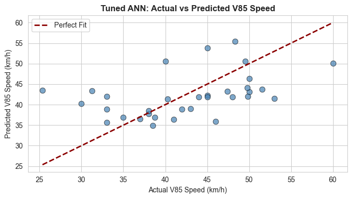
    


    

    


Residual Plot


```python
# Tuned ANN Residual Analysis

# Calculate residuals
ann_tuned_residuals = y_test - y_test_pred_ann_tuned

sns.set_style("whitegrid")

plt.figure(figsize=(7, 4))

# Scatter plot
sns.scatterplot(
    x=y_test_pred_ann_tuned,
    y=ann_tuned_residuals,
    color="steelblue",
    s=60,
    alpha=0.7,
    edgecolor="black"
)

# Reference line at zero
plt.axhline(
    y=0,
    linestyle="--",
    color="darkred",
    linewidth=2
)

plt.xlabel("Predicted V85 Speed (km/h)")
plt.ylabel("Residuals (km/h)")

plt.title(
    "Tuned ANN: Residual Plot",
    fontsize=12,
    fontweight="bold"
)

plt.tight_layout()
plt.show()
```


    

    


    
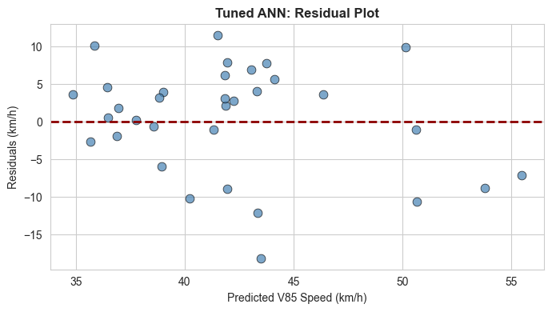
    


Result Table


```python
# Final Tuned ANN Performance Summary

ann_tuned_final = pd.DataFrame({
    "Model": ["Tuned ANN"],
    "R2": [round(ann_tuned_test_r2, 3)],
    "RMSE": [round(ann_tuned_test_rmse, 3)],
    "MAE": [round(ann_tuned_test_mae, 3)]
})

# Display results
display(ann_tuned_final)
```


<div>
<style scoped>
    .dataframe tbody tr th:only-of-type {
        vertical-align: middle;
    }

    .dataframe tbody tr th {
        vertical-align: top;
    }

    .dataframe thead th {
        text-align: right;
    }
</style>
<table border="1" class="dataframe">
  <thead>
    <tr style="text-align: right;">
      <th></th>
      <th>Model</th>
      <th>R2</th>
      <th>RMSE</th>
      <th>MAE</th>
    </tr>
  </thead>
  <tbody>
    <tr>
      <th>0</th>
      <td>Tuned ANN</td>
      <td>0.142</td>
      <td>7.043</td>
      <td>5.718</td>
    </tr>
  </tbody>
</table>
</div>


<div>
<style scoped>
    .dataframe tbody tr th:only-of-type {
        vertical-align: middle;
    }

    .dataframe tbody tr th {
        vertical-align: top;
    }

    .dataframe thead th {
        text-align: right;
    }
</style>
<table border="1" class="dataframe">
  <thead>
    <tr style="text-align: right;">
      <th></th>
      <th>Model</th>
      <th>R2</th>
      <th>RMSE</th>
      <th>MAE</th>
    </tr>
  </thead>
  <tbody>
    <tr>
      <th>0</th>
      <td>Tuned ANN</td>
      <td>0.142</td>
      <td>7.043</td>
      <td>5.718</td>
    </tr>
  </tbody>
</table>
</div>


Base vs Tuned Comparison


```python
# Baseline vs Tuned ANN Comparison

ann_comparison = pd.concat(
    [ann_final, ann_tuned_final],
    ignore_index=True
)

# Display comparison
display(ann_comparison)
```


<div>
<style scoped>
    .dataframe tbody tr th:only-of-type {
        vertical-align: middle;
    }

    .dataframe tbody tr th {
        vertical-align: top;
    }

    .dataframe thead th {
        text-align: right;
    }
</style>
<table border="1" class="dataframe">
  <thead>
    <tr style="text-align: right;">
      <th></th>
      <th>Model</th>
      <th>R2</th>
      <th>RMSE</th>
      <th>MAE</th>
    </tr>
  </thead>
  <tbody>
    <tr>
      <th>0</th>
      <td>ANN</td>
      <td>-0.088</td>
      <td>7.931</td>
      <td>6.203</td>
    </tr>
    <tr>
      <th>1</th>
      <td>Tuned ANN</td>
      <td>0.142</td>
      <td>7.043</td>
      <td>5.718</td>
    </tr>
  </tbody>
</table>
</div>


<div>
<style scoped>
    .dataframe tbody tr th:only-of-type {
        vertical-align: middle;
    }

    .dataframe tbody tr th {
        vertical-align: top;
    }

    .dataframe thead th {
        text-align: right;
    }
</style>
<table border="1" class="dataframe">
  <thead>
    <tr style="text-align: right;">
      <th></th>
      <th>Model</th>
      <th>R2</th>
      <th>RMSE</th>
      <th>MAE</th>
    </tr>
  </thead>
  <tbody>
    <tr>
      <th>0</th>
      <td>ANN</td>
      <td>-0.088</td>
      <td>7.931</td>
      <td>6.203</td>
    </tr>
    <tr>
      <th>1</th>
      <td>Tuned ANN</td>
      <td>0.142</td>
      <td>7.043</td>
      <td>5.718</td>
    </tr>
  </tbody>
</table>
</div>


Best Hyperparameters Table


```python
# Best Hyperparameters of Tuned ANN

best_ann_params = pd.DataFrame(
    list(grid_ann.best_params_.items()),
    columns=["Parameter", "Best Value"]
)

# Remove pipeline prefix
best_ann_params["Parameter"] = (
    best_ann_params["Parameter"].str.replace(
        "ann__", "", regex=False
    )
)

# Display results
display(best_ann_params)
```


<div>
<style scoped>
    .dataframe tbody tr th:only-of-type {
        vertical-align: middle;
    }

    .dataframe tbody tr th {
        vertical-align: top;
    }

    .dataframe thead th {
        text-align: right;
    }
</style>
<table border="1" class="dataframe">
  <thead>
    <tr style="text-align: right;">
      <th></th>
      <th>Parameter</th>
      <th>Best Value</th>
    </tr>
  </thead>
  <tbody>
    <tr>
      <th>0</th>
      <td>activation</td>
      <td>tanh</td>
    </tr>
    <tr>
      <th>1</th>
      <td>alpha</td>
      <td>0.01</td>
    </tr>
    <tr>
      <th>2</th>
      <td>hidden_layer_sizes</td>
      <td>(32,)</td>
    </tr>
    <tr>
      <th>3</th>
      <td>learning_rate_init</td>
      <td>0.001</td>
    </tr>
  </tbody>
</table>
</div>


<div>
<style scoped>
    .dataframe tbody tr th:only-of-type {
        vertical-align: middle;
    }

    .dataframe tbody tr th {
        vertical-align: top;
    }

    .dataframe thead th {
        text-align: right;
    }
</style>
<table border="1" class="dataframe">
  <thead>
    <tr style="text-align: right;">
      <th></th>
      <th>Parameter</th>
      <th>Best Value</th>
    </tr>
  </thead>
  <tbody>
    <tr>
      <th>0</th>
      <td>activation</td>
      <td>tanh</td>
    </tr>
    <tr>
      <th>1</th>
      <td>alpha</td>
      <td>0.01</td>
    </tr>
    <tr>
      <th>2</th>
      <td>hidden_layer_sizes</td>
      <td>(32,)</td>
    </tr>
    <tr>
      <th>3</th>
      <td>learning_rate_init</td>
      <td>0.001</td>
    </tr>
  </tbody>
</table>
</div>


Final Comparison of All Models


```python
# Step 1: Assign Model Type (Base or Tuned)

mlr_final["Type"] = "Base"

rf_final["Type"] = "Base"
rf_tuned_final["Type"] = "Tuned"

xgb_final["Type"] = "Base"
xgb_tuned_final["Type"] = "Tuned"

svr_final["Type"] = "Base"
svr_tuned_final["Type"] = "Tuned"

ann_final["Type"] = "Base"
ann_tuned_final["Type"] = "Tuned"


# Step 2: Combine All Nine Models

master_table = pd.concat([
    mlr_final,
    rf_final,
    rf_tuned_final,
    xgb_final,
    xgb_tuned_final,
    svr_final,
    svr_tuned_final,
    ann_final,
    ann_tuned_final
], ignore_index=True)


# Step 3: Arrange Columns

master_table = master_table[
    ["Model", "Type", "R2", "RMSE", "MAE"]
].copy()


# Step 4: Sort by RMSE (Lowest = Best)

master_table = master_table.sort_values(
    by="RMSE",
    ascending=True
).reset_index(drop=True)


# Step 5: Add Model Ranking

master_table.insert(
    0,
    "Rank (RMSE)",
    range(1, len(master_table) + 1)
)


# Step 6: Round Results

master_table[["R2", "RMSE", "MAE"]] = (
    master_table[["R2", "RMSE", "MAE"]].round(3)
)


# Step 7: Display Final Comparison Table

display(master_table)
```


<div>
<style scoped>
    .dataframe tbody tr th:only-of-type {
        vertical-align: middle;
    }

    .dataframe tbody tr th {
        vertical-align: top;
    }

    .dataframe thead th {
        text-align: right;
    }
</style>
<table border="1" class="dataframe">
  <thead>
    <tr style="text-align: right;">
      <th></th>
      <th>Rank (RMSE)</th>
      <th>Model</th>
      <th>Type</th>
      <th>R2</th>
      <th>RMSE</th>
      <th>MAE</th>
    </tr>
  </thead>
  <tbody>
    <tr>
      <th>0</th>
      <td>1</td>
      <td>Tuned Random Forest</td>
      <td>Tuned</td>
      <td>0.597</td>
      <td>4.829</td>
      <td>3.764</td>
    </tr>
    <tr>
      <th>1</th>
      <td>2</td>
      <td>Tuned XGBoost</td>
      <td>Tuned</td>
      <td>0.545</td>
      <td>5.127</td>
      <td>4.126</td>
    </tr>
    <tr>
      <th>2</th>
      <td>3</td>
      <td>Random Forest</td>
      <td>Base</td>
      <td>0.510</td>
      <td>5.322</td>
      <td>4.201</td>
    </tr>
    <tr>
      <th>3</th>
      <td>4</td>
      <td>XGBoost</td>
      <td>Base</td>
      <td>0.387</td>
      <td>5.956</td>
      <td>4.772</td>
    </tr>
    <tr>
      <th>4</th>
      <td>5</td>
      <td>MLR</td>
      <td>Base</td>
      <td>0.246</td>
      <td>6.604</td>
      <td>5.493</td>
    </tr>
    <tr>
      <th>5</th>
      <td>6</td>
      <td>Tuned SVR</td>
      <td>Tuned</td>
      <td>0.182</td>
      <td>6.879</td>
      <td>5.559</td>
    </tr>
    <tr>
      <th>6</th>
      <td>7</td>
      <td>Tuned ANN</td>
      <td>Tuned</td>
      <td>0.142</td>
      <td>7.043</td>
      <td>5.718</td>
    </tr>
    <tr>
      <th>7</th>
      <td>8</td>
      <td>SVR</td>
      <td>Base</td>
      <td>-0.067</td>
      <td>7.857</td>
      <td>6.190</td>
    </tr>
    <tr>
      <th>8</th>
      <td>9</td>
      <td>ANN</td>
      <td>Base</td>
      <td>-0.088</td>
      <td>7.931</td>
      <td>6.203</td>
    </tr>
  </tbody>
</table>
</div>


<div>
<style scoped>
    .dataframe tbody tr th:only-of-type {
        vertical-align: middle;
    }

    .dataframe tbody tr th {
        vertical-align: top;
    }

    .dataframe thead th {
        text-align: right;
    }
</style>
<table border="1" class="dataframe">
  <thead>
    <tr style="text-align: right;">
      <th></th>
      <th>Rank (RMSE)</th>
      <th>Model</th>
      <th>Type</th>
      <th>R2</th>
      <th>RMSE</th>
      <th>MAE</th>
    </tr>
  </thead>
  <tbody>
    <tr>
      <th>0</th>
      <td>1</td>
      <td>Tuned Random Forest</td>
      <td>Tuned</td>
      <td>0.597</td>
      <td>4.829</td>
      <td>3.764</td>
    </tr>
    <tr>
      <th>1</th>
      <td>2</td>
      <td>Tuned XGBoost</td>
      <td>Tuned</td>
      <td>0.545</td>
      <td>5.127</td>
      <td>4.126</td>
    </tr>
    <tr>
      <th>2</th>
      <td>3</td>
      <td>Random Forest</td>
      <td>Base</td>
      <td>0.510</td>
      <td>5.322</td>
      <td>4.201</td>
    </tr>
    <tr>
      <th>3</th>
      <td>4</td>
      <td>XGBoost</td>
      <td>Base</td>
      <td>0.387</td>
      <td>5.956</td>
      <td>4.772</td>
    </tr>
    <tr>
      <th>4</th>
      <td>5</td>
      <td>MLR</td>
      <td>Base</td>
      <td>0.246</td>
      <td>6.604</td>
      <td>5.493</td>
    </tr>
    <tr>
      <th>5</th>
      <td>6</td>
      <td>Tuned SVR</td>
      <td>Tuned</td>
      <td>0.182</td>
      <td>6.879</td>
      <td>5.559</td>
    </tr>
    <tr>
      <th>6</th>
      <td>7</td>
      <td>Tuned ANN</td>
      <td>Tuned</td>
      <td>0.142</td>
      <td>7.043</td>
      <td>5.718</td>
    </tr>
    <tr>
      <th>7</th>
      <td>8</td>
      <td>SVR</td>
      <td>Base</td>
      <td>-0.067</td>
      <td>7.857</td>
      <td>6.190</td>
    </tr>
    <tr>
      <th>8</th>
      <td>9</td>
      <td>ANN</td>
      <td>Base</td>
      <td>-0.088</td>
      <td>7.931</td>
      <td>6.203</td>
    </tr>
  </tbody>
</table>
</div>


```python
# Best Performing Model Based on RMSE

best_model = master_table.iloc[0]

print("Best Model:", best_model["Model"])
print("Testing R²:", best_model["R2"])
print("Testing RMSE:", best_model["RMSE"])
print("Testing MAE:", best_model["MAE"])
```

    Best Model: Tuned Random Forest
    Testing R²: 0.597
    Testing RMSE: 4.829
    Testing MAE: 3.764
    Best Model: Tuned Random Forest
    Testing R²: 0.597
    Testing RMSE: 4.829
    Testing MAE: 3.764
    

BOOTSTRAPPING FOR BEST TWO MODELS

Preparation of Data


```python
# Prepare data for Bootstrap Evaluation

X_boot = X_train.copy()
y_boot = y_train.copy()

print("X_boot shape:", X_boot.shape)
print("y_boot shape:", y_boot.shape)
```

    X_boot shape: (132, 5)
    y_boot shape: (132,)
    X_boot shape: (132, 5)
    y_boot shape: (132,)
    

Import Required Libraries


```python
# Import Required Libraries

from sklearn.utils import resample
from sklearn.base import clone
```

Create Bootstrap OOB Evaluation Function


```python
# Bootstrap OOB Evaluation Function

def bootstrap_oob_evaluation(model, X, y, n_bootstrap=1000, random_state=42):

    r2_list = []
    rmse_list = []
    mae_list = []
    used_iterations = []

    X_array = np.array(X)
    y_array = np.array(y)

    n = len(X_array)
    indices = np.arange(n)

    for i in range(n_bootstrap):

        # Bootstrap sample indices
        boot_idx = resample(
            indices,
            replace=True,
            n_samples=n,
            random_state=random_state + i
        )

        # Out-of-bag indices
        oob_idx = np.setdiff1d(indices, boot_idx)

        # Skip if insufficient OOB observations
        if len(oob_idx) < 2:
            continue

        X_train_boot = X_array[boot_idx]
        y_train_boot = y_array[boot_idx]

        X_test_oob = X_array[oob_idx]
        y_test_oob = y_array[oob_idx]

        # Clone model
        model_i = clone(model)

        # Train on bootstrap sample
        model_i.fit(X_train_boot, y_train_boot)

        # Predict OOB observations
        y_pred_oob = model_i.predict(X_test_oob)

        # Calculate metrics
        r2 = r2_score(y_test_oob, y_pred_oob)
        rmse = np.sqrt(mean_squared_error(y_test_oob, y_pred_oob))
        mae = mean_absolute_error(y_test_oob, y_pred_oob)

        r2_list.append(r2)
        rmse_list.append(rmse)
        mae_list.append(mae)
        used_iterations.append(i + 1)

    results = pd.DataFrame({
        "Iteration": used_iterations,
        "R2": r2_list,
        "RMSE": rmse_list,
        "MAE": mae_list
    })

    return results
```

Bootstrap Evaluation for Tuned Random Forest


```python
# Bootstrap for Tuned Random Forest

rf_boot_results = bootstrap_oob_evaluation(
    model=best_rf,
    X=X_boot,
    y=y_boot,
    n_bootstrap=1000,
    random_state=42
)

# Display results
display(rf_boot_results.head())
```


<div>
<style scoped>
    .dataframe tbody tr th:only-of-type {
        vertical-align: middle;
    }

    .dataframe tbody tr th {
        vertical-align: top;
    }

    .dataframe thead th {
        text-align: right;
    }
</style>
<table border="1" class="dataframe">
  <thead>
    <tr style="text-align: right;">
      <th></th>
      <th>Iteration</th>
      <th>R2</th>
      <th>RMSE</th>
      <th>MAE</th>
    </tr>
  </thead>
  <tbody>
    <tr>
      <th>0</th>
      <td>1</td>
      <td>0.316884</td>
      <td>8.281960</td>
      <td>6.133892</td>
    </tr>
    <tr>
      <th>1</th>
      <td>2</td>
      <td>0.291151</td>
      <td>7.448467</td>
      <td>5.806550</td>
    </tr>
    <tr>
      <th>2</th>
      <td>3</td>
      <td>0.299946</td>
      <td>8.290198</td>
      <td>6.554013</td>
    </tr>
    <tr>
      <th>3</th>
      <td>4</td>
      <td>0.496386</td>
      <td>6.203564</td>
      <td>5.145780</td>
    </tr>
    <tr>
      <th>4</th>
      <td>5</td>
      <td>0.425146</td>
      <td>7.618340</td>
      <td>5.689186</td>
    </tr>
  </tbody>
</table>
</div>


Bootstrap OOB Evaluation for Tuned XGBoost


```python
# Bootstrap OOB Evaluation for Tuned XGBoost

xgb_boot_results = bootstrap_oob_evaluation(
    model=best_xgb,
    X=X_boot,
    y=y_boot,
    n_bootstrap=1000,
    random_state=42
)

# Display first five results
display(xgb_boot_results.head())
```


<div>
<style scoped>
    .dataframe tbody tr th:only-of-type {
        vertical-align: middle;
    }

    .dataframe tbody tr th {
        vertical-align: top;
    }

    .dataframe thead th {
        text-align: right;
    }
</style>
<table border="1" class="dataframe">
  <thead>
    <tr style="text-align: right;">
      <th></th>
      <th>Iteration</th>
      <th>R2</th>
      <th>RMSE</th>
      <th>MAE</th>
    </tr>
  </thead>
  <tbody>
    <tr>
      <th>0</th>
      <td>1</td>
      <td>0.291514</td>
      <td>8.434348</td>
      <td>6.307513</td>
    </tr>
    <tr>
      <th>1</th>
      <td>2</td>
      <td>0.258019</td>
      <td>7.620547</td>
      <td>6.035131</td>
    </tr>
    <tr>
      <th>2</th>
      <td>3</td>
      <td>0.395764</td>
      <td>7.701979</td>
      <td>5.698651</td>
    </tr>
    <tr>
      <th>3</th>
      <td>4</td>
      <td>0.515850</td>
      <td>6.082501</td>
      <td>4.878391</td>
    </tr>
    <tr>
      <th>4</th>
      <td>5</td>
      <td>0.440380</td>
      <td>7.516719</td>
      <td>5.530174</td>
    </tr>
  </tbody>
</table>
</div>


Summary Statistics


```python
# Function to Summarize Bootstrap Results

def summarize_bootstrap_results(results, model_name):

    summary = pd.DataFrame({
        "Model": [model_name],
        "Mean R2": [results["R2"].mean()],
        "Std R2": [results["R2"].std()],
        "Mean RMSE": [results["RMSE"].mean()],
        "Std RMSE": [results["RMSE"].std()],
        "Mean MAE": [results["MAE"].mean()],
        "Std MAE": [results["MAE"].std()]
    })

    return summary.round(3)
```


```python
# Bootstrap Summary for Tuned Random Forest

rf_boot_summary = summarize_bootstrap_results(
    rf_boot_results,
    "Tuned Random Forest"
)

# Bootstrap Summary for Tuned XGBoost

xgb_boot_summary = summarize_bootstrap_results(
    xgb_boot_results,
    "Tuned XGBoost"
)
```


```python
# Combined Bootstrap Performance Summary

boot_summary = pd.concat(
    [rf_boot_summary, xgb_boot_summary],
    ignore_index=True
)

# Display results
display(boot_summary)
```


<div>
<style scoped>
    .dataframe tbody tr th:only-of-type {
        vertical-align: middle;
    }

    .dataframe tbody tr th {
        vertical-align: top;
    }

    .dataframe thead th {
        text-align: right;
    }
</style>
<table border="1" class="dataframe">
  <thead>
    <tr style="text-align: right;">
      <th></th>
      <th>Model</th>
      <th>Mean R2</th>
      <th>Std R2</th>
      <th>Mean RMSE</th>
      <th>Std RMSE</th>
      <th>Mean MAE</th>
      <th>Std MAE</th>
    </tr>
  </thead>
  <tbody>
    <tr>
      <th>0</th>
      <td>Tuned Random Forest</td>
      <td>0.412</td>
      <td>0.104</td>
      <td>7.416</td>
      <td>0.717</td>
      <td>5.787</td>
      <td>0.566</td>
    </tr>
    <tr>
      <th>1</th>
      <td>Tuned XGBoost</td>
      <td>0.420</td>
      <td>0.103</td>
      <td>7.365</td>
      <td>0.708</td>
      <td>5.732</td>
      <td>0.562</td>
    </tr>
  </tbody>
</table>
</div>


```python
# Rank Models Based on Mean RMSE

boot_summary = boot_summary.sort_values(
    by="Mean RMSE",
    ascending=True
).reset_index(drop=True)

display(boot_summary)
```


<div>
<style scoped>
    .dataframe tbody tr th:only-of-type {
        vertical-align: middle;
    }

    .dataframe tbody tr th {
        vertical-align: top;
    }

    .dataframe thead th {
        text-align: right;
    }
</style>
<table border="1" class="dataframe">
  <thead>
    <tr style="text-align: right;">
      <th></th>
      <th>Model</th>
      <th>Mean R2</th>
      <th>Std R2</th>
      <th>Mean RMSE</th>
      <th>Std RMSE</th>
      <th>Mean MAE</th>
      <th>Std MAE</th>
    </tr>
  </thead>
  <tbody>
    <tr>
      <th>0</th>
      <td>Tuned XGBoost</td>
      <td>0.420</td>
      <td>0.103</td>
      <td>7.365</td>
      <td>0.708</td>
      <td>5.732</td>
      <td>0.562</td>
    </tr>
    <tr>
      <th>1</th>
      <td>Tuned Random Forest</td>
      <td>0.412</td>
      <td>0.104</td>
      <td>7.416</td>
      <td>0.717</td>
      <td>5.787</td>
      <td>0.566</td>
    </tr>
  </tbody>
</table>
</div>


Bootstrap 95% Percentile Intervals for Tuned RF and Tuned XGBoost


```python
# Function to Calculate Bootstrap Percentile Intervals

def bootstrap_confidence_intervals(results, model_name):

    ci_summary = pd.DataFrame({
        "Model": [model_name],

        # R²
        "R2 Mean": [results["R2"].mean()],
        "R2 2.5%": [results["R2"].quantile(0.025)],
        "R2 97.5%": [results["R2"].quantile(0.975)],

        # RMSE
        "RMSE Mean": [results["RMSE"].mean()],
        "RMSE 2.5%": [results["RMSE"].quantile(0.025)],
        "RMSE 97.5%": [results["RMSE"].quantile(0.975)],

        # MAE
        "MAE Mean": [results["MAE"].mean()],
        "MAE 2.5%": [results["MAE"].quantile(0.025)],
        "MAE 97.5%": [results["MAE"].quantile(0.975)]
    })

    return ci_summary.round(3)
```


```python
# Tuned Random Forest Bootstrap Intervals

rf_ci = bootstrap_confidence_intervals(
    rf_boot_results,
    "Tuned Random Forest"
)

# Tuned XGBoost Bootstrap Intervals

xgb_ci = bootstrap_confidence_intervals(
    xgb_boot_results,
    "Tuned XGBoost"
)
```


```python
# Combined Bootstrap Percentile Interval Table

boot_ci_table = pd.concat(
    [rf_ci, xgb_ci],
    ignore_index=True
)

# Display results
display(boot_ci_table)
```


<div>
<style scoped>
    .dataframe tbody tr th:only-of-type {
        vertical-align: middle;
    }

    .dataframe tbody tr th {
        vertical-align: top;
    }

    .dataframe thead th {
        text-align: right;
    }
</style>
<table border="1" class="dataframe">
  <thead>
    <tr style="text-align: right;">
      <th></th>
      <th>Model</th>
      <th>R2 Mean</th>
      <th>R2 2.5%</th>
      <th>R2 97.5%</th>
      <th>RMSE Mean</th>
      <th>RMSE 2.5%</th>
      <th>RMSE 97.5%</th>
      <th>MAE Mean</th>
      <th>MAE 2.5%</th>
      <th>MAE 97.5%</th>
    </tr>
  </thead>
  <tbody>
    <tr>
      <th>0</th>
      <td>Tuned Random Forest</td>
      <td>0.412</td>
      <td>0.197</td>
      <td>0.581</td>
      <td>7.416</td>
      <td>6.032</td>
      <td>8.786</td>
      <td>5.787</td>
      <td>4.684</td>
      <td>6.943</td>
    </tr>
    <tr>
      <th>1</th>
      <td>Tuned XGBoost</td>
      <td>0.420</td>
      <td>0.190</td>
      <td>0.582</td>
      <td>7.365</td>
      <td>6.043</td>
      <td>8.770</td>
      <td>5.732</td>
      <td>4.675</td>
      <td>6.920</td>
    </tr>
  </tbody>
</table>
</div>


Bootstrap Distribution of R²


```python
# Bootstrap R² Distribution - Tuned Random Forest

import matplotlib.pyplot as plt
import seaborn as sns

sns.set_style("whitegrid")

plt.figure(figsize=(7, 4))

sns.histplot(
    rf_boot_results["R2"],
    bins=30,
    kde=True,
    color="skyblue",
    edgecolor="black",
    alpha=0.7
)

plt.title(
    "Bootstrap Distribution of R² - Tuned Random Forest",
    fontsize=12,
    fontweight="bold"
)

plt.xlabel("R²")
plt.ylabel("Frequency")

plt.tight_layout()
plt.show()
```


    
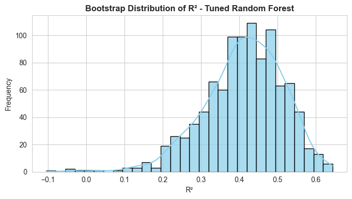
    


```python
# Bootstrap R² Distribution - Tuned XGBoost

sns.set_style("whitegrid")

plt.figure(figsize=(7, 4))

sns.histplot(
    xgb_boot_results["R2"],
    bins=30,
    kde=True,
    color="skyblue",
    edgecolor="black",
    alpha=0.7
)

plt.title(
    "Bootstrap Distribution of R² - Tuned XGBoost",
    fontsize=12,
    fontweight="bold"
)

plt.xlabel("R²")
plt.ylabel("Frequency")

plt.tight_layout()
plt.show()
```


    
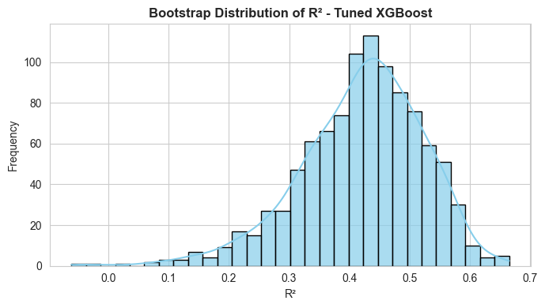
    


Bootstrap Distribution of RMSE


```python
# Bootstrap RMSE Distribution - Tuned Random Forest

sns.set_style("whitegrid")

plt.figure(figsize=(7, 4))

sns.histplot(
    rf_boot_results["RMSE"],
    bins=30,
    kde=True,
    color="skyblue",
    edgecolor="black",
    alpha=0.7
)

plt.title(
    "Bootstrap Distribution of RMSE - Tuned Random Forest",
    fontsize=12,
    fontweight="bold"
)

plt.xlabel("RMSE (km/h)")
plt.ylabel("Frequency")

plt.tight_layout()
plt.show()
```


    
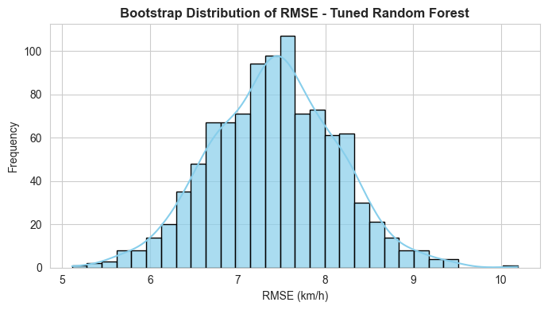
    


```python
# Bootstrap RMSE Distribution - Tuned XGBoost

sns.set_style("whitegrid")

plt.figure(figsize=(7, 4))

sns.histplot(
    xgb_boot_results["RMSE"],
    bins=30,
    kde=True,
    color="skyblue",
    edgecolor="black",
    alpha=0.7
)

plt.title(
    "Bootstrap Distribution of RMSE - Tuned XGBoost",
    fontsize=12,
    fontweight="bold"
)

plt.xlabel("RMSE (km/h)")
plt.ylabel("Frequency")

plt.tight_layout()
plt.show()
```


    
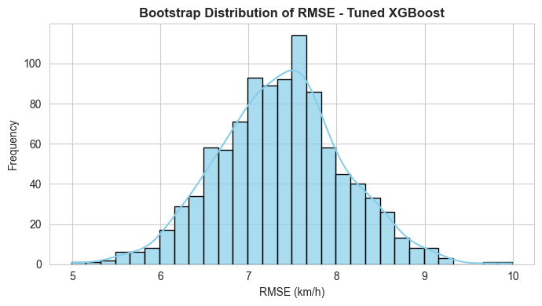
    


Partial Dependence Plots (PDP) for Tuned Random Forest

Import Required Libraries


```python
# Partial Dependence Plot (PDP) Analysis

import pandas as pd
import numpy as np
import matplotlib.pyplot as plt

from sklearn.inspection import PartialDependenceDisplay

# Use already trained Tuned Random Forest
rf_unscaled = best_rf

# Display best hyperparameters
print("Best RF Parameters:", grid_rf.best_params_)

# Check feature names
print("\nInput Features:")
print(X_train.columns.tolist())
```

    Best RF Parameters: {'max_depth': None, 'max_features': 'sqrt', 'min_samples_leaf': 2, 'min_samples_split': 10, 'n_estimators': 100}
    
    Input Features:
    ['Gradient', 'Radius of Curve', 'Carriageway Width', 'Average Shoulder Width', 'IRI']
    

PDP for Gradient


```python
# Partial Dependence Plot: Gradient

fig, ax = plt.subplots(figsize=(7, 4))

PartialDependenceDisplay.from_estimator(
    rf_unscaled,
    X_train,
    features=["Gradient"],
    grid_resolution=50,
    method="brute",
    ax=ax
)

ax.set_title(
    "Partial Dependence Plot: Gradient vs V85 Speed",
    fontsize=12,
    fontweight="bold"
)

ax.set_xlabel("Gradient (%)")
ax.set_ylabel("Predicted V85 Speed (km/h)")

plt.tight_layout()
plt.show()
```


    
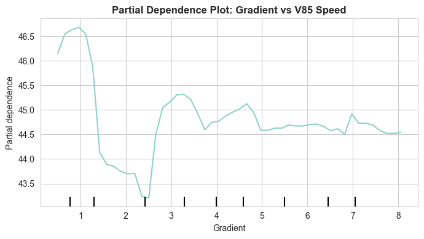
    


PDP for Radius of Curve


```python
# Partial Dependence Plot: Radius of Curve

fig, ax = plt.subplots(figsize=(7, 4))

PartialDependenceDisplay.from_estimator(
    rf_unscaled,
    X_train,
    features=["Radius of Curve"],
    grid_resolution=50,
    method="brute",
    ax=ax
)

ax.set_title(
    "Partial Dependence Plot: Radius vs V85 Speed",
    fontsize=12,
    fontweight="bold"
)

ax.set_xlabel("Radius of Curve (m)")
ax.set_ylabel("Predicted V85 Speed (km/h)")

plt.tight_layout()
plt.show()
```


    
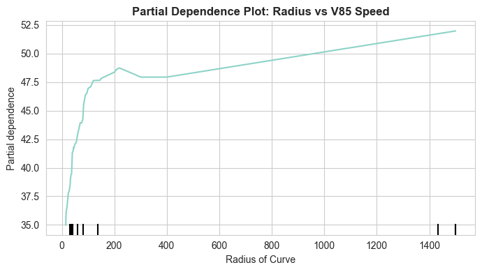
    


PDP for Carriageway Width


```python
# Partial Dependence Plot: Carriageway Width

fig, ax = plt.subplots(figsize=(7, 4))

PartialDependenceDisplay.from_estimator(
    rf_unscaled,
    X_train,
    features=["Carriageway Width"],
    grid_resolution=50,
    method="brute",
    ax=ax
)

ax.set_title(
    "Partial Dependence Plot: Carriageway Width vs V85 Speed",
    fontsize=12,
    fontweight="bold"
)

ax.set_xlabel("Carriageway Width (m)")
ax.set_ylabel("Predicted V85 Speed (km/h)")

plt.tight_layout()
plt.show()
```


    
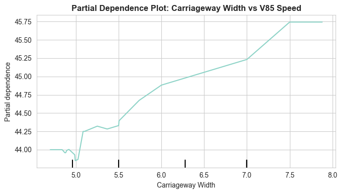
    


PDP for Average Shoulder Width


```python
# Partial Dependence Plot: Average Shoulder Width

fig, ax = plt.subplots(figsize=(7, 4))

PartialDependenceDisplay.from_estimator(
    rf_unscaled,
    X_train,
    features=["Average Shoulder Width"],
    grid_resolution=50,
    method="brute",
    ax=ax
)

ax.set_title(
    "Partial Dependence Plot: Average Shoulder Width vs V85 Speed",
    fontsize=12,
    fontweight="bold"
)

ax.set_xlabel("Average Shoulder Width (m)")
ax.set_ylabel("Predicted V85 Speed (km/h)")

plt.tight_layout()
plt.show()
```


    
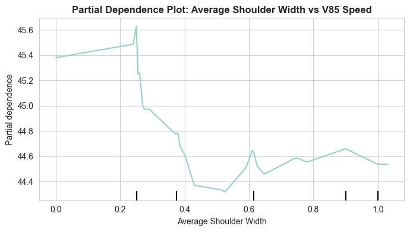
    


PDP for IRI


```python
# Partial Dependence Plot: IRI

fig, ax = plt.subplots(figsize=(7, 4))

PartialDependenceDisplay.from_estimator(
    rf_unscaled,
    X_train,
    features=["IRI"],
    grid_resolution=50,
    method="brute",
    ax=ax
)

ax.set_title(
    "Partial Dependence Plot: IRI vs V85 Speed",
    fontsize=12,
    fontweight="bold"
)

ax.set_xlabel("IRI (m/km)")
ax.set_ylabel("Predicted V85 Speed (km/h)")

plt.tight_layout()
plt.show()
```


    
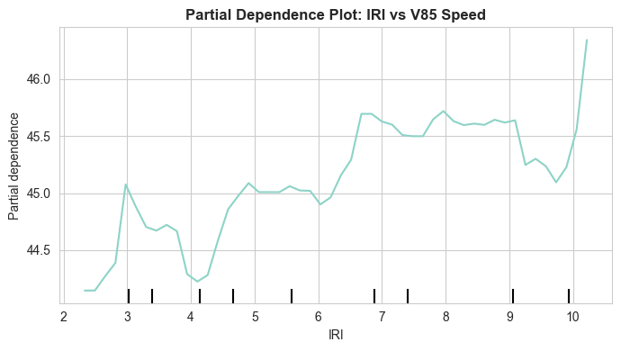
    


```python
# Combined Partial Dependence Plots for All Five Variables

features = [
    "Gradient",
    "Radius of Curve",
    "Carriageway Width",
    "Average Shoulder Width",
    "IRI"
]

fig, ax = plt.subplots(2, 3, figsize=(15, 8))

PartialDependenceDisplay.from_estimator(
    rf_unscaled,
    X_train,
    features=features,
    grid_resolution=50,
    method="brute",
    ax=ax.ravel()[:5]
)

# Remove empty subplot
fig.delaxes(ax[1, 2])

plt.suptitle(
    "Partial Dependence Plots - Tuned Random Forest",
    fontsize=14,
    fontweight="bold"
)

plt.tight_layout()
plt.show()
```


    

    


Sensitivity Analysis of Tangent Radius


```python
# ============================================================
# TANGENT RADIUS SENSITIVITY ANALYSIS
# MLR + FOUR TUNED MACHINE LEARNING MODELS
# ============================================================

import numpy as np
import pandas as pd
import matplotlib.pyplot as plt
import seaborn as sns

from sklearn.base import clone
from sklearn.metrics import (
    r2_score,
    mean_squared_error,
    mean_absolute_error
)

sns.set_style("whitegrid")
```

Identify Tangent Sections


```python
# ============================================================
# STEP 2: IDENTIFY TANGENT SECTIONS
# ============================================================

tangent_mask = (
    df["Radius of Curve"]
    .astype(str)
    .str.strip()
    .str.lower()
    .isin(["infinity", "inf", "+inf", "∞"])
)

# Match mask to model dataset
tangent_mask = tangent_mask.reindex(X.index)

# Check dataset
print("Total Observations:", len(X))
print("Tangent Sections:", tangent_mask.sum())
print("Curved Sections:", (~tangent_mask).sum())

# Verify data and tangent identification
assert len(X) == 165, "Expected 165 observations."
assert tangent_mask.notna().all(), "Index mismatch detected."
assert tangent_mask.sum() == 45, "Tangent section count does not match."

print("\nTangent sections identified successfully.")
```

    Total Observations: 165
    Tangent Sections: 45
    Curved Sections: 120
    
    Tangent sections identified successfully.
    

DEFINE TANGENT RADIUS SCENARIOS


```python
# ============================================================
# STEP 3: DEFINE TANGENT RADIUS SCENARIOS
# ============================================================

tangent_radius_values = [1000, 1500, 2000]

print("Sensitivity Analysis Scenarios:")

for radius in tangent_radius_values:
    print(f"Tangent Radius = {radius} m")
```

    Sensitivity Analysis Scenarios:
    Tangent Radius = 1000 m
    Tangent Radius = 1500 m
    Tangent Radius = 2000 m
    

Define the Five Selected Models


```python
# ============================================================
# STEP 4: DEFINE FIVE SELECTED MODELS
# ============================================================

models_sensitivity = {

    "MLR": mlr,

    "Tuned Random Forest": best_rf,

    "Tuned XGBoost": best_xgb,

    "Tuned SVR": best_svr,

    "Tuned ANN": best_ann
}

# Verify tuned SVR and ANN contain scaling pipelines

assert isinstance(best_svr, Pipeline), (
    "Tuned SVR must contain a scaling pipeline."
)

assert isinstance(best_ann, Pipeline), (
    "Tuned ANN must contain a scaling pipeline."
)

# Display selected models

print("Models Selected for Sensitivity Analysis:\n")

for i, model_name in enumerate(models_sensitivity.keys(), 1):
    print(f"{i}. {model_name}")
```

    Models Selected for Sensitivity Analysis:
    
    1. MLR
    2. Tuned Random Forest
    3. Tuned XGBoost
    4. Tuned SVR
    5. Tuned ANN
    

Run the Automated Sensitivity Analysis


```python
# ============================================================
# STEP 5: AUTOMATED TANGENT RADIUS SENSITIVITY ANALYSIS
# ============================================================

sensitivity_results = []

# Store fitted models for additional analysis
fitted_sensitivity_models = {}

# Loop through tangent radius scenarios

for tangent_radius in tangent_radius_values:

    print("\n" + "=" * 60)
    print(f"TANGENT RADIUS = {tangent_radius} m")
    print("=" * 60)

    # --------------------------------------------------------
    # 1. Create scenario dataset
    # --------------------------------------------------------

    X_sens = X.copy()

    # Change radius ONLY for tangent sections

    X_sens.loc[
        tangent_mask,
        "Radius of Curve"
    ] = tangent_radius

    # --------------------------------------------------------
    # 2. Preserve original training and testing observations
    # --------------------------------------------------------

    X_train_sens = X_sens.loc[X_train.index].copy()

    X_test_sens = X_sens.loc[X_test.index].copy()

    # --------------------------------------------------------
    # 3. Train and evaluate each model
    # --------------------------------------------------------

    for model_name, model in models_sensitivity.items():

        print(f"Training: {model_name}")

        # Create fresh model with original hyperparameters

        model_sens = clone(model)

        # Train model

        model_sens.fit(X_train_sens, y_train)

        # Store fitted model

        fitted_sensitivity_models[
            (tangent_radius, model_name)
        ] = model_sens

        # Predictions

        y_train_pred = model_sens.predict(X_train_sens)

        y_test_pred = model_sens.predict(X_test_sens)

        # ----------------------------------------------------
        # 4. Calculate evaluation metrics
        # ----------------------------------------------------

        # R²

        train_r2 = r2_score(
            y_train, y_train_pred
        )

        test_r2 = r2_score(
            y_test, y_test_pred
        )

        # RMSE

        train_rmse = np.sqrt(
            mean_squared_error(y_train, y_train_pred)
        )

        test_rmse = np.sqrt(
            mean_squared_error(y_test, y_test_pred)
        )

        # MAE

        train_mae = mean_absolute_error(
            y_train, y_train_pred
        )

        test_mae = mean_absolute_error(
            y_test, y_test_pred
        )

        # ----------------------------------------------------
        # 5. Store results
        # ----------------------------------------------------

        sensitivity_results.append({

            "Model": model_name,

            "Tangent Radius (m)": tangent_radius,

            "Training R2": train_r2,

            "Testing R2": test_r2,

            "Training RMSE": train_rmse,

            "Testing RMSE": test_rmse,

            "Training MAE": train_mae,

            "Testing MAE": test_mae

        })

# ------------------------------------------------------------
# 6. Create results table
# ------------------------------------------------------------

sensitivity_table = pd.DataFrame(
    sensitivity_results
)

# Arrange results

sensitivity_table = sensitivity_table.sort_values(
    by=["Model", "Tangent Radius (m)"]
).reset_index(drop=True)

# Display results

display(sensitivity_table.round(4))
```

    
    ============================================================
    TANGENT RADIUS = 1000 m
    ============================================================
    Training: MLR
    Training: Tuned Random Forest
    Training: Tuned XGBoost
    Training: Tuned SVR
    Training: Tuned ANN
    
    ============================================================
    TANGENT RADIUS = 1500 m
    ============================================================
    Training: MLR
    Training: Tuned Random Forest
    Training: Tuned XGBoost
    Training: Tuned SVR
    Training: Tuned ANN
    
    ============================================================
    TANGENT RADIUS = 2000 m
    ============================================================
    Training: MLR
    Training: Tuned Random Forest
    Training: Tuned XGBoost
    Training: Tuned SVR
    Training: Tuned ANN
    


<div>
<style scoped>
    .dataframe tbody tr th:only-of-type {
        vertical-align: middle;
    }

    .dataframe tbody tr th {
        vertical-align: top;
    }

    .dataframe thead th {
        text-align: right;
    }
</style>
<table border="1" class="dataframe">
  <thead>
    <tr style="text-align: right;">
      <th></th>
      <th>Model</th>
      <th>Tangent Radius (m)</th>
      <th>Training R2</th>
      <th>Testing R2</th>
      <th>Training RMSE</th>
      <th>Testing RMSE</th>
      <th>Training MAE</th>
      <th>Testing MAE</th>
    </tr>
  </thead>
  <tbody>
    <tr>
      <th>0</th>
      <td>MLR</td>
      <td>1000</td>
      <td>0.4331</td>
      <td>0.2810</td>
      <td>7.3748</td>
      <td>6.4480</td>
      <td>5.8013</td>
      <td>5.3396</td>
    </tr>
    <tr>
      <th>1</th>
      <td>MLR</td>
      <td>1500</td>
      <td>0.4238</td>
      <td>0.2457</td>
      <td>7.4355</td>
      <td>6.6042</td>
      <td>5.8476</td>
      <td>5.4931</td>
    </tr>
    <tr>
      <th>2</th>
      <td>MLR</td>
      <td>2000</td>
      <td>0.4187</td>
      <td>0.2281</td>
      <td>7.4680</td>
      <td>6.6810</td>
      <td>5.8769</td>
      <td>5.5634</td>
    </tr>
    <tr>
      <th>3</th>
      <td>Tuned ANN</td>
      <td>1000</td>
      <td>0.5163</td>
      <td>0.2120</td>
      <td>6.8126</td>
      <td>6.7503</td>
      <td>5.2586</td>
      <td>5.4520</td>
    </tr>
    <tr>
      <th>4</th>
      <td>Tuned ANN</td>
      <td>1500</td>
      <td>0.5020</td>
      <td>0.1421</td>
      <td>6.9120</td>
      <td>7.0432</td>
      <td>5.3194</td>
      <td>5.7179</td>
    </tr>
    <tr>
      <th>5</th>
      <td>Tuned ANN</td>
      <td>2000</td>
      <td>0.4951</td>
      <td>0.1038</td>
      <td>6.9596</td>
      <td>7.1986</td>
      <td>5.3564</td>
      <td>5.8332</td>
    </tr>
    <tr>
      <th>6</th>
      <td>Tuned Random Forest</td>
      <td>1000</td>
      <td>0.7358</td>
      <td>0.5968</td>
      <td>5.0344</td>
      <td>4.8285</td>
      <td>3.9157</td>
      <td>3.7643</td>
    </tr>
    <tr>
      <th>7</th>
      <td>Tuned Random Forest</td>
      <td>1500</td>
      <td>0.7358</td>
      <td>0.5968</td>
      <td>5.0344</td>
      <td>4.8285</td>
      <td>3.9157</td>
      <td>3.7643</td>
    </tr>
    <tr>
      <th>8</th>
      <td>Tuned Random Forest</td>
      <td>2000</td>
      <td>0.7358</td>
      <td>0.5968</td>
      <td>5.0344</td>
      <td>4.8285</td>
      <td>3.9157</td>
      <td>3.7643</td>
    </tr>
    <tr>
      <th>9</th>
      <td>Tuned SVR</td>
      <td>1000</td>
      <td>0.4577</td>
      <td>0.2123</td>
      <td>7.2128</td>
      <td>6.7491</td>
      <td>5.3685</td>
      <td>5.4354</td>
    </tr>
    <tr>
      <th>10</th>
      <td>Tuned SVR</td>
      <td>1500</td>
      <td>0.4496</td>
      <td>0.1816</td>
      <td>7.2669</td>
      <td>6.8793</td>
      <td>5.4137</td>
      <td>5.5586</td>
    </tr>
    <tr>
      <th>11</th>
      <td>Tuned SVR</td>
      <td>2000</td>
      <td>0.4454</td>
      <td>0.1615</td>
      <td>7.2943</td>
      <td>6.9632</td>
      <td>5.4448</td>
      <td>5.6275</td>
    </tr>
    <tr>
      <th>12</th>
      <td>Tuned XGBoost</td>
      <td>1000</td>
      <td>0.7062</td>
      <td>0.5453</td>
      <td>5.3089</td>
      <td>5.1275</td>
      <td>4.1120</td>
      <td>4.1258</td>
    </tr>
    <tr>
      <th>13</th>
      <td>Tuned XGBoost</td>
      <td>1500</td>
      <td>0.7062</td>
      <td>0.5453</td>
      <td>5.3089</td>
      <td>5.1275</td>
      <td>4.1120</td>
      <td>4.1258</td>
    </tr>
    <tr>
      <th>14</th>
      <td>Tuned XGBoost</td>
      <td>2000</td>
      <td>0.7062</td>
      <td>0.5453</td>
      <td>5.3089</td>
      <td>5.1275</td>
      <td>4.1120</td>
      <td>4.1258</td>
    </tr>
  </tbody>
</table>
</div>


Result Table


```python
# ============================================================
# STEP 6: FINAL SENSITIVITY RESULTS TABLE
# ============================================================

sensitivity_final = sensitivity_table[
    [
        "Model",
        "Tangent Radius (m)",
        "Testing R2",
        "Testing RMSE",
        "Testing MAE"
    ]
].copy()

# Round results

sensitivity_final[
    ["Testing R2", "Testing RMSE", "Testing MAE"]
] = sensitivity_final[
    ["Testing R2", "Testing RMSE", "Testing MAE"]
].round(3)

# Display results

display(sensitivity_final)
```


<div>
<style scoped>
    .dataframe tbody tr th:only-of-type {
        vertical-align: middle;
    }

    .dataframe tbody tr th {
        vertical-align: top;
    }

    .dataframe thead th {
        text-align: right;
    }
</style>
<table border="1" class="dataframe">
  <thead>
    <tr style="text-align: right;">
      <th></th>
      <th>Model</th>
      <th>Tangent Radius (m)</th>
      <th>Testing R2</th>
      <th>Testing RMSE</th>
      <th>Testing MAE</th>
    </tr>
  </thead>
  <tbody>
    <tr>
      <th>0</th>
      <td>MLR</td>
      <td>1000</td>
      <td>0.281</td>
      <td>6.448</td>
      <td>5.340</td>
    </tr>
    <tr>
      <th>1</th>
      <td>MLR</td>
      <td>1500</td>
      <td>0.246</td>
      <td>6.604</td>
      <td>5.493</td>
    </tr>
    <tr>
      <th>2</th>
      <td>MLR</td>
      <td>2000</td>
      <td>0.228</td>
      <td>6.681</td>
      <td>5.563</td>
    </tr>
    <tr>
      <th>3</th>
      <td>Tuned ANN</td>
      <td>1000</td>
      <td>0.212</td>
      <td>6.750</td>
      <td>5.452</td>
    </tr>
    <tr>
      <th>4</th>
      <td>Tuned ANN</td>
      <td>1500</td>
      <td>0.142</td>
      <td>7.043</td>
      <td>5.718</td>
    </tr>
    <tr>
      <th>5</th>
      <td>Tuned ANN</td>
      <td>2000</td>
      <td>0.104</td>
      <td>7.199</td>
      <td>5.833</td>
    </tr>
    <tr>
      <th>6</th>
      <td>Tuned Random Forest</td>
      <td>1000</td>
      <td>0.597</td>
      <td>4.829</td>
      <td>3.764</td>
    </tr>
    <tr>
      <th>7</th>
      <td>Tuned Random Forest</td>
      <td>1500</td>
      <td>0.597</td>
      <td>4.829</td>
      <td>3.764</td>
    </tr>
    <tr>
      <th>8</th>
      <td>Tuned Random Forest</td>
      <td>2000</td>
      <td>0.597</td>
      <td>4.829</td>
      <td>3.764</td>
    </tr>
    <tr>
      <th>9</th>
      <td>Tuned SVR</td>
      <td>1000</td>
      <td>0.212</td>
      <td>6.749</td>
      <td>5.435</td>
    </tr>
    <tr>
      <th>10</th>
      <td>Tuned SVR</td>
      <td>1500</td>
      <td>0.182</td>
      <td>6.879</td>
      <td>5.559</td>
    </tr>
    <tr>
      <th>11</th>
      <td>Tuned SVR</td>
      <td>2000</td>
      <td>0.161</td>
      <td>6.963</td>
      <td>5.627</td>
    </tr>
    <tr>
      <th>12</th>
      <td>Tuned XGBoost</td>
      <td>1000</td>
      <td>0.545</td>
      <td>5.127</td>
      <td>4.126</td>
    </tr>
    <tr>
      <th>13</th>
      <td>Tuned XGBoost</td>
      <td>1500</td>
      <td>0.545</td>
      <td>5.127</td>
      <td>4.126</td>
    </tr>
    <tr>
      <th>14</th>
      <td>Tuned XGBoost</td>
      <td>2000</td>
      <td>0.545</td>
      <td>5.127</td>
      <td>4.126</td>
    </tr>
  </tbody>
</table>
</div>


RMSE SENSITIVITY COMPARISON


```python
# ============================================================
# STEP 7: RMSE SENSITIVITY COMPARISON
# ============================================================

rmse_sensitivity = sensitivity_table.pivot(
    index="Model",
    columns="Tangent Radius (m)",
    values="Testing RMSE"
)

# Arrange model order

rmse_sensitivity = rmse_sensitivity.reindex(
    list(models_sensitivity.keys())
)

# Arrange radius order

rmse_sensitivity = rmse_sensitivity[
    [1000, 1500, 2000]
]

# Rename columns

rmse_sensitivity.columns = [
    "RMSE (1000 m)",
    "RMSE (1500 m)",
    "RMSE (2000 m)"
]

# Display results

display(rmse_sensitivity.round(3))
```


<div>
<style scoped>
    .dataframe tbody tr th:only-of-type {
        vertical-align: middle;
    }

    .dataframe tbody tr th {
        vertical-align: top;
    }

    .dataframe thead th {
        text-align: right;
    }
</style>
<table border="1" class="dataframe">
  <thead>
    <tr style="text-align: right;">
      <th></th>
      <th>RMSE (1000 m)</th>
      <th>RMSE (1500 m)</th>
      <th>RMSE (2000 m)</th>
    </tr>
    <tr>
      <th>Model</th>
      <th></th>
      <th></th>
      <th></th>
    </tr>
  </thead>
  <tbody>
    <tr>
      <th>MLR</th>
      <td>6.448</td>
      <td>6.604</td>
      <td>6.681</td>
    </tr>
    <tr>
      <th>Tuned Random Forest</th>
      <td>4.829</td>
      <td>4.829</td>
      <td>4.829</td>
    </tr>
    <tr>
      <th>Tuned XGBoost</th>
      <td>5.127</td>
      <td>5.127</td>
      <td>5.127</td>
    </tr>
    <tr>
      <th>Tuned SVR</th>
      <td>6.749</td>
      <td>6.879</td>
      <td>6.963</td>
    </tr>
    <tr>
      <th>Tuned ANN</th>
      <td>6.750</td>
      <td>7.043</td>
      <td>7.199</td>
    </tr>
  </tbody>
</table>
</div>


R² SENSITIVITY COMPARISON


```python
# ============================================================
# STEP 8: R² SENSITIVITY COMPARISON
# ============================================================

r2_sensitivity = sensitivity_table.pivot(
    index="Model",
    columns="Tangent Radius (m)",
    values="Testing R2"
)

# Arrange model order

r2_sensitivity = r2_sensitivity.reindex(
    list(models_sensitivity.keys())
)

# Arrange radius order

r2_sensitivity = r2_sensitivity[
    [1000, 1500, 2000]
]

# Rename columns

r2_sensitivity.columns = [
    "R2 (1000 m)",
    "R2 (1500 m)",
    "R2 (2000 m)"
]

# Display results

display(r2_sensitivity.round(3))
```


<div>
<style scoped>
    .dataframe tbody tr th:only-of-type {
        vertical-align: middle;
    }

    .dataframe tbody tr th {
        vertical-align: top;
    }

    .dataframe thead th {
        text-align: right;
    }
</style>
<table border="1" class="dataframe">
  <thead>
    <tr style="text-align: right;">
      <th></th>
      <th>R2 (1000 m)</th>
      <th>R2 (1500 m)</th>
      <th>R2 (2000 m)</th>
    </tr>
    <tr>
      <th>Model</th>
      <th></th>
      <th></th>
      <th></th>
    </tr>
  </thead>
  <tbody>
    <tr>
      <th>MLR</th>
      <td>0.281</td>
      <td>0.246</td>
      <td>0.228</td>
    </tr>
    <tr>
      <th>Tuned Random Forest</th>
      <td>0.597</td>
      <td>0.597</td>
      <td>0.597</td>
    </tr>
    <tr>
      <th>Tuned XGBoost</th>
      <td>0.545</td>
      <td>0.545</td>
      <td>0.545</td>
    </tr>
    <tr>
      <th>Tuned SVR</th>
      <td>0.212</td>
      <td>0.182</td>
      <td>0.161</td>
    </tr>
    <tr>
      <th>Tuned ANN</th>
      <td>0.212</td>
      <td>0.142</td>
      <td>0.104</td>
    </tr>
  </tbody>
</table>
</div>


CHANGE IN RMSE RELATIVE TO 1500 m


```python
# ============================================================
# STEP 9: CHANGE IN RMSE RELATIVE TO 1500 m
# ============================================================

rmse_change = rmse_sensitivity.copy()

# Change for 1000 m

rmse_change["Change (1000 - 1500)"] = (
    rmse_change["RMSE (1000 m)"]
    - rmse_change["RMSE (1500 m)"]
)

# Change for 2000 m

rmse_change["Change (2000 - 1500)"] = (
    rmse_change["RMSE (2000 m)"]
    - rmse_change["RMSE (1500 m)"]
)

# Display results

display(rmse_change.round(4))
```


<div>
<style scoped>
    .dataframe tbody tr th:only-of-type {
        vertical-align: middle;
    }

    .dataframe tbody tr th {
        vertical-align: top;
    }

    .dataframe thead th {
        text-align: right;
    }
</style>
<table border="1" class="dataframe">
  <thead>
    <tr style="text-align: right;">
      <th></th>
      <th>RMSE (1000 m)</th>
      <th>RMSE (1500 m)</th>
      <th>RMSE (2000 m)</th>
      <th>Change (1000 - 1500)</th>
      <th>Change (2000 - 1500)</th>
    </tr>
    <tr>
      <th>Model</th>
      <th></th>
      <th></th>
      <th></th>
      <th></th>
      <th></th>
    </tr>
  </thead>
  <tbody>
    <tr>
      <th>MLR</th>
      <td>6.4480</td>
      <td>6.6042</td>
      <td>6.6810</td>
      <td>-0.1562</td>
      <td>0.0768</td>
    </tr>
    <tr>
      <th>Tuned Random Forest</th>
      <td>4.8285</td>
      <td>4.8285</td>
      <td>4.8285</td>
      <td>0.0000</td>
      <td>0.0000</td>
    </tr>
    <tr>
      <th>Tuned XGBoost</th>
      <td>5.1275</td>
      <td>5.1275</td>
      <td>5.1275</td>
      <td>0.0000</td>
      <td>0.0000</td>
    </tr>
    <tr>
      <th>Tuned SVR</th>
      <td>6.7491</td>
      <td>6.8793</td>
      <td>6.9632</td>
      <td>-0.1302</td>
      <td>0.0839</td>
    </tr>
    <tr>
      <th>Tuned ANN</th>
      <td>6.7503</td>
      <td>7.0432</td>
      <td>7.1986</td>
      <td>-0.2929</td>
      <td>0.1555</td>
    </tr>
  </tbody>
</table>
</div>


OVERALL RMSE SENSITIVITY


```python
# ============================================================
# STEP 10: OVERALL RMSE SENSITIVITY
# ============================================================

rmse_variation = pd.DataFrame({

    "Model": rmse_sensitivity.index,

    "RMSE (1000 m)": rmse_sensitivity[
        "RMSE (1000 m)"
    ].values,

    "RMSE (1500 m)": rmse_sensitivity[
        "RMSE (1500 m)"
    ].values,

    "RMSE (2000 m)": rmse_sensitivity[
        "RMSE (2000 m)"
    ].values

})

# Calculate RMSE range

rmse_variation["RMSE Variation"] = (
    rmse_variation[
        ["RMSE (1000 m)", "RMSE (1500 m)", "RMSE (2000 m)"]
    ].max(axis=1)
    -
    rmse_variation[
        ["RMSE (1000 m)", "RMSE (1500 m)", "RMSE (2000 m)"]
    ].min(axis=1)
)

# Sort by lowest variation

rmse_variation = rmse_variation.sort_values(
    by="RMSE Variation",
    ascending=True
).reset_index(drop=True)

# Display results

display(rmse_variation.round(4))
```


<div>
<style scoped>
    .dataframe tbody tr th:only-of-type {
        vertical-align: middle;
    }

    .dataframe tbody tr th {
        vertical-align: top;
    }

    .dataframe thead th {
        text-align: right;
    }
</style>
<table border="1" class="dataframe">
  <thead>
    <tr style="text-align: right;">
      <th></th>
      <th>Model</th>
      <th>RMSE (1000 m)</th>
      <th>RMSE (1500 m)</th>
      <th>RMSE (2000 m)</th>
      <th>RMSE Variation</th>
    </tr>
  </thead>
  <tbody>
    <tr>
      <th>0</th>
      <td>Tuned Random Forest</td>
      <td>4.8285</td>
      <td>4.8285</td>
      <td>4.8285</td>
      <td>0.0000</td>
    </tr>
    <tr>
      <th>1</th>
      <td>Tuned XGBoost</td>
      <td>5.1275</td>
      <td>5.1275</td>
      <td>5.1275</td>
      <td>0.0000</td>
    </tr>
    <tr>
      <th>2</th>
      <td>Tuned SVR</td>
      <td>6.7491</td>
      <td>6.8793</td>
      <td>6.9632</td>
      <td>0.2141</td>
    </tr>
    <tr>
      <th>3</th>
      <td>MLR</td>
      <td>6.4480</td>
      <td>6.6042</td>
      <td>6.6810</td>
      <td>0.2330</td>
    </tr>
    <tr>
      <th>4</th>
      <td>Tuned ANN</td>
      <td>6.7503</td>
      <td>7.0432</td>
      <td>7.1986</td>
      <td>0.4484</td>
    </tr>
  </tbody>
</table>
</div>


TANGENT RADIUS VS TESTING RMSE


```python
# ============================================================
# STEP 11: TANGENT RADIUS VS TESTING RMSE
# ============================================================

sns.set_style("whitegrid")

plt.figure(figsize=(9, 5))

sns.lineplot(
    data=sensitivity_table,
    x="Tangent Radius (m)",
    y="Testing RMSE",
    hue="Model",
    marker="o",
    markersize=8,
    linewidth=2
)

plt.title(
    "Sensitivity of Testing RMSE to Assumed Tangent Radius",
    fontsize=12,
    fontweight="bold"
)

plt.xlabel("Assumed Tangent Radius (m)")
plt.ylabel("Testing RMSE (km/h)")

plt.xticks([1000, 1500, 2000])

plt.legend(
    title="Model",
    bbox_to_anchor=(1.02, 1),
    loc="upper left"
)

plt.tight_layout()

plt.savefig(
    "Tangent_Radius_RMSE_Sensitivity.png",
    dpi=300,
    bbox_inches="tight"
)

plt.show()
```


    

    


TANGENT RADIUS VS TESTING R²


```python
# ============================================================
# STEP 12: TANGENT RADIUS VS TESTING R²
# ============================================================

sns.set_style("whitegrid")

plt.figure(figsize=(9, 5))

sns.lineplot(
    data=sensitivity_table,
    x="Tangent Radius (m)",
    y="Testing R2",
    hue="Model",
    marker="o",
    markersize=8,
    linewidth=2
)

plt.title(
    "Sensitivity of Testing R² to Assumed Tangent Radius",
    fontsize=12,
    fontweight="bold"
)

plt.xlabel("Assumed Tangent Radius (m)")
plt.ylabel("Testing R²")

plt.xticks([1000, 1500, 2000])

plt.legend(
    title="Model",
    bbox_to_anchor=(1.02, 1),
    loc="upper left"
)

plt.tight_layout()

plt.savefig(
    "Tangent_Radius_R2_Sensitivity.png",
    dpi=300,
    bbox_inches="tight"
)

plt.show()
```


    

    


VERIFY ORIGINAL 1500 m MODEL RESULTS


```python
# ============================================================
# STEP 13: VERIFY ORIGINAL 1500 m MODEL RESULTS
# ============================================================

# Extract sensitivity results for 1500 m

baseline_sensitivity = sensitivity_table[
    sensitivity_table["Tangent Radius (m)"] == 1500
][
    ["Model", "Testing R2", "Testing RMSE", "Testing MAE"]
].copy()

# Rename columns

baseline_sensitivity = baseline_sensitivity.rename(
    columns={
        "Testing R2": "Sensitivity R2",
        "Testing RMSE": "Sensitivity RMSE",
        "Testing MAE": "Sensitivity MAE"
    }
)

# Merge with existing model comparison

verification_table = pd.merge(
    master_table[
        ["Model", "R2", "RMSE", "MAE"]
    ],
    baseline_sensitivity,
    on="Model",
    how="inner"
)

# Calculate differences

verification_table["R2 Difference"] = (
    verification_table["Sensitivity R2"]
    - verification_table["R2"]
)

verification_table["RMSE Difference"] = (
    verification_table["Sensitivity RMSE"]
    - verification_table["RMSE"]
)

verification_table["MAE Difference"] = (
    verification_table["Sensitivity MAE"]
    - verification_table["MAE"]
)

# Display results

display(verification_table.round(4))
```


<div>
<style scoped>
    .dataframe tbody tr th:only-of-type {
        vertical-align: middle;
    }

    .dataframe tbody tr th {
        vertical-align: top;
    }

    .dataframe thead th {
        text-align: right;
    }
</style>
<table border="1" class="dataframe">
  <thead>
    <tr style="text-align: right;">
      <th></th>
      <th>Model</th>
      <th>R2</th>
      <th>RMSE</th>
      <th>MAE</th>
      <th>Sensitivity R2</th>
      <th>Sensitivity RMSE</th>
      <th>Sensitivity MAE</th>
      <th>R2 Difference</th>
      <th>RMSE Difference</th>
      <th>MAE Difference</th>
    </tr>
  </thead>
  <tbody>
    <tr>
      <th>0</th>
      <td>Tuned Random Forest</td>
      <td>0.597</td>
      <td>4.829</td>
      <td>3.764</td>
      <td>0.5968</td>
      <td>4.8285</td>
      <td>3.7643</td>
      <td>-0.0002</td>
      <td>-0.0005</td>
      <td>0.0003</td>
    </tr>
    <tr>
      <th>1</th>
      <td>Tuned XGBoost</td>
      <td>0.545</td>
      <td>5.127</td>
      <td>4.126</td>
      <td>0.5453</td>
      <td>5.1275</td>
      <td>4.1258</td>
      <td>0.0003</td>
      <td>0.0005</td>
      <td>-0.0002</td>
    </tr>
    <tr>
      <th>2</th>
      <td>MLR</td>
      <td>0.246</td>
      <td>6.604</td>
      <td>5.493</td>
      <td>0.2457</td>
      <td>6.6042</td>
      <td>5.4931</td>
      <td>-0.0003</td>
      <td>0.0002</td>
      <td>0.0001</td>
    </tr>
    <tr>
      <th>3</th>
      <td>Tuned SVR</td>
      <td>0.182</td>
      <td>6.879</td>
      <td>5.559</td>
      <td>0.1816</td>
      <td>6.8793</td>
      <td>5.5586</td>
      <td>-0.0004</td>
      <td>0.0003</td>
      <td>-0.0004</td>
    </tr>
    <tr>
      <th>4</th>
      <td>Tuned ANN</td>
      <td>0.142</td>
      <td>7.043</td>
      <td>5.718</td>
      <td>0.1421</td>
      <td>7.0432</td>
      <td>5.7179</td>
      <td>0.0001</td>
      <td>0.0002</td>
      <td>-0.0001</td>
    </tr>
  </tbody>
</table>
</div>

